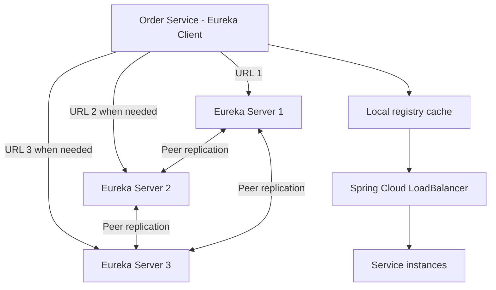

# Configuring Multiple Eureka Addresses on the Client Side

## 1. Why Does a Eureka Client Need Multiple Server Addresses?

A Eureka Client needs to know the Eureka Server address to register an instance, send heartbeats, deregister, and download the service registry. If the client configures only a single server, that server becomes a direct point of dependency: when the server or the network path to it fails, the client may fail to update the registry.

In a Eureka cluster, there are usually multiple Eureka Server peers. A client can be configured with multiple URLs to have additional connection endpoints when one node becomes unreachable. The commonly used Spring Cloud property is `eureka.client.service-url.defaultZone` in YAML or `eureka.client.serviceUrl.defaultZone` in properties.

Multiple URLs on the client side only provide a list of endpoints for the Eureka Client to connect to. They do not create a Eureka cluster on their own, do not configure replication between servers, and do not guarantee that every request is evenly distributed like a load balancer. The servers must have proper peer replication configured if they serve the same logical registry.

## 2. Single-Address vs. Multi-Address Configuration

### 2.1. One Eureka Server URL

For development environments or clusters with a single endpoint, a simple configuration can look like:

```yaml
spring:
  application:
    name: order-service

eureka:
  client:
    service-url:
      defaultZone: http://eureka-server:8761/eureka/
    register-with-eureka: true
    fetch-registry: true
```

`defaultZone` is a key in the `service-url` map. The URL value must point to the Eureka REST API reachable by the client, typically ending with `/eureka/`. Port `8761` is a common default for Eureka Server, though it can vary by deployment configuration.

### 2.2. Multiple URLs in the Same Zone

To declare multiple Eureka Server URLs for the same zone, list the URLs separated by commas:

```yaml
eureka:
  client:
    service-url:
      defaultZone: "http://eureka-1.internal:8761/eureka/,http://eureka-2.internal:8761/eureka/,http://eureka-3.internal:8761/eureka/"
    register-with-eureka: true
    fetch-registry: true
```

In this configuration, the client has three endpoints to connect to. The endpoints should be peers belonging to the same Eureka cluster capable of exchanging registry state with each other. If one URL is unreachable, the Eureka Client has mechanisms to select another endpoint and retry according to its configuration and version; do not assume the attempt order or request distribution is always fixed.

You can use properties instead of YAML:

```properties
spring.application.name=order-service
eureka.client.serviceUrl.defaultZone=http://eureka-1.internal:8761/eureka/,http://eureka-2.internal:8761/eureka/,http://eureka-3.internal:8761/eureka/
eureka.client.register-with-eureka=true
eureka.client.fetch-registry=true
```

In YAML, wrap the URL list in quotes to make clear it is a comma-separated string. Do not format each URL as a YAML list item if the config binder/version in use expects `defaultZone` to be a string value.

### 2.3. Case Sensitivity in `defaultZone`

`service-url` can be written in kebab-case thanks to Spring Boot's relaxed binding, but `defaultZone` is a map key and must keep the uppercase `Z`:

```yaml
eureka:
  client:
    service-url:
      defaultZone: "http://eureka-1:8761/eureka/,http://eureka-2:8761/eureka/"
```

Do not change it to `defaultzone` or `default-zone`. When using properties files, the common form is `eureka.client.serviceUrl.defaultZone`.

## 3. Meaning of `defaultZone` and Client Flags

`defaultZone` is the list of server URLs associated with the default zone that the client uses when no matching zone-specific configuration is provided. It is not a service name and does not determine whether the application registers or fetches the registry.

| Property | Role |
|---|---|
| `eureka.client.service-url.defaultZone` | List of Eureka Server URLs in the default zone |
| `eureka.client.register-with-eureka` | Enables/disables registering the application's instance with Eureka |
| `eureka.client.fetch-registry` | Enables/disables downloading the registry to discover other services |
| `eureka.client.registry-fetch-interval-seconds` | Interval between client refreshes of the registry cache |
| `eureka.client.region` | Region the Eureka Client is configured to use |
| `eureka.client.availability-zones` | List of zones declared per region |

In a typical microservice, both `register-with-eureka` and `fetch-registry` are enabled: the service publishes its own instance while discovering other services. A consumer that only needs discovery can disable registration; a service that only needs to be registered can disable registry fetching if it does not look up other services.

Having multiple URLs in `defaultZone` does not change these two flags. If `register-with-eureka` is disabled, the client will not register merely because multiple servers are declared. If `fetch-registry` is disabled, the client will not download the instance list merely because server endpoints are active.

## 4. How Does Eureka Client Use Multiple URLs?

When given multiple URLs, Eureka Client uses the configured endpoint list to perform operations against Eureka Server. The exact endpoint selection, retry, and failover behavior depends on the Eureka Client implementation and version.

What to understand at an operational level:

1. The client may try an endpoint from the list to execute a request.
2. If that endpoint is unreachable or the request fails, the client may try another endpoint according to its internal policy and retry configuration.
3. Once connectivity is restored, the client resumes sending heartbeats, registrations, or registry fetches according to its lifecycle.
4. If all endpoints are unreachable, registration and registry update operations are interrupted. The client may still hold a previously downloaded cache, though that cache may become stale.

Do not treat the URL list as a round-robin load balancer for business requests. Eureka Client needs endpoints to communicate with the registry; Spring Cloud LoadBalancer is the component that typically selects target service instances for application requests.

### 4.1. Example When One Eureka Node Fails

Suppose a client is configured with:

```yaml
eureka:
  client:
    service-url:
      defaultZone: "http://eureka-1:8761/eureka/,http://eureka-2:8761/eureka/"
```

If `eureka-1` goes down while `eureka-2` remains reachable and both servers are peers with synchronized registries, the client can continue communicating with the surviving node via Eureka Client's endpoint/retry mechanisms. If both servers fail or lose connectivity, the client cannot guarantee new registrations or registry fetches.

Consumers can continue using cached data for a period, but you must account for stale instances, unseen new instances, and unrenewed heartbeats. Applications should have timeouts, bounded retries, and error handling when calling services.

### 4.2. A URL List Does Not Replace Peer Replication

Suppose both `eureka-1` and `eureka-2` are running, but replication is not configured between them. A client may connect to either one, yet each node may hold a different registry. If clients register with or fetch from nodes with diverging data, discovery results can become inconsistent.

Therefore, you must configure the Eureka Server cluster so peers know each other and replication is active. The client-side URL list only tells the client which endpoints it can connect to; it does not synchronize data between servers.

## 5. Configuring Regions and Availability Zones

For multi-zone deployments, Eureka Client can be configured with a region and availability zones to identify the appropriate group of Eureka Servers. `region` defines the logical region; `availability-zones` declares the zones belonging to the region; `service-url` maps each zone to a list of Eureka Server URLs.

Illustrative example for one region with two zones:

```yaml
eureka:
  client:
    region: ap-southeast-1
    availability-zones:
      ap-southeast-1: az-a,az-b
    service-url:
      az-a: "http://eureka-a.internal:8761/eureka/"
      az-b: "http://eureka-b.internal:8761/eureka/"
      defaultZone: "http://eureka-default.internal:8761/eureka/"
```

Region and zone names must be consistent with the topology and Eureka Server configuration. Each zone can have one or more URLs depending on the architecture. `defaultZone` acts as the default/fallback zone in client configuration; do not rely on it as a workaround for misconfigured zone names.

For systems with a single region and one server group, configuring multiple URLs in `defaultZone` is usually sufficient. Add regions/availability zones only when you need discovery routing across a multi-zone topology and have clearly defined how servers exchange registry data.

## 6. Environment-Specific Endpoint Configuration

URLs typically differ between local, test, and production environments. You can supply the URL list via an environment variable:

```yaml
eureka:
  client:
    service-url:
      defaultZone: "${EUREKA_SERVER_URLS:http://localhost:8761/eureka/}"
    register-with-eureka: true
    fetch-registry: true
```

Example environment variable value in production:

```text
EUREKA_SERVER_URLS=http://eureka-1.internal:8761/eureka/,http://eureka-2.internal:8761/eureka/
```

Ensure the environment variable is passed into the container or process properly and is not split on commas into another structure by a shell, YAML parser, or deployment tool. In production, avoid inadvertently falling back to the `localhost` default.

### 6.1. URLs Must Be Reachable from the Client

Every URL in the list must be reachable from the application's network:

- If the client runs in Docker, `localhost` refers to the client container itself. Use the DNS/service name of the Eureka Server on the same Docker network.
- If the client runs on Kubernetes, use a DNS/service endpoint resolvable from the namespace with network policies permitting the connection.
- If the client runs on another machine, use a hostname or IP routable to the server with the proper port open.
- If using HTTPS, verify certificates, SAN hostnames, and the JVM truststore for each endpoint.

Do not test only the first URL. A backup URL with wrong DNS, wrong port, wrong context path, or invalid certificate will fail to provide failover when the primary node goes down.

### 6.2. Security Must Be Consistent Across URLs

If Eureka Server requires authentication or TLS, every endpoint in the list must follow compatible settings. Verify that:

- All servers use the configured HTTP/HTTPS protocol consistently.
- The client trusts each server's certificate chain and the hostname matches the certificate.
- Credentials and permissions allow the client to register, send heartbeats, and fetch the registry.
- Firewalls/network policies allow the client to reach backup nodes, not just the primary node.

Do not write usernames, passwords, tokens, or private keys directly into configuration files committed to a repository. Use secret/configuration management appropriate for the deployment environment.

## 7. Complete Configuration Example for a Microservice

Suppose `order-service` runs in an internal network with two Eureka Server peers. Client configuration can look like:

```yaml
spring:
  application:
    name: order-service

server:
  port: 8081

eureka:
  client:
    service-url:
      defaultZone: "${EUREKA_SERVER_URLS:http://eureka-1.internal:8761/eureka/,http://eureka-2.internal:8761/eureka/}"
    register-with-eureka: true
    fetch-registry: true
    registry-fetch-interval-seconds: 30
  instance:
    instance-id: ${spring.application.name}:${server.port}
    prefer-ip-address: true
```

In this example:

- `spring.application.name` defines the service ID.
- `defaultZone` provides two Eureka Server URLs.
- `register-with-eureka` enables instance registration and lease renewal.
- `fetch-registry` enables downloading the service list for discovery.
- `registry-fetch-interval-seconds` controls the registry cache refresh interval.
- `instance-id` distinguishes instances; in multi-host deployments using the same port, include a hostname or unique identifier.
- `prefer-ip-address` advertises the IP address instead of hostname; the IP must be reachable from consumers.

## 8. Verifying Multi-URL Configuration

After the application starts, verify from configuration through to actual runtime behavior:

1. Confirm the effective value of `eureka.client.serviceUrl.defaultZone` after applying profiles and environment variables.
2. Check that each URL has the correct scheme, hostname, port, and `/eureka/` context path.
3. From the client runtime environment, test DNS resolution and TCP connectivity to each server.
4. Confirm each URL points to a peer belonging to the same registry cluster, or follows an explicit multi-region design.
5. Check Eureka Client logs to see which endpoints are used and any connection/retry errors.
6. Check the Eureka dashboard/API on each peer to confirm the registry is replicated.
7. Shut down one node in a test environment and observe the client continuing to connect, send heartbeats, and fetch the registry through the remaining node.
8. Restore the node and verify the registry converges without creating duplicate instances or lingering stale state.

You can test each Eureka API endpoint with `curl` from the client's actual network:

```bash
curl -i http://eureka-1.internal:8761/eureka/apps
curl -i http://eureka-2.internal:8761/eureka/apps
```

If using HTTPS or authentication, add the appropriate options to verify certificates/credentials. Reachability from your laptop does not prove that a container or pod has the same DNS, routing, and access permissions.

### 8.1. Common Error Symptoms

| Symptom | Possible Cause | Resolution |
|---|---|---|
| Client connects only to the first URL | Remaining URLs have wrong DNS, port, or network policy | Test each endpoint from the client's runtime environment |
| `UnknownHostException` | Hostname cannot be resolved | Fix DNS/service name or hostname configuration |
| `Connection refused` | Server is not listening or wrong port | Check the process, port mapping, and firewall |
| HTTP `404` | Wrong context path or base URL | Verify `/eureka/` and the server context path |
| TLS handshake error | Untrusted certificate or hostname mismatch | Check CA, SAN, and JVM truststore |
| Servers show different registries | Peer replication is unconfigured or failing | Check peer URLs and replication on Eureka Server |
| Client cannot find new service | Cache not fetched yet or registry not converged | Check fetch interval, connectivity, and service status |
| Old instance still appears | Heartbeat/eviction, self-preservation, or stale cache | Check leases, server logs, and registry cache |

## 9. What Multi-URL Configuration Does Not Solve

Multiple URLs on the client side expand the endpoints a client can connect to, but they do not by themselves solve the following problems:

- **Peer replication:** must be configured on Eureka Servers so nodes synchronize the registry.
- **Business request load balancing:** use Spring Cloud LoadBalancer or corresponding infrastructure to select target service instances.
- **Application health checks:** heartbeats prove the client can still talk to Eureka; they do not guarantee business dependencies are healthy.
- **Instantaneous consistency:** replication and registry caches can introduce delay.
- **Network partitions:** when peers cannot communicate, data across nodes may temporarily diverge; topology design and stale-data handling are required.
- **Security:** each endpoint must be protected and accessed with proper permissions; adding URLs does not automatically configure TLS/ACLs.

## 10. Diagram of Client Connections to Multiple Eureka Servers



The arrows from client to servers represent endpoints the client can use according to Eureka Client's mechanism; they do not mean every request is sent simultaneously to all servers. The peer arrows represent replication, which must be configured separately on the Eureka Servers.

## 11. Implementation Checklist

- [ ] URLs use valid syntax and preserve the `defaultZone` key.
- [ ] Each URL points to the Eureka API with the right context path.
- [ ] All endpoints are reachable from the client's network.
- [ ] Servers in the same list belong to the same registry cluster or follow a clear region/zone design.
- [ ] Peer replication is configured and verified.
- [ ] `register-with-eureka` and `fetch-registry` are enabled/disabled according to the service's role.
- [ ] TLS, certificates, authentication, and firewalls are consistent across all endpoints.
- [ ] Single-node failure, node recovery, and registry convergence have been tested.
- [ ] Logs/metrics exist to observe retries, connection errors, and registry update lag.

## 12. Conclusion

To configure multiple Eureka addresses on the client side, declare a comma-separated list of URLs in `eureka.client.service-url.defaultZone`. The URLs must point to Eureka Server endpoints reachable from the client and generally belong to the same peer cluster configured for replication.

A multi-URL list improves the client's ability to keep communicating with the registry when one endpoint fails, but it does not replace peer replication, health checks, or load balancing. Verify every URL, configure zones if needed, and test failure modes from the actual deployment network before going to production.
