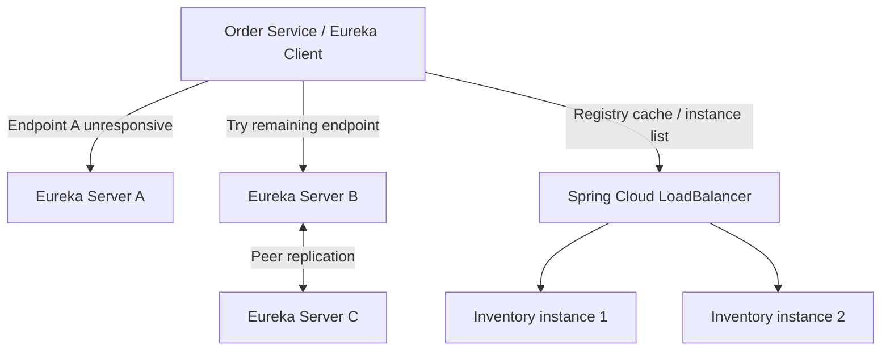
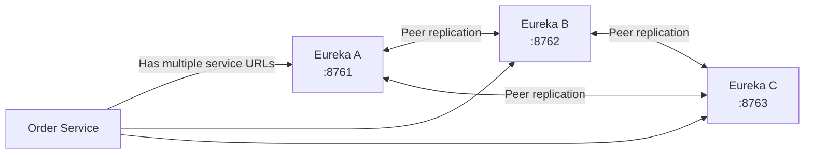
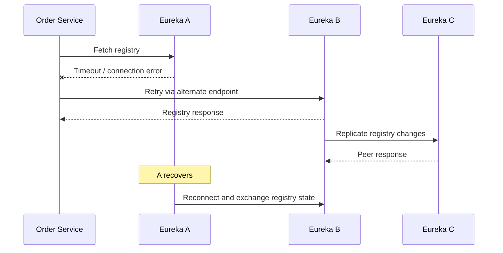

# Failing Over to Another Server When a Peer Loses Connectivity

In a Eureka cluster, a server may become temporarily unreachable because the process stopped, the network was disrupted, or the peer is overloaded. Applications can continue registering and looking up services if they know the remaining Eureka Servers and the Eureka Client can fail over to another endpoint. However, client endpoint failover, peer registry replication between servers, and LoadBalancer instance selection are three distinct mechanisms.

For failover to work, multiple Eureka Server addresses must be configured on both the client application side and the peer server side. Surviving nodes must continue serving the registry; peer replication must resume when connectivity returns; and consumers must handle registry cache data that may be stale during the outage.

## Three Layers to Distinguish

| Mechanism | Responsible Component | What Happens When a Peer Fails? |
|---|---|---|
| Eureka endpoint failover | Eureka Client in the application | The client tries or selects another configured Eureka URL when the current endpoint is unreachable |
| Peer replication | Eureka Servers | Connected nodes continue exchanging registry changes; an isolated node may temporarily hold different data |
| Service load balancing | Spring Cloud LoadBalancer | Selects an instance of `inventory-service` or another service from the instance list the consumer currently has |

For example, `order-service` is configured to connect to `eureka-a` and `eureka-b`. If `eureka-a` stops, Eureka Client can route registry requests to `eureka-b`. Then `order-service`'s LoadBalancer selects an `inventory-service` instance from the registry the client downloaded.



LoadBalancer does not switch Eureka Client from server A to server B by itself. It chooses service instances; Eureka Client is responsible for communicating with registry endpoints.

## Configuring Multiple Eureka Servers for a Client Application

Client applications should know multiple available Eureka Server addresses rather than only a single node. With Spring Cloud Netflix, you can declare the URL list in `eureka.client.service-url.defaultZone`.

```yaml
spring:
  application:
    name: order-service

eureka:
  client:
    register-with-eureka: true
    fetch-registry: true
    service-url:
      defaultZone: "http://eureka-a:8761/eureka/,http://eureka-b:8762/eureka/,http://eureka-c:8763/eureka/"
```

In this example:

- `register-with-eureka: true` lets `order-service` register its own instance.
- `fetch-registry: true` lets the client download the application and instance list.
- `defaultZone` contains multiple endpoints so the client has alternatives when one server is unreachable.
- Hostnames must be resolvable from `order-service`'s runtime environment; ports and context paths must match each Eureka Server.

`defaultZone` is a special configuration key name in the `service-url` map; keep this exact casing in YAML. The URL list is typically comma-separated. Selection order, retries, and endpoint switching timing depend on the Eureka Client version and timeout/retry configuration, so do not assume failover is instantaneous or always follows a fixed order in the string.

If an application is a consumer only, you can set `register-with-eureka: false` while keeping `fetch-registry: true`. That does not change the principle of configuring multiple endpoints.

## Configuring Peers So Eureka Servers Exchange Registries

Declaring multiple URLs for a client application helps the client reach surviving servers, but it is not enough for independent registries to synchronize with one another. When deploying Eureka in a peer-aware model, each server must also declare the remaining peers in `service-url.defaultZone`.

Example three-node cluster:

| Running Node | Hostname / Port | Configured Peer URLs |
|---|---|---|
| `eureka-a` | `eureka-a:8761` | `eureka-b:8762`, `eureka-c:8763` |
| `eureka-b` | `eureka-b:8762` | `eureka-a:8761`, `eureka-c:8763` |
| `eureka-c` | `eureka-c:8763` | `eureka-a:8761`, `eureka-b:8762` |

Example configuration for node A:

```yaml
server:
  port: 8761

spring:
  application:
    name: eureka-server

eureka:
  instance:
    hostname: eureka-a
  client:
    register-with-eureka: true
    fetch-registry: true
    service-url:
      defaultZone: "http://eureka-b:8762/eureka/,http://eureka-c:8763/eureka/"
```

Nodes B and C use the same structure, replacing `hostname`, `port`, and the peer list so each node points to the remaining nodes. Do not include the node's own URL in its peer list. In Docker or Kubernetes environments, use a DNS/service name resolvable across containers or pods; `localhost` points only to the current process's own network namespace.



Peer-aware nodes typically enable both `register-with-eureka` and `fetch-registry` to participate in registry exchange. These two properties control the Eureka Client embedded inside each server; they do not replace accurate `defaultZone` configuration and network connectivity between peers.

## What Happens When a Peer Loses Connectivity?

Suppose `eureka-a` stops while `eureka-b` and `eureka-c` keep running:

1. A client sending requests to A may encounter timeouts or connection errors.
2. Eureka Client uses the other declared endpoints to retry or route registry requests to B/C according to the endpoint selection mechanism of the version in use.
3. Clients able to reach B/C continue fetching the registry from surviving nodes and sending heartbeats/registrations through available endpoints.
4. B/C continue serving their local registries and exchanging changes with one another.
5. When A restarts, it needs to reconnect to peers and synchronize state per Eureka's mechanisms; inspect the registry on each node rather than assuming all data converges instantaneously.



This is a conceptual flow. Specific retry timing, attempt counts, and endpoint selection depend on the Eureka Client version, HTTP transport, timeouts, and retry configuration.

## Failover Does Not Mean Immediate Registry Synchronization

Eureka peer replication is a registry exchange mechanism between nodes, not a quorum-based consensus protocol like some other distributed storage systems. When a peer is network-isolated, surviving nodes can continue serving clients they can reach, but registry state across sides may temporarily differ.

This leads to several situations:

- A provider registers through node B while A is isolated; A may not see the new record yet.
- An instance stops, yet a node holding its record has not received the deregistration or reached heartbeat timeout.
- A client switches to C and receives a registry view different from its earlier view on A.
- When A recovers, exchange and synchronization take time; during the transition window, different clients may observe different instance lists.

Do not treat a Eureka cluster as a quorum cluster requiring a majority of nodes to stay operational. Surviving, reachable nodes can continue serving independently, while the freshness and consistency of the registry depend on peer connectivity, replication, and caching.

## Clients Can Use the Registry Cache When All Peers Are Temporarily Unreachable

Eureka Client retains a local registry after successful fetches. When registry endpoints temporarily fail, the client can usually keep previously downloaded data in memory for lookups. This allows some internal calls to keep working during an outage.

However, the cache does not replace a live registry:

- New instances registered after the last fetch may not appear in the cache yet.
- Dead instances may remain in the cache and continue to be selected for requests.
- Metadata or health status changes may not be visible to consumers yet.
- If an application starts when no registry endpoint is available, whether a usable cache exists depends on initialization state and client version.

Therefore, treat the cache as best-known recent data that may be stale. Applications must still configure timeouts, connection error handling, bounded retries, and circuit breakers where appropriate. If Spring Cloud LoadBalancer maintains its own cache, factor that cache's TTL into how long stale data can still be used.

## Distinguishing Server Failover from Service Instance Failover

| Scenario | Related Mechanism | How to Handle |
|---|---|---|
| Eureka A is unreachable | Eureka Client endpoint failover | Client tries configured URL B/C |
| Peer A loses connectivity to B | Peer replication | Restore network and verify registry sync after reconnect |
| `inventory-service` instance 1 dies | Service discovery + LoadBalancer | Registry updates the record; LoadBalancer picks an available instance after the list refreshes |
| All Eureka Servers are unreachable | Registry outage and local cache | Use most recent data if available while bounding errors and waiting for registry recovery |
| Client configured only one Eureka URL and it dies | No client-side fallback endpoint | Add reachable URLs or use a stable endpoint with health checks |

Do not confuse switching to another Eureka Server with routing requests to another provider instance. The first is discovery control-plane failover; the second is target selection for business requests.

## Intentional Timeout and Retry Configuration

Failover does not happen the instant the first socket encounters an issue if the client still has to wait for a connect timeout or read timeout. Total endpoint switchover time may include:

1. Time waiting to connect to the current endpoint.
2. Time waiting for a response or detecting a read error.
3. Backoff/retry according to client configuration.
4. Time connecting to the fallback endpoint and receiving a response.

Do not set timeouts too long, or registry requests may block for a long time when a peer is dead. Nor should you set them too short, or brief network slowness may be mistaken for a dead peer. Choose timeouts based on inter-node network latency, retry counts, and recovery time objectives.

Configuration principles:

- Declare enough Eureka endpoints reachable from each application.
- Ensure URLs use the right scheme, host, port, context path, and credentials.
- Set connect/read timeouts and retries according to the capabilities of your Eureka Client version.
- Avoid unbounded retries or simultaneous retry bursts right as a server recovers.
- Track the time from the first endpoint failure to the next successful fetch/register on an alternate endpoint.

Do not copy timeout property names from a different Netflix Eureka version without checking the binding supported by your Spring Cloud Netflix version. Transport property names and configuration options can change across release trains.

## Using DNS or a Load Balancer in Front of Eureka Servers

Another option is to provide a stable DNS name or virtual IP pointing to multiple Eureka Servers. In that model, the external DNS/load balancer layer is responsible for removing unhealthy backends and routing connections to surviving nodes.

| Connection Approach | Advantages | What Must Be Managed |
|---|---|---|
| Client declares multiple peer URLs | Eureka Client knows fallback endpoints directly | URL lists, per-peer DNS, timeouts, and retries |
| Client calls a single DNS/VIP/load balancer | Stable application endpoint, centralized backend changes | Health checks, connection draining, TLS, and load balancer config |

Do not simply create a DNS name pointing randomly at servers without proper health checks. DNS caches or load balancers may keep returning dead backends if health check and refresh settings are misconfigured. When using TLS, the certificate must be valid for the hostname the client calls.

## Verifying Failover in a Test Environment

You can test with three peer-aware Eureka Servers and a service client:

1. Start `eureka-a`, `eureka-b`, and `eureka-c` with bidirectional peer URL configurations.
2. Start `inventory-service` and `order-service`; configure both with multiple Eureka endpoints.
3. Confirm the provider registers and appears on each node's dashboard/API.
4. Stop `eureka-a` or block client traffic to A.
5. Observe Eureka Client logs: connection errors, retries, and successful requests to B/C.
6. Call `DiscoveryClient.getInstances("inventory-service")` and inspect the returned list.
7. Send requests through a `@LoadBalanced` HTTP client; confirm LoadBalancer selects a valid provider instance.
8. Restart A, wait for peers to reconnect, and compare registries on A/B/C.
9. Repeat with a network partition between A and B while both processes keep running.

Expected outcomes:

- When one endpoint fails, a client with alternate URLs can continue fetching or registering through a reachable node after retry intervals.
- Connected peers continue serving the registry and exchanging changes with one another.
- When the peer recovers, the registry gradually converges; observe and verify rather than assuming instantaneous updates.
- If all endpoints fail, applications may still have stale cached data but will not receive fresh updates.

## Observation and Diagnostics

When testing failover, observe the client, servers, and providers together:

- **Client logs:** endpoint being called, DNS/connect/read timeout errors, retries, and the next successful fetch/register.
- **Peer logs:** inter-server connections, replication errors, peer reconnect timestamps, and registry discrepancy warnings.
- **Registry view:** application/instance counts on each node's dashboard or REST API.
- **Consumer cache:** timestamp of the last registry fetch, current instance count, and when LoadBalancer cache refreshes.
- **Request metrics:** error rate, latency, timeouts, and target instances after failover.

You can inspect each node's registry via the Eureka endpoint in a local environment:

```bash
curl -H "Accept: application/json" http://eureka-a:8761/eureka/apps
curl -H "Accept: application/json" http://eureka-b:8762/eureka/apps
curl -H "Accept: application/json" http://eureka-c:8763/eureka/apps
```

Run these commands from an environment that can resolve and reach those hostnames. If the registry is protected by authentication or TLS, provide credentials securely; do not expose credentials in shell history or logs.

## Common Issues

| Symptom | Possible Cause | Resolution |
|---|---|---|
| Client does not fail over to another peer | Only one URL configured or fallback URLs are unreachable | Declare multiple endpoints and test DNS/network for each endpoint |
| Client switches peers but misses new service | Peer's registry view has not received replication yet | Check peer URLs, replication, and convergence time |
| Client still calls a dead instance | Registry cache or LoadBalancer cache is still stale | Check fetch interval, supplier cache, and request timeouts/retries |
| Two servers show different registries | Peer link disrupted or replication incomplete | Restore connectivity and monitor post-reconnect synchronization |
| Failover takes too long | Connect/read timeout or retry/backoff too large | Measure each wait interval and tune to actual network conditions |
| Client fails to register after failover | Fallback endpoint has wrong URL, auth, or rejects requests | Check context path, TLS, credentials, and server logs |
| DNS still returns dead node | DNS TTL or load balancer health check not updated | Check TTL, backend health, and connection draining |
| Only some clients are affected | Clients have different endpoint lists or caches | Compare runtime config, active profiles, and fetch timestamps |

## Security When Configuring Multiple Endpoints

When adding multiple Eureka URLs, every endpoint must enforce the same authentication and encryption policy. Do not leave a fallback URL using unencrypted HTTP while the primary URL uses HTTPS. If peers require Basic Auth or another authentication mechanism, ensure credentials are managed via a secret store and not embedded directly in the repository.

Restrict access to the Eureka dashboard and REST API to management networks or authorized workloads. Peer replication requires inter-node connectivity, which does not mean every application should be permitted to access administrative endpoints. Monitor logs and metrics without leaking credentials or sensitive information.

## Implementation Checklist

1. Deploy at least two Eureka Servers if single-node fault tolerance is needed; clearly define peers and stable hostnames.
2. Configure each server to point to remaining peers using `service-url.defaultZone`.
3. For peer-aware servers, enable `register-with-eureka` and `fetch-registry` according to the chosen topology.
4. Configure each Eureka Client with multiple reachable server endpoints or a health-checked DNS/VIP.
5. Verify clients can reach every endpoint from the actual network namespace.
6. Standardize context paths, TLS, authentication, and credentials across endpoints.
7. Set appropriate timeouts/retries and avoid retry storms.
8. Monitor registry fetches, peer replication, registry size, and LoadBalancer cache.
9. Test node death, peer partitions, full registry outages, and node recovery.
10. Verify registry views converge after reconnect and requests stop selecting stale instances once caches refresh.

## Conclusion

For an application to fail over to another Eureka Server when a peer loses connectivity, configure multiple registry URLs for the Eureka Client and configure peer servers to exchange registries with each other. Client endpoint failover helps applications reach surviving nodes; peer replication keeps registries updated; and LoadBalancer selects service instances from the discovery data held by the consumer. Each of these three layers has its own latency and limitations. Test both node failures and network partitions, observe caches and replication, and configure timeouts, retries, DNS, and security across all endpoints.
