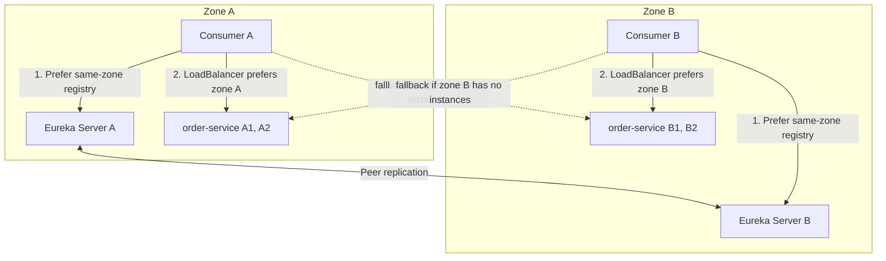

# Exploring Same-Zone Preference and the Scope of Load Balancing

In a system deployed across multiple availability zones, instances of the same service may reside in different zones. A consumer in `zone-a` should generally call an instance in `zone-a` first to reduce latency and cross-zone traffic. When the local zone has no suitable instances left, the system may need to fail over to another zone to continue serving.

Eureka and Spring Cloud support this locality at two separate layers: Eureka Client can prefer connecting to a Eureka Server in the same zone to fetch the registry; Spring Cloud LoadBalancer can prefer selecting service instances in the same zone for each call. These two mechanisms are often used together, yet they have different scopes and configurations. This lesson clarifies regions, zones, metadata declaration, LoadBalancer configuration, and the limits of a same-zone preference strategy.

## 1. Regions and Availability Zones

A **region** is a broad deployment area that may contain multiple infrastructure-independent **availability zones**. For example:

```text
Region: ap-southeast-1
  zone-a
    Eureka Server A
    order-service instance A1, A2
    payment-service instance A1
  zone-b
    Eureka Server B
    order-service instance B1, B2
    payment-service instance B1
```

In this example, instances provide the same `order-service`, but are placed across two zones. A consumer in `zone-a` can prefer `order-service` in `zone-a`; a consumer in `zone-b` can prefer instances in `zone-b`.

The names `region`, `zone-a`, and `zone-b` are only examples. Zone names must be consistent across client configuration, instance metadata, and deployment infrastructure. Eureka does not automatically infer topology details from service names; applications or the deployment environment must provide the appropriate zone information.

## 2. Two Layers of Same-Zone Preference to Distinguish

There are two different decisions in the discovery flow:

1. **Which Eureka Server does Eureka Client connect to:** `eureka.client.prefer-same-zone-eureka` helps the client prefer a registry server in the same zone. The goal is to reduce latency when registering, sending heartbeats, and fetching the registry.
2. **Which service instance does LoadBalancer call:** `ZonePreferenceServiceInstanceListSupplier` filters the instance list to prefer instances whose `zone` metadata matches the consumer's zone.

Overall diagram:



`prefer-same-zone-eureka` is not an algorithm for picking an `order-service` instance. Conversely, LoadBalancer's zone preference does not decide which Eureka Server peer Eureka Client fetches the registry from. Configure both layers properly if you want both nearby registry access and nearby service calls.

## 3. Declaring Zones for Eureka Client and Eureka Server

### 3.1. Attaching Zone to Instance Metadata

Each application registering with Eureka should declare its own zone in metadata:

```yaml
spring:
  application:
    name: order-service

eureka:
  instance:
    metadata-map:
      zone: ${APP_ZONE:zone-a}
```

Eureka stores this metadata alongside the registration and provides it to clients when they fetch the registry. Instances in `zone-a` declare `APP_ZONE=zone-a`; instances in `zone-b` declare `APP_ZONE=zone-b`.

Metadata is descriptive data. Adding `metadata-map.zone` alone does not automatically enable zone filtering for calls; LoadBalancer must be configured with zone preference as shown later. If using a registry other than Eureka, declare `spring.cloud.loadbalancer.zone` or the equivalent mechanism to specify the consumer's zone.

### 3.2. Declaring Region, Availability Zones, and Eureka Server URLs

Eureka Client can be configured to know its region and the zones within that region. Example for two zones:

```yaml
eureka:
  client:
    region: ap-southeast-1
    availability-zones:
      ap-southeast-1:
        - zone-a
        - zone-b
    service-url:
      zone-a: http://eureka-zone-a:8761/eureka/
      zone-b: http://eureka-zone-b:8761/eureka/
    prefer-same-zone-eureka: true
  instance:
    metadata-map:
      zone: ${APP_ZONE:zone-a}
```

Meaning:

- `eureka.client.region` specifies the region to which the client belongs. The Netflix-compatible default is typically `us-east-1`; explicitly declare the real region in multi-zone systems.
- `availability-zones` maps a region to the list of zones in that region.
- `service-url` maps each zone name to the reachable Eureka Server URL in that zone.
- `prefer-same-zone-eureka: true` tells the client to prefer a same-zone Eureka Server when selecting a registry endpoint.
- `metadata-map.zone` describes the zone of the service instance itself.

In this example, the same configuration can serve as a baseline; each deployment's profile or environment variable sets `APP_ZONE` to `zone-a` or `zone-b`. Ensure the corresponding peer URLs actually exist and are reachable from the client.

### 3.3. Eureka Servers Must Synchronize Across Zones

If Eureka Servers are deployed in multiple zones, the servers must be configured as peer-aware to exchange registrations. Clients in zone A can fetch the registry from server A, while consumers in zone B fetch the registry from server B. If the two servers are not synchronized, each zone may see a different set of instances.

Abbreviated peer configuration example for two servers:

```yaml
# Eureka Server A
eureka:
  client:
    service-url:
      defaultZone: http://eureka-zone-b:8761/eureka/
```

```yaml
# Eureka Server B
eureka:
  client:
    service-url:
      defaultZone: http://eureka-zone-a:8761/eureka/
```

In production, configure all peers per your topology and verify bidirectional connectivity. Each Eureka Server has its own registry/cache; peer replication lets them exchange registration state. Same-zone preference does not replace peer replication and does not create high availability if a zone has only one server.

## 4. Configuring Same-Zone Eureka Server Preference

Property:

```yaml
eureka:
  client:
    prefer-same-zone-eureka: true
```

This property controls how Eureka Client prioritizes Eureka Server endpoints within its own zone. The modern default is typically `true`; still check the configuration of your release train.

This is registry endpoint selection. It helps clients reduce cross-zone traffic when talking to Eureka, but it does not guarantee every service request will go to a same-zone instance. To prefer same-zone application instances, you also need a zone-aware LoadBalancer.

If no Eureka Server is available in the local zone, the client may have to use another endpoint from the configured zone list and URLs. Therefore, declare valid fallback URLs and test behavior when a server or an entire zone loses connectivity.

## 5. Preferring Same-Zone Service Instances with Spring Cloud LoadBalancer

Spring Cloud LoadBalancer provides `ZonePreferenceServiceInstanceListSupplier`. This supplier takes the list of `ServiceInstance` objects from DiscoveryClient and filters by `zone` metadata:

- If the consumer's zone can be determined and same-zone instances exist, the supplier returns the list of same-zone instances.
- If the consumer's zone cannot be determined, the supplier returns the original list.
- If no instances exist in the same zone, the supplier falls back to the full list of discovered instances.

Thus, zone preference is **preference with fallback**, not a strict isolation policy. When the local zone has no instances, requests can still be sent to another zone.

### 5.1. Configuring the Consumer's Zone

With Eureka Discovery Client, Spring Cloud can read the consumer's zone from `eureka.instance.metadata-map.zone` and use that value for LoadBalancer. You can override it directly with:

```yaml
spring:
  cloud:
    loadbalancer:
      zone: zone-a
```

If no zone is available from metadata or property, Spring Cloud Netflix can approximate it from the region's `eureka.client.availability-zones` setting. The option `spring.cloud.loadbalancer.eureka.approximate-zone-from-hostname` allows using the domain in the hostname as a zone hint; it is typically disabled by default. Do not rely on hostname approximation if your infrastructure can supply the zone explicitly.

With Consul or another discovery implementation, set `spring.cloud.loadbalancer.zone` if the implementation does not automatically supply a zone to LoadBalancer.

### 5.2. Enabling ZonePreferenceServiceInstanceListSupplier

Add the LoadBalancer starter if your current dependencies do not already provide it:

```xml
<dependency>
    <groupId>org.springframework.cloud</groupId>
    <artifactId>spring-cloud-starter-loadbalancer</artifactId>
</dependency>
```

Create a dedicated configuration for the service needing zone preference:

```java
import org.springframework.cloud.loadbalancer.core.ServiceInstanceListSupplier;
import org.springframework.context.ConfigurableApplicationContext;
import org.springframework.context.annotation.Bean;

public class OrderServiceLoadBalancerConfiguration {

    @Bean
    ServiceInstanceListSupplier orderServiceInstanceListSupplier(
            ConfigurableApplicationContext context) {
        return ServiceInstanceListSupplier.builder()
                .withDiscoveryClient()
                .withZonePreference()
                .build(context);
    }
}
```

Bind this configuration to the service ID:

```java
import org.springframework.cloud.loadbalancer.annotation.LoadBalancerClient;
import org.springframework.boot.autoconfigure.SpringBootApplication;

@SpringBootApplication
@LoadBalancerClient(
        name = "order-service",
        configuration = OrderServiceLoadBalancerConfiguration.class
)
public class OrderConsumerApplication {
    // main method
}
```

The `OrderServiceLoadBalancerConfiguration` class should sit outside the application's component scan scope or omit `@Configuration` so the custom bean applies only to the specified service's LoadBalancer context. Supplier composition and caching must match the Spring Cloud version in use. Eureka Discovery Client already caches the registry; do not add LoadBalancer caching on top if it creates two cache layers and prolongs stale data. If your discovery implementation does not cache and you need caching in LoadBalancer, you can add `.withCaching()` right after `.withDiscoveryClient()` and before `.withZonePreference()`.

### 5.3. Calling a Service by Logical Name

Example with a `@LoadBalanced` `RestTemplate`:

```java
@Bean
@LoadBalanced
RestTemplate restTemplate() {
    return new RestTemplate();
}

public String getOrders() {
    return restTemplate.getForObject(
            "http://order-service/api/orders",
            String.class
    );
}
```

Processing flow:

1. The application sends a request to the logical service ID `order-service`.
2. DiscoveryClient fetches the instances known to the Eureka client.
3. Zone preference filters for same-zone instances if available.
4. LoadBalancer selects an instance from the remaining list, for example via round-robin.
5. The HTTP client sends the request to the chosen instance's host/port.

Round-robin or whichever LoadBalancer algorithm is configured chooses only from the list returned by the supplier. Zone preference determines the candidate set; LoadBalancer picks the specific instance within that set.

## 6. Runtime Behavior and Fallback Examples

Suppose a consumer runs in `zone-a` and the registry holds:

| Service instance | Zone metadata | Status |
| --- | --- | --- |
| `order-a1` | `zone-a` | UP |
| `order-a2` | `zone-a` | UP |
| `order-b1` | `zone-b` | UP |
| `order-b2` | `zone-b` | UP |

With zone preference enabled, the initial candidate list for the consumer in `zone-a` contains only `order-a1` and `order-a2`. If neither instance in `zone-a` is present in the available list, the supplier returns `order-b1` and `order-b2` so LoadBalancer can keep selecting.

| Scenario | List Returned by Supplier to `zone-a` Consumer |
| --- | --- |
| Both `zone-a` and `zone-b` instances exist | Only `zone-a` instances |
| No `zone-a` instances left, `zone-b` instances exist | All remaining instances in `zone-b` |
| Consumer zone cannot be determined | Original instance list across all zones |
| Registry returns no instances | Empty list; LoadBalancer has no instance to call |

Fallback keeps the system serving when a zone experiences an outage, though it can increase latency, cross-zone traffic, and data transfer costs. If business requirements strictly forbid cross-zone calls, design a dedicated fail-closed policy and accept request failures when the local zone has no instances left.

## 7. Scope of the Load Balancing Mechanism

Spring Cloud LoadBalancer is a **client-side** mechanism. Each calling application has its own LoadBalancer context per service ID. Configuring zone preference in one consumer does not automatically alter how other consumers select instances.

Zone preference applies only to calls routed through LoadBalancer, such as `@LoadBalanced RestTemplate`, `RestClient`, or a LoadBalancer-integrated `WebClient`. Calls using fixed URLs, HTTP clients without LoadBalancer integration, or requests passing through an external load balancer are not automatically affected by this configuration.

| Component | Scope of Responsibility |
| --- | --- |
| Eureka Server | Stores the registry and exchanges registrations between peers. |
| Eureka Client / DiscoveryClient | Fetches the registry and supplies the `ServiceInstance` list to the application. |
| `prefer-same-zone-eureka` | Prefers a same-zone Eureka Server endpoint for client communication with the registry. |
| `ZonePreferenceServiceInstanceListSupplier` | Filters the service instance list by the consumer's zone and falls back when no same-zone instance exists. |
| Spring Cloud LoadBalancer | Selects an instance from the candidate list and dispatches the consumer's request. |
| Network / ingress / external load balancer | Routes traffic per external network or infrastructure config; not automatically affected by client-side zone preference. |

Therefore, do not conclude that enabling `prefer-same-zone-eureka` automatically routes application requests within the same zone. Nor should you assume that one service's zone preference changes load balancing across the entire system.

## 8. Verifying Locality Configuration

When deploying across multiple zones, verify step by step:

1. Each service instance registers the right `spring.application.name` and `zone` metadata.
2. The consumer has the right zone via metadata or `spring.cloud.loadbalancer.zone`.
3. Eureka Client knows the correct `region`, `availability-zones` list, and Eureka Server URL for each zone.
4. Eureka Servers across zones are peers and can exchange registries.
5. `prefer-same-zone-eureka` is enabled if you want to prefer same-zone registry endpoints.
6. `ZonePreferenceServiceInstanceListSupplier` is configured for the target service ID.
7. Actual calls go through Spring Cloud LoadBalancer rather than fixed URLs.
8. A fallback plan exists when the local zone loses all instances, and cross-zone traffic is monitored.

You can inspect metadata by calling `DiscoveryClient`:

```java
discoveryClient.getInstances("order-service")
        .forEach(instance -> System.out.printf(
                "host=%s port=%d zone=%s%n",
                instance.getHost(),
                instance.getPort(),
                instance.getMetadata().get("zone")
        ));
```

The output confirms whether the registry returns zone metadata. To verify final selection, enable appropriate logging for Spring Cloud LoadBalancer and inspect which host/port receives requests on each instance. Test fallback by temporarily removing same-zone instances from the available list in a test environment.

## 9. Common Issues

| Symptom | Possible Cause | Resolution |
| --- | --- | --- |
| Consumer in `zone-a` calls `zone-b` instances even though `zone-a` has instances | Zone preference supplier not configured, consumer zone missing, or wrong metadata key | Check `ZonePreferenceServiceInstanceListSupplier`, `spring.cloud.loadbalancer.zone`, and metadata key `zone`. |
| Same-zone instances do not appear in the registry | Service registered wrong `metadata-map.zone` or Eureka server peers are out of sync | Check registration metadata and peer replication across Eureka Servers. |
| All instances are returned | Consumer zone is `null`, no zone preference supplier, or no instances match the zone | Verify consumer zone and supplier config; if no local instances exist, returning all is the expected fallback. |
| Consumer cannot connect to same-zone Eureka Server | Wrong zone URL, DNS, firewall, or same-zone server is down | Check `service-url`, `availability-zones`, and peer reachability. |
| Enabled `prefer-same-zone-eureka` but service requests still cross zones | That property only selects the Eureka Server, not service instances | Also configure Spring Cloud LoadBalancer zone preference. |
| After stopping local instances, requests do not fail back/over | Supplier or custom policy filters strictly, or registry has not updated the list yet | Check supplier chain, caches, health status, and fallback policy. |
| Zone changes propagate slowly after deploy | Eureka registry and LoadBalancer have caches; updates are not instantaneous | Check fetch interval, cache TTL, and peer replication; tune deliberately. |

## 10. Production Design Principles

- Use the same zone naming convention across metadata, client config, and infrastructure.
- Place Eureka Servers in the zones to be served and configure peer replication.
- Prefer same-zone registries to minimize latency between clients and Eureka Servers.
- Use LoadBalancer zone preference if you want to prefer same-zone service instances.
- Keep cross-zone fallback when high availability is required; measure latency and cost when fallback occurs.
- Do not use zone metadata as a security mechanism or access boundary. Security segmentation still requires network policies, authentication, and authorization.
- Monitor the ratio of same-zone vs. cross-zone requests, instance call errors, healthy instance counts per zone, and peer status.
- Test single-instance failure, full-zone failure, and loss of connectivity between Eureka peers before deploying to production.

## 11. Takeaways

- A region contains multiple availability zones; zone metadata must be declared consistently for each instance.
- `eureka.client.prefer-same-zone-eureka` prefers a same-zone Eureka Server for registry communication.
- `eureka.instance.metadata-map.zone` supplies an instance's zone; Spring Cloud Netflix can use this metadata to determine the consumer's zone for LoadBalancer.
- `ZonePreferenceServiceInstanceListSupplier` filters for same-zone service instances; if the zone is unknown or no same-zone instances exist, the supplier returns the broader list.
- Zone preference affects only requests routed through Spring Cloud LoadBalancer and applies only within the scope of the configured consumer/service.
- For locality to work properly, you need zone metadata, registry peer replication, a zone-aware supplier, and tested fallback behavior.

## References

- [Spring Cloud Netflix: Zones and Eureka with Spring Cloud LoadBalancer](https://docs.spring.io/spring-cloud-netflix/reference/spring-cloud-netflix.html)
- [Spring Cloud Commons: Zone-Based Load-Balancing](https://docs.spring.io/spring-cloud-commons/reference/spring-cloud-commons/loadbalancer.html)
