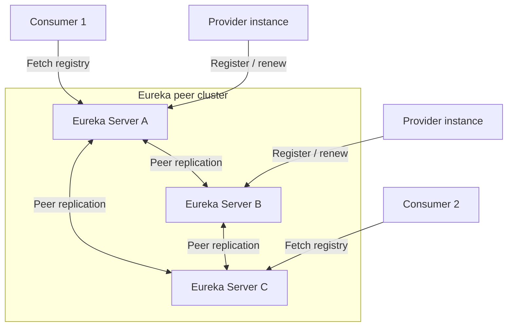
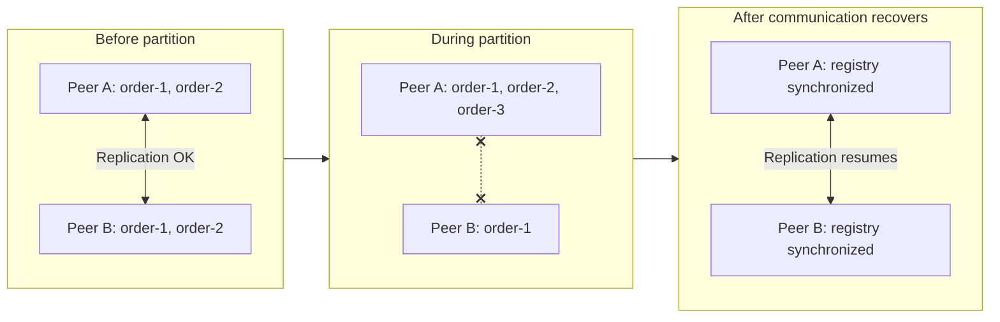

# Network Partitions, Registry Divergence Between Peers, and Convergence

A Eureka cluster typically has multiple Eureka Server peers to increase availability. Peers exchange registration information so providers and consumers can connect to different servers and still discover services. However, peer replication depends on the network. When the link between servers is disrupted, each peer may temporarily hold a different view of the registry.

This phenomenon is called *registry divergence* between peers. One peer may have already received a new instance while another peer does not know about it yet; one peer may still hold an old registration after an instance has stopped; or consumers querying two different peers may receive different instance lists. When the network recovers, replication can propagate the missing changes and registry state gradually converges, but restored network connectivity should not be taken as the sole proof that all data is consistent.

This lesson belongs to the `Eureka Clustering` chapter in the `SPRING_CLOUD_SERVICE_DISCOVERY` module. The module helps learners understand service-name instance lookup via `DiscoveryClient`, `ServiceRegistry`, Eureka or Consul, registration lifecycles, health checks, load balancing, security, and handling registry discrepancies. This lesson focuses on network partitions between Eureka peers, causes of registry divergence, the impact of self-preservation, and how to verify convergence after an incident.

## 1. What Do Peers in a Eureka Cluster Do?

A Eureka Server can operate standalone or join a multi-server cluster. In a peer-aware cluster, each server knows the other peers through service URL configuration. Providers register instances with one server; the server coordinates exchanging registry changes with peers via Eureka's replication mechanism.

Consumers can also connect to any server in the cluster to fetch the application and instance list. Depending on client configuration, a consumer can have multiple Eureka URLs for fallback or access distribution.



Peers are not a single database that multiple servers read from and write to synchronously in a single transaction. Each server maintains its own registry state and exchanges changes with peers. Therefore, distinguish:

- **Peer replication:** transmitting registration information and changes between Eureka Servers.
- **Client registry fetch:** a Eureka client downloading a snapshot or delta from a server to update its local cache.
- **Client heartbeat:** a provider renewing its lease so the server knows the client is still active.
- **Load balancing:** a consumer or Spring Cloud LoadBalancer selecting an instance for a request after obtaining the discovery list.

These are separate flows. Healthy peer replication does not automatically guarantee a client has refreshed; a successful client refresh does not prove all peers hold identical data.

## 2. What Is a Network Partition?

A network partition occurs when some nodes cannot exchange data with the rest, even though the nodes themselves may still be running. In a Eureka cluster, pinpoint exactly which link is broken because each type of partition produces different symptoms.

### 2.1. Partition Between Eureka Server Peers

For example, server A cannot connect to B and C, while B and C can still communicate with each other. Server A can continue serving clients connected to it, but changes on A are not propagated to the B/C group during the partition.

### 2.2. Partition Between Provider and Eureka Server

The provider is still running but cannot send registrations or heartbeats to the server. The registry may keep the old record for a period; afterward, lease expiration and eviction may handle it depending on configuration and self-preservation state.

### 2.3. Partition Between Consumer and Eureka Server

The consumer cannot download a fresh registry. If the client already has a cache, the application may continue discovering from the latest snapshot depending on the implementation; that data may be stale. If the client just started and has no snapshot yet, discovery capability can be affected more severely.

### 2.4. Partition Between Consumer and Provider

The consumer still sees the instance in the registry but cannot connect to the instance's host/port due to routing, firewalls, DNS, or network policies. This is a data-plane failure; the registry itself may be completely normal.

| Failing Link | Common Symptoms | Layer to Investigate First |
|---|---|---|
| Peer ↔ peer | Dashboards or REST APIs on different peers display different registries. | Peer URLs, DNS, ports, TLS, replication logs. |
| Provider ↔ server | New instance fails to register or heartbeats are missing. | Provider logs, server endpoint, lease, and network path. |
| Consumer ↔ server | Discovery cache is not updated. | `defaultZone`, client refresh, timeouts, and caches. |
| Consumer ↔ provider | Discovery finds the instance, yet requests fail. | Host/port, routing, firewalls, TLS, and health endpoints. |

## 3. Why Does Data Diverge Between Peers?

Suppose a cluster has two peers A and B. Before the incident, both know `ORDER-SERVICE` has instances `order-1` and `order-2`. When the network between A and B is severed:

- A new provider registers `order-3` through A. Peer A knows this instance; B has not received the change.
- `order-2` stops and the provider sends a deregistration to B. Peer B processes the change locally; A does not know yet.
- Consumers reading from A and B may receive two different lists.



Common causes include:

1. **Unreachable peer:** wrong DNS, blocked ports, broken routing, mismatched TLS or authentication.
2. **Failed or slow replication:** change-exchange requests fail, retries have not succeeded, or the server is overloaded.
3. **Clients sending operations to different peers:** providers and consumers do not necessarily use the same peer at all times.
4. **Unrefreshed response cache:** data returned by the API may lag behind the internal registry after changes.
5. **Interrupted heartbeats:** a peer may retain old state because it did not receive renewals or did not meet eviction conditions.
6. **Non-unique instance IDs:** two processes may accidentally register with the same identifier, making updates hard to reconcile and potentially overwriting the same registration.

## 4. Eureka Does Not Use Peer Replication as a Consensus Transaction

When designing a cluster, do not treat Eureka's peer replication as a quorum consensus mechanism guaranteeing that every server commits a change before replying to the provider. Eureka prioritizes availability in service discovery and exchanges changes across peers; during a network partition, peers may temporarily hold differing views.

This means:

- A peer can accept and serve registrations locally even when it cannot contact another peer.
- Consumers connected to different peers can receive different snapshots.
- Do not assume concurrent changes on both sides of a partition will merge according to a business rule your application can rely on.
- When the network recovers, verify that replication has resumed and peers actually see the same set of registrations.

Eureka is not a strongly consistent transactional data store for business state. Do not use the registry to store order state, account balances, or data requiring strict consistency. The registry serves to locate instances; business requests still need timeouts, bounded retries, and target endpoint status checks.

## 5. Role and Limitations of Self-Preservation

Eureka Server tracks heartbeats/renewals from clients. If the renewal count drops abnormally, the cause may be many instances dying at once or a disrupted network between clients and servers. The self-preservation mechanism helps prevent mass removal of registrations when Eureka suspects a widespread network outage.

Self-preservation protects data from premature eviction in certain scenarios, but as a consequence old records may persist longer. For example, a provider has died, yet a peer retains its registration because a widespread drop in heartbeats triggered protection mode on the server.

| Mechanism | Role | Limitation |
|---|---|---|
| Heartbeat/renewal | Signals that the client continues maintaining its lease. | Missing heartbeats can result from a dead process or a broken network. |
| Lease expiration/eviction | Removes registrations no longer renewed per policy. | Detection time is not instantaneous; can be affected by self-preservation. |
| Self-preservation | Throttles mass eviction when renewals drop abnormally. | Can keep stale registrations around longer. |
| Peer replication | Propagates registry changes between servers. | Does not eliminate all lag or divergence during a partition. |

Self-preservation does not repair the network, guarantee peer convergence, or verify business endpoints. Do not turn off this mechanism merely to clear old instances quickly from the Dashboard. First determine whether heartbeats dropped because providers died or because the network path failed.

## 6. Peer Configuration Example and Verification Points

In a two-node cluster, each server typically declares the other peer's address in `eureka.client.service-url.defaultZone`. Illustrative example:

```yaml
# Eureka Server A
server:
  port: 8761

eureka:
  instance:
    hostname: eureka-a.internal
  client:
    register-with-eureka: true
    fetch-registry: true
    service-url:
      defaultZone: http://eureka-b.internal:8762/eureka/
```

```yaml
# Eureka Server B
server:
  port: 8762

eureka:
  instance:
    hostname: eureka-b.internal
  client:
    register-with-eureka: true
    fetch-registry: true
    service-url:
      defaultZone: http://eureka-a.internal:8761/eureka/
```

This is an illustrative configuration for two peers; adjust hostnames, ports, TLS, authentication, and profiles for your actual environment. In multi-peer clusters, each server needs to know the appropriate peers according to topology. Also configure an advertised address that other peers can actually reach; a hostname resolvable only inside one container will not work for nodes on another network.

When checking peer configuration, verify:

- `eureka.instance.hostname` reflects an address resolvable from peers.
- `eureka.client.service-url.defaultZone` points to the right peers, not mistakenly to `localhost` in container or multi-host environments.
- Eureka Server ports and the `/eureka/` path are open under network policies.
- TLS certificates, truststores, and authentication are compatible across peers if enabled.
- Servers are not accidentally using standalone settings (`register-with-eureka: false` and `fetch-registry: false`) when they need to participate in a peer cluster.
- Each node has separate logs and metrics to distinguish local errors from cluster-wide errors.

## 7. Split-Brain and Concurrent Changes on Both Sides

Split-brain in this context describes a situation where peer groups are split into unreachable sides while each side remains active. Providers can continue registering or renewing with peers close to them. As a result, each side can accumulate local changes unknown to the other side.

Example:

| Event | Side A | Side B |
|---|---|---|
| Before partition | `catalog-1=UP`, `catalog-2=UP` | `catalog-1=UP`, `catalog-2=UP` |
| During partition | Adds `catalog-3=UP` | Marks `catalog-2` out of service or loses renewals |
| Consumer query | Sees `catalog-1`, `catalog-2`, `catalog-3` | May see only `catalog-1`, `catalog-2`, or another state depending on local data |
| After network recovers | Receives missing replication changes | Receives missing replication changes |

If the same service instance is registered by two processes with the same instance ID but different addresses or statuses, investigation becomes even harder. Generate an instance ID that is stable for a single process over its lifetime yet unique across running processes. Do not reuse the same ID across multiple concurrent replicas.

Do not assume one side of a partition is always right. Identify the source of events: which process is still running, which provider sent heartbeats, which server received the registration, and when the change occurred. The registry is only a discovery record; the actual state of processes and endpoints must be verified independently.

## 8. Convergence Process After Network Recovery

Once connectivity between peers is restored, replication can resume propagating changes that peers need to learn. Servers gradually update their local registries, and consumers can receive a more consistent list on subsequent fetches.

Convergence does not necessarily occur the instant TCP connectivity reopens. Lag can still remain because:

- Peers need to re-establish connections and process queued or retried replication requests.
- Registrations and statuses must be retransmitted or updated.
- Heartbeats resume renewing leases after providers reconnect.
- Stale leases need to expire or eviction runs per policy.
- Server response caches need to refresh.
- Clients must reach their next registry refresh cycle to receive new data.
- LoadBalancer may have its own cache/supplier that needs to refresh.

```mermaid
sequenceDiagram
    participant A as Eureka peer A
    participant B as Eureka peer B
    participant C as Consumer client

    Note over A,B: Network partitioned; registries may differ
    A->>A: Receives registration X
    B->>B: Keeps old snapshot or receives change Y
    Note over A,B: Peer connectivity restored
    A->>B: Peer replication resumes
    B->>A: Peer replication resumes
    Note over A,B: Peers update local registries
    C->>A: Registry fetch
    A-->>C: Updated snapshot/delta
    C->>C: Updates local cache
```

This is a conceptual model, not a synchronization schedule with a fixed deadline. Convergence time depends on topology, server health, number of registrations, refresh configuration, retries, and the duration of the outage.

### 8.1. Conditions for Stable Convergence

- Peers can communicate bidirectionally according to the configured topology.
- DNS, hostnames, ports, TLS, and authentication have been fixed properly.
- There are no prolonged replication errors or overloaded servers.
- Active providers send renewals, or stopped ones have deregistered cleanly.
- Duplicate instance ID registrations are resolved and no longer occur.
- Clients have refreshed their data after peers synchronized.
- Response caches and LoadBalancer caches no longer serve overly stale snapshots.

### 8.2. When Will It Fail to Converge Automatically?

If peer URLs are wrong, firewalls keep blocking traffic, credentials have expired, a server keeps restarting, or two nodes no longer share the same topology, replication will keep failing. In that case, do not wait indefinitely or assume Eureka will self-heal all data. Address the underlying cause, verify each peer, and follow a controlled recovery procedure.

## 9. Investigation Workflow When Two Peers Display Different Data

Follow this sequence to determine whether the discrepancy lies in peers, clients, or providers:

1. **Capture at the same point in time:** take snapshots or save Dashboard/REST API output from each peer with timestamps, application names, and instance IDs.
2. **Compare the same application:** compare using the same service ID and instance ID; avoid comparing two snapshots taken at different times.
3. **Check peer connectivity:** verify DNS, TCP ports, HTTP paths, TLS, authentication, and replication request logs.
4. **Identify which side received events:** check which peer the provider registered/deregistered with and which peer the client is fetching from.
5. **Check heartbeats:** inspect the latest renewal timestamp and lease state for the relevant instance.
6. **Check self-preservation:** verify whether the server is throttling eviction due to an abnormal drop in renewals.
7. **Check response caches:** compare internal registry data, REST responses, and the Dashboard if discrepancies exist.
8. **Check client fetches:** if peers agree yet a consumer does not see the change, inspect `fetch-registry`, refresh intervals, and full/delta fetch logs.
9. **Check LoadBalancer:** if the discovery client has the new list yet requests still hit old instances, inspect LoadBalancer suppliers/caches and policies.
10. **Assess convergence:** repeat the comparison after replication and refreshes finish; record the time from network recovery until data becomes consistent.

Do not conclude peer replication is broken from a single Dashboard page load. Compare the same data, at the same time, across the relevant nodes; whenever possible, query the REST API on each peer for structured comparison.

## 10. Safe Recovery After a Partition

After an incident, the goal is to return the cluster to a verifiable topology and consistent data. A safe recovery workflow typically includes:

**Step 1 – Restore connectivity.** Fix the DNS, routing, firewall, port, TLS, or credential issue disrupting peer communication. Test bidirectional connectivity from each node.

**Step 2 – Confirm peer health.** Inspect server logs, peer lists, and replication errors. Confirm all nodes use the intended peer URLs and profiles.

**Step 3 – Verify real providers.** Cross-check running processes/containers against registrations. Verify instance IDs, hosts, ports, and latest heartbeats.

**Step 4 – Let lifecycle mechanisms handle valid records.** Running providers should keep renewing; stopped instances should deregister or be removed by lease/eviction. Do not bulk-delete records without verification.

**Step 5 – Compare peers.** Use the Dashboard and REST API on each server to compare applications, instance IDs, statuses, hosts, and metadata.

**Step 6 – Refresh consumers.** Confirm Eureka clients fetch the registry successfully; wait for the refresh interval or use your version's supported refresh mechanism when clearly justified. Check LoadBalancer caches afterward.

**Step 7 – Test actual call paths.** Send requests from consumers to selected instances; verify DNS, ports, health, and connection errors.

**Step 8 – Monitor stability.** Observe heartbeats, replication errors, instance counts, stale records, convergence time, and request failures over a sufficiently long window.

Do not directly edit Eureka's internal data or invoke bulk registration deletion APIs merely to force two Dashboards to match. If administrative intervention is needed, identify the exact instance, enforce access controls, capture before/after evidence, and follow a tested runbook.

## 11. Impact on Consumers and Load Balancing

When two peers hold different lists, two consumers may pick different instances even when calling the same service ID. This can cause:

- Consumer A sees a new instance while consumer B does not yet.
- A consumer keeps selecting a stopped instance because its cache has not refreshed.
- Uneven request distribution while registries diverge.
- Some consumers return connection errors while other consumers continue working.

Spring Cloud LoadBalancer chooses from the instance list supplied by discovery integration at processing time. It cannot select an instance the registry client does not know about yet, nor can it guarantee an instance just selected will stay alive until the request finishes.

To reduce impact:

1. Set sensible connect timeouts and response timeouts.
2. Use bounded retries with backoff, and retry only operations that are safe to retry.
3. Use circuit breakers or fault-isolation mechanisms when dependencies repeatedly fail.
4. Design readiness probes and graceful shutdown so instances drain from traffic cleanly.
5. Monitor cache age and propagation lag from registration changes to consumers.
6. Avoid multi-layer caching without clear invalidation policies.

## 12. Observability and Operational Metrics

To detect partitions and verify convergence, collect signals across peers, providers, and consumers.

| Signal | What to Observe |
|---|---|
| Peer connectivity | Connections to peers, timeout errors, DNS, TLS, and authentication. |
| Replication errors | Error counts and duration of replication requests. |
| Registry size | Application/instance counts per peer. |
| Instance status | Distribution of `UP`, `DOWN`, `OUT_OF_SERVICE`, and stale records. |
| Heartbeat/renewal | Received renewals, renewal failure rate, and last renewal timestamp. |
| Self-preservation | Protection state, renewal threshold, and eviction warnings. |
| Client fetch | Full/delta fetch latency, fetch errors, and last successful refresh time. |
| Consumer discovery | Returned instance counts and empty-result rate per service ID. |
| LoadBalancer | Selected instances, per-instance connection errors, and cache age if applicable. |
| Convergence time | Time from network recovery until peers and consumers share the same view. |

Logs should include timestamps, server/peer identity, service ID, and instance ID. Do not log tokens, credentials, or sensitive metadata. When comparing multiple peers, synchronize system clocks so event ordering can be analyzed accurately.

## 13. Preventing Prolonged Registry Divergence

- Deploy peers across appropriate failure domains; avoid having all nodes depend on a single network path.
- Use stable hostnames, reliable DNS, and explicit port/network policy configurations.
- Test peer communication after every change to DNS, certificates, firewalls, or credentials.
- Assign a unique instance ID to each running process.
- Design health checks and readiness probes aligned with actual serving capability.
- Keep heartbeat, lease, and self-preservation settings appropriate; do not disable protection just to scrub the registry.
- Monitor replication errors, registry sizes, and differences across peers.
- Run controlled tests for losing one peer, losing inter-peer links, and link recovery.
- Prepare a runbook for comparing peers and handling stale registrations before production incidents occur.
- Protect peer endpoints with TLS, authentication, and appropriate network segmentation.

## 14. Common Misconceptions

**"A peer cluster means every server always has identical data immediately."** False. Replication has lag; partitions can cause peers to hold differing views temporarily.

**"Once the network recovers, the registry is automatically clean."** Insufficient. You must check replication, heartbeats, stale records, response caches, and client refreshes.

**"Self-preservation solves network partitions."** False. It throttles mass eviction when renewals drop abnormally; it does not restore connectivity or guarantee data convergence.

**"The Dashboard on one peer is the source of truth for the whole cluster."** False while peers are out of sync. Compare data across the relevant nodes.

**"If DiscoveryClient returns an instance, the request will succeed."** False. The registry can contain stale data and the network path to the provider can still fail.

**"You can manually delete stale records as soon as you see a discrepancy."** Risky. First verify processes, heartbeats, peer replication, and lifecycles to avoid accidentally deleting active instances.

## 15. Partition and Convergence Checklist

| Category | Questions to Answer |
|---|---|
| Failure scope | Is the partition between peers, provider-server, consumer-server, or consumer-provider? |
| Peer topology | Does each server know the right peers and reachable addresses? |
| Network | Do DNS, routing, firewalls, ports, TLS, and authentication work bidirectionally? |
| Registry | Do the same service ID and instance ID show different data across peers? |
| Provider | Which processes are still running, which instances are renewing, and which have stopped? |
| Self-preservation | Is it retaining stale records due to an abnormal drop in renewals? |
| Replication | Do logs show prolonged peer replication errors? |
| Server cache | Does the response cache reflect the latest registry changes? |
| Client fetch | Have consumers successfully fetched a snapshot/delta after peers synchronized? |
| LoadBalancer | Are consumers still selecting old instances from caches or suppliers? |
| Convergence | Do peers share the same applications, instance IDs, statuses, and metadata? |
| Operations | Are before/after evidence and the recovery runbook recorded? |

## Conclusion

Network partitions can cause Eureka Server peers to hold differing registries for a period of time. Providers can continue sending changes to reachable peers; consumers connected to different peers may therefore receive different instance lists. Heartbeats, leases, eviction, and self-preservation affect how long stale records persist, while peer replication propagates changes across servers once connectivity resumes.

Convergence must be verified through peer connectivity, replication logs, each server's registry, provider state, heartbeats, response caches, and consumer refreshes. Do not treat restored network reachability as proof that data is consistent, and do not use manual deletions to mask symptoms. By identifying which layer a partition affects and measuring convergence time, operations teams can recover a Eureka cluster safely and minimize the impact of stale discovery data on consumers.
