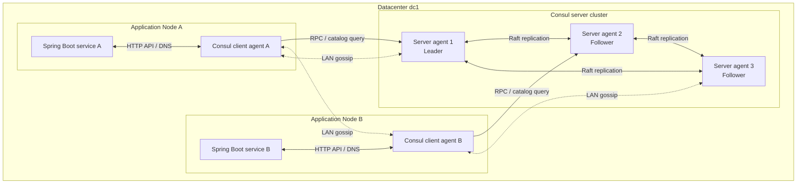

# Consul Agent, Client Agent, and Server Agent Architecture

Consul provides a centralized registry so services can discover each other by name. In a Spring Cloud system, applications can register services and look up instances through Spring Cloud Consul. Behind that API are Consul agent processes: each agent manages the state of the node it runs on, while the group of server agents maintains the shared catalog and coordinates to ensure consistent data.

Understanding the role of agents helps distinguish three things that are often confused: **the application registering a service**, **the agent running health checks and reporting state to the registry**, and **the server cluster storing and synchronizing the catalog**. Consul helps resolve instance addresses; choosing an instance to send a request to is typically handled by Spring Cloud LoadBalancer or another routing component.

## 1. Concepts in Consul Architecture

### Consul Agent

A Consul agent is a long-running process on a machine or deployment environment where services run. Each node participating in Consul typically runs an agent. The agent provides local capabilities such as:

- Receiving requests to register or deregister services and health checks.
- Executing health checks declared for the node, service, or application.
- Participating in the gossip protocol to exchange membership information and detect unresponsive nodes.
- Exposing an HTTP API and a DNS interface for tools or applications to query Consul.
- Forwarding cluster-level requests to server agents and synchronizing local state with the catalog.

An agent has two main modes: **client mode** and **server mode**. Both are Consul agents; the difference lies in whether the agent participates in storing cluster data and Raft consensus.

### Client Agent

A client agent is an agent running in client mode, typically placed on each machine running one or more applications. It serves as the closest connection point to Consul for the application.

A client agent has the following main responsibilities:

- Receiving service and health check registrations from applications or deployment tools on the node.
- Running the health checks assigned to that agent and updating their results.
- Participating in LAN gossip to stay aware of datacenter membership and detect node failures.
- Forwarding queries or required operations to server agents.
- Retaining local state to continue managing the node's services and checks.

A client agent does **not** participate in Raft voting, is not a voting member of the server cluster, and does not hold an authoritative copy of the entire datacenter catalog. Therefore, adding client agents on application nodes does not increase the number of Raft voters.

In a common model, a Spring Boot application calls the HTTP API of the client agent on the same node. If using DNS, the application can also query the DNS interface provided by the agent. This setup prevents the application from needing to know where the server leader is or manually managing the list of Consul servers.

### Server Agent

A server agent is a Consul agent running in server mode. In addition to regular agent functions, a server agent participates in a datacenter's server cluster.

A server agent is responsible for:

- Storing and replicating the service catalog, node catalog, health state, and related Consul data.
- Participating in Raft consensus to agree on changes to be committed to the cluster.
- Electing a leader; the leader coordinates write operations and cluster management tasks.
- Serving requests forwarded by client agents and providing registry data for queries.
- Exchanging state with servers in other datacenters via WAN gossip in multi-datacenter deployments.

Server agents in the same datacenter form a quorum group. In common configurations, you should deploy **3 or 5 server agents** on independent machines, ideally distributed across failure domains or availability zones. Three servers tolerate one server failure; five servers tolerate two server failures, as long as the remaining servers maintain quorum. A two-server cluster cannot tolerate any server failure while keeping quorum.

Server agents are typically not installed on every application node. They are deployed as a small, stable group with persistent storage. Applications and client agents connect to this group over the internal network.

### Datacenter and Cluster

In Consul, a **datacenter** is a scope consisting of a group of server agents that jointly manage a catalog and coordinate via Raft. The datacenter name must be consistent across agents within the same scope.

A datacenter typically includes:

- A group of server agents forming a server cluster.
- Multiple client agents running on application nodes or infrastructure nodes.
- A service catalog reflecting synchronized nodes, service instances, and health check statuses.

When there are multiple datacenters, each datacenter maintains its own server cluster. WAN gossip enables server agents to exchange information across datacenters. Multiple datacenters should not be treated as a single Raft cluster: Raft consensus runs independently within each datacenter.

## 2. Gossip and Raft Solve Two Different Problems

Consul uses two primary coordination mechanisms. They complement each other rather than replace each other.

| Mechanism | Scope and Purpose | Participating Components |
| --- | --- | --- |
| LAN gossip | Membership exchange, detecting nodes leaving the cluster or becoming unresponsive within the same datacenter | Client agents and server agents |
| WAN gossip | Membership exchange across datacenters | Server agents |
| Raft consensus | Agreeing on committed changes to server cluster data | Server agents only |

Gossip prioritizes membership discovery and distributed information dissemination. It is not the catalog commit mechanism. Raft provides consistency for data managed by the server cluster; a write operation requires quorum acceptance before it is considered committed.

For example, when a client agent detects that a node is no longer responding, membership information is propagated via gossip. For a service health check, the agent runs the check locally and synchronizes the result to the server cluster to update the catalog; this is a registry update flow, separate from the client agent participating in gossip. When a server agent loses connectivity, the remaining servers can only continue committing changes if Raft quorum is still intact.

## 3. Typical Architecture Diagram

The following diagram illustrates two application nodes connecting to their local client agents, while the client agents communicate with the server agent group in the same datacenter:



In the diagram:

- Each application interacts with the agent on its node to register a service, declare health checks, or look up instances.
- Client agents participate in LAN gossip and send requests to the server cluster.
- Server agents replicate data using Raft. One server acts as leader at a time; the remaining servers are followers.
- The gossip lines represent membership exchange, while the Raft lines represent cluster data synchronization. These are two separate flows.

The diagram is a logical model. In real deployments, RPC connections can go to any appropriate server agent; agents and Consul internally handle routing to the leader when an operation requires it.

## 4. Service Registration and Discovery Lifecycle

### Step 1: Agents Join the Datacenter

A Consul agent starts with configuration for the datacenter, bind address, data directory, and a list of addresses to join the cluster. Client agents join LAN gossip and discover server agents. Server agents start up, discover the remaining servers, and form a Raft quorum.

A client agent does not need to know a fixed server leader ahead of time. It uses configured server addresses or discovers them through the join mechanism to communicate with the cluster.

### Step 2: The Application Registers a Service

When Spring Boot starts, Spring Cloud Consul can register the application with Consul using its service name, instance ID, IP address, port, metadata, and health check. In the local client agent model, the application sends the request to that agent's HTTP API.

For example, an application might register a service named `orders` with an instance running at `10.0.1.20:8080`. The name `orders` represents the logical service; each deployment can create multiple instances with the same name but different addresses or instance IDs.

The agent receives the request and manages the service and health check tied to the node. Registration state is synchronized to the server cluster so other clients can look it up in the catalog.

### Step 3: The Agent Performs Health Checks

A health check can inspect node status, a process, a TCP port, an HTTP endpoint, or a command suited to the environment. With Spring Boot Actuator, an HTTP health check typically calls the `/actuator/health` endpoint.

The agent runs the check on the configured interval and updates states such as `passing`, `warning`, or `critical`. The server cluster uses the synchronized status when returning lookup results. As a result, an instance may be registered in the catalog yet omitted from queries requesting only `passing` instances.

The health check must target an endpoint reachable by the agent. If the application runs in a container, `localhost` inside the application container is not necessarily reachable by an agent on the host or in another container.

### Step 4: Another Application Looks Up the Service

An application that needs to call `orders` can use Spring Cloud `DiscoveryClient` to retrieve the list of instances by service name. Spring Cloud Consul translates the lookup through the Consul API; the application can also use Consul DNS if the architecture chooses that approach.

The discovery result contains information about matching instances, such as host and port. Spring Cloud LoadBalancer can pick an instance from this list to execute the request. The Consul registry does not automatically become a proxy handling all HTTP traffic between applications.

### Step 5: State Changes When an Instance Fails

If a health check fails, the agent updates the check status. If a node leaves the network or the agent stops responding, gossip helps detect the membership failure. The state is synchronized into the catalog; queries filtering by health exclude instances that no longer meet the requirement.

When the instance recovers, the health check succeeds again and the status is updated. Applications calling discovery receive a list reflecting the new state once the update has synchronized. Due to the health check interval and state propagation time, discovery does not always reflect changes instantaneously.

## 5. Sample Configuration for Server Agents and Client Agents

The example below illustrates a datacenter named `dc1` with three server agents. The IP addresses are illustrative only; replace them with routable network addresses in your deployment environment.

### Server Agent Configuration

On each server, create a configuration similar to the following in the Consul configuration directory:

```hcl
server           = true
datacenter       = "dc1"
data_dir         = "/opt/consul"
node_name        = "consul-server-1"
bind_addr        = "10.0.0.11"
client_addr      = "127.0.0.1"
bootstrap_expect = 3

retry_join = [
  "10.0.0.12",
  "10.0.0.13"
]
```

On the second and third servers, update `node_name` and `bind_addr` accordingly. `bootstrap_expect = 3` indicates the cluster expects three servers to complete bootstrapping. Servers must have a persistent `data_dir` and must not share data directories.

`bind_addr` is the address the agent uses for internal cluster communication. `client_addr` specifies the listening addresses for the HTTP API, DNS, and client interfaces; the example above only binds the client interface on loopback. If client agents or applications need to call the API over the network, you must configure appropriate listening addresses and restrict access with firewalls and security mechanisms.

### Client Agent Configuration

On an application node, configure a client agent:

```hcl
server      = false
datacenter  = "dc1"
data_dir    = "/opt/consul"
node_name   = "app-node-1"
bind_addr   = "10.0.1.20"
client_addr = "127.0.0.1"

retry_join = [
  "10.0.0.11",
  "10.0.0.12",
  "10.0.0.13"
]
```

The client agent joins the same datacenter and connects to the server group. `client_addr = "127.0.0.1"` is suitable when the application calls the API from the same network namespace as the agent. If the application resides in a different container or machine, select an address reachable from the application and apply appropriate network restrictions.

These configurations only illustrate the basic structure. Production environments need ACL tokens, TLS, gossip encryption, file permissions, monitoring, and appropriate firewall policies.

## 6. Connecting Spring Cloud to a Consul Agent

With Spring Cloud Consul, the application declares the HTTP API address of the Consul agent it will use. If the client agent runs on the same machine and the API listens only on loopback, the application can use `localhost:8500`.

Example `application.yml`:

```yaml
spring:
  application:
    name: orders
  cloud:
    consul:
      host: localhost
      port: 8500
      discovery:
        register: true
        health-check-path: /actuator/health
        health-check-interval: 10s

management:
  endpoints:
    web:
      exposure:
        include: health
```

In this example:

- `spring.application.name` is the registered service name, and also the service name other applications use during discovery.
- `spring.cloud.consul.host` and `port` point to the agent's HTTP API.
- `register` enables service registration for the application.
- `health-check-path` specifies the endpoint Consul calls to check application health; the endpoint must be exposed and reachable by the agent.
- `health-check-interval` defines the check interval in the example.

Property names and values may vary depending on the Spring Cloud Consul version in use. Cross-check with the documentation for your project's dependency version before applying to a production environment.

When the application and agent run in two separate containers, `localhost` usually points to the application container itself. In that case, configure the hostname or address of the client agent on the same network, and ensure the agent can call back to the application's health endpoint. This is a common cause of a service registering successfully while its health check remains permanently `critical`.

## 7. Distinguishing Discovery, Registry, and Load Balancing

These components often appear together but serve different roles:

| Component | Role |
| --- | --- |
| Spring Cloud Consul Registry | Registers and deregisters application instances with Consul |
| Consul agent | Accepts registrations, runs health checks, and acts as the communication entry point to the Consul cluster |
| Consul server cluster | Stores and synchronizes the catalog, serves discovery data |
| Spring Cloud `DiscoveryClient` | Provides an API for applications to retrieve instance lists by service name |
| Spring Cloud LoadBalancer | Selects an instance from the discovery list to send a request |
| API Gateway or reverse proxy | Routes requests according to gateway/proxy policies if used by the architecture |

For example, when `checkout` calls `orders`, `DiscoveryClient` may return three `orders` instances. LoadBalancer selects one instance, such as `10.0.1.20:8080`, and the HTTP client sends the request to that address. Consul supplies instance and health data; it does not replace the HTTP client or balance all traffic between services on its own.

## 8. Security and Operations

A Consul agent exposes multiple network interfaces for different purposes. Separate the RPC, gossip, HTTP API, HTTPS, and DNS ports, and only allow necessary sources to access each port. Common ports in the default configuration include:

| Port | Protocol | Purpose |
| --- | --- | --- |
| `8300` | TCP | RPC between client agents and server agents, as well as RPC communication within the server cluster |
| `8301` | TCP/UDP | LAN gossip within a datacenter |
| `8302` | TCP/UDP | WAN gossip across datacenters |
| `8500` | TCP | HTTP API |
| `8501` | TCP | HTTPS API when configured |
| `8600` | TCP/UDP | DNS interface |

Never expose the HTTP API or DNS to the Internet. In production environments, you should:

- Enable ACLs to authenticate and restrict read/write permissions for the registry, KV store, and other Consul resources.
- Use TLS for API/RPC connections matching your deployment configuration; manage and rotate certificates.
- Enable gossip encryption to protect information exchanged over gossip.
- Restrict `client_addr`, firewalls, and security groups strictly to the nodes that need access.
- Protect `data_dir`, tokens, and configuration files; never commit secrets to repositories or logs.
- Monitor leader status, quorum, health checks, disk capacity, RPC latency, and instance counts.

The server cluster requires quorum to commit changes. If more than half of the servers are lost, the cluster cannot continue processing write operations until quorum is restored. Therefore, place servers on independent machines or failure domains and back up data according to Consul operational procedures.

## 9. Basic Verification and Troubleshooting

When a service does not appear in discovery results, inspect from the local agent to the server cluster in order:

1. Verify that the Consul agent is running and the node has joined the right datacenter.
2. Check whether the agent sees the registered service.
3. Verify the health check, IP address, port, and endpoint reachability from the agent itself.
4. Check whether the client agent can connect to server agents and whether the server cluster still has quorum.
5. Check the ACL token, TLS, DNS, or HTTP API used by the application.
6. Verify that the application is pointing to the right agent, datacenter, and service name.

Sample verification commands via the local HTTP API (assuming the agent listens on `127.0.0.1:8500`):

```bash
# List services managed by the agent on the current node
curl http://127.0.0.1:8500/v1/agent/services

# View instances of the orders service along with health check statuses
curl "http://127.0.0.1:8500/v1/health/service/orders"

# Retrieve only passing instances
curl "http://127.0.0.1:8500/v1/health/service/orders?passing=true"
```

If ACLs or HTTPS are enabled, pass tokens and configure certificates according to your environment's policy. Do not disable security checks to troubleshoot production issues.

| Symptom | Common Cause | Where to Check |
| --- | --- | --- |
| Service does not appear | Application has not registered, wrong service name, or agent has not synchronized | Inspect services on the agent, Spring Cloud Consul logs, and server connectivity |
| Service appears but is not `passing` | Wrong health endpoint, agent cannot reach application, wrong port or firewall | Call the health endpoint from the agent node and inspect check output |
| Client agent fails to join cluster | Wrong `retry_join`, wrong `bind_addr`, firewall blocking gossip, or mismatched datacenter | Check server addresses, LAN gossip, and datacenter configuration |
| Server cluster loses leader | Insufficient quorum, network failure between servers, or disk/data error | Check Raft status, server logs, and connectivity between servers |
| Application cannot reach Consul API | Pointing to wrong host/port, `client_addr` bound only to loopback, or ACL/TLS mismatch | Test from inside the application's network namespace |
| Discovery returns stale instances temporarily | Health check interval and state sync have not completed yet | Check interval, timeout, and catalog state on agent/server |

## 10. Key Takeaways

- A Consul agent is a process running on a node; each agent operates in client mode or server mode.
- A client agent sits close to the application, manages local services and health checks, participates in LAN gossip, and forwards requests to the server cluster. It does not vote in Raft.
- A server agent stores and replicates the catalog, participates in Raft consensus, maintains a leader, and serves data to other agents.
- Gossip discovers and exchanges membership information; Raft agrees on data changes within the server cluster.
- Each datacenter has its own server cluster. WAN gossip connects membership information across datacenters.
- Spring Cloud Consul integrates applications with the registry; `DiscoveryClient` retrieves instances and Spring Cloud LoadBalancer chooses an instance to call.
- Health checks are only effective when the agent can reach the right endpoint and state is synchronized back to the catalog.

When deploying Spring Cloud Service Discovery with Consul, an easy-to-operate model is to run one client agent on each application node, maintain a stable group of three or five server agents per datacenter, and have Spring Cloud Consul communicate with the agent closest to the application. This layout separates the responsibilities of applications, agents, and the server cluster, while allowing instance scaling without changing how services look each other up.
