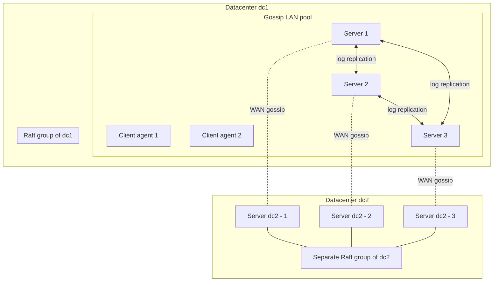

# The Role of Gossip, Raft, and Quorum in a Consul Cluster

When deploying Consul for microservice service discovery, a single server can become a single point of failure. Consul addresses this by running multiple Consul Servers within the same datacenter and coordinating among them. Three essential concepts to understand are **gossip**, **Raft**, and **quorum**: gossip lets agents know which members are participating and detects failed nodes; Raft maintains consistent state across servers; quorum determines the minimum number of servers required for the cluster to continue electing a leader and safely committing writes.

This lesson places these mechanisms in the context of Spring Cloud Service Discovery. Applications can register services using Spring Cloud Consul, look up instances via `DiscoveryClient`, and select an instance using Spring Cloud LoadBalancer. For that flow to operate reliably, Consul must maintain membership and registry state when nodes or network connections are disrupted.

## 1. Overall View of Consul Architecture

A Consul datacenter typically has multiple server agents and may have multiple client agents. Servers store datacenter state and participate in Raft. Client agents run close to applications, participate in LAN gossip, and forward necessary requests to servers.



Think of the three mechanisms through three questions:

| Mechanism | Question Answered | Primary Scope |
| --- | --- | --- |
| Gossip | Which nodes are participating? Which nodes are suspected or failed? | Membership and failure detection in the LAN pool; connecting servers across datacenters via the WAN pool. |
| Raft | How do servers reach consensus on committed state? Who is the leader? | The server group of each datacenter. |
| Quorum | How many servers must agree at minimum to elect a leader or commit a log entry? | Voting servers within a Raft group. |

Gossip and Raft support each other rather than replace each other. Membership is propagated by gossip; consistent registry state is protected by Raft. The number of client agents does not increase Raft quorum.

## 2. Gossip: Membership and Node Failure Detection

Consul uses a Serf-based gossip protocol so agents exchange membership information and disseminate events. Each agent joins a gossip pool appropriate for its role and datacenter. Updates propagate gradually across multiple members instead of requiring a central node to broadcast messages to every node.

### 2.1. LAN Gossip

LAN gossip operates within a single datacenter. Both client agents and server agents join that datacenter's LAN pool. It helps agents:

- Discover and maintain the member list within the datacenter.
- Detect unresponsive nodes using gossip's probing and suspicion mechanism.
- Propagate membership information and events to other members.
- Help servers stay aware of other servers in the same datacenter participating in the cluster.

Gossip uses time-based failure detection. When a node does not respond, members can transition the node into a suspect state and then `failed` if it cannot be re-verified. Brief packet loss or short-term network congestion can delay or trigger false positives in failure detection; therefore, corroborate membership status with logs and network conditions.

### 2.2. WAN Gossip

WAN gossip connects **server agents** across different datacenters. It enables Consul to discover remote datacenters and servers to support federation. Client agents do not join the WAN pool.

For example, `dc1` and `dc2` can each run their own server cluster. WAN gossip lets servers in `dc1` know about servers in `dc2` and vice versa. This does not merge the two datacenters into a single Raft group; each datacenter still maintains its own Raft group.

### 2.3. Gossip Is Not an Application Health Check

Gossip focuses on agent/node membership and reachability. It does not replace service health checks such as an HTTP check calling Spring Boot Actuator. A node can remain `alive` in gossip while the application on that node returns errors; conversely, an application can be healthy while its agent has connectivity issues with the cluster.

When investigating an incident, inspect these two layers separately:

- **Node membership:** Is the agent still participating and reachable in the gossip pool?
- **Service health:** Is the application instance passing the health check registered with Consul?

Command to check LAN membership:

```bash
consul members
```

Check servers in the WAN pool:

```bash
consul members -wan
```

These two commands show membership from the gossip perspective. They do not list full Raft leader and voter state.

## 3. Raft: Consensus and State Replication

Raft is the consensus algorithm Consul uses to maintain consistent state among Consul Servers within the same datacenter. In each Raft group, servers hold the role of leader or follower at any given time. Only server agents join the Raft group and have voting rights; client agents are not voters.

### 3.1. Leader and Follower

- **Leader** accepts write changes to Raft-managed state, creates log entries, and replicates entries to followers.
- **Follower** receives logs from the leader, persists logs, and votes when a new leader election is needed.
- If the leader stops operating or can no longer maintain consensus, the remaining servers can elect a new leader provided quorum is still met.

Raft uses terms and an election mechanism to prevent multiple valid leaders from controlling a group simultaneously. A change is considered committed once the log entry has been replicated and acknowledged by a majority of voting servers. Only after commit is the change applied to the cluster state machine.

Critical Consul state, such as the service catalog, key/value store, sessions, and ACL state, is maintained through the server consensus mechanism. Thus, Raft protects the state queried by clients and servers, rather than merely tracking which nodes are alive.

### 3.2. Raft Operates Within a Single Datacenter

Each datacenter has its own Raft group. If a system has three datacenters, there are typically three independent Raft groups, each electing a leader and achieving quorum within that datacenter's servers.

This matters greatly during WAN outages: losing connectivity between `dc1` and `dc2` can disrupt cross-datacenter discovery or queries, but it does not automatically cause `dc1` or `dc2` to lose local Raft quorum. Each cluster can continue internal operations as long as its own servers retain quorum.

Check Raft peers and the leader with the command:

```bash
consul operator raft list-peers
```

The output displays peers in the Raft group, their state, and which server holds the leader role. Use this command alongside `consul members` to distinguish gossip membership issues from Raft consensus issues.

## 4. Quorum: The Required Server Majority

Quorum is the minimum number of votes Raft requires to make a safe decision, such as electing a leader or committing a log entry. With `N` voting servers in a Raft group:

\[
Q = \left\lfloor \frac{N}{2} \right\rfloor + 1
\]

Where `Q` is the quorum. The maximum number of servers that can be lost while the group still maintains quorum is:

\[
F = N - Q
\]

Here `N` is the number of **voting servers in the Raft group**, not the total number of machines, total service instances, or total client agents in the datacenter.

| Voting Servers (`N`) | Quorum (`Q`) | Tolerated Server Failures (`F`) |
| ---: | ---: | ---: |
| 1 | 1 | 0 |
| 2 | 2 | 0 |
| 3 | 2 | 1 |
| 4 | 3 | 1 |
| 5 | 3 | 2 |
| 6 | 4 | 2 |
| 7 | 4 | 3 |

For example:

- A 3-server cluster needs at least 2 votes. One server failure still leaves quorum; if two servers fail, the remaining server cannot commit changes on its own.
- A 5-server cluster needs at least 3 votes. The cluster tolerates up to 2 unreachable servers while still reaching quorum.
- A 4-server cluster also tolerates only 1 server failure, just like a 3-server cluster, while requiring more resources. That is why odd server counts are generally more efficient when sizing a cluster.

In production deployments, 3 or 5 Consul Servers are commonly chosen per datacenter. Three servers fit most clusters needing single-server fault tolerance; five servers increase fault tolerance to two. Adding servers beyond what is needed increases coordination overhead and write latency without necessarily providing proportional benefit.

## 5. What Happens When Nodes or Networks Fail?

### 5.1. Losing One Server in a Three-Server Cluster

Assume `dc1` has three servers and a quorum of two. When one server stops:

1. Gossip detects the unresponsive server and propagates membership status.
2. The remaining two servers can still form a majority.
3. If the leader is still healthy, it can continue committing logs; if the leader was lost, the remaining two servers can elect a new leader.
4. Write operations can continue as long as the cluster maintains Raft quorum.

Failure detection via gossip and leader election via Raft are related but independent processes. Do not assume gossip elects the Raft leader directly.

### 5.2. Losing Two Servers in a Three-Server Cluster

Only one of three voters remains, while quorum requires two. The remaining server cannot validly elect a leader or commit new log entries on its own. Already committed data remains on disk across servers, but changes requiring consensus are blocked until quorum is restored.

When encountering this situation, prioritize restoring the failed servers or network connectivity so the existing voters can reconnect. Do not delete the data directory, arbitrarily create a new cluster, or change bootstrap configuration to force a standalone server into becoming the current cluster; those actions can produce divergent registry state or data loss.

### 5.3. Network Partition Splitting the Cluster Into Two Sides

Suppose a five-server cluster is split into two sides: one side with three servers and the other with two servers. The side with three voters can still reach quorum, elect a leader, and commit logs. The two-voter side lacks a majority and cannot commit Raft changes.

Raft prioritizes consistency: the two sides cannot both commit conflicting log histories. Read behavior while quorum is lost also depends on Consul's consistency mode and query type; do not assume all reads succeed or that every follower returns the latest data.

### 5.4. Losing WAN Connectivity Between Datacenters

If WAN gossip between `dc1` and `dc2` is disrupted while servers within each datacenter can still communicate internally, each Raft group can continue maintaining its own quorum. Features requiring cross-datacenter communication or discovery may be affected, but there is no global Raft quorum that must be maintained across all datacenters.

## 6. Initial Server Cluster Configuration

Abbreviated configuration example for three Consul Servers in `dc1`:

```hcl
server           = true
datacenter       = "dc1"
data_dir         = "/opt/consul"
bootstrap_expect = 3

retry_join = [
  "10.0.0.11",
  "10.0.0.12",
  "10.0.0.13"
]
```

Apply the corresponding configuration on all three servers, with a distinct `node_name` and data directory per machine. `bootstrap_expect = 3` tells the initializing cluster to expect three servers in the datacenter before completing bootstrap and electing a leader. `retry_join` provides addresses for agents to locate and join the cluster.

Key considerations:

- All three servers must use the same datacenter name and be able to communicate over the required Consul ports.
- Each server needs a persistent data directory and a unique node identity.
- Do not use `bootstrap = true` as a routine fix for quorum issues. Manual bootstrap mode can unintentionally create a split cluster.
- Enable gossip encryption with the same shared key across agents during deployment; generate the key with `consul keygen` and manage it as a secret. Gossip encryption does not replace TLS for RPC/API or ACLs.
- Distribute servers across separate hosts and fault domains so a single machine failure or infrastructure zone outage does not wipe out a majority of voters simultaneously.

Client agents can join LAN gossip and register local services, but they do not count toward `bootstrap_expect` or Raft quorum. Adding more client agents does not help the server cluster tolerate additional Raft failures.

## 7. Inspecting and Diagnosing the Cluster

When Consul exhibits instability, inspect from membership down to consensus:

```bash
# Gossip members in the current datacenter
consul members

# Server members in the WAN pool
consul members -wan

# Raft peers, voters, and leader of the datacenter
consul operator raft list-peers
```

Interpret results by layer:

| Observation | Likely Area to Investigate Next |
| --- | --- |
| Node shows `failed` in `consul members` | Stopped agent, LAN gossip network issue, firewall, or mismatched gossip encryption config. |
| Server appears in gossip membership, but Raft lacks peers or has no leader | RPC connectivity between servers, process health, Raft logs, and reachable voter count. |
| Raft has a leader and quorum, yet service is not found by consumers | Service registration, catalog, health checks, ACLs, and consumer discovery filters. |
| Cross-datacenter queries fail while local Raft is healthy | WAN gossip, routing between datacenters, and federation configuration. |
| Cluster loses quorum after multiple servers restart | Inspect data directories, node identities, peer addresses, and connectivity before changing membership or re-bootstrapping. |

Common default ports to verify in firewalls and network policies:

| Port | Protocol | Purpose |
| ---: | --- | --- |
| 8300 | TCP | Server RPC, including server-to-server communication. |
| 8301 | TCP and UDP | LAN gossip. |
| 8302 | TCP and UDP | WAN gossip between servers. |
| 8500 | TCP | Consul HTTP API, if enabled. |

Verify the actual ports against your deployment configuration, because Consul allows customizing ports and bind addresses. Never open these ports more broadly than required by the network scope.

## 8. Common Misconceptions

| Misconception | Accurate Understanding |
| --- | --- |
| Gossip and Raft are both just node synchronization mechanisms. | Gossip manages membership/failure detection; Raft reaches consensus on state stored in the server cluster. |
| More client agents make the quorum stronger. | Quorum is counted over voting servers in the Raft group; client agents do not vote. |
| Every datacenter in a federation shares one Raft group. | Each datacenter has its own Raft group and leader; WAN gossip connects servers across datacenters. |
| A node marked `alive` in gossip means the application is healthy. | Node membership and per-service health checks are two distinct signals. |
| Losing quorum only slows down queries. | The cluster cannot commit new Raft changes or elect a leader without a majority; read availability depends on the consistency mode. |
| You can add a single new server to automatically restore quorum. | Membership changes must follow safe procedures; a new server cannot automatically restore an old voter majority if existing peers remain unreachable. |

## 9. Production Design Checklist

Before taking Consul into production, verify:

1. Each datacenter has an appropriate number of voting servers, typically 3 or 5.
2. Servers are distributed across fault domains to reduce the risk of losing a majority at once.
3. Servers have stable connectivity for Raft RPC and LAN gossip; servers across datacenters have WAN gossip connectivity when federation is used.
4. Gossip encryption, TLS, and ACLs are configured according to the environment's security requirements.
5. Server data directories are on persistent storage with an appropriate backup/restore plan.
6. Monitoring is in place for leader status, Raft peer count, membership state, latency, and alerts on quorum loss.
7. The operations team knows how to recover quorum from existing servers before considering membership changes or re-bootstrapping.

## 10. Takeaways

- **Gossip** lets Consul agents discover members, detect failed nodes, and propagate membership information. The LAN pool operates within a datacenter; the WAN pool connects servers across datacenters.
- **Raft** lets Consul Servers within the same datacenter reach consensus on state and replicate logs. Each datacenter has its own Raft group.
- **Quorum** is a majority of voting servers: `floor(N / 2) + 1`. Losing the majority means the cluster cannot commit new Raft changes or elect a leader.
- Client agents do not vote in Raft. Gossip membership also does not replace application health checks.

Understanding these three mechanisms helps design a Consul cluster with appropriate fault tolerance and enables operators to determine whether a service discovery issue stems from membership, consensus, health checks, or cross-datacenter connectivity.
