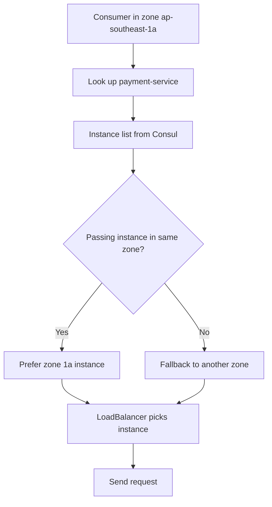

# Declaring Tags, Metadata, and Deployment Zone Location

When registering a service instance with Consul, an application can publish additional information so consumers and operational tools know which environment the instance belongs to, which version it runs, and which deployment zone it resides in. Spring Cloud Consul Discovery supports two commonly used data groups: **tags** and **metadata**. Deployment locations such as zone, region, or rack are typically represented via metadata using a consistent convention.

This information complements the service name, instance ID, hostname/IP, port, and health status. It aids lookup, observability, grouping, and instance selection. However, Consul does not automatically interpret the semantics of every tag or metadata entry. Applications, Consul queries, or load balancers must be configured to use those values.

In Spring Cloud, `DiscoveryClient` returns `ServiceInstance` objects along with instance metadata; `ServiceRegistry` and Spring Cloud Consul handle registering that information in Consul. This lesson focuses on declaring tags, metadata, and zones to support service discovery across multi-deployment environments.

## 1. Tags and Metadata in Consul

A Consul service registration can include a list of tags and a key-value metadata map.

| Component | Structure | Common Purpose | Example |
|---|---|---|---|
| Tags | List of strings | Labels for categorizing, searching, or filtering services. | `production`, `payments`, `canary` |
| Service metadata | String key-value map | Describes structured attributes of a service instance. | `version=2.8.1`, `zone=ap-southeast-1a` |
| Node metadata | Key-value map attached to the Consul agent node | Describes characteristics of the node hosting the agent. | `rack=rack-03`, `hardware-class=compute` |

Tags and metadata are both published with a service registration but serve different purposes. Tags suit short labels and tag-based filtering. Metadata suits explicitly named attributes such as `version`, `api-level`, `zone`, or `region`.

Consul stores tags as strings. Consul does not automatically parse a string like `environment=production` into a key-value map; to Consul, it remains an opaque tag string. If you need a structured field for consumers to read, declare it in the metadata map.

## 2. Declaring Tags with Spring Cloud Consul

Tags are configured via `spring.cloud.consul.discovery.tags`. Each item is a string. Example:

```yaml
spring:
  application:
    name: payment-service
  cloud:
    consul:
      host: consul.internal.example
      port: 8500
      discovery:
        service-name: payment-service
        instance-id: payment-service:payment-01
        tags:
          - production
          - payments
          - rest
          - canary
```

After registration, the service can be identified by the labels `production`, `payments`, `rest`, and `canary`. Labels should be concise, consistent, and follow a system-wide convention.

### 2.1. Choosing Useful Tags

Common tag categories:

| Category | Example | Usage |
|---|---|---|
| Environment | `dev`, `staging`, `production` | Distinguishes deployment environments. |
| Owning team | `team-payments`, `team-commerce` | Helps locate services by responsible team. |
| Protocol | `http`, `grpc`, `https` | Describes endpoint type or protocol. |
| Role | `worker`, `api`, `scheduler` | Categorizes deployment roles if one service name covers different instance types. |
| Release | `canary`, `blue`, `green` | Helps identify rollout cohorts. |

There is no need to put everything into tags. If consumers need to read values such as version or zone, key-value metadata is usually clearer and easier to inspect.

### 2.2. Tags Do Not Automatically Drive Load Balancing

Registering a `canary` tag does not mean Spring Cloud LoadBalancer automatically routes a percentage of requests to canary instances. Tags are merely published data. You need a Consul query, gateway, custom `ServiceInstanceListSupplier`, or routing policy that understands the tag.

The Consul HTTP API supports filtering services by tag in appropriate catalog/health queries. For example, querying passing instances with the `canary` tag:

```http
GET /v1/health/service/payment-service?passing=true&tag=canary
```

Specific APIs may have additional query parameters and constraints depending on the Consul version. Spring Cloud's `DiscoveryClient.getInstances("payment-service")` does not include arbitrary tag parameters in its default method signature; if tag filtering is required, choose an appropriate query mechanism or discovery layer.

## 3. Declaring Key-Value Metadata

Metadata is configured via `spring.cloud.consul.discovery.metadata`. Every key and value is stored as a string. Example:

```yaml
spring:
  application:
    name: payment-service
  cloud:
    consul:
      discovery:
        metadata:
          version: "2.8.1"
          api-level: "v2"
          region: "ap-southeast-1"
          zone: "ap-southeast-1a"
          release-ring: "canary"
```

In this example:

- `version` indicates the instance's software version.
- `api-level` describes the API contract supported by the instance.
- `region` and `zone` describe the deployment location.
- `release-ring` distinguishes rollout groups such as canary or stable.

Metadata enables consumers to inspect attributes of each instance after discovery. For example, a consumer can read `zone` to prefer instances in the same zone, or read `api-level` to pick a compatible provider. Consul only stores and serves the data; logic that acts on metadata belongs to the application or routing component.

### 3.1. Key and Value Conventions

To make metadata easy to use across services:

- Use lowercase, stable keys such as `version`, `zone`, `region`, and `api-level`.
- Standardize spelling and semantics for every key across both providers and consumers.
- Use simple, exact-match values; avoid multiple spellings for the same zone such as `az-a`, `AZ-A`, and `zone-a`.
- Keep metadata small and include only details needed for discovery or operations.
- Never store passwords, tokens, private keys, connection strings with credentials, or personal data.
- Avoid putting frequently changing data into metadata, since updating registrations adds load and convergence latency.

Metadata is typically returned in the `ServiceMeta` field of a Consul service record and mapped by Spring Cloud Consul into `ServiceInstance` metadata. Verify the exact integration/version behavior when relying on specific mappings.

## 4. Declaring Zone, Region, and Rack

In distributed systems, two instances running the same service can reside in different infrastructure zones. If consumers always call remote instances, requests may incur higher latency and rely heavily on cross-zone links. Publishing location lets the system prefer nearby instances and supports fault-tolerant design aligned with failure domains.

Concepts to distinguish:

| Concept | Meaning | Example |
|---|---|---|
| Region | Geographic region or broad infrastructure area. | `ap-southeast-1` |
| Zone / Availability Zone | Smaller failure domain within a region. | `ap-southeast-1a` |
| Rack | Hardware group or server rack within a data center. | `rack-03` |
| Consul datacenter | Logical datacenter scope in Consul topology. | `dc-singapore-1` |

A Consul datacenter is not synonymous with an availability zone. A single Consul datacenter can span multiple zones; how regions and zones are organized depends on the cloud or deployment platform. If zone-based routing is needed, publish the zone using a consistent metadata key such as `zone`.

Example of two instances of the same service in two zones:

| Instance | Region | Zone | Rack |
|---|---|---|---|
| `payment-01` | `ap-southeast-1` | `ap-southeast-1a` | `rack-03` |
| `payment-02` | `ap-southeast-1` | `ap-southeast-1b` | `rack-07` |

When a consumer runs in `ap-southeast-1a`, the load balancer can prefer `payment-01`. If no healthy instances remain in that zone, policy should allow falling back to `ap-southeast-1b` to maintain availability.

## 5. Combining Tags, Metadata, and Zone in One Registration

A complete configuration can declare both tags and metadata:

```yaml
spring:
  application:
    name: payment-service

  cloud:
    consul:
      host: consul.internal.example
      port: 8500
      discovery:
        enabled: true
        register: true
        service-name: ${spring.application.name}
        instance-id: "${spring.application.name}:${INSTANCE_ID:payment-01}"
        tags:
          - production
          - payments
          - rest
          - canary
        metadata:
          version: "2.8.1"
          api-level: "v2"
          region: "ap-southeast-1"
          zone: "ap-southeast-1a"
          rack: "rack-03"
          release-ring: "canary"
        health-check-path: /actuator/health
        health-check-interval: 15s
        query-passing: true
```

In real environments, `INSTANCE_ID`, version, region, and zone should be injected per instance by the deployment pipeline or platform. Do not share a single configuration file with the same `instance-id` across all replicas.

`query-passing: true` instructs discovery to return only instances with passing health checks as supported by the Spring Cloud Consul integration. It does not replace deployment-platform readiness policies and does not guarantee every request to an instance will succeed.

## 6. Zone Metadata and Spring Cloud LoadBalancer

Merely registering `zone` metadata does not cause consumers to automatically prefer same-zone instances. To use zones for selection, configure the consumer and enable the corresponding zone-preference mechanism in Spring Cloud LoadBalancer.

Example consumer in zone `ap-southeast-1a`:

```yaml
spring:
  cloud:
    loadbalancer:
      configurations: zone-preference
      zone: ap-southeast-1a
```

The provider must register metadata with key `zone` and a matching value convention:

```yaml
spring:
  cloud:
    consul:
      discovery:
        metadata:
          zone: ap-southeast-1a
```

When the zone-preference supplier is activated and receives compatible metadata, the load balancer can prefer instances in the same zone. Exact behavior depends on the Spring Cloud LoadBalancer version, supplier configuration, and provider metadata. Verify against your release train and inspect the actual supplier bean created in the application context.

### 6.1. Cross-Zone Fallback Is Essential

Zone preference should be treated as a preference, not a hard boundary in every situation. If the consumer's zone has no healthy instances left, the application needs a fallback to another zone or a controlled error according to business requirements.



If policy allows calling only within the same zone, the system can lose availability during a zone outage. Therefore, explicitly decide whether to prioritize latency or availability, and test zone-outage scenarios.

### 6.2. Do Not Treat Zone Metadata as Proof of Health

`zone=ap-southeast-1a` describes location only. It does not prove an instance is healthy. Consul health checks and instance filtering criteria must still be applied independently. A same-zone instance with a failing health check should not be chosen simply because it is nearby.

## 7. Node Metadata and Service Metadata

Consul supports metadata attached to nodes and metadata attached to service registrations. Their scopes differ:

- **Node metadata (`NodeMeta`):** describes the Consul agent node, such as rack, hardware class, or zone of the host running the agent.
- **Service metadata (`ServiceMeta`):** describes a service instance registered on the node, such as software version, API level, release ring, or workload deployment zone.

If every service on a node always belongs to the same zone, node metadata can reflect the node's location. If a single node runs workloads belonging to different zones or logical groups, service metadata is better suited for describing each registration.

The Spring Cloud Consul Discovery `metadata` property primarily targets service registration metadata. Do not assume this setting updates the Consul agent's `NodeMeta`. Node metadata is normally configured on the Consul agent or in service definitions per Consul's mechanism.

## 8. Reading Tags and Metadata from Consul

### 8.1. Checking via Consul UI and HTTP API

Once the application starts, open the Consul UI on the management network and find `payment-service`. Inspect each instance's tags, metadata, address, port, and health status.

You can retrieve registrations using the Consul HTTP API:

```bash
curl http://consul.internal.example:8500/v1/catalog/service/payment-service
```

The response may include fields such as `ServiceTags`, `ServiceMeta`, `ServiceAddress`, `ServicePort`, `Node`, and datacenter details. To fetch only passing instances with a specific tag:

```bash
curl "http://consul.internal.example:8500/v1/health/service/payment-service?passing=true&tag=canary"
```

These APIs must be protected by appropriate ACL tokens and network policies. Never place real tokens into documentation, logs, or configuration examples committed to a repository.

### 8.2. Reading Metadata via DiscoveryClient

A Spring Cloud consumer can read each instance's metadata via `ServiceInstance`:

```java
import java.util.List;

import org.springframework.cloud.client.ServiceInstance;
import org.springframework.cloud.client.discovery.DiscoveryClient;
import org.springframework.stereotype.Service;

@Service
public class PaymentInstanceInspector {

    private final DiscoveryClient discoveryClient;

    public PaymentInstanceInspector(DiscoveryClient discoveryClient) {
        this.discoveryClient = discoveryClient;
    }

    public void printInstances() {
        List<ServiceInstance> instances =
                discoveryClient.getInstances("payment-service");

        for (ServiceInstance instance : instances) {
            String version = instance.getMetadata().get("version");
            String zone = instance.getMetadata().get("zone");
            String apiLevel = instance.getMetadata().get("api-level");

            System.out.printf(
                    "id=%s host=%s port=%d version=%s api=%s zone=%s%n",
                    instance.getInstanceId(),
                    instance.getHost(),
                    instance.getPort(),
                    version,
                    apiLevel,
                    zone
            );
        }
    }
}
```

The metadata map may miss keys or hold stale values while registry/cache synchronization converges. Consumers must handle `null`, invalid values, and empty instance lists. Do not assume every provider publishes `version`, `api-level`, and `zone`.

## 9. Filtering Instances by Tag, Metadata, and Version

Filtering policies should be driven by clear goals:

- Use tags when selecting labeled cohorts such as `canary` or `production`.
- Use `version` metadata for observability or artifact version checks.
- Use `api-level` to verify contract compatibility.
- Use `zone` metadata to prefer zones close to the consumer.
- Use health status to exclude unready instances.

Example of a consumer filtering instances with API v2 in the same zone:

```java
import java.util.List;
import java.util.stream.Collectors;

import org.springframework.cloud.client.ServiceInstance;
import org.springframework.cloud.client.discovery.DiscoveryClient;
import org.springframework.stereotype.Service;

@Service
public class CompatiblePaymentInstances {

    private final DiscoveryClient discoveryClient;

    public CompatiblePaymentInstances(DiscoveryClient discoveryClient) {
        this.discoveryClient = discoveryClient;
    }

    public List<ServiceInstance> findV2InZone(String zone) {
        return discoveryClient.getInstances("payment-service").stream()
                .filter(instance -> "v2".equals(
                        instance.getMetadata().get("api-level")))
                .filter(instance -> zone.equals(
                        instance.getMetadata().get("zone")))
                .collect(Collectors.toList());
    }
}
```

This example filters the list returned by the discovery client. It does not automatically hook into every Spring Cloud LoadBalancer request. If you need per-request filtering, implement a `ServiceInstanceListSupplier` or corresponding routing mechanism and define a fallback when no matching instances exist.

Do not infer API compatibility solely from software version. A newer release might still serve an older API, or an older release might support multiple APIs. Use dedicated metadata such as `api-level` or `capabilities` to describe the actual contract.

## 10. Tags and Metadata During Deployment

Tags and metadata are typically set when a service instance registers. When releasing a new version or moving a workload to another zone, ensure registrations update in line with the instance lifecycle.

A deployment workflow might include:

1. The build pipeline records the artifact version and commit.
2. The deployment platform supplies instance ID, region, and zone to the workload.
3. The Spring Cloud Consul client registers service name, tags, and metadata.
4. Consul health checks confirm service status.
5. Consumer discovery and the load balancer inspect metadata to choose instances.
6. When the workload stops, the registration is deregistered or the health check transitions to non-passing.

If version or zone metadata changes without the instance re-registering/updating, consumers may keep seeing old values in registry caches. Verify the actual registration after rollout rather than only checking container environment variables.

## 11. Common Errors

| Symptom | Possible Cause | Resolution |
|---|---|---|
| Consul UI does not display tags | `tags` misconfigured or client has not re-registered. | Inspect `spring.cloud.consul.discovery.tags` and the service record. |
| Metadata does not appear in `ServiceInstance` | Misspelled key, integration not mapping as expected, or consumer using stale cache. | Inspect `ServiceMeta` in the Consul API and check Spring Cloud Consul version. |
| Consumer cannot filter by tag | Confusing tags with metadata or using a `DiscoveryClient` API without tag parameters. | Use a Consul query/filter or custom discovery policy. |
| Load balancer does not prefer same zone | `zone` metadata declared without enabling zone preference, or key/value mismatch. | Check `spring.cloud.loadbalancer.zone`, supplier configuration, and instance metadata. |
| Same-zone instance still called despite failed health check | Zone is location data only; list may not filter for passing health. | Enable/verify health-aware discovery and `passing` status handling. |
| No instances remain after zone filtering | Consumer's zone has no healthy instances or zone values are inconsistent. | Standardize metadata and implement fallback to other zones. |
| Multiple instances share version yet expose different APIs | Using software version as a proxy for API compatibility. | Publish dedicated `api-level` or capability metadata. |
| Stale metadata persists after rollout | Registration/cache has not converged or old workload is still running. | Check instance ID, deregistration, health, and cache refresh. |
| Sensitive information exposed via Consul | Placing tokens, passwords, or personal data in tags/metadata. | Remove sensitive data and tighten ACLs and network access. |

## 12. Design and Operations Principles

- Use tags for short labels supporting categorization or queries; use metadata for key-value attributes consumers need to read.
- Standardize `zone`, `region`, `version`, and `api-level` keys across all providers and consumers.
- Set zones according to actual workload failure domains; never infer zone purely from Consul datacenter.
- Rely on zone metadata for load balancing only when the corresponding supplier/policy is enabled.
- Always provide a fallback when the preferred zone has no passing instances, unless business rules mandate strict zone isolation.
- Combine health status with zone; proximity does not mean an instance is healthy.
- Do not assume tags are automatically applied by Spring Cloud LoadBalancer.
- Keep metadata small, stable, and free of secrets.
- Supply version, commit, region, and zone from pipelines or deployment platforms to avoid manual drift.
- Verify tags, `ServiceMeta`, addresses, and health via the Consul UI/API after rollouts.
- Protect the Consul API with ACL tokens, TLS, and network policies; never expose the registry to the Internet.
- Verify behavior against your specific Consul and Spring Cloud Consul versions before depending on particular filters or zone suppliers.

## Conclusion

Consul tags are string label lists suited for categorizing and querying services. Service metadata is a key-value map suited for publishing version, API level, region, zone, and per-instance attributes. Node metadata describes the Consul agent node and has a different scope from service registration metadata.

In Spring Cloud Consul, declare tags via `spring.cloud.consul.discovery.tags` and metadata via `spring.cloud.consul.discovery.metadata`. To use zones to prefer instances close to consumers, publish `zone` metadata, configure Spring Cloud LoadBalancer zone preference, and design a fallback when the preferred zone has no healthy instances remaining. Verifying registration, health, and instance selection from the consumer's perspective ensures the published data truly serves service discovery.
