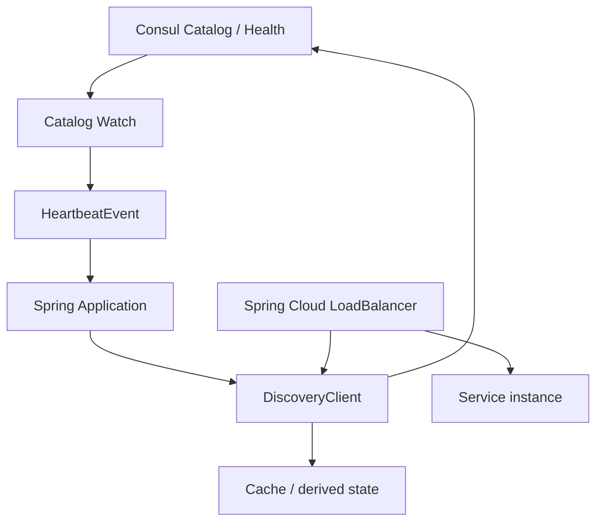

# Catalog Watch and How Applications Detect Changes

## 1. Why Do Applications Need to Watch the Catalog?

In a microservice system, Consul stores service and instance information in the service catalog. When an instance is registered, deregistered, or changes health status, consumers need to update their view to pick an appropriate call target. If a consumer reads the catalog only once at startup and holds that list forever, it can keep calling stopped instances or miss newly added ones.

Catalog Watch is a way to monitor changes in the Consul Catalog and notify the application when relevant data changes. After receiving a signal, the application can re-query the registry, update its cache, or recompute dependency state.

In Spring Cloud Service Discovery, `DiscoveryClient` provides a common API for retrieving services and instances. With Consul, the implementation uses the Consul Catalog/Health API as its data source. Catalog Watch tells the application when to refresh data; it does not replace instance lookups, health checks, or load balancing.

## 2. Distinguishing Catalog, Health, and Watch

Consul separates service registration data from health check results:

| Component | Content | Question Answered |
|---|---|---|
| Catalog | Registered services, nodes, addresses, ports, tags, and metadata | Which services/instances are registered? |
| Health | Status of health checks attached to nodes or services | Is an instance passing, warning, or critical? |
| Catalog Watch | Change detection mechanism from catalog/health queries | When should the application re-read data? |
| DiscoveryClient | Spring Cloud abstraction for querying instances | Which API does the application use to retrieve instances? |
| Load balancer | Component that selects an instance for a request | Which instance should handle the next request? |

A service can still exist in the catalog while its health check is `critical`. Thus, watching only the service list is insufficient to conclude an instance can receive traffic. When you need a list of healthy instances, query the health endpoint or use DiscoveryClient with the appropriate health-filtering mechanism.

## 3. Consul Detects Changes via Blocking Queries

### 3.1. The Idea Behind `index` and `wait`

The Consul HTTP API supports blocking queries. Instead of calling the API repeatedly on short intervals and receiving identical data, the client sends the `index` from the previous read along with a `wait` duration. Consul holds the request open until relevant data changes or the wait duration expires.

When returning, the response typically includes an `X-Consul-Index` header. The client stores this index and uses it on the next request:

1. Call the API initially with `index=0` to obtain the current snapshot.
2. Read `X-Consul-Index` from the response.
3. Call the same API again with the received `index` and `wait`, such as `wait=5m`.
4. When data changes, Consul returns a new response earlier than the timeout; the client reads the new index and continues the watch loop.
5. If the wait period expires without changes, the request returns with the current index; the client continues waiting with that index.

`index` is a cursor telling Consul which data version the client has already read. `wait` is the maximum wait duration for a single blocking query; the server may enforce its own upper bound. Avoid immediately firing tight retry loops on errors, or if a timeout occurs without handling backoff when needed, as improper loops turn a watch into aggressive polling and create unnecessary load.

### 3.2. Example Watching the Service List

The catalog services endpoint is:

```text
GET /v1/catalog/services
```

First read:

```bash
curl -i "http://localhost:8500/v1/catalog/services?index=0&wait=5m"
```

Suppose the response includes the header:

```text
X-Consul-Index: 1250
```

The next request uses the received index:

```bash
curl -i "http://localhost:8500/v1/catalog/services?index=1250&wait=5m"
```

When the catalog changes, Consul returns updated data along with a new `X-Consul-Index`. The client stores that index and continues watching. If nothing changes, the request simply returns after `wait` elapses.

This example watches the list of service names in the catalog. It is not always sufficient to detect every instance or health change for an already existing service. If you need to track instances and check statuses, choose a more suitable endpoint.

### 3.3. Watching Instances and Health of a Service

To read instances along with their health statuses, use the Health API:

```text
GET /v1/health/service/{service-name}
```

Example retrieving only passing instances:

```bash
curl -i "http://localhost:8500/v1/health/service/payment-service?passing=true&index=0&wait=5m"
```

After the first response, capture `X-Consul-Index` and reuse it in the subsequent request:

```bash
curl -i "http://localhost:8500/v1/health/service/payment-service?passing=true&index=1250&wait=5m"
```

Querying `passing=true` restricts results to service instances whose relevant checks are passing according to the endpoint's semantics. If you also need to observe `warning` or `critical` states, omit this filter and evaluate the returned statuses yourself.

Choose the query based on your application's question:

- Only need to know when a new service is added to or removed from the catalog: watch `/v1/catalog/services`.
- Need to know which instances of `payment-service` appear or disappear: watch that specific catalog service or its Health API.
- Need to know whether instances are eligible to receive traffic: watch the Health API and filter statuses per application policy.

## 4. Index Handling and Edge Cases

Watch clients must manage indices carefully:

- Use `index=0` on the initial request to obtain the baseline snapshot and cursor.
- Store the index from the `X-Consul-Index` header; do not manually increment the index by adding one.
- When a request returns on timeout without changes, continue watching with the returned index.
- When a connection error occurs, preserve necessary state and retry with backoff; avoid tight busy-loop requests.
- If a returned index is lower than the stored index after a failure, restore, or cluster state change, handle it per your Consul version's blocking query guidance. Reset the cursor and fetch a fresh snapshot to avoid waiting on an obsolete index.
- Do not assume every single change produces a distinct event that the application will individually receive. Blocking queries detect that data changed; applications should read the latest snapshot and reconcile current state.

Consul may return identical results across multiple queries when no relevant change occurred. Applications should compare pertinent data or the index to avoid re-running expensive work when the snapshot has not changed.

## 5. Catalog Watch in Spring Cloud Consul

Spring Cloud Consul provides a Catalog Watch mechanism so Spring applications can detect catalog changes without hand-writing the entire Consul API watch loop. In many versions, the built-in watch runs as a scheduled background task that polls the catalog and publishes a `HeartbeatEvent` when a change is detected. Exact implementation, property names, and tracking details vary by release train; verify against the documentation for your exact Spring Cloud Consul version.

Common configuration looks like:

```yaml
spring:
  cloud:
    consul:
      discovery:
        catalog-services-watch:
          enabled: true
          delay: 1000
```

`enabled` turns the built-in watch on or off; `delay` is the interval between checks in milliseconds in versions supporting this property. Some documentation or releases may show property names in camelCase, such as `catalogServicesWatch.enabled` and `catalogServicesWatch.delay`. Check your project release train's configuration metadata/Javadoc before applying.

Crucially, do not assume Spring Cloud's built-in Catalog Watch always uses Consul blocking queries with `index`/`wait` like a custom client. Several versions perform scheduled catalog checks. Blocking queries are a Consul HTTP API capability; how Spring Cloud Consul uses that API is a version-specific implementation detail.

### 5.1. Listening for `HeartbeatEvent`

When the built-in watch detects a catalog change, the application can listen for Spring Cloud Commons' `HeartbeatEvent`:

```java
import org.springframework.cloud.client.discovery.event.HeartbeatEvent;
import org.springframework.context.event.EventListener;
import org.springframework.stereotype.Component;

@Component
public class CatalogChangeListener {

    @EventListener
    public void onCatalogChanged(HeartbeatEvent event) {
        // Treat the event as a signal to refresh discovery state.
        // Re-query DiscoveryClient or update the internal cache.
    }
}
```

`HeartbeatEvent` signals that the discovery source observed a change or heartbeat update. Do not treat the event as a complete diff listing which instances were added, removed, or changed state. Upon receiving the event, the application should re-query `DiscoveryClient` or the Consul API for the latest snapshot.

Example refreshing the instance list:

```java
import java.util.List;

import org.springframework.cloud.client.ServiceInstance;
import org.springframework.cloud.client.discovery.DiscoveryClient;
import org.springframework.cloud.client.discovery.event.HeartbeatEvent;
import org.springframework.context.event.EventListener;
import org.springframework.stereotype.Component;

@Component
public class PaymentCatalogRefresher {

    private final DiscoveryClient discoveryClient;

    public PaymentCatalogRefresher(DiscoveryClient discoveryClient) {
        this.discoveryClient = discoveryClient;
    }

    @EventListener
    public void onCatalogChanged(HeartbeatEvent event) {
        List<ServiceInstance> instances =
                discoveryClient.getInstances("payment-service");

        // Update internal cache idempotently.
        // Do not assume the list is always non-empty or all instances are healthy.
    }
}
```

This example only illustrates the event -> snapshot query flow. In production applications, keep event listener work lightweight; if refreshing is slow, offload to an appropriate executor, coalesce rapid consecutive events, and ensure thread-safe cache updates when refreshes overlap.

### 5.2. Watching the Catalog Is Not Per-Instance Health Checking

Catalog Watch may only monitor changes to the service list. A service remains in the catalog even when one of its instances turns `critical`; depending on the endpoint and watch implementation, health or instance-level changes might not alter the service list.

If the application must react to individual instance states, watch the Health API or query the specific service. Also define which states are eligible for traffic: `passing` is normally selected for regular requests; `warning` requires a policy decision; `critical` must normally be excluded from traffic.

## 6. Consul Watch CLI and Handlers

Beyond calling the HTTP API, Consul provides the `consul watch` command to monitor a data type and invoke a handler on changes. Example:

```bash
consul watch -type=services -datacenter=dc1 ./refresh-services.sh
```

Or watch a specific service:

```bash
consul watch -type=service -service=payment-service ./refresh-payment.sh
```

The handler receives watch data via standard input in the format produced by the Consul CLI. The script should parse input, check for errors, update state idempotently, and log activity. Watch types and options depend on the Consul version; check `consul watch -h` and corresponding docs before using in production.

CLI watches fit automation or integrations outside a Spring application. Inside a Spring Boot application, using Spring Cloud Consul Catalog Watch or the Consul HTTP API through an appropriate client is generally preferable for managing lifecycle, retries, and events in-process.

## 7. What Should the Application Do After Receiving a Change?

A watch only notifies that data should be re-read. The application must determine the appropriate actions:

1. **Read the latest snapshot:** query `DiscoveryClient`, the Catalog API, or the Health API within the necessary scope.
2. **Compare state:** identify which services/instances appeared, disappeared, or changed health.
3. **Update cache:** replace or update internal caches in a thread-safe, idempotent manner.
4. **Update traffic selection:** if managing routing manually, exclude ineligible instances and include new ones; if using Spring Cloud LoadBalancer, let discovery/load balancing supply the updated list via its mechanism.
5. **Record observability:** log/emit metrics for change count, refresh duration, passing/warning/critical instance counts, and query errors.

Never trigger irreversible business actions merely because a watch event arrived. Events can be coalesced, duplicated, or arrive after state has changed yet again. Use the latest snapshot as the source of truth and make update operations safe to re-run.

## 8. Debouncing, Retries, and Error Handling

When running watches in environments where many instances scale simultaneously, bursts of changes can arrive back-to-back. If every single event triggers heavy work, the application can create load spikes on Consul or itself.

Key principles:

- **Debounce/coalesce:** collapse rapid signals into a single snapshot refresh.
- **Idempotency:** applying the same snapshot multiple times produces the same correct state.
- **Bounded retry:** retry network failures with exponential backoff and jitter; avoid unbounded busy loops.
- **Timeout:** set deadlines on HTTP requests and blocking query waits.
- **Cursor recovery:** persist valid indices; if an index resets or becomes invalid, fetch a fresh snapshot and re-establish the cursor.
- **Stale state:** when Consul is temporarily unreachable, decide whether to keep serving stale cache or switch to degraded mode; never treat stale cache as fresh data.
- **Concurrency:** ensure overlapping refreshes cannot overwrite a newer snapshot with an older result.
- **Shutdown:** cancel watch tasks or close HTTP clients according to Spring lifecycle hooks so threads and connections do not linger after context shutdown.

When using blocking queries, set `wait` long enough to reduce polling, yet shorter than timeouts on intermediate proxies or load balancers. When a proxy closes a request early, the client must reconnect and resume from the appropriate cursor.

## 9. How Watch Coordinates With DiscoveryClient and LoadBalancer

`DiscoveryClient` is the API for querying the instance list; Catalog Watch is the refresh signal. Spring Cloud LoadBalancer uses discovery to find instances when picking a request target. These three roles are related yet distinct:



When receiving an event, the application can refresh its own derived state. Meanwhile, regular requests should flow through an appropriate load-balancing mechanism instead of maintaining a static address list with no expiration.

## 10. Example HTTP Blocking Query Flow

A custom client can watch the health of `payment-service` using the following conceptual loop:

```text
index = 0

while application_is_running:
    response = GET /v1/health/service/payment-service
               ?passing=true&index={index}&wait=5m

    if response is successful:
        new_index = response.header["X-Consul-Index"]
        if response.data or new_index differs from current snapshot:
            replace_local_snapshot(response.data)
        index = new_index
    else:
        wait_with_exponential_backoff_and_jitter()
```

This is pseudocode illustrating the protocol; real implementations need an HTTP client with timeouts, status code handling, response parsing, cancellation on shutdown, and index-reset handling. Never run blocking loops on the application's HTTP request-serving threads.

## 11. Common Misconceptions

| Misconception | Accurate Understanding |
|---|---|
| Catalog Watch is a health check | Watch detects data changes; health checks evaluate instance health |
| Watching `/v1/catalog/services` alone is enough | This endpoint focuses on the service list; use Health API when instance/health state matters |
| Every watch event contains a full diff | Events are typically signals; re-query the snapshot to get current state |
| `ApplicationReadyEvent` or a watch event guarantees the catalog is settled | The registry can keep changing with propagation lag; always handle empty/stale snapshots |
| Blocking queries are fast polling | Consul holds the request open until the index changes or `wait` expires |
| Spring Cloud Catalog Watch always uses blocking queries in every version | Built-in mechanisms vary by release; many versions use scheduled catalog checks |
| Catalog Watch load-balances requests on its own | The load balancer selects instances; watch only signals when data needs refreshing |
| No events means the service definitely did not change | The watch may be failing or disconnected; reconnect and reconcile snapshots on recovery |

## 12. Implementation Checklist

- [ ] Choose the right data source: Catalog API or Health API based on the type of changes to detect.
- [ ] If using blocking queries, store `X-Consul-Index`, pass it back via `index`, and set a reasonable `wait`.
- [ ] Handle timeouts, network errors, index resets, and reconnections.
- [ ] Verify whether Spring Cloud Consul's built-in Catalog Watch in your release train runs on a schedule or via blocking queries.
- [ ] Listen for `HeartbeatEvent` as a refresh signal; do not assume the event is a detailed diff.
- [ ] Re-query the snapshot via `DiscoveryClient` or Consul API after receiving the signal.
- [ ] Distinguish a service existing in the catalog from instances being passing.
- [ ] Debounce/coalesce events and update caches idempotently and thread-safely.
- [ ] Configure timeouts, retry/backoff, and a stale-cache policy when Consul is disrupted.
- [ ] Monitor logs/metrics and shut down watch tasks cleanly via lifecycle hooks on application shutdown.

## 13. Conclusion

Consul Catalog Watch lets applications detect registry changes so they can re-read service and instance state. At the Consul HTTP API layer, blocking queries use `index` and `wait` to wait for data changes without continuous polling. At the Spring Cloud Consul layer, the built-in Catalog Watch can emit `HeartbeatEvent` when changes are detected; implementation and configuration details depend on the version.

Treat watch events as refresh signals, then query the latest snapshot and update caches idempotently. When you need to know whether instances can accept traffic, monitor the Health API and check statuses; when sending requests, let DiscoveryClient and the load balancer supply and select instances through the appropriate mechanism.
