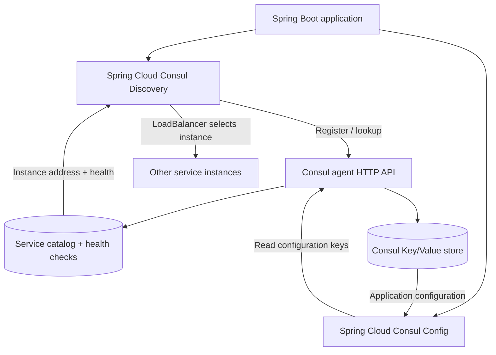

# Separating Consul Discovery Configuration From Consul Config

Spring Cloud Consul integrates Spring Boot applications with Consul through two independent feature sets: **Consul Discovery** uses the service catalog to register and locate service instances; **Consul Config** uses the Key/Value store to load externalized application configuration. Both can share the same Consul cluster and the same Consul agent endpoint, yet they solve different problems and have separate dependencies, configuration namespaces, and lifecycles.

A service can use Discovery without Config, use Config without registering a service, or enable both. Keeping the two features distinct prevents accidentally enabling service registration when only configuration reading is desired, or expecting Consul KV entries to automatically create service instances in the catalog.

## 1. Two Features, Two Types of Data

### Consul Discovery: Finding Service Instances

Discovery manages information so applications can find one another. A service provider registers its service with a Consul agent. The agent updates the service catalog and runs declared health checks. A consumer looks up a service by name, receives the addresses and ports of eligible instances, and uses Spring Cloud LoadBalancer or another routing mechanism to pick an instance.

Data typically belonging to Discovery:

- Service name and service ID.
- Instance ID of each running replica.
- Node, reachable hostname/IP, and port.
- Tags and metadata for identifying or filtering instances.
- Health checks and `passing`, `warning`, or `critical` statuses.

Related Consul APIs include the Agent Service API for registering services and the Health API/Catalog API for lookups. For example, an agent receives registrations at `/v1/agent/service/register`; consumers can query service status at `/v1/health/service/{service}`.

### Consul Config: Loading Application Configuration

Config uses the Consul Key/Value store to hold configuration values such as dependency URLs, feature flags, timeout limits, topic names, or environment-specific settings. Spring Cloud Consul Config reads keys matching the application's context and active profiles and loads them into the Spring `Environment` during startup.

Data typically belonging to Config:

- Shared application configuration.
- Configuration specific to `spring.application.name`.
- Profile-specific configuration such as `dev`, `staging`, and `production`.
- YAML/properties files stored under a KV key.
- Configuration changes tracked via the watch mechanism if enabled.

Config typically uses the Consul KV API, such as `/v1/kv/{key}`. A KV key is not a service instance and is never returned by `DiscoveryClient.getInstances()`.

### Quick Comparison

| Aspect | Consul Discovery | Consul Config |
| --- | --- | --- |
| Goal | Register and locate service instances | Store and distribute application configuration |
| Data source | Agent service registry, catalog, and health checks | Consul Key/Value store |
| Typical data | Service name, instance ID, host, port, tags, health | YAML, properties, feature flags, URLs, and app parameters |
| Primary APIs | Agent Service, Catalog, Health | KV |
| Spring abstraction | `DiscoveryClient`, `ServiceRegistry`, `ServiceInstance` | Spring Config Data and `Environment` |
| Common dependency | `spring-cloud-starter-consul-discovery` | `spring-cloud-starter-consul-config` |
| Enable/disable flag | `spring.cloud.consul.discovery.enabled` | `spring.cloud.consul.config.enabled` |
| Registers a service automatically? | Possible, if `discovery.register` is enabled | No |
| Creates KV data automatically? | No | Does not auto-create; reads data already written to KV |

## 2. Architecture When Used Independently or Combined

Both features can connect to the same Consul agent, yet each calls separate APIs and reads a different kind of data.



Common deployment patterns:

1. **Discovery only:** the application configures itself using files or environment variables, while registering and discovering services through Consul.
2. **Config only:** the application loads configuration from Consul KV without registering a service or using Consul for discovery.
3. **Discovery and Config:** the application both registers/discovers instances and loads centralized configuration.

Sharing a Consul cluster does not couple the two features together. Access permissions for KV and for the service catalog should likewise be granted independently as needed.

## 3. Dependencies for Each Feature

Spring Cloud Consul provides separate starters for Discovery and Config. Use a Spring Cloud BOM compatible with your project's Spring Boot version to manage dependency versions.

### Using Consul Discovery Only

Add the dependency:

```xml
<dependency>
    <groupId>org.springframework.cloud</groupId>
    <artifactId>spring-cloud-starter-consul-discovery</artifactId>
</dependency>
```

This starter integrates service registration and discovery with Consul. If the application calls services using Spring Cloud LoadBalancer, add the corresponding LoadBalancer starter:

```xml
<dependency>
    <groupId>org.springframework.cloud</groupId>
    <artifactId>spring-cloud-starter-loadbalancer</artifactId>
</dependency>
```

### Using Consul Config Only

Add the dependency:

```xml
<dependency>
    <groupId>org.springframework.cloud</groupId>
    <artifactId>spring-cloud-starter-consul-config</artifactId>
</dependency>
```

The application loads configuration from Consul KV. Add the Discovery starter only if the application also needs to register or look up service instances.

### Using Both

When an application needs both service discovery and externalized configuration, declare both starters:

```xml
<dependencies>
    <dependency>
        <groupId>org.springframework.cloud</groupId>
        <artifactId>spring-cloud-starter-consul-discovery</artifactId>
    </dependency>
    <dependency>
        <groupId>org.springframework.cloud</groupId>
        <artifactId>spring-cloud-starter-consul-config</artifactId>
    </dependency>
    <dependency>
        <groupId>org.springframework.cloud</groupId>
        <artifactId>spring-cloud-starter-loadbalancer</artifactId>
    </dependency>
</dependencies>
```

Do not declare a Consul Server dependency in the application. The Consul agent/server is separate infrastructure; the starters are purely client integrations inside the Spring Boot application.

## 4. Configuration Namespaces: `discovery` and `config`

Properties for the two features reside under separate branches of `spring.cloud.consul`:

```yaml
spring:
  cloud:
    consul:
      host: localhost
      port: 8500
      discovery:
        enabled: true
        register: true
      config:
        enabled: false
```

`host` and `port` define the Consul agent endpoint used by Spring Cloud Consul. Properties under `discovery` control service registration and lookup; properties under `config` control reading KV and loading configuration.

The two enable/disable flags have separate scopes:

- `spring.cloud.consul.discovery.enabled=false` disables discovery integration for the application. It does not mean Config is also disabled.
- `spring.cloud.consul.config.enabled=false` disables Config integration. It does not prevent the application from registering a service if Discovery remains enabled.

When both are needed, enable both branches. Do not place Config properties such as `prefix`, `format`, or `data-key` under `discovery`; likewise, do not place `register`, `service-name`, or health-check properties under `config`.

## 5. Standalone Discovery Configuration

Example where `payment-service` registers its service and health check with Consul while reading configuration from `application.yml` or environment variables:

```yaml
spring:
  application:
    name: payment-service
  cloud:
    consul:
      host: ${CONSUL_HOST:localhost}
      port: ${CONSUL_PORT:8500}
      discovery:
        enabled: true
        register: true
        service-name: payment-service
        instance-id: ${spring.application.name}:${spring.cloud.client.hostname}:${server.port}
        prefer-ip-address: true
        health-check-path: /actuator/health
        health-check-interval: 15s
      config:
        enabled: false

server:
  port: 8085

management:
  endpoints:
    web:
      exposure:
        include: health,info
```

In this configuration:

- `discovery.enabled` enables Consul Discovery integration.
- `register` enables registering the service instance.
- `service-name` is the logical name consumers use for lookups.
- `instance-id` distinguishes each running instance of the service.
- `prefer-ip-address` requests advertising the IP rather than hostname if the selected address fits the network.
- `health-check-path` and `health-check-interval` configure the HTTP health check executed by the Consul agent.
- `config.enabled=false` explicitly states the application does not load configuration from Consul KV via Consul Config.

The agent must be able to reach the health endpoint address and port. If the application runs in a container, do not use `localhost` in the health check address if the agent lives in another network namespace. Advertise a hostname/IP routable from both the Consul agent and consumers.

A Discovery-only application can still load configuration from YAML files, environment variables, Kubernetes ConfigMaps, or another configuration system. Omitting Consul Config does not affect service registration.

## 6. Standalone Config Configuration

A batch application or worker may retrieve parameters from Consul KV without needing to appear in the service catalog. With Spring Boot supporting the Config Data API, declare Consul Config via `spring.config.import`.

Example `application.yml`:

```yaml
spring:
  application:
    name: invoice-batch
  config:
    import: optional:consul:
  cloud:
    consul:
      host: ${CONSUL_HOST:localhost}
      port: ${CONSUL_PORT:8500}
      discovery:
        enabled: false
      config:
        enabled: true
        format: YAML
        prefix: config
        default-context: application
        profile-separator: ","
        data-key: data
        fail-fast: false

server:
  port: 8090
```

Key points to understand:

- `spring.config.import` tells Spring Boot to load the Consul configuration source during the Config Data phase.
- `optional:consul:` allows the application to continue starting if the Consul Config source is unavailable. Remove `optional:` or enable fail-fast per appropriate configuration if the application strictly requires configuration from Consul.
- `format: YAML` specifies that KV content is parsed as YAML.
- `prefix` is the root folder in KV.
- `default-context` is the shared configuration context.
- `profile-separator` separates the application name from the profile in the key path.
- `data-key` is the key holding the YAML/properties content inside a context.
- `discovery.enabled=false` prevents the application from registering or looking up services via Consul Discovery.

Property names and Config Data loading details may vary across Spring Boot/Spring Cloud Consul versions. For projects older than the Config Data API, the bootstrap mechanism differs; follow the guidance for your installed release train.

### Example Key Structure in Consul KV

With `prefix=config`, `default-context=application`, `spring.application.name=invoice-batch`, profile `production`, and `data-key=data`, contexts typically take this form:

```text
config/
├── application/data
├── application,production/data
├── invoice-batch/data
└── invoice-batch,production/data
```

The shared context supplies default values; the application context overrides shared settings; profile contexts supply environment-specific overrides. Exact precedence is applied by Spring Cloud Consul Config when building property sources; inspect effective properties whenever multiple contexts declare the same key.

Example YAML content stored under key `config/invoice-batch,production/data`:

```yaml
invoice:
  export:
    bucket: invoice-production
    batch-size: 500
  downstream:
    timeout: 3s
```

You can write a YAML file into KV using the Consul CLI, for example:

```bash
consul kv put config/invoice-batch,production/data @invoice-production.yml
```

`invoice-production.yml` is a local configuration file loaded into KV; it is not a service registration file.

## 7. Enabling Discovery and Config Together

A microservice commonly needs both to register as a service and to fetch centralized configuration. For example, `payment-service` might use Consul Config to fetch an external payment gateway endpoint and Consul Discovery so other services can locate `payment-service` itself.

```yaml
spring:
  application:
    name: payment-service
  config:
    import: consul:
  cloud:
    consul:
      host: ${CONSUL_HOST:localhost}
      port: ${CONSUL_PORT:8500}
      discovery:
        enabled: true
        register: true
        service-name: payment-service
        instance-id: ${spring.application.name}:${spring.cloud.client.hostname}:${server.port}
        prefer-ip-address: true
        health-check-path: /actuator/health
        health-check-interval: 15s
      config:
        enabled: true
        format: YAML
        prefix: config
        default-context: application
        profile-separator: ","
        data-key: data
        fail-fast: true

server:
  port: 8085

management:
  endpoints:
    web:
      exposure:
        include: health,info
```

Here the two branches are configured side by side without sharing business properties:

- Discovery registers `payment-service`, publishing the instance address and health check.
- Config loads keys such as `payment.gateway.url` and `payment.timeout` from KV into the Spring Environment.
- `spring.config.import: consul:` together with `fail-fast: true` indicates the application requires Consul Config to be available at startup. If not mandatory, use `optional:consul:` and set `fail-fast: false`.

Do not enable Config merely because the Discovery starter is present, or vice versa. Add each feature only when the application actually needs it.

## 8. Distinguishing the Two Lifecycles

Discovery and Config operate at different points in time:

| Stage | Discovery | Config |
| --- | --- | --- |
| Application startup | Creates registration and sends it to the Consul agent if `register=true` | Reads KV by context/profile while building the Spring Environment |
| After startup | Sends heartbeats/health checks and serves lookups | Application reads loaded values from Environment/beans |
| Data changes | Service registration, health, and catalog are updated | KV changes; Config watch can detect changes if enabled |
| When instance stops | Deregisters or transitions health/TTL per configuration | Does not automatically delete configuration keys in KV |
| Consumer usage | `DiscoveryClient`, `ServiceInstance`, LoadBalancer | `@Value`, `@ConfigurationProperties`, Spring Environment |

A KV change does not re-register a service; registering a service does not change application configuration. The two mechanisms may share a Consul agent, yet do not share a lifecycle.

## 9. Config Watch and Runtime Configuration Updates

Consul Config can monitor KV changes using watch. Example:

```yaml
spring:
  cloud:
    consul:
      config:
        watch:
          enabled: true
          delay: 1000
```

Watch helps the application detect configuration changes according to the mechanism and interval supported by your Spring Cloud Consul version. However, detecting a KV change does not mean every Java bean is automatically recreated. Beans needing updated values must participate in an appropriate refresh mechanism, such as `@RefreshScope` or another configuration refresh mechanism supported by Spring Cloud.

Avoid continually mutating critical configuration keys without a rollout, verification, and rollback process. For changes affecting database connections, credentials, or bean wiring, a controlled restart may be safer and more predictable than hot refresh.

Discovery also updates through its own mechanisms: health checks, registrations, catalog queries, and caches. Config Watch does not replace health checks, and health checks do not watch KV changes.

## 10. Verifying Each Feature Independently

### Verifying Discovery

After starting the provider with `discovery.register=true`, inspect the Consul UI or call the API:

```bash
# View services in the catalog
curl http://localhost:8500/v1/catalog/services

# View instances and health statuses of payment-service
curl http://localhost:8500/v1/health/service/payment-service

# Retrieve only passing instances
curl "http://localhost:8500/v1/health/service/payment-service?passing=true"
```

If ACLs are enabled, supply a token with appropriate service/health read permissions. Verify host, port, instance ID, and check status. If the service is missing, check application and Consul agent logs to determine whether registration was sent.

### Verifying Config

Verify that the KV key exists:

```bash
# Read the YAML configuration key
consul kv get config/invoice-batch,production/data

# List keys under the config prefix
consul kv get -recurse config/
```

Next, start the application with the matching `spring.application.name` and active profile. Verify loaded values through controlled logs or a protected internal health/info endpoint. Never log secrets or the entire Environment.

## 11. ACLs, TLS, and Permissions

Discovery and Config generally require distinct permissions:

- A Discovery provider needs permission to register/update its own service and perform agent/check operations matching the deployment model.
- A Discovery consumer needs permission to read catalog/health data for allowed services.
- A Config client needs permission to read KV keys within its granted prefix/context.
- Pipelines or administrators writing Config need KV write permissions; runtime applications should normally lack write access if they only read configuration.

Issue ACL tokens following the principle of least privilege. Avoid sharing a single admin token across all microservices. Inject tokens via a secrets manager or platform secret mechanism rather than committing them to YAML files or container images.

TLS protects transport to the Consul agent/server. Configure certificates, CA trust, and authentication per environment policy. Never expose the agent HTTP API, UI, or KV to the public Internet. Restrict KV read permissions because configuration data may contain internal endpoints or sensitive details.

Do not store plaintext secrets directly in KV if security policy prohibits it. Store references to a secrets manager or use an appropriate encryption/secret-store mechanism. Config watch must also respect read permissions and the key scope visible to the application.

## 12. Common Configuration Errors

| Symptom | Possible Cause | Resolution |
| --- | --- | --- |
| App reads KV yet does not appear in service catalog | Only Config starter added, or `discovery.enabled=false` | Add Discovery starter and enable discovery registration |
| Service appears yet app cannot fetch configuration | Only Discovery starter added, or Config import misconfigured | Add Config starter, configure `spring.config.import` and KV context |
| `DiscoveryClient` returns empty list | Discovery disabled, service unregistered, or consumer lacks read rights | Check `discovery.enabled`, registration, catalog, and ACLs |
| App fails to start because Consul Config is missing | Mandatory Config import, Consul unreachable, or `fail-fast` enabled | Check connectivity; choose optional vs. fail-fast per requirements |
| KV has key yet property is not loaded | Wrong prefix, context, profile separator, format, or data-key | Compare KV key path against Config properties |
| YAML KV fails to parse | Key content is invalid YAML or `format` is wrong | Validate content and set `format: YAML` |
| KV updated yet bean does not change | Watch disabled or bean does not participate in refresh | Check watch config and bean refresh/restart mechanism |
| Consul marks service `critical` | Agent cannot reach health endpoint or wrong path/port | Call health endpoint from the agent's network and check firewall |
| Config reads work yet Discovery registration is denied | Token only has KV rights, missing service/agent rights | Issue least-privilege ACL permissions for Discovery |
| Discovery works yet Config gets `permission denied` | Token lacks read permissions on the KV prefix | Check ACL policy and granted prefix |

## 13. Separating Configuration by Deployment Environment

Place the Consul agent address and connection options in environment-overridable configuration sources. You can use environment variables for host/port while managing Discovery and Config structure in application or profile files.

Example split:

```text
application.yml
  - spring.application.name
  - common Discovery configuration
  - safe Config defaults

application-local.yml
  - local Consul host localhost
  - optional Config or disabled if unused locally

application-production.yml
  - internal Consul host
  - TLS and secrets supplied by the platform
  - fail-fast Config if centralized config is mandatory
  - production Discovery registration and health checks
```

Never place real tokens inside production profiles. Also avoid sharing the exact same Consul prefix across all environments unless ACLs and contexts are isolated. You can separate environments using distinct Consul datacenters/namespaces or prefixes, depending on your organization model and Consul version.

## 14. Selection and Deployment Checklist

- [ ] Identified whether the application needs service registration/lookup, centralized config, or both.
- [ ] Discovery only: includes `spring-cloud-starter-consul-discovery` and configures `spring.cloud.consul.discovery`.
- [ ] Config only: includes `spring-cloud-starter-consul-config`, `spring.config.import`, and configures `spring.cloud.consul.config`.
- [ ] Both: declares both starters and configures both branches separately.
- [ ] `discovery.enabled` and `config.enabled` toggled independently as required.
- [ ] Discovery health check is reachable by the Consul agent.
- [ ] Config prefix, context, profile separator, format, and data-key match the KV layout.
- [ ] Decided whether the application may start when Consul Config is temporarily unavailable.
- [ ] Defined how refresh or restart happens when KV changes.
- [ ] ACL tokens scoped separately for service registration, service read, and KV read/write.
- [ ] TLS, secrets, and internal networking configured securely.
- [ ] Verified catalog/health and KV/property sources independently after deployment.

Consul Discovery manages service instance lifecycles and health so applications can locate one another; Consul Config feeds configuration from KV into the Spring Environment. While the two features can share a Consul agent, they remain independent in starters, configuration namespaces, APIs, permissions, and lifecycles. Select the right dependencies and enable only the branches you need, then verify the service catalog and KV store using separate checks.
