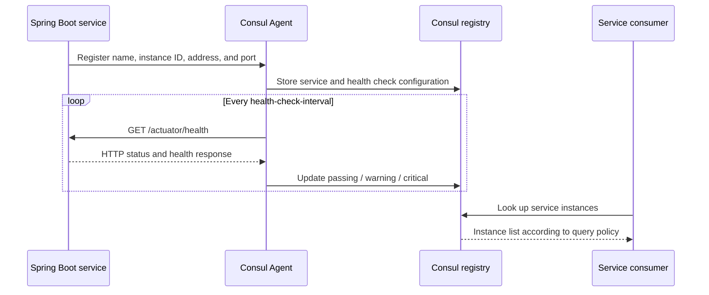

# HTTP Checks to Actuator Health and Passing, Warning, and Critical States

In Spring Cloud Service Discovery, registering an instance with Consul only lets services know that the instance exists. Clients also need to know whether the instance can currently receive traffic. Consul solves this with health checks: the Consul Agent periodically calls an application endpoint, records the result in the registry, and provides the status so clients can select suitable instances.

This lesson focuses on HTTP health checks targeting Spring Boot Actuator. You will configure the `/actuator/health` endpoint, understand how Consul maps HTTP status codes to the three states `passing`, `warning`, and `critical`, and verify the results from both the application and Consul. This is part of the lifecycle covering registration, health checking, load balancing, and resolving registry drift when deploying microservices with Spring Cloud.

## 1. Where Does HTTP Health Check Fit in Service Discovery?

A service is typically registered with Consul along with metadata such as the service name, instance ID, IP address, and port. With an HTTP-type health check, the Consul Agent uses the registered address and port, appends the check path, and sends requests on a schedule.

Basic flow:



There are three components to distinguish:

- **Service registration** describes where an instance lives and which service it belongs to.
- **Health check** verifies whether the instance is reachable and satisfies the check condition.
- **Service discovery** returns the list of instances to the calling application. Spring Cloud can use `DiscoveryClient` and Spring Cloud LoadBalancer to look up and select instances from discovery data.

An instance can already be registered while its health check is `critical`. Therefore, seeing a service appear in the Consul Catalog is not enough to conclude that the instance is ready to receive requests.

## 2. How Does Consul Evaluate HTTP Responses?

For an HTTP health check, Consul sends a request to the configured URL and primarily evaluates the **HTTP status code**. Consul does not parse the JSON body and interpret Actuator's `status` field on its own.

| HTTP Result | Consul Status | Meaning |
| --- | --- | --- |
| `2xx` code | `passing` | Endpoint responded successfully. |
| `429` code | `warning` | Endpoint responded but reported a warning state by HTTP check convention. |
| Code other than `2xx` and `429`, or connection failure | `critical` | Check failed; for example, the endpoint returned `404`, `401`, `503`, timed out, or was unreachable. |

For example, Actuator returns:

```http
HTTP/1.1 200 OK
Content-Type: application/vnd.spring-boot.actuator.v3+json

{"status":"UP"}
```

Consul records the check as `passing` because the HTTP code is `200`.

If a critical dependency fails and Actuator returns:

```http
HTTP/1.1 503 Service Unavailable
Content-Type: application/vnd.spring-boot.actuator.v3+json

{"status":"DOWN"}
```

Consul records `critical` because the HTTP code is `503`. The `{"status":"DOWN"}` body is useful for operators, but the `503` status code itself is the HTTP signal Consul uses to classify the check.

Key point to remember: `warning` does not appear automatically just because Actuator's JSON contains a status named `WARNING`. For Consul to receive `warning` via an HTTP check, the endpoint must return HTTP `429`.

## 3. Configuring Actuator and Spring Cloud Consul

### 3.1. Add Dependencies

The application needs Spring Boot Actuator to provide the health endpoint and Spring Cloud Consul Discovery to register the service with Consul. Example Maven dependencies:

```xml
<dependencies>
    <dependency>
        <groupId>org.springframework.boot</groupId>
        <artifactId>spring-boot-starter-actuator</artifactId>
    </dependency>

    <dependency>
        <groupId>org.springframework.cloud</groupId>
        <artifactId>spring-cloud-starter-consul-discovery</artifactId>
    </dependency>
</dependencies>
```

Manage Spring Boot and Spring Cloud versions using compatible BOMs according to your project's release train; do not pick two independent versions based solely on this example.

### 3.2. Expose the Health Endpoint and Declare the HTTP Check

Example `application.yml` for a service named `order-service`:

```yaml
spring:
  application:
    name: order-service
  cloud:
    consul:
      host: localhost
      port: 8500
      discovery:
        register: true
        health-check-path: /actuator/health
        health-check-interval: 10s
        query-passing: true

management:
  endpoints:
    web:
      exposure:
        include: health
  endpoint:
    health:
      show-details: never
```

Important properties:

- `spring.application.name` is the service name consumers use for lookup.
- `spring.cloud.consul.discovery.register` enables instance registration with Consul.
- `health-check-path` specifies the HTTP path the Consul Agent calls. The default path is typically `/actuator/health`; declaring it explicitly makes the configuration easier to read and cross-reference.
- `health-check-interval` sets the check period. For example, `10s` means the Agent checks periodically every 10 seconds.
- `query-passing: true` instructs discovery queries to return only instances whose checks are in the `passing` state. With this option enabled, `warning` or `critical` instances are excluded from passing query results.
- `management.endpoints.web.exposure.include` allows accessing the health endpoint over HTTP.
- `show-details: never` avoids exposing internal details of health indicators in the HTTP response. Consul only needs the status code to perform the check.

Property names and defaults may vary by Spring Cloud Consul version. Cross-check the configuration against your application's actual dependency version.

### 3.3. Ensure the Agent Calls the Right Address

The Consul Agent must be able to reach the registered address and port. Check the following cases during deployment:

- The application runs inside a container but registers `localhost`; from the Consul Agent's perspective, `localhost` may point to the Agent's own container or a different host than intended.
- Actuator uses a separate `management.server.port`, while the service registers the application port. In that case, configure the health check URL/port appropriately for your Spring Cloud Consul version and actual topology.
- The application changes `management.endpoints.web.base-path` or changes the health endpoint's base path, while `health-check-path` keeps the old value.
- A firewall, network policy, proxy, or TLS configuration prevents the Consul Agent from connecting to the endpoint.

Test the URL from the exact network environment used by the Consul Agent. A successful `curl` command on your development machine does not prove the Agent can reach that URL.

## 4. Verifying Results from the Application and Consul

First, call the application's endpoint directly:

```bash
curl -i http://localhost:8080/actuator/health
```

When the application is healthy, the response typically has status code `200` and a body containing `"status":"UP"`. If the application runs in a container or on another host, replace `localhost:8080` with the address the Consul Agent actually reaches.

Next, inspect the service's health checks via Consul's HTTP API:

```bash
curl http://localhost:8500/v1/health/checks/order-service
```

The API returns a list of checks attached to the service, where the `Status` field shows `passing`, `warning`, or `critical`. You can view passing instances with:

```bash
curl "http://localhost:8500/v1/health/service/order-service?passing"
```

You can also open the Consul UI, select the `order-service` service, and inspect each instance and its corresponding health check. When cross-checking, verify the exact service ID, address, port, and last update time; a service can have multiple instances, and each instance has its own state.

## 5. Mapping Actuator Statuses to HTTP Codes

Spring Boot Actuator has a mechanism for mapping health statuses to HTTP status codes. Under the default configuration, `DOWN` and `OUT_OF_SERVICE` typically return `503`; `UP` returns `200`. Because Consul evaluates the HTTP code, this mapping allows application failure states to be reflected as `critical` in the registry.

If the system genuinely needs a warning state, you can create a `HealthIndicator` returning a custom `WARNING` status and map that status to HTTP `429`. Example configuration:

```yaml
management:
  endpoint:
    health:
      status:
        http-mapping:
          down: 503
          out-of-service: 503
          warning: 429
```

A health indicator can then return `WARNING` when the service is still handling requests but has a condition that requires monitoring. Keep the `down` and `out-of-service` mappings when declaring custom mappings so severe failures continue returning `503`.

Only use `warning` when consumers and the operations team agree on what this state means. If `query-passing: true` is enabled, `warning` instances are excluded from passing queries just like unhealthy instances; therefore, consider whether a warning state should continue receiving traffic.

## 6. Choosing Appropriate Health Check Content

The health endpoint should reflect the instance's ability to serve requests. If it only checks that the process is still running, an instance might be marked `passing` even though the database or an essential dependency has lost connectivity. Conversely, putting every secondary dependency into the health check can cause the entire service to be removed from discovery when a component unrelated to the core business flow fails.

With Spring Boot, you can use health groups to separate readiness from other health information. For example, if your Spring Boot version and application configuration have readiness probes enabled, you can point Consul to `/actuator/health/readiness`. Only use this path after verifying that the health group actually exists and is exposed over HTTP; otherwise, Consul will receive `404` and transition the check to `critical`.

An appropriate endpoint should meet these criteria:

1. Respond quickly and reliably so it does not trigger false timeouts.
2. Be reachable by the Consul Agent over the internal network at the exact registered address and port.
3. Reflect the conditions that genuinely determine whether the instance can receive traffic.
4. Never expose credentials, connection strings, or infrastructure details in the response.
5. Behave consistently in HTTP status codes across local, staging, and production environments.

If the endpoint requires authentication, configure an appropriate access mechanism for the Consul Agent according to your Spring Cloud Consul version. Do not expose detailed endpoints to the public Internet just to make health checks work.

## 7. Troubleshooting Common Scenarios

| Symptom | Causes to Check | Resolution |
| --- | --- | --- |
| Application returns `200` locally but Consul reports `critical` | Agent uses a different address or port; wrong network route; firewall blocking; registered URL unreachable from Agent | Check the instance address in Consul and call the exact URL from the same network as the Agent. |
| Consul receives `404` | Wrong `health-check-path`; changed Actuator base path; health group not created or not exposed | Synchronize the path and verify the endpoint using `curl -i`. |
| Consul receives `401` or `403` | Security filter requires authentication or blocks requests from the Agent | Grant minimal access permissions for the Agent or configure supported headers. |
| Consul receives `503` | Actuator reports `DOWN`/`OUT_OF_SERVICE`; dependent health indicator failed; application not ready yet | Inspect the health response in the internal environment and identify the failing indicator. |
| Status turns `critical` even though the endpoint sometimes returns `200` | Slow endpoint response, timeouts, intermittent network errors, or overly aggressive check interval | Measure response latency, fix the cause of slowness, and choose a suitable interval. |
| Instance is `warning` but missing from discovery | `query-passing: true` is enabled, so only passing instances are queried | Inspect the check returning `429`; decide whether warning instances should receive traffic. |
| Service exists in Catalog but consumer finds no instances | Instance is registered but health check is not passing, or consumer filters for passing | Check `/v1/health/checks/{service}` and discovery query configuration. |

Health checks run periodically, so the status in Consul may lag behind a recent change in the application. When investigating, compare the request timestamp, the latest check timestamp, and the configured interval.

## 8. Quick Verification Checklist

When an instance is not selected by service discovery, follow these steps in order:

1. Confirm the instance is registered with the right name, ID, address, and port in Consul.
2. Read `health-check-path` and combine it with the actual address/port to determine the full URL.
3. Call that URL from the Consul Agent's network environment and inspect both the HTTP status and response body.
4. Read the check list via `/v1/health/checks/{service}` to identify which check is failing.
5. If the check is `critical`, resolve the connectivity error, path, access permissions, or health indicator. If the check is `warning`, investigate why the endpoint returned `429`.
6. Check the consumer's query policy, especially `query-passing`, then verify the instance now appears in discovery results.

Combining application logs, Consul Agent logs, and the health API helps separate application errors from network or registry configuration errors.

## 9. Key Takeaways

- Service registration and health checking are two distinct concerns: an instance can exist in the registry without being healthy.
- Consul HTTP checks classify based on HTTP status codes: `2xx` is `passing`, `429` is `warning`, and all other results or connection failures are `critical`.
- Actuator provides health information; HTTP status mapping determines the signal Consul observes.
- The endpoint must be reachable from the Consul Agent via the registered address and port.
- `query-passing: true` ensures consumers receive only passing instances, which also means warning instances are excluded from query results.

When these rules are configured consistently, Consul can provide a more reliable instance list to `DiscoveryClient` and Spring Cloud LoadBalancer, helping microservices avoid sending requests to unhealthy instances.
