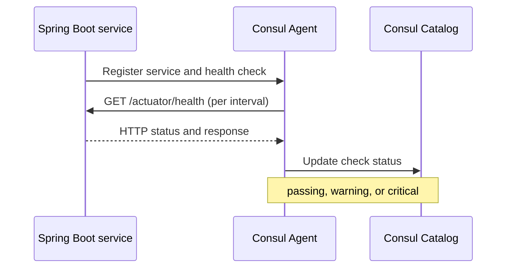
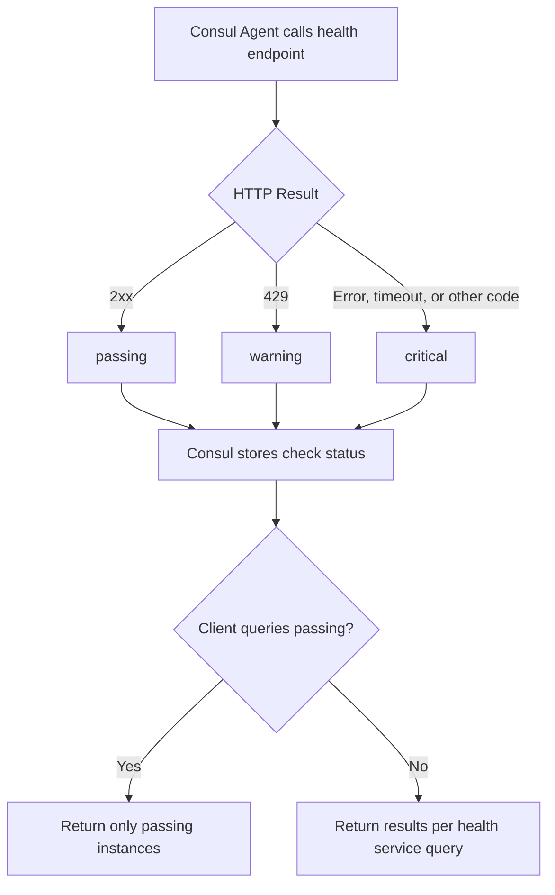

# Configuring Health Check Path, Interval, and Timeout

In Spring Cloud Service Discovery, registering an instance with Consul only tells Consul the service name, address, and port of the instance. To know whether that instance can still serve requests, Consul needs to perform a health check. Spring Cloud Consul supports configuring the check endpoint, call interval, and timeout via the `spring.cloud.consul.discovery.health-check-*` properties.

The three parameters you must understand clearly are:

- **Path (`health-check-path`):** the endpoint Consul calls to check application status.
- **Interval (`health-check-interval`):** the time period between check attempts.
- **Timeout (`health-check-timeout`):** the maximum duration Consul waits for a single check to complete before considering that check failed.

A wrong path can cause a running application to be marked unhealthy. An interval that is too long delays failure detection; a timeout that is too short can produce false alerts when the system is under load. Therefore, configure these three parameters based on the actual endpoint and the service's operational characteristics.

## 1. Default HTTP Health Check Mechanism

When an application uses Spring Cloud Consul Discovery and registers a service, Spring Cloud Consul creates an HTTP health check in Consul by default. The Consul Agent is responsible for sending requests to the instance's endpoint. For a Spring Boot application with Actuator, the default path is `/actuator/health`; the default interval is `10s`.

Basic flow:



Consul performs health checks from the Consul Agent's network perspective. Thus, the endpoint must be reachable from the agent performing the check, not only from a development machine or from inside the application itself. Service address, port, protocol, DNS, firewall, and network policy can all affect the outcome.

HTTP checks send `GET` by default. Consul evaluates status based on the returned HTTP code:

| Response Code | Check Status | Meaning |
|---|---|---|
| `200`–`299` | `passing` | Endpoint responded successfully |
| `429` | `warning` | Endpoint is rate-limiting requests |
| Other codes or failed request | `critical` | Check failed, e.g., 404, 503, connection error, or timeout |

By default, Consul does not parse Actuator's JSON body to interpret `status` or `components` fields; the HTTP status code is the primary signal of an HTTP check. Spring Boot Actuator maps health status to HTTP status according to the application's health endpoint and status mapping configuration.

## 2. Configuring the Health Check Path

The `spring.cloud.consul.discovery.health-check-path` property defines the path Consul uses to call the health endpoint. The default value is `/actuator/health`.

Example application configuration:

```yaml
spring:
  application:
    name: catalog-service
  cloud:
    consul:
      host: consul-agent.internal
      port: 8500
      discovery:
        register: true
        register-health-check: true
        health-check-path: /actuator/health
```

The application must include Spring Boot Actuator, and the health endpoint must be enabled and accessible at the declared path. If the endpoint path has changed, update the discovery property accordingly. For instance, if the application has context path `/catalog`, the endpoint may be `/catalog/actuator/health`; if the management server uses a separate context path `/ops`, the endpoint may be `/ops/actuator/health`. Confirm the actual URL according to your application's `server.servlet.context-path`, `management.server.servlet.context-path`, and `management.endpoints.web.base-path` settings.

Example configuration when the management endpoint is placed under context path `/ops`:

```yaml
management:
  server:
    servlet:
      context-path: /ops

spring:
  cloud:
    consul:
      discovery:
        health-check-path: /ops/actuator/health
```

Do not prepend the context path twice. If the endpoint is already under `/ops/actuator/health`, setting the path to `/ops/ops/actuator/health` will cause Consul to receive a 404 error. Similarly, if the management server runs on a separate port, verify how the service and management service are registered by Spring Cloud Consul along with the endpoint each health check actually uses.

If you need to specify a full URL to override how Spring Cloud Consul builds the URL from service address and path, consider `spring.cloud.consul.discovery.health-check-url`. This property is useful when the check endpoint resides on a different host or port. Only use a URL reachable from the Consul Agent.

To disable registering the HTTP health check, you can set:

```yaml
spring:
  cloud:
    consul:
      discovery:
        register-health-check: false
```

This is an intentional choice for environments or service types that do not provide a suitable endpoint. When disabled, Consul no longer has periodic HTTP signals to confirm the instance is healthy.

## 3. Configuring the Check Interval

`spring.cloud.consul.discovery.health-check-interval` controls how frequently the Consul Agent calls the endpoint. Spring Cloud Consul's default value is `10s`. Duration strings such as `10s`, `15s`, or `1m` can be used.

```yaml
spring:
  cloud:
    consul:
      discovery:
        health-check-path: /actuator/health
        health-check-interval: 15s
```

A shorter interval detects an unresponsive endpoint sooner, but increases check request volume and work for both the agent and the application. A longer interval reduces check frequency but lengthens the window before Consul notices an outage. For example, a service with 40 instances and a `10s` interval generates roughly 4 check requests per second across all instances, assuming each instance has one HTTP check as in the example configuration.

When choosing an interval, consider:

- **Service criticality:** a service handling critical transactions may need faster failure detection than a low-impact background service.
- **Endpoint load:** the health endpoint should be lightweight, avoiding heavy queries or sequential calls to many downstream systems on every check.
- **Instance count:** hundreds of instances with a very short interval can generate substantial check traffic.
- **Transient fault tolerance:** networks can experience brief slowdowns; interval and timeout must avoid turning minor jitter into a continuous stream of alerts.

Do not pick an interval solely to minimize detection time. Measure endpoint cost and real failure detection time under realistic load.

## 4. Configuring the Timeout

`spring.cloud.consul.discovery.health-check-timeout` sets the time limit for a single check attempt. If the endpoint does not return a response within this duration, the check attempt is considered failed.

```yaml
spring:
  cloud:
    consul:
      discovery:
        health-check-interval: 15s
        health-check-timeout: 3s
```

In the example, Consul waits at most 3 seconds for a health check request, while the check interval is set to 15 seconds. These are illustrative values; adjust them based on normal latency and system load.

In Spring Cloud Consul's property table, `health-check-timeout` has no declared default value. When omitted, Consul uses its HTTP check default; current Consul documentation states a default of `10s`. Configure the timeout explicitly when you need control over failure detection timing and to avoid mistakenly assuming an empty value means waiting indefinitely.

Distinguish between two similarly named properties:

| Property | What Does It Control? | Example |
|---|---|---|
| `health-check-timeout` | Maximum time for a single check request | `3s` |
| `health-check-critical-timeout` | How long a service remains in `critical` state before Consul automatically deregisters it | `30m` |

`health-check-critical-timeout` is not an HTTP request timeout. It is a registration cleanup mechanism after a service has remained in a prolonged failure state; only configure it when operational policy permits automatic deregistration and your Consul version supports that property.

A few guidelines for choosing timeout values:

1. Measure the normal response time of the health endpoint under representative load.
2. Set the timeout higher than normal latency with a reasonable safety margin.
3. Set the timeout short enough to detect a hung endpoint within an acceptable timeframe.
4. Typically choose a timeout smaller than the interval so each check has a clear bound before the next cycle.
5. If the endpoint depends on a database or other services, clarify whether the health check verifies process liveness or full dependency readiness.

A timeout that is too short can mark a healthy instance `critical` under load or network jitter. A timeout that is too long causes Consul to take a long time to record a failed check.

## 5. Complete Configuration Example

The following example uses the Actuator health endpoint, checks every 15 seconds, and limits wait time to 3 seconds:

```yaml
server:
  port: 8080

management:
  endpoints:
    web:
      exposure:
        include: health,info
  endpoint:
    health:
      show-details: never

spring:
  application:
    name: catalog-service
  cloud:
    consul:
      host: localhost
      port: 8500
      discovery:
        register: true
        register-health-check: true
        health-check-path: /actuator/health
        health-check-interval: 15s
        health-check-timeout: 3s
        query-passing: true
```

Meaning of key properties:

| Property | Meaning |
|---|---|
| `register` | Enables registering the service with Consul |
| `register-health-check` | Registers the health check alongside the service; defaults to `true` |
| `health-check-path` | Path called by the HTTP check; defaults to `/actuator/health` |
| `health-check-interval` | Check interval; defaults to `10s` |
| `health-check-timeout` | Wait limit for a single check; if omitted, Consul applies its HTTP check default |
| `query-passing` | When `true`, requests health service queries to return only instances with `passing` checks |

`query-passing` matters on the service lookup side: it instructs Consul to filter the instance list by passing status. This property defaults to `false`, so you should not assume all discovery queries automatically exclude unhealthy instances. If you want clients to receive a list filtered by health checks, configure this property appropriately and test the behavior of your Spring Cloud Consul version.

## 6. How Health Checks Affect Service Discovery

Health checks update an instance's status in the Consul Catalog. This status serves as the signal for other components to decide which instances should be used.



Health checks and discovery are related but distinct steps. Consul records the check status; the calling application needs to query according to the right policy. `query-passing=true` causes Spring Cloud Consul to request only passing instances from Consul. If disabled, the application must recognize that the returned list may include warning or critical instances, depending on the query type and data in Consul.

Health checks also do not replace load balancing, retries, or circuit breakers. They provide a health signal for discovery or routing components to consume. Applications still need to handle network errors and failures occurring between check cycles.

## 7. Headers, HTTPS, and Protecting the Health Endpoint

If the health endpoint requires authentication headers, Spring Cloud Consul supports configuring `spring.cloud.consul.discovery.health-check-headers`. Illustrative example:

```yaml
spring:
  cloud:
    consul:
      discovery:
        health-check-headers:
          X-Health-Check-Key: ${CONSUL_HEALTH_CHECK_KEY}
```

Secret values should be supplied through a secret manager or protected environment variables. Do not commit real tokens into repositories or place secrets inside sample configuration documentation.

For HTTPS endpoints, Consul verifies TLS certificates by default. The certificate must be valid for the hostname being called and the agent must trust the corresponding CA. The `spring.cloud.consul.discovery.health-check-tls-skip-verify` property can bypass certificate verification, but it weakens server authentication and should not be enabled in production as a workaround for certificate errors. Install the proper CA or use a hostname matching the certificate.

The health endpoint must also avoid leaking internal information. You can restrict details returned by Actuator, limit network access, and grant access only to the Consul Agents that need to perform checks. If the endpoint requires authentication, header configuration must align with security policy and secret rotation lifecycles.

## 8. HTTP Checks and TTL Heartbeats

HTTP check is the default mechanism: the Consul Agent actively calls the service's endpoint. Spring Cloud Consul also supports TTL checks, where the application actively sends heartbeats to the Consul Agent. These are two different ways of supplying health signals.

Example enabling TTL heartbeats:

```yaml
spring:
  cloud:
    consul:
      discovery:
        heartbeat:
          enabled: true
          ttl: 30s
```

With TTL checks, the application must send status updates on time. If Consul does not receive a heartbeat before the TTL expires, the check transitions to `critical`. The `heartbeat.ttl` property is the heartbeat expiration window, not the `health-check-timeout` of an HTTP request and not the `health-check-interval` of an HTTP check.

TTL can be useful when the Consul Agent cannot actively reach the application's endpoint but the application can send outbound heartbeats. In exchange, the application must implement heartbeats reliably and handle send failures. Do not enable TTL just because you want to change the HTTP check interval; for HTTP checks, configure `health-check-interval` and `health-check-timeout`.

## 9. Verification and Troubleshooting

When an instance remains stuck in `critical` state, check from the Consul Agent's own network location:

1. **Verify the URL:** check scheme, hostname, port, context path, management context path, and endpoint base path. The path must point accurately to the real health endpoint.
2. **Call the endpoint:** send a request from the node or container hosting the Consul Agent. For example: `curl -i http://127.0.0.1:8080/actuator/health`. Inspect HTTP code, DNS, routing, and firewall.
3. **Check Actuator:** confirm the Actuator dependency is present, and the health endpoint is enabled and exposed over web.
4. **Check timeout:** compare actual response time against `health-check-timeout`; inspect application and Consul Agent logs to distinguish timeouts from HTTP errors.
5. **Check interval:** confirm the duration value was loaded properly from the active profile and is not too short relative to endpoint load.
6. **Check TLS and headers:** verify CA, hostname, certificate, authentication headers, and endpoint access permissions.
7. **Check discovery queries:** confirm `query-passing` is enabled if the application expects only passing instances.

Common symptoms:

| Symptom | Common Causes | Resolution |
|---|---|---|
| Check returns `404` | Wrong `health-check-path`, context path, or base path | Call the actual endpoint and update the path |
| Check returns `401` or `403` | Endpoint requires authentication or blocks the agent | Configure appropriate headers and access permissions |
| Check returns `503` | Actuator reports unhealthy status or application is not ready | Inspect health indicator details and dependencies |
| Check times out | Slow endpoint, network failure, or timeout set too low | Measure latency, check network, and adjust timeout |
| Check stays `critical` even though app is running | Agent calls wrong host/port or cannot reach endpoint | Check service address and connectivity from the agent |
| Unhealthy instance still appears in discovery results | Query does not filter by passing status | Evaluate and enable `query-passing` if appropriate |

After updating configuration, confirm that the Consul Agent received the new health check configuration and that check status updated. Do not rely solely on successful application startup: successful service registration does not prove the health endpoint is reachable by the agent.

## 10. Summary

In Spring Cloud Consul, `health-check-path` defines the endpoint, `health-check-interval` controls check frequency, and `health-check-timeout` caps the wait time for each request. Commonly used defaults are `/actuator/health` and `10s`; Consul's HTTP timeout also defaults to `10s` when not explicitly set. Proper configuration must reflect the real path, reachability from the Consul Agent, and normal application latency.

Health checks supply status to Consul, while filtering instances during discovery must be configured and verified separately. When deploying, combine a lightweight endpoint, appropriate interval and timeout, TLS/header verification, and confirm clients receive only instances matching your desired health policy.

## References

- [Spring Cloud Consul — Service Discovery and HTTP Health Check](https://docs.spring.io/spring-cloud-consul/reference/discovery.html)
- [Spring Cloud Consul — Common Application Properties](https://docs.spring.io/spring-cloud-consul/reference/appendix.html)
- [HashiCorp Consul — Health Check Configuration Reference](https://developer.hashicorp.com/consul/docs/reference/service/health-check)
- [HashiCorp Consul — Define Health Checks](https://developer.hashicorp.com/consul/docs/register/health-check/vm)
