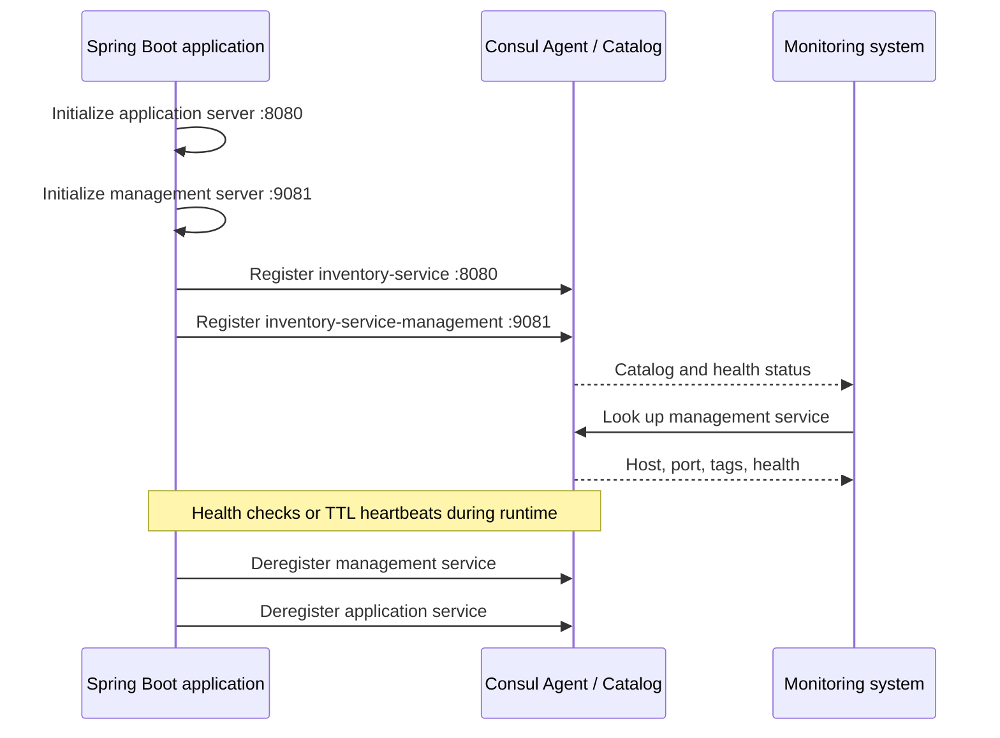

# Handling a Separate Management Port and Co-Registered Management Service

A Spring Boot application typically has a port for receiving business requests and management endpoints such as health, info, or metrics. If all endpoints share one port, Consul only needs a single service registration to locate the application. When the management server runs on a different port, Spring Cloud Consul can register an additional dedicated service for management.

For example, `inventory-service` receives business requests on port `8080`, while Spring Boot Actuator runs on port `9081`. Consul will contain two records: the business service `inventory-service` and the management service `inventory-service-management`. The second record lets operations systems locate the exact management port without causing business consumers to accidentally call internal endpoints.

This lesson belongs to the `Consul Health` chapter in the `SPRING_CLOUD_SERVICE_DISCOVERY` module. The module helps learners understand instance discovery by service name through `DiscoveryClient`, `ServiceRegistry`, Eureka, or Consul, along with the registration lifecycle, health checks, load balancing, security, and resolving registry drift. This content focuses on separating the management port, how Consul registers the companion management service, and how to verify health checks for each registration.

## 1. Distinguishing the Application Port and Management Port

Spring Boot has two port groups to distinguish:

- `server.port`: the port of the web server serving business APIs or UI.
- `management.server.port`: the separate port of the management web server, used for Actuator management endpoints.

If a separate `management.server.port` is not configured, management endpoints normally share the application web server. When `management.server.port` is set differently from `server.port`, Spring Boot runs the management server on a separate port. Example:

```yaml
server:
  port: 8080

management:
  server:
    port: 9081
  endpoints:
    web:
      base-path: /actuator
      exposure:
        include: health,info
```

In this example, business requests go through port `8080`; Actuator endpoints are served over port `9081`, such as `/actuator/health`. Endpoint exposure and how they are secured must still be configured separately. Setting a management port alone does not automatically expose every Actuator endpoint publicly.

### 1.1. Why Separate the Management Port?

Separating the management port can help:

- Restrict access to health, metrics, and operational information to the internal network.
- Apply dedicated firewall rules or network policies to management traffic.
- Separate monitoring system access permissions from business consumers.
- Prevent business APIs from inadvertently becoming an entry point to management endpoints.
- Easily route traffic from the Consul Agent or monitoring platform to the health endpoint.

Separating ports does not create a complete security boundary on its own. If the management port remains broadly open or endpoints lack proper authentication, sensitive information can still be accessed.

## 2. How Does Consul Register the Management Service?

Spring Cloud Consul uses `spring.application.name` as the default service name and automatically registers the application following the Spring Cloud lifecycle. When the management server port differs from the application port, Spring Cloud Consul registers an additional separate management service.

Example:

```yaml
spring:
  application:
    name: inventory-service

server:
  port: 8080

management:
  server:
    port: 9081
```

With the configuration above, the Consul Catalog contains two services:

| Registration Type | Service ID | Service Name | Port |
|---|---|---|---:|
| Application service | `inventory-service` | `inventory-service` | 8080 |
| Management service | `inventory-service-management` | `inventory-service-management` | 9081 |

Both registrations represent the same application instance on the same host, but with different purposes and access ports. Business consumers look up `inventory-service`; management systems can look up `inventory-service-management`.

### 2.1. The Management Service Inherits Identity from the Application Service

The management service inherits its instance ID and service name from the application service, then appends the management suffix. By default, the suffix is `management`.

If custom name and ID are configured:

```yaml
spring:
  application:
    name: inventory-service
  cloud:
    consul:
      discovery:
        instance-id: inventory-node-01
        service-name: commerce-${spring.application.name}

management:
  server:
    port: 9081
```

The illustrative identifiers will be:

| Registration | ID | Name |
|---|---|---|
| Application | `inventory-node-01` | `commerce-inventory-service` |
| Management | `inventory-node-01-management` | `commerce-inventory-service-management` |

This helps distinguish registrations while preserving their relationship. When running multiple replicas, each replica's instance ID must be unique; do not reuse a fixed ID across multiple concurrent processes.

## 3. Configuration Properties for Management Registration

Spring Cloud Consul provides properties to customize the management service:

| Property | Meaning |
|---|---|
| `management.server.port` | Port on which the Spring Boot management server actually listens. |
| `spring.cloud.consul.discovery.management-port` | Port published in the management service registration; defaults to the management port. |
| `spring.cloud.consul.discovery.management-suffix` | Suffix appended to the management service ID and name; defaults to `management`. |
| `spring.cloud.consul.discovery.management-tags` | Tags attached to the management service; Spring Cloud Consul documentation describes the default tag as `management`. |
| `spring.cloud.consul.discovery.management-metadata` | Dedicated metadata for the management service. |
| `spring.cloud.consul.discovery.management-enable-tag-override` | Enables tag override for the management service depending on Consul and integration version capabilities. |

The two port properties have different responsibilities. `management.server.port` causes the management web server to listen on the actual port. `management-port` determines the port Spring Cloud Consul publishes for the management service. If the two values do not match, Consul may store an address where no endpoint is listening.

Normally, if the management server already runs on `9081`, you can omit `management-port` since it defaults to the management port. Only set `management-port` when you need to customize the registered port and have verified the actual endpoint is reachable at that port.

## 4. Complete Configuration for a Service

The following example registers the application service on port `8080` and the management service on port `9081`:

```yaml
spring:
  application:
    name: inventory-service
  cloud:
    consul:
      host: consul.internal
      port: 8500
      discovery:
        register: true
        management-port: 9081
        management-suffix: management
        management-tags:
          - management
          - internal
        management-metadata:
          visibility: operations
        health-check-path: /actuator/health
        health-check-interval: 15s

server:
  port: 8080

management:
  server:
    port: 9081
  endpoints:
    web:
      base-path: /actuator
      exposure:
        include: health,info
  endpoint:
    health:
      show-details: when_authorized
```

In this example:

- The Consul Agent is at `consul.internal:8500`.
- The application service is registered with name `inventory-service` and port `8080`.
- The management service is registered with name `inventory-service-management` and port `9081`.
- The management service has tags `management`, `internal`, and metadata `visibility=operations`.
- The Consul HTTP health check uses path `/actuator/health` with a `15s` interval.

`management-port: 9081` is stated explicitly so readers clearly see the published port. If this value matches `management.server.port`, the `management-port` line can be omitted to use the default. In container or Kubernetes environments, ensure the management port is exposed and routed from the Consul Agent to the right container/pod.

### 4.1. Changing Only Management Tags and Metadata

Management tags and metadata are configured separately so consumers or operational tools can recognize this registration:

```yaml
spring:
  cloud:
    consul:
      discovery:
        management-tags:
          - management
          - monitoring
        management-metadata:
          owner: platform-ops
          access: private
```

Tags help categorize or filter lookup results. Metadata supplies extra attributes for components using Consul. Neither tags nor metadata replace ACLs, authentication, or firewalls; do not rely on them as the sole protection mechanism for management endpoints.

## 5. Health Checks for Application and Management Services

Consul normally creates an HTTP health check when Spring Cloud Consul registers a service. Under common default settings, Consul calls `/actuator/health` every `10s`; if the check fails, the service instance is marked `critical`.

Commonly used properties:

| Property | Purpose |
|---|---|
| `spring.cloud.consul.discovery.health-check-path` | HTTP path called for health checks; defaults to `/actuator/health`. |
| `spring.cloud.consul.discovery.health-check-interval` | Check interval; common default is `10s`. |
| `spring.cloud.consul.discovery.health-check-timeout` | Wait time for a health check response. |
| `spring.cloud.consul.discovery.health-check-url` | Custom full URL overriding the URL built from service address and port. |
| `spring.cloud.consul.discovery.register-health-check` | Enables or disables registering the HTTP health check. |

When the management server uses a separate port, inspect the actual health check Consul stores for each registration. Specifically, verify whether the check's host, port, and path point to a listening endpoint. If Actuator endpoints are exposed only on the management port while the application service's check calls the same path on the application port, that check may fail.

The health path must also match the context path and management endpoint base path. For example, if the real endpoint is `/admin/actuator/health`, configuring `/actuator/health` will return `404`:

```yaml
management:
  server:
    port: 9081
    servlet:
      context-path: /admin
  endpoints:
    web:
      base-path: /actuator

spring:
  cloud:
    consul:
      discovery:
        health-check-path: /admin/actuator/health
        health-check-interval: 15s
```

This illustrates how context path and endpoint base path combine. Verify the final URL by calling it directly from the network used by the Consul Agent. If configuring a full `health-check-url`, ensure hostname, scheme, port, and path in the URL are all reachable from the Agent.

### 5.1. Reading Health Status in Consul

Consul typically displays check states as:

| Status | Operational Meaning |
|---|---|
| `passing` | Health check succeeded. |
| `warning` | Check is warning based on the result returned by the check script/endpoint. |
| `critical` | Check failed or the endpoint did not respond as required. |

A registration can exist in the Catalog while marked `critical`. Therefore, when checking the management service, inspect both the service entry and its health checks. Simply seeing the service name in the Catalog is not enough to conclude the management endpoint is healthy.

### 5.2. Using TTL Checks When HTTP Checks Are Unsuitable

With a TTL check, the application sends heartbeats to the Consul Agent instead of having the Agent actively poll an HTTP endpoint. This can fit cases where you do not want the Agent directly reaching the management port, though the application must send heartbeats on schedule and handle heartbeat failures.

Example TTL heartbeat configuration in Spring Cloud Consul:

```yaml
spring:
  cloud:
    consul:
      discovery:
        heartbeat:
          enabled: true
          ttl: 10s
```

A TTL check shifts responsibility for emitting health signals. It does not prove that the management HTTP endpoint is reachable from a monitoring system. If the goal is to verify real reachability of the management endpoint, include a check matching the network path monitoring tools will use.

## 6. Inspecting Both Registrations in the Consul Catalog

After the application starts, open the Consul UI or use the HTTP API to verify both services are registered.

Read the application service:

```bash
curl http://consul.internal:8500/v1/catalog/service/inventory-service
```

Read the management service:

```bash
curl http://consul.internal:8500/v1/catalog/service/inventory-service-management
```

Read the application service's health:

```bash
curl http://consul.internal:8500/v1/health/service/inventory-service
```

Read the management service's health:

```bash
curl http://consul.internal:8500/v1/health/service/inventory-service-management
```

These APIs are examples using the default Consul HTTP API; production environments may require an ACL token, HTTPS, or an appropriate datacenter/namespace. Do not put real tokens in documentation or shared shell history.

When reading the responses, check:

1. Whether both service names are present.
2. Whether the management service ID has the right suffix.
3. Whether both share the appropriate host address.
4. Whether the application service has the business port and the management service has the management port.
5. Whether the management service's tags and metadata match configuration.
6. Whether the health check points to a reachable endpoint and port.
7. Whether registrations are removed when the instance stops.

If `spring.cloud.consul.discovery.query-passing=true` is enabled, discovery queries can ask Consul to return only services with passing checks. This affects discovery results, though it does not replace checking the entries directly in the Catalog.

## 7. Controlled Access to the Management Service

Because the management service exists in the Consul Catalog, components with lookup permissions can discover its service ID. This is convenient for internal monitoring, but also raises access control requirements.

Principles to apply:

- Allow only the Consul Agent, monitoring systems, and operations networks to access the management port.
- Do not include the management service in public API routing or default business routes.
- Use Consul ACLs to restrict service read/register permissions under appropriate policies.
- Use firewalls, security groups, or Kubernetes NetworkPolicy to restrict sources reaching the management port.
- Enable TLS for management endpoints when appropriate and configure authentication for sensitive endpoints.
- Expose only necessary Actuator endpoints, such as `health` and `info`; consider separate authorization for `metrics`, `env`, `configprops`, or other sensitive endpoints.
- Never place passwords, tokens, keys, or secrets in tags and metadata.
- Set `management.endpoint.health.show-details` according to security policy; do not expose dependency details to every client.

Tags like `management` or `internal` only provide classification. Any consumer with Catalog read access can still view the name, address, and port; ACLs and network policies form the actual access control layer.

## 8. Registration and Deregistration Lifecycle

Spring Cloud Consul usually manages registrations automatically according to the application lifecycle. Once the application server and management server are initialized, the integration can register both the application service and the management service. On graceful shutdown, both registrations are removed according to lifecycle and deregistration settings.



Exact ordering and timing of registration depend on Spring Boot, Spring Cloud Consul, and lifecycle integration versions. When testing shutdown, verify both services are removed or transition state as configured.

Related properties:

| Property | Meaning |
|---|---|
| `spring.cloud.consul.discovery.register` | Enables/disables registering the application's services. When disabled, neither application nor management registration is registered via this mechanism. |
| `spring.cloud.consul.discovery.deregister` | Controls automatic deregistration when the application stops. |
| `spring.cloud.consul.discovery.lifecycle.enabled` | Enables/disables lifecycle-managed auto-registration for the Consul integration. |
| `spring.cloud.service-registry.auto-registration.enabled` | General Spring Cloud setting to enable/disable auto-registration. |

Do not disable `register` if you still want the application service in Consul and only wish to change how the management service is accessed; that property affects application registration overall. If you specifically need to omit the management registration, check configuration capabilities in your release train or design an intentional custom lifecycle.

## 9. Troubleshooting Common Errors

| Symptom | Possible Cause | How to Check |
|---|---|---|
| Only application service appears, no management service | Management port not separated, both ports equal, or management server failed to start. | Check `management.server.port`, actual listening ports, and auto-registration logs. |
| Management service exists with wrong port | `management-port` does not match listening port or wrong override setting. | Compare Consul Catalog with `management.server.port` and listening ports. |
| Management service is `critical` | Health check cannot reach host/port/path or endpoint returns error. | Check check URL, context path, network policy, and Actuator. |
| Application service is also `critical` | Application registration's check cannot reach configured endpoint. | Check health check of each registration; do not assume both checks use the same working port. |
| Consul Agent cannot connect to management port | Firewall, container port mapping, or network policy blocks the Agent. | Try calling the endpoint from the Agent's own node/network. |
| Business consumer discovers management service | Consumer queries wrong suffix or route uses overly broad wildcard. | Check service ID and tag filters in discovery/routing. |
| Duplicate service names / collisions | Multiple instances share the same ID or unsuitable service name config. | Check instance IDs, service names, and replica count. |
| Management service remains after app stops | Deregistration disabled, incomplete shutdown, or agent/server not synced yet. | Check `deregister`, lifecycle logs, and TTL/check status. |
| Health endpoint returns `404` | Base path or servlet context path mismatch. | Call the real URL and update `health-check-path`. |
| Health endpoint returns `401` or `403` | Endpoint requires authentication but Consul check lacks matching headers. | Check security policy and `health-check-headers`; do not disable auth just to turn the check green. |

### 9.1. Layer-by-Layer Verification Order

When the management service does not work, check step by step:

1. Verify Spring Boot actually opened the management port.
2. Call `/actuator/health` from the machine running the application to confirm the endpoint.
3. Call the same URL from the Consul Agent's machine or network namespace.
4. Read the service registration and health check in the Consul Catalog.
5. Compare address, port, scheme, and path in the check with the real endpoint.
6. Verify ACLs, tokens, TLS, firewalls, and network policies.
7. Check tags and service ID queried by consumers or monitoring tools.
8. Inspect Spring Cloud Consul auto-registration and deregistration logs.

Do not rely solely on a "registered" log line to conclude the management endpoint is reachable. Successful registration and passing health checks are two distinct conditions.

## 10. Pre-Production Testing

An integration test should verify both the application service and the management service:

- Start the application with distinct `server.port` and `management.server.port`.
- Verify the Consul Catalog contains both registrations with correct ID, name, and port.
- Verify the management service has the expected suffix and tags.
- Call the health endpoint from the application host and from the Consul Agent network.
- Temporarily make the health endpoint fail to confirm Consul updates check status.
- Restore the endpoint and confirm status returns to passing.
- Stop the application gracefully and confirm both registrations are deregistered.
- Start multiple replicas to confirm instance IDs do not collide.
- Verify business consumers look up only the application service, while monitoring accesses only the management service.
- Test ACLs and network policies from both permitted and disallowed sources.

## 11. Common Misconceptions

**"Setting `management-port` is enough to open the management port."** False. `management-port` controls the port published in the Consul registration. `management.server.port` configures the port on which the management server actually listens.

**"The management service is a second Spring Boot application."** False. It is an extra registration for the same application instance, used to locate management endpoints on a separate port.

**"Presence of a registration in the Catalog means health is passing."** False. You must inspect the service's health check and verify its status separately.

**"The `management` tag protects the endpoint from consumers."** False. Tags only classify or assist filtering; ACLs and network policies enforce access control.

**"Disabling `spring.cloud.consul.discovery.register` disables only the management registration."** False. That property disables service registration for the application as a whole, including the application registration.

**"The default health check is always right when using a separate management port."** False. Path, port, context path, authentication, and network path must match the actual endpoint. Inspect the check URL stored by Consul.

## 12. Deployment Checklist

| Area | Question to Confirm |
|---|---|
| Port | Are `server.port` and `management.server.port` accurate and distinct when separation is needed? |
| Registration | Did Consul create both the application service and the management service? |
| Identity | Are ID, service name, and suffix correct and unique across replicas? |
| Management port | Does `management-port` match the port the management server listens on? |
| Tags/metadata | Do `management-tags` and `management-metadata` serve their intended purpose? |
| Health | Do check URL, path, interval, and timeout match the endpoint? |
| Network | Can the Consul Agent and monitoring reach the management port? |
| Security | Are ACLs, TLS, firewalls, authentication, and endpoint exposure configured? |
| Discovery | Do business consumers look up the application service correctly? |
| Lifecycle | Are both registrations removed when the application stops? |
| Observability | Are logs and metrics in place for registration, health checks, and deregistration? |
| Compatibility | Are Spring Boot, Spring Cloud Consul, and Consul Agent compatible for the deployed versions? |

## Summary

When Spring Boot runs the management server on a different port from the application server, Spring Cloud Consul can register an additional management service in the Consul Catalog. The application service continues representing business traffic; the management service uses the default `management` suffix and publishes the management port so monitoring or operational systems find the right management endpoint.

Distinguish `management.server.port` from `spring.cloud.consul.discovery.management-port`, configure appropriate suffixes, tags, and metadata, and verify each registration along with its health checks in Consul. Management ports must be protected with ACLs, TLS, and network policies; tags only assist classification. Registration, health checking, and actual reachability are three separate checks required to operate service discovery safely.

## References

- [Spring Cloud Consul – Service Discovery](https://docs.spring.io/spring-cloud-consul/reference/discovery.html): separate management service registration, management port/suffix/tags, HTTP health checks, and TTL checks.
- [Spring Cloud Consul – Common Application Properties](https://docs.spring.io/spring-cloud-consul/reference/appendix.html): property list for `management-port`, `management-suffix`, `management-tags`, `management-metadata`, and health check options.
- [Spring Boot – Actuator](https://docs.spring.io/spring-boot/reference/actuator/index.html): configuring the management server and management endpoints.
