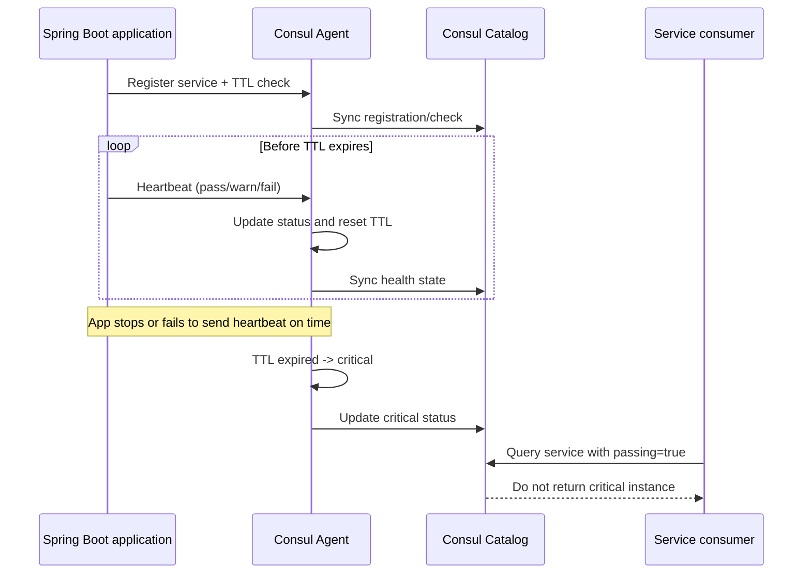

# TTL Checks and the Application Heartbeat Mechanism

Consul can check a service either by actively polling an application endpoint (HTTP health check) or by waiting for the application itself to send a liveness pulse (TTL heartbeat). With a TTL check, the Consul Agent grants a validity window. The application must update the check status before that window expires; otherwise, Consul transitions the check to `critical`.

Spring Cloud Consul includes a built-in background heartbeat mechanism to perform TTL updates. When enabled, the application periodically sends a signal to the Consul Agent, and the outgoing status can be derived from Spring Boot Actuator or a custom `ApplicationStatusProvider`. This is helpful when the agent cannot call back into the service, though it requires both the application and its connection to the agent to work reliably enough to renew the TTL.

## 1. How Does a TTL Check Work?

TTL (time to live) is the maximum duration Consul waits for a fresh status update on a check. When a TTL check is registered, the Consul Agent tracks a TTL timer. Each time it receives a valid update, the agent updates the status and resets the timer. If the TTL expires with no update, the check automatically transitions to `critical`.



A TTL check has three key states:

| Status | Meaning | Typical Impact |
|---|---|---|
| `passing` | Application reports healthy | Instance can be returned when consumers require passing checks |
| `warning` | Application is running with a warning | Instance remains in the registry; consumers can decide whether to accept it |
| `critical` | Application reports an error or TTL expired | Instance no longer passes queries requiring all checks passing |

TTL expiration does not mean the service registration is immediately deleted. The check turns `critical`; the record can remain in the Catalog for observation and recovery. Automatically deregistering after a prolonged critical period is a separate policy, such as `DeregisterCriticalServiceAfter`, and must be configured appropriately.

## 2. TTL Heartbeat vs. HTTP Health Check

Spring Cloud Consul creates an HTTP health check polling `/actuator/health` every 10 seconds by default. In that mode, the Consul Agent actively calls the application. A TTL check replaces that by having the application actively send heartbeats to the Consul Agent.

| Criterion | HTTP Health Check | TTL Heartbeat |
|---|---|---|
| Check initiator | Consul Agent | Spring Boot application |
| Network direction | Agent calls service endpoint | Application calls Agent API |
| Primary requirement | Agent can reach exact hostname, port, path, scheme, and auth | Application can reach Agent and send heartbeats before TTL expires |
| When process hangs | Agent receives no response or times out | Application scheduler stops sending heartbeats; TTL expires |
| When app cannot reach Agent | HTTP check can still run if Agent can reach app | Heartbeat cannot renew TTL and check may turn critical |
| Health signal | HTTP request result | Application status sent in heartbeat |

Choose HTTP checks when the agent can reach the service endpoint and you want Consul to probe externally. Choose TTL when the application can proactively report status while the agent cannot call back into the service, or when you want to send status based on internal logic.

Do not enable both mechanisms expecting them to automatically complement each other. According to Spring Cloud Consul documentation, TTL checks are an alternative to the default HTTP check. After configuring, inspect the actual check registered on the agent to confirm which check type is active.

## 3. Enabling Heartbeat in Spring Cloud Consul

Add the discovery dependencies to the application:

```xml
<dependency>
    <groupId>org.springframework.cloud</groupId>
    <artifactId>spring-cloud-starter-consul-discovery</artifactId>
</dependency>

<dependency>
    <groupId>org.springframework.boot</groupId>
    <artifactId>spring-boot-starter-actuator</artifactId>
</dependency>
```

Do not pin a separate version for the Spring Cloud starter if your project already imports a Spring Cloud BOM compatible with Spring Boot.

Configure `application.yml` to enable TTL heartbeats:

```yaml
spring:
  application:
    name: inventory-service
  cloud:
    consul:
      host: ${CONSUL_HOST:localhost}
      port: ${CONSUL_PORT:8500}
      discovery:
        register: true
        deregister: true
        heartbeat:
          enabled: true
          ttl: 30s
          use-actuator-health: true
```

Meaning:

- `register: true`: registers the service with Consul.
- `deregister: true`: deregisters during graceful application shutdown.
- `heartbeat.enabled: true`: enables the TTL heartbeat mechanism managed by Spring Cloud Consul.
- `heartbeat.ttl: 30s`: TTL attached to the check; if no update arrives before expiration, Consul transitions the check to critical.
- `heartbeat.use-actuator-health: true`: reads current health status from Actuator to decide the status sent for the TTL check.

Under current Spring Cloud Consul defaults, `heartbeat.enabled` defaults to `false`, `heartbeat.ttl` defaults to `30s`, `heartbeat.use-actuator-health` defaults to `true`, and `heartbeat.reregister-service-on-failure` defaults to `false`. Because heartbeat is off by default, adding the Consul Discovery starter alone is not enough for the application to send TTL heartbeats.

## 4. Heartbeat Sending Interval and Safety Margin

TTL is the deadline Consul waits for an update; the heartbeat schedule is the cadence at which the application actively updates the check. These two values are related but are not the same concept. The application needs to send updates before TTL expiration to leave headroom for scheduler delay, network latency, agent load, and request processing time.

Spring Cloud Consul provides the `spring.cloud.consul.discovery.heartbeat.interval-ratio` property to adjust the heartbeat scheduling ratio relative to TTL. Current property documentation lists this property without declaring a fixed default value in the properties table. Therefore, verify your Spring Cloud Consul version and test before overriding.

Example setting a 30-second TTL and adjusting the heartbeat send ratio:

```yaml
spring:
  cloud:
    consul:
      discovery:
        heartbeat:
          enabled: true
          ttl: 30s
          interval-ratio: 0.5
```

The value `0.5` here is an example configuration, not a claim of the default across all versions. The goal is for renewals to arrive well before TTL expiration. Never set the send schedule equal to the TTL because a single scheduler or network delay could cause the check to expire.

Choose TTL based on failure detection goals and acceptable latency:

- TTL too short: the application can be marked critical during GC pauses, CPU spikes, scheduler delays, or transient network congestion.
- TTL too long: a stopped process may still be considered healthy for longer.
- Heartbeat too frequent: increases requests to the agent and unnecessary processing overhead.
- Margin too small: a brief delay can push the check to critical even while the application is running.

Do not treat TTL as an exact SLA for removing an instance from traffic. After a check turns critical, Consul still has to sync state to the Catalog and consumers must query fresh data.

## 5. How Is TTL Status Derived from Actuator?

When `use-actuator-health` is enabled, Spring Cloud Consul reads the status from the Spring Boot Actuator Health endpoint before sending a heartbeat. The root health group is used by default. You can select another health group with `actuator-health-group`.

Example using the `readiness` group:

```yaml
management:
  endpoints:
    web:
      exposure:
        include: health,info
  endpoint:
    health:
      probes:
        enabled: true
      group:
        readiness:
          include: readinessState,db

spring:
  cloud:
    consul:
      discovery:
        heartbeat:
          enabled: true
          ttl: 30s
          use-actuator-health: true
          actuator-health-group: readiness
```

The `readiness` group should include only components that genuinely determine whether the service can accept requests. For example, if a database is a mandatory dependency for every request, include `db` in the group. Do not blindly add every dependency; a system can often continue serving partial functionality when a secondary dependency fails.

In particular, avoid creating a health dependency cycle. If the health group used to renew TTL includes a health indicator checking the Consul Agent/cluster itself, a Consul issue can stop the application from sending passing status even when it can still serve business requests. Pick signals that reflect the service's ability to serve and explicitly decide whether Consul is a mandatory dependency.

### 5.1. When No Actuator Endpoint Is Present

Spring Cloud Consul documentation explicitly notes: if the health endpoint is absent (Actuator not added, endpoint disabled, or not a Spring Boot Actuator app), the TTL status is assumed healthy. This behavior easily causes false positives: an application can send passing heartbeats with no real health evaluation.

In production environments, you should:

1. Add Actuator and ensure the health endpoint is available if you want to use its health status.
2. Specify `actuator-health-group` when the root group contains too many indicators or unsuitable dependencies.
3. Verify the health group's output directly inside the application before enabling TTL heartbeats.
4. If you do not want to depend on Actuator, provide a custom `ApplicationStatusProvider`.

You can disable reading Actuator entirely with `spring.cloud.consul.discovery.heartbeat.use-actuator-health: false`. Only do this when another status mechanism is in place or an always-passing intent has been explicitly evaluated.

## 6. Providing Custom Status with ApplicationStatusProvider

Not every application can express readiness through standard health indicators alone. Spring Cloud Consul lets you implement `ApplicationStatusProvider` to determine the TTL status.

Illustrative example:

```java
@Component
class InventoryApplicationStatusProvider implements ApplicationStatusProvider {

    private final InventoryReadiness readiness;

    InventoryApplicationStatusProvider(InventoryReadiness readiness) {
        this.readiness = readiness;
    }

    @Override
    public CheckStatus currentStatus() {
        if (readiness.isReady()) {
            return CheckStatus.PASSING;
        }

        return CheckStatus.CRITICAL;
    }
}
```

Here, `InventoryReadiness` is an application business component, while `ApplicationStatusProvider` and `CheckStatus` are Spring Cloud Consul APIs. Register the provider in the application context as required by your library version. If the application supports degraded levels, consider returning `WARNING` instead of `CRITICAL` when the service can still handle requests with limitations.

Custom status should reflect the instance's serving capacity. Do not just check that the process is alive; likewise, do not turn a non-essential dependency into a critical condition. If the provider throws an exception, handle errors explicitly so you do not accidentally report a healthy state.

## 7. Where Does Spring Cloud Consul Send Heartbeats?

The application sends heartbeats to the Consul Agent configured via `spring.cloud.consul.host` and `spring.cloud.consul.port` (default `localhost:8500`). The Agent manages the check locally and syncs status to the Consul Catalog. The application does not send TTL updates directly to every Consul server in the cluster.

The Consul Agent exposes TTL endpoints:

| Endpoint | Status Set | Purpose |
|---|---|---|
| `PUT /v1/agent/check/pass/{check_id}` | `passing` | Mark check healthy and renew TTL |
| `PUT /v1/agent/check/warn/{check_id}` | `warning` | Report degraded yet operating and renew TTL |
| `PUT /v1/agent/check/fail/{check_id}` | `critical` | Mark check failed and renew TTL |
| `PUT /v1/agent/check/update/{check_id}` | Status passed in JSON | Update status and optional output |

Example sending a manual passing heartbeat:

```bash
curl --request PUT \
  http://127.0.0.1:8500/v1/agent/check/pass/service:inventory-service
```

Example sending a critical status with a note:

```bash
curl --request PUT \
  --data '{"Status":"critical","Output":"Database pool exhausted"}' \
  http://127.0.0.1:8500/v1/agent/check/update/service:inventory-service
```

These are examples of calling the Consul Agent HTTP API directly for testing or manual integration. When using Spring Cloud Consul heartbeats, the library schedules heartbeat sending automatically; do not write a second scheduler calling `check/pass` for the same check.

The check ID in the URL must be the actual registered ID. Do not always assume the ID is `service:{service-name}`; inspect the agent's check list to obtain the exact ID:

```bash
curl http://127.0.0.1:8500/v1/agent/checks
```

The Consul Agent API requires node/service write permissions when ACLs are enabled. Per API documentation, TTL update operations require `node:write` and `service:write` privileges. Issue a token with minimal required privileges and configure it via secrets/environment variables instead of embedding tokens in source code.

## 8. Monitoring TTL Checks in Consul

List checks managed by the local agent:

```bash
curl http://127.0.0.1:8500/v1/agent/checks
```

Query health checks for a service:

```bash
curl http://127.0.0.1:8500/v1/health/service/inventory-service
```

Fetch only instances where all health checks are passing:

```bash
curl "http://127.0.0.1:8500/v1/health/service/inventory-service?passing=true"
```

Distinguish the two data sources:

- `/v1/agent/checks` shows the status of checks managed by the local agent.
- `/v1/health/service/{name}` returns health/catalog query results from the Consul server.

For a short period, the two results may differ while the agent syncs with the Catalog or if the cluster has issues. If the heartbeat API returns success yet consumers still see stale status, inspect both layers and update timestamps.

## 9. Reregistering When Heartbeat Fails

Spring Cloud Consul provides the `spring.cloud.consul.discovery.heartbeat.reregister-service-on-failure` property. It defaults to `false`. When enabled, Spring Cloud Consul can attempt to re-register the service if a heartbeat fails and meets the library's re-registration conditions.

```yaml
spring:
  cloud:
    consul:
      discovery:
        heartbeat:
          enabled: true
          ttl: 30s
          reregister-service-on-failure: true
```

Re-registration can help when a Consul Agent just restarted and local check/service registrations were lost. It cannot fix a deadlocked application, a prolonged network partition, an invalid ACL token, or an unreachable Consul endpoint. Enable it only after understanding your version's behavior and monitor re-registration logs.

Do not treat re-registration as the sole recovery mechanism. Monitor heartbeat errors, agent status, service registrations, and application self-recovery. If a transient error stops the scheduler from running, re-registering will not help until heartbeat scheduling resumes.

## 10. Cleaning Up Critical Services and Application Lifecycle

A TTL check turns critical on expiration but does not immediately delete the service registration automatically. Consul allows configuring `DeregisterCriticalServiceAfter` to deregister a service if its check remains continuously critical past a threshold. This is a record cleanup policy, distinct from the TTL used for initial failure detection.

Choose a deregistration timeout longer than recoverable outages. If set too short, a brief network blip or Consul Agent restart can remove the service even though the process is still running. If left unconfigured, critical records can remain available for investigation or recovery.

During graceful shutdown, Spring Cloud Consul normally deregisters the service per lifecycle if `spring.cloud.consul.discovery.deregister=true`. When a process is killed abruptly, there is no chance to deregister; TTL detects that heartbeats stopped. Test graceful shutdown and process crashes separately because they follow different execution paths.

## 11. Common Issues and Troubleshooting

| Symptom | Possible Cause | How to Check |
|---|---|---|
| Service repeatedly turns `critical` while app is running | Heartbeat does not reach Agent on time; scheduler delay; TTL too short | Check heartbeat logs, network to Agent, CPU/GC pauses, and TTL |
| Check stays `passing` even when service is unhealthy | Missing Actuator endpoint so status is assumed healthy; `use-actuator-health=false`; provider always returns passing | Check Actuator dependency, health group, and `ApplicationStatusProvider` |
| No TTL check visible in Consul | `heartbeat.enabled` not enabled; service not registered; wrong Agent or check ID | Check active profile/config, `/v1/agent/checks`, and registration logs |
| Agent reports `Unknown check ID` | Check was deleted, Agent restarted, or wrong check ID used | Fetch current check ID from `/v1/agent/checks`; verify re-registration |
| Heartbeat errors after Agent restart | Local registration/check no longer exists or Agent not ready yet | Check 404 logs, `reregister-service-on-failure`, and registration lifecycle |
| Local agent shows passing but consumer sees critical | Catalog not synced yet or query hits another server/partition | Compare `/v1/agent/checks`, health API, datacenter, namespace, and ACLs |
| Application stops sending heartbeats during Consul error | Agent unreachable, token expired, or request timeout | Check Consul host/port, TLS, ACLs, retries, and network policy |
| Critical service does not disappear from Catalog | TTL only changes status; critical deregistration timeout not configured | Check `DeregisterCriticalServiceAfter` and record cleanup policy |

### 11.1. Step-by-Step Diagnostic Order

1. Confirm the active profile and that `spring.cloud.consul.discovery.heartbeat.enabled=true` in effective configuration.
2. Verify the service registration and TTL check were created on the intended Consul Agent.
3. Read `TTL`, `Status`, `Output`, and `CheckID` from `/v1/agent/checks`.
4. Verify the application sends heartbeats periodically and requests to the Agent succeed.
5. If using Actuator, call the configured health group and confirm status is not assumed healthy.
6. Cross-check local agent state against the Consul Health API and Catalog.
7. Inspect ACL token, TLS, DNS, port, and network policy.
8. If the Agent recently restarted, verify the service/check was re-registered and the scheduler continues renewing.
9. Record the last heartbeat timestamp, TTL expiration timestamp, critical transition timestamp, and the time consumers stopped receiving the instance.

## 12. Hands-On Verification of TTL Heartbeats

Run this in a development environment with one Consul Agent and one Spring Boot service:

1. Start the Consul Agent and confirm the API at `localhost:8500` is reachable.
2. Start an application with `spring-cloud-starter-consul-discovery`, Actuator, and heartbeat enabled.
3. Use `/v1/agent/checks` to confirm the service's check is of type TTL and verify its initial status.
4. Wait several heartbeat cycles; confirm status stays `passing` and TTL is renewed.
5. Force the health group to `DOWN` or make the custom provider return `CRITICAL`; confirm Consul receives critical status.
6. Restore the health group/provider; confirm the check returns to passing.
7. Kill the process abruptly; stop sending heartbeats and measure how long it takes for the check to turn critical.
8. Restart the service; confirm registration and heartbeats recover.
9. Test restarting the Consul Agent; inspect check ID, re-registration, and scheduler logs.

Do not test network partitions or stop agents in production without an impact-control plan. Record timestamps at each milestone to measure real-world failure detection latency.

## 13. Deployment Checklist

- [ ] `spring.cloud.consul.discovery.heartbeat.enabled` is enabled.
- [ ] TTL is long enough for network, scheduler, and realistic load.
- [ ] Heartbeats are sent before TTL expiration with a safe margin.
- [ ] `use-actuator-health` and the target health group are explicitly determined.
- [ ] If not using Actuator, a status provider is supplied or default behavior is explicitly accepted.
- [ ] No dependency cycle exists between the health group and the Consul Agent.
- [ ] Check ID, status, and output are verified directly from the Consul Agent.
- [ ] ACL token has minimal privileges to update TTL checks and is stored securely.
- [ ] A decision has been made on whether to enable `reregister-service-on-failure`.
- [ ] A deregistration policy is in place for prolonged critical services.
- [ ] Graceful shutdown, process crash, and Consul Agent restart have been tested.
- [ ] Consumers receive only instances matching the desired health state, e.g., `passing=true`.

## References

- [Spring Cloud Consul 5.1.0 — Service Discovery, TTL Health Check, and TTL Application Status](https://docs.spring.io/spring-cloud-consul/reference/discovery.html)
- [Spring Cloud Consul — Common Application Properties](https://docs.spring.io/spring-cloud-consul/reference/appendix.html)
- [Consul Agent HTTP API — Check](https://developer.hashicorp.com/consul/api-docs/agent/check)
- [Consul — Define Health Checks and TTL Checks](https://developer.hashicorp.com/consul/docs/register/health-check/vm)
