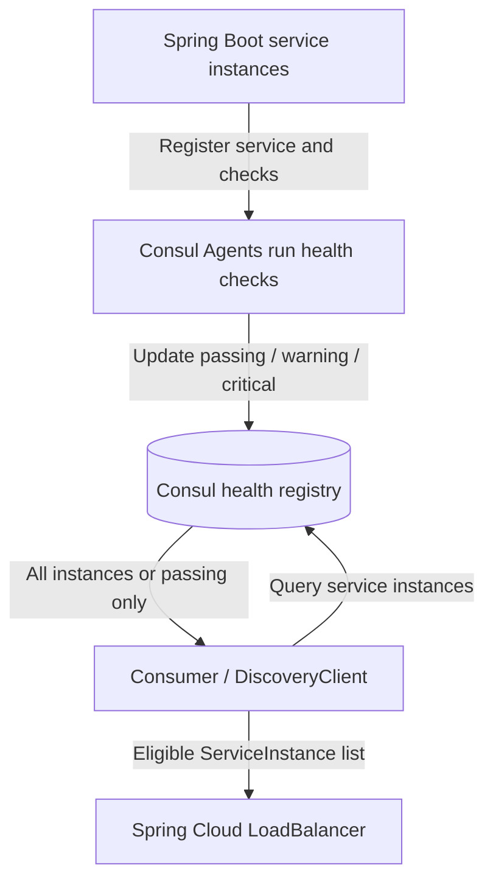

# Filtering Instances Passing Health Checks When Querying

Consul stores service registration details alongside the health check status of each node and service instance. When a consumer looks up `order-service`, the question is not only whether the service is registered, but also which instances are healthy enough to receive requests.

Consul provides a health API to query instances by check status. The `passing` parameter returns only instances whose associated health checks are all in the `passing` state. Spring Cloud Consul Discovery offers the `spring.cloud.consul.discovery.query-passing` property to enable this filtering for instance queries through `DiscoveryClient`. This lesson explains how filtering works, how to configure and verify the results, and the limitations to understand when using health status to select instances.

## 1. From Service Registration to Querying Healthy Instances

When an application registers with Consul, the registry stores the service name, service ID, address, port, tags, and metadata. Health checks are attached to the node or service registration and updated periodically by the Consul Agent.

Consider a service with three instances:

| Instance | Address | Health Check Status |
| --- | --- | --- |
| `order-a` | `10.0.0.11:8080` | `passing` |
| `order-b` | `10.0.0.12:8080` | `warning` |
| `order-c` | `10.0.0.13:8080` | `critical` |

If a consumer queries all instances, it may receive all three records. If the consumer only wants healthy instances, querying with `passing` returns only `order-a`.



The flow has three independent steps:

- **Registration:** the instance appears in the Consul Catalog.
- **Health check:** the Consul Agent updates check status for the node and service.
- **Health-aware discovery:** the consumer instructs Consul to return only instances meeting health criteria, and LoadBalancer picks an instance from that list.

An instance can still exist in the Catalog while being excluded from `passing` queries. This is the desired behavior when consumers must avoid sending requests to failing instances.

## 2. Consul's Three Health States

Consul health checks normally have three states:

| Status | Meaning | Returned with `passing`? |
| --- | --- | --- |
| `passing` | Check succeeded; instance satisfies the condition measured by the check. | Yes |
| `warning` | Check is warning, though not yet marked critically failed. | No |
| `critical` | Check failed or check condition not met. | No |

The `passing` parameter applies at the node/service entry level: Consul returns only entries where **all associated checks** are `passing`. Therefore, a single `warning` check is enough to exclude an instance from passing results, even if its other checks are passing.

For example, if `order-a` has two checks:

```text
HTTP /actuator/health       passing
Database connectivity      passing
```

the instance is considered passing. If the database check transitions to `warning`:

```text
HTTP /actuator/health       passing
Database connectivity      warning
```

the instance no longer appears in `?passing` queries because not all checks are passing.

Note that node health checks can also affect services registered on that node. Consequently, a failing node-level check can prevent multiple service instances on the same node from meeting the passing condition.

## 3. Querying the Consul Health API Directly

The commonly used API to retrieve instances of a service is:

```text
GET /v1/health/service/{service}
```

Without the `passing` parameter, the API returns service entries along with their check details, including entries in `warning` or `critical` states.

Add the `passing` parameter to filter:

```bash
curl "http://localhost:8500/v1/health/service/order-service?passing"
```

The result contains only entries where all associated checks are passing. You can combine it with a datacenter:

```bash
curl "http://localhost:8500/v1/health/service/order-service?passing&dc=dc1"
```

If Consul has ACLs enabled, the request needs a token with read permissions for the corresponding service/health resources. Example passing a token via an environment variable:

```bash
curl -H "X-Consul-Token: ${CONSUL_HTTP_TOKEN}" \
  "http://localhost:8500/v1/health/service/order-service?passing"
```

Avoid putting tokens directly into scripts or logs. In PowerShell, environment variable syntax is `$env:CONSUL_HTTP_TOKEN`; make sure the token is set in the exact shell running the command.

### 3.1. Comparison with the Catalog API

Catalog API:

```bash
curl "http://localhost:8500/v1/catalog/service/order-service"
```

Health API:

```bash
curl "http://localhost:8500/v1/health/service/order-service"
```

The two APIs return data for different purposes:

| API | Purpose | Filters by Health? |
| --- | --- | --- |
| `/v1/catalog/service/{service}` | Inspect registrations in the Catalog. | Not a health-filtering API; records can still appear even if checks fail. |
| `/v1/health/service/{service}` | Inspect service instances along with associated checks. | Yes; append `?passing` to get only healthy entries. |
| `/v1/health/checks/{service}` | Inspect health checks attached to the service. | Returns checks and statuses for diagnostics. |

Do not use record counts from the Catalog API to conclude how many instances are ready. Inspect the Health API and the actual checks.

## 4. Enabling query-passing in Spring Cloud Consul

Spring Cloud Consul Discovery provides the `query-passing` property. When enabled, instance lookups via discovery request Consul to return only instances with passing health checks.

Example `application.yml`:

```yaml
spring:
  application:
    name: order-consumer
  cloud:
    consul:
      host: ${CONSUL_HOST:localhost}
      port: ${CONSUL_PORT:8500}
      discovery:
        query-passing: true
```

Key points to remember:

- `spring.cloud.consul.discovery.query-passing: true` enables passing filtering for service instance queries made by the Consul Discovery Client.
- When this property is `false`, discovery can return `warning` or `critical` instances depending on Health API results and registry configuration.
- This property controls how the consumer queries; it does not alter health statuses stored in Consul.
- It does not create health checks on its own. Services still must register appropriate checks, such as an HTTP check to Actuator.
- The default value is typically `false`; check the reference documentation for your exact Spring Cloud Consul version.

If an application only needs to query healthy instances, enable `query-passing` on the consumer. You do not need to set this identically on service providers: providers are responsible for registering health checks; consumers decide whether to require passing filtering when querying.

## 5. Using DiscoveryClient and LoadBalancer

When `query-passing` is enabled, Spring Cloud Consul's `DiscoveryClient` receives the instance list filtered by Consul's passing condition.

Example injecting `DiscoveryClient`:

```java
import java.util.List;

import org.springframework.cloud.client.ServiceInstance;
import org.springframework.cloud.client.discovery.DiscoveryClient;
import org.springframework.web.bind.annotation.GetMapping;
import org.springframework.web.bind.annotation.RestController;

@RestController
public class OrderDiscoveryController {

    private final DiscoveryClient discoveryClient;

    public OrderDiscoveryController(DiscoveryClient discoveryClient) {
        this.discoveryClient = discoveryClient;
    }

    @GetMapping("/discovery/orders")
    public List<ServiceInstance> findHealthyOrders() {
        return discoveryClient.getInstances("order-service");
    }
}
```

With `query-passing: true`, the returned list includes only instances whose checks are passing according to Consul. If no instances are passing, `getInstances("order-service")` may return an empty list.

Spring Cloud LoadBalancer can use that list to choose an instance when the consumer calls by logical service name:

```java
@Bean
@LoadBalanced
RestTemplate restTemplate() {
    return new RestTemplate();
}

public String getOrders() {
    return restTemplate.getForObject(
            "http://order-service/api/orders",
            String.class
    );
}
```

Selection flow:

1. The consumer calls `order-service` by logical name.
2. Spring Cloud LoadBalancer requests the instance list from DiscoveryClient.
3. Consul Discovery queries the Health API with or without the `passing` condition depending on configuration.
4. LoadBalancer picks one instance from the returned list.
5. The HTTP client sends the request to the selected instance's address.

`query-passing` governs the candidate list returned by discovery. It is not a round-robin algorithm and does not determine which instance gets picked when multiple passing instances exist.

## 6. What Happens When Instances Are Warning or Critical?

Suppose Consul has three instances:

```text
order-a  passing
order-b  warning
order-c  critical
```

Results depend on the query:

| Query | Result |
| --- | --- |
| `/v1/health/service/order-service` | `order-a`, `order-b`, `order-c` along with check statuses |
| `/v1/health/service/order-service?passing` | Only `order-a` |
| Discovery with `query-passing: false` | May receive all three instances, with check statuses in Consul data. |
| Discovery with `query-passing: true` | Receives only `order-a`. |

When `order-b` transitions from `warning` back to `passing`, the instance can reappear in passing queries after the next check and subsequent query. When `order-a` turns `critical`, it is excluded from the passing list once Consul updates the check status.

State transitions do not necessarily take effect instantaneously. Latency depends on `health-check-interval`, timeout, Agent update timing, consumer query frequency, and discovery/load balancer caches.

## 7. Designing Health Checks to Filter the Right Instances

`passing` filtering is only useful when health checks accurately reflect an instance's readiness to serve requests. An endpoint returning `200 OK` simply because the JVM is alive may be insufficient if the service cannot reach its database or a mandatory dependency.

With Spring Boot Actuator, you can use the readiness health group if your application version supports it and the endpoint is exposed:

```yaml
management:
  endpoints:
    web:
      exposure:
        include: health
  endpoint:
    health:
      probes:
        enabled: true
      show-details: never

spring:
  cloud:
    consul:
      discovery:
        health-check-path: /actuator/health/readiness
        health-check-interval: 10s
        query-passing: true
```

Only use `/actuator/health/readiness` after confirming the health group exists in your Spring Boot version. If the endpoint returns `404`, Consul marks the check non-passing and the instance may be filtered out of discovery.

Select dependencies included in readiness deliberately:

- A database required for most requests can be part of readiness.
- An analytics system or auxiliary service that does not impact the main request flow probably should not cause the instance to be removed completely.
- Checks must respond quickly, use reasonable timeouts, and avoid creating heavy load when polled periodically.
- Health endpoints must not expose credentials, connection strings, or sensitive infrastructure details.

If an instance has multiple checks, remember `?passing` requires all associated checks to be passing. Even a secondary check in `warning` state can exclude the instance from the list.

## 8. Handling When No Passing Instances Remain

When all instances transition to `warning` or `critical`, `passing` queries return an empty list. LoadBalancer has no instances to pick and service calls usually fail before any request reaches a provider.

This scenario requires clear fallback behavior:

1. Check the Health API to see whether `passing` entries are missing due to genuine check failures or misconfigured checks.
2. Inspect each check in `/v1/health/checks/{service}` to locate the check causing warning/critical status.
3. Verify the check endpoint is reachable from the Consul Agent and returns the expected HTTP status.
4. If the failure is transient, restore the dependency or endpoint so checks return to passing.
5. Design timeouts, bounded retries, and circuit breakers on consumers to prevent cascading load.
6. Only consider disabling passing filtering as a deliberate operational decision; understand that consumers may call unhealthy instances.

Do not automatically fall back to all unhealthy instances in production if the health check reflects a mandatory dependency. Doing so can amplify errors and trigger a retry storm. Conversely, if checks are overly strict or include non-essential dependencies, refine readiness to reflect true serving capacity instead of disabling health filtering.

## 9. Caching and Update Latency

The Consul Agent executes health checks periodically, so the returned status is the latest result recorded by Consul rather than a live probe at the exact instant a consumer calls the service.

Additionally, multiple cache layers may exist:

- Consul Agent and Consul Server maintain check/registry state.
- Spring Cloud Consul or the discovery client may cache data depending on configuration and version.
- Spring Cloud LoadBalancer may cache instance lists if the supplier chain is configured with caching.
- Some applications also maintain their own discovery result caches.

If an instance recently became `critical` yet consumers still call it, check the last check timestamp and cache durations before concluding `query-passing` is broken. Avoid enabling unnecessary cache layers since stale health data can persist longer.

## 10. Verification Flow from Consul to the Application

When consumers still receive unhealthy instances or find no instances at all, check in order:

1. Call `/v1/health/checks/{service}` to view each check and its current status.
2. Call `/v1/health/service/{service}` to view service entries along with associated checks.
3. Add `?passing` and compare entry counts with the unfiltered output.
4. Check `spring.cloud.consul.discovery.query-passing` in the consumer's active profile and property sources.
5. Call `DiscoveryClient.getInstances(serviceId)` to inspect the instance list the application actually receives.
6. Check Spring Cloud LoadBalancer suppliers/caches if the list or chosen instance differs from DiscoveryClient.
7. Verify the health endpoint, address, port, and network from the Consul Agent's perspective.

Sample commands:

```bash
# Status of the service's checks
curl "http://localhost:8500/v1/health/checks/order-service"

# All instances and associated checks
curl "http://localhost:8500/v1/health/service/order-service"

# Only instances with all checks passing
curl "http://localhost:8500/v1/health/service/order-service?passing"

# Registrations in Catalog; do not use to infer health
curl "http://localhost:8500/v1/catalog/service/order-service"
```

If Consul enables ACLs, include the appropriate token header on each request. Run commands from the exact network and datacenter used by the consumer.

## 11. Common Issues

| Symptom | Possible Cause | Resolution |
| --- | --- | --- |
| Catalog has instance but DiscoveryClient does not return it | Instance has a warning/critical check and `query-passing` is enabled | Inspect the Health API and status of all associated checks. |
| `?passing` still returns an undesired instance | Instance lacks a check reflecting readiness, or the latest check is still passing | Inspect the check list, add appropriate checks, and verify update timestamps. |
| `?passing` returns an empty list | All instances have at least one non-passing check, or health checks were not registered properly | Inspect `/v1/health/checks/{service}`, endpoint, timeout, and Agent network. |
| `query-passing: true` has no effect in app | Property placed at wrong YAML indentation, wrong profile, or Spring Cloud Consul version behaves differently | Check property sources, dependency version, and Health API request logs. |
| A warning instance is excluded even though HTTP check passes | Another check or node-level check is warning/critical | Inspect all checks attached to the node and service entry. |
| Instance recovered but has not reappeared yet | Agent has not run the next check or discovery/load balancer cache is still active | Check interval, last update time, and cache TTL. |
| Consumer still calls critical instance | `query-passing` is false, consumer uses stale cache, or calls bypass Consul LoadBalancer | Check discovery config, caching, and actual call path. |

## 12. Key Takeaways

- Consul Health API `/v1/health/service/{service}` returns service instances alongside health checks; append `?passing` to retrieve only entries whose associated checks are all passing.
- Both `warning` and `critical` are excluded from `passing` results.
- `spring.cloud.consul.discovery.query-passing: true` enables passing filtering for instance queries via Spring Cloud Consul Discovery.
- Health filtering does not delete registrations from the Catalog and does not alter check states stored in Consul.
- When no passing instances remain, DiscoveryClient can return an empty list; consumers must handle errors, timeouts, and bounded retries.
- Filtering effectiveness depends on whether health checks accurately reflect readiness, as well as update latency and caching.

When passing filtering is enabled and health checks match true serving readiness, consumers receive a better candidate list for Spring Cloud LoadBalancer, reducing the risk of sending requests to failing services.

## References

- [Consul HTTP API: Health](https://developer.hashicorp.com/consul/api-docs/health)
- [Spring Cloud Consul: Discovery Client](https://docs.spring.io/spring-cloud-consul/reference/discovery.html)
