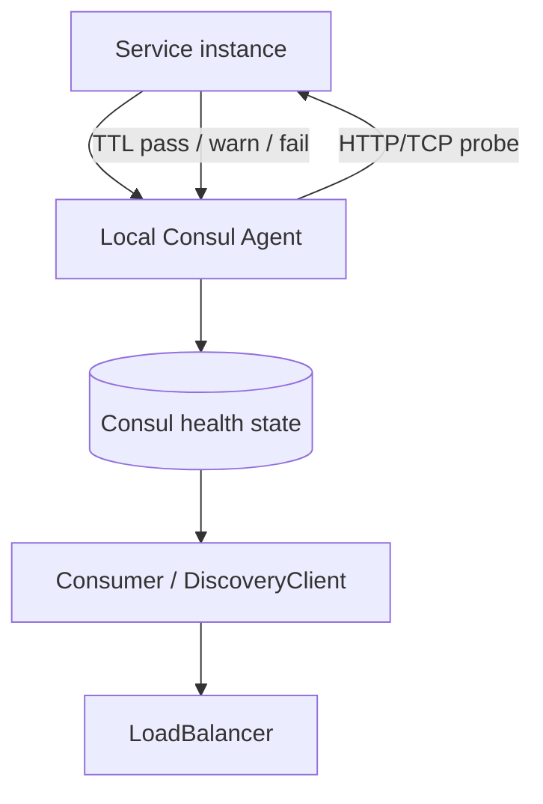

# Trade-offs Between HTTP Checks, TTL Heartbeats, and Check Load

Consul needs to know whether a service instance is still capable of serving requests in order to report health status to consumers. The two common approaches are **HTTP checks** and **TTL checks (heartbeats)**. An HTTP check has the Consul Agent actively poll an application endpoint periodically; a TTL check has the application proactively report healthy status to the Consul Agent before a timer expires.

Neither approach is universally best for every service. HTTP checks verify a concrete access path from the agent to the application while generating periodic check requests. TTL heartbeats are lighter on endpoint probing and let the application evaluate readiness itself, yet they rely on heartbeats being emitted on time and tied to actual process health. Choosing between them requires balancing failure detection accuracy, latency, check load, and operational complexity.

## Where Do Consul Health Checks Operate?

The Consul Agent manages service registrations and health checks declared on that agent. The Agent executes periodic HTTP/TCP/script checks or receives TTL updates from the application, then syncs check state into the Consul catalog/health state for consumers to query.

Common states:

| Status | Meaning | Impact on Health Queries |
|---|---|---|
| `passing` | Check succeeded; service satisfies check criteria | Eligible when consumers query only passing services |
| `warning` | Warning present, though check is not yet critically failed | Consumers must decide whether to accept warning instances |
| `critical` | Check failed or TTL expired | Normally excluded from queries requesting only passing instances |

Catalog registrations and health status are two related but separate data layers. An instance can remain in the catalog while its check is `critical`; consumers must select the appropriate API or query mode. When using the Consul health API with the `passing` parameter, only instances meeting the passing condition are returned.



Both HTTP checks and TTL checks update a service's health state; they differ in who initiates the check and what signal the check proves.

## HTTP Check: Consul Actively Calls the Endpoint

With an HTTP check, the Consul Agent sends a request to a service endpoint at a configured interval. The endpoint is typically a readiness endpoint such as `/actuator/health/readiness`, reflecting ability to accept business requests rather than merely confirming the process is alive.

Example service definition:

```json
{
  "service": {
    "name": "inventory-service",
    "id": "inventory-1",
    "address": "10.0.1.12",
    "port": 8080,
    "check": {
      "http": "http://10.0.1.12:8080/actuator/health/readiness",
      "method": "GET",
      "interval": "15s",
      "timeout": "3s"
    }
  }
}
```

The Agent calls the endpoint roughly every 15 seconds and waits up to 3 seconds per check. If a request times out or receives an unsuccessful result, the check transitions to `critical` per Consul's rules. Verify HTTP status codes and how your endpoint represents health status for your running Consul version.

### What Does an HTTP Check Detect?

- The Agent can connect to the registered address and port.
- The specific HTTP endpoint can return a readiness/health response.
- Dependencies included in the endpoint's health aggregation, such as a database or message broker, can influence the outcome.
- The network path from the agent to the service is tested directly.

An HTTP check only verifies the configured endpoint. If `/actuator/health` simply returns `UP` whenever the JVM is alive without checking readiness, Consul may continue marking the service passing even when business APIs can no longer accept load. Conversely, if the endpoint checks too many dependencies, a non-essential dependency outage can exclude the instance from discovery.

### Advantages and Costs

- **Advantages:** verifies the real HTTP path from the agent; easy to observe; supports readiness endpoints and clear status codes.
- **Costs:** every check generates periodic requests, HTTP handling, and potential dependency checks; as instance count grows, request count scales proportionally.
- **Risks:** a heavy endpoint or overly aggressive interval can generate self-inflicted load; a slow shared dependency can push many instances to critical simultaneously.

## TTL Check: Application Actively Sends Heartbeats

With a TTL check, the Consul Agent maintains a countdown timer for the check. The application or an internal monitoring component must update check status before TTL expires. Without a timely update, the agent transitions the check to `critical`.

Example service definition:

```json
{
  "service": {
    "name": "inventory-service",
    "id": "inventory-1",
    "address": "10.0.1.12",
    "port": 8080,
    "check": {
      "ttl": "30s"
    }
  }
}
```

When the application evaluates itself as ready, it sends a `pass` update to the local Consul Agent. The check update API uses the registered check ID:

```bash
curl --request PUT \
  http://127.0.0.1:8500/v1/agent/check/pass/service:inventory-1
```

`service:inventory-1` is an example of the default check ID typically generated for a service check; if the service definition specifies a different check ID, use that exact ID. When needed, the application can also report `warn` or `fail` via the corresponding endpoints. In ACL-enabled environments, check update requests require a token with appropriate agent permissions; never embed tokens directly in source code.

### What Does a TTL Heartbeat Detect?

A TTL check proves that the application or heartbeat emitter can still deliver updates to the agent within the allowed window. It does not test the HTTP path from the agent to business endpoints. If heartbeats run on an independent scheduler that keeps firing while request handlers are hung, the check can remain passing even though the service is not actually ready.

For TTL to reflect true readiness, send `pass` only after verifying essential conditions: initialization is complete, worker/thread pools can still accept work, mandatory connections are healthy, and shutdown has not started. Do not run a blind timer that always reports pass just because the JVM process is alive.

### Advantages and Costs

- **Advantages:** avoids having the agent periodically call heavy health endpoints; lets the application apply internal logic to determine status; fits workers or services without HTTP endpoints.
- **Costs:** requires building and operating a heartbeat loop; the application needs permission to update checks on the agent; scheduler bugs or token issues can cause TTL expiration.
- **Risks:** heartbeats can report false health if decoupled from real readiness; requires handling local agent disconnections or check ID changes.

## Comparing HTTP Checks and TTL Heartbeats

| Criterion | HTTP Check | TTL Heartbeat |
|---|---|---|
| Initiator | Consul Agent actively calls service | Application actively pushes status to agent |
| Check signal | HTTP endpoint and network path agent -> service | Application still delivers heartbeats to agent |
| Application requirement | Exposes an appropriate check endpoint | Implements heartbeat loop and readiness evaluation |
| Detection latency | Depends on interval, timeout, and configured failure thresholds | Depends on TTL and time since last heartbeat |
| Primary load | Periodic probe requests and endpoint execution | Periodic TTL update requests and heartbeat work |
| Best suited for | Web/APIs with lightweight readiness endpoints | Workers, non-HTTP services, or readiness needing internal logic |
| Weakness | Can create probe load and overly deep checks | Can report false health if heartbeat is isolated from request handling |

HTTP checks actively probe an endpoint from the agent's perspective. TTL checks accept health assertions from the application. If you need to verify both internal serving capacity and network HTTP reachability, you can combine both checks, provided you account for total overhead and avoid duplicating the exact same check condition.

## Detection Latency and Choosing Intervals

For an HTTP check with interval `I`, the Consul Agent normally waits until the next scheduled run to detect changes. If a service dies right after a successful check, wait time before the next probe can be nearly `I`, plus request timeout and check state transition rules. If consecutive-failure thresholds or monitoring rules are configured, factor in additional failed attempts.

For a TTL check with TTL `T`, if the application stops sending heartbeats immediately after a successful update, the check transitions to critical only after TTL expires. If heartbeats are sent every `H` seconds and `H` is substantially smaller than `T`, the system retains headroom for jitter and pauses.

Reference examples:

| Check Type | Interval / TTL | Approximate Worst-Case Latency Under Normal Conditions |
|---|---:|---|
| HTTP | interval 15s, timeout 3s | Nearly 15s waiting for next probe, plus probe duration and state handling |
| TTL | TTL 30s, heartbeat every 10s | Up to nearly 30s from last pass until TTL expires |

These are rough estimates, not SLAs. Agent scheduling, host load, networking, check processing, retries, and health state propagation can extend actual latency.

Guidelines for choosing TTL and heartbeat cadence:

- Choose a TTL several times larger than the heartbeat interval to absorb jitter and brief pauses.
- Start by sending heartbeats at roughly one-half or one-third of TTL, then measure in a realistic environment.
- Add minor jitter when large batches of instances may start simultaneously to avoid synchronized heartbeat spikes.
- Set HTTP timeout long enough for normal endpoint latency yet much shorter than the interval so checks do not overlap excessively.
- Do not shrink intervals solely for perceived faster detection; weigh probe load and endpoint stability.

## Estimating Check Load by Instance Count

For HTTP checks, given `N` instances each running one check every `I` seconds, the average system-wide probe rate is roughly:

```text
HTTP probes per second ≈ N / I
```

If each instance has `K` independent checks:

```text
HTTP probes per second ≈ N × K / I
```

For example, with 1,200 instances each having one HTTP check on a 10-second interval:

```text
1,200 / 10 = 120 HTTP probes/second
```

This is the average probe rate across the cluster. Each Consul Agent typically executes checks for the services it manages locally, distributing load across agents and local checks. However, application endpoints still absorb the corresponding request volume. If the health endpoint queries a database or multiple dependencies, the true cost can be significantly higher than a lightweight HTTP request.

For TTL checks, heartbeat updates also average roughly `N / H` requests per second when each instance sends once every `H` seconds. The key difference is that requests travel from the application to its local agent without forcing the agent to probe a service HTTP endpoint. TTL does not eliminate control-plane load entirely: the agent still processes updates and syncs check state.

Example: 1,200 instances sending TTL heartbeats every 10 seconds:

```text
1,200 / 10 = 120 TTL updates/second
```

Requests per second may look identical to the HTTP check example, yet costs on the service endpoint and network path differ. TTL shifts readiness evaluation into the application; HTTP shifts probing into the agent. Therefore, load comparisons must consider CPU, networking, endpoint logic, agent count, ACLs, state synchronization, and heartbeat operational overhead.

## Reducing Load While Detecting Failures Fast Enough

### Keep the Health Endpoint Lightweight

HTTP checks should hit a readiness endpoint with predictable latency. Avoid running heavy business queries, large table scans, or sequential downstream service calls on every probe. For critical dependencies, consider health indicators with short timeouts and separate readiness from liveness.

### Choose Intervals by Service Criticality

Not every service needs the same cadence. User-facing APIs or payment services may need faster detection than time-insensitive batch workers. Match interval/TTL to recovery objectives and consumer fault tolerance.

### Avoid Synchronized Check Bursts

When hundreds of instances start together using fixed intervals, probes can create periodic load spikes. Stagger startup times, add jitter to application-managed heartbeats, or roll out replicas evenly over deployment windows. Verify jitter configuration support in your agent/client versions.

### Limit Redundant Checks

Do not define multiple HTTP checks on the same instance if they hit the same readiness endpoint and drive the same decision. When checking multiple dependencies, distinguish which ones truly decide whether the instance can serve traffic; informational checks can be monitored separately.

### Choose TTL with Headroom

A TTL that is too short allows GC pauses, CPU contention, or a brief agent restart to trigger critical transitions. A TTL that is too long delays detecting lost instances. Measure heartbeat timing distributions under heavy load and choose a TTL with ample headroom above observed latency percentiles.

## When to Use Each Type

| Context | Recommended Choice | Rationale |
|---|---|---|
| REST API with lightweight readiness endpoint | HTTP check | Agent verifies the exact endpoint consumers expect to call |
| Worker without an open HTTP port | TTL check | Worker reports status itself via the local agent |
| Readiness relies on complex internal logic | TTL check or combined checks | Application has better context to decide whether it can accept work |
| Must verify agent connectivity to endpoint over real network | HTTP check | Probe traverses the network path from agent to service |
| Very large instance count with expensive endpoint check | TTL or lightweight HTTP check with reasonable interval | Avoids generating heavy periodic probe traffic |
| Need both internal readiness and HTTP reachability | Selective combination | Complementary signals, though increases check count and complexity |

For APIs, HTTP checks are usually straightforward when a readiness endpoint accurately reflects serving capacity. For workers, TTL is often more natural. When using TTL, ensure heartbeats stop once the service can no longer process work.

## Combining HTTP and TTL Without Creating Two Sources of Truth

You can declare both an HTTP check and a TTL check for a service when they test distinct aspects. For example, an HTTP check verifies endpoint reachability from the agent; a TTL heartbeat reflects that the application finished initializing and retains capacity to handle requests.

When combining:

1. Give each check a distinct name and clear purpose so operators know which check is failing.
2. Never allow TTL heartbeats to unconditionally pass regardless of actual readiness.
3. Understand that consumers querying only passing instances will exclude the service if either check turns critical.
4. Account for combined load: one HTTP probe plus one TTL update per instance.
5. Track critical transitions and recovery procedures separately per check.

Avoid duplicating two checks just to feel "safer." If both test the same endpoint, they add load without yielding meaningful new signal.

## Configuring with Spring Cloud Consul

Spring Cloud Consul can automatically register services and configure HTTP health checks from discovery properties. Example HTTP check configuration:

```yaml
spring:
  application:
    name: inventory-service
  cloud:
    consul:
      host: localhost
      port: 8500
      discovery:
        register: true
        health-check-path: /actuator/health/readiness
        health-check-interval: 15s
        health-check-timeout: 3s
```

Health check properties may vary across Spring Cloud Consul versions; cross-check the reference docs for your project's release train. Ensure the readiness endpoint is exposed and the agent can reach the registered address/port. If the application runs in a container, the advertised address must not be `localhost` unless the agent and service genuinely share the same network namespace.

For TTL heartbeats, Spring Cloud Consul provides built-in heartbeat support in supported versions. Verify exact property names, TTL check creation behavior, and heartbeat cadence in your version's documentation before enabling. If managing TTL manually via the Consul Agent API, the application must store the check ID, send periodic pass updates, handle agent errors, and stop heartbeats when readiness turns critical or the process shuts down.

Example calling the TTL update API directly targets the local Consul Agent, not an arbitrary Consul server:

```bash
curl --request PUT \
  --header "X-Consul-Token: ${CONSUL_AGENT_TOKEN}" \
  http://127.0.0.1:8500/v1/agent/check/pass/service:inventory-1
```

In production, load tokens from a secret manager or protected environment variables. Never commit tokens into YAML or source code. The check ID in the command must match the check registered on the agent.

## Security and Operations

- Grant only the Consul Agent access to necessary health endpoints; do not expose management endpoints to untrusted networks.
- If a health endpoint requires authentication, configure appropriate headers/tokens for the HTTP check and manage secrets securely.
- For TTL updates, issue an ACL token scoped strictly to minimal agent check-update privileges.
- Never return secrets, connection strings, or sensitive infrastructure details in health responses.
- Monitor check counts, response latencies, critical/warning rates, failed TTL updates, and state sync delays.
- Configure `deregister_critical_service_after` only when you want the agent to automatically remove services after prolonged critical states; do not treat it as a substitute for investigating and fixing check failures.

## Measuring Load and Choosing Settings in Practice

You can run an experiment with identical instance counts and identical readiness semantics:

1. Register one group of instances with an HTTP check, 10s interval, and 2s timeout.
2. Measure request rate to the health endpoint, agent and app CPU, response latency, and time from stopping the service until the check turns critical.
3. Register an equivalent group with 30s TTL and 10s heartbeat cadence.
4. Measure TTL update rate, agent CPU, app CPU, detection time when heartbeats stop, and detection time when readiness explicitly reports failure.
5. Increase instance counts in steps and observe both aggregate load and per-agent load.
6. Simulate slow endpoints, agent disconnects, JVM pauses, and graceful shutdowns.
7. Compare detection latency, false-critical rates, and resource overhead across both options.

Metrics to record:

| Metric | Why Measure It? |
|---|---|
| Checks per agent | Determines check load distribution |
| HTTP requests/second | Measures actual probe load on the endpoint |
| TTL updates/second | Measures heartbeat load generated by applications |
| p95/p99 health endpoint latency | Avoids setting timeouts too tight relative to normal latency |
| Time from failure to `critical` | Evaluates detection delay |
| False critical rate | Catches settings overly sensitive to jitter or pauses |
| Agent and service CPU/network | Compares operational cost |

Do not measure average load alone. Test during rolling deployments or scale-outs, when many instances may start and begin checks/heartbeats nearly simultaneously.

## Common Issues

| Symptom | Possible Cause | Resolution |
|---|---|---|
| HTTP check continuously critical | Wrong address/port/path, agent cannot reach endpoint, or timeout too short | Call the endpoint from the agent host/container itself and check timeout |
| HTTP check passing while API is unusable | Endpoint only checks liveness or omits readiness | Use a readiness endpoint reflecting ability to accept traffic |
| TTL check critical while service is running | Heartbeat scheduler stopped, agent unreachable, or TTL too short | Check heartbeat logs, check ID, ACLs, and increase TTL headroom |
| TTL check passing while worker is hung | Heartbeat thread runs independently of processing threads | Send pass only when workers can genuinely accept work |
| High load on agent/app due to checks | Interval too short, duplicate checks, or heavy health endpoint | Reduce check count, lighten endpoint, and adjust interval |
| Many instances turn critical together | Shared dependency outage or synchronized check timing | Separate system-wide vs. instance failures; add jitter and sensible timeouts |
| Service stays in catalog despite critical | Check status and deregistration are separate mechanisms | Verify `passing` queries and configure critical deregistration timeout if needed |

## Selection Principles

1. Choose HTTP checks when you need to verify endpoint reachability from the Consul Agent and have a lightweight readiness endpoint.
2. Choose TTL when the application needs to determine readiness itself, lacks an HTTP endpoint, or can reliably emit heartbeats.
3. With TTL, heartbeats must reflect real serving capacity; stop sending or report failure when the application is no longer ready.
4. Estimate total load from instance count, check count, and cadence; include both endpoint execution and TTL update requests.
5. Pick interval/TTL from detection targets and p95/p99 metrics, leaving margin for jitter, pauses, and network delays.
6. Avoid duplicate checks, heavy endpoints, and synchronized intervals that create bursts.
7. Combine HTTP and TTL only when the two checks contribute complementary signals.
8. Test scale-outs, rolling deployments, agent restarts, network partitions, and dependency outages.

## Summary

An HTTP check is an active probe from the Consul Agent to a service endpoint; a TTL heartbeat is an application-sent signal renewing healthy status. HTTP checks confirm whether the network path and readiness endpoint respond, at the cost of periodic probe requests. TTL reduces endpoint probing and lets applications use internal readiness logic, yet is trustworthy only when heartbeats are tightly coupled to serving capacity. At scale, load for both depends on instance count, check count, and cadence. Choose the mechanism matching the signal you need to verify, measure real detection delay and resource cost, and tune TTL/interval with headroom rather than blindly shrinking intervals for faster detection.
