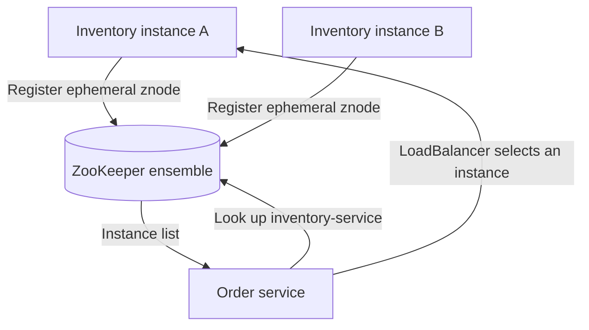

# Role of ZooKeeper and Curator in Service Discovery

In a microservices system, a service can run across multiple instances, and the address of each instance may change after every deployment or scaling event. Consumers need a way to look up instances by a logical name such as `inventory-service`, while providers need to advertise their location and status. ZooKeeper can serve as the centralized coordination store for this directory; Apache Curator provides a high-level API that helps Java applications work with ZooKeeper more safely and conveniently.

Within the scope of Spring Cloud, three layers of responsibility should be distinguished:

- **ZooKeeper** is a distributed coordination system providing a data tree, sessions, synchronization mechanisms, and change notifications. It does not natively understand the concept of microservices or HTTP health checks of an application.
- **Curator** is a Java client library. Curator Framework manages connections and operations with ZooKeeper; its recipes and modules such as Service Discovery build common coordination patterns on top of those primitives.
- **Spring Cloud Zookeeper Discovery** integrates ZooKeeper into Spring Cloud's service discovery abstraction, enabling applications to look up services using `DiscoveryClient` and combine it with Spring Cloud LoadBalancer.

## What part of the discovery problem does ZooKeeper solve?

If `order-service` calls `inventory-service` via a hardcoded IP address in configuration, that address can become stale when containers are recreated. If there are multiple instances, the consumer also needs to know which instances are active and choose one to send requests to.

ZooKeeper provides a hierarchical namespace of data nodes called **znodes**. An application can define a path as the root for the service directory, for example:

```text
/services
  /inventory-service
    /instance-a
    /instance-b
  /pricing-service
    /instance-c
```

Each instance node can hold data describing the host, port, instance ID, version, or routing metadata. Providers create or update znodes when joining the system; consumers read the child instances under a service ID to find call targets. This is a convention built by the application or discovery library—ZooKeeper does not automatically detect which processes are listening on which ports.



ZooKeeper is suited for small coordination data that needs to be observed and updated in a controlled manner by multiple processes. It should not be used as a business database or a place to store large payloads. A discovery directory only needs to hold enough information to locate and select instances.

## Important ZooKeeper concepts

### Znodes and tree structure

A znode is the unit of data in the ZooKeeper tree. A znode has a unique path, can hold a small amount of data, and can have child znodes. For example, `/services/inventory-service/instance-a` represents an instance belonging to `inventory-service`.

ZooKeeper supports several types of znodes. In discovery, the two commonly relevant types are:

- **Persistent znode:** remains until a client deletes it or an administrative operation removes it. It can be used to create the root `/services` node or nodes representing service IDs.
- **Ephemeral znode:** tied to the session of the client that created it. When the session ends or expires, ZooKeeper automatically deletes the ephemeral znode and its ephemeral children.

A common pattern is to create the service path using a persistent znode and create each instance using an ephemeral znode. When an instance stops gracefully, the application should unregister before closing the client. If the process crashes unexpectedly and the session expires, ZooKeeper will clean up the temporary registration.

Ephemeral znodes cannot have children. Therefore, if you design a multi-level tree, place ephemeral nodes at the leaf level and use persistent nodes for parent nodes. If multiple instances may register concurrently, each instance needs a distinct path; you can use ephemeral sequential nodes so ZooKeeper assigns a sequential suffix, or use a unique instance ID generated by the application.

### Sessions and heartbeats

When a Curator client connects, ZooKeeper creates or resumes a session with a timeout. The client sends heartbeats to keep the session alive. If the server does not receive a heartbeat within the allowed period, the session can expire and the ephemeral znodes belonging to that session are deleted.

A key point to understand clearly is that **a temporary connection loss does not mean the session has expired immediately**. When the network is interrupted, the client may not yet know whether the session is still valid. In Curator, common connection states include:

| State | Operational meaning |
|---|---|
| `CONNECTED` | The client is connected and can operate against ZooKeeper. |
| `SUSPENDED` | The connection is interrupted; the client cannot confirm the session state yet. Be cautious with operations that depend on ephemeral node ownership. |
| `RECONNECTED` | The client reconnected and the existing session was preserved. |
| `LOST` | The session has expired or cannot be recovered; previous ephemeral znodes have been deleted and the application must re-register once a new session is established. |

Exact names and detailed behaviors should be checked against the Curator version in use, but the operational principle remains: while in an uncertain state, do not assume the registration is still valid; when the session is lost, the registration must be recreated.

### Watches and change notifications

Consumers can set watches to be notified when a znode or its list of children changes. For example, `order-service` watches the child instances of `/services/inventory-service`; when an instance is added or removed, the consumer receives a notification and re-reads the updated list.

A basic ZooKeeper watch is a one-time trigger: after an event fires, the client typically must register a new watch if it wants to continue monitoring. Some events may be coalesced when a client disconnects or processes slowly, so watches should not be treated as a guaranteed ordered stream of every change. Consumers should use events as signals to reload the current state.

Curator provides higher-level recipes and caches to reduce manual watch management. Regardless of which cache is used, the application must still handle stale caches, connection drops, and resynchronization after connectivity is restored.

### Quorum and ensemble availability

In production deployments, ZooKeeper typically runs as an **ensemble** consisting of multiple servers. Write operations require a quorum to agree on state. For this reason, an odd number of nodes is usually chosen to tolerate failures of some servers while maintaining a majority.

For example, a three-node ensemble can continue serving when one node fails because the remaining two nodes still form a majority. If quorum is lost, the system cannot continue processing writes in a consistency-preserving manner; clients may encounter errors or block waiting to connect. Because discovery depends on the registry, quorum should be monitored and ensemble recovery plans should be in place.

## Curator makes using ZooKeeper easier to manage

Curator is an Apache Java client library, not a standalone registry server. Curator Framework manages connections, retries, and client lifecycle. Its recipe modules provide standardized implementations for patterns such as leader election, distributed locks, caches, and service discovery.

For service discovery, the Curator Service Discovery module provides the main abstractions:

| Component | Role |
|---|---|
| `ServiceDiscovery` | Manages registration, unregistration, and querying of service instances under a base path. |
| `ServiceInstance` | Describes an instance including service name, address, port, ID, and optional payload. |
| `ServiceProvider` | Supplies an instance to a consumer according to a configured selection strategy. |
| `ServiceCache` | Caches the instance list and updates when discovery data changes. |
| `ProviderStrategy` | Defines how instances are chosen, such as round-robin or a custom strategy. |

Curator saves applications from having to write all the logic for creating znodes, managing sessions, handling watches, and resynchronizing from scratch. Even so, the application must still manage the lifecycle of the client and discovery objects, choose an appropriate retry policy, and react properly to connection states.

## Registration and lookup flow with Curator

A typical flow can proceed as follows:

1. The provider initializes `CuratorFramework` with the ensemble address and retry policy, then opens the connection.
2. The provider creates `ServiceDiscovery` with a base path, such as `/services`.
3. The provider creates a `ServiceInstance` with the service name, an address reachable by consumers, port, and any needed payload.
4. The provider calls `registerService`. Curator writes the instance information into ZooKeeper according to the library's registration model.
5. The consumer queries instances by service name, or creates a `ServiceProvider` to pick an instance according to a strategy.
6. When the provider stops, it unregisters and closes its resources. If the process terminates abruptly, the ephemeral node is cleaned up when the session expires.
7. When a session is lost, the provider must re-register under the new session; the consumer must refresh its cache or instance list once connectivity is restored.

Example of initializing the client and service discovery with Curator:

```java
import org.apache.curator.framework.CuratorFramework;
import org.apache.curator.framework.CuratorFrameworkFactory;
import org.apache.curator.retry.ExponentialBackoffRetry;
import org.apache.curator.x.discovery.ServiceDiscovery;
import org.apache.curator.x.discovery.ServiceDiscoveryBuilder;
import org.apache.curator.x.discovery.ServiceInstance;

import java.io.Closeable;
import java.util.concurrent.TimeUnit;

public class InventoryRegistration implements Closeable {
    private final CuratorFramework client;
    private final ServiceDiscovery<InstanceMetadata> discovery;
    private ServiceInstance<InstanceMetadata> registeredInstance;

    public InventoryRegistration(String connectString) throws Exception {
        this.client = CuratorFrameworkFactory.newClient(
            connectString,
            new ExponentialBackoffRetry(1_000, 3)
        );
        this.client.start();
        if (!this.client.blockUntilConnected(10, TimeUnit.SECONDS)) {
            this.client.close();
            throw new IllegalStateException("Cannot connect to ZooKeeper");
        }

        this.discovery = ServiceDiscoveryBuilder
            .builder(InstanceMetadata.class)
            .client(client)
            .basePath("/services")
            .build();
        this.discovery.start();
    }

    public void register(String host, int port) throws Exception {
        ServiceInstance<InstanceMetadata> instance = ServiceInstance
            .<InstanceMetadata>builder()
            .name("inventory-service")
            .address(host)
            .port(port)
            .payload(new InstanceMetadata("v1"))
            .build();

        discovery.registerService(instance);
        this.registeredInstance = instance;
    }

    @Override
    public void close() throws java.io.IOException {
        if (registeredInstance != null) {
            discovery.unregisterService(registeredInstance);
        }
        discovery.close();
        client.close();
    }
}

class InstanceMetadata {
    private String version;

    public InstanceMetadata() {}

    public InstanceMetadata(String version) {
        this.version = version;
    }

    public String getVersion() {
        return version;
    }

    public void setVersion(String version) {
        this.version = version;
    }
}
```

This snippet illustrates how registration works, not a complete Spring Boot application. In a real application, you should create the client and `ServiceDiscovery` as beans with clear lifecycles, wait for the connection to be ready before advertising the instance, and ensure `host` is an address reachable by consumers. The payload should be small, reliably serializable data and must not contain passwords or tokens.

Consumers can query the instance list directly:

```java
var instances = discovery.queryForInstances("inventory-service");
for (var instance : instances) {
    System.out.println(instance.getAddress() + ":" + instance.getPort());
}
```

Or use `ServiceProvider` to pick an instance instead of selecting manually:

```java
import org.apache.curator.x.discovery.ServiceProvider;
import org.apache.curator.x.discovery.strategies.RoundRobinStrategy;

ServiceProvider<InstanceMetadata> provider = discovery
    .serviceProviderBuilder()
    .serviceName("inventory-service")
    .providerStrategy(new RoundRobinStrategy<>())
    .build();

provider.start();
try {
    ServiceInstance<InstanceMetadata> selected = provider.getInstance();
    if (selected != null) {
        // Send request to selected.getAddress() and selected.getPort().
    }
} finally {
    provider.close();
}
```

In the example, `RoundRobinStrategy` distributes selection in a round-robin order over the instance list currently known to the provider. This is a selection strategy, not a health check. The consumer still needs timeouts, connection error handling, and a bounded retry policy because an instance can fail right after being selected.

## Integrating ZooKeeper with Spring Cloud

Spring Cloud Zookeeper provides integration for Spring applications to use ZooKeeper as a service registry. The common starter is `spring-cloud-starter-zookeeper-discovery`; its version should be managed through a Spring Cloud BOM compatible with the project's Spring Boot version. When calling services by name with client-side load balancing, add the corresponding Spring Cloud LoadBalancer starter.

Example Maven dependencies, with versions managed by Spring Cloud dependency management:

```xml
<dependencies>
    <dependency>
        <groupId>org.springframework.cloud</groupId>
        <artifactId>spring-cloud-starter-zookeeper-discovery</artifactId>
    </dependency>
    <dependency>
        <groupId>org.springframework.cloud</groupId>
        <artifactId>spring-cloud-starter-loadbalancer</artifactId>
    </dependency>
</dependencies>
```

Provider configuration:

```yaml
spring:
  application:
    name: inventory-service
  cloud:
    zookeeper:
      connect-string: zk-1:2181,zk-2:2181,zk-3:2181
      discovery:
        enabled: true
        register: true
        root: /services
        instance-id: ${spring.application.name}:${server.port}
        prefer-ip-address: true
```

`spring.application.name` becomes the service ID that consumers look up. `connect-string` points to a ZooKeeper ensemble reachable from the application. `root` specifies the root path of the directory; `instance-id` must be unique within the service scope. When running multiple instances on the same host, make sure ports or ID components differ. The advertised address configuration must match the network used by consumers.

Consumers can look up instances through the common `DiscoveryClient` abstraction:

```java
import java.util.List;

import org.springframework.cloud.client.ServiceInstance;
import org.springframework.cloud.client.discovery.DiscoveryClient;
import org.springframework.stereotype.Service;

@Service
public class InventoryLookup {
    private final DiscoveryClient discoveryClient;

    public InventoryLookup(DiscoveryClient discoveryClient) {
        this.discoveryClient = discoveryClient;
    }

    public List<ServiceInstance> findInstances() {
        return discoveryClient.getInstances("inventory-service");
    }
}
```

For standard HTTP calls, you can use the service name as a logical host and let Spring Cloud LoadBalancer select an instance:

```java
import org.springframework.boot.web.client.RestTemplateBuilder;
import org.springframework.cloud.client.loadbalancer.LoadBalanced;
import org.springframework.context.annotation.Bean;
import org.springframework.context.annotation.Configuration;
import org.springframework.web.client.RestTemplate;

@Configuration
class HttpClientConfiguration {
    @Bean
    @LoadBalanced
    RestTemplate inventoryRestTemplate(RestTemplateBuilder builder) {
        return builder.build();
    }
}
```

Calls can then use a URL such as `http://inventory-service/api/items/42`. LoadBalancer coordinates with the discovery client to find and select an instance. This approach relieves the consumer from implementing its own instance-selection algorithm. If an application only needs to inspect the instance list or specific metadata, `DiscoveryClient` can still be used directly.

Property names and integration capabilities can vary across Spring Cloud release trains. Always check the documentation for the exact release train, dependency BOM, and starter configuration in use; do not arbitrarily mix Curator, Spring Boot, and Spring Cloud versions.

## Health checks, registry state, and correctness

A common misconception is that an ephemeral znode acts as an application health check. It only indicates that ZooKeeper still considers the client's session alive. A process might still keep its session active while its HTTP endpoint is hung, its database connection is broken, or the application is not ready to serve traffic.

Therefore, when designing discovery, multiple signals should work together:

- **Readiness:** only register or allow an instance to receive traffic when the application is ready to serve requests.
- **Liveness:** detect processes that can no longer function and need to be restarted.
- **ZooKeeper session:** detect clients that have been disconnected long enough and clean up ephemeral nodes when the session expires.
- **Consumer timeouts and error handling:** protect calls during the window when the registry or cache does not yet reflect a failure.

Do not treat the existence of a znode as proof that an endpoint is healthy. If instances must be excluded based on HTTP or TCP health checks, you must integrate an appropriate check mechanism or update registration status according to the application's readiness.

### Handling registry and cache staleness

The registry and consumer caches cannot synchronize instantaneously with the network. An instance that just died may still appear in lookup results until its session expires and caches are updated. Conversely, a new instance may have started but not yet registered successfully or appeared in the cache.

Handling principles:

1. Use a unique instance ID and a consistent registration path by convention.
2. During graceful shutdown, unregister before closing the Curator client.
3. Monitor `ConnectionState`; when `SUSPENDED`, avoid advertising or trusting unconfirmed state changes; when `LOST`, recreate the registration after the client obtains a new session.
4. After reconnecting, reload the list or refresh the service cache rather than relying solely on old watches.
5. Set request timeouts, bound retries, and avoid excessive concurrent retries when a service has just recovered.
6. Observe registered instance counts, session durations, ZooKeeper connection errors, cache refreshes, and request failure rates.

Curator can handle part of reconnection and recipe mechanics automatically, but it does not replace application readiness logic, request error handling, or recovery policies. Verify the exact behavior of the library version and configuration you deploy.

## Security and operating ZooKeeper

ZooKeeper holds location information for internal services, so it should be treated as sensitive infrastructure. A discovery setup may be functionally correct yet still pose risks if every workload is allowed to read, write, or delete the entire data tree.

- **ACL permissions:** restrict create, read, update, and delete permissions on znodes per service or workload group. Do not grant broad permissions to all clients in production.
- **Authentication and encryption:** enable appropriate authentication and TLS as supported by the ZooKeeper/Curator versions; manage credentials securely and rotate them periodically.
- **Network segmentation:** allow only providers, consumers, and required administrative components to connect to ZooKeeper ports; do not expose the ensemble to untrusted networks.
- **Protect registration data:** do not put secrets, access tokens, or personal data in payloads or metadata.
- **Monitor the ensemble:** track quorum, request latency, connection counts, session expirations, snapshot/transaction log disk usage, and individual server health.
- **Backup and recovery:** establish backup, restore, and ensemble upgrade procedures; test node-loss and quorum-loss scenarios.

When choosing ZooKeeper as a registry, the team must be prepared to operate an additional infrastructure cluster with quorum, session, and storage requirements. For small systems or platforms that already have another registry, weigh operational cost and suitability before introducing ZooKeeper.

## When should you use ZooKeeper and Curator?

ZooKeeper and Curator are a good fit when a system already uses ZooKeeper for distributed coordination, needs a znode-based registry, and wants to leverage Curator Service Discovery or Spring Cloud Zookeeper. Curator is especially helpful when Java applications need to interact with discovery directly or need other coordination recipes.

Before choosing, consider:

| Question | What to determine |
|---|---|
| Is a ZooKeeper ensemble already running? | If not, factor in the effort for deployment, monitoring, backups, and upgrades. |
| Is discovery by service ID needed? | Curator and Spring Cloud Zookeeper provide abstractions to represent and look up service instances. |
| What level of health checking is required? | Sessions/ephemeral nodes only reflect connection lifecycle; application readiness and health checks are still needed. |
| Do consumers need load balancing? | Combine with Spring Cloud LoadBalancer or an appropriate provider strategy. |
| Are there security and tenant isolation requirements? | Design ACLs, authentication, TLS, network segmentation, and base path structure from the start. |
| Can the team operate quorum? | The registry requires a stable ensemble and an incident response procedure for quorum loss. |

ZooKeeper provides coordination primitives and state storage; Curator wraps those primitives into an easier-to-use discovery API; Spring Cloud Zookeeper connects that registry to the Spring ecosystem. When you understand the boundary between sessions, health checks, caches, and load balancing, your team can use discovery to locate instances flexibly while still handling the windows where the registry lags behind actual state.
