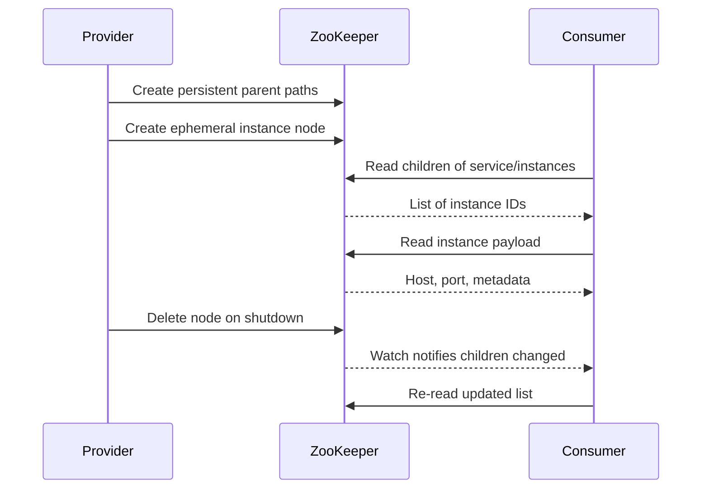

# Znodes, Ephemeral Nodes, and Registration Path Structure

When using ZooKeeper to store a service directory, each provider needs to publish a record so consumers can find its address. ZooKeeper represents records as **znodes** in a hierarchical path tree. How you choose znode types and organize paths determines how the system handles instances starting, stopping, losing connectivity, and re-registering.

A common convention is to place services under a root node such as `/services`, with each service having its own branch and each instance having its own leaf node:

```text
/services                              (persistent)
  /inventory-service                   (persistent)
    /instances                        (persistent)
      /instance-01                    (ephemeral)
      /instance-02                    (ephemeral)
  /pricing-service                    (persistent)
    /instances                        (persistent)
      /instance-01                    (ephemeral)
```

Parent nodes hold the long-lived directory structure; leaf nodes represent registered instances and are bound to the provider's session. When a session expires, ZooKeeper deletes the corresponding ephemeral node. Consumers only need to read the child nodes under `/services/inventory-service/instances` to obtain the instance list, and then read each node's data for addresses and metadata.

In the `SPRING_CLOUD_SERVICE_DISCOVERY` module, this model helps explain the storage layer behind service-ID-based discovery. Spring Cloud Zookeeper and Curator can manage creating, reading, and deleting these znodes on the application's behalf. Regardless of which abstraction is used, designers still need to understand node-type, session, and path-structure rules to operate the registry accurately.

## What is a znode?

A znode is a node in ZooKeeper's data tree. Each znode has a unique absolute path, for example `/services/inventory-service/instances/instance-01`. A znode can hold a small data payload and can have child nodes, subject to the restrictions specific to ephemeral nodes.

A znode is commonly used to store one of the following kinds of information:

- **Structural node:** marks a namespace, service name, or instance group, such as `/services` and `/services/inventory-service/instances`.
- **Instance record:** contains host, port, protocol, instance ID, deployment zone, or metadata needed for routing.
- **Coordination state:** used in other synchronization problems such as leader election or distributed locks. This is a different purpose from service discovery records.

Znode data is stored as bytes. Applications can serialize JSON, Avro, or another suitable format, but should keep payloads small with a clear schema. Do not store large business objects, files, passwords, or access tokens in a znode. Consumers need to know the payload format and version to decode it safely.

Example payload for an instance:

```json
{
  "serviceId": "inventory-service",
  "instanceId": "inventory-01",
  "host": "10.0.1.12",
  "port": 8080,
  "scheme": "http",
  "zone": "ap-southeast-1a",
  "version": "v1"
}
```

This payload only describes location and routing metadata. It does not prove that the endpoint is healthy. Readiness and health checks must be designed separately at the application or deployment infrastructure layer.

## Znode types relevant to service registration

ZooKeeper supports node types combining two properties: persistent or ephemeral, and with or without a sequential suffix. For service discovery, four basic types should be understood.

| Znode type | Lifecycle | Node name | Use case |
|---|---|---|---|
| `PERSISTENT` | Remains until explicitly deleted | Exact requested path | Root node, service name, `instances` directory |
| `EPHEMERAL` | Exists for the creating session | Exact requested path | Instance record with a stable ID |
| `PERSISTENT_SEQUENTIAL` | Remains until deleted | ZooKeeper appends an increasing numeric suffix | Queues or records requiring long-lived creation order |
| `EPHEMERAL_SEQUENTIAL` | Deleted when the session expires | ZooKeeper appends an increasing numeric suffix | Temporary records needing a unique ZooKeeper-assigned name |

### Persistent nodes: preserving directory structure

`PERSISTENT` is suited for parent nodes that do not represent a live process. For instance, `/services`, `/services/inventory-service`, and `/services/inventory-service/instances` can exist even when the service currently has no instances.

Because parent nodes remain stable, a provider only needs to create or delete its own instance node. Stopping one instance does not remove the service namespace. Persistent nodes do not disappear automatically when clients disconnect, so a cleanup process is needed if the application dynamically creates structural nodes that are no longer used.

### Ephemeral nodes: tying records to a session

`EPHEMERAL` is the node type commonly used for instance registration. When a client creates an ephemeral node, ZooKeeper binds that node to the client's current session. If the session closes or expires, the node is deleted automatically.

For example, `inventory-service` has two instances. Each instance opens its own session and registers an ephemeral node:

```text
/services/inventory-service/instances/instance-01
/services/inventory-service/instances/instance-02
```

When `instance-01` stops gracefully, it should delete its registration node before closing the session. If the process is killed or the host fails, ZooKeeper deletes the node once it determines the session has expired. Consumers watch the child list and update their callable instance list.

Ephemeral nodes have two important limitations:

1. An ephemeral node cannot have child nodes. Therefore, do not make `/instances` ephemeral if instance nodes will live beneath it. Keep `/instances` persistent and create ephemeral nodes only at the leaf level beneath it.
2. An ephemeral node belongs to the session that created it. Another client cannot take over that node by overwriting it. If the old session expires, the provider must create a new registration under a new session.

An ephemeral node reflects session lifecycle, not full application health. A process might still send heartbeats to ZooKeeper while its HTTP API is hung. Conversely, a network glitch might temporarily disconnect the client even though the process is still running. Therefore, do not rely on the presence of an ephemeral node as the sole health check.

### Sequential nodes: generating unique instance names

With `PERSISTENT_SEQUENTIAL` or `EPHEMERAL_SEQUENTIAL`, the application supplies a path prefix; ZooKeeper automatically appends an incrementing numeric suffix to form the node name. For example, creating under the prefix `/services/inventory-service/instances/instance-` might return:

```text
/services/inventory-service/instances/instance-0000000042
```

This property is useful when multiple providers register concurrently without coordinating to assign IDs themselves. In discovery, combining `EPHEMERAL_SEQUENTIAL` creates an instance node with a unique name within the parent branch that is automatically cleaned up with the session.

The sequential suffix is only meaningful within the scope of the parent path and ZooKeeper's numbering mechanism. Do not treat it as a timestamp, a global ID, or proof of healthy instance ordering. If an application needs a stable ID across the deployment lifecycle, you can use a platform-assigned instance ID and create an `EPHEMERAL` node with an exact path.

## Designing the registration path structure

A good path structure helps consumers look up quickly, restrict access permissions, and avoid collisions between providers. You can start with the pattern:

```text
/{root}/{namespace}/{serviceId}/instances/{instanceId}
```

Example:

```text
/services/production/inventory-service/instances/pod-a7f3
/services/production/inventory-service/instances/pod-b2c9
/services/production/pricing-service/instances/pod-c1d8
```

Each component has a distinct meaning:

| Component | Meaning | Design note |
|---|---|---|
| `root` | Shared registry root, e.g., `/services` | Configure consistently across providers and consumers |
| `namespace` | Environment, tenant, or deployment domain | Add only when directory separation is actually needed |
| `serviceId` | Logical service name, e.g., `inventory-service` | Stable, readable, and consistent with `spring.application.name` |
| `instances` | Branch holding instance records | Typically a persistent node |
| `instanceId` | Identifier for a specific running instance | Unique within the service and namespace |

### Path naming rules

ZooKeeper paths follow ZooKeeper node-naming rules; not every arbitrary string is valid. Some practical guidelines:

- Use clear segments and do not allow service IDs to contain `/`, since that separates tree levels.
- Normalize letter casing and special characters before registering; providers and consumers must use the same service ID mapping rule.
- Do not concatenate raw user input directly into paths. If an ID comes from an external source, validate or encode it according to a safe convention.
- Do not create paths with repeated separators, empty segments, or invalid special segments.
- Do not use an IP address as the service ID. IP addresses are properties of instances and can change; the service name is the stable logical identifier.
- Keep paths short, structured, and observable through ZooKeeper administration tools.

If two environments share the same ensemble, a namespace separates `/services/dev/...` from `/services/production/...`. However, a namespace is only logical separation. If strict security is required, combine it with ACLs so workloads in one environment cannot read or modify data in another environment.

### Choosing an instance ID

An instance ID must distinguish concurrent running instances of the same service. Common ID sources include:

- Pod or container name assigned by the orchestration platform.
- Hostname combined with port when a single host runs multiple instances.
- A UUID generated at process startup.
- A sequential suffix assigned by ZooKeeper when using `EPHEMERAL_SEQUENTIAL`.

Do not use `spring.application.name` alone as the instance ID, because multiple replicas of the same service would write to the same path. If using a stable path with `EPHEMERAL`, ensure only one process owns that ID at any time. If multiple concurrent instances are needed without a reliable external ID source, using sequential nodes is an option.

## Registering with Curator

Curator provides APIs to create znodes and manage the connection to ZooKeeper. The following example demonstrates creating persistent parent nodes and an ephemeral node for an instance; it uses Jackson Databind to serialize the payload. This is a primitive-level approach; in a standard Spring Cloud application, the discovery starter handles most of these operations.

```java
import com.fasterxml.jackson.databind.ObjectMapper;

import java.util.Map;

import org.apache.curator.framework.CuratorFramework;
import org.apache.zookeeper.CreateMode;
import org.apache.zookeeper.KeeperException;

public class ZookeeperServiceRegistration {
    private final CuratorFramework client;
    private final ObjectMapper objectMapper = new ObjectMapper();

    public ZookeeperServiceRegistration(CuratorFramework client) {
        this.client = client;
    }

    public String registerInventory(String instanceId,
                                    String host,
                                    int port) throws Exception {
        String instancesPath = "/services/inventory-service/instances";
        String instancePath = instancesPath + "/" + instanceId;

        // Create persistent parent nodes if they do not exist yet.
        try {
            client.create()
                .creatingParentsIfNeeded()
                .forPath(instancesPath);
        } catch (KeeperException.NodeExistsException ignored) {
            // The instances branch was already created by a previous registration or another replica.
        }

        byte[] payload = objectMapper.writeValueAsBytes(
            Map.of("host", host, "port", port));

        try {
            client.create()
                .withMode(CreateMode.EPHEMERAL)
                .forPath(instancePath, payload);
        } catch (KeeperException.NodeExistsException ex) {
            throw new IllegalStateException(
                "Instance path is already registered: " + instancePath, ex);
        }

        return instancePath;
    }

    public void unregister(String instancePath) throws Exception {
        try {
            client.delete().forPath(instancePath);
        } catch (KeeperException.NoNodeException ignored) {
            // The node was already cleaned up by ZooKeeper when the session expired.
        }
    }
}
```

The example assumes `instanceId` has already been validated and `host` is an address reachable by consumers. `ObjectMapper` serializes the payload to JSON bytes, avoiding escaping issues when hosts or metadata contain special characters. `NodeExistsException` should also be handled according to application policy: this error can indicate a duplicate ID or a previous registration that is still valid.

`creatingParentsIfNeeded()` creates missing parent nodes as persistent nodes. It does not turn parent nodes into ephemeral nodes. For a registration path, only the final instance node is created with `CreateMode.EPHEMERAL`.

### Registering with an ephemeral sequential node

If there is no stable ID or multiple instances may start simultaneously, you can let ZooKeeper assign a sequential suffix. In the same registration class above, the node creation part can be replaced with the following snippet:

```java
String instancesPath = "/services/inventory-service/instances";
byte[] payloadBytes = objectMapper.writeValueAsBytes(
    Map.of("host", "10.0.1.12", "port", 8080));

String createdPath = client.create()
    .creatingParentsIfNeeded()
    .withMode(CreateMode.EPHEMERAL_SEQUENTIAL)
    .forPath(instancesPath + "/instance-", payloadBytes);
```

The return value of `forPath` is the actual path created, such as `/services/inventory-service/instances/instance-0000000042`. The provider should store the returned path for graceful unregistration. When the session expires, ZooKeeper deletes that node automatically; if a new session is created, the provider must re-register and will receive a new path.

### Updating instance data

If an instance's address or metadata changes, the provider can update the node data with `setData`. ZooKeeper associates a version with data; applications can use the version to avoid overwriting another client's update:

```java
client.setData()
    .withVersion(expectedVersion)
    .forPath(instancePath, updatedPayload);
```

If the version no longer matches, ZooKeeper returns a version conflict error. The application needs to re-read the data and decide whether to apply the new update. Avoid unconditional updates if multiple components can write to the same node.

In discovery design, typically only the provider owning an instance is permitted to update its own node. Consumers read data and watch for changes rather than modifying provider addresses.

## Looking up and watching instances

A consumer starts by reading the list of child nodes under the service path. It then reads each instance's payload to retrieve its address:

```java
import java.nio.charset.StandardCharsets;
import java.util.List;

List<String> instanceIds = client.getChildren().forPath(
    "/services/inventory-service/instances");

for (String instanceId : instanceIds) {
    String path = "/services/inventory-service/instances/" + instanceId;
    byte[] data = client.getData().forPath(path);
    String payload = new String(data, StandardCharsets.UTF_8);
    System.out.println(instanceId + " -> " + payload);
}
```

This snippet only illustrates read operations. In a real system, a node can be deleted between the moment the consumer reads the child list and the moment it reads the payload. Consumers need to handle `NoNodeException`, reload the list, and continue with the remaining instances. Never assume the list just read is always accurate at the exact moment a request is sent.

To track changes, consumers can set a watch on the child list or use a Curator cache. Basic ZooKeeper watches are one-time notifications; after receiving an event, the client must re-register the watch or use a cache abstraction that manages it automatically. After reconnecting, resynchronize the current state rather than relying solely on events that may have been missed.



## Sessions, reconnection, and re-registration

An ephemeral node lives for the duration of a ZooKeeper session. The client sends heartbeats to keep the session alive; if the network is interrupted, the client may transition to the `SUSPENDED` state. During this phase, the client cannot yet be certain whether the session has been lost. If connectivity is restored before the session expires, the ephemeral node may still exist. If the session expires, ZooKeeper deletes the node and the client no longer owns the previous registration.

With Curator, monitor connection states carefully:

| State | Handling related to registration |
|---|---|
| `CONNECTED` | Operations can proceed once the client and application are ready. |
| `SUSPENDED` | Temporarily treat registration state as uncertain; avoid advertising the instance as available based solely on stale caches. |
| `RECONNECTED` | Connectivity restored; if the old session is still valid, the old registration remains. If the session was previously lost, create a new registration per client state. |
| `LOST` | The session expired; old ephemeral nodes were deleted. The provider must re-register once it has a new session. |

A safe recovery sequence typically includes:

1. Detecting connection interruption and marking the instance's discovery state as uncertain.
2. Waiting for Curator to restore the connection or establish a new session according to client lifecycle.
3. If the old session is still valid, verifying the existing registration; if the session was lost, creating a new ephemeral node.
4. Having consumers reload the instance list and refresh caches.
5. Allowing the instance to receive traffic only when application readiness meets requirements.

Do not create a persistent node as a fallback replacement for an ephemeral node when a session is lost. Doing so can leave a record behind after the process dies and turn a temporary failure into long-lived stale registry data.

## ACLs and access permissions on the path structure

ZooKeeper ACLs control who can read, write, create, delete nodes, or modify ACLs. When structuring paths by service, you can restrict permissions per branch:

- Administrators or bootstrap jobs create `/services` and service parent nodes.
- Providers are granted permission to create child nodes under their own service branch and write instance node data.
- Consumers only have permission to read the instance list and required payloads.
- A provider for service A cannot delete or overwrite registration records for service B.

Important ACL permissions include `READ`, `WRITE`, `CREATE`, `DELETE`, and `ADMIN`. Permission to create a child node is checked on the parent; deleting a child also involves `DELETE` permission on the parent. Therefore, setting permissions at the right path levels is essential. Setting ACLs only on instance nodes while forgetting permissions on parent nodes can prevent providers from registering.

If namespaces share the same ensemble, combine path separation with matching ACLs. A path like `/services/production/...` does not create a security boundary on its own. Enable client authentication, manage credentials, and encrypt connections according to environment requirements.

## Common design mistakes

| Mistake | Consequence | Fix |
|---|---|---|
| Creating `/instances` as ephemeral | Cannot create child instance nodes | Keep parent nodes persistent; make only instance nodes ephemeral |
| Using service name as instance ID | Replicas overwrite or collide on the same path | Assign a distinct ID per replica |
| Using persistent nodes for short-lived instances | Records remain after the process dies | Use session-bound ephemeral nodes |
| Granting all services write access to all of `/services` | One provider can modify or delete another service's registrations | Scope ACLs by service branch |
| Storing secrets in payloads | Credentials are exposed to consumers with read access | Store only routing metadata; manage secrets in a dedicated system |
| Treating ephemeral nodes as health checks | Hung instances can still appear in the registry | Combine readiness, health checks, and timeouts |
| Reading the list once and caching indefinitely | Consumers keep calling deleted instances | Use watches/caches with refresh and handle reconnection |
| Building paths from unvalidated input | Malformed path structure or wrong branch access | Validate/normalize service IDs and instance IDs before registering |

## Applying with Spring Cloud Zookeeper and Curator Service Discovery

In a Spring Cloud application, the Zookeeper Discovery starter can automatically register the service under `spring.application.name` and supply the instance list to `DiscoveryClient`. Consumers look up by service ID; Spring Cloud LoadBalancer selects an instance when making HTTP calls by service name.

An illustrative configuration:

```yaml
spring:
  application:
    name: inventory-service
  cloud:
    zookeeper:
      connect-string: zk-1:2181,zk-2:2181,zk-3:2181
      discovery:
        enabled: true
        register: true
        root: /services
```

Here, `root` is the root of the registration structure used by the integration. The service name and instance attributes are mapped into ZooKeeper data by the integration. Do not manually create, delete, or edit internal paths managed by Spring Cloud Zookeeper while the application is running; use the official integration APIs and configuration to avoid breaking the schema consumers expect.

If using Curator Service Discovery directly, `ServiceDiscovery` and `ServiceInstance` provide a higher-level abstraction than raw znode operations. Providers register an instance, while consumers query by service name or use `ServiceProvider` to pick an instance. This prevents applications from having to manage every path and payload manually. Ensure providers and consumers share the same base path, serializer, and service-name conventions.

Exact property names and detailed behaviors can vary across Spring Cloud versions. Manage dependencies with a Spring Cloud BOM compatible with Spring Boot, and verify documentation for the exact release train before putting configuration into production.

## Procedure for designing and testing registration paths

Before putting the registry into use, the team can verify it using the following sequence:

1. Define the shared root path, namespace, and service ID mapping rules.
2. Choose a persistent-parent and ephemeral-instance structure; verify no ephemeral node is placed where children are required.
3. Choose a stable instance ID or use ephemeral sequential if ZooKeeper should assign unique names.
4. Define the payload schema, data version, and required routing fields.
5. Configure ACLs on root, service parents, instances parents, and instance nodes; verify actual create/read/write/delete permissions.
6. Test multiple replicas registering concurrently, one replica shutting down gracefully, and one replica being killed abruptly.
7. Briefly interrupt the network and restore it; verify `SUSPENDED`, `RECONNECTED`, or `LOST` behavior and re-registration.
8. Test a consumer reading the list right as a node is deleted; verify the application handles `NoNodeException` and refreshes the list.
9. Cross-check the registry against readiness and health checks; verify unready instances do not receive traffic.
10. Monitor node counts, session expirations, ACL errors, node creation errors, cache refreshes, and instance-loss detection latency.

A sound design ensures paths accurately express the relationship between services and instances, node types reflect process lifecycles, and ACLs restrict operation permissions. Combining these principles with session recovery, readiness, and cache refresh enables ZooKeeper to provide a dynamic directory so Spring Cloud can locate instances by service name without storing hardcoded IP addresses in every consumer's configuration.
