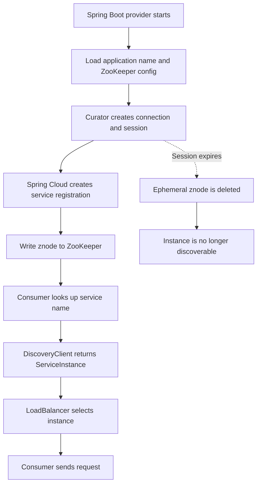

# Registering an Application with Spring Cloud Zookeeper Discovery

Spring Cloud Zookeeper Discovery enables a Spring Boot application to register instance information into Apache ZooKeeper so other services can find and call it by logical name. When a provider starts, the discovery integration creates a registration containing the service name, instance identifier, connection address, and metadata, and stores it in ZooKeeper. When the application stops or the ZooKeeper session expires, the registration is removed according to the client lifecycle.

Unlike Consul, which typically runs an agent on each node, an application using Spring Cloud Zookeeper connects directly to the ZooKeeper ensemble via a client built on Apache Curator. Therefore, connection settings, sessions, ACLs, and ZooKeeper addresses directly affect registration.

## 1. Components in the registration flow

| Component | Role |
|---|---|
| Provider | Spring Boot application advertising its own instance |
| Spring Cloud Zookeeper Discovery | Discovery integration that creates and manages registrations |
| Apache Curator | Manages connections, sessions, and operations with ZooKeeper |
| ZooKeeper ensemble | Stores znodes holding service instance data and coordinates cluster state |
| Consumer | Looks up a service ID to retrieve the instance list |
| Spring Cloud LoadBalancer | Selects a suitable instance when calling by service ID |

An application usually declares its logical name with `spring.application.name`. The discovery integration uses that name as the default service name unless overridden in configuration. Multiple instances of the same application are grouped under the same service name; each instance needs its own identifier.

Overall flow:



## 2. Adding the dependency

In Maven, add the discovery starter matching the Spring Cloud release train used by your project:

```xml
<dependency>
    <groupId>org.springframework.cloud</groupId>
    <artifactId>spring-cloud-starter-zookeeper-discovery</artifactId>
</dependency>
```

Manage the Spring Cloud version using a BOM compatible with the project's Spring Boot version rather than assigning an arbitrary starter version manually. The starter pulls in the components needed for the application to connect to ZooKeeper and provides discovery integration.

If the application needs to make HTTP calls by service ID using Spring Cloud LoadBalancer, add the LoadBalancer dependency matching your release train. If using Actuator to observe readiness, add Spring Boot Actuator separately.

## 3. Configuring the ZooKeeper connection

Suppose ZooKeeper is running locally and listening on port `2181`. Basic provider configuration:

```yaml
spring:
  application:
    name: inventory-service
  cloud:
    zookeeper:
      connect-string: localhost:2181
      discovery:
        enabled: true
        register: true
        root: /services

server:
  port: 8081
```

Meaning of the properties:

- `spring.application.name`: logical name of the application, here `inventory-service`.
- `spring.cloud.zookeeper.connect-string`: ZooKeeper addresses the client connects to; multiple ensemble hosts can be listed, separated by commas.
- `spring.cloud.zookeeper.discovery.enabled`: enables Spring Cloud Zookeeper discovery integration.
- `spring.cloud.zookeeper.discovery.register`: allows the application to register its own instance.
- `spring.cloud.zookeeper.discovery.root`: root znode used to store service information; the default is typically `/services`.

Exact property names and detailed behaviors can vary across Spring Cloud Zookeeper versions. Check against your actual dependency/release train when configuring optional properties.

With the configuration above, the provider uses service name `inventory-service` and application port `8081`. The discovery client must be able to reach the ZooKeeper server and have permissions to create, read, update, or delete the znodes used by the integration.

### Connecting to an ensemble

In production, the connect string typically contains multiple server addresses:

```yaml
spring:
  cloud:
    zookeeper:
      connect-string: zk-1.internal:2181,zk-2.internal:2181,zk-3.internal:2181
```

The client can connect to an available member of the ensemble. ZooKeeper coordinates sessions and replicates data across servers via quorum. Merely listing multiple addresses does not replace deploying a properly configured ensemble; nodes still need proper networking, quorum, data directories, and security.

## 4. Service name and instance ID

### Service name

The service name is the logical name consumers look up. Under default configuration, it is usually taken from `spring.application.name`:

```yaml
spring:
  application:
    name: inventory-service
```

All replicas of the inventory service share the same service name `inventory-service`. Do not embed hostnames, IPs, pod names, or ports into the service name because those values vary per instance.

If a provider overrides the service name via dedicated discovery configuration, consumers must use the exact registered name. Mismatches in letter casing, hyphens, or overridden names between provider and consumer can cause lookups to return no instances.

### Instance ID

The instance ID distinguishes individual running instances of the same service. For example:

| Service name | Instance ID | Host | Port |
|---|---|---|---:|
| `inventory-service` | `inventory-node-a-8081` | `10.0.1.21` | 8081 |
| `inventory-service` | `inventory-node-b-8081` | `10.0.1.22` | 8081 |
| `inventory-service` | `inventory-node-c-8081` | `10.0.1.23` | 8081 |

The instance ID must be unique within a service and ZooKeeper root. If multiple replicas share the same ID, registrations can overwrite or collide. A custom instance ID can be configured through the corresponding discovery property for the version in use; the default ID format generated by the integration may vary by version and environment.

Do not assume the instance ID is always the hostname or always generated by a fixed formula. When a stable ID is needed, configure it explicitly and ensure each replica receives a distinct value.

## 5. Host, port, and consumer-reachable address

The registration must advertise a network address that consumers can actually connect to. The port is usually taken from the application's server port, whereas the advertised host must suit the network topology.

For example, an application may bind to `0.0.0.0:8081` to accept connections on all interfaces, while the registered address needs to be an IP or hostname reachable from consumers:

```text
Process bind:       0.0.0.0:8081
Advertised address: 10.0.1.21:8081
Consumer network:   10.0.1.21:8081
```

If a registration advertises `localhost` while consumers run on other hosts, consumers will connect to their own local machine. If the application runs in a container, avoid advertising the container's loopback address to consumers outside the container.

Spring Cloud Zookeeper provides discovery properties to adjust instance host, port, and IP address selection depending on the version. Override only when needed and inspect the actual values consumers receive via `ServiceInstance`.

## 6. How are registrations stored in ZooKeeper?

ZooKeeper organizes data as a znode tree. Spring Cloud Zookeeper Discovery uses a root path to group service registrations. With the default `/services` root, you can visualize the structure as:

```text
/services
  /inventory-service
    /inventory-node-a-8081
    /inventory-node-b-8081
  /order-service
    /order-node-a-8082
```

Each instance znode stores information describing the service instance, including service name, instance ID, address, port, and metadata in the discovery integration's format.

This is a conceptual view of the logical structure; exact node names, payloads, and serialization details are managed by Curator/Spring Cloud Zookeeper. Do not manually write arbitrary data into znodes managed by the integration.

### Ephemeral znodes and session lifecycle

Service registrations are typically created as ephemeral znodes bound to the client's ZooKeeper session. When the client deregisters normally, the znode is deleted. If the process crashes abruptly or loses connectivity long enough for the session to expire, ZooKeeper also deletes the ephemeral znode.

This mechanism prevents registrations from lingering forever after a client disappears. However:

- A brief network drop does not necessarily expire the session immediately.
- Curator may attempt to reconnect within the session timeout window.
- When a session expires, the client needs to create a new session and the registration must be restored according to the integration's lifecycle.
- Consumers may see stale data briefly due to caches or watcher update delays.

An ephemeral znode reflects client session lifecycle, not a direct measurement of an HTTP endpoint's business health.

## 7. Metadata in registrations

Metadata lets a provider publish extra information so consumers or LoadBalancer can filter and select instances. Example:

```yaml
spring:
  cloud:
    zookeeper:
      discovery:
        metadata:
          zone: zone-a
          version: v2
          capability: inventory-read
```

Metadata can describe zone, version, deployment group, or instance capabilities. Agree on key names and data types across providers and consumers. Metadata must not contain passwords, tokens, private keys, or sensitive data because many components can read registrations.

Do not assume metadata automatically creates a routing policy. If you want to prefer the same zone or select only compatible versions, the consumer needs appropriate filtering logic or LoadBalancer configuration.

## 8. Automatic registration and disabling registration

When Spring Cloud Zookeeper Discovery is enabled and registration is permitted, the application normally registers itself during startup. When the application context shuts down cleanly, the integration performs deregistration per the client lifecycle.

Registration can be disabled if an application is strictly a consumer:

```yaml
spring:
  cloud:
    zookeeper:
      discovery:
        enabled: true
        register: false
```

This configuration keeps discovery integration active so the application can look up services without registering its own instance. Conversely, disabling `enabled` may prevent discovery integration from initializing and related discovery beans may not exist.

Do not confuse `register: false` with removing an existing old registration. If an instance had previously registered and configuration changes while the process is running, ensure the old registration is deregistered properly or handled via the provider lifecycle. Avoid deleting the entire service root while healthy replicas still remain.

## 9. Consumer instance lookup

Spring Cloud provides the `DiscoveryClient` abstraction for consumers to look up services by name. Example:

```java
import java.util.List;

import org.springframework.cloud.client.ServiceInstance;
import org.springframework.cloud.client.discovery.DiscoveryClient;
import org.springframework.stereotype.Component;

@Component
public class InventoryDiscovery {

    private final DiscoveryClient discoveryClient;

    public InventoryDiscovery(DiscoveryClient discoveryClient) {
        this.discoveryClient = discoveryClient;
    }

    public List<ServiceInstance> findInstances() {
        return discoveryClient.getInstances("inventory-service");
    }
}
```

The returned list contains instances visible to the discovery client at query time. Each `ServiceInstance` can provide service ID, host, port, URI, secure flag, and metadata.

If the list is empty, check:

1. Has the ZooKeeper client connected successfully?
2. Has the provider registered under the exact service name?
3. Do the provider and consumer share the same root path?
4. Does the registration still exist and is the session still valid?
5. Does the consumer have permission to read the required znodes?
6. Is the consumer reading stale cache or outdated data?

### Calling HTTP by service ID with LoadBalancer

If Spring Cloud LoadBalancer is added and the HTTP client is configured accordingly, consumers can call by logical name. Example with `RestTemplate`:

```java
import org.springframework.cloud.client.loadbalancer.LoadBalanced;
import org.springframework.context.annotation.Bean;
import org.springframework.context.annotation.Configuration;
import org.springframework.web.client.RestTemplate;

@Configuration
public class HttpClientConfiguration {

    @Bean
    @LoadBalanced
    RestTemplate restTemplate() {
        return new RestTemplate();
    }
}
```

Then invoke:

```java
String url = "http://inventory-service/api/items/42";
Item item = restTemplate.getForObject(url, Item.class);
```

With a `RestTemplate` annotated with `@LoadBalanced`, the host `inventory-service` is treated as a service ID. LoadBalancer retrieves the instance list from the discovery integration and chooses a target for the request. Do not use a plain `RestTemplate` and assume it will resolve service IDs automatically.

## 10. Health checks and limits of ephemeral registration

ZooKeeper Discovery should not be mistaken for an automated active HTTP health-checking system like Consul. Session-bound ephemeral znodes tell the registry that the client is still maintaining a session, but that does not prove the application can still process business requests.

For example, the JVM may still maintain a ZooKeeper session while its HTTP endpoint is hung or its database connection is lost. In that case, the znode can remain even though the provider is no longer ready.

Distinguish clearly:

| Signal | What does it tell you? | Limitation |
|---|---|---|
| ZooKeeper session | The client still maintains a session with the ensemble | Does not prove the HTTP endpoint or business logic is healthy |
| Ephemeral znode | The registration is still tied to the active session | Can remain for the session timeout duration after the client disconnects |
| Spring Boot Actuator health | Configured health indicators report application status | Only affects routing if wired to an appropriate routing/health mechanism |
| Consumer request | Tests actual connectivity and processing | Requires timeouts, retries, and resilience |

You can add Actuator to observe readiness:

```yaml
management:
  endpoint:
    health:
      probes:
        enabled: true
```

The readiness endpoint helps an orchestration platform or monitoring tool determine when the application is ready. However, merely enabling Actuator does not make Spring Cloud Zookeeper automatically poll this endpoint and delete registrations when health fails. If traffic must stop based on readiness, design an explicit coordination mechanism at the deployment, gateway, or LoadBalancer layer.

## 11. Security and operating ZooKeeper

Registrations contain service hosts, ports, and metadata. ZooKeeper read/write permissions therefore directly impact discovery and routing between applications.

In real environments, you should:

- Use ZooKeeper ACLs and authentication to restrict applications to only the paths they need.
- Avoid granting write access to the entire znode tree to every service unnecessarily.
- Secure client-server connections with TLS when supported by the topology and versions.
- Never store secrets in registration metadata or payloads.
- Restrict network access to the ZooKeeper client port; never expose the ensemble directly to public networks.
- Monitor session expirations, reconnects, znode creation errors, and registration counts.
- Configure reasonable timeouts/retries so brief network instability does not trigger constant registration/deregistration churn.

If a provider lacks permission to create znodes under the configured root, registration fails. If a consumer lacks read permission, the service may exist yet lookups return empty or throw access errors depending on the integration.

## 12. Common registration errors

| Symptom | Possible cause | Troubleshooting step |
|---|---|---|
| Application cannot connect to ZooKeeper | Wrong connect string, server not running, or network blocked | Check host, port, Curator logs, and ensemble status |
| Provider starts, but service is missing from znode tree | Discovery disabled, register=false, or missing write permission | Check dependencies, properties, and ACLs |
| Consumer cannot find service | Service name/root path mismatch or registration does not exist yet | Compare `spring.application.name`, root, and catalog paths |
| Multiple instances overwrite each other | Duplicate instance ID | Generate a unique instance ID for each replica |
| Old instance persists after process death | Session has not expired yet or client has not lost session | Check session timeout, reconnection, and ephemeral node status |
| Instance disappears during flaky networking | Session expired due to prolonged interruption | Adjust timeout/network and verify reconnection capability |
| Consumer receives unreachable host | Provider advertises loopback or wrong internal IP | Configure an advertised host routable from consumers |
| Service exists but is unhealthy | Session is alive while endpoint or business dependency fails | Combine readiness/health monitoring and routing policy |

When investigating, compare the service name, instance ID, root path, and session for the same provider. Do not manually delete znodes while the discovery client is actively managing that registration, as the client may recreate them or enter an inconsistent state.

## 13. Provider deployment checklist

Before deploying the application to a runtime environment, confirm:

1. The Spring Cloud Zookeeper Discovery starter matches the Spring Boot/Spring Cloud release train.
2. The ZooKeeper connect string points to a reachable ensemble.
3. `spring.application.name` is the unified service name agreed with consumers.
4. Discovery is enabled and registration is permitted when the application acts as a provider.
5. The root path matches between providers and consumers.
6. Every replica has a unique instance ID.
7. Advertised host and port are reachable from consumers.
8. Metadata follows a consistent schema and contains no secrets.
9. ACLs allow operations on the exact required paths.
10. Plans are in place for session expiration, reconnection, and graceful deregistration.
11. Business readiness is managed separately; ephemeral znodes are not treated as HTTP health checks.
12. Consumers configure timeouts, bounded retries, and empty-instance handling.

Spring Cloud Zookeeper Discovery lets applications register services automatically via ZooKeeper and Curator. Understanding service names, instance IDs, root paths, ephemeral znodes, and session lifecycles helps manage registrations and instance lookups accurately. For safe routing, pair registrations with routable network addresses, readiness checks, ACLs, and recovery handling when ZooKeeper sessions change.
