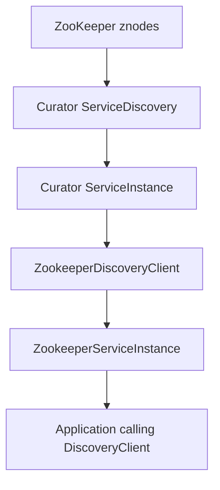
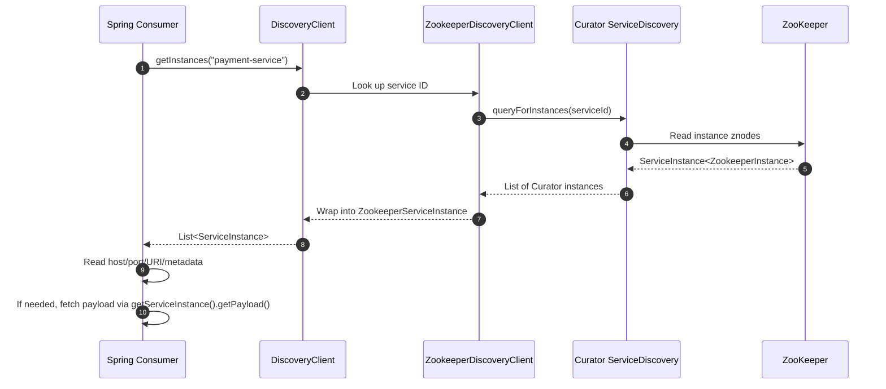

# Querying `ServiceInstance` and Reading the Registration Payload

## 1. From service name to instance information

In Spring Cloud Service Discovery, a consumer typically knows a service's logical name, such as `payment-service`, without knowing the host and port of each running instance in advance. `DiscoveryClient` provides a common API for looking up instances by service ID. With ZooKeeper, Spring Cloud implements this API using Curator Service Discovery.

When an application registers with ZooKeeper, it advertises information such as service name, instance ID, address, port, and metadata. Curator stores the registration as a service instance in the znode tree. When a consumer calls `DiscoveryClient.getInstances("payment-service")`, Spring Cloud Zookeeper queries Curator, receives `ServiceInstance<ZookeeperInstance>` objects, and wraps them as `ZookeeperServiceInstance`, which is Spring Cloud's `ServiceInstance` implementation.

The data flow can be visualized as follows:



Key distinction: `ServiceInstance` is Spring Cloud's standard view for looking up endpoints; `ZookeeperServiceInstance` is Spring Cloud Zookeeper's specific adapter; `ZookeeperInstance` is the default payload stored alongside the registration in ZooKeeper.

## 2. Registration structure in ZooKeeper

Spring Cloud Zookeeper uses Curator Service Discovery Extension to register and locate services. The default registry root path is `/services`. Each service has its own branch and each instance has a child znode, conceptually structured as:

```text
/services
  /payment-service
    /payment-node-a
    /payment-node-b
  /inventory-service
    /inventory-node-a
```

The actual path depends on `spring.cloud.zookeeper.discovery.root`, service name, instance ID, and dependency/path settings. Curator manages creating, updating, and deleting records. For standard dynamic registration, instances are bound to a ZooKeeper session; when the session expires, ephemeral znodes are cleaned up by ZooKeeper.

A record has two data layers to understand:

1. **Curator service instance information:** service name, instance ID, address, port, SSL port, registration type, registration timestamp, and URI specification.
2. **Spring Cloud payload:** the `ZookeeperInstance` object, containing the instance's ID, name, and metadata map.

The payload is the application-level data used to exchange supplementary details. It does not replace the address/port fields of Curator ServiceInstance.

## 3. Spring Cloud `DiscoveryClient` and `ServiceInstance`

### 3.1. Querying by service ID

The `org.springframework.cloud.client.discovery.DiscoveryClient` interface provides the primary read operations:

| Method | Meaning |
|---|---|
| `getServices()` | Retrieves the service IDs currently known to the discovery client |
| `getInstances(serviceId)` | Retrieves the list of instances for a service ID |
| `description()` | Describes the discovery implementation |

Each element in the returned list is an `org.springframework.cloud.client.ServiceInstance`. Commonly used properties:

| Getter | Contents |
|---|---|
| `getServiceId()` | Logical service name |
| `getInstanceId()` | Unique ID of the running instance if supplied by the implementation |
| `getHost()` | Hostname or IP address |
| `getPort()` | Port serving requests |
| `isSecure()` | Whether the endpoint uses HTTPS |
| `getUri()` | URI constructed from endpoint information |
| `getMetadata()` | Key/value metadata map of the instance |

### 3.2. Example of querying and reading endpoints

```java
import java.net.URI;
import java.util.List;

import org.springframework.cloud.client.ServiceInstance;
import org.springframework.cloud.client.discovery.DiscoveryClient;
import org.springframework.stereotype.Service;

@Service
public class PaymentDiscoveryService {

    private final DiscoveryClient discoveryClient;

    public PaymentDiscoveryService(DiscoveryClient discoveryClient) {
        this.discoveryClient = discoveryClient;
    }

    public void printPaymentInstances() {
        List<ServiceInstance> instances =
                discoveryClient.getInstances("payment-service");

        if (instances == null || instances.isEmpty()) {
            System.out.println("payment-service not found");
            return;
        }

        for (ServiceInstance instance : instances) {
            URI uri = instance.getUri();

            System.out.printf(
                    "service=%s, instance=%s, host=%s, port=%d, secure=%s, uri=%s%n",
                    instance.getServiceId(),
                    instance.getInstanceId(),
                    instance.getHost(),
                    instance.getPort(),
                    instance.isSecure(),
                    uri
            );
        }
    }
}
```

Never assume the list always contains at least one element. `ZookeeperDiscoveryClient` returns an empty list if the service has not registered or the corresponding branch does not yet exist; other ZooKeeper connection/read errors may be wrapped as runtime exceptions. Therefore, applications should distinguish "no instances available" from "registry unreachable."

### 3.3. Listing registered services

```java
List<String> serviceIds = discoveryClient.getServices();

for (String serviceId : serviceIds) {
    List<ServiceInstance> instances = discoveryClient.getInstances(serviceId);
    System.out.printf("%s has %d instance(s)%n", serviceId, instances.size());
}
```

The service ID list is a point-in-time snapshot. It can change as instances register, deregister, or as ZooKeeper sessions expire. Do not read it once and store it permanently if the application must react to registry changes.

## 4. Reading metadata via `ServiceInstance`

For most application logic, `getMetadata()` is the simplest way to read metadata published by the registered service. The snippet below assumes `discoveryClient` has been injected; `orElseThrow` handles the case when no instance is present:

```java
import java.util.Map;

import org.springframework.cloud.client.ServiceInstance;

ServiceInstance instance = discoveryClient.getInstances("payment-service")
        .stream()
        .findFirst()
        .orElseThrow(() -> new IllegalStateException("No instances available for payment-service"));

Map<String, String> metadata = instance.getMetadata();

if (metadata != null) {
    String apiVersion = metadata.get("api-version");
    String zone = metadata.get("zone");

    System.out.println("API version: " + apiVersion);
    System.out.println("Zone: " + zone);
}
```

Metadata often contains descriptive or supplementary routing information, such as:

- `api-version`: API version offered by the instance.
- `zone`: region or availability zone of the instance.
- `environment`: deployment environment.
- `capability`: feature group supported by the instance.
- `context-path`: base path if consumers follow a convention to read this metadata.

Spring Cloud Zookeeper metadata is a `String`–`String` map. Do not store passwords, tokens, private keys, or secrets in the map because any client with registry read access can inspect that metadata. Also do not assume the load balancer automatically understands custom keys; consumers must implement logic to read and act on them.

## 5. What is the default `ZookeeperInstance` payload?

Spring Cloud Zookeeper uses `org.springframework.cloud.zookeeper.discovery.ZookeeperInstance` as the default payload for Curator Service Discovery. This payload describes an instance with three main fields:

| Field | Meaning |
|---|---|
| `id` | Identifier inside the `ZookeeperInstance` payload; distinguish from the Curator service instance ID |
| `name` | Registered service name |
| `metadata` | Key/value map containing additional metadata |

Conceptual payload example:

```json
{
  "id": "payment-node-a",
  "name": "payment-service",
  "metadata": {
    "api-version": "v2",
    "zone": "zone-a",
    "environment": "production"
  }
}
```

This illustrates the logical shape of `ZookeeperInstance`, not a guarantee about every raw JSON byte stored in the znode. Curator serializes a `ServiceInstance<ZookeeperInstance>` wrapping the payload; the outer data may also contain address, port, SSL port, service type, and URI specification. Serializers and representation details can vary by version or configuration.

### 5.1. Distinguishing the payload from the outer wrapper

Simplified illustration of the relationship between the two layers:

```text
Curator ServiceInstance
  name       = payment-service
  id         = registry-entry-a
  address    = 10.0.1.21
  port       = 8080
  sslPort    = null
  payload    = ZookeeperInstance
                 id       = spring-context-a
                 name     = payment-service
                 metadata = { api-version=v2, zone=zone-a }
```

Address and port reside in Curator's service instance fields. The payload holds `ZookeeperInstance`'s own ID, name, and Spring Cloud metadata. These two ID fields should not be assumed identical by default; if you need to compare them, inspect the actual objects and configuration for your version. When you need the registration ID, prefer `ServiceInstance.getInstanceId()`; when you need to read the payload, use `getServiceInstance().getPayload()`. When building a URI to call the service, use `ServiceInstance.getUri()` or the host/port fields.

## 6. Accessing the ZooKeeper-specific payload

If you only need metadata, prefer `ServiceInstance.getMetadata()` to keep code implementation-independent. When an integration component genuinely needs the underlying payload, you can cast to `ZookeeperServiceInstance` and call `getServiceInstance().getPayload()`:

```java
import java.util.Map;

import org.apache.curator.x.discovery.ServiceInstance;
import org.springframework.cloud.client.discovery.DiscoveryClient;
import org.springframework.cloud.zookeeper.discovery.ZookeeperInstance;
import org.springframework.cloud.zookeeper.discovery.ZookeeperServiceInstance;

public class ZookeeperPayloadReader {

    private final DiscoveryClient discoveryClient;

    public ZookeeperPayloadReader(DiscoveryClient discoveryClient) {
        this.discoveryClient = discoveryClient;
    }

    public void readPayload() {
        org.springframework.cloud.client.ServiceInstance springInstance =
                discoveryClient.getInstances("payment-service")
                        .stream()
                        .findFirst()
                        .orElseThrow(() ->
                                new IllegalStateException("No payment-service instance available"));

        if (!(springInstance instanceof ZookeeperServiceInstance)) {
            throw new IllegalStateException(
                    "Current discovery implementation is not ZooKeeper");
        }

        ZookeeperServiceInstance zookeeperInstance =
                (ZookeeperServiceInstance) springInstance;

        ServiceInstance<ZookeeperInstance> curatorInstance =
                zookeeperInstance.getServiceInstance();

        ZookeeperInstance payload = curatorInstance.getPayload();
        Map<String, String> metadata = payload.getMetadata();

        System.out.println("Payload id: " + payload.getId());
        System.out.println("Payload name: " + payload.getName());
        System.out.println("Metadata: " + metadata);
    }
}
```

`ZookeeperServiceInstance` is the adapter implementing Spring Cloud `ServiceInstance`; `getServiceInstance()` returns the underlying Curator object; `getPayload()` on the Curator object returns `ZookeeperInstance`. This access path is specific to Spring Cloud Zookeeper, so code using it becomes coupled to this implementation.

If the application might switch to Eureka, Consul, or another discovery provider, keep business logic tied to `ServiceInstance` and generic metadata. Place this cast only inside a ZooKeeper integration adapter where the specific dependency is intentionally accepted.

## 7. Configuring metadata when registering a service

Spring Cloud Zookeeper lets you declare metadata via `spring.cloud.zookeeper.discovery.metadata`. Example:

```yaml
spring:
  application:
    name: payment-service
  cloud:
    zookeeper:
      connect-string: localhost:2181
      discovery:
        root: /services
        register: true
        instance-id: payment-node-a
        instance-host: 10.0.1.21
        instance-port: 8080
        metadata:
          api-version: v2
          zone: zone-a
          environment: production
```

Meaning of properties:

- `connect-string`: address of the ZooKeeper ensemble.
- `discovery.root`: root path containing service registrations; typically defaults to `/services`.
- `discovery.register`: enables/disables registration of the application's own instance.
- `instance-id`: ID used to distinguish running instances.
- `instance-host` and `instance-port`: address advertised to consumers.
- `metadata`: key/value pairs placed in the payload for other clients to read.

In real deployments, host and port must be reachable from the consumer network. If running multiple instances on the same machine, each instance needs a distinct ID. Spring/Curator can infer some values from Environment, but explicit configuration is advisable when stable endpoints are needed or when running behind containers/proxies.

## 8. Reading payloads directly from znodes for diagnostics

When inspecting raw data is necessary, you can use the ZooKeeper CLI to view the registry tree. With the default root:

```text
ls /services
ls /services/payment-service
get /services/payment-service/payment-node-a
```

The first `ls` command lists services; the second lists instances; `get` reads the instance znode's data. Exact paths depend on root, service name, instance ID, and the serializer in use.

The content returned is Curator-serialized data, which may include the `ServiceInstance` envelope along with the `ZookeeperInstance` payload. Do not manually edit znodes to change metadata in a running environment. Direct writes can cause mismatches with the serializer, registration lifecycle, or state managed by Curator. Update metadata via configuration/`ServiceRegistry` or the application's registration mechanism.

## 9. Instance status and Spring Cloud-reserved metadata

Spring Cloud Zookeeper leverages the flexible payload to store instance status in metadata. When updating status through `ServiceRegistry`, the implementation writes the status into a dedicated metadata key. Spring Cloud LoadBalancer's `ZookeeperServiceInstanceListSupplier` can filter out instances whose status is not `UP`; if status is absent, the implementation treats the instance as `UP` for backward compatibility.

This means metadata does not always contain only application-defined keys. When iterating over the entire map, you may encounter internal keys used by Spring Cloud. Do not delete or overwrite unknown keys without understanding their role.

If you need to change registration status, use `ServiceRegistry` or a properly configured and secured `/serviceregistry` Actuator endpoint. Do not update the znode payload directly to simulate status, as doing so bypasses Spring Cloud's lifecycle and logic.

## 10. Combining with Spring Cloud LoadBalancer

`DiscoveryClient.getInstances()` returns an instance list; it does not select an instance per request on its own. For applications calling services by name, use Spring Cloud LoadBalancer to resolve service IDs and pick instances.

Example of creating a load-balanced `RestTemplate`:

```java
import org.springframework.cloud.client.loadbalancer.LoadBalanced;
import org.springframework.context.annotation.Bean;
import org.springframework.context.annotation.Configuration;
import org.springframework.web.client.RestTemplate;

@Configuration
public class HttpClientConfiguration {

    @Bean
    @LoadBalanced
    RestTemplate restTemplate() {
        return new RestTemplate();
    }
}
```

The application needs Spring Cloud LoadBalancer on the classpath (typically via `org.springframework.cloud:spring-cloud-starter-loadbalancer`), with versions managed by a Spring Cloud BOM compatible with Spring Boot.

Then invoke by service ID:

```java
@Service
public class PaymentClient {

    private final RestTemplate restTemplate;

    public PaymentClient(RestTemplate restTemplate) {
        this.restTemplate = restTemplate;
    }

    public PaymentResponse findPayment(String paymentId) {
        return restTemplate.getForObject(
                "http://payment-service/api/payments/{id}",
                PaymentResponse.class,
                paymentId
        );
    }
}
```

LoadBalancer uses the discovery implementation to fetch the instance list and choose a target. If the application only needs to invoke the service, casting to `ZookeeperServiceInstance` or reading the payload manually is unnecessary. Read the payload only when custom logic such as API version, zone, or capability filtering is needed and not handled by the default load-balancing strategy.

## 11. Handling missing instances or anomalous data

| Symptom | Possible cause | Resolution |
|---|---|---|
| `getInstances()` returns an empty list | Service not registered yet, wrong service ID, or znode does not exist | Check `spring.application.name`, `discovery.root`, and `/services` tree |
| `getServices()` is empty | No services registered yet or discovery not ready | Check ZooKeeper connection, registration, and client logs |
| Instance exists but URI is wrong | Wrong host/port/SSL port or URI spec | Verify `instance-host`, `instance-port`, `instance-ssl-port`, `uri-spec` |
| Metadata lacks expected key | Producer did not register key, wrong key name, or reading a different instance | Check metadata config and individual instances |
| Casting to `ZookeeperServiceInstance` fails | Application uses another discovery provider or composite client returned another implementation | Use generic `ServiceInstance` or check implementation before casting |
| Null payload or null metadata | Stale registration, custom payload, or incomplete data | Handle nulls and verify producer's serializer/schema |
| Old instance persists after process death | ZooKeeper session has not expired yet or client is reconnecting | Check session timeout and Curator/ZooKeeper state |

Data-reading guidelines:

- Do not call `get(0)` before checking for an empty list.
- Do not assume all instances share identical metadata or application versions.
- Do not cache `ServiceInstance` or URIs as immutable addresses; the registry can change.
- Handle ZooKeeper errors separately from the case where a service does not exist.
- When checking health status, distinguish a registration record from actual ability to serve requests.

## 12. Payload reading diagram



## 13. Checklist for querying and reading payloads

- [ ] Use the exact service ID registered by the provider.
- [ ] Check for an empty list before picking an instance.
- [ ] Use `ServiceInstance` to read service ID, instance ID, host, port, URI, secure flag, and common metadata.
- [ ] Understand that `ZookeeperServiceInstance` is Spring Cloud Zookeeper's adapter.
- [ ] Cast to `ZookeeperServiceInstance` only when the Curator object or ZooKeeper-specific payload is truly needed.
- [ ] Read the payload via `getServiceInstance().getPayload()` and handle nulls.
- [ ] Distinguish Curator endpoint fields from the `ZookeeperInstance` payload.
- [ ] Keep metadata as string pairs with consistent key conventions and no secrets.
- [ ] Do not modify znodes directly inside business flows.
- [ ] Use Spring Cloud LoadBalancer to select an instance per request rather than holding a fixed address.

## 14. Conclusion

With Spring Cloud Zookeeper, `DiscoveryClient.getInstances(serviceId)` returns a list of standard Spring `ServiceInstance` objects. The `ZookeeperDiscoveryClient` implementation fetches Curator service instances and converts them into `ZookeeperServiceInstance`. Applications can read endpoints and metadata through the generic API without knowing ZooKeeper's internal tree structure.

When the registration-specific payload is needed, perform a checked cast to `ZookeeperServiceInstance`, obtain the Curator object via `getServiceInstance()`, and call `getPayload()` to receive `ZookeeperInstance` containing ID, name, and metadata. Keep ZooKeeper-specific payload reading confined to the integration layer; most application logic should stick to `ServiceInstance` and `getMetadata()` to minimize provider coupling.

## References

- [Spring Cloud Zookeeper – Service Discovery](https://docs.spring.io/spring-cloud-zookeeper/reference/discovery.html)
- [Spring Cloud Zookeeper – Service Registry](https://docs.spring.io/spring-cloud-zookeeper/reference/service-registry.html)
- [Spring Cloud Zookeeper 4.1.2 – ZookeeperServiceInstance API](https://www.javadoc.io/static/org.springframework.cloud/spring-cloud-zookeeper-discovery/4.1.2/org/springframework/cloud/zookeeper/discovery/ZookeeperServiceInstance.html)
- [Spring Cloud Commons – ServiceInstance API](https://github.com/spring-cloud/spring-cloud-commons/blob/main/spring-cloud-commons/src/main/java/org/springframework/cloud/client/ServiceInstance.java)
