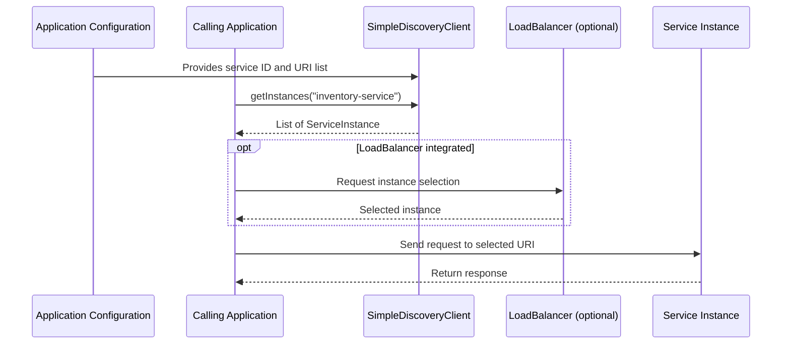

# Role and Conditions for Using SimpleDiscoveryClient

In a microservice architecture, a service is typically called by a logical name such as `inventory-service` instead of hardcoding a server's IP address and port. The service discovery mechanism translates that logical name into a list of reachable addresses. Spring Cloud provides `DiscoveryClient` as the common API for this lookup operation. When a system has a small topology and addresses rarely change, `SimpleDiscoveryClient` can supply the instance list directly from application configuration without deploying a dedicated registry server.

## 1. What problem does SimpleDiscoveryClient solve?

Suppose `order-service` needs to call `inventory-service`. If the source code directly contains `http://10.20.0.15:8081`, the application becomes coupled to a specific address. When the server is replaced, moved to another environment, or changes port, the development team has to modify the source code or re-release the calling application. This approach also makes running multiple instances difficult to manage.

Instead, the calling application looks up the target by service ID:

```text
inventory-service
        |
        v
  DiscoveryClient
        |
        v
  List of ServiceInstance
        |
        v
  Instance URIs
```

`SimpleDiscoveryClient` is an implementation of Spring Cloud's `DiscoveryClient`. It reads the instances declared in configuration and exposes them to the application through the discovery API. Because the list comes from static configuration, the application does not need to query a Eureka, Consul, or ZooKeeper server to retrieve it.

An important distinction is that `SimpleDiscoveryClient` only provides instance information for lookup. It does not make HTTP calls itself, does not select an instance for load balancing, and does not operate a centralized registry. The application can use the returned list directly or combine it with Spring Cloud LoadBalancer to select an instance when calling the service.

## 2. Role in the Spring Cloud architecture

`SimpleDiscoveryClient` allows the application to depend on the `DiscoveryClient` abstraction rather than a specific registry provider. Business code can request a list of instances by service ID; the underlying implementation determines whether the data comes from static configuration or another discovery system.

| Component | Role | Responsibilities not belonging to the component |
|---|---|---|
| `DiscoveryClient` | Spring Cloud's common service lookup API | Does not mandate a specific registry |
| `SimpleDiscoveryClient` | Returns instances declared in configuration | Does not perform dynamic registration, lease renewal, or automatic instance health checks |
| `ServiceInstance` | Represents an instance, including URI and metadata | Does not guarantee the endpoint is healthy |
| Spring Cloud LoadBalancer | Can select an instance from the list to send a request | Does not automatically update static configuration when the topology changes |
| Calling application | Uses the URI or an integrated client to send requests | Must handle timeouts, network errors, and empty instance results |

Two commonly used lookup operations of `DiscoveryClient` are:

- `getInstances(serviceId)`: retrieves the list of `ServiceInstance` declared for the service ID.
- `getServices()`: retrieves the service IDs known to the discovery client.

A `ServiceInstance` can contain information such as URI, host, port, service ID, and metadata. Metadata is additional data supplied by configuration; `SimpleDiscoveryClient` itself does not turn metadata into a health-check mechanism or intelligent routing.

`SimpleDiscoveryClient` should also be distinguished from `ServiceRegistry`. `DiscoveryClient` serves to read instance information. `ServiceRegistry` is the abstraction for registering and deregistering instances with a registry. Static configuration for `SimpleDiscoveryClient` does not create a dynamic registration lifecycle comparable to Eureka or Consul.

## 3. Declaring instances via configuration

The instance list is placed under the `spring.cloud.discovery.client.simple.instances` prefix. Each sub-key is a service ID; the value is the list of instances for that service. For example, `order-service` needs to locate two instances of `inventory-service`:

```yaml
spring:
  cloud:
    discovery:
      client:
        simple:
          instances:
            inventory-service:
              - uri: http://inventory-1.internal:8081
                metadata:
                  zone: hcm-a
                  version: v1
              - uri: http://inventory-2.internal:8081
                metadata:
                  zone: hcm-b
                  version: v1
            payment-service:
              - uri: https://payment.internal:8443
```

In the example above:

- `inventory-service` and `payment-service` are the service IDs that the calling application uses for lookup.
- Each element in the `inventory-service` list describes an instance that can be called.
- `uri` points to the address reachable by the calling application. The hostname must be resolvable and the port must be open from the calling application's network perspective.
- `metadata` holds additional attributes such as deployment zone or version. The application or integrated filters can read these attributes if designed to use them.

With a `.properties` file, you can declare the equivalent using element indices:

```properties
spring.cloud.discovery.client.simple.instances.inventory-service[0].uri=http://inventory-1.internal:8081
spring.cloud.discovery.client.simple.instances.inventory-service[1].uri=http://inventory-2.internal:8081
```

Separating configuration by environment helps each environment use its proper addresses. For example, development configuration can point to containers on a local machine, while testing and production configurations point to their respective internal hostnames. Addresses reachable only from a developer's machine should never be placed in production configuration.

## 4. Looking up instances via DiscoveryClient

When Spring Cloud Commons and the appropriate discovery configuration are present in the application, source code can depend on the `DiscoveryClient` abstraction. The following example retrieves the URIs of `inventory-service` instances:

```java
import java.net.URI;
import java.util.List;
import java.util.stream.Collectors;

import org.springframework.cloud.client.ServiceInstance;
import org.springframework.cloud.client.discovery.DiscoveryClient;
import org.springframework.stereotype.Service;

@Service
public class InventoryEndpointProvider {

    private final DiscoveryClient discoveryClient;

    public InventoryEndpointProvider(DiscoveryClient discoveryClient) {
        this.discoveryClient = discoveryClient;
    }

    public List<URI> findEndpoints() {
        List<ServiceInstance> instances =
                discoveryClient.getInstances("inventory-service");

        return instances.stream()
                .map(ServiceInstance::getUri)
                .collect(Collectors.toList());
    }
}
```

The method above returns an empty list if no instances are available. Calling code must decide how to react to that case, such as returning an appropriate error, logging, or retrying according to the application's policy. You should not assume every service ID always has at least one instance.

If the application simply needs to call a service, discovery can be combined with an HTTP client and Spring Cloud LoadBalancer. In that case, the service ID is used as the logical target name, while the LoadBalancer picks an instance from the list provided by the discovery client. The appropriate dependencies and HTTP client type supported by the project's Spring Cloud version must be configured properly. `SimpleDiscoveryClient` itself does not perform this instance selection step.

## 5. Execution flow



This flow shows that discovery and service invocation are two separate responsibilities. Discovery provides the address list; the client or LoadBalancer uses that list to execute the request. If configuration contains an endpoint that has stopped running, `SimpleDiscoveryClient` can still return that endpoint because it does not verify endpoint health on its own.

## 6. When should it be used?

`SimpleDiscoveryClient` is suitable when the instance list is stable, the number of services and instances is small, and the operations team can manage addresses through configuration. Common scenarios include:

1. **Local development:** services run on a fixed set of containers or ports; configuration lets developers test inter-service communication without standing up a separate registry.
2. **Integration testing:** the test environment has a deterministic topology and is recreated from a known configuration.
3. **Small, rarely changing deployments:** few instances, stable addresses, and a release process that can update the configurations of related applications.
4. **Infrastructure-constrained environments:** unable or unnecessary to operate Eureka, Consul, or an independent registry system.
5. **Prototyping or demonstrating the discovery API:** needing to understand how an application looks up services by service ID before adopting a dynamic registry.

The most important condition is that operators must know the instance list and keep it accurate. Hostnames, ports, protocols, and environment details in the configuration must correspond to endpoints that the calling application can actually reach.

## 7. When should it not be used?

Static discovery should not be chosen as the primary mechanism if the system frequently creates, destroys, or replaces instances. When autoscaling, rolling deployments, or failovers alter the topology, multiple calling applications must receive the updated list in a timely manner. Manually updating multiple configuration files easily leads to out-of-sync state.

Signs that you should consider Eureka, Consul, or the deployment platform's native discovery mechanism include:

- The number of instances changes frequently or is driven by an autoscaler.
- Automatic instance registration and deregistration tied to the application lifecycle is needed.
- Health checks, heartbeats, or eviction of unhealthy instances from the advertised list are required.
- Multiple calling applications need a centrally updated source of instance information.
- Distributed, multi-zone, or multi-cluster deployments with complex routing policies need to be supported.

In those cases, a dynamic registry or service discovery provided by the orchestration platform is usually a better fit. The specific choice also depends on infrastructure: for example, Kubernetes has DNS and Services to route to workloads, whereas Eureka or Consul has its own registry model.

## 8. Limitations and operational responsibilities

Because data is declared statically, you must understand several limitations before placing `SimpleDiscoveryClient` into a shared environment:

- **No automatic discovery of new instances:** when adding or removing instances, configuration must be updated via the application's configuration management mechanism.
- **No automatic health checks:** dead endpoints can remain in the list. If health checks are needed, an appropriate mechanism must be added or you should move to a discovery system that supports this capability.
- **No built-in load balancing:** returning multiple instances does not mean requests will be distributed automatically. A LoadBalancer or custom instance-selection logic is required.
- **No built-in retry and circuit breaker handling:** the application still needs timeout policies, bounded retries, circuit breakers, and error handling appropriate for the request type.
- **Potential configuration drift across applications:** if each application keeps a separate copy of the list, applications may call different instances or call endpoints that have already been decommissioned.
- **Dependent on network reachability:** syntactically valid addresses can still be unreachable due to DNS, firewalls, network policies, ports, or TLS.

Metadata must also be used intentionally. Declaring `zone` or `version` does not automatically guarantee that the LoadBalancer prefers the same zone or filters by version. A component must read the metadata and enforce the corresponding policy. Do not place passwords, tokens, or secret data in metadata or URIs; use dedicated secret management and authentication mechanisms.

## 9. Checking configuration and troubleshooting

When discovery does not return the expected instances, check in the following order:

1. **Service ID:** does the name passed to `getInstances()` match the key under `spring.cloud.discovery.client.simple.instances`?
2. **Configuration prefix:** are the `spring.cloud.discovery.client.simple.instances` levels structured properly in YAML or `.properties` syntax?
3. **Active profile:** is the configuration file containing the instance list loaded in the current environment?
4. **URI:** does each instance have the right scheme, hostname, and port? Use `https` when the endpoint requires TLS.
5. **Connectivity from the calling application:** test DNS resolution and connecting to the host/port from the exact container or machine running the calling application; check firewalls and network policies.
6. **Service invocation integration:** if `DiscoveryClient` returns the right list but requests still fail, inspect the HTTP client, LoadBalancer, timeout, and error-handling configuration.

If the instance list changes after the application has started, verify the configuration reload mechanism the system is using. Do not assume that editing a file on disk will update the discovery client immediately inside the running process. For a frequently changing topology, this is a sign to re-evaluate the choice of static discovery.

## 10. Conclusion

`SimpleDiscoveryClient` provides a way to resolve a service ID into a list of `ServiceInstance` objects using static configuration. It is useful for development, testing, and small deployments with a stable topology because no registry server needs to be operated. In return, development and operations teams must maintain the endpoint list themselves, keep configurations consistent, and address health, load balancing, retries, and topology updates using the appropriate components.

When the number of instances grows, addresses change frequently, or the system needs automatic registration and health checks, consider a dynamic discovery mechanism such as Eureka, Consul, or the deployment platform's service discovery. The right choice depends on how dynamic the topology is and the operational capabilities the system requires.
