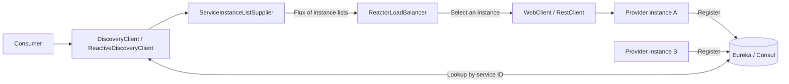
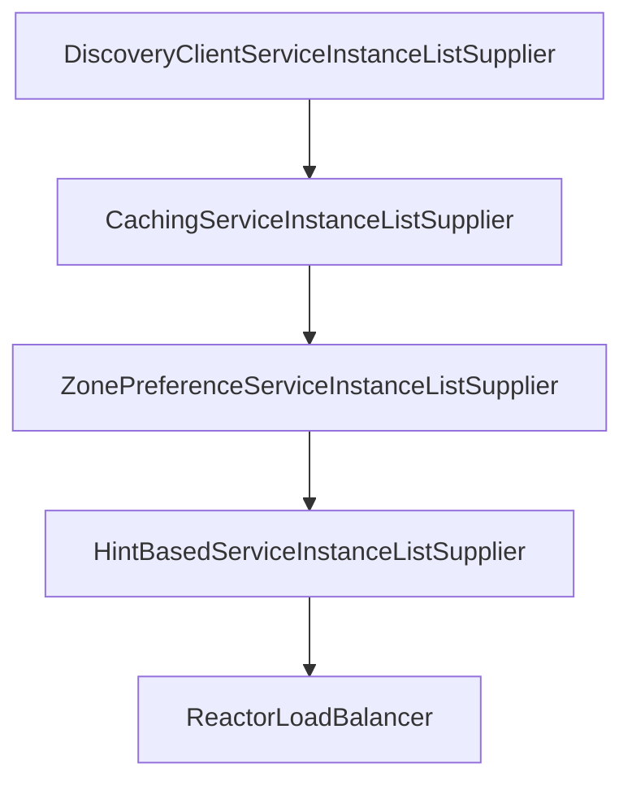
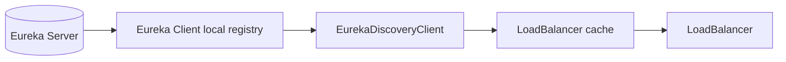

# ServiceInstanceListSupplier and List Sources from DiscoveryClient

When a consumer calls `catalog-service`, Spring Cloud LoadBalancer needs to know which instances can receive the request. `DiscoveryClient` provides the ability to look up instances by service ID; `ServiceInstanceListSupplier` connects that discovery data with LoadBalancer's instance selection mechanism.

`ServiceInstanceListSupplier` is the provider of `ServiceInstance` lists for LoadBalancer. It can fetch data from `DiscoveryClient` or `ReactiveDiscoveryClient`, and then combine caching, health checks, zone filtering, hints, or other policies before the list is used to select an instance. The supplier does not choose a server for the request itself; `ReactorLoadBalancer` performs the selection step.

This lesson belongs to the `Service Call Integration` chapter in the `SPRING_CLOUD_SERVICE_DISCOVERY` module. The module helps learners understand how to discover instances by service name via `DiscoveryClient`, `ServiceRegistry`, Eureka, or Consul, as well as master the registration lifecycle, health checks, load balancing, security, and handling registry discrepancies. This content focuses on the role of `ServiceInstanceListSupplier`, list sources from DiscoveryClient, and how to build an appropriate supplier chain.

## 1. Position of ServiceInstanceListSupplier in the service call flow

The provider registers instances in a registry such as Eureka or Consul. The consumer does not need to know the IP and port of each instance in advance; it uses the service ID. The discovery client queries the registry and provides `ServiceInstance` objects. LoadBalancer obtains this list via `ServiceInstanceListSupplier`, then selects an instance for the HTTP client to send the request to.



Each component has a distinct responsibility:

| Component | Responsibility |
|---|---|
| Service Registry | Stores registrations published by providers and their status according to the registry's model. |
| `DiscoveryClient` | Looks up instances by service ID using a synchronous API. |
| `ReactiveDiscoveryClient` | Looks up instances by service ID using a reactive API. |
| `ServiceInstanceListSupplier` | Provides the instance list to LoadBalancer, optionally combining caching and filters. |
| `ReactorLoadBalancer` | Selects a `ServiceInstance` from the provided list. |
| HTTP client | Sends the request to the selected instance's host/port. |

`ServiceInstanceListSupplier` does not replace `DiscoveryClient`, nor is it a new registry. It is the integration layer connecting the instance list with LoadBalancer and allowing additional processing steps before instance selection.

## 2. The ServiceInstanceListSupplier contract

`ServiceInstanceListSupplier` belongs to the `org.springframework.cloud.loadbalancer.core` package. Its core contract represents a supplier of instance lists as a Reactor `Flux`:

```java
package org.springframework.cloud.loadbalancer.core;

import java.util.List;

import org.springframework.cloud.client.ServiceInstance;
import org.springframework.cloud.client.loadbalancer.Request;

import reactor.core.publisher.Flux;

public interface ServiceInstanceListSupplier
        extends java.util.function.Supplier<Flux<List<ServiceInstance>>> {

    String getServiceId();

    @Override
    Flux<List<ServiceInstance>> get();

    default Flux<List<ServiceInstance>> get(Request request) {
        return get();
    }

    static ServiceInstanceListSupplierBuilder builder() {
        return new ServiceInstanceListSupplierBuilder();
    }
}
```

The snippet above describes the key parts of the API; consult the Javadoc for the release train your project uses when you need to check exact method signatures.

| Member | Meaning |
|---|---|
| `getServiceId()` | Returns the service ID served by this supplier, for example `catalog-service`. |
| `get()` | Returns `Flux<List<ServiceInstance>>`, a publisher emitting instance lists. |
| `get(Request request)` | Allows the supplier to receive additional request context; by default it can delegate to `get()`. |
| `builder()` | Creates a builder to assemble the base supplier and decorating suppliers. |

A key detail is the return type `Flux<List<ServiceInstance>>`, not `Flux<ServiceInstance>`. Each element of the Flux is a candidate list at a point in time or per the supplier's update mechanism. When no instances exist, the list may be empty; LoadBalancer then has no target to select.

`get(Request request)` enables request-dependent policies, such as filtering instances by hints or session data. Standard suppliers only return lists by service ID and do not need request context.

## 3. List sources from DiscoveryClient

Spring Cloud LoadBalancer provides suppliers backed by service discovery. This supplier uses the discovery client in the application context to retrieve instances for the service ID LoadBalancer is handling.

There are two common integration approaches:

| Builder method | Discovery API used | When appropriate |
|---|---|---|
| `withDiscoveryClient()` | `ReactiveDiscoveryClient` | Application uses the reactive discovery API, fitting a WebFlux/Reactor pipeline. |
| `withBlockingDiscoveryClient()` | `DiscoveryClient` | Application uses the synchronous/blocking discovery API, commonly alongside RestTemplate or RestClient. |

In current Spring Cloud versions, the builder clearly separates these two ways of creating a supplier. Do not assume `.withDiscoveryClient()` always automatically chooses blocking or reactive APIs based on the HTTP client; choose the method matching the discovery client present in your application and verify against your version.

### 3.1. With ReactiveDiscoveryClient

When using `.withDiscoveryClient()`, the base supplier relies on `ReactiveDiscoveryClient`. The data stream is represented with Reactor and can participate directly in LoadBalancer's reactive pipeline.

```java
ServiceInstanceListSupplier supplier = ServiceInstanceListSupplier.builder()
        .withDiscoveryClient()
        .build(context);
```

The discovery integration for Eureka, Consul, or another registry must provide a corresponding reactive discovery client. If the application lacks a matching bean, supplier configuration may fail to initialize.

### 3.2. With synchronous DiscoveryClient

If the application uses the synchronous `DiscoveryClient` API, the builder can create a supplier from the blocking client:

```java
ServiceInstanceListSupplier supplier = ServiceInstanceListSupplier.builder()
        .withBlockingDiscoveryClient()
        .build(context);
```

The supplier still returns results as `Flux<List<ServiceInstance>>` to conform to LoadBalancer's API. That does not mean the underlying discovery call naturally becomes non-blocking. On a blocking stack, lookup operations still retain the blocking characteristics of the implementation.

### 3.3. Forwarded instance data

The supplier retrieves the list from the discovery client. Each `ServiceInstance` may contain service ID, host, port, URI, secure flag, instance ID, and metadata. Downstream suppliers can use metadata to filter by zone, hint, version, or weight.

Example registry output:

| Instance ID | Host:Port | Metadata |
|---|---|---|
| `catalog-a` | `10.0.1.21:8080` | `zone=zone-a`, `version=v1` |
| `catalog-b` | `10.0.1.22:8080` | `zone=zone-a`, `version=v2` |
| `catalog-c` | `10.0.2.31:8080` | `zone=zone-b`, `version=v2` |

The base supplier may pass all three instances to LoadBalancer. Decorating suppliers can filter by zone or request hint before the selection algorithm chooses an instance.

## 4. Supplier chain and delegate model

Spring Cloud LoadBalancer allows composing multiple `ServiceInstanceListSupplier` instances in a delegate chain. The base supplier fetches data from discovery; outer suppliers add caching or list filtering.



The example above illustrates a chain with caching, zone filtering, and hints. The actual ordering must follow the function of each supplier. Caching is typically placed right after the supplier fetching data over the network to avoid repeated discovery calls, after which filtering steps can operate on the fetched list.

Common suppliers:

| Supplier | Role |
|---|---|
| `DiscoveryClientServiceInstanceListSupplier` | Retrieves the instance list from `DiscoveryClient` or `ReactiveDiscoveryClient`. |
| `CachingServiceInstanceListSupplier` | Caches the instance list provided by its delegate. |
| `ZonePreferenceServiceInstanceListSupplier` | Prioritizes same-zone instances based on metadata and zone configuration. |
| `HintBasedServiceInstanceListSupplier` | Filters based on hints from the request or configuration. |
| `HealthCheckServiceInstanceListSupplier` | Periodically checks the health endpoints of instances. |
| `SameInstancePreferenceServiceInstanceListSupplier` | Prioritizes the previously selected instance if it is still in the list. |
| `WeightedServiceInstanceListSupplier` | Assigns weights to instances for LoadBalancer to use during selection. |

The supplier chain decouples list retrieval from selection policies. You can change caching or filters without rewriting registry query logic.

## 5. Configuring a supplier for a service

Example of configuring LoadBalancer specifically for `catalog-service`, using reactive discovery, caching, and same-zone preference:

```java
import org.springframework.cloud.loadbalancer.core.ServiceInstanceListSupplier;
import org.springframework.context.ConfigurableApplicationContext;
import org.springframework.context.annotation.Bean;

public class CatalogLoadBalancerConfiguration {

    @Bean
    ServiceInstanceListSupplier serviceInstanceListSupplier(
            ConfigurableApplicationContext context) {
        return ServiceInstanceListSupplier.builder()
                .withDiscoveryClient()
                .withCaching()
                .withZonePreference()
                .build(context);
    }
}
```

Attach the configuration to the corresponding LoadBalancer client:

```java
import org.springframework.cloud.loadbalancer.annotation.LoadBalancerClient;
import org.springframework.context.annotation.Configuration;

@Configuration
@LoadBalancerClient(
        value = "catalog-service",
        configuration = CatalogLoadBalancerConfiguration.class)
public class CatalogClientLoadBalancerSetup {
}
```

`value` is the service ID to which this configuration applies. LoadBalancer client configuration is created in a separate child context per service ID. The configuration class passed to `@LoadBalancerClient` should stay outside normal component scanning or omit `@Configuration` per the Spring Cloud version's guidance, to avoid accidentally applying a custom supplier to all services.

If blocking discovery is needed, replace `.withDiscoveryClient()` with `.withBlockingDiscoveryClient()`. If blocking health checks are needed, use `.withBlockingHealthChecks()` instead of `.withHealthChecks()`.

### 5.1. Required dependencies

The application needs the LoadBalancer starter and the corresponding discovery starter. For example:

```xml
<dependencies>
    <dependency>
        <groupId>org.springframework.cloud</groupId>
        <artifactId>spring-cloud-starter-loadbalancer</artifactId>
    </dependency>

    <dependency>
        <groupId>org.springframework.cloud</groupId>
        <artifactId>spring-cloud-starter-netflix-eureka-client</artifactId>
    </dependency>
</dependencies>
```

If using Consul, replace the Eureka starter with `spring-cloud-starter-consul-discovery`. Dependencies should be managed by a Spring Cloud BOM compatible with the Spring Boot version in use; do not mix release trains or starter versions arbitrarily.

## 6. CachingServiceInstanceListSupplier and list freshness

Discovery lookups can generate network requests or read data from the registry client. When request volume is high, LoadBalancer caching helps reduce how often lists are fetched from the base supplier.

The builder adds caching with:

```java
ServiceInstanceListSupplier.builder()
        .withDiscoveryClient()
        .withCaching()
        .build(context);
```

LoadBalancer caching has commonly used properties:

```yaml
spring:
  cloud:
    loadbalancer:
      cache:
        enabled: true
        ttl: 35s
        capacity: 256
```

Current Spring Cloud LoadBalancer documentation describes a default TTL of `35s` and default capacity of `256`; re-verify with your project's release train. Caffeine can be used as the cache backend if the Caffeine dependency is on the classpath.

Caching reduces discovery load but introduces update lag. If an instance has just registered or been removed, the consumer may continue receiving the cached list until the cache expires or is refreshed according to the active mechanism.

### 6.1. Avoiding double caching

Some `DiscoveryClient` implementations already maintain their own cache. Eureka is a common example: `EurekaDiscoveryClient` reads the local registry that the Eureka client has fetched from the server. If LoadBalancer caching is also enabled with its own TTL, the list may pass through two cache layers:



Two independent TTLs can compound the delay in observing changes. When the discovery implementation already caches data, consider disabling LoadBalancer's cache:

```yaml
spring:
  cloud:
    loadbalancer:
      cache:
        enabled: false
```

Do not disable caching out of habit. Identify which caches are active, the Eureka/Consul client refresh interval, the LoadBalancer TTL, and data freshness requirements. The goal is to avoid unintended double caching while preserving appropriate performance.

### 6.2. Cache position in the chain

When building a chain manually, place `CachingServiceInstanceListSupplier` right after the supplier that queries discovery over the network and before request-based filtering suppliers. That way, the source list is cached; filters can apply per request without causing the cache to hold only results filtered for one specific request.

If using `HealthCheckServiceInstanceListSupplier`, consult your version's guide because that supplier has its own caching mechanism. Avoid stacking multiple cache layers simultaneously without a clear purpose.

## 7. Filtering by zone and metadata

`ZonePreferenceServiceInstanceListSupplier` prioritizes instances in the same zone as the consumer. The zone is typically read from the `zone` metadata key or the `spring.cloud.loadbalancer.zone` property.

Example zone configuration for a Eureka instance:

```yaml
eureka:
  instance:
    metadata-map:
      zone: zone-a

spring:
  cloud:
    loadbalancer:
      zone: zone-a
```

With the supplier chain:

```java
return ServiceInstanceListSupplier.builder()
        .withDiscoveryClient()
        .withCaching()
        .withZonePreference()
        .build(context);
```

If same-zone instances exist, the supplier prioritizes returning those instances. If no zone is determined or no same-zone instances exist, current documentation describes the fallback behavior as returning the list retrieved from the delegate. This allows the application to still call a service in another zone when no local instances are available.

With Consul or other registries, ensure zone metadata is published consistently and the consumer's zone configuration matches. Simply setting `spring.cloud.loadbalancer.zone` does not automatically create zone metadata for providers.

## 8. HealthCheckServiceInstanceListSupplier

`HealthCheckServiceInstanceListSupplier` can actively probe endpoints of instances supplied by the delegate. This mechanism is useful when the discovery source lacks reliable health state, such as `SimpleDiscoveryClient`, or when the application needs an extra health probe for a small set of instances.

Example using reactive health checks:

```java
return ServiceInstanceListSupplier.builder()
        .withDiscoveryClient()
        .withHealthChecks()
        .build(context);
```

With a blocking stack:

```java
return ServiceInstanceListSupplier.builder()
        .withBlockingDiscoveryClient()
        .withBlockingHealthChecks()
        .build(context);
```

Health checks can be configured via properties under `spring.cloud.loadbalancer.health-check`, such as initial delay, interval, path, and port. If using the default path `/actuator/health`, the provider needs Actuator or an equivalent endpoint. Custom paths can be configured per service ID.

Example configuring the path and check interval:

```yaml
spring:
  cloud:
    loadbalancer:
      health-check:
        initial-delay: 5s
        interval: 25s
        path:
          default: /actuator/health
          catalog-service: /actuator/health
```

Property names and data types should be checked against the Spring Cloud version in use; do not enable scheduled health checks if the endpoint is not exposed or is unreachable from the consumer.

Do not mechanically add a health-check supplier when using Eureka or Consul. Real registries usually already provide health status in discovery results; Spring Cloud LoadBalancer documentation notes that additional checks are generally unnecessary in such cases. Check the registry's health checks first to avoid duplicate probes, extra load, or two conflicting sources of status.

If using a health-check supplier, place it immediately after the discovery-backed list supplier and before other filtering suppliers. This supplier has its own caching mechanism in current versions; wrapping it additionally in `CachingServiceInstanceListSupplier` is usually unnecessary if that creates double caching.

## 9. Hints, weights, and same instance preference

Beyond zone and health, the supplier chain can also apply other policies.

### 9.1. Hint-based filtering

`HintBasedServiceInstanceListSupplier` filters the list based on a request hint or configuration. According to current documentation, the default header is `X-SC-LB-Hint`, and the supplier compares the hint value against the instance's `hint` metadata key.

Example provider metadata:

```yaml
eureka:
  instance:
    metadata-map:
      hint: internal
```

You can add `.withHints()` to the builder. If no hint is present, the supplier preserves the delegate's list. According to current documentation, if no instance has metadata matching the hint, the supplier returns the list from the delegate rather than returning an empty list. Thus, hints are only a routing preference/filtering mechanism; do not use hints as a substitute for authorization or tenant isolation.

### 9.2. Weighted supplier

`WeightedServiceInstanceListSupplier` supplies instance weights based on metadata or a `WeightFunction`. Example:

```java
return ServiceInstanceListSupplier.builder()
        .withDiscoveryClient()
        .withWeighted()
        .build(context);
```

Under the default configuration described in the documentation, the supplier reads the `weight` metadata key; if no weight is present, it defaults to `1`. The LoadBalancer algorithm must support using the corresponding weights. Merely adding `weight` metadata will not make a standard HTTP client distribute requests by weight if the supplier and LoadBalancer are not configured.

### 9.3. Same instance preference

`SameInstancePreferenceServiceInstanceListSupplier` prioritizes the previously selected instance if that instance is still present in the list. This mechanism can be useful when wanting relative instance stickiness across requests, though it is not an absolute sticky-session guarantee and should not retain an instance already removed from the list.

Suppliers can be composed via the builder:

```java
return ServiceInstanceListSupplier.builder()
        .withDiscoveryClient()
        .withCaching()
        .withZonePreference()
        .withHints()
        .withSameInstancePreference()
        .build(context);
```

Choose only the policies genuinely needed for the service. Too many filters can yield an empty list or make it difficult to explain why an instance was not selected.

## 10. ServiceInstanceListSupplier is not the instance selector

The supplier only provides the candidate list after fetching and processing data. `ReactorLoadBalancer` is what chooses one instance from the list. Common implementations include round-robin and random; algorithms can be configured per service ID.

Overview flow:

1. The HTTP client sends a request to a service name, for example `http://catalog-service`.
2. LoadBalancer identifies the service ID `catalog-service`.
3. LoadBalancer obtains the supplier from that service ID's child context.
4. The supplier retrieves the list from DiscoveryClient and applies the chain.
5. LoadBalancer selects a `ServiceInstance` from the final list.
6. The HTTP client sends the request to the selected instance's host/port.

Because the supplier does not select instances, do not manually grab the first element of the list and call it load balancing. Likewise, do not place instance selection algorithms inside a custom supplier when that responsibility belongs to `ReactorLoadBalancer`.

## 11. Integration with WebClient

In a reactive application, `WebClient.Builder` can be annotated with `@LoadBalanced`. Requests using a service ID will then be handled by Spring Cloud LoadBalancer:

```java
import org.springframework.cloud.client.loadbalancer.LoadBalanced;
import org.springframework.context.annotation.Bean;
import org.springframework.context.annotation.Configuration;
import org.springframework.web.reactive.function.client.WebClient;

@Configuration
public class HttpClientConfiguration {

    @Bean
    @LoadBalanced
    WebClient.Builder loadBalancedWebClientBuilder() {
        return WebClient.builder();
    }
}
```

Consumer usage:

```java
import org.springframework.cloud.client.loadbalancer.LoadBalanced;
import org.springframework.stereotype.Service;
import org.springframework.web.reactive.function.client.WebClient;
import reactor.core.publisher.Mono;

@Service
public class CatalogClient {

    private final WebClient webClient;

    public CatalogClient(@LoadBalanced WebClient.Builder builder) {
        this.webClient = builder
                .baseUrl("http://catalog-service")
                .build();
    }

    public Mono<Product> getProduct(String productId) {
        return webClient.get()
                .uri("/api/products/{id}", productId)
                .retrieve()
                .bodyToMono(Product.class);
    }
}
```

`Product` in the example is a DTO defined by the application.

`WebClient` does not call `DiscoveryClient` directly inside each service method. It routes the request through the LoadBalancer filter; LoadBalancer fetches the list via `ServiceInstanceListSupplier`, picks an instance, and sends the request.

## 12. When is a custom ServiceInstanceListSupplier needed?

The default supplier backed by DiscoveryClient covers most needs. Only write a custom supplier when you have list-filtering rules that built-in suppliers do not cover, for example:

- Allowing a consumer in a given tenant to see only instances with matching tenant metadata.
- Filtering instances by API version or deployment group.
- Applying an organization-specific locality policy.
- Integrating a specialized list source outside DiscoveryClient.

A custom supplier typically extends `DelegatingServiceInstanceListSupplier` to keep the underlying data source intact and only transform the emitted list.

Example filtering by `version` metadata:

```java
import java.util.List;
import java.util.stream.Collectors;

import org.springframework.cloud.client.ServiceInstance;
import org.springframework.cloud.loadbalancer.core.DelegatingServiceInstanceListSupplier;
import org.springframework.cloud.loadbalancer.core.ServiceInstanceListSupplier;

import reactor.core.publisher.Flux;

public class VersionServiceInstanceListSupplier
        extends DelegatingServiceInstanceListSupplier {

    private final String requiredVersion;

    public VersionServiceInstanceListSupplier(
            ServiceInstanceListSupplier delegate,
            String requiredVersion) {
        super(delegate);
        this.requiredVersion = requiredVersion;
    }

    @Override
    public Flux<List<ServiceInstance>> get() {
        return delegate.get().map(instances -> instances.stream()
                .filter(instance -> requiredVersion.equals(
                        instance.getMetadata().get("version")))
                .collect(Collectors.toList()));
    }
}
```

This example illustrates a static filter. If the version depends on each request, implement or override `get(Request request)` and read the appropriate request context instead of holding a single value shared across all requests. In a multi-threaded environment, never store request-specific state in shared supplier fields.

When a custom supplier returns an empty list, LoadBalancer may be unable to find an instance. Explicitly decide whether to fall back to the original list or return an empty result; falling back carelessly can defeat the purpose of a tenant/version policy.

## 13. Common errors and diagnostics

| Symptom | Possible cause | How to check |
|---|---|---|
| `ServiceInstanceListSupplier` bean not found | Missing LoadBalancer starter or custom configuration not loaded. | Check dependencies, `@LoadBalancerClient`, and child context. |
| Missing `DiscoveryClient` or `ReactiveDiscoveryClient` | Missing registry starter or client type disabled. | Check Eureka/Consul starter and discovery configuration. |
| Supplier returns empty list | Wrong service ID, provider not registered, non-passing health state, or filters excluded all instances. | Cross-check Catalog/Dashboard, DiscoveryClient, and each chain step. |
| Consumer sees stale instances | Registry client or LoadBalancer cache TTL has not expired. | Identify active caches and refresh timing. |
| Same-zone instances not prioritized | Missing `zone` metadata or mismatched consumer zone configuration. | Check instance metadata and `spring.cloud.loadbalancer.zone`. |
| Health-check supplier excludes all instances | Incorrect path/port, endpoint requires auth, or health check unreachable. | Call the endpoint from the consumer's network perspective. |
| List does not vary per request properly | Supplier only overrides `get()` and ignores request context. | Check `get(Request request)` and delegate chain. |
| Cache holds different data from base supplier | Cache placed after filters or multiple cache layers exist. | Check delegate ordering and TTL per layer. |
| One service's config affects other services | Custom LoadBalancer configuration component-scanned as global configuration. | Check `@LoadBalancerClient` scope and component scan. |

### 13.1. Layer-by-layer verification process

When a consumer cannot call a service, check in order:

1. Confirm the service ID in the HTTP client's URL.
2. Check whether the registry has the corresponding application and instances.
3. Call `DiscoveryClient` or `ReactiveDiscoveryClient` to confirm the raw list.
4. Check the base supplier and `getServiceId()`.
5. Check each delegate supplier: cache, health, zone, hint, or custom filter.
6. Check the final list received by LoadBalancer.
7. Check the LoadBalancer algorithm and selected instance.
8. Call the host/port from the consumer's perspective to verify DNS, firewall, TLS, and endpoint.
9. Compare cache TTLs against when the registration changed.

Do not conclude the registry is broken simply because a request failed. The fault may lie in the service ID, filters, cache, instance selection algorithm, or network path to the provider.

## 14. Testing ServiceInstanceListSupplier

When writing a custom supplier, test these cases:

- Delegate returns multiple instances.
- Delegate returns an empty list.
- Metadata is missing or invalid.
- Request context with and without hint/version.
- No instance matches the filter.
- Delegate emits an error or times out.
- Cache returns stale data and retrieves fresh data after TTL.
- Supplier chain is created for the right service ID.

You can use `StepVerifier` to test `Flux<List<ServiceInstance>>`:

```java
import static org.assertj.core.api.Assertions.assertThat;

import reactor.test.StepVerifier;

StepVerifier.create(supplier.get())
        .assertNext(instances -> {
            assertThat(instances).hasSize(2);
        })
        .verifyComplete();
```

For a custom supplier relying on request context, test both `get(request)` and `get()` to ensure default logic is not unintentionally altered. Use mock instances with explicit host, port, and metadata to test filters deterministically.

## 15. Observability and operations

LoadBalancer can emit metrics on successful requests, failed requests, and requests where no instance could be obtained. Micrometer statistics can be enabled per the Spring Cloud version in use by providing a `MeterRegistry`.

Useful signals:

- Number of instances returned by DiscoveryClient per service ID.
- Number of instances after each filter step.
- Empty list rate.
- Latency to fetch the list from discovery.
- Cache hit/miss and cache age if exposed by the implementation.
- Selected instance and request error rate per instance.
- Time from provider registration/deregistration until the consumer sees the change.

Do not log full sensitive metadata or authentication credentials. When debugging, service ID, instance ID, zone, version, and status are usually enough to find the root cause without exposing secrets.

## 16. Best practices

1. Use a DiscoveryClient-backed supplier as the base list source when the application already has registry integration.
2. Choose `.withDiscoveryClient()` for `ReactiveDiscoveryClient` and `.withBlockingDiscoveryClient()` for synchronous `DiscoveryClient`.
3. Keep the supplier chain simple and only add filters with concrete requirements.
4. Place caching right after the discovery-backed supplier and before request-based filters.
5. Avoid double caching if the registry client such as Eureka already maintains a local cache.
6. Do not add a health-check supplier duplicating health state already supplied by the registry without a clear reason.
7. Use a stable metadata schema for zone, hint, version, or weight.
8. Keep request-specific state inside request context, not in shared supplier fields.
9. Configure LoadBalancer per service ID when policies differ.
10. Test empty lists, discovery errors, stale caches, and fallbacks before deployment.

## Conclusion

`ServiceInstanceListSupplier` is the bridge between service discovery data and Spring Cloud LoadBalancer. It provides `Flux<List<ServiceInstance>>`, binds to a service ID, and can retrieve lists from `ReactiveDiscoveryClient` or `DiscoveryClient` via the builder. Delegate suppliers allow adding caching, zone preference, hints, health checks, weights, and other filtering policies before `ReactorLoadBalancer` chooses an instance.

When designing a supplier chain, separate the data source from filters and the instance selection algorithm. Control cache placement, avoid double caching with Eureka, enable extra health checks only when needed, and scope custom configurations to the exact service ID. When requests fail, inspect the registry, discovery client, supplier chain, cache, LoadBalancer, and network path in sequence to pinpoint the failing layer.

## References

- [Spring Cloud LoadBalancer](https://docs.spring.io/spring-cloud-commons/reference/spring-cloud-commons/loadbalancer.html): discovery-backed suppliers, caching, zone preference, health checks, hints, weights, and per-service-ID configuration.
- [Spring Cloud Commons – Common Abstractions](https://docs.spring.io/spring-cloud-commons/reference/spring-cloud-commons/common-abstractions.html): `DiscoveryClient` and `ReactiveDiscoveryClient` abstractions.
- [Spring Cloud LoadBalancer API](https://javadoc.io/doc/org.springframework.cloud/spring-cloud-loadbalancer/latest/index.html): API and packages of `ServiceInstanceListSupplier` and its implementations.
