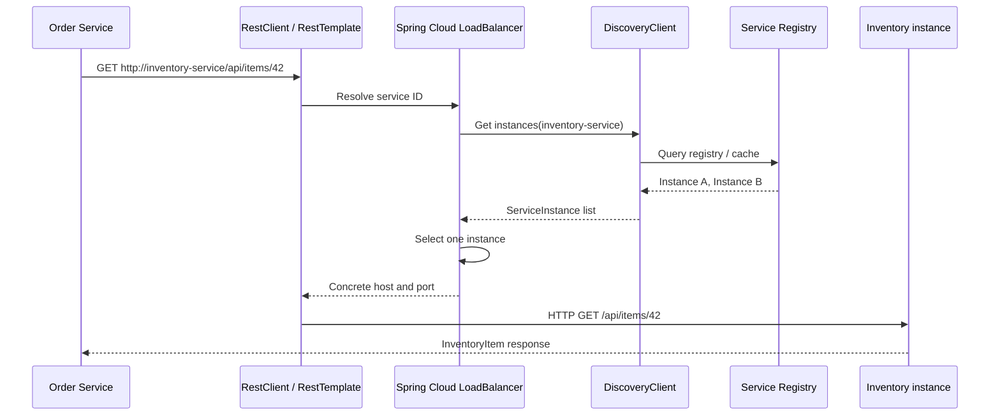

# Calling a Service by Name Using RestClient or RestTemplate with @LoadBalanced

In microservices, a consumer should call a provider using a logical name such as `inventory-service` instead of hardcoding a specific instance's IP and port. Spring Cloud LoadBalancer works with service discovery to resolve the service name in the URL to a concrete instance before sending the HTTP request. For Spring's synchronous HTTP clients, this mechanism can be enabled with the `@LoadBalanced` annotation on a `RestClient.Builder` or `RestTemplate` bean.

This lesson covers two common approaches: `RestClient` for applications using Spring Framework 6.1 or later, and `RestTemplate` for codebases using the older API. Both use the service ID in the URL, but only beans marked with `@LoadBalanced` have service name resolution via LoadBalancer.

## Processing flow when calling by service ID

Suppose `order-service` needs to fetch inventory details from `inventory-service`. The registry currently has two instances:

```text
inventory-service
  instance A: 10.0.1.12:8080
  instance B: 10.0.1.13:8080
```

The consumer calls a URL whose host is `inventory-service`. With an HTTP client integrated with Spring Cloud LoadBalancer, the request is processed as follows:

1. Application code creates a request to `http://inventory-service/...`.
2. The LoadBalancer integration recognizes the host as a service ID and requests the instance list from discovery.
3. The discovery client queries the registry or existing cached data to obtain the instances of `inventory-service`.
4. LoadBalancer selects an instance according to its configured policy.
5. The HTTP client sends the request to the selected instance's host and port.
6. The response is returned to the calling code just like a normal HTTP request.



`inventory-service` here is a service ID, not a hostname that DNS necessarily resolves. `@LoadBalanced` adds instance selection before the request is sent over the network. If you use a `RestClient` or `RestTemplate` without this annotation, the client may try to resolve `inventory-service` via normal DNS and fail with an unknown host error.

## Required dependencies

The application needs Spring Cloud LoadBalancer and at least one discovery integration supplying the instance list. Dependencies are typically managed using a Spring Cloud BOM compatible with the Spring Boot version.

Maven example for LoadBalancer:

```xml
<dependency>
    <groupId>org.springframework.cloud</groupId>
    <artifactId>spring-cloud-starter-loadbalancer</artifactId>
</dependency>
```

Add the corresponding registry starter if the application uses a real registry, for example:

| Registry | Common dependency |
|---|---|
| Eureka | `spring-cloud-starter-netflix-eureka-client` |
| Consul | `spring-cloud-starter-consul-discovery` |
| ZooKeeper | `spring-cloud-starter-zookeeper-discovery` |

In simple test environments, `SimpleDiscoveryClient` can provide static instances from configuration without running a registry server. LoadBalancer is still needed in that case if you want to call by service ID through an HTTP client.

## Calling with RestClient and @LoadBalanced

`RestClient` is a synchronous HTTP client with a fluent API, introduced in Spring Framework 6.1. To call a service by name, create a `RestClient.Builder` bean with `@LoadBalanced`.

### Declaring the builder

```java
import org.springframework.cloud.client.loadbalancer.LoadBalanced;
import org.springframework.context.annotation.Bean;
import org.springframework.context.annotation.Configuration;
import org.springframework.web.client.RestClient;

@Configuration
public class HttpClientConfiguration {

    @Bean
    @LoadBalanced
    RestClient.Builder loadBalancedRestClientBuilder() {
        return RestClient.builder();
    }
}
```

`@LoadBalanced` marks this builder so Spring Cloud adds an interceptor supporting service ID resolution. If the application has multiple `RestClient.Builder` beans, inject the builder with the appropriate qualifier to avoid picking a non-load-balanced builder by mistake.

### Creating the client to call Inventory Service

```java
import org.springframework.cloud.client.loadbalancer.LoadBalanced;
import org.springframework.stereotype.Service;
import org.springframework.web.client.RestClient;

@Service
public class InventoryClient {
    private final RestClient restClient;

    public InventoryClient(@LoadBalanced RestClient.Builder builder) {
        this.restClient = builder.build();
    }

    public InventoryItem getItem(long id) {
        return restClient.get()
            .uri("http://inventory-service/api/items/{id}", id)
            .retrieve()
            .body(InventoryItem.class);
    }
}
```

The host `inventory-service` is resolved to an instance by LoadBalancer. The path `/api/items/{id}` and response reading follow the standard `RestClient` API. `InventoryItem` is a response type defined by the application.

Other HTTP methods can be used similarly:

```java
InventoryItem created = restClient.post()
    .uri("http://inventory-service/api/items")
    .body(new CreateInventoryItemRequest("SKU-42", 10))
    .retrieve()
    .body(InventoryItem.class);

restClient.delete()
    .uri("http://inventory-service/api/items/{id}", 42L)
    .retrieve()
    .toBodilessEntity();
```

### Using multiple RestClients

When an application calls multiple upstreams or needs both load-balanced requests and requests to fixed URLs, use clear bean names:

```java
@Configuration
public class HttpClientConfiguration {

    @Bean
    @LoadBalanced
    RestClient.Builder serviceRestClientBuilder() {
        return RestClient.builder();
    }

    @Bean
    RestClient.Builder externalRestClientBuilder() {
        return RestClient.builder();
    }
}
```

Inject `@LoadBalanced RestClient.Builder` for calls by service ID; inject the regular builder for external URLs or fixed addresses. Avoid mixing up builders, because URLs like `http://inventory-service` only work when requests go through the LoadBalancer integration.

`RestClient.Builder` can be customized with default headers, request factories, message converters, or observations. When configuring multiple clients, keep settings separated by purpose and avoid sharing mutable builder state unintentionally.

## Calling with RestTemplate and @LoadBalanced

`RestTemplate` is still supported in many existing Spring Boot applications. The integration approach is similar: annotate the `RestTemplate` bean with `@LoadBalanced` so Spring Cloud attaches the load-balancing interceptor.

### Declaring the bean

```java
import org.springframework.boot.web.client.RestTemplateBuilder;
import org.springframework.cloud.client.loadbalancer.LoadBalanced;
import org.springframework.context.annotation.Bean;
import org.springframework.context.annotation.Configuration;
import org.springframework.web.client.RestTemplate;

@Configuration
public class HttpClientConfiguration {

    @Bean
    @LoadBalanced
    RestTemplate inventoryRestTemplate(RestTemplateBuilder builder) {
        return builder.build();
    }
}
```

### Injecting and calling by service ID

```java
import org.springframework.beans.factory.annotation.Qualifier;
import org.springframework.stereotype.Service;
import org.springframework.web.client.RestTemplate;

@Service
public class InventoryClient {
    private final RestTemplate restTemplate;

    public InventoryClient(
            @Qualifier("inventoryRestTemplate") RestTemplate restTemplate) {
        this.restTemplate = restTemplate;
    }

    public InventoryItem getItem(long id) {
        return restTemplate.getForObject(
            "http://inventory-service/api/items/{id}",
            InventoryItem.class,
            id
        );
    }
}
```

With `@LoadBalanced RestTemplate`, `inventory-service` is interpreted as a service ID. There is no need to manually call `DiscoveryClient`, pick an instance, and concatenate host/port into the URL for every request.

`RestTemplate` is a long-standing synchronous API. For new code on Spring Framework 6.1+, consider `RestClient` to use the fluent API; there is no need to migrate immediately if an existing application is already running stably with `RestTemplate`.

## Comparing RestClient and RestTemplate

| Criterion | RestClient | RestTemplate |
|---|---|---|
| API | Fluent API: `get()`, `post()`, `retrieve()` | Methods such as `getForObject`, `postForEntity`, `exchange` |
| Integration method | Annotate `RestClient.Builder` with `@LoadBalanced` | Annotate the `RestTemplate` bean with `@LoadBalanced` |
| Call style | Synchronous, blocking | Synchronous, blocking |
| Baseline version | Spring Framework 6.1+ | Available across older and newer Spring Framework releases |
| Best suited for | New code using the modern synchronous HTTP API | Existing applications or libraries depending on RestTemplate |

Both share the same concept: the service ID in the URI is resolved by LoadBalancer to a `ServiceInstance`. Choose the client based on your Spring version and codebase conventions; do not mix regular builders/beans with load-balanced beans.

## Configuring service ID and registry

The provider must register a stable service ID. With Spring Boot, `spring.application.name` is typically used as the service name:

```yaml
spring:
  application:
    name: inventory-service
```

The consumer must call the exact service ID published by the provider. For example, if the provider registers `inventory-service` while the consumer calls `http://inventory`, the registry will not automatically treat those two names as identical without an alias or custom mapping rule.

Example of a consumer using Eureka:

```yaml
spring:
  application:
    name: order-service

eureka:
  client:
    service-url:
      defaultZone: http://eureka-server:8761/eureka/
    register-with-eureka: true
    fetch-registry: true
```

With Consul or ZooKeeper, replace the Eureka configuration with the corresponding starter and connection properties. Code calling via `RestClient` or `RestTemplate` does not need to know the specific registry as long as the integration provides a `DiscoveryClient` to Spring Cloud.

## How does LoadBalancer select an instance?

After discovery returns the instance list, Spring Cloud LoadBalancer selects an instance according to its configuration. In the common setup, the default algorithm is round robin: requests are distributed sequentially across instances in the list. This can be replaced with another strategy or a custom supplier as needed.

Example with a list containing A, B, and C:

```text
Request 1 -> instance A
Request 2 -> instance B
Request 3 -> instance C
Request 4 -> instance A
```

This illustrates round robin, not a guarantee that every request will be distributed with absolute uniformity. Actual distribution depends on concurrent requests, the instance list, caching, retries, supplier configuration, and the strategy used by the application.

LoadBalancer does not automatically probe every business endpoint before each request. The instance list comes from the discovery/health integration; if the registry or cache still holds an old instance, requests may still be sent to a stopped address. The consumer needs timeouts and connection error handling.

## Handling the case when no instance is available

When the registry has no suitable instance, LoadBalancer cannot pick a target. The HTTP call will fail instead of automatically falling back to a default IP. Handle the error at the client or service layer boundary:

```java
import org.springframework.stereotype.Service;
import org.springframework.web.client.RestClientException;

@Service
public class InventoryFacade {
    private final InventoryClient inventoryClient;

    public InventoryFacade(InventoryClient inventoryClient) {
        this.inventoryClient = inventoryClient;
    }

    public InventoryItem findItem(long id) {
        try {
            return inventoryClient.getItem(id);
        } catch (RestClientException ex) {
            // Log with correlation ID and translate to an appropriate application error.
            throw new InventoryUnavailableException(
                "Inventory service is unavailable", ex);
        } catch (IllegalStateException ex) {
            // Some implementations throw this error when no instance is available to choose.
            throw new InventoryUnavailableException(
                "No inventory instance is available", ex);
        }
    }
}
```

The example above illustrates the error-handling boundary; in a real application, determine the exact exception types emitted by your LoadBalancer/HTTP client version when no instance is available and map them to an appropriate response or retry policy.

Do not retry every error unconditionally. Retries are only appropriate when the request can be safely re-executed, with bounded attempts, backoff, and an overall timeout. For write operations, consider idempotency keys or deduplication mechanisms.

## Timeouts, retries, and circuit breakers

Load balancing only selects the target; it does not replace the HTTP client's reliability policies. A production call should define:

- **Connect timeout:** maximum time to establish a connection to an instance.
- **Response/read timeout:** maximum time to wait for a response.
- **Retry:** bounded retry attempts and which error types may be retried.
- **Circuit breaker:** temporarily halting calls to a consistently failing upstream to protect the consumer.
- **Bulkhead:** limiting resources allocated to calls to a dependency.

Do not set overly long timeouts that tie up consumer threads when the provider is already failing. Likewise, do not retry in lockstep with fixed delays, as that can cause a retry storm when the service recovers. Use backoff and jitter when retrying.

## Distinguishing calls via LoadBalancer from manual lookup

There are two distinct approaches:

| Approach | When to use | What you must manage yourself |
|---|---|---|
| `@LoadBalanced RestClient` or `RestTemplate` | Regular HTTP requests by service ID | Timeouts, errors, retries, and client configuration |
| `DiscoveryClient.getInstances(serviceId)` | Needing metadata, building a custom protocol, or specialized routing | Instance selection, caching, refresh, stale instance handling, and URI assembly |

Manual lookup example:

```java
List<ServiceInstance> instances =
    discoveryClient.getInstances("inventory-service");

if (instances.isEmpty()) {
    throw new IllegalStateException("No inventory instance is available");
}

ServiceInstance selected = instances.get(0);
URI target = selected.getUri();
```

This snippet only illustrates reading metadata; picking the first element is not a good load-balancing strategy for production. If you select instances manually, the application must handle load distribution, caching, and the case where an instance disappears after lookup. For regular HTTP requests, `@LoadBalanced` usually avoids writing this yourself.

## Common errors

| Symptom | Possible cause | How to check / resolve |
|---|---|---|
| `UnknownHostException: inventory-service` | Client not annotated with `@LoadBalanced` or LoadBalancer dependency missing | Check the bean and starter dependencies |
| No instances for service ID | Provider not registered, wrong service ID, or registry not yet synced | Check `spring.application.name`, registry, and `DiscoveryClient.getInstances` |
| Ambiguous bean injection | Multiple `RestClient.Builder` or `RestTemplate` beans exist | Use `@Qualifier` and explicit bean names |
| Requests always go to one instance | Only one instance is available, caching, or customized strategy | Check the registry list, supplier, and LoadBalancer configuration |
| Works locally but fails in containers | Advertised provider address is unreachable from the consumer | Check hostname, port, Docker/Kubernetes networking, and registered address |
| Still calls dead instances | Registry or LoadBalancer cache is still stale | Check health checks, registry refresh, cache TTL, and timeouts |
| Write requests executed twice | Retries do not account for idempotency | Bound retries and use idempotency keys for suitable operations |

When investigating, follow this order: confirm the service ID, verify the registry has instances, confirm the bean has `@LoadBalanced`, inspect logs to see which instance LoadBalancer selects, and finally test network connectivity to that host/port.

## Integration testing

You can test through the following steps:

1. Start a registry or configure `SimpleDiscoveryClient` with two test URIs for `inventory-service`.
2. Start two mock HTTP servers on different ports that return an instance identifier in their response.
3. Initialize a `RestClient.Builder` or `RestTemplate` with `@LoadBalanced`.
4. Call `http://inventory-service/...` multiple times and verify requests are distributed according to the active strategy.
5. Stop one server and verify health/discovery caches update according to configuration.
6. Test the empty instance list scenario and confirm the error is handled at the service layer.
7. Run integration tests against a real registry or container when you need to verify registration, heartbeats, and deregistration.

Do not just test that the bean was created. Tests must verify that requests are actually routed from the service ID to instance addresses and that the application reacts properly when instances become unavailable.

## Version notes and API selection

`RestClient` requires Spring Framework 6.1 or later. When using Spring Boot, pick compatible Boot and Spring Cloud release train lines; do not add an arbitrary `spring-cloud-starter-loadbalancer` version outside the BOM. The documentation for the active release train is the authoritative source for APIs and auto-configuration.

For new code on supported platforms, `RestClient` can be preferred for synchronous calls. For existing applications using `RestTemplate`, continuing to use a `@LoadBalanced` bean remains a valid choice within supported versions. If the system requires non-blocking I/O, consider WebClient with `@LoadBalanced WebClient.Builder` or a corresponding reactive HTTP client; that is a different integration approach outside the two clients covered here.

## Deployment checklist

1. Provider has a stable `spring.application.name` and registers the right service ID.
2. Consumer has the corresponding discovery starter and can reach the registry.
3. Consumer has `spring-cloud-starter-loadbalancer`.
4. `RestClient.Builder` or `RestTemplate` bean is annotated with `@LoadBalanced`.
5. Code injects the right bean with qualifiers when multiple HTTP clients exist.
6. URLs use the exact service ID, such as `http://inventory-service/api/items/42`.
7. Instance host/port addresses are reachable from the consumer's network.
8. Timeouts and error-handling policies are configured; retries are bounded and account for idempotency.
9. Empty lists, dead instances, slow registries, and stale caches are tested.
10. Spring Boot/Spring Cloud versions are managed via a compatible BOM.

## Conclusion

`@LoadBalanced` enables `RestClient` or `RestTemplate` to call providers by service name instead of fixed instance addresses. Spring Cloud LoadBalancer reads the service ID from the URL, retrieves the instance list from discovery, picks a target, and lets the HTTP client send the request. For `RestClient`, annotate `RestClient.Builder`; for `RestTemplate`, annotate the `RestTemplate` bean. Both require the LoadBalancer dependency, discovery integration, and a service ID matching the registered provider name. Check your beans, registry, network reachability, and timeout/retry policies so calls remain reliable as instances change.
