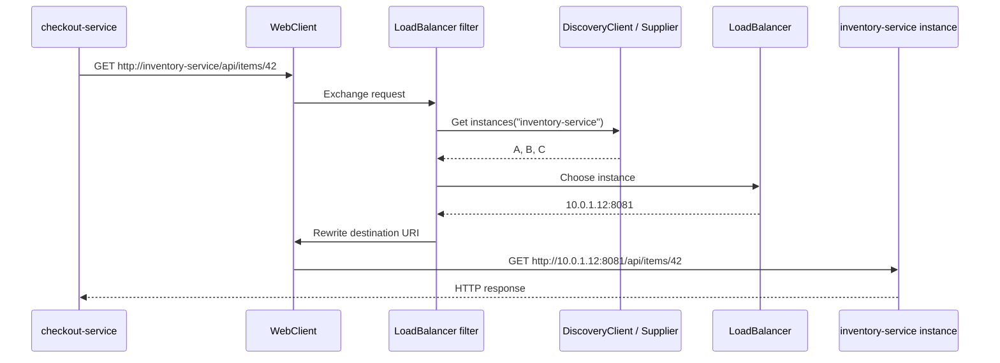

# Calling a Service by Name Using WebClient and Load Balancer Filters

In microservices, a consumer should call a provider using a logical service name such as `inventory-service` instead of hardcoding a specific instance's IP and port. Spring Cloud LoadBalancer integrates with WebClient through the `ReactorLoadBalancerExchangeFilterFunction` filter: the filter receives a URI whose host is a service ID, retrieves the instance list from service discovery, chooses an instance, and routes the request to the real address.

For this mechanism to work, the application needs the corresponding discovery client (Eureka, Consul, or another provider), Spring Cloud LoadBalancer, and a `WebClient.Builder` annotated with `@LoadBalanced`. A plain WebClient does not understand service IDs in the hostname on its own.

## 1. Service call flow through WebClient

Suppose `checkout-service` needs to call `inventory-service`, which has three instances in the registry:

| Service ID | Instance | Address |
| --- | --- | --- |
| `inventory-service` | instance A | `10.0.1.11:8081` |
| `inventory-service` | instance B | `10.0.1.12:8081` |
| `inventory-service` | instance C | `10.0.2.21:8081` |

The consumer writes the URL using the logical name:

```text
http://inventory-service/api/items/42
```

Processing flow:

1. `WebClient` receives a request with host `inventory-service`.
2. `ReactorLoadBalancerExchangeFilterFunction` recognizes that the request requires load balancing.
3. Spring Cloud LoadBalancer retrieves the `ServiceInstance` list for service ID `inventory-service` from `ServiceInstanceListSupplier`.
4. LoadBalancer selects an instance according to its configured strategy.
5. The filter replaces the host and port in the request with the selected instance's address.
6. WebClient sends the HTTP request to the provider.



The consumer does not need to know which specific instance is chosen. When the registry changes, the supplier can provide the updated list and LoadBalancer continues choosing among available instances.

## 2. Preparing dependencies

The consumer needs WebClient, a discovery client, and Spring Cloud LoadBalancer. Example with Eureka:

```xml
<dependencies>
    <dependency>
        <groupId>org.springframework.boot</groupId>
        <artifactId>spring-boot-starter-webflux</artifactId>
    </dependency>
    <dependency>
        <groupId>org.springframework.cloud</groupId>
        <artifactId>spring-cloud-starter-netflix-eureka-client</artifactId>
    </dependency>
    <dependency>
        <groupId>org.springframework.cloud</groupId>
        <artifactId>spring-cloud-starter-loadbalancer</artifactId>
    </dependency>
</dependencies>
```

With Consul, replace the Eureka starter with `spring-cloud-starter-consul-discovery`; keep WebFlux and LoadBalancer. Import a Spring Cloud BOM compatible with your Spring Boot version so dependencies align on the right release train.

`spring-boot-starter-webflux` provides `WebClient` and Reactor. If an application uses Spring MVC but wants to use WebClient for outbound HTTP calls, the WebFlux starter can be added to the classpath; when both MVC and WebFlux are present, Spring Boot typically chooses MVC as the web application type. Only use the WebFlux server when the application actually intends to handle inbound requests on the reactive stack.

## 3. Configuring discovery on the consumer

Example of `checkout-service` using Eureka:

```yaml
spring:
  application:
    name: checkout-service

eureka:
  client:
    register-with-eureka: true
    fetch-registry: true
    service-url:
      defaultZone: ${EUREKA_SERVER_URL:http://localhost:8761/eureka/}
```

`fetch-registry: true` allows the Eureka client to download the service instance list for discovery. `register-with-eureka` only needs to be enabled if `checkout-service` also wants to be discovered by other services; it does not govern outbound calling capability. If the consumer only calls other services and exposes no API for other services, `register-with-eureka: false` can be set.

With Consul, the corresponding configuration usually resides under `spring.cloud.consul.discovery`:

```yaml
spring:
  application:
    name: checkout-service
  cloud:
    consul:
      host: ${CONSUL_HOST:localhost}
      port: ${CONSUL_PORT:8500}
      discovery:
        enabled: true
        register: true
```

The consumer must be able to reach the Consul agent and have ACL permissions to read the service catalog and health. Whether using Eureka or Consul, LoadBalancer works with the `ServiceInstance` abstraction and service IDs provided by the discovery provider.

## 4. Declaring WebClient.Builder with LoadBalancer

This is the most important configuration part. Annotate the builder bean with `@LoadBalanced` so Spring Cloud attaches the service ID resolution filter:

```java
package com.example.checkout.config;

import org.springframework.cloud.client.loadbalancer.LoadBalanced;
import org.springframework.context.annotation.Bean;
import org.springframework.context.annotation.Configuration;
import org.springframework.web.reactive.function.client.WebClient;

@Configuration
public class WebClientConfiguration {

    @Bean
    @LoadBalanced
    WebClient.Builder loadBalancedWebClientBuilder() {
        return WebClient.builder();
    }
}
```

`@LoadBalanced` acts as a qualifier helping Spring distinguish the builder used to call service IDs. Spring Cloud LoadBalancer auto-configures `ReactorLoadBalancerExchangeFilterFunction` for this builder. There is no need to write your own instance selection algorithm or parse hostnames out of URLs manually.

If the application calls both external fixed URLs and internal service IDs, you can declare an additional builder without `@LoadBalanced`:

```java
@Bean
WebClient.Builder plainWebClientBuilder() {
    return WebClient.builder();
}
```

Use the right builder for each purpose. A plain builder does not resolve hostnames via the registry; only a `@LoadBalanced` builder resolves service IDs through Spring Cloud LoadBalancer.

## 5. Calling a provider by service ID

Inject the `@LoadBalanced` builder, then build WebClient:

```java
package com.example.checkout.client;

import org.springframework.cloud.client.loadbalancer.LoadBalanced;
import org.springframework.stereotype.Component;
import org.springframework.web.reactive.function.client.WebClient;
import reactor.core.publisher.Mono;

@Component
public class InventoryClient {

    private final WebClient webClient;

    public InventoryClient(
            @LoadBalanced WebClient.Builder builder) {
        this.webClient = builder.build();
    }

    public Mono<ItemResponse> getItem(String itemId) {
        return webClient.get()
                .uri("http://inventory-service/api/items/{itemId}", itemId)
                .retrieve()
                .bodyToMono(ItemResponse.class);
    }
}
```

`inventory-service` in the URI is a service ID, not a DNS hostname. LoadBalancer selects an instance and directs the request to the actual host/port. The path `/api/items/{itemId}` is preserved when the destination URI is rewritten.

In the example, `ItemResponse` is a DTO defined by the application. WebClient returns `Mono<ItemResponse>`, so callers can compose it with other reactive operations:

```java
public Mono<CheckoutView> prepareCheckout(String itemId) {
    return inventoryClient.getItem(itemId)
            .map(item -> new CheckoutView(item.id(), item.available()));
}
```

If the application is not end-to-end reactive, blocking can occur at an appropriate boundary of an imperative thread, but `.block()` should not be called on a WebFlux event-loop thread as it can cause stalling or runtime errors. Prefer returning `Mono`/`Flux` throughout the reactive layer.

## 6. What does the load balancer filter do?

`ReactorLoadBalancerExchangeFilterFunction` is an `ExchangeFilterFunction` integrated with WebClient. It participates in the filter chain before the request is sent via the HTTP connector.

Responsibilities of the filter:

- Identify URIs whose host is a service ID.
- Ask LoadBalancer to select a matching `ServiceInstance`.
- Build the target URI from the instance's scheme, host, and port.
- Forward the request to the target URI using the next `ExchangeFunction`.
- Handle the no-instance-found case according to the configured behavior.

When no suitable instance exists, Spring Cloud LoadBalancer by default typically returns `503 Service Unavailable`. You can configure `spring.cloud.loadbalancer.use404=true` if you want the missing-instance case represented as `404 Not Found`; consider your API semantics and active version.

Do not manually replace the request host with an address pulled from a cache in business code if you are already using the LoadBalancer filter. Doing so creates two instance-selection sites and easily conflicts with retries, suppliers, or health filtering.

### Distinguishing the LoadBalancer filter from business filters

WebClient supports `ExchangeFilterFunction` for needs such as correlation IDs, authentication headers, metrics, or logging. Those filters do not find instances themselves.

| Filter | Responsibility |
| --- | --- |
| `ReactorLoadBalancerExchangeFilterFunction` | Resolves service IDs and selects instances |
| Correlation ID filter | Attaches request IDs for cross-service tracing |
| Authentication filter | Adds access tokens or appropriate auth headers |
| Logging/metrics filter | Records request/response details per policy |
| Retry filter or LoadBalancer retry integration | Executes retries per configuration and safety conditions |

Keep business filters focused and avoid logging tokens, personal data, or sensitive payloads. Do not add a parallel filter that resolves service IDs alongside the LoadBalancer filter.

## 7. Adding an ExchangeFilterFunction for correlation IDs

Example of adding a correlation ID to outgoing requests:

```java
import java.util.UUID;

import org.springframework.context.annotation.Bean;
import org.springframework.context.annotation.Configuration;
import org.springframework.web.reactive.function.client.ClientRequest;
import org.springframework.web.reactive.function.client.ExchangeFilterFunction;
import reactor.core.publisher.Mono;

@Configuration
public class OutboundFilterConfiguration {

    @Bean
    ExchangeFilterFunction correlationIdFilter() {
        return ExchangeFilterFunction.ofRequestProcessor(request -> {
            ClientRequest updated = ClientRequest.from(request)
                    .headers(headers -> headers.set(
                            "X-Correlation-Id", UUID.randomUUID().toString()))
                    .build();
            return Mono.just(updated);
        });
    }
}
```

This filter can be added to the `@LoadBalanced` builder:

```java
@Bean
@LoadBalanced
WebClient.Builder loadBalancedWebClientBuilder(
        ExchangeFilterFunction correlationIdFilter) {
    return WebClient.builder().filter(correlationIdFilter);
}
```

Spring Cloud still adds the load-balancing filter to the annotated builder. The correlation ID filter only adds the header; instance selection remains LoadBalancer's responsibility.

In systems with tracing, use the trace context managed by Micrometer Tracing or your active observability library rather than generating independent correlation IDs at every hop. If accepting an ID from an inbound request, validate/sanitize it before forwarding.

## 8. Instance selection algorithms

After receiving the instance list, LoadBalancer selects an instance according to the `ReactorLoadBalancer` configured for the service. Spring Cloud LoadBalancer typically uses `RoundRobinLoadBalancer` by default: cycling through available instances in turn.

For example, three instances A, B, and C can be selected cyclically:

```text
Request 1 -> A
Request 2 -> B
Request 3 -> C
Request 4 -> A
Request 5 -> B
```

This is a simplified illustration; multiple consumer processes have separate counters, lists can change, and some instances may be filtered out. Therefore, do not expect the system-wide order to always be strictly A-B-C.

LoadBalancer does not inherently guarantee equal CPU load, in-flight request counts, or latency across instances. If another strategy is needed, configure an appropriate LoadBalancer implementation or `ServiceInstanceListSupplier`.

## 9. Customizing the strategy for a service

`@LoadBalancerClient` can be used to specify a LoadBalancer configuration for a service ID. Example choosing random selection instead of round robin:

```java
import org.springframework.cloud.client.ServiceInstance;
import org.springframework.cloud.loadbalancer.annotation.LoadBalancerClient;
import org.springframework.cloud.loadbalancer.core.RandomLoadBalancer;
import org.springframework.cloud.loadbalancer.core.ReactorLoadBalancer;
import org.springframework.cloud.loadbalancer.core.ServiceInstanceListSupplier;
import org.springframework.cloud.loadbalancer.support.LoadBalancerClientFactory;
import org.springframework.context.annotation.Bean;
import org.springframework.core.env.Environment;
import org.springframework.boot.autoconfigure.SpringBootApplication;

@LoadBalancerClient(
        name = "inventory-service",
        configuration = InventoryLoadBalancerConfiguration.class
)
@SpringBootApplication
public class CheckoutApplication {
}

class InventoryLoadBalancerConfiguration {

    @Bean
    ReactorLoadBalancer<ServiceInstance> randomLoadBalancer(
            Environment environment,
            LoadBalancerClientFactory factory) {

        String serviceId = environment.getProperty(
                LoadBalancerClientFactory.PROPERTY_NAME);

        return new RandomLoadBalancer(
                factory.getLazyProvider(
                        serviceId, ServiceInstanceListSupplier.class),
                serviceId);
    }
}
```

This is an example of per-service configuration; constructor APIs and packages may vary by Spring Cloud version. Use a version compatible with your project's BOM.

The `InventoryLoadBalancerConfiguration` class should not be component-scanned as a global application-wide default configuration. Place it outside the application's scan packages or organize it in a separate package, so random selection applies only to `inventory-service` via `@LoadBalancerClient`.

Do not pick a random strategy just to distribute load. Identify actual requirements: simple round robin, random, local zone preference, excluding unhealthy instances, or weighted policies. Every strategy should be tested against instance counts, caching, and behavior when instances change.

## 10. Filtering instances by zone or health

LoadBalancer can use a `ServiceInstanceListSupplier` chain to fetch and transform the instance list before the selection algorithm runs. For example, a supplier can:

- Fetch the list from `DiscoveryClient`.
- Cache the list to reduce registry queries.
- Prioritize instances in the same zone as the consumer.
- Filter out instances incompatible with metadata or health policies.
- Apply custom health checks if the application has corresponding endpoints and policies.

Do not hard-filter down to a single zone without fallback. If the current zone has no remaining instances, the consumer will find no targets even when other zones are still operational. The common policy is to prefer the local zone and fall back to other zones.

Registry health also has limits. An instance may be marked healthy by the registry while requests still time out due to network issues or application failures occurring after the last health check. Combine health filtering with timeouts, circuit breakers, and request error handling.

## 11. Per-service configuration

`@LoadBalancerClient(name = "inventory-service", configuration = ...)` binds a dedicated configuration to service ID `inventory-service`. This is a clean way to change the algorithm or supplier chain for a specific provider without affecting other services.

Depending on the Spring Cloud version, some settings such as caching, health checks, and retries can be configured via properties; other policies require declaring a `ServiceInstanceListSupplier` or `ReactorLoadBalancer` bean. Do not copy property names arbitrarily from another release train. Check the reference documentation for the exact version in use and verify configuration takes effect in tests.

When using `@LoadBalancerClient(name = "inventory-service", ...)`, the name in the annotation must match the host/service ID in the URI `http://inventory-service/...` and the service ID in the registry exactly.

## 12. Error handling when calling WebClient

Discovery and LoadBalancer help locate addresses, but they do not guarantee every request succeeds. The consumer still must handle:

- No instances: typically receives `503 Service Unavailable` from LoadBalancer.
- Provider returns an HTTP error: check status and map to an appropriate business error.
- Timeout or connection refused: an instance may have just stopped or its advertised address is unreachable.
- Response decoding error: consumer DTO does not match provider response schema.
- Stale registry/cache: the instance list does not yet reflect the latest changes.

Example handling status codes and timeouts:

```java
import java.time.Duration;

public Mono<ItemResponse> getItem(String itemId) {
    return webClient.get()
            .uri("http://inventory-service/api/items/{itemId}", itemId)
            .retrieve()
            .onStatus(
                    status -> status.isError(),
                    response -> response.createException())
            .bodyToMono(ItemResponse.class)
            .timeout(Duration.ofSeconds(3));
}
```

`timeout` caps waiting time on the consumer side. Choose timeouts based on the API's SLA and normal processing time; overly low timeouts cause false failures, while overly high timeouts hold resources for too long when the provider is degraded.

### Retries must be conditional

Retries can help when an instance was just removed from the registry or a network error is transient. However:

- Only retry a bounded number of times with backoff.
- Do not unconditionally retry write or payment requests without idempotency keys.
- Avoid retrying at multiple layers simultaneously, which multiplies request volume exponentially.
- Combine with a circuit breaker to stop calling a persistently failing dependency.
- Record the instance/service ID and trace ID for investigation.

## 13. Distinguishing service ID URLs from fixed URLs

| URL | Appropriate builder | How it is handled |
| --- | --- | --- |
| `http://inventory-service/api/items` | `@LoadBalanced WebClient.Builder` | Host is treated as a service ID and resolved by LoadBalancer |
| `https://api.partner.example/v1/items` | Plain WebClient builder | DNS/TLS connects directly to the fixed host |
| `http://localhost:8081/health` | Plain WebClient builder | Connects directly to localhost of the current process |

Do not mechanically use a load-balanced builder for every URL. For non-service-ID hosts, a plain builder can handle them directly, and separating clients by purpose keeps timeout, authentication, and observability configuration clear.

Conversely, if you use a plain builder for `http://inventory-service`, WebClient will try to resolve `inventory-service` as a hostname via DNS. It will not automatically look up Eureka or Consul.

## 14. Verifying end-to-end operation

A local test can be carried out in this sequence:

1. Start Eureka Server or Consul.
2. Start two or three `inventory-service` instances with the same service ID but different ports/instance IDs.
3. Verify the instances appear in the registry and their advertised addresses are reachable.
4. Start `checkout-service` with the discovery client and LoadBalancer.
5. Call the consumer endpoint that uses WebClient.
6. Observe provider logs to see which instance receives requests.
7. Stop one provider and call again to verify registry refresh and instance selection behavior.
8. Stop all providers and confirm the consumer receives an appropriate error when no instances remain.

Local run example:

```text
Eureka Server:       localhost:8761
inventory-service A: localhost:8081
inventory-service B: localhost:8083
checkout-service:    localhost:8082
```

You cannot register two instances with the exact same ID if you want them seen as two independently running replicas. Set distinct instance IDs, such as `inventory-local-8081` and `inventory-local-8083`.

## 15. Common errors

| Symptom | Possible cause | How to check and fix |
| --- | --- | --- |
| `UnknownHostException: inventory-service` | WebClient does not use `@LoadBalanced` builder | Inject the right builder and check bean qualifiers |
| No matching `WebClient.Builder` bean found | Missing WebFlux/WebClient or builder bean not defined | Add the WebFlux starter and declare the builder |
| No instances found | Registry lacks the service, wrong service ID, or fetch disabled | Check dashboard/catalog, `spring.application.name`, and fetch config |
| LoadBalancer returns 503 | Instance list is empty after filtering or registry not ready | Check supplier, health, zone filters, and registry |
| One instance works while another times out | Wrong advertised address/port or firewall closed | Call each URI directly from the consumer's network |
| Only one instance receives requests | Duplicate instance ID, stale cache, or selection strategy | Check registry, supplier cache, and LoadBalancer logs |
| `@LoadBalanced` has no effect | Builder created via `WebClient.create()` or another `WebClient.builder()` | Use the `@LoadBalanced`-annotated builder bean |
| Correlation ID filter does not run | A different WebClient used or filter not attached to builder | Check builder bean and filter chain |
| Retries cause duplicate requests | Retrying non-idempotent requests or retrying at multiple layers | Use idempotency keys and restrict retries to one layer |
| Custom configuration applies to all services | LoadBalancer config was globally component-scanned | Place custom config outside scan packages and attach via `@LoadBalancerClient` |

## 16. Security and observability

WebClient is an outbound communication boundary, so security and observability principles apply:

- Only call service IDs belonging to registries and namespaces the application is authorized to access.
- Do not accept arbitrary hostnames/service IDs from user input, to avoid turning the client into an SSRF vector.
- Pass access tokens with appropriate audience and scope; do not log tokens.
- Use TLS when service endpoints require HTTPS and manage truststores/certificates properly.
- Propagate trace/correlation context to follow requests across services.
- Record latency, status codes, timeouts, retry counts, and service IDs.
- Do not log full payloads or sensitive headers.
- Bound connection pools, timeouts, and concurrency according to expected load.

When LoadBalancer selects an instance, logs/traces should help identify the service ID and target instance without exposing sensitive data. This information is valuable for investigating stale registry issues or a failing node.

## 17. Deployment checklist

- [ ] Have WebClient dependency and appropriate discovery client.
- [ ] Have `spring-cloud-starter-loadbalancer` compatible with the Spring Cloud BOM.
- [ ] Declare `WebClient.Builder` with `@LoadBalanced`.
- [ ] Inject the right builder into service-calling clients.
- [ ] Use exact service IDs in URIs, such as `http://inventory-service/...`.
- [ ] Confirm discovery returns instances with reachable host/port.
- [ ] Understand that the LoadBalancer filter resolves URIs and selects instances.
- [ ] Separate the load-balancing filter from correlation/auth/logging filters.
- [ ] If customizing algorithms, scope configuration to the exact service ID.
- [ ] Provide appropriate zone/health fallbacks; avoid hard filters that empty the list.
- [ ] Have timeouts, status handling, bounded retries, and circuit breakers.
- [ ] Test adding/removing instances and when the registry has no instances.
- [ ] Protect tokens, TLS, trace context, and outbound logs.

Calling services with WebClient and service IDs decouples consumers from the physical addresses of individual instances. `@LoadBalanced WebClient.Builder` activates the Spring Cloud LoadBalancer filter to retrieve the instance list, pick a target, and rewrite the URI before sending the request. Other WebClient filters can add tracing, authentication, or logging, while instance selection policies can be customized per service. To keep calls reliable, still manage health, timeouts, retries, fallbacks, and security at the application layer.
