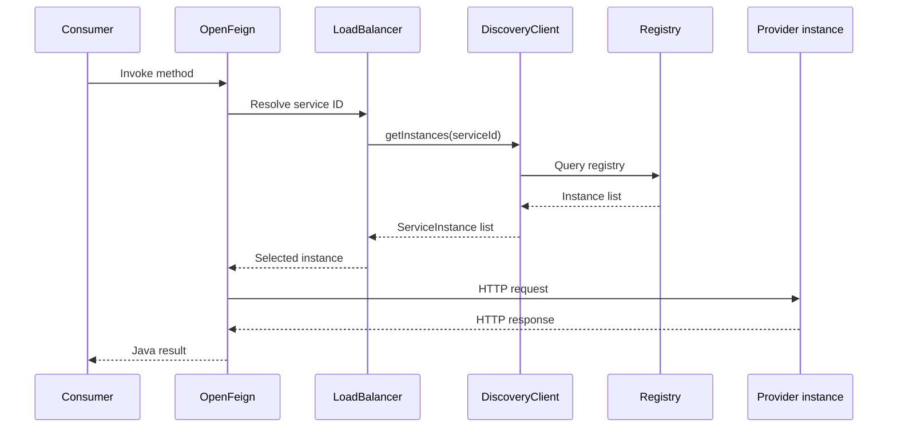

# OpenFeign Using Service Names and How It Differs from Fixed URLs

Spring Cloud OpenFeign allows an application to call HTTP APIs through a Java interface. When declaring a Feign client with a service name and omitting the URL, Spring Cloud can use Service Discovery to locate active instances, and Spring Cloud LoadBalancer selects an instance for the request. Providers can scale out, scale in, or replace instances without the consumer having to change IP addresses.

If a specific URL is declared for the Feign client, requests are sent directly to that URL and bypass instance selection via discovery/load balancing. The two approaches solve different needs: service names fit microservices with dynamic instances; fixed URLs fit stable endpoints or external systems.

## 1. Call flow through OpenFeign and Service Discovery

OpenFeign generates an implementation for interfaces annotated with `@FeignClient`. The application invokes a Java method; Feign translates the method, parameters, and payload into an HTTP request, sends the request, and converts the response back to the declared Java return type.

When integrated with Service Discovery, the call flow by service name consists of:

1. The consumer invokes a method on the Feign interface.
2. Feign constructs the request and identifies the client name/service ID.
3. Spring Cloud LoadBalancer asks the discovery integration for the instance list.
4. The discovery client reads data from Eureka, Consul, ZooKeeper, or the configured provider.
5. LoadBalancer selects a suitable instance.
6. The request is sent to the instance's host and port.
7. The response is returned to the Feign client method.



Feign does not maintain the instance list itself. Discovery integration handles finding instances; LoadBalancer handles selecting an instance. Therefore, calling by service ID requires the corresponding discovery client and Spring Cloud LoadBalancer.

## 2. Adding dependencies and enabling Feign clients

In Maven, add the OpenFeign starter:

```xml
<dependency>
    <groupId>org.springframework.cloud</groupId>
    <artifactId>spring-cloud-starter-openfeign</artifactId>
</dependency>
```

For Feign to call by service ID, add Spring Cloud LoadBalancer if it is not already in the dependency graph:

```xml
<dependency>
    <groupId>org.springframework.cloud</groupId>
    <artifactId>spring-cloud-starter-loadbalancer</artifactId>
</dependency>
```

The provider and consumer need an appropriate discovery integration, such as Eureka Discovery Client, Consul Discovery, or Zookeeper Discovery. Manage Spring Cloud versions via a BOM compatible with your Spring Boot version; do not pick individual starter versions independently.

Enable Feign clients in the application:

```java
import org.springframework.boot.SpringApplication;
import org.springframework.boot.autoconfigure.SpringBootApplication;
import org.springframework.cloud.openfeign.EnableFeignClients;

@SpringBootApplication
@EnableFeignClients
public class OrderApplication {

    public static void main(String[] args) {
        SpringApplication.run(OrderApplication.class, args);
    }
}
```

If interfaces reside outside the default component scan package, specify the package explicitly:

```java
@EnableFeignClients(basePackages = "com.example.clients")
@SpringBootApplication
public class OrderApplication {
    // ...
}
```

## 3. Calling by service name: no URL declared

Suppose `order-service` needs to call `inventory-service`'s API. Declare the Feign interface:

```java
import org.springframework.cloud.openfeign.FeignClient;
import org.springframework.web.bind.annotation.GetMapping;
import org.springframework.web.bind.annotation.PathVariable;

@FeignClient(name = "inventory-service")
public interface InventoryClient {

    @GetMapping("/api/items/{itemId}")
    ItemResponse getItem(@PathVariable("itemId") String itemId);
}
```

Inject the client into the business service:

```java
import org.springframework.stereotype.Service;

@Service
public class OrderService {

    private final InventoryClient inventoryClient;

    public OrderService(InventoryClient inventoryClient) {
        this.inventoryClient = inventoryClient;
    }

    public ItemResponse checkItem(String itemId) {
        return inventoryClient.getItem(itemId);
    }
}
```

`name = "inventory-service"` is the service ID. There is no `url` attribute, so Spring Cloud OpenFeign can create a client using LoadBalancer to discover instances under this name.

The provider registers the same service ID:

```yaml
spring:
  application:
    name: inventory-service

server:
  port: 8081
```

The consumer must be able to connect to the registry where the provider registers. Example with Eureka:

```yaml
eureka:
  client:
    service-url:
      defaultZone: http://localhost:8761/eureka/
```

With Consul or ZooKeeper, configure the connection string and discovery settings according to the provider. The name in `@FeignClient` must match the name published in the registry.

### Multiple instances with the same service ID

Suppose the registry publishes:

| Service ID | Host | Port |
|---|---|---:|
| inventory-service | 10.0.1.21 | 8081 |
| inventory-service | 10.0.1.22 | 8081 |
| inventory-service | 10.0.1.23 | 8081 |

The Feign client still declares only `@FeignClient(name = "inventory-service")`. LoadBalancer chooses an instance from the list returned by discovery according to the configured strategy. When adding a fourth instance, the consumer does not need to modify the interface or update any URL.

The service ID is a logical name, not a DNS hostname or IP. In load-balanced calls, `inventory-service` is resolved through Spring Cloud's discovery integration.

## 4. Distinguishing name, contextId, and url

| Attribute | Meaning |
|---|---|
| `name` | Service/client name, typically the service ID when using LoadBalancer |
| `contextId` | Identifier for a Feign client's dedicated configuration in the application context |
| `url` | Fixed target address; when set, the client does not use LoadBalancer to find instances |
| `path` | Path prefix prepended to all interface mappings |
| `configuration` | Configuration class for encoder, decoder, contract, logger, or client components |

Example of two clients calling the same service with separate configurations:

```java
@FeignClient(
    name = "inventory-service",
    contextId = "inventoryReadClient"
)
public interface InventoryReadClient {
    // Read operations
}

@FeignClient(
    name = "inventory-service",
    contextId = "inventoryAdminClient"
)
public interface InventoryAdminClient {
    // Administrative operations
}
```

Both clients use the same service ID `inventory-service` but have distinct `contextId` values to differentiate configurations and beans. `contextId` is not a service ID stored by the registry.

In modern versions, prefer the `name` attribute. The older `serviceId` attribute has been replaced/deprecated in Spring Cloud OpenFeign versions; follow the API of your project's release train.

## 5. Calling with a fixed URL

If a Feign client declares a URL, requests are sent directly to that endpoint:

```java
@FeignClient(
    name = "inventoryClient",
    url = "http://inventory.internal.example:8081"
)
public interface InventoryFixedUrlClient {

    @GetMapping("/api/items/{itemId}")
    ItemResponse getItem(@PathVariable("itemId") String itemId);
}
```

The URL can be placed in configuration instead of being hardcoded:

```yaml
clients:
  inventory:
    url: http://inventory.internal.example:8081
```

You can reference the property directly on the annotation:

```java
@FeignClient(
    name = "inventoryFixedClient",
    url = "${clients.inventory.url}"
)
public interface InventoryFixedUrlClient {
    // ...
}
```

Then pass the URL property into the annotation's `url` attribute using a Spring placeholder or configure the URL per Feign client name. When a URL is set, `name` still identifies the Feign client, while the URL is the actual call target. OpenFeign does not ask LoadBalancer to pick an instance for a client that already specifies a URL.

A fixed URL is suitable when:

- Calling a partner API or SaaS service whose endpoint is published by the vendor.
- Calling a gateway or load balancer with a stable hostname.
- A service has only a single endpoint managed outside the registry.
- Writing integration tests that need to point to a mock server.
- Temporarily needing to call a specific endpoint for diagnostics.

Do not use a fixed URL pointing to the IP of a short-lived pod/container. When the instance is replaced or its address changes, the consumer must update configuration and redeploy or refresh configuration via a separate mechanism.

## 6. Comparing target selection approaches

| Criterion | Feign using service name | Feign using fixed URL |
|---|---|---|
| Declaration | `@FeignClient(name = "inventory-service")` | `@FeignClient(name = "inventoryClient", url = "...")` |
| Discovery lookup | Yes, via discovery integration | No |
| LoadBalancer | Selects instance by service ID | Does not select instance via Spring Cloud LoadBalancer |
| Multiple replicas | Selects from the instance list | The URL itself handles distribution or points to a single target |
| Instance IP/port changes | Registry updates, consumer looks up via discovery | Endpoint must be updated if the URL changes |
| Metadata and instance filtering | Supported via discovery/LoadBalancer integration | No registry instance list available to filter |
| Registry dependency | Yes | No |
| Best suited for | Internal microservices with dynamic instances | External APIs, gateways, or stable endpoints |

A fixed URL does not necessarily mean there is only one backend. That URL may point to a load balancer or reverse proxy distributing across multiple servers. The difference is that distribution happens in infrastructure behind the URL, rather than Spring Cloud LoadBalancer selecting individual instances from the registry.

## 7. Configuring by client name

Spring Cloud OpenFeign supports per-client configuration by name. Example setting timeouts for a client using a service ID:

```yaml
spring:
  cloud:
    openfeign:
      client:
        config:
          inventory-service:
            connectTimeout: 2000
            readTimeout: 3000
```

For a fixed-URL client, you can set the URL and timeouts by client name:

```yaml
spring:
  cloud:
    openfeign:
      client:
        config:
          inventoryFixedClient:
            url: http://inventory.internal.example:8081
            connectTimeout: 2000
            readTimeout: 3000
```

When a URL is set via configuration properties, the Feign client also calls the fixed endpoint and does not use LoadBalancer to pick instances. If a URL is declared directly on the annotation, the annotation's URL takes precedence according to Spring Cloud OpenFeign configuration rules. Avoid setting two different values, which makes it hard for operators to determine the actual target.

The client configuration key name must match the client name recognized by OpenFeign in the active version. When multiple clients share the same service name but have different contextIds, check the configuration naming rules and separate configurations when needed.

## 8. Fallback, timeouts, and instance-not-found errors

Using a service name makes instance changes flexible, but does not guarantee requests always succeed. Errors can still occur:

- The registry does not yet have an instance or the consumer has not refreshed data.
- All instances are unhealthy.
- A registered host/port is unreachable from the consumer.
- The instance stops after LoadBalancer selected it.
- The provider responds slowly or returns an HTTP error.
- Network or TLS issues occur.

Set connect timeout and read timeout aligned with SLAs. Retries should be bounded and only applied when requests can be safely retried; for payment creation or order creation operations, blind retries can cause duplicate business execution. Use idempotency keys or deduplication mechanisms when needed.

Fallbacks with circuit breakers can be declared when the project has integrated Spring Cloud CircuitBreaker and configured OpenFeign accordingly. A fallback should represent failure clearly rather than returning dummy data as if the request succeeded.

Example enabling circuit breaker support for OpenFeign:

```yaml
spring:
  cloud:
    openfeign:
      circuitbreaker:
        enabled: true
```

The configuration above only takes effect when a compatible CircuitBreaker implementation dependency is present in the project. Fallback/fallbackFactory declarations and circuit breaker policies must be designed around business requirements, not as a substitute for discovery error handling or timeout configuration.

## 9. Migrating from a fixed URL to a service name

An application might initially call a provider using a URL:

```java
@FeignClient(
    name = "inventoryClient",
    url = "http://localhost:8081"
)
public interface InventoryClient {
    // ...
}
```

When switching to discovery, replace the client with the service ID:

```java
@FeignClient(name = "inventory-service")
public interface InventoryClient {
    // ...
}
```

Next steps required:

1. Enable the appropriate discovery client in the consumer.
2. Ensure the provider registers under service ID `inventory-service`.
3. Add Spring Cloud LoadBalancer if not already present.
4. Remove the fixed URL from the annotation or client configuration.
5. Verify the consumer receives instances via DiscoveryClient.
6. Verify requests through Feign are routed to instances.
7. Test scenarios where the registry has no instances and where an instance is removed from the registry.

Simply changing the annotation from URL to name is not enough if the consumer is not connected to the registry or lacks LoadBalancer. Conversely, if a URL remains in configuration properties, the client may keep calling the fixed URL even though the annotation no longer has a URL; check both configuration sources.

## 10. Common errors and how to handle them

| Symptom | Possible cause | Resolution |
|---|---|---|
| Cannot create Feign bean | `@EnableFeignClients` not enabled or wrong scan package | Check configuration and interface location |
| No load-balancing Feign client | Missing Spring Cloud LoadBalancer or discovery integration | Check dependencies and auto-configuration |
| `No instances available` error | Wrong service ID, provider not registered, or no healthy instances in registry | Cross-check registry names and DiscoveryClient |
| Feign still calls old endpoint | URL remains in annotation or client properties | Check `url` in both configuration sources |
| Calls wrong host/port | Provider advertises an unreachable address | Check host, port, and networking from the consumer |
| Client treats service name as DNS hostname | Plain Feign or fixed URL used instead of load-balanced client | Check `@FeignClient` has no URL and LoadBalancer dependency is present |
| Timeout when provider is slow | Inappropriate connect/read timeouts | Configure timeouts per SLA and monitor latency |
| Fallback hides real errors | Fallback returns default result without recording cause | Log/emit error metrics and distinguish degraded responses from success |
| Retries create duplicate transactions | Retrying non-idempotent operations | Design for idempotency and bound retries |

When debugging, check in order: whether the Feign bean was created, whether the client uses a URL or a service ID, whether LoadBalancer is present, whether the discovery client returns instances, and whether the instance address is reachable.

## 11. Checklist for choosing how to declare a Feign client

Use a service name when:

1. The provider is an internal microservice registered with Eureka, Consul, ZooKeeper, or a corresponding discovery provider.
2. Multiple instances may run or instance addresses change across deployments.
3. The consumer needs LoadBalancer to select instances.
4. You want to use metadata or application-layer instance selection policies.

Use a fixed URL when:

1. The endpoint is provided by a partner or external platform.
2. The URL points to a stable gateway/load balancer.
3. Integration tests need a mock server or specific endpoint.
4. Discovery lookup and client-side load balancing are not needed.

Before releasing, check the service ID, discovery registration, LoadBalancer dependency, URL overrides, timeouts, retries, and missing-instance handling. OpenFeign keeps HTTP calling code clean through interfaces; choosing between a service name and a URL determines who is responsible for locating and selecting the target. For microservices with dynamic instances, service names combined with DiscoveryClient and LoadBalancer decouple consumers from individual machine addresses. For stable or external endpoints, a fixed URL is usually simpler and easier to control.
