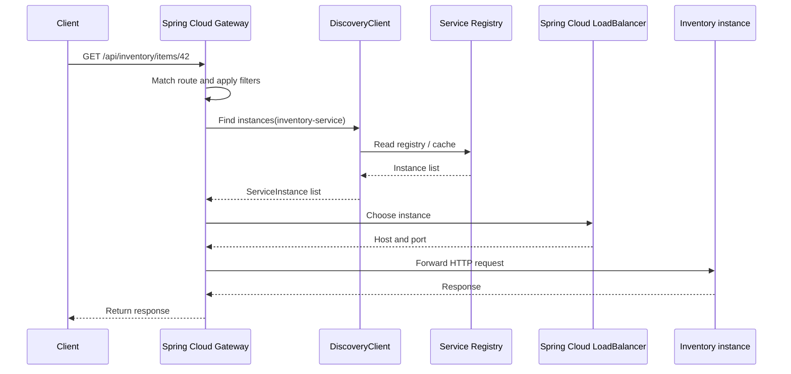

# Integrating Gateway with lb:// and the Limits of Auto-Generating Routes from Discovery

Spring Cloud Gateway can route requests to microservices using a service ID instead of a fixed IP address. When a route uses the URI `lb://inventory-service`, Gateway works with Spring Cloud LoadBalancer and the discovery client to look up an instance of `inventory-service`, pick an instance, and forward the request.

Gateway can also automatically generate routes from services registered in the registry via Discovery Locator. This feature is convenient when the system has many services or changes frequently, but it can expose internal services if every registered service automatically becomes a reachable route. Therefore, understand the difference between explicitly declared routes and auto-generated routes, and control the list of services permitted to be exposed.

## How do Gateway, discovery, and LoadBalancer work together?

Three components have distinct responsibilities:

| Component | Responsibility |
|---|---|
| Spring Cloud Gateway | Receives requests, matches routes, runs predicates/filters, and forwards to upstreams |
| DiscoveryClient | Looks up registered instances by service ID |
| Spring Cloud LoadBalancer | Selects one instance from the list returned by discovery |

With the URI `lb://inventory-service`, Gateway treats `inventory-service` as a service ID. LoadBalancer retrieves the instance list from a discovery integration such as Eureka, Consul, or ZooKeeper. After picking an instance, Gateway sends the request to that instance's actual host and port.



`lb://` is a scheme for load-balancing integration. It is not a URL that a browser or DNS can resolve directly. A URI like `http://10.0.1.12:8080` points directly to a specific address; a URI like `lb://inventory-service` tells Gateway to resolve the service ID when handling the request.

## Required dependencies

The Gateway application needs Spring Cloud Gateway, Spring Cloud LoadBalancer, and a discovery integration if looking up a real registry. Manage versions using a Spring Cloud BOM compatible with Spring Boot.

Example Maven dependencies commonly used in a Gateway WebFlux application:

```xml
<dependency>
    <groupId>org.springframework.cloud</groupId>
    <artifactId>spring-cloud-starter-gateway</artifactId>
</dependency>
<dependency>
    <groupId>org.springframework.cloud</groupId>
    <artifactId>spring-cloud-starter-loadbalancer</artifactId>
</dependency>
<dependency>
    <groupId>org.springframework.cloud</groupId>
    <artifactId>spring-cloud-starter-netflix-eureka-client</artifactId>
</dependency>
```

If using Consul or ZooKeeper, replace the Eureka starter with the corresponding discovery starter. Gateway needs a working `DiscoveryClient` to fetch instances. If using only fixed URIs, discovery is not needed for that route; however, `lb://` routes require LoadBalancer integration.

The YAML examples below use common Spring Cloud Gateway WebFlux configuration. Property names and starters may differ between Gateway WebFlux, Gateway Server MVC, and release trains; verify against the documentation for your project's exact version.

## Declaring explicit routes with lb://

With explicit routes, the development team actively decides the public path, target service ID, predicates to match requests, and filters to rewrite paths or headers.

Example route to `inventory-service`:

```yaml
spring:
  cloud:
    gateway:
      routes:
        - id: inventory-api
          uri: lb://inventory-service
          predicates:
            - Path=/api/inventory/**
          filters:
            - StripPrefix=2
```

The request `GET /api/inventory/items/42` matches the predicate `Path=/api/inventory/**`. The filter `StripPrefix=2` removes the two segments `/api` and `/inventory`, so the upstream receives the path `/items/42`.

If the upstream expects `/inventory/items/42`, strip only `/api` with `StripPrefix=1`. If the upstream needs a different path structure, use `RewritePath` with an appropriate expression. Verify post-filter paths with integration tests to prevent 404 errors caused by Gateway forwarding the wrong path.

Routes can add filters as needed:

```yaml
spring:
  cloud:
    gateway:
      routes:
        - id: inventory-api
          uri: lb://inventory-service
          predicates:
            - Path=/api/inventory/**
            - Method=GET,POST
          filters:
            - StripPrefix=2
            - AddRequestHeader=X-Gateway-Source, public-api
```

`Method=GET,POST` restricts which HTTP methods match the route. `AddRequestHeader` adds a header to the upstream request. Client-supplied headers should not be trusted if they carry security meaning; Gateway must strip or overwrite sensitive headers before forwarding.

### Routing multiple services

Explicit routes can declare multiple services with distinct public paths:

```yaml
spring:
  cloud:
    gateway:
      routes:
        - id: inventory-api
          uri: lb://inventory-service
          predicates:
            - Path=/api/inventory/**
          filters:
            - StripPrefix=2
        - id: order-api
          uri: lb://order-service
          predicates:
            - Path=/api/orders/**
          filters:
            - StripPrefix=1
```

The `inventory-api` and `order-api` routes have separate IDs, making them easy to review, test, and govern with distinct policies. This is usually the right choice for public APIs because the list of exposed endpoints is controlled in configuration or source code.

## Discovery Locator auto-generated routes

Spring Cloud Gateway provides Discovery Locator to generate routes based on services visible to `DiscoveryClient`. This feature is typically disabled by default and enabled via configuration:

```yaml
spring:
  cloud:
    gateway:
      discovery:
        locator:
          enabled: true
          lower-case-service-id: true
```

When enabled, Gateway iterates over service IDs provided by the discovery client and creates a route for each qualifying service. The common default configuration creates a URI of the form `lb://<serviceId>`, predicate `Path=/<serviceId>/**`, and a `RewritePath` filter to strip the service ID prefix before forwarding to the upstream.

For example, if the service ID is `inventory-service`, the auto-generated route typically matches paths like `/inventory-service/**` and forwards to `inventory-service` after stripping the prefix. Exact route IDs, predicate/filter expressions, and case normalization details depend on the Gateway version.

`lower-case-service-id: true` is helpful when the registry returns uppercase service IDs, as in some Eureka configurations, though you must ensure client paths follow the same lowercase convention.

### Inspecting auto-generated routes

In development environments, you can inspect the route list via the Gateway Actuator endpoint if the application has configured it. This administrative endpoint can reveal internal service IDs, predicates, URIs, and filters; only expose it on a protected management network.

When verifying, confirm that DiscoveryClient returns the right service ID; the auto-generated route has the right `lb://` URI; the predicate matches the path; RewritePath strips the right prefix; LoadBalancer has instances to select; and the upstream receives the expected path.

## Limits of auto-generated routes

Discovery Locator creates routes from registration data, but the registry is not a public API allowlist. Not every service appearing in the registry should be exposed through Gateway.

### Risk of accidentally exposing internal services

If the locator is enabled without restrictions, services such as `admin-service`, `internal-report-worker`, or `debug-service` can become routes. If Gateway sits on a public network without adequate protection, external callers could attempt to invoke services intended only for internal traffic.

Registries are generally designed for internal workloads to locate one another. They do not necessarily store public/private classification, user permissions, or which APIs are permitted externally. Therefore, auto-generating routes from the entire registry can exceed the security boundary the team intends.

### Does not describe the full API contract

Discovery knows service IDs, hosts, ports, and metadata. It does not understand business endpoints, API versions, HTTP methods, request/response schemas, or authorization rules. Having a route to a service does not mean every path on that service is a valid public API.

### Routes can change with registry state

When services register, deregister, or rename their service IDs, the auto-generated route set can shift with discovery. This is convenient in dynamic environments but makes it harder to review public API changes, document contracts, and control compatibility across clients.

### Does not replace authentication and authorization

Discovery Locator only creates routes; it does not authenticate users or decide which APIs a user may call. Configure Spring Security, OAuth2 Resource Server, or an appropriate authentication mechanism alongside per-route/API authorization. Never treat the absence of registration as your sole security control.

### Can cause path confusion

Default prefixes containing the service ID and rewrite path filters may differ from the public URLs desired by the frontend. With many services, paths can become inconsistent or leak internal names. Explicit routes allow designing stable API paths independent of service IDs.

### Depends on registry and metadata quality

Auto-generated routes are only as good as the discovery data. Wrong service IDs, missing metadata, stale instances, or unrefreshed registry caches can result in routes that exist without usable instances, or routes pointing to the wrong upstream.

## Limiting exposure with include-expression

When Discovery Locator is genuinely needed, you can restrict which services get routes using the `include-expression` property. The SpEL expression is evaluated against the service instances received by Discovery Locator; verify exact syntax and evaluation context against your Gateway version.

You can use a service ID allowlist or metadata managed by the registration pipeline so routes are created only for services permitted to be public. For example, accepting only service IDs prefixed with `public-`; test the specific expression against real `ServiceInstance` data.

Only trusted pipelines should be able to set metadata marking a service as public. If any workload can attach that metadata itself, the route generation filter does not establish a trust boundary.

`include-expression` is a route-generation filter, not request authorization. Even services permitted to generate routes still need authentication, authorization, and path/API validation.

If the list of public APIs is small and stable, explicit routes are usually easier to govern than a dynamic expression.

## Explicit routes vs. auto-generated routes: which to choose?

| Criterion | Explicit routes | Discovery Locator |
|---|---|---|
| Route source | Team-managed configuration | Service list from DiscoveryClient |
| Public path control | Clear; can be designed independently of service IDs | Typically based on service ID and default rewrites |
| Change review | Visible in configuration/source code | Routes change dynamically with runtime registry state |
| Best suited for | Public APIs, clear security and contract requirements | Labs, controlled internal systems, or rapidly changing service environments |
| Risk | Requires updating configuration when adding routes | May expose unintended services or produce awkward routes |
| Per-route policy customization | Easy to apply distinct filters/predicates | Shared configuration or expressions across many routes |

Both can be combined: use explicit routes for public APIs and a constrained locator for a group of internal services. However, avoid having two routes match the same path with unclear precedence. Inspect active routes via Gateway Actuator and write tests for critical paths.

## Securing Gateway when using lb://

Gateway is often the boundary receiving external traffic. When routing to internal services, ensure these protective layers:

- **Authentication:** verify user or client identity, such as OAuth2/JWT.
- **Authorization:** check scopes/roles/permissions for each API group.
- **Network policy:** allow Gateway to reach only required upstreams; restrict external clients from calling internal services directly.
- **Header hygiene:** strip spoofed headers from clients and only forward headers validated or generated by Gateway.
- **Rate limiting:** throttle traffic by client, user, or API where appropriate.
- **TLS:** encrypt connections at the public boundary and between Gateway and upstreams per system requirements.
- **Observability:** record correlation IDs, route IDs, service IDs, status codes, and latency; avoid logging tokens or sensitive data.

For example, a route with a rate-limiting filter can use the Redis rate limiter or another suitable Gateway mechanism. Specific configuration depends on how users are identified and the limiter backend; do not copy a default key resolver without defining a quota policy.

Do not rely on `include-expression` as the sole line of defense. Whether a route is created is a configuration decision; access permissions must be enforced on every request.

## Handling when a service has no instances

A route `lb://inventory-service` may exist while the service has no passing instances or the registry is failing. In that case, LoadBalancer cannot find a target and Gateway returns an upstream error. In common configurations, the default status is `503 Service Unavailable`; Gateway offers an option in some versions to turn no-instance cases into `404`.

Do not confuse two situations:

- **No matching route:** the request matches no route; Gateway typically returns `404 Not Found`.
- **Route exists but no instance:** the `lb://` route matches, but LoadBalancer finds no instances; typically returns `503 Service Unavailable`.

Errors can be handled with global error handling, fallback routes, or circuit breakers where appropriate. Do not silently fall back to a different service if the two services do not share the same contract.

## Observability and diagnostics

When requests fail to reach the upstream, check in order:

1. Does the route exist and is it enabled?
2. Do predicates match the request path, host, and method?
3. Is the route URI properly set to `lb://<serviceId>`?
4. Does DiscoveryClient return instances for that service ID?
5. Does LoadBalancer select an instance?
6. Does Gateway rewrite the path properly?
7. Are the instance host/port reachable from Gateway's network?
8. Does the upstream return a response or reject the request due to authentication/authorization?

Enable controlled logging for Gateway route matching, LoadBalancer, and the discovery client in test environments. Gateway Actuator can help inspect routes; only expose this endpoint on a protected management network. Useful metrics include request counts per route, response statuses, upstream latency, no-instance errors, and instance counts returned by discovery.

## Testing lb:// routes

You can build a test with two mock instances of `inventory-service` and a Gateway:

1. Register or configure two instances of `inventory-service` in the registry or test discovery client.
2. Declare a route `uri: lb://inventory-service` with a specific public path.
3. Send requests to Gateway and verify one of the two instances receives the request.
4. Check that the upstream receives the expected path after `StripPrefix` or `RewritePath`.
5. Stop one instance and verify requests continue to the remaining instance after discovery/health caches update.
6. Remove all instances and verify Gateway returns an appropriate no-instance error.
7. Test a service ID outside the allowlist to verify no auto-generated route exists.
8. Test requests without tokens or lacking permissions to verify security policies still block them.

With Discovery Locator, also inspect the route set after services register and deregister. Do not just check that a route was created; verify which routes were created, which paths are exposed, and who can invoke them.

## Common errors

| Symptom | Possible cause | Resolution |
|---|---|---|
| `lb://inventory-service` is not resolved | Missing Spring Cloud LoadBalancer or discovery integration | Check dependencies and the `DiscoveryClient` bean |
| Route does not match | Wrong path predicate or HTTP method | Check the route definition and actual request |
| Upstream returns 404 | Rewrite/StripPrefix produces the wrong path | Verify the path received by the upstream and adjust filters |
| Gateway creates routes for internal services | Discovery Locator enabled without an allowlist | Disable locator or restrict with include-expression/metadata |
| Route exists but returns 503 | No available instances or registry not yet updated | Check service ID, health status, registry, and caches |
| Auto-generated route has uppercase path | Service ID from registry has uppercase letters and is not normalized | Review `lower-case-service-id` and client request paths |
| Sensitive service accessed through Gateway | Missing authentication/authorization or network policy | Protect individual APIs and restrict route exposure |
| Gateway picks an unreachable instance | Wrong advertised address or stale instance | Check host/port, health checks, and cache refresh |

## Deployment checklist

1. Choose explicit routes or Discovery Locator based on API control requirements.
2. For explicit routes, use `lb://<serviceId>` and confirm the service ID matches the registry.
3. Install Spring Cloud LoadBalancer and a compatible discovery integration.
4. Test Path predicates together with `StripPrefix`/`RewritePath`.
5. If enabling the locator, set `enabled=true` intentionally and restrict which services generate routes.
6. Do not expose every service in the registry by default.
7. Configure authentication, authorization, rate limits, and network policies.
8. Protect Gateway Actuator and the registry's dashboard/REST APIs.
9. Test no-route, no-instance, stale instance, and newly registered/deregistered service scenarios.
10. Monitor routes, selected instances, upstream latency, and 4xx/5xx errors.

## Conclusion

The `lb://service-id` URI enables Spring Cloud Gateway to work with DiscoveryClient and Spring Cloud LoadBalancer for dynamic instance selection. Explicit routes fit scenarios requiring strict control over public paths, API contracts, and per-service policies. Discovery Locator can auto-generate routes from the registry, but a registry is not a public API allowlist; enabling the locator unrestrictedly can expose internal services and produce undesirable paths. Use explicit routes for most public APIs, enable auto-generated routes only with clear justification, restrict exposed services, and always enforce authentication and authorization on every request.
