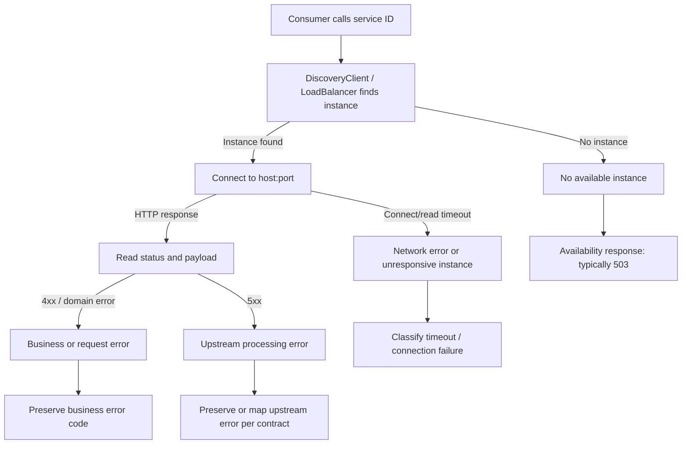

# Handling Missing Instances Without Masking Business Errors

When a consumer calls a service through Spring Cloud LoadBalancer, the registry may temporarily return zero instances. This is an availability error at the service discovery layer: the consumer has not found an endpoint to send the request to. It differs from connecting to the service successfully and receiving a business error such as insufficient balance, order not found, or invalid input data.

Proper handling must preserve the meaning of each error. Do not turn every exception into default data, do not return `200 OK` for an unexecuted operation, and do not retry indefinitely. Identify the missing-instance error, map it to an appropriate availability response, and let business errors continue following their API contracts.

## 1. Distinguishing discovery errors from business errors

A request going through service discovery passes through several stages. Each stage can fail in a different way:



Distinguish the common situations:

| Situation | What happened | How to interpret and handle |
|---|---|---|
| No instance | Discovery could not find a matching `ServiceInstance` for the service ID | Upstream availability error; typically return `503 Service Unavailable` |
| Connection refused | LoadBalancer picked an endpoint, but no process is listening on the port | Connection error; log the endpoint and handle per retry/circuit breaker policy |
| Connect/read timeout | An endpoint exists, but connection could not be established or response did not arrive in time | Network error or slow upstream; do not conflate with an empty discovery list |
| HTTP `400`, `401`, `403`, `404`, `409`, `422` | Upstream returned an HTTP response | Preserve the request, authentication, or business error meaning; do not turn into a discovery error |
| HTTP `500`, `502`, `503`, `504` | Upstream or gateway returned a server error | Classify the upstream error by status and contract; do not assume all mean no instance |
| Domain error in payload | Upstream processed the request but rejected it on business rules | Return the corresponding domain error, e.g., `INSUFFICIENT_BALANCE` or `ORDER_STATE_INVALID` |

For example, `inventory-service` having no instances is an availability issue. However, if `inventory-service` is up and returns `409 STOCK_NOT_AVAILABLE`, the consumer must not turn that response into `503` or return a fabricated empty item list.

## 2. How DiscoveryClient returns empty and LoadBalancer reports errors

The blocking API `DiscoveryClient.getInstances(serviceId)` can return an empty list when no instance is found. An empty list is a valid lookup result; it does not automatically carry information on why no instance is present.

Spring Cloud LoadBalancer uses `ServiceInstanceListSupplier` to obtain the instance list and pick an endpoint. Do not assume every HTTP client throws the exact same exception when the list is empty. In Spring Cloud Commons 5.1.0, `BlockingLoadBalancerClient.execute()` throws `IllegalStateException` with the message `No instances available for <serviceId>` when no instance can be chosen; `BlockingLoadBalancerClient.choose(serviceId)` returns `null` if no instance is chosen. The reactive exchange filter has its own handling path, so verify the actual exception/cause for your active version and integration.

`IllegalStateException` is a broad exception type and can also indicate programming bugs or other application states. Do not catch all `IllegalStateException` instances in controller advice and treat them as discovery errors. One way to create a clean boundary is to call `LoadBalancerClient.choose(serviceId)`, check for a `null` result, and convert it into an application-specific exception before calling the selected endpoint. Once an instance is chosen, connection errors, timeouts, TLS errors, HTTP statuses, or deserialization errors may arise from other layers.

### 2.1. Checking lookup for diagnostics

```java
import java.util.List;

import org.springframework.cloud.client.ServiceInstance;
import org.springframework.cloud.client.discovery.DiscoveryClient;
import org.springframework.stereotype.Component;

@Component
class DiscoveryProbe {

    private final DiscoveryClient discoveryClient;

    DiscoveryProbe(DiscoveryClient discoveryClient) {
        this.discoveryClient = discoveryClient;
    }

    List<ServiceInstance> inventoryInstances() {
        return discoveryClient.getInstances("inventory-service");
    }
}
```

This snippet helps inspect the list visible to `DiscoveryClient`. Do not use the pattern `if (getInstances(id).isEmpty())` followed by sending a request through LoadBalancer as a guarantee. The registry can change between the two operations (time-of-check to time-of-use); the actual request must still handle the case where LoadBalancer cannot find an instance.

## 3. Mapping missing-instance errors to HTTP 503

For an API gateway or REST API, `503 Service Unavailable` is usually appropriate when a dependent service currently has no available instances. Map your application-specific exception with `@RestControllerAdvice` and return a stable error code. This exception is raised in the service-calling adapter after confirming LoadBalancer could not pick an instance.

Example using Spring Boot `ProblemDetail`:

```java
import org.springframework.http.HttpStatus;
import org.springframework.http.ProblemDetail;
import org.springframework.http.ResponseEntity;
import org.springframework.web.bind.annotation.ExceptionHandler;
import org.springframework.web.bind.annotation.RestControllerAdvice;

@RestControllerAdvice
class UpstreamAvailabilityAdvice {

    @ExceptionHandler(InventoryUnavailableException.class)
    ResponseEntity<ProblemDetail> handleNoInstance(
            InventoryUnavailableException exception) {

        ProblemDetail problem = ProblemDetail.forStatusAndDetail(
                HttpStatus.SERVICE_UNAVAILABLE,
                "No instance of the dependent service is currently available.");
        problem.setTitle("Upstream service unavailable");
        problem.setProperty("code", "UPSTREAM_NO_INSTANCE");

        return ResponseEntity
                .status(HttpStatus.SERVICE_UNAVAILABLE)
                .body(problem);
    }
}
```

Example response:

```json
{
  "type": "about:blank",
  "title": "Upstream service unavailable",
  "status": 503,
  "detail": "No instance of the dependent service is currently available.",
  "code": "UPSTREAM_NO_INSTANCE"
}
```

Do not include internal hostnames, registry addresses, stack traces, or tokens in responses sent to callers. Those details belong in controlled internal logs/traces.

Catch only the application exception defined for this case. Do not write a catch-all handler for `Exception` or `IllegalStateException` that always returns 503, as programming bugs, authentication errors, and business errors would also be masked.

## 4. Wrapping errors at the client layer to preserve the application contract

In many applications, it is better to translate discovery library exceptions into application-layer exceptions. This keeps controllers from depending directly on Spring Cloud.

The example below explicitly chooses an instance first, then uses a plain `RestClient` to call the physical URI. This creates a clean type boundary when no instance exists, rather than inferring from a generic `IllegalStateException` thrown by the integration:

```java
import java.net.URI;

import org.springframework.cloud.client.ServiceInstance;
import org.springframework.cloud.client.loadbalancer.LoadBalancerClient;
import org.springframework.stereotype.Component;
import org.springframework.web.util.UriComponentsBuilder;
import org.springframework.web.client.RestClient;

@Component
class InventoryGateway {

    private final LoadBalancerClient loadBalancerClient;
    private final RestClient restClient = RestClient.create();

    InventoryGateway(LoadBalancerClient loadBalancerClient) {
        this.loadBalancerClient = loadBalancerClient;
    }

    InventoryResponse getInventory(String sku) {
        ServiceInstance instance = loadBalancerClient.choose("inventory-service");
        if (instance == null) {
            throw new InventoryUnavailableException(
                    "Could not find an instance of inventory-service");
        }

        URI target = UriComponentsBuilder.fromUri(instance.getUri())
                .path("/api/items/{sku}")
                .buildAndExpand(sku)
                .toUri();

        return restClient.get()
                .uri(target)
                .retrieve()
                .body(InventoryResponse.class);
    }
}
```

`LoadBalancerClient.choose()` uses the configured instance selection algorithm and returns `null` if no instance is chosen. `InventoryUnavailableException` is an application-defined exception. Controller advice can map this exception to `503` and code `UPSTREAM_NO_INSTANCE`. HTTP errors that `RestClient.retrieve()` converts into `RestClientResponseException` are still handled according to the upstream's status/payload; connection errors to the selected endpoint also retain their own type rather than being folded into `InventoryUnavailableException`.

Example application exception:

```java
class InventoryUnavailableException extends RuntimeException {

    InventoryUnavailableException(String message) {
        super(message);
    }

    InventoryUnavailableException(String message, Throwable cause) {
        super(message, cause);
    }
}
```

If using `@LoadBalanced RestClient` or the `WebClient` filter directly instead of pre-selecting an instance, verify the exact exception/cause thrown by your integration version. With blocking `BlockingLoadBalancerClient.execute()`, the current `IllegalStateException` message looks like `No instances available for <serviceId>`; this is an implementation detail and the message string should not be treated as a long-term API contract. If stable classification is needed, place a dedicated adapter around LoadBalancer and convert the confirmed no-instance signal into an application exception.

## 5. With WebClient: handle only actual discovery errors

With `WebClient` using the LoadBalancer filter, the reactive pipeline must preserve unrelated errors. Illustrative pattern when the exception is emitted directly:

```java
return webClient.get()
        .uri("http://inventory-service/api/items/{sku}", sku)
        .retrieve()
        .bodyToMono(InventoryResponse.class)
        .onErrorMap(
                NoInstanceSignal.class,
                exception -> new InventoryUnavailableException(
                        "Could not find an instance of inventory-service", exception));
```

`NoInstanceSignal` in the example is an exception defined by the application's reactive adapter after inspecting the response from `ReactiveLoadBalancer` and confirming `hasServer()` is `false`; it is not a Spring Cloud class. `onErrorMap` transforms only the specified exception type. HTTP 4xx/5xx, timeouts, or deserialization errors retain their own error types. With reactive integrations, do not assume a single exception class across all versions; observe the actual exception/cause and map only the confirmed no-instance signal.

Do not apply `onErrorResume(Throwable.class, error -> Mono.just(defaultValue))` to the entire pipeline. That turns every error into fake success data, preventing callers from distinguishing an upstream with no instances from a business rejection.

## 6. When is a fallback appropriate?

A fallback is only valid when a business-approved alternative result exists. Fallback does not mean ignoring errors and returning arbitrary default values.

| Case | Acceptable fallback | Condition |
|---|---|---|
| Reading product info | Return most recent cache with `stale=true` and update timestamp | Caller accepts stale data and the response clearly indicates staleness |
| Reading low-criticality content | Return snapshot or static data | Backup data has a clear source and well-defined limits |
| Sending email/notification | Enqueue command into a durable queue and return `202 Accepted` | Message is durably persisted and has a reprocessing mechanism |
| Optional feature | Skip the feature and return an explicit degraded status | That feature does not affect the correctness of the main transaction |
| Payment/transfer/order placement | Usually return an availability error and ask the caller to retry per contract | Must never fabricate transaction success or failure when the real outcome is unknown |

Avoid:

- Returning `200 OK` with `[]` when no instance of a required data-reading service is available.
- Returning balance `0`, price `0`, or status `SUCCESS` when the source service is unresponsive.
- Ignoring inventory errors and confirming a placed order without a valid reservation.
- Returning `202 Accepted` when the command has not been persisted to a durable queue or store.
- Returning stale cached data without clearly marking it stale or checking allowed age limits.

Fallbacks must have clear semantics. If no safe substitute data exists, return an availability error rather than pretending the business operation succeeded.

## 7. Bounded retries for the right error types

Retries can help when the registry has just changed or an instance has just registered, but retries do not create instances on their own. If the discovery list remains empty, retrying repeatedly usually only increases load and latency.

Principles:

1. Set an overall deadline for the entire request; every retry must fit within that budget.
2. Use a small retry count, exponential backoff, and jitter to prevent many consumers retrying in lockstep.
3. Retry only recoverable errors and safe/idempotent operations.
4. Do not retry validation, authentication, authorization, or domain errors such as `409`/`422`.
5. Do not retry `InventoryUnavailableException` or integration no-instance signals indefinitely; a brief single retry may be considered if you know the registry is updating and sufficient deadline remains.
6. For write operations, use idempotency keys or deduplication mechanisms before retrying after timeouts.

Example policy classification:

| Error type | Retry by default? | Notes |
|---|---|---|
| No instance | Do not retry continuously; only conditional brief retry | Prefer waiting for registry/cache update within the deadline |
| Connect timeout / connection reset | May retry with bounds | Only for safe or idempotent operations |
| Read timeout after sending write command | Do not auto-retry without knowing if server processed it | Server may have succeeded while the response was lost |
| HTTP 400/401/403/404/409/422 | No | Fix the request, permissions, or business preconditions |
| HTTP 429/503 from upstream | Depends on `Retry-After`, deadline, and contract | Use backoff and limit concurrency |
| HTTP 500 | Depends on error nature and operation | Do not assume every 500 is transient by default |

Do not configure retries simultaneously at multiple layers without calculating the total attempt count. For example, a gateway retrying 3 times, calling service retrying 3 times, and client SDK retrying 3 times can generate up to 27 requests to the upstream.

## 8. Circuit breakers and fallbacks must not swallow errors

A circuit breaker protects the system when an upstream fails repeatedly by opening the circuit and rejecting new calls for a period of time. When open, callers may receive `CallNotPermittedException` or an integration-specific exception.

A circuit breaker fallback must distinguish:

- No instance: discovery availability error.
- Open circuit breaker: upstream is judged unstable.
- HTTP/domain error: upstream responded and the response meaning must be preserved.

If using a generic fallback method accepting `Throwable`, classify the exception inside. Only return backup data for errors permitted by business rules; for domain errors, rethrow or forward intact to the corresponding handler layer. A fallback returning `null` or a default object for every error makes telemetry report success while the actual transaction failed.

Illustrative conditional fallback logic (pseudocode):

```java
InventoryResult fallback(String sku, Throwable cause) {
    if (cause instanceof InventoryUnavailableException
            || cause instanceof CallNotPermittedException) {
        return cache.findFreshEnough(sku)
                .<InventoryResult>map(value ->
                        new StaleInventoryResult(value, true))
                .orElseThrow(() -> new InventoryUnavailableException(
                        "Inventory is temporarily unavailable", cause));
    }

    // Business errors or errors not permitted for fallback must continue to propagate.
    throw new UpstreamCallFailedException("Inventory call failed", cause);
}
```

This is illustrative logic; result types and exceptions must be defined by your application. If `cause` wraps the root error, unwrap by concrete exception type. Do not use a broad `instanceof Exception` check to treat every error as an availability error.

## 9. Designing a consistent error contract

Consumer APIs should return stable error codes so callers can decide whether to retry or display a message. Example:

| HTTP status | Error code | Meaning | What should the caller do? |
|---:|---|---|---|
| `503` | `UPSTREAM_NO_INSTANCE` | No matching instance found | May retry later with backoff and deadline |
| `503` | `UPSTREAM_CIRCUIT_OPEN` | Circuit breaker is open | Wait for recovery period then retry if request is still valid |
| `504` | `UPSTREAM_TIMEOUT` | Upstream wait timed out | For write commands, check idempotency/status before resending |
| `502` | `UPSTREAM_BAD_RESPONSE` | Gateway received an invalid response from upstream | Retry only when appropriate |
| `400` / `422` | `VALIDATION_FAILED` | Invalid request | Fix payload; do not auto-retry |
| `404` | `RESOURCE_NOT_FOUND` | Resource does not exist | Handle as a business result |
| `409` | `BUSINESS_CONFLICT` | Conflicting business state | Refresh state or prompt a different action |

Not every application must use these exact codes, but there should be a consistent convention across services, gateways, and clients. If the upstream already returned a meaningful domain code, preserve that code rather than mapping everything to `UPSTREAM_UNAVAILABLE`.

## 10. Logging, metrics, and tracing

To diagnose services with no instances, logs must reveal the service ID and the failing stage. Record:

- The service ID being looked up by the consumer.
- The calling client name (`RestClient`, `WebClient`, Feign, or gateway) and operation.
- The classified exception class and cause chain.
- Trace ID/correlation ID and remaining deadline.
- Retry attempt count and circuit breaker state.
- Instance count returned by the discovery supplier if safely observable.

Do not log tokens, credentials, sensitive payloads, or full metadata that could contain secrets. Avoid using instance IDs, request IDs, or user IDs as high-cardinality metric labels; use service ID and bounded error categories.

Useful metrics:

| Metric | Purpose |
|---|---|
| `upstream_no_instance_total` | Count of missing-instance occurrences per service ID |
| `upstream_call_failures_total` | Breakdown of connection, timeout, HTTP, and domain failures |
| `upstream_call_duration` | Track latency of upstream calls |
| `loadbalancer_instances_available` | Observe available instance count if the supplier exposes matching metrics |
| `retry_attempts_total` | Detect retry storms or ineffective retries |
| `circuitbreaker_state` | Observe closed/open/half-open states |

Alerts should distinguish missing-instance errors from upstream 5xx responses or business errors. If you only monitor aggregate HTTP 5xx rates, operations teams will struggle to tell whether the issue is in the registry, the network, or service logic.

## 11. Practice verifying error types

Create a consumer calling `inventory-service` by service ID via Spring Cloud LoadBalancer. Test sequentially:

1. **No registration:** stop all instances or use a wrong service ID. Verify the error is classified as `UPSTREAM_NO_INSTANCE` and returns 503.
2. **Instance exists but wrong port:** verify this is a connection failure, not no-instance.
3. **Instance returns 404:** verify the response preserves `RESOURCE_NOT_FOUND` or the equivalent contract.
4. **Instance returns 409:** verify the domain error is propagated to the caller and not fallen back to an empty list.
5. **Instance returns 500:** observe the upstream error; do not convert it into a discovery error by default.
6. **Enable circuit breaker:** cause continuous upstream failures and verify the open state is recorded separately.
7. **Enable cache fallback:** allow fallback only for availability errors; verify the response includes a `stale` flag and timestamp.
8. **Test timeout on write operations:** verify idempotency keys or status-check procedures before retrying.

On each test, record the exception/cause, HTTP status, error code, retry count, and trace ID. Inspect both logs and API responses to ensure no business error is turned into a fake success.

## 12. Deployment checklist

- [ ] Distinguished empty discovery results from connect/read timeouts and HTTP responses.
- [ ] Identified the actual no-instance signal of the blocking/reactive integration and mapped it to a strongly typed application exception.
- [ ] Avoided catch-all handlers converting every exception to HTTP 503.
- [ ] Preserved the semantics of domain errors and HTTP 4xx errors.
- [ ] Assigned distinct error codes and clear policies for upstream 5xx/timeout errors.
- [ ] Restricted fallbacks to cases with safe alternative data and explicitly indicated degraded/stale status.
- [ ] Avoided returning fake success, default numbers, or `202` when business work is incomplete or commands are not durably stored.
- [ ] Configured bounded retries with backoff, jitter, deadlines, and appropriate idempotency.
- [ ] Separated availability errors from business errors in circuit breakers.
- [ ] Separated no-instance, network, HTTP, and domain failures in logs/metrics/traces.
- [ ] Tested empty registries, failing endpoints, upstream 4xx/5xx responses, and open circuit breakers.

## References

- [Spring Cloud Commons — LoadBalancer: No available instance and client integration](https://docs.spring.io/spring-cloud-commons/reference/spring-cloud-commons/loadbalancer.html)
- [Spring Cloud Commons — BlockingLoadBalancerClient source](https://github.com/spring-cloud/spring-cloud-commons/blob/main/spring-cloud-loadbalancer/src/main/java/org/springframework/cloud/loadbalancer/blocking/client/BlockingLoadBalancerClient.java)
- [Spring Cloud Commons — DiscoveryClient and service instance abstractions](https://docs.spring.io/spring-cloud-commons/reference/spring-cloud-commons/common-abstractions.html)
- [Spring Cloud CircuitBreaker — Resilience4j integration and fallback](https://docs.spring.io/spring-cloud-circuitbreaker/reference/spring-cloud-circuitbreaker.html)
- [Spring Framework — REST Clients and error handling](https://docs.spring.io/spring-framework/reference/integration/rest-clients.html)
- [RFC 9110 — HTTP Semantics: 502, 503 and 504](https://www.rfc-editor.org/rfc/rfc9110.html)
