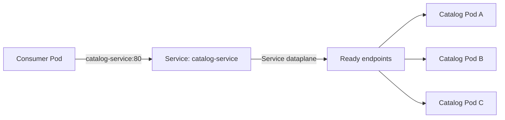
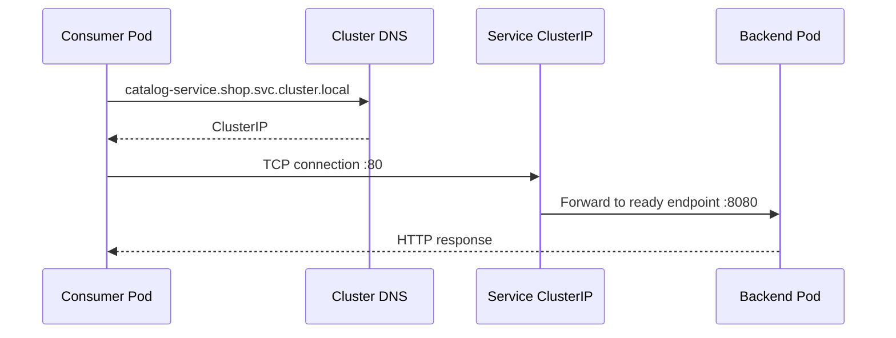
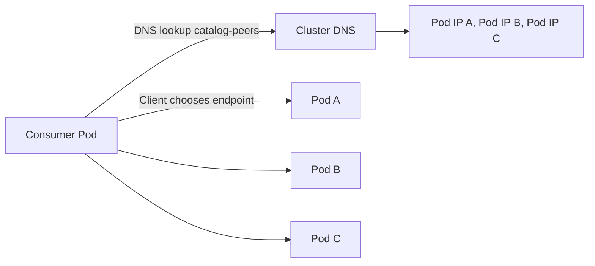

# Discovery with Kubernetes Service and DNS

Kubernetes has built-in service discovery through the `Service` object and internal DNS. An application in the cluster can call another service by a stable name such as `catalog-service` instead of storing individual Pod IPs. Kubernetes maintains the list of matching backends for a Service and forwards traffic to ready endpoints.

Spring Cloud Kubernetes can add an application-side discovery option: `DiscoveryClient` reads Service and endpoint information from the Kubernetes API, then returns `ServiceInstance` objects for Spring Cloud LoadBalancer to select from. Both approaches rely on Kubernetes, but they behave differently. DNS for a standard Service returns the ClusterIP and lets the Kubernetes dataplane distribute traffic; endpoint-based discovery can return individual Pod IPs so client-side load balancing selects an instance.

This lesson belongs to the `Kubernetes Discovery` chapter in the `SPRING_CLOUD_SERVICE_DISCOVERY` module. The module helps learners understand how to look up instances by service name via `DiscoveryClient`, `ServiceRegistry`, Eureka, or Consul, along with the registration lifecycle, health checks, load balancing, security, and handling registry drift. This content focuses on Kubernetes Service, DNS, EndpointSlice, and how to integrate them with Spring Cloud.

## 1. What problem does a Kubernetes Service solve?

A Pod has its own IP address, but a Pod can be replaced during a Deployment rollout, scaling, or self-healing after a failure. If a consumer stores a Pod IP, that address may no longer be valid after the next deployment.

A `Service` creates a stable access point for a group of Pods. A Service typically uses a selector to match Pods by label. The Kubernetes control plane tracks matching Pods and updates the endpoint list for the Service. The consumer only needs to know the Service name and the port exposed by the Service.



Each component has a distinct role:

| Component | Role |
|---|---|
| Pod | Runs one or more containers; the Pod address can change over the workload lifecycle. |
| Service | Provides a stable name and address for a group of backends. |
| Selector | Selects Pods whose labels match the Service. |
| EndpointSlice | Stores backend addresses and endpoint information for the Service. |
| Cluster DNS | Creates DNS records so Pods can look up a Service by name. |
| Service dataplane | Forwards traffic from the Service IP to a matching backend. |

With a standard Service, consumers do not need to call the Kubernetes API or maintain a list of Pod IPs. Kubernetes DNS and the Service dataplane handle locating backends and distributing traffic.

## 2. Declaring a Service for a Spring Boot application

Suppose the `catalog-service` application serves HTTP on container port `8080`. The Deployment attaches the label `app: catalog-service`; the Service selects Pods with that label and exposes port `80`.

```yaml
apiVersion: apps/v1
kind: Deployment
metadata:
  name: catalog-service
  namespace: shop
spec:
  replicas: 3
  selector:
    matchLabels:
      app: catalog-service
  template:
    metadata:
      labels:
        app: catalog-service
    spec:
      containers:
        - name: app
          image: example/catalog-service:1.0.0
          ports:
            - name: http
              containerPort: 8080
          readinessProbe:
            httpGet:
              path: /actuator/health/readiness
              port: http
            periodSeconds: 5
---
apiVersion: v1
kind: Service
metadata:
  name: catalog-service
  namespace: shop
spec:
  type: ClusterIP
  selector:
    app: catalog-service
  ports:
    - name: http
      protocol: TCP
      port: 80
      targetPort: http
```

In this configuration:

- The Service's `metadata.name` is `catalog-service`.
- `metadata.namespace` is `shop`.
- `selector` matches the label of the Pods created by the Deployment.
- `port: 80` is the port consumers call on the Service.
- `targetPort: http` references the container port named `http`, which is `8080`.
- The readiness probe determines when a Pod is eligible to receive traffic.

The path `/actuator/health/readiness` requires Spring Boot Actuator and the readiness health group to be enabled/exposed according to the application's configuration. If the project uses another endpoint, replace `path` with the actual readiness endpoint; do not point the probe to a URL that does not exist.

`spring.application.name` in a Spring Boot application does not automatically create a Kubernetes Service. A Service is a Kubernetes resource that must be declared using a manifest, Helm chart, Kustomize, or an equivalent deployment tool. If Spring Cloud Kubernetes needs to look up a service by application name, you should align the Service name with `spring.application.name`.

## 3. Kubernetes Service DNS

When cluster DNS is configured, Kubernetes automatically creates DNS records for a Service. Within the same namespace, a Pod can call it using the short name:

```text
http://catalog-service
```

A Pod in a different namespace must include the namespace:

```text
http://catalog-service.shop
```

The fully qualified name typically has the form:

```text
<service>.<namespace>.svc.<cluster-domain>
```

For example, with the common default cluster domain `cluster.local`:

```text
catalog-service.shop.svc.cluster.local
```

The cluster domain can be configured by an administrator to something other than `cluster.local`. Therefore, when a full FQDN is needed, verify the cluster's actual domain instead of hardcoding an assumed value.

### 3.1. Short names and search domains

Kubernetes typically configures `/etc/resolv.conf` in a Pod with search suffixes such as:

```text
shop.svc.cluster.local
svc.cluster.local
cluster.local
```

Because of this, a query for `catalog-service` can be expanded to the name in the current namespace. This is why short names work within the same namespace. From another namespace, use `catalog-service.shop` or the FQDN to avoid accidentally resolving a Service with the same name in the current namespace.

### 3.2. DNS A/AAAA and SRV records

For a standard Service, the DNS A or AAAA record points to the Service's ClusterIP. For a Service with named ports, Kubernetes can also create SRV records to look up the port name, protocol, and service address.

For example, a Service with a port named `http`:

```text
_http._tcp.catalog-service.shop.svc.cluster.local
```

Standard HTTP applications still need to know the port to call; DNS A/AAAA records do not automatically add a port to a URL. SRV records are useful for clients that support querying this record type.

## 4. ClusterIP Service: DNS returns a stable address

`ClusterIP` is the default Service type. Kubernetes assigns a stable virtual IP inside the cluster. DNS for the Service name resolves to that ClusterIP; the Service dataplane (kube-proxy or an alternative in-cluster mechanism) forwards connections to an eligible backend.



DNS does not return a list of Pod IPs for a standard ClusterIP Service. Traffic distribution happens in the Service dataplane. Consequently, when using the URL `http://catalog-service`, the application does not necessarily need to integrate `DiscoveryClient` or Spring Cloud LoadBalancer.

Example of configuring `WebClient` to call Kubernetes DNS directly:

```java
import org.springframework.stereotype.Service;
import org.springframework.web.reactive.function.client.WebClient;
import reactor.core.publisher.Mono;

@Service
public class CatalogClient {

    private final WebClient webClient;

    public CatalogClient(WebClient.Builder builder) {
        this.webClient = builder
                .baseUrl("http://catalog-service.shop.svc.cluster.local")
                .build();
    }

    public Mono<Product> getProduct(String id) {
        return webClient.get()
                .uri("/api/products/{id}", id)
                .retrieve()
                .bodyToMono(Product.class);
    }
}
```

This example assumes the Service exposes HTTP port `80` and the cluster domain is `cluster.local`. If the Service uses a different port, append `:<service-port>` to the base URL. `Product` is an application-defined DTO.

### 4.1. Where does Kubernetes perform load balancing?

With a ClusterIP Service, the client sends requests to a single virtual IP. The Kubernetes dataplane chooses a suitable endpoint to forward the traffic to. The application does not receive a list of individual Pods simply by resolving the Service name via DNS.

This is often referred to as server-side or platform-side service discovery/load balancing. The consumer knows the Service name and port; Kubernetes handles mapping to the backend.

Do not confuse ClusterIP DNS with DNS round-robin across individual Pods. A standard Service's A record points to the ClusterIP; the backend list lives in EndpointSlices and is used by the dataplane.

## 5. Headless Service: DNS returns Pod addresses

Some applications need to know about individual Pods, such as StatefulSets, internal cluster systems, or applications that manage their own topology. In those cases, you can create a headless Service by setting `clusterIP: None`.

```yaml
apiVersion: v1
kind: Service
metadata:
  name: catalog-peers
  namespace: shop
spec:
  clusterIP: None
  selector:
    app: catalog-service
  ports:
    - name: http
      port: 8080
      targetPort: http
```

A headless Service has no ClusterIP. Kubernetes does not create a virtual IP or perform proxying/load balancing for this Service. DNS returns the IP addresses of the Pod endpoints selected by the Service.



The client must handle the returned set of addresses and pick an endpoint itself, or use a library with an appropriate distribution mechanism. The order of addresses returned by DNS is not a stable load-balancing contract.

### 5.1. When to use ClusterIP vs. headless?

| Criterion | ClusterIP Service | Headless Service |
|---|---|---|
| Cluster IP | Has a virtual IP. | No ClusterIP is assigned. |
| DNS A/AAAA | Returns the ClusterIP. | Returns the Pod endpoint IPs. |
| Platform load balancing | Service dataplane distributes to backends. | No Service proxying or load balancing. |
| Consumer needs Pod IPs | No. | May need them to choose endpoints itself. |
| Typical use cases | Standard API services. | StatefulSets, peer discovery, or client-managed topology. |

A headless Service does not automatically give an application good load balancing. If a client only takes the first address in the DNS response, it can send all traffic to a single Pod. Proper selection algorithms, retries, timeouts, and address-list refreshes are required.

### 5.2. DNS records for Pods in a StatefulSet

When combining a headless Service with a StatefulSet, each Pod can have a stable ordinal-based DNS name, such as:

```text
catalog-0.catalog-peers.shop.svc.cluster.local
catalog-1.catalog-peers.shop.svc.cluster.local
catalog-2.catalog-peers.shop.svc.cluster.local
```

Individual Pod records depend on hostname/subdomain and workload configuration. For Pods that are not Ready, DNS records may not be published by default; `publishNotReadyAddresses` can change this behavior when an application needs to discover peers before readiness is achieved.

## 6. EndpointSlice and the endpoint lifecycle

`EndpointSlice` is the Kubernetes API used to represent a Service's backends in slices. The control plane automatically creates EndpointSlices for Services with a selector and updates them when matching Pods are added, removed, or change state.

An EndpointSlice can contain:

- Endpoint addresses, typically Pod IPs.
- Endpoint ports and protocols.
- Related node and zone information.
- Conditions such as `ready`, `serving`, and `terminating` depending on API/version.
- A reference to the target Pod if the endpoint represents a Pod.

Readiness plays a critical role. A running Pod that is not yet Ready is generally not selected as a backend for normal traffic. When the readiness probe fails, the endpoint may become ineligible to receive traffic; when the Pod becomes Ready again, the endpoint can be returned to the serving list.

Note that liveness probes and readiness probes serve different purposes:

- Readiness answers whether the application is ready to accept requests.
- Liveness helps kubelet decide whether the container needs to be restarted.
- A startup probe protects slow-starting applications from being checked too early by liveness/readiness probes.

Do not use liveness as a replacement for readiness. If an application is still starting up or warming up but is alive, readiness should keep the Pod out of Service endpoints until it can serve traffic.

### 6.1. Inspecting EndpointSlices

Useful commands:

```bash
kubectl get service catalog-service -n shop
kubectl get endpointslice -n shop \
  -l kubernetes.io/service-name=catalog-service
kubectl describe service catalog-service -n shop
kubectl get pods -n shop -l app=catalog-service -o wide
```

If the Service exists but the EndpointSlice has no matching endpoints, check the selector, Pod labels, readiness, and ports. Do not only check DNS, because a ClusterIP DNS record can still resolve even when the Service has no active backends.

## 7. Spring Cloud Kubernetes DiscoveryClient

Kubernetes native DNS works well when consumers only need to call a single Service endpoint. In some systems, an application needs the list of individual instances to apply client-side load balancing, filter metadata, select zones, or use a common abstraction alongside Eureka/Consul. Spring Cloud Kubernetes provides `DiscoveryClient` to query Services and endpoints from Kubernetes.

With a discovery client, the general flow is:

1. The application calls `getServices()` to retrieve discoverable Service names.
2. The application calls `getInstances("catalog-service")` to retrieve a list of `ServiceInstance`.
3. The discovery implementation reads Service/endpoint data from the Kubernetes API or the client's cache/lister.
4. Spring Cloud LoadBalancer can use the instance list to pick a Pod endpoint.

Example using the abstraction:

```java
import java.util.List;

import org.springframework.cloud.client.ServiceInstance;
import org.springframework.cloud.client.discovery.DiscoveryClient;
import org.springframework.stereotype.Service;

@Service
public class KubernetesCatalogDiscovery {

    private final DiscoveryClient discoveryClient;

    public KubernetesCatalogDiscovery(DiscoveryClient discoveryClient) {
        this.discoveryClient = discoveryClient;
    }

    public List<ServiceInstance> findCatalogInstances() {
        return discoveryClient.getInstances("catalog-service");
    }
}
```

Spring Cloud Kubernetes offers implementation options based on the Fabric8 Kubernetes Client, Kubernetes Java Client, and an HTTP-based DiscoveryClient using DiscoveryServer. The dependency should be chosen based on the desired client type and the Spring Cloud Kubernetes release train compatible with your Spring Boot version.

Example Fabric8 dependency:

```xml
<dependency>
    <groupId>org.springframework.cloud</groupId>
    <artifactId>spring-cloud-starter-kubernetes-fabric8</artifactId>
</dependency>
```

Example Kubernetes Java Client dependency:

```xml
<dependency>
    <groupId>org.springframework.cloud</groupId>
    <artifactId>spring-cloud-starter-kubernetes-client</artifactId>
</dependency>
```

The HTTP-based `spring-cloud-starter-kubernetes-discoveryclient` is designed to work with Spring Cloud Kubernetes DiscoveryServer; this is an architecture with a separate server component and should not be confused with Fabric8/Kubernetes Java clients that access the API directly.

## 8. How is a ServiceInstance created from a Kubernetes Service?

`DiscoveryClient.getInstances(serviceId)` returns `List<ServiceInstance>`. Each instance contains typical fields such as instance ID, service ID, host, port, URI, and metadata. Depending on configuration, Spring Cloud Kubernetes can add namespace, Pod metadata, Service labels, annotations, and Service type.

For a Service with multiple endpoints, the instance list can represent individual backend addresses. The host is typically the endpoint IP; for `ExternalName`, the host can be the external DNS name.

Port selection must be deterministic. Current Spring Cloud Kubernetes documentation describes the selection order as:

1. If the Service has only one port, use that port.
2. If the Service has the `primary-port-name` label, use the port with the name specified by the label.
3. If there is no label, use `spring.cloud.kubernetes.discovery.primary-port-name` if configured.
4. If still undetermined, look for a port named `https` or `http`.
5. Finally, fall back to the first port in the list; this choice can be nondeterministic if ordering changes.

Therefore, name ports explicitly in the Service manifest, such as `http` or `https`, or configure `primary-port-name` when a Service has multiple ports.

### 8.1. Readiness and include-not-ready-addresses

By default, Spring Cloud Kubernetes excludes endpoints not marked Ready by Kubernetes from discovery results. You can enable it with:

```yaml
spring:
  cloud:
    kubernetes:
      discovery:
        include-not-ready-addresses: true
```

This option is useful for monitoring tools that need to inspect endpoints of Pods that are not Ready. For business consumers, enabling it can cause LoadBalancer to send traffic to unready instances. Only use it when there is a clear purpose and an appropriate endpoint selection policy.

### 8.2. ExternalName Service

An `ExternalName` Service maps an internal DNS name to an external DNS hostname using a CNAME. It does not represent a set of internal Pods and does not have a ClusterIP like a standard Service.

Spring Cloud Kubernetes does not include `ExternalName` Services in discovery by default. To have `DiscoveryClient` return this Service type, you can enable:

```yaml
spring:
  cloud:
    kubernetes:
      discovery:
        include-external-name-services: true
```

Be mindful of hostname differences when making HTTP/HTTPS calls: the hostname in the URL affects the HTTP Host header and TLS certificate validation. Not all protocols behave as expected when replacing a hostname with an `ExternalName` alias.

## 9. Namespaces and discovery scope

Kubernetes Services live in namespaces. The name `catalog-service` can exist simultaneously in multiple namespaces. Therefore, the discovery client needs an explicit namespace scope.

Spring Cloud Kubernetes supports common configuration options:

- A single namespace: defaults according to namespace resolution rules.
- A specific list of namespaces: searches for Services only in the selected namespaces.
- All namespaces: allows cluster-wide discovery, but can increase Kubernetes API load and application memory usage.

Example selecting two namespaces:

```yaml
spring:
  cloud:
    kubernetes:
      discovery:
        namespaces:
          - shop
          - payments
```

Or searching across all namespaces:

```yaml
spring:
  cloud:
    kubernetes:
      discovery:
        all-namespaces: true
```

Enable `all-namespaces` only when genuinely required. If multiple namespaces contain Services with the same name, `getServices()` returns unique Service names; duplicate names do not by themselves indicate the intended namespace. Use namespace scoping and metadata to avoid selecting the wrong service.

### 9.1. Filtering Services by label

You can restrict discovered Services using a label selector:

```yaml
spring:
  cloud:
    kubernetes:
      discovery:
        service-labels:
          team: commerce
          exposure: internal
```

Only Services with the matching labels are included in the results. Label filtering also helps reduce the number of Services a lister must watch in large namespaces. Distinguish Service labels from Pod labels: a Service selector matches Pods; Service metadata labels filter Service objects in Spring Cloud Kubernetes discovery.

## 10. Spring Cloud Kubernetes LoadBalancer: POD and SERVICE modes

Spring Cloud Kubernetes integrates with Spring Cloud LoadBalancer using two main modes:

| Mode | Routing approach | Traffic distribution |
|---|---|---|
| `POD` | Uses `DiscoveryClient` to fetch the instance/endpoint list for the service ID. | Spring Cloud LoadBalancer selects a Pod endpoint on the client side. |
| `SERVICE` | Looks up the Kubernetes Service and uses the Service DNS address/port. | The Kubernetes Service dataplane distributes to backends. |

The default mode described in current Spring Cloud Kubernetes documentation is `POD`. You can select `SERVICE`:

```yaml
spring:
  cloud:
    kubernetes:
      loadbalancer:
        mode: SERVICE
```

With `POD` mode, a request to `catalog-service` calls `DiscoveryClient.getInstances("catalog-service")`, and then LoadBalancer picks an instance. This is useful when client-side selection, metadata, or LoadBalancer policies are needed.

With `SERVICE` mode, LoadBalancer looks up the matching Kubernetes Service and constructs an address in the form:

```text
<service>.<namespace>.svc.<cluster-domain>:<service-port>
```

The common default cluster domain is `cluster.local` and can be configured via `spring.cloud.kubernetes.loadbalancer.clusterDomain`. If a Service has multiple ports, name the ports clearly and configure the appropriate `portName`; current documentation uses `http` as the default port name to look for when a Service has multiple ports.

Example:

```yaml
spring:
  cloud:
    kubernetes:
      loadbalancer:
        mode: SERVICE
        cluster-domain: cluster.local
        port-name: http
```

Do not treat `POD` and `SERVICE` modes as operating at the same load-balancing layer. With `POD`, Spring Cloud LoadBalancer selects the endpoint. With `SERVICE`, the Kubernetes Service handles backend distribution after the request reaches the Service address.

### 10.1. When to choose which mode?

Choose `SERVICE` or direct DNS calls when the application only needs a stable Service address, wants to let the Kubernetes dataplane handle backend selection, or wants natural integration with a service mesh.

Choose `POD` when the application needs the endpoint list on the client side, wants to use Spring Cloud LoadBalancer policies, or needs metadata/zone filtering. In that case, you must manage Kubernetes API read permissions, namespace scope, caching, and data refresh.

Avoid unintentionally stacking multiple load-balancing layers without a specific reason. For example, if the client selects a Pod directly in `POD` mode, there is no need to route the request through another ClusterIP Service to select a Pod again.

## 11. Kubernetes Service name and spring.application.name

Spring Cloud Kubernetes uses the Kubernetes Service name (`metadata.name`) as the service name in discovery. `spring.application.name` does not automatically rename the Kubernetes resource.

Some Spring Cloud components need to look up the local service instance by application name. For those components to work properly, align:

```yaml
spring:
  application:
    name: catalog-service
```

and the Kubernetes Service:

```yaml
apiVersion: v1
kind: Service
metadata:
  name: catalog-service
```

If the two names differ, `DiscoveryClient.getInstances("catalog-service")` still looks up by the Kubernetes Service name; it does not implicitly use `spring.application.name` to rename Services in the cluster.

## 12. Security when using Kubernetes DiscoveryClient

DNS lookup for a Service name does not require the application to call the Kubernetes API. By contrast, Spring Cloud Kubernetes DiscoveryClient uses a Kubernetes client to read Services and endpoints and therefore requires appropriate permissions.

When running in a Pod, Kubernetes typically mounts a ServiceAccount token according to the workload configuration. Apply least-privilege RBAC for the application's ServiceAccount:

- Allow only read verbs (`get`, `list`, `watch`) on the required resources.
- Restrict namespaces if the application only needs to discover within specific namespaces.
- Grant permissions for the Service and endpoint resources watched by the client/version in use, such as EndpointSlices or Endpoints.
- Do not grant create, update, or delete permissions on Services/Pods to a consumer that only performs discovery.
- Do not share a cluster-admin ServiceAccount across all microservices.

The following Role skeleton only illustrates the read-only principle in a single namespace; the exact list of resources must be verified against the client and Spring Cloud Kubernetes version in use:

```yaml
apiVersion: rbac.authorization.k8s.io/v1
kind: Role
metadata:
  name: service-discovery-reader
  namespace: shop
rules:
  - apiGroups: [""]
    resources:
      - services
      - endpoints
    verbs: ["get", "list", "watch"]
  - apiGroups: ["discovery.k8s.io"]
    resources:
      - endpointslices
    verbs: ["get", "list", "watch"]
```

If multiple namespaces are used, create corresponding RoleBindings in each namespace or a tightly scoped ClusterRole/ClusterRoleBinding. Do not grant broader permissions just to work around a `Forbidden` error; identify the exact resource and namespace the discovery client is accessing.

DNS discovery does not replace network security either. NetworkPolicy, service mesh authorization, TLS, and endpoint authentication still need to be configured to control who can call a Service.

## 13. List updates and caching

Kubernetes continuously updates Services and EndpointSlices as Pods scale, roll out, or change readiness. Clients can observe changes via DNS queries, Kubernetes API watches, or internal caches.

With Spring Cloud Kubernetes, some implementations use a lister/cache updated asynchronously from the Kubernetes API. The discovery client can watch the service catalog and emit heartbeat events so related components notice changes. Current documentation notes that the catalog watcher requires scheduling to be enabled and has a configurable period; exact behavior depends on the client implementation and release train.

Therefore, after a new Pod becomes Ready or an old Pod is deleted, do not assume every consumer immediately sees the same list. Latency can come from:

- Readiness and EndpointSlice update propagation time.
- DNS caching in the JVM, libc, or DNS resolver.
- The Spring Cloud Kubernetes DiscoveryClient cache/lister.
- The Spring Cloud LoadBalancer cache if using POD mode.
- Connection pools holding connections to old endpoints.

When investigating stale instances, determine whether the client is using DNS/ClusterIP or a Pod list from DiscoveryClient. The two mechanisms have different caches and update paths.

## 14. Verifying Service discovery with kubectl and DNS

When a consumer cannot call `catalog-service`, follow these steps in order:

**Step 1 – Check the Service.**

```bash
kubectl get svc catalog-service -n shop -o wide
kubectl describe svc catalog-service -n shop
```

Verify that the Service exists in the right namespace with the expected ClusterIP, selector, and ports.

**Step 2 – Check Pods and labels.**

```bash
kubectl get pods -n shop -l app=catalog-service -o wide
```

Verify that Pods have labels matching the selector and are in the Ready state.

**Step 3 – Check EndpointSlices.**

```bash
kubectl get endpointslice -n shop \
  -l kubernetes.io/service-name=catalog-service -o wide
```

Verify that appropriate endpoint IPs and ports exist. If there are no endpoints, check the selector and readiness before investigating DNS.

**Step 4 – Check DNS from a consumer Pod.**

```bash
kubectl exec -n shop deploy/order-service -- \
  nslookup catalog-service.shop.svc.cluster.local
```

For a ClusterIP Service, the result should resolve to the ClusterIP. For a headless Service, the result may contain multiple Pod IPs.

**Step 5 – Check HTTP.**

```bash
kubectl exec -n shop deploy/order-service -- \
  curl -i http://catalog-service.shop.svc.cluster.local/actuator/health
```

This command assumes Service port `80` and that the health endpoint is exposed at the path above. Adjust the path, port, TLS, and authentication to match the application.

**Step 6 – If using Spring Cloud Kubernetes DiscoveryClient.** Check the starter, namespace scope, ServiceAccount/RBAC, label filters, port selection, and lister/watch logs. Compare `getInstances()` with EndpointSlices to determine whether the mismatch is in API discovery or the Service resource.

## 15. Common errors and troubleshooting

| Symptom | Possible cause | How to check |
|---|---|---|
| DNS `catalog-service` does not resolve | Wrong namespace, Service does not exist, or cluster DNS failure. | Check `kubectl get svc`, `/etc/resolv.conf`, and CoreDNS. |
| DNS resolves but HTTP times out | Service has no ready endpoints, wrong port/targetPort, or NetworkPolicy blocks traffic. | Check EndpointSlices, port mapping, and network policies. |
| Service exists but EndpointSlice is empty | Selector does not match Pod labels or Pods are not Ready. | Compare selector/labels and readiness probes. |
| Consumer in another namespace cannot find short name | Short names resolve in the current namespace. | Use `service.namespace` or the FQDN. |
| Spring DiscoveryClient returns empty list | Wrong service ID, namespace scope, filter, or missing API permissions. | Check `getServices`, `getInstances`, logs, and RBAC. |
| Discovery returns the wrong port | Service has multiple ports and port selection is ambiguous. | Name ports `http`/`https` or configure `primary-port-name`. |
| Consumer calls unready Pods | `include-not-ready-addresses` is enabled or health/readiness is misconfigured. | Check properties and EndpointSlice conditions. |
| Same Service name in multiple namespaces | Discovery searches multiple namespaces but service ID only has the name. | Restrict namespaces or filter by namespace/label. |
| Headless DNS returns multiple IPs but traffic hits one Pod | Client does not distribute across the IP set or caches DNS too long. | Check the resolver and client-side endpoint selection algorithm. |
| Kubernetes API returns `403 Forbidden` | ServiceAccount lacks RBAC for the resource/namespace. | Check Role, RoleBinding, and get/list/watch permissions. |
| `ExternalName` is not discovered | The include ExternalName option is disabled. | Enable `include-external-name-services` if appropriate. |

## 16. Common misconceptions

**“DNS for a ClusterIP Service returns individual Pod IPs.”** Incorrect. DNS for a standard Service returns the ClusterIP; only a headless Service returns the set of endpoint IPs.

**“A Kubernetes Service is automatically Eureka.”** Incorrect. Service/DNS is Kubernetes's native discovery mechanism. Spring Cloud Kubernetes DiscoveryClient is an application-side abstraction that reads data from the Kubernetes API.

**“spring.application.name creates a Kubernetes Service.”** Incorrect. A Service must be declared as a Kubernetes resource. Discovery names come from the Service's `metadata.name`.

**“A headless Service automatically load balances traffic.”** Incorrect. It has no ClusterIP and no Service proxying/load balancing. The client must handle the endpoint set.

**“Pod Running means the Service will send traffic to the Pod.”** Insufficient. Readiness determines whether a Pod is eligible to receive traffic.

**“Using DiscoveryClient does not require RBAC.”** Incorrect. DiscoveryClient reads the Kubernetes API and requires appropriate permissions; Service DNS lookups do not require those API permissions.

**“The cluster domain is always cluster.local.”** Incorrect. That is a common default, but a cluster can use a different domain.

## 17. Design and operations checklist

| Area | Question |
|---|---|
| Service | Does the Service have the right name, namespace, selector, and type? |
| Port | Do `port`, `targetPort`, and port names match the application? |
| EndpointSlice | Are there Ready backends with valid addresses and ports? |
| DNS | Do the short name, namespace-qualified name, and cluster FQDN resolve properly? |
| ClusterIP/headless | Have you chosen the right server-side or client-side discovery model? |
| Readiness | Does the probe accurately reflect readiness to receive traffic? |
| Spring DiscoveryClient | Have you chosen the right starter/client and namespace scope? |
| LoadBalancer | Are you using POD or SERVICE mode, and avoiding stacked load balancing? |
| Port selection | Does the Service have a single port or an explicit port name? |
| RBAC | Does the ServiceAccount have read-only access limited to needed resources and namespaces? |
| Cache | Have you accounted for DNS cache, discovery lister, and LoadBalancer cache? |
| Security | Are NetworkPolicy, TLS, and endpoint authentication applied? |
| Observability | Are there logs for DNS, EndpointSlices, discovery results, and endpoint call errors? |

## Conclusion

Kubernetes Services and DNS provide native service discovery for applications running inside a cluster. With a ClusterIP Service, DNS returns a stable address and the Service dataplane distributes traffic to eligible endpoints. With a headless Service, DNS returns Pod addresses for the client to select from. EndpointSlices are the key data source for understanding which backends are Ready and attached to a Service.

Spring Cloud Kubernetes DiscoveryClient adds the ability to retrieve a list of `ServiceInstance` objects from the Kubernetes API, while Spring Cloud Kubernetes LoadBalancer can run in `POD` mode to pick endpoints on the client side or `SERVICE` mode to use Service DNS. When deploying, clearly determine your discovery model, namespaces, ports, readiness, caching, and RBAC. Distinguishing ClusterIP DNS from Pod endpoint lists helps avoid stacked load-balancing configurations and shortens troubleshooting time.

## References

- [Kubernetes – Service](https://kubernetes.io/docs/concepts/services-networking/service/): ClusterIP, headless Services, EndpointSlices, and Service discovery.
- [Kubernetes – DNS for Services and Pods](https://kubernetes.io/docs/concepts/services-networking/dns-pod-service/): DNS A/AAAA, SRV, namespaces, and cluster domains.
- [Kubernetes – EndpointSlices](https://kubernetes.io/docs/concepts/services-networking/endpoint-slices/): how Kubernetes manages backend endpoints per Service.
- [Spring Cloud Kubernetes – DiscoveryClient](https://docs.spring.io/spring-cloud-kubernetes/reference/discovery-client.html): Service discovery, namespace scope, filters, and `ServiceInstance`.
- [Spring Cloud Kubernetes – LoadBalancer](https://docs.spring.io/spring-cloud-kubernetes/reference/load-balancer.html): POD/SERVICE modes and port/Service DNS selection.
