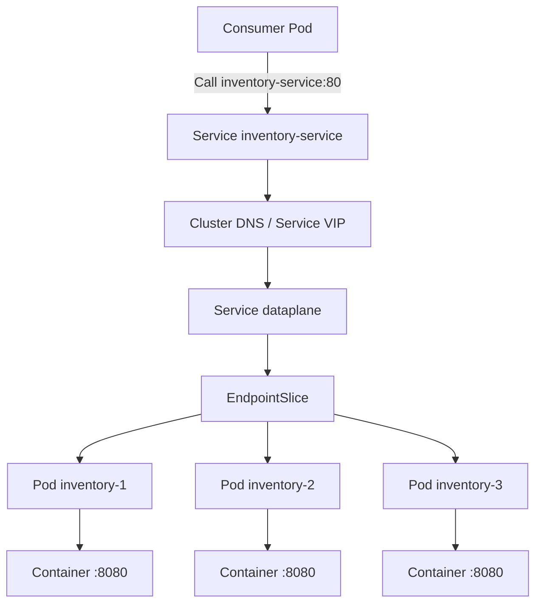

# Service, Pod, and Endpoints in the Discovery Model

In Kubernetes, a Pod is where containers run, a Service provides a stable access point for a group of Pods, and an EndpointSlice stores the list of backend addresses to which the Service can forward traffic. These three objects work together so an application can call a service by a stable name without tracking the changing IP of each Pod.

This is the foundation of service discovery on Kubernetes. When a Pod is newly created, replaced, or no longer ready, Kubernetes updates the corresponding endpoints. Consumers continue calling the Service via DNS or use Spring Cloud Kubernetes to discover instances, depending on the application's integration model.

## 1. Roles of Pod, Service, and EndpointSlice

| Object | Role | Key characteristics |
|---|---|---|
| Pod | Deployment unit running one or more containers sharing a network namespace | Has its own IP, short-lived; IP can change when the Pod is replaced |
| Service | Defines a group of backends and provides a stable access address | Typically selects Pods using a label selector |
| EndpointSlice | Stores backend addresses and ports of a Service in small slices | Updated by the control plane from Pods matching the selector and endpoint state |
| Cluster DNS | Maps a Service name to a Service address or list of endpoints | Keeps consumers from hardcoding IPs |
| kube-proxy or equivalent dataplane | Forwards traffic from a Service to backends | Watches Services and EndpointSlices to update network rules |

A Pod can be deleted and recreated with a different IP. If a consumer calls Pod IPs directly, the application must update addresses itself whenever the workload changes. A Service solves this problem with a DNS name and a stable virtual address within the cluster.

EndpointSlice is the modern backend data source Kubernetes uses to represent endpoints. The legacy Endpoints resource may still appear in a cluster, but EndpointSlice is designed to scale better when a Service has many backends.

## 2. Relationship between Service, Pod, and EndpointSlice

A Service typically uses a selector to find Pods with matching labels. The control plane watches Pods and creates/updates the corresponding EndpointSlices. An EndpointSlice contains Pod addresses, ports, and a reference to the target Pod.



Typical update flow:

1. A Deployment creates Pods and attaches labels to the Pod template.
2. The Service selector matches the Pods' labels.
3. The Kubernetes EndpointSlice controller creates or updates EndpointSlices for the Service.
4. The EndpointSlice publishes addresses, ports, and endpoint conditions.
5. The cluster dataplane updates how traffic is forwarded to eligible backends.
6. The consumer calls the Service using its stable DNS name or ClusterIP.

A Service does not store container replicas or directly manage the Pod lifecycle. A Deployment/StatefulSet manages the workload; the Service defines how it is accessed; EndpointSlice describes the available backends.

## 3. Example of a Service selecting Pods by label selector

Suppose an inventory application runs in the `shop` namespace. A Deployment creates Pods with the label `app: inventory`. The Service selects those Pods:

```yaml
apiVersion: v1
kind: Service
metadata:
  name: inventory-service
  namespace: shop
spec:
  type: ClusterIP
  selector:
    app: inventory
  ports:
    - name: http
      protocol: TCP
      port: 80
      targetPort: http
```

Containers in the Pod declare a port named `http`:

```yaml
apiVersion: apps/v1
kind: Deployment
metadata:
  name: inventory
  namespace: shop
spec:
  replicas: 3
  selector:
    matchLabels:
      app: inventory
  template:
    metadata:
      labels:
        app: inventory
    spec:
      containers:
        - name: inventory
          image: example/inventory:1.0
          ports:
            - name: http
              containerPort: 8080
              protocol: TCP
```

Here:

- `spec.selector.app: inventory` on the Service matches the label on the Pods.
- `port: 80` is the Service port called by consumers.
- `targetPort: http` is the target port on the Pod; this name maps to container port `8080`.
- `type: ClusterIP` creates an internal Service address within the cluster.

A Service can select multiple Pods at once. When the replica count scales from three to five and the new Pods have matching labels, the endpoint controller updates EndpointSlices to reflect the new backends.

### The selector must match exactly

If the Service selector is `app: inventory` while a Pod has the label `app: inventory-v2`, the Service cannot select that Pod. The Service may still exist and DNS may still resolve the ClusterIP, but there are no matching backends to handle requests.

When debugging, compare the Service's selector against the Pods' actual labels:

```bash
kubectl get service inventory-service -n shop
kubectl get pods -n shop --show-labels
kubectl describe service inventory-service -n shop
```

If no endpoints appear, check the selector, namespace, Pod labels, and readiness status.

## 4. What information does an EndpointSlice contain?

An EndpointSlice typically contains:

- `addresses`: IP addresses of the endpoints.
- `ports`: ports and protocols exposed in the slice.
- `targetRef`: reference to the target object, typically a Pod.
- `nodeName`: the node running the Pod, if present.
- `zone`: topology zone of the endpoint, if provided.
- `conditions.ready`: whether the endpoint is ready to receive normal traffic.
- `conditions.serving`: whether the endpoint is currently serving.
- `conditions.terminating`: whether the endpoint is in the process of terminating.

Illustrative example of a Kubernetes-managed EndpointSlice structure:

```yaml
apiVersion: discovery.k8s.io/v1
kind: EndpointSlice
metadata:
  name: inventory-service-abcde
  namespace: shop
  labels:
    kubernetes.io/service-name: inventory-service
addressType: IPv4
ports:
  - name: http
    protocol: TCP
    port: 8080
endpoints:
  - addresses:
      - 10.42.1.17
    conditions:
      ready: true
      serving: true
      terminating: false
    targetRef:
      kind: Pod
      name: inventory-7c9d8f-abcde
```

The EndpointSlice name, IP, Pod, and conditions in this example are illustrative only. Actual EndpointSlices are created by the control plane and may be split into multiple slices as the number of endpoints grows. Do not directly edit controller-managed slices if the Service uses a selector.

You can view a Service's EndpointSlices with:

```bash
kubectl get endpointslice -n shop \
  -l kubernetes.io/service-name=inventory-service
```

Inspect details:

```bash
kubectl describe endpointslice -n shop inventory-service-abcde
```

Get the actual slice name from the list output; do not assume it is always `inventory-service-abcde`.

## 5. EndpointSlice vs. legacy Endpoints

Kubernetes previously used the `Endpoints` resource to represent the list of backend addresses. This resource can still be observed with:

```bash
kubectl get endpoints inventory-service -n shop
```

However, `Endpoints` has limitations when a Service has a large number of backends. EndpointSlice splits endpoints into multiple slices, supports clearer endpoint metadata and conditions, and allows the control plane to update data incrementally.

| Criterion | Endpoints | EndpointSlice |
|---|---|---|
| Model | A single resource aggregating backend addresses | Multiple slices possible for a single Service |
| Large scale | Hard to scale efficiently with many endpoints | Split and updated per slice |
| Endpoint conditions | More limited representation | Includes ready, serving, terminating |
| Topology | Less information | Can carry node and zone |
| Current role | Legacy compatibility API | Recommended API for endpoint discovery |

When reading modern operational data, prefer EndpointSlice. The Endpoints resource may still be created for compatibility, but new integrations should not depend on the limitations of the legacy resource.

## 6. Readiness determines whether an endpoint receives traffic

A Pod existing does not mean the application inside the Pod is ready. Kubernetes uses a readiness probe to determine whether a container can accept traffic.

Example Deployment configuring a readiness probe:

```yaml
apiVersion: apps/v1
kind: Deployment
metadata:
  name: inventory
  namespace: shop
spec:
  replicas: 3
  selector:
    matchLabels:
      app: inventory
  template:
    metadata:
      labels:
        app: inventory
    spec:
      containers:
        - name: inventory
          image: example/inventory:1.0
          ports:
            - name: http
              containerPort: 8080
          readinessProbe:
            httpGet:
              path: /actuator/health/readiness
              port: http
            initialDelaySeconds: 5
            periodSeconds: 5
```

When the readiness probe fails, the Pod may remain in the Running phase while its Ready condition is false. For a standard Service, EndpointSlice reflects that the endpoint is not ready; the dataplane will not select that endpoint for normal traffic.

Distinguish the three probe types:

- **Liveness:** determines whether the container needs to be restarted.
- **Readiness:** determines whether the Pod should receive traffic.
- **Startup:** gives the application extra initialization time before liveness/readiness checks start evaluating according to configuration.

Do not use liveness as a substitute for readiness. An application may still be alive while not yet connected to its database or finished loading required data. If liveness only checks whether the process is running, the Pod does not necessarily need a restart; readiness is the signal to remove the endpoint from traffic.

### Terminating endpoints

When a Pod is deleted, the endpoint can be marked `terminating` in EndpointSlice. The `serving` and `ready` conditions help the dataplane and orchestrator handle draining. How terminating endpoints are used depends on the Kubernetes version, Service configuration, and dataplane implementation.

For safe rollouts, the application should have graceful shutdown, flip readiness to false before shutting down, allow adequate drain time, and set `terminationGracePeriodSeconds` long enough for in-flight requests. Do not just delete Pods immediately and expect every consumer to have already refreshed its cache.

## 7. ClusterIP Service and stable DNS

With a ClusterIP Service, Kubernetes assigns a stable virtual IP within the cluster. Internal DNS publishes the Service name pointing to that ClusterIP.

For example, within the same `shop` namespace, a consumer can call:

```text
http://inventory-service
```

From another namespace, the full name can be used:

```text
http://inventory-service.shop.svc.cluster.local
```

The full name has the structure:

```text
<service>.<namespace>.svc.cluster.local
```

The consumer calls the Service IP/hostname; the dataplane forwards traffic to an eligible endpoint. The consumer does not need to know Pod IPs. When Pods are replaced, the Service DNS and ClusterIP remain unchanged while EndpointSlices are updated.

ClusterIP is not the IP of a specific Pod. It is a virtual IP representing the Service. How forwarding is implemented depends on the dataplane: kube-proxy may program iptables/IPVS rules, or the cluster may use an equivalent eBPF solution.

## 8. Headless Service: DNS returns Pod addresses

A headless Service is declared with `clusterIP: None`. Kubernetes does not assign a ClusterIP to this Service. Instead, DNS can return endpoint addresses directly, depending on endpoint status and the `publish-not-ready-addresses` configuration.

Example:

```yaml
apiVersion: v1
kind: Service
metadata:
  name: inventory-headless
  namespace: shop
spec:
  clusterIP: None
  selector:
    app: inventory
  ports:
    - name: http
      port: 8080
      targetPort: http
```

Key differences:

| ClusterIP Service | Headless Service |
|---|---|
| Has a stable virtual IP | Has no ClusterIP |
| DNS normally returns the ClusterIP | DNS can return endpoint addresses |
| Dataplane selects backend when traffic is sent to Service | Client can receive multiple Pod addresses and select itself |
| Suitable for standard service calls | Useful when clients need to know each member/endpoint |

Headless Services are often used with StatefulSets when an application needs a stable network identity per Pod, such as database clusters or distributed systems. In this case, DNS can publish an individual name for each Pod under the headless Service's domain.

Do not choose a headless Service just for "better load balancing". Clients must understand multi-address DNS responses, handle caching, implement retries, and exclude unready endpoints. For standard HTTP applications, ClusterIP is usually simpler.

## 9. Services without selectors and external endpoints

Not every Service selects Pods via a selector. A Service can omit a selector while EndpointSlices are managed manually or by another controller to point to endpoints outside the cluster.

This pattern is useful when:

- You need to expose a service running on a VM or system outside Kubernetes.
- You need to forward to backends whose addresses are managed by another system.
- You want to use a single Service name inside the cluster while backends live outside Pods.

Example selectorless Service:

```yaml
apiVersion: v1
kind: Service
metadata:
  name: legacy-payment
  namespace: shop
spec:
  ports:
    - name: https
      port: 443
      protocol: TCP
```

For a Service without a selector, Kubernetes does not automatically create EndpointSlices from Pod labels. An operator or controller must create appropriate EndpointSlices, using a `kubernetes.io/service-name` label matching the Service name and declaring valid endpoint addresses.

Do not create EndpointSlices pointing to loopback addresses or addresses that are not routable from nodes/Pods. Also ensure endpoint ports and protocols match the Service port.

Another case is an `ExternalName` Service. This type creates a DNS CNAME mapping to an external hostname; it does not behave like a selector-based Service with a ClusterIP and normal EndpointSlice backends.

## 10. Service types and access scope

Common Service types:

| Type | Purpose | Characteristics |
|---|---|---|
| ClusterIP | Internal cluster access | Default; provides a stable virtual IP |
| NodePort | Opens a port across nodes | Allows access via node address and assigned port |
| LoadBalancer | Exposes Service via an external load balancer | Depends on cloud provider or supporting implementation |
| ExternalName | Maps Service name to an external hostname | DNS CNAME, does not select Pods by selector |

NodePort and LoadBalancer change how a Service is reached from outside, but backends are still represented by endpoints. When the Service has a selector, EndpointSlices still hold matching Pods and the dataplane forwards traffic to backends as configured.

Distinguish between:

- `port`: the port consumers call on the Service.
- `targetPort`: the application port on the endpoint/Pod.
- `nodePort`: the port opened on nodes when using NodePort or LoadBalancer Services as configured.

Confusing `port` and `targetPort` is a common reason a Service exists yet requests fail to reach the right application port.

## 11. Service discovery in Spring Cloud Kubernetes

Spring Cloud Kubernetes provides integration so Spring Cloud applications can discover services based on Kubernetes objects. Depending on version and configuration, the discovery client can retrieve information from Services and related endpoints in accessible namespaces.

At the application level, a consumer can use the Spring Cloud abstraction:

```java
import java.util.List;

import org.springframework.cloud.client.ServiceInstance;
import org.springframework.cloud.client.discovery.DiscoveryClient;
import org.springframework.stereotype.Component;

@Component
public class InventoryLookup {

    private final DiscoveryClient discoveryClient;

    public InventoryLookup(DiscoveryClient discoveryClient) {
        this.discoveryClient = discoveryClient;
    }

    public List<ServiceInstance> findInstances() {
        return discoveryClient.getInstances("inventory-service");
    }
}
```

The `ServiceInstance` list is the discovery integration's view, not a full copy of every Kubernetes API field. How Services, Pods, and EndpointSlices map to instances can vary by discovery mode, client provider, and Spring Cloud Kubernetes version.

If you only need to call a Kubernetes Service via DNS, an application can use the Service's hostname without deploying Eureka or Consul. If you need client-side selection, metadata, or a unified abstraction across multiple platforms, Spring Cloud Kubernetes Discovery and Spring Cloud LoadBalancer can be useful.

When using `@FeignClient(name = "inventory-service")` or a `@LoadBalanced` HTTP client, make sure discovery integration is enabled and the service name matches the Kubernetes Service. If a fixed URL is provided, requests go straight to that URL and do not rely on LoadBalancer `ServiceInstance` selection.

## 12. Observing and debugging Service/Pod/EndpointSlice

Useful commands:

```bash
kubectl get services -n shop
kubectl get pods -n shop -o wide --show-labels
kubectl describe service inventory-service -n shop
kubectl get endpointslices -n shop \
  -l kubernetes.io/service-name=inventory-service
```

To view YAML:

```bash
kubectl get service inventory-service -n shop -o yaml
kubectl get endpointslices -n shop \
  -l kubernetes.io/service-name=inventory-service -o yaml
```

When a Service has no backends, check in order:

1. Does the Service exist in the right namespace?
2. Does the Service selector match the Pod labels?
3. Are Pods created and in the Ready state?
4. Do EndpointSlices have the right Pod addresses and ports?
5. Is the readiness probe failing or configured with the wrong path/port?
6. Do the Service port and targetPort match the container listener?
7. Are a NetworkPolicy, firewall, or dataplane blocking traffic?
8. Is the consumer calling the right DNS name/namespace?

| Symptom | Possible cause | Resolution |
|---|---|---|
| Service has ClusterIP but cannot be reached | No endpoints or wrong targetPort | Check selector and EndpointSlices |
| EndpointSlice is empty | Pod labels do not match or no matching Pods exist | Compare selector against Pod labels |
| Pod Running but receives no traffic | Readiness is false | Check readiness probe and health endpoint |
| Consumer calls stale Pod IP | Application caches Pod address instead of using Service | Use Service DNS or discovery client |
| DNS returns ClusterIP but requests time out | Dataplane, network policy, or backend error | Check endpoints, kube-proxy/eBPF, and network |
| Headless Service does not return expected addresses | Endpoints not ready or DNS cache | Check EndpointSlice conditions and DNS policy |
| Endpoint has wrong port | Service targetPort does not match container port | Use a named port or fix targetPort |
| Service does not auto-create endpoints | Service has no selector | Manage EndpointSlices via controller or declare appropriately |

Do not check only whether a Pod is in the Running phase. Inspect the Ready condition and EndpointSlices to see whether the endpoint is actually published for traffic.

## 13. Discovery model design checklist

Before deploying, confirm:

1. Deployments/StatefulSets attach stable labels to Pod templates.
2. Service selectors accurately match the intended labels.
3. Service `port` and `targetPort` map correctly to application ports.
4. Readiness probes reflect the ability to serve business requests.
5. EndpointSlices contain accurate addresses, ports, and endpoint states.
6. Consumers use Service DNS or a discovery client instead of holding Pod IPs.
7. ClusterIP or headless Service is chosen according to how clients access backends.
8. If a Service has no selector, a clear controller/process manages EndpointSlices.
9. Graceful shutdown and endpoint draining are configured during rollouts.
10. NetworkPolicy and DNS allow consumers to connect to backends.
11. Spring Cloud Kubernetes has read permissions for the right namespaces and required resources.
12. Logs/metrics exist to correlate Services, Pods, EndpointSlices, and lookup results.

A Service provides a stable name and access point, a Pod is where the application runs, and an EndpointSlice reflects the actual backends a Service can use. When selectors, readiness, port mapping, and DNS are configured correctly, Kubernetes can update endpoints across the Pod lifecycle without consumers needing to track individual instance IPs. This is the foundation for Spring Cloud Kubernetes and load-balanced clients to call services reliably in a Kubernetes environment.
