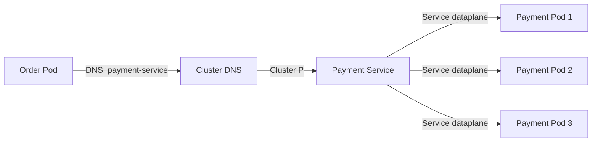
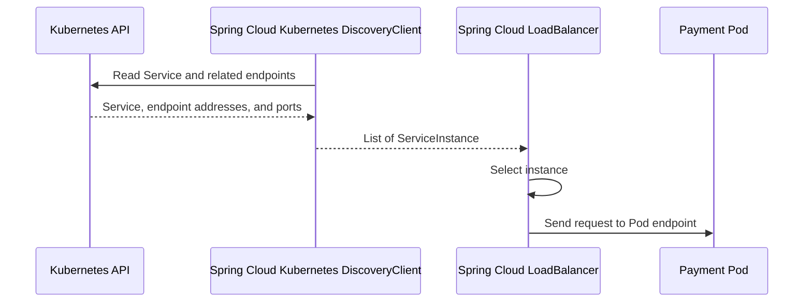

# Comparing DNS with Spring Cloud Kubernetes DiscoveryClient

In Kubernetes, an application can locate a service using internal cluster DNS or through Spring Cloud Kubernetes's `DiscoveryClient`. Both approaches help consumers find service endpoints, but they operate at different layers and return different levels of information.

DNS provides a stable name for a Kubernetes Service. For a standard Service, DNS resolves the name to a ClusterIP; the Kubernetes dataplane forwards requests to an eligible backend. For a headless Service, DNS can return Pod addresses instead of a ClusterIP. By contrast, Spring Cloud Kubernetes `DiscoveryClient` queries the Kubernetes API for service and instance details, then represents instances as Spring Cloud `ServiceInstance` objects.

In the `SPRING_CLOUD_SERVICE_DISCOVERY` module, the goal is to find instances by service name through abstractions such as `DiscoveryClient` and use that information with load balancing. Therefore, it is important to understand when DNS is sufficient, when an application needs an instance list at the Spring layer, and how to avoid creating two unintended load-balancing layers.

## 1. Two mechanisms at two different layers

### 1.1. Kubernetes DNS

Kubernetes DNS provides internal domain names for Services and certain workload types. For example, a `payment-service` Service in the `commerce` namespace typically has the fully qualified name:

```text
payment-service.commerce.svc.cluster.local
```

`cluster.local` is the common default cluster domain; a cluster may be configured with a different domain. Pods in the same namespace can normally use the short name `payment-service`; Pods in another namespace should use the namespace-qualified name or FQDN to avoid resolving the wrong service.

For a Service with a ClusterIP, DNS normally returns the Service's ClusterIP address. The consumer sends requests to this virtual IP; the Kubernetes Service dataplane (e.g., kube-proxy or an alternative dataplane mechanism) forwards requests to an eligible endpoint.

For a headless Service (`clusterIP: None`), DNS returns the addresses of the endpoints instead of a single ClusterIP. In this case, the client can receive multiple addresses, and how requests are distributed depends on the DNS resolver, client, and caching.

### 1.2. Spring Cloud Kubernetes DiscoveryClient

Spring Cloud Kubernetes provides an implementation of `org.springframework.cloud.client.discovery.DiscoveryClient`. This implementation uses the Kubernetes API to discover Services and their associated endpoints/instances. It converts that data into a list of `ServiceInstance` objects containing details such as service ID, host, port, URI, and metadata.

A consumer can call:

```java
discoveryClient.getInstances("payment-service");
```

to obtain the list of instances for a service by service ID. That list can be fed into Spring Cloud LoadBalancer to select a Pod endpoint on the client side, or read by the application to apply custom policies.

`DiscoveryClient` is not merely a DNS resolver. It interacts with the Kubernetes API and resources inside the cluster. Therefore, the application needs the appropriate Spring Cloud Kubernetes dependency and RBAC permissions to read the resources used by the implementation.

## 2. DNS flow for a ClusterIP Service

Suppose there is a `payment-service` Service in the `commerce` namespace:

```yaml
apiVersion: v1
kind: Service
metadata:
  name: payment-service
  namespace: commerce
spec:
  type: ClusterIP
  selector:
    app: payment
  ports:
    - name: http
      port: 80
      targetPort: 8080
```

DNS creates records for the Service. From a Pod in the `commerce` namespace, an application can call:

```text
http://payment-service
```

or from another namespace:

```text
http://payment-service.commerce.svc.cluster.local
```

This name resolves to the Service's ClusterIP. Requests arriving on port `80` are forwarded to `targetPort: 8080` of a Pod matching the selector and current endpoints.



The consumer only needs to know a single DNS name and Service port. Kubernetes is responsible for distributing requests to backends. The application does not need to read individual Pod IPs or pick a Pod itself.

## 3. DNS for a headless Service

A headless Service is declared with `clusterIP: None`:

```yaml
apiVersion: v1
kind: Service
metadata:
  name: payment-headless
  namespace: commerce
spec:
  clusterIP: None
  selector:
    app: payment
  ports:
    - name: http
      port: 8080
      targetPort: 8080
```

With a headless Service, DNS can return multiple Pod addresses:

```text
payment-headless.commerce.svc.cluster.local
    -> 10.10.1.21
    -> 10.10.2.34
    -> 10.10.3.18
```

The client receives multiple addresses and may pick one according to the behavior of its resolver or HTTP client. Record ordering, cache duration, and address-probing strategies vary across clients; do not assume all clients perform identical round-robin distribution.

A headless Service is often useful when an application needs to know individual endpoints, such as StatefulSets, distributed systems with peer identity, or applications managing connections to each member directly. With a StatefulSet and a headless Service, each Pod can have a stable ordinal-based DNS name, such as `payment-0.payment-headless.commerce.svc.cluster.local`.

## 4. Spring Cloud Kubernetes DiscoveryClient flow

With Spring Cloud Kubernetes DiscoveryClient, the application uses the Kubernetes API to find services and instances. A general flow:

1. The provider creates the Kubernetes Service and Pods according to manifests/deployments.
2. Kubernetes updates the Service along with corresponding endpoint information when Pods match the selector and readiness conditions.
3. The consumer application's discovery client queries the required resources via the Kubernetes API.
4. The implementation converts endpoints into `ServiceInstance` objects.
5. The consumer or Spring Cloud LoadBalancer selects an instance to call.



The exact resources and update mechanisms depend on the Spring Cloud Kubernetes version. Some versions/options work with Endpoints, while newer versions may support EndpointSlices or equivalent mechanisms. Check the documentation for the release train in use and actual RBAC permissions rather than assuming every version queries the same resource type.

Unlike ClusterIP DNS, the discovery client can provide a list of instance addresses to the application. This is useful when client-side load balancing, reading metadata, or applying instance selection logic at the Spring layer is required.

## 5. Direct comparison

| Criterion | Kubernetes DNS | Spring Cloud Kubernetes DiscoveryClient |
|---|---|---|
| Data source | DNS records generated from Services/endpoints per Kubernetes DNS rules. | Kubernetes API and discovery resources supported by the integration. |
| Typical result | ClusterIP for standard Services; multiple endpoint IPs for headless Services. | List of `ServiceInstance` objects with host, port, and metadata. |
| Load balancing | Typically handled by the Service dataplane for ClusterIP; headless depends on client/resolver. | Can integrate with Spring Cloud LoadBalancer for client-side instance selection. |
| Spring dependency | None; any language and HTTP client can use DNS. | Yes; requires compatible Spring Cloud Kubernetes Discovery dependencies and configuration. |
| Kubernetes API permissions | Applications only using DNS and calling Services normally do not need API permissions to read Services/Endpoints. | ServiceAccount/RBAC requires read permissions on the resources used by the discovery implementation. |
| Instance metadata | DNS does not provide a per-instance metadata map matching the `ServiceInstance` API. | Can provide metadata from Kubernetes Services/Pods/endpoints depending on implementation capabilities. |
| Discovery scope | Based on DNS name and namespace/domain. | Can be scoped to or expanded across namespaces via configuration and RBAC. |
| Application integration | Uses hostname like a regular endpoint. | Uses `DiscoveryClient`, `ServiceInstance`, and Spring Cloud abstractions. |
| Endpoint changes | DNS and the Service dataplane update as Services/endpoints change; resolvers may cache. | Discovery client observes resources via the API; caching/watching/refreshing depends on implementation and version. |
| Complexity | Low, suitable for standard service calls. | Higher, useful when an instance list and client-side policies are needed. |

The two approaches are not mutually exclusive at the cluster level, but each request path should have one clear traffic-distribution model.

## 6. When should you use DNS?

DNS is generally the right choice when the consumer only needs to call a single stable service endpoint managed by Kubernetes.

Choose DNS if:

- The application only needs to call a Service by hostname and port.
- It does not need to read the list of Pod instances itself.
- You want the Kubernetes Service dataplane to handle traffic distribution.
- You want to keep the application lightly coupled to Spring Cloud and the Kubernetes API.
- Multiple languages or runtimes call the same service.
- The Service has a stable ClusterIP and endpoints are managed via selectors/readiness.

For example, in Spring Boot, you can use a standard `WebClient`:

```java
import org.springframework.context.annotation.Bean;
import org.springframework.context.annotation.Configuration;
import org.springframework.web.reactive.function.client.WebClient;

@Configuration
public class PaymentClientConfiguration {

    @Bean
    WebClient paymentWebClient(WebClient.Builder builder) {
        return builder
                .baseUrl("http://payment-service.commerce.svc.cluster.local")
                .build();
    }
}
```

Requests are sent to the Kubernetes Service's DNS name. The application does not need to inject `DiscoveryClient` or know Pod IPs.

## 7. When should you use Spring Cloud Kubernetes DiscoveryClient?

DiscoveryClient fits when the application needs to know the list of instances rather than just a single Service virtual IP.

Choose DiscoveryClient if:

- You need to retrieve a list of `ServiceInstance` objects and select an endpoint on the client side.
- You need to read metadata or per-instance details for routing policies.
- You need to integrate with Spring Cloud LoadBalancer and existing discovery abstractions.
- You need selection logic based on zone, version, label, or capability.
- You want to use the same `DiscoveryClient` API when switching discovery providers in the Spring Cloud ecosystem.
- You need to discover services in specified namespaces according to configuration and RBAC permissions.

Example reading instances:

```java
import java.util.List;

import org.springframework.cloud.client.ServiceInstance;
import org.springframework.cloud.client.discovery.DiscoveryClient;
import org.springframework.stereotype.Service;

@Service
public class PaymentDiscoveryService {

    private final DiscoveryClient discoveryClient;

    public PaymentDiscoveryService(DiscoveryClient discoveryClient) {
        this.discoveryClient = discoveryClient;
    }

    public List<ServiceInstance> findPaymentInstances() {
        return discoveryClient.getInstances("payment-service");
    }

    public void logInstances() {
        for (ServiceInstance instance : findPaymentInstances()) {
            System.out.printf(
                    "id=%s host=%s port=%d uri=%s metadata=%s%n",
                    instance.getInstanceId(),
                    instance.getHost(),
                    instance.getPort(),
                    instance.getUri(),
                    instance.getMetadata()
            );
        }
    }
}
```

If the list is empty, check the service ID, discovery namespaces, selector/endpoints, RBAC permissions, and Pod readiness status. `DiscoveryClient` only returns data observed by the implementation; it does not guarantee an endpoint is still alive at the exact moment a request is actually sent.

## 8. Integrating DiscoveryClient with Spring Cloud LoadBalancer

When using DiscoveryClient, you can use Spring Cloud LoadBalancer to select a `ServiceInstance` instead of picking one manually.

Example creating a load-balanced `WebClient`:

```java
import org.springframework.cloud.client.loadbalancer.LoadBalanced;
import org.springframework.context.annotation.Bean;
import org.springframework.context.annotation.Configuration;
import org.springframework.web.reactive.function.client.WebClient;

@Configuration
public class LoadBalancedClientConfiguration {

    @Bean
    @LoadBalanced
    WebClient.Builder loadBalancedWebClientBuilder() {
        return WebClient.builder();
    }
}
```

Calling a service by service ID:

```java
webClientBuilder.build()
        .get()
        .uri("http://payment-service/api/payments/42")
        .retrieve()
        .bodyToMono(String.class);
```

For this to work, the application needs Spring Cloud LoadBalancer and Spring Cloud Kubernetes DiscoveryClient configured compatibly. LoadBalancer requests the instance list by service ID, selects an instance, and issues the request to that instance's host/port.

With DNS, the URL is typically `http://payment-service.commerce.svc.cluster.local/...` and `@LoadBalanced` is not needed. Do not use a ClusterIP Service DNS name as if it were a list of Pod instances if your goal is client-side load balancing.

## 9. Avoiding double load balancing

A common design mistake is unintentionally combining ClusterIP DNS with client-side load balancing.

Unnecessary example:

1. The discovery client returns instances, yet each instance's host is configured to be the same ClusterIP DNS name.
2. Spring Cloud LoadBalancer selects a `ServiceInstance`.
3. The request is sent to the ClusterIP.
4. The Kubernetes Service dataplane selects another Pod again.

In this scenario, Spring Cloud's selection does not determine the final Pod that receives the request. Kubernetes performs load balancing again at the Service layer. Logging the chosen instance may not reflect the actual Pod that handled the request.

Pick one of the two models for a given request path:

- **DNS + ClusterIP:** the application calls Service DNS; Kubernetes selects the backend.
- **DiscoveryClient + Pod endpoints:** the application fetches Pod endpoints; Spring Cloud LoadBalancer selects the backend directly.

Combining multiple layers is possible when there is a specific reason, but you must clearly understand which layer chooses the final endpoint, how health is applied, and how requests are observed.

## 10. Readiness, health, and published endpoints

Both DNS and DiscoveryClient depend on the Service/endpoint state published by Kubernetes, though they consume that information differently.

- With a standard Service, DNS continues to provide a stable ClusterIP name while endpoints change. The dataplane uses the list of eligible endpoints to forward traffic.
- With a headless Service, DNS returns endpoint addresses; resolvers may cache results so an application can continue using old addresses for a period of time.
- DiscoveryClient retrieves endpoint information from the Kubernetes API according to the integration's capabilities. Whether endpoints are filtered by readiness or include unready addresses depends on configuration and version.
- `publishNotReadyAddresses` can change publication of unready endpoints for uses such as peer discovery; do not enable this option if consumers are not allowed to call unready Pods.

Readiness probes and liveness probes have different goals. Readiness determines whether a Pod should receive traffic; liveness helps detect processes that need to be restarted. Do not use liveness in place of readiness to control endpoint publication.

Even when an endpoint is marked ready, requests can still fail due to a process stopping right after discovery, network errors, or timeouts. Consumers need timeouts, bounded retries, and connection error handling.

## 11. Configuring Spring Cloud Kubernetes Discovery

Exact dependencies and properties depend on the Spring Cloud release train and Spring Cloud Kubernetes version. An illustrative configuration can limit discovery to the application's namespace:

```yaml
spring:
  application:
    name: order-service
  cloud:
    kubernetes:
      discovery:
        enabled: true
        all-namespaces: false
```

When using specific namespaces, you can configure the list of discovered namespaces using the properties supported by the version in use. Do not enable discovery across all namespaces if the application only needs a narrow scope.

Spring Cloud Kubernetes may require a ServiceAccount with read permissions for Services and related endpoint resources. Exact permissions vary by version and implementation, such as `get`, `list`, or `watch` permissions on `services`, `endpoints`, or `endpointslices`. Grant least-privilege permissions for the resources actually used by the client.

If an application only calls Services via DNS, it does not need Kubernetes API read permissions just to resolve names. Kubernetes DNS and the Service dataplane provide the access path without requiring the application to list Pods or Services.

## 12. Namespace scope and service names

A Service DNS name has an explicit namespace:

```text
payment-service.commerce.svc.cluster.local
```

The short name `payment-service` is usually resolved via the Pod's search domains, so in another namespace it may point to a different Service with the same name or fail to resolve.

With DiscoveryClient, the service ID is usually the Kubernetes Service name. Which namespaces are searched depends on discovery configuration and ServiceAccount permissions. If two namespaces both have a Service named `payment-service`, use explicit namespace scoping or a naming/namespace convention to avoid confusion.

For example, an application in the `orders` namespace wants to call a service in the `commerce` namespace:

```text
DNS: payment-service.commerce.svc.cluster.local
DiscoveryClient: discover commerce namespace per supported configuration
```

Do not assume `DiscoveryClient.getInstances("payment-service")` always searches every namespace. Check the `all-namespaces`/namespace list configuration and RBAC.

## 13. Metadata and routing capabilities

DNS provides names and addresses, not a per-instance metadata map via the `ServiceInstance` abstraction. DiscoveryClient can return metadata based on Service/Pod or endpoint resources supported by the integration.

Metadata can be used to:

- Prefer a zone or region close to the consumer.
- Distinguish versions or rollout groups if that information is published.
- Filter instances by mapped labels or attributes.
- Support observability and diagnostics per endpoint.

Not every Pod label automatically appears in `ServiceInstance.metadata`. Verify the mapping behavior of the Spring Cloud Kubernetes version in use. If a policy relies on labels, determine whether the label is read from the Service or Pod and how it is mapped.

DNS is usually preferable when metadata is not needed; DiscoveryClient fits when the application needs metadata in instance selection policies. Metadata does not replace health/readiness and does not guarantee an endpoint is still healthy.

## 14. Security and availability

### 14.1. DNS path

- Ensure CoreDNS or the cluster's DNS provider is healthy and reachable from Pods.
- Verify NetworkPolicy allows UDP/TCP port 53 DNS queries.
- Monitor DNS caching and TTL when endpoints change.
- Do not expose internal Services via unnecessary Service types or ingresses.

### 14.2. DiscoveryClient path

- Use a dedicated ServiceAccount per workload.
- Grant least-privilege RBAC for only the namespaces and resources that need to be read.
- Do not enable `all-namespaces` unless required.
- Protect the Kubernetes API using the authentication and TLS mechanisms provided by the cluster.
- Monitor `Forbidden` errors, watch/list failures, and endpoint update latency.
- Avoid logging sensitive metadata or ServiceAccount tokens.

The two mechanisms have different failure modes: DNS depends on the DNS service and resolvers; DiscoveryClient depends on the Kubernetes API, RBAC, and the integration's cache/watch. Consumer design still needs proper timeouts and fallbacks.

## 15. Common errors

| Symptom | Possible cause | How to check |
|---|---|---|
| DNS cannot resolve the Service | Wrong name/namespace, CoreDNS failure, or broken Pod DNS config. | Run `nslookup`/`getent hosts` in the consumer Pod; check the Service and CoreDNS. |
| DNS resolves but requests time out | Wrong ClusterIP/port, no ready endpoints, or NetworkPolicy blocking traffic. | Check the Service, EndpointSlice/Endpoints, ports, and network policies. |
| Short name works in one namespace but not another | Different search domains. | Use the namespace-qualified FQDN. |
| Headless DNS returns stale IPs | Resolver/client cache or TTL has not expired. | Check TTL, resolver cache, and Pod lifecycle. |
| DiscoveryClient returns an empty list | Wrong service ID, namespace filter, Service has no endpoints, or RBAC issue. | Check the Service, endpoint resources, namespace config, and API logs. |
| DiscoveryClient fails with `Forbidden` | ServiceAccount lacks read permissions for the resource. | Inspect the API error and grant least-privilege RBAC for the required resources. |
| DiscoveryClient returns wrong host/port | Incorrect Service port/targetPort or endpoint mapping. | Compare the Service spec with endpoints and `ServiceInstance`. |
| LoadBalancer cannot find the service | Missing dependency, no suitable DiscoveryClient, or wrong service ID. | Check the classpath, beans, and service ID. |
| Requests pass through two load-balancing layers | Using DiscoveryClient to select an instance while host is still ClusterIP. | Explicitly choose client-side Pod selection or ClusterIP dataplane. |
| Unready instances are still returned | Include not-ready / `publishNotReadyAddresses` enabled or version semantics. | Check readiness and discovery endpoint configuration. |

## 16. Verification workflow in a cluster

You can compare both mechanisms against the same service:

1. Inspect the Service and endpoints:

   ```bash
   kubectl get service payment-service -n commerce
   kubectl get endpoints payment-service -n commerce
   kubectl get endpointslices -n commerce -l kubernetes.io/service-name=payment-service
   ```

2. From a consumer Pod, check DNS:

   ```bash
   nslookup payment-service.commerce.svc.cluster.local
   ```

3. Call the Service via DNS and the Service port:

   ```bash
   curl -v http://payment-service.commerce.svc.cluster.local:80/actuator/health
   ```

4. In the Spring application, inspect the `ServiceInstance` list:

   ```java
   discoveryClient.getInstances("payment-service").forEach(instance ->
           System.out.printf("%s %s:%d%n",
                   instance.getInstanceId(),
                   instance.getHost(),
                   instance.getPort()));
   ```

5. If using DiscoveryClient, verify that the ServiceAccount has read permissions for the resources required by the integration.
6. Send requests through Spring Cloud LoadBalancer and verify which actual Pod endpoint receives each request.
7. Try deleting a Pod in a test environment, observe DNS/endpoint/discovery updates, and measure how long it takes consumers to stop calling the old Pod.
8. Test the case where all endpoints are unready to confirm the application handles an empty list or dependency failures properly.

Commands and endpoint resources may differ across Kubernetes versions. On newer clusters, EndpointSlice is usually the primary endpoint source; still verify which resource your Spring Cloud Kubernetes integration uses.

## 17. Selection matrix

| Requirement | Recommended option | Reason |
|---|---|---|
| Call a stable Service inside the cluster | DNS + ClusterIP | Simple; no Spring discovery or API read RBAC needed. |
| Polyglot applications calling the service | DNS | Independent of Java/Spring frameworks. |
| Need a list of Pod endpoints in Java/Spring | Spring Cloud Kubernetes DiscoveryClient | Returns `ServiceInstance` objects for the application to process. |
| Need client-side load balancing using metadata | DiscoveryClient + Spring Cloud LoadBalancer | Enables building selection policies on the consumer side. |
| Need stable identity per Pod | Headless Service and StatefulSet DNS; or DiscoveryClient | Per-Pod DNS or instance list depending on requirements. |
| Do not want to grant Kubernetes API read permissions to apps | DNS + ClusterIP | Requires only DNS and Service network access. |
| Need cross-namespace service lookup | Namespace-qualified DNS FQDN or scoped DiscoveryClient | Both need clear namespace conventions; DiscoveryClient also requires RBAC. |

## Conclusion

Kubernetes DNS provides a stable name for a Service and typically lets the Kubernetes dataplane distribute requests via ClusterIP. A headless Service can publish multiple Pod IPs for clients to choose from themselves. Spring Cloud Kubernetes `DiscoveryClient` queries the Kubernetes API and maps endpoints to `ServiceInstance` objects, enabling Spring applications to retrieve instance lists, read metadata, and integrate with Spring Cloud LoadBalancer.

Choose DNS when you only need to call a stable Service endpoint and want to keep applications simple. Choose DiscoveryClient when you need an instance list and client-side policies. Avoid unintentionally routing requests through both client-side load balancing and ClusterIP, and verify namespaces, readiness, RBAC, DNS caching, and connectivity from consumer Pods.

## References

- [Kubernetes — DNS for Services and Pods](https://kubernetes.io/docs/concepts/services-networking/dns-pod-service/)
- [Kubernetes — Services, Load Balancing, and Networking](https://kubernetes.io/docs/concepts/services-networking/service/)
- [Spring Cloud Kubernetes — Discovery](https://docs.spring.io/spring-cloud-kubernetes/reference/discovery-client.html)
- [Spring Cloud Commons — DiscoveryClient](https://docs.spring.io/spring-cloud-commons/reference/spring-cloud-commons/common-abstractions.html)
