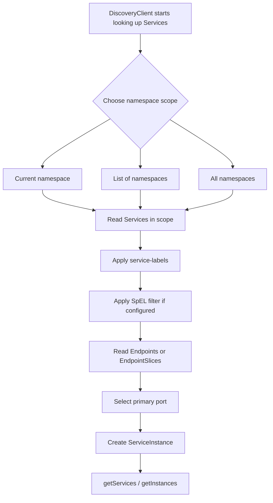

# Scoping Discovery by Namespace, Labels, and Service Ports

## 1. Why limit discovery scope?

In Kubernetes, each Service belongs to a namespace and can expose multiple ports. A Spring Cloud application usually only needs to find a subset of services related to its domain, such as payment services in the `payments` namespace. If `DiscoveryClient` reads too broadly, the application must process more data, increases the number of resources watched on the Kubernetes API Server, and may encounter identically named services across multiple namespaces.

Spring Cloud Kubernetes allows scoping discovery along three main dimensions:

- **Namespace:** determines which namespaces are searched.
- **Labels and filter expressions:** selects matching Kubernetes Services within that namespace scope.
- **Service port:** determines which Service port is used to construct a `ServiceInstance` when a Service declares multiple ports.

These three dimensions answer different questions. Namespaces bound the search domain; labels and filters narrow the Service set; port selection picks the endpoint port for a discovered Service. They do not replace Kubernetes RBAC permissions and do not create a load-balancing mechanism by themselves.

## 2. What does Spring Cloud Kubernetes DiscoveryClient read?

Spring Cloud Kubernetes provides an implementation of `org.springframework.cloud.client.discovery.DiscoveryClient`. Depending on the starter, the implementation may use Fabric8 Kubernetes Client, Kubernetes Java Client, or HTTP DiscoveryClient connecting to Spring Cloud Kubernetes DiscoveryServer.

DiscoveryClient looks up Kubernetes Services and their corresponding endpoints. From there, `getInstances(serviceId)` returns a list of `ServiceInstance` objects containing details such as:

- Service ID and instance ID.
- Endpoint host, typically the endpoint/pod IP address.
- Selected port from the Service configuration and corresponding endpoint.
- URI and scheme (`http` or `https`).
- Metadata such as namespace, Service labels, annotations, ports, and Service type when the corresponding metadata options are enabled.

`getServices()` returns Service names according to `metadata.name`. If multiple namespaces have Services with the same name, the returned list of names is unique; therefore, the Service name alone is not enough to distinguish namespaces. When distinguishing instances is necessary, read the namespace from `ServiceInstance` metadata or avoid duplicate Service names within the active discovery scope.

Spring Cloud Kubernetes DiscoveryClient is an option at the Spring layer. Kubernetes also provides internal DNS for Services, such as `payment-api.payments.svc.cluster.local`. If an application only needs to call a stable Kubernetes Service and does not need to fetch endpoint lists or metadata through Spring, Kubernetes DNS may already be sufficient.

## 3. Scoping by namespace

Spring Cloud Kubernetes supports three ways to determine which namespaces to search for Services. Choose a scope that fits the application's topology and access permissions.

### 3.1. Searching only the current namespace

This is the default behavior when `spring.cloud.kubernetes.discovery.namespaces` is not declared and `all-namespaces` is not enabled. Spring Cloud Kubernetes needs to determine the application's current namespace. Namespace resolution is performed on a best-effort order, typically including:

1. The value of `spring.cloud.kubernetes.client.namespace` if configured.
2. The namespace file specified via `spring.cloud.kubernetes.client.service-account-namespace-path`.
3. The default file mounted by Kubernetes inside a Pod: `/var/run/secrets/kubernetes.io/serviceaccount/namespace`.
4. The namespace API or client-specific configuration of the Kubernetes client in use, if available.

Example configuring the namespace explicitly:

```yaml
spring:
  cloud:
    kubernetes:
      client:
        namespace: payments
```

Inside a Pod, Kubernetes usually mounts the ServiceAccount's namespace into the service account file. When running outside the cluster, this file may not exist; in that case, configure the namespace explicitly or configure the corresponding client.

### 3.2. Searching only a list of namespaces

When an application needs to find Services in several specific namespaces, declare `spring.cloud.kubernetes.discovery.namespaces`:

```yaml
spring:
  cloud:
    kubernetes:
      discovery:
        namespaces:
          - payments
          - shared-platform
          - identity
```

DiscoveryClient only searches for Services in the three declared namespaces. This approach fits when an application must call a few shared functional domains while keeping a clear boundary.

In a properties file, you can declare it by index:

```properties
spring.cloud.kubernetes.discovery.namespaces[0]=payments
spring.cloud.kubernetes.discovery.namespaces[1]=shared-platform
spring.cloud.kubernetes.discovery.namespaces[2]=identity
```

If using the HTTP-based DiscoveryClient, namespace configuration must be placed on Spring Cloud Kubernetes DiscoveryServer because the server is the component accessing the Kubernetes API. With Fabric8 or Kubernetes Java Client running directly inside the application, the configuration lives in that application.

### 3.3. Searching across all namespaces

Cluster-wide discovery can be enabled with:

```yaml
spring:
  cloud:
    kubernetes:
      discovery:
        all-namespaces: true
```

This option is useful for administrative tools or components that need cluster-wide visibility. For standard business services, cluster-wide scope can increase the volume of Services/Endpoints to read and cache, increase load on the Kubernetes API Server, and require broader permissions.

Do not enable `all-namespaces` just to fix a missing-Service error. First, verify the current namespace, `namespaces` configuration, Service name, and RBAC. Explicit namespace selection is generally easier to control.

### 3.4. Do not confuse the client's namespace with the Service's namespace

Namespace is part of a Kubernetes resource's identity. Two Services with the same name in two different namespaces are two distinct resources:

```text
payments/payment-api
identity/payment-api
```

When DiscoveryClient searches both namespaces, `getServices()` may return only a single `payment-api` name because the service ID list is deduplicated. `getInstances("payment-api")` can return instances coming from multiple selected namespaces. Read the namespace metadata of each `ServiceInstance` if the application needs to tell them apart.

## 4. Filtering Services by metadata labels

### 4.1. `service-labels` filters Kubernetes Service labels

The `spring.cloud.kubernetes.discovery.service-labels` property accepts a key/value map. DiscoveryClient only returns Services that have all the declared label pairs in `metadata.labels` on the Service object itself.

Example configuration:

```yaml
spring:
  cloud:
    kubernetes:
      discovery:
        service-labels:
          discovery: enabled
          team: payments
          environment: production
```

A matching Service can declare:

```yaml
apiVersion: v1
kind: Service
metadata:
  name: payment-api
  namespace: payments
  labels:
    discovery: enabled
    team: payments
    environment: production
    app.kubernetes.io/name: payment-api
spec:
  selector:
    app.kubernetes.io/name: payment-api
  ports:
    - name: http
      port: 80
      targetPort: 8080
```

The Service must have all three labels with the matching values to be selected. Any additional labels do not affect matching.

### 4.2. Distinguishing `metadata.labels` from `spec.selector`

These two fields are frequently confused:

| Field | Where it lives | Purpose |
|---|---|---|
| `metadata.labels` | Metadata of the Service object | Labels the Service itself; Spring Cloud Kubernetes uses these for `service-labels` and filters |
| `spec.selector` | Spec of the Service | Selects the Pods to which the Service forwards traffic |
| Pod `metadata.labels` | Metadata of the Pod | Can be added to `ServiceInstance` metadata if pod metadata options are enabled |

For example, `spec.selector.app` matches the Pod label `app`, but that does not automatically make the Service match `service-labels.app`. If you want discovery to filter by `app`, you must declare `metadata.labels.app` on the Service.

Kubernetes labels are key/value pairs for grouping and selecting resources. They are not a security or authorization mechanism. To restrict who can read Services, use Kubernetes RBAC.

### 4.3. Benefits and limitations of `service-labels`

Spring Cloud Kubernetes uses an asynchronous lister/cache to fetch Services. Filtering with `service-labels` helps shrink the set of Services of interest, especially when a namespace contains many Services. Use stable labels with clear conventions, such as `team`, `environment`, `discovery`, or `app.kubernetes.io/part-of`.

Avoid using constantly changing labels such as build timestamps or pod hashes as Service filter criteria. If labels must change, update the Service manifest and verify that the discovery cache has picked up the update.

## 5. Advanced filtering with SpEL `filter`

When the `service-labels` map cannot express a condition, you can use:

```yaml
spring:
  cloud:
    kubernetes:
      discovery:
        filter: "#root.metadata.labels['tier'] == 'backend' and #root.metadata.namespace == 'payments'"
```

`filter` is a SpEL expression evaluated against the Kubernetes Service object after it is retrieved from the API. The root object type depends on the Kubernetes client:

- With the Fabric8 client, the expression is evaluated against `io.fabric8.kubernetes.api.model.Service`.
- With Kubernetes Java Client, the expression is evaluated against `io.kubernetes.client.openapi.models.V1Service`.
- With HTTP DiscoveryClient, the filter is configured on DiscoveryServer and uses the Kubernetes model corresponding to the server.

SpEL is evaluated in a read-only context. Do not invoke methods on objects such as `metadata.name.startsWith('pay')` or `metadata.labels.containsKey('tier')`. Use operators, regex `matches`, and map indexing by key, for example:

```yaml
spring:
  cloud:
    kubernetes:
      discovery:
        filter: "#root.metadata.namespace matches '^pay.*' and #root.metadata.labels['tier'] == 'backend'"
```

If using HTTP DiscoveryServer, configure the filter in the server's deployment, such as via an environment variable:

```yaml
env:
  - name: SPRING_CLOUD_KUBERNETES_DISCOVERY_FILTER
    value: "#root.metadata.namespace matches '^pay.*'"
```

Verify the model and expression against the specific client in use. A SpEL expression valid for the Fabric8 model will not necessarily work if the input type is the Kubernetes Java Client model.

### 5.1. Combining namespaces, labels, and filter

A typical configuration can restrict namespaces first, then select Services by labels:

```yaml
spring:
  cloud:
    kubernetes:
      discovery:
        namespaces:
          - payments
          - shared-platform
        service-labels:
          discovery: enabled
          environment: production
        filter: "#root.metadata.labels['tier'] == 'backend'"
```

Treat these conditions as successive layers narrowing the Service set: `namespaces` defines where to look, `service-labels` requires label pairs, and `filter` further excludes Services that do not satisfy the expression. If a Service does not appear, inspect each layer in order to identify which condition excluded it.

## 6. Selecting the primary port when a Service has multiple ports

### 6.1. Why specify a port?

A Kubernetes Service can expose multiple ports, such as an HTTP business port, an HTTPS port, and a metrics port. `DiscoveryClient` must select one primary port to build a `ServiceInstance` for the service ID. If the wrong port is chosen, applications may accidentally call the metrics endpoint or a port that does not serve business requests.

A Kubernetes Service port has key fields:

| Field | Meaning |
|---|---|
| `name` | Name of the port in the Service; used to distinguish multiple ports |
| `port` | Port exposed by the Service to Service clients |
| `targetPort` | Backend port on the Pod to which the Service forwards; can be a number or container port name |
| `protocol` | Network protocol, typically TCP |

Example of a Service with HTTP and metrics:

```yaml
apiVersion: v1
kind: Service
metadata:
  name: payment-api
  namespace: payments
  labels:
    discovery: enabled
    primary-port-name: http
spec:
  selector:
    app.kubernetes.io/name: payment-api
  ports:
    - name: http
      protocol: TCP
      port: 80
      targetPort: 8080
    - name: metrics
      protocol: TCP
      port: 9090
      targetPort: 9090
```

The `http` port is the application port; `metrics` is for scraping. The `primary-port-name: http` label tells Spring Cloud Kubernetes which port name to select as primary. In endpoint-based discovery results, the host address and port are paired from the matching endpoint; do not assume `targetPort` always equals `port`.

### 6.2. DiscoveryClient port selection order

According to Spring Cloud Kubernetes rules, when selecting the port for a `ServiceInstance`, the priority order is:

1. If the Service has a `primary-port-name` label, select the port whose name matches the label value.
2. If that label is absent, use `spring.cloud.kubernetes.discovery.primary-port-name`.
3. If neither is configured, look for a port named `https`.
4. If not found, look for a port named `http`.
5. If still not found, use the first port in the list.

The last fallback can be nondeterministic when a Service has multiple ports. Therefore, for multi-port Services, set the `primary-port-name` label or configure `primary-port-name` in the application.

Example selecting the `http` port via application configuration:

```yaml
spring:
  cloud:
    kubernetes:
      discovery:
        primary-port-name: http
```

The label on the Service fits when you want the Service itself to declare its preferred port. The configuration property fits when a consumer application wants to apply a shared port-naming convention across the Services it discovers.

### 6.3. No ports and multiple Service ports

If a Service declares no ports, DiscoveryClient may create a `ServiceInstance` with port `0`; such an endpoint cannot be used for normal HTTP calls. If a Service has exactly one port, that port is chosen. With multiple ports, name each port and specify the primary port explicitly.

Do not rely on element ordering in `spec.ports` to decide the business port. Reordering the manifest can change which port is picked by the final fallback.

### 6.4. Marking HTTPS endpoints

Spring Cloud Kubernetes determines `secure` using signals such as:

- The Service's `secured` label set to `true`, `on`, `yes`, or `1`.
- If the label is absent, a `secured` annotation with the corresponding values.
- The port belongs to `spring.cloud.kubernetes.discovery.known-secure-ports` (typically defaulting to `443` and `8443`).
- The port name is `https`.

Example:

```yaml
metadata:
  labels:
    secured: "true"
    primary-port-name: https
spec:
  ports:
    - name: https
      port: 443
      targetPort: 8443
```

Marking `secured` only helps DiscoveryClient/LoadBalancer determine the scheme. It does not configure TLS on the application, certificates, truststores, or NetworkPolicies. The backend Service must actually serve HTTPS on the selected endpoint.

## 7. Port metadata and ServiceInstance metadata

Spring Cloud Kubernetes can include Service labels, annotations, and port definitions in `ServiceInstance.getMetadata()`. Commonly used options:

| Property | Common default | Meaning |
|---|---:|---|
| `spring.cloud.kubernetes.discovery.metadata.add-labels` | `true` | Adds Service labels to metadata |
| `spring.cloud.kubernetes.discovery.metadata.add-annotations` | `true` | Adds Service annotations to metadata |
| `spring.cloud.kubernetes.discovery.metadata.add-ports` | `true` | Adds port names and port details to metadata |
| `spring.cloud.kubernetes.discovery.metadata.labels-prefix` | empty | Prefix for label keys |
| `spring.cloud.kubernetes.discovery.metadata.annotations-prefix` | empty | Prefix for annotation keys |
| `spring.cloud.kubernetes.discovery.metadata.ports-prefix` | `port.` | Prefix for port keys |
| `spring.cloud.kubernetes.discovery.metadata.add-pod-labels` | `false` | Adds Pod labels to metadata |
| `spring.cloud.kubernetes.discovery.metadata.add-pod-annotations` | `false` | Adds Pod annotations to metadata |

Example enabling required metadata:

```yaml
spring:
  cloud:
    kubernetes:
      discovery:
        metadata:
          add-labels: true
          add-annotations: true
          add-ports: true
          labels-prefix: "label."
          annotations-prefix: "annotation."
          ports-prefix: "port."
          add-pod-labels: true
          add-pod-annotations: true
```

Metadata can include the instance's namespace (`k8s_namespace`), Service type (`type`, e.g., `ClusterIP` or `ExternalName`), and Pod information if enabled. Custom keys do not automatically alter routing; consumers must read and apply them if needed.

By default, `ExternalName` Services are excluded from discovery results. If you need this Service type, enable `spring.cloud.kubernetes.discovery.include-external-name-services=true`. Endpoints not marked ready by Kubernetes are normally excluded from the list; `spring.cloud.kubernetes.discovery.include-not-ready-addresses=true` can be enabled for observability/monitoring purposes, though not-ready lists should not be used as normal traffic targets.

## 8. RBAC: discovery filters are not security boundaries

`namespaces`, `service-labels`, and `filter` decide what the application wants to see. Kubernetes RBAC decides which resources a ServiceAccount is allowed to read. An application might be configured to search only `payments`, yet if its ServiceAccount has cluster-wide `list` permissions, its actual access remains broader than the discovery scope.

With Fabric8 or Kubernetes Java Client running inside the application, the application Pod's ServiceAccount needs appropriate permissions. With HTTP-based DiscoveryClient, the component calling the Kubernetes API is DiscoveryServer; permissions must be granted to DiscoveryServer's ServiceAccount, while client applications call the server's HTTP API.

Example Role for read-only access to Services and Endpoints in a single namespace:

```yaml
apiVersion: rbac.authorization.k8s.io/v1
kind: Role
metadata:
  name: spring-discovery-reader
  namespace: payments
rules:
  - apiGroups: [""]
    resources: ["services", "endpoints"]
    verbs: ["get", "list", "watch"]
```

Bind the Role to the ServiceAccount:

```yaml
apiVersion: rbac.authorization.k8s.io/v1
kind: RoleBinding
metadata:
  name: spring-discovery-reader
  namespace: payments
subjects:
  - kind: ServiceAccount
    name: payment-app
    namespace: payments
roleRef:
  apiGroup: rbac.authorization.k8s.io
  kind: Role
  name: spring-discovery-reader
```

If discovery requires several selective namespaces, you can create a RoleBinding in each namespace referencing a shared ClusterRole that holds the required read permissions. Only use ClusterRoleBinding when cluster-wide read access is genuinely needed; avoid granting `cluster-admin` to an application just to look up Services.

If `spring.cloud.kubernetes.discovery.use-endpoint-slices=true` is enabled, add `get`, `list`, `watch` permissions on the `endpointslices` resource in the `discovery.k8s.io` API group. If Pod labels/annotations are enabled, verify Pod read permissions according to the client and version in use. Check `kubectl auth can-i` with the exact ServiceAccount to confirm actual permissions.

## 9. Complete configuration for a specific scope

Example of a consumer discovering only production Services in the `payments` and `shared-platform` namespaces, accepting only Services with matching discovery labels, and selecting the HTTP port:

```yaml
spring:
  application:
    name: payment-worker
  cloud:
    kubernetes:
      client:
        namespace: payments
      discovery:
        namespaces:
          - payments
          - shared-platform
        service-labels:
          discovery: enabled
          environment: production
        primary-port-name: http
        include-not-ready-addresses: false
        metadata:
          add-labels: true
          add-annotations: false
          add-ports: true
```

In this configuration:

- Only the two listed namespaces are searched.
- Services must have both `discovery=enabled` and `environment=production` in `metadata.labels`.
- `primary-port-name: http` selects the port named `http` when a Service has multiple ports and no overriding `primary-port-name` label.
- Unready endpoints are excluded from normal lists.
- Label and port metadata are attached to `ServiceInstance` for consumer inspection.

If the application uses HTTP DiscoveryServer, move the namespace/label/filter configuration to DiscoveryServer according to the corresponding version's guide. Do not assume consumer-side configuration automatically changes the server's Kubernetes access scope.

## 10. Verifying discovery results

After configuring, verify from the actual environment running DiscoveryClient:

1. Confirm the actual namespace and the namespaces in `spring.cloud.kubernetes.discovery.namespaces`.
2. Verify the Service exists via `kubectl get services -n payments --show-labels`.
3. Compare the Service's `metadata.labels` against `service-labels` and the `filter` expression.
4. Check `spec.ports`, port names, `port`, `targetPort`, and matching endpoints.
5. Check ready endpoints with `kubectl get endpoints` or `kubectl get endpointslices` if using EndpointSlice.
6. Check RBAC with `kubectl auth can-i list services --as=system:serviceaccount:payments:payment-app -n payments` and the corresponding endpoint resources.
7. Call `DiscoveryClient.getServices()` and `getInstances("payment-api")`; inspect host, port, URI, namespace, and metadata of each instance.

Example code to inspect instances:

```java
import java.util.List;

import org.springframework.cloud.client.ServiceInstance;
import org.springframework.cloud.client.discovery.DiscoveryClient;
import org.springframework.stereotype.Component;

@Component
public class PaymentServiceInspector {

    private final DiscoveryClient discoveryClient;

    public PaymentServiceInspector(DiscoveryClient discoveryClient) {
        this.discoveryClient = discoveryClient;
    }

    public void inspect() {
        List<ServiceInstance> instances =
                discoveryClient.getInstances("payment-api");

        for (ServiceInstance instance : instances) {
            System.out.printf(
                    "service=%s host=%s port=%d uri=%s metadata=%s%n",
                    instance.getServiceId(),
                    instance.getHost(),
                    instance.getPort(),
                    instance.getUri(),
                    instance.getMetadata()
            );
        }
    }
}
```

If results are empty, check namespaces first, then labels/filters, and finally RBAC and endpoint status. If instances exist but have the wrong port, check `primary-port-name`, the `primary-port-name` label, and the names of entries in `spec.ports`.

## 11. Common errors

| Symptom | Possible cause | Resolution |
|---|---|---|
| Cannot find Service in another namespace | Default searches only the current namespace | Declare `namespaces` or enable `all-namespaces` if genuinely needed |
| Current namespace cannot be determined | Missing namespace config and unreadable ServiceAccount namespace file | Configure `spring.cloud.kubernetes.client.namespace` and check mounts |
| Service exists but is excluded from discovery | `service-labels` or SpEL does not match | Check `metadata.labels` on the Service, not just Pod labels or `spec.selector` |
| Service exists but `getInstances()` is empty | No ready endpoints, wrong port, or missing Endpoints read permission | Check Endpoints/EndpointSlices, readiness, and RBAC |
| Duplicate Service name across namespaces | `serviceId` is only the Service name and `getServices()` returns unique names | Read namespace metadata and set explicit namespace bounds |
| Instance uses metrics port by mistake | Service has multiple ports and fallback picks the first port | Set the `primary-port-name` label or configure `primary-port-name` |
| URI uses HTTP instead of HTTPS | Missing `secured` marker, port name, or secure port mismatch | Check `secured` label/annotation, port name, and `known-secure-ports` |
| Application gets `Forbidden` calling API | ServiceAccount lacks `get/list/watch` permissions | Grant least-privilege Role/RoleBinding for target namespaces |
| HTTP DiscoveryServer ignores filter | Configuration placed on client instead of server | Set the corresponding properties in DiscoveryServer's Deployment/env |

## 12. Discovery scoping order diagram



RBAC is checked by the Kubernetes API Server whenever the client or DiscoveryServer reads resources at each step. Without sufficient permissions, the process can fail before the application receives any result list.

## 13. Deployment checklist

- [ ] Choose current namespace, namespace list, or all namespaces based on real needs.
- [ ] Verify the current namespace resolves properly in the runtime environment.
- [ ] Attach labels to the Service's `metadata.labels` if using `service-labels`.
- [ ] Distinguish Service labels from Pod labels and `spec.selector`.
- [ ] Use SpEL filters only when the label map is insufficient; verify the model for your Kubernetes client.
- [ ] For HTTP DiscoveryServer, configure namespaces/filters on the server and align client/server versions.
- [ ] Name each Service port clearly and configure `primary-port-name` when multiple ports exist.
- [ ] Verify the HTTP/HTTPS scheme via `secured` label/annotation and actual TLS configuration.
- [ ] Grant least-privilege RBAC for Services, Endpoints, and EndpointSlices if used.
- [ ] Verify `ServiceInstance` results from the application's actual namespace and network.

## 14. Conclusion

Scoping discovery in Spring Cloud Kubernetes starts by choosing the right namespaces, then filtering Services by `metadata.labels` or SpEL, and finally selecting the right port to construct `ServiceInstance` objects. `namespaces` and `all-namespaces` control search scope; `service-labels` and `filter` narrow the Service set; `primary-port-name` identifies the primary port when a Service exposes multiple ports.

Keep the namespace scope as narrow as requirements allow, use stable labels on Service objects, name ports clearly, and grant least-privilege RBAC. Configuring these layers properly helps consumers locate the right services and endpoints while reducing discovery load and avoiding exposure to out-of-scope resources.

## References

- [Spring Cloud Kubernetes – DiscoveryClient for Kubernetes](https://docs.spring.io/spring-cloud-kubernetes/reference/discovery-client.html)
- [Spring Cloud Kubernetes – Common application properties](https://docs.spring.io/spring-cloud-kubernetes/reference/appendix.html)
- [Spring Cloud Kubernetes – LoadBalancer for Kubernetes](https://docs.spring.io/spring-cloud-kubernetes/reference/load-balancer.html)
- [Kubernetes – Labels and Selectors](https://kubernetes.io/docs/concepts/overview/working-with-objects/labels/)
- [Kubernetes – Services and networking](https://kubernetes.io/docs/concepts/services-networking/service/)
