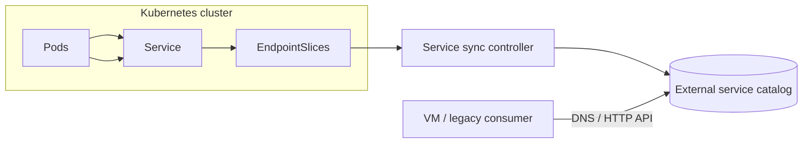

# When to Combine Kubernetes with an External Registry

Kubernetes already has its own service discovery mechanism. A `Service` groups backend Pods behind a stable address; in-cluster DNS lets workloads look up services by name; EndpointSlice tracks endpoint lists and readiness state. Therefore, if all applications run in a single cluster and only need to call internal services, you generally do not need to deploy Eureka or Consul as well.

An external registry becomes valuable when Kubernetes boundaries no longer match the system's communication boundaries: part of the workload still runs on VMs or bare metal, multiple clusters need to share services, legacy applications only speak Eureka/Consul, or an organization needs a shared catalog across multiple platforms. This lesson helps determine when native Kubernetes discovery is enough, when to use Spring Cloud Kubernetes, and when integrating a registry such as Consul or Eureka is warranted.

## 1. What does Kubernetes already provide?

### 1.1. Services create a stable address for a group of Pods

Pods are short-lived and their IPs can change when recreated. A Kubernetes `Service` provides a stable name and endpoint so clients do not need to track individual Pods. For a standard Service, the control plane matches Pods by selector and updates EndpointSlices whenever the backend set changes.

Example `inventory` Service in the `shop` namespace:

```yaml
apiVersion: v1
kind: Service
metadata:
  name: inventory
  namespace: shop
spec:
  selector:
    app: inventory
  ports:
    - name: http
      port: 80
      targetPort: 8080
```

Pods in the same namespace can call the service at:

```text
http://inventory
```

Pods in another namespace can use the fuller name:

```text
http://inventory.shop.svc.cluster.local
```

`cluster.local` is a common cluster domain, though a cluster can be configured with a different domain. Check the Pod's DNS search domains or cluster configuration instead of hardcoding this suffix across every environment.

The default Service type is `ClusterIP`, providing a cluster-internal address. Kubernetes DNS resolves the service name; Service networking routes traffic to eligible backends. `NodePort`, `LoadBalancer`, or Ingress/Gateway serve external access needs from outside the cluster, but by themselves they do not create a shared discovery catalog across multiple runtimes.

### 1.2. EndpointSlice tracks backends

EndpointSlice stores addresses and conditions of endpoints belonging to a Service. Kubernetes controllers update EndpointSlices when Pods matching the selector are added, removed, or change state.

Common conditions:

- `ready`: whether the endpoint is eligible to receive normal traffic; for Pods, this maps to the Ready condition.
- `serving`: whether the endpoint is currently serving.
- `terminating`: whether the endpoint is in the process of terminating.

A Pod's readiness probe affects whether an endpoint is considered ready. A liveness probe determines when kubelet should restart a container; it does not replace readiness. Thus, Kubernetes Services already have an endpoint-update lifecycle driven by workload health.

Inspect a Service's endpoints:

```bash
kubectl get service inventory -n shop
kubectl get endpointslice -n shop \
  -l kubernetes.io/service-name=inventory
```

If a Service has no backends, check the selector, Pod labels, and readiness before adding another registry.

### 1.3. Headless Services and per-Pod access

If clients need to see individual Pod addresses instead of a single ClusterIP, a headless Service can be used:

```yaml
apiVersion: v1
kind: Service
metadata:
  name: inventory-headless
  namespace: shop
spec:
  clusterIP: None
  selector:
    app: inventory
  ports:
    - name: http
      port: 8080
      targetPort: 8080
```

DNS for a headless Service can return backend addresses instead of a single virtual IP. This style is useful for StatefulSets or clients that need to connect directly to each member. Confirm whether clients truly need to know individual instances or only need a single stable endpoint before choosing a headless Service.

## 2. When is native Kubernetes discovery enough?

Kubernetes Services and DNS are usually the simplest choice when all of the following hold:

- Providers and consumers run in the same Kubernetes cluster.
- Services can be accessed via stable DNS names and ports.
- Kubernetes is the primary manager of Pod and endpoint lifecycles.
- Readiness, Service selectors, and EndpointSlices satisfy backend filtering needs.
- No VMs, bare-metal workloads, or out-of-cluster applications need to query the same catalog.
- No shared service identity/catalog spanning multiple clusters or runtimes is required.

For example, `order-service` calling `inventory-service` in the same cluster only needs the URL `http://inventory.shop.svc.cluster.local`. Adding Eureka or Consul just to turn a DNS name into a service ID usually introduces extra servers, credentials, registration sync, and another stateful layer to operate.

| Need | Suitable starting mechanism |
| --- | --- |
| Calling internal services in one cluster | Kubernetes Service + DNS |
| Distributing traffic to Ready Pods | Service networking + EndpointSlice |
| Fetching instance lists/metadata via Spring API | Spring Cloud Kubernetes `DiscoveryClient` |
| Needing per-Pod addresses for a StatefulSet | Headless Service and DNS |
| Accessing an out-of-cluster backend via DNS | `ExternalName` Service or selectorless Service with EndpointSlice, depending on requirements |
| Needing a shared catalog across VMs, Kubernetes, and multiple clusters | Consider Consul or an external registry |

You do not need an external registry just because an application is written with Spring Cloud. Spring Cloud can use Kubernetes as its discovery source via Spring Cloud Kubernetes, or use Service DNS directly.

## 3. Spring Cloud Kubernetes is not an external registry

If your codebase needs the `DiscoveryClient` API instead of calling hostnames directly, Spring Cloud Kubernetes provides an implementation that reads Kubernetes Services/endpoints. This is still Kubernetes API-based discovery, not a standalone registry server like Eureka or Consul.

Example Maven dependency with the Fabric8 client:

```xml
<dependency>
    <groupId>org.springframework.cloud</groupId>
    <artifactId>spring-cloud-starter-kubernetes-fabric8</artifactId>
</dependency>
```

Spring Cloud Kubernetes also supports Kubernetes Java Client; the exact starter and version must match your project's Spring Cloud release train. Once configured, the application can inject `DiscoveryClient`:

```java
import java.util.List;

import org.springframework.cloud.client.ServiceInstance;
import org.springframework.cloud.client.discovery.DiscoveryClient;
import org.springframework.stereotype.Service;

@Service
public class InventoryLookup {

    private final DiscoveryClient discoveryClient;

    public InventoryLookup(DiscoveryClient discoveryClient) {
        this.discoveryClient = discoveryClient;
    }

    public List<ServiceInstance> findInstances() {
        return discoveryClient.getInstances("inventory");
    }
}
```

The Kubernetes Service name is the source of discovery names. `spring.application.name` does not automatically rename a Kubernetes Service; if a Spring Cloud component needs to identify the local service, keep the Service name and `spring.application.name` consistent.

### 3.1. Namespace scoping and access permissions

The discovery client needs to know which namespaces to search for services. You can restrict it to a default namespace or specify explicit namespaces. Searching all namespaces can increase the number of objects read and load on the Kubernetes API; enable it only when truly needed.

When the discovery client queries the Kubernetes API directly, the Pod needs an appropriate ServiceAccount and RBAC. Grant least-privilege permissions for the exact namespaces and resources read by your version/client, typically `get`, `list`, and `watch` on Services and the corresponding endpoint resources. If using EndpointSlices, permissions on `discovery.k8s.io/endpointslices` are required. Do not grant `cluster-admin` just to make discovery work.

Verify permissions in the deployment environment:

```bash
kubectl auth can-i list services \
  --as=system:serviceaccount:shop:order-consumer -n shop

kubectl auth can-i list endpointslices \
  --as=system:serviceaccount:shop:order-consumer -n shop
```

Spring Cloud Kubernetes supports namespace scoping and label-based service filtering; use these controls to bound discovery before considering an external catalog.

## 4. When do you need an external registry?

### 4.1. Systems running across both Kubernetes and VMs/bare metal

Some components cannot yet move to Kubernetes, such as legacy Java applications, batch workers, services running on physical hosts, or internal databases. These workloads cannot access Kubernetes Service DNS or the API server by default.

A shared registry like Consul can store services from both Kubernetes and non-Kubernetes nodes. Workloads inside and outside the cluster can look them up via Consul DNS/HTTP API, provided backend addresses are routable from callers.

Example:

```text
Kubernetes cluster                 Datacenter / VM network
  order-service Pods               legacy-pricing VM
  inventory-service Pods           payment-adapter VM
          \                           /
           \                         /
            Consul service catalog
              - inventory-service
              - legacy-pricing
              - payment-adapter
```

This is a case where an external registry brings clear value: it provides a unified discovery view across runtime boundaries.

### 4.2. Multiple Kubernetes clusters needing to discover each other

Default Service DNS is scoped to a single cluster. If `cluster-a` needs to call a service in `cluster-b`, `inventory.shop.svc.cluster.local` in `cluster-a` does not automatically resolve to endpoints in `cluster-b`.

There are several options:

- Use the Multi-Cluster Services API (`ServiceExport`/`ServiceImport`) if supported by your platform and implementation.
- Use a service mesh or federation mechanism suited to your network topology.
- Sync services into Consul to maintain a shared catalog across multiple clusters and non-Kubernetes workloads.
- Use gateways or static endpoints if there are only a few clearly scoped connections.

Do not assume every multi-cluster system needs Eureka/Consul. The MCS API and implementations such as Cilium Cluster Mesh or cloud-provider multi-cluster services can satisfy cross-cluster needs while keeping the Kubernetes Service model.

Conceptual MCS API example:

```yaml
apiVersion: multicluster.x-k8s.io/v1alpha1
kind: ServiceExport
metadata:
  name: inventory
  namespace: shop
```

An MCS implementation creates/imports a service representation in receiving clusters. DNS typically follows `inventory.shop.svc.clusterset.local` under the MCS DNS convention. Exact API groups, CRDs, DNS, and feature support depend on the implementation; follow your platform's documentation rather than applying this manifest blindly.

### 4.3. Out-of-cluster applications needing the same catalog as Pods

If a consumer running on a VM needs to locate a Pod in Kubernetes, or a Pod needs to call a VM service, a shared registry can bridge both sides. A Kubernetes Service can be exposed externally via LoadBalancer/NodePort, but that only creates network reachability; out-of-cluster clients still need to know which services exist and which addresses are current.

Consul service sync can sync Kubernetes Services into the Consul Catalog and sync selected Consul services as Kubernetes Services. That way, nodes outside the cluster can use Consul DNS/HTTP API to find Kubernetes services, while Pods can locate out-of-cluster services via DNS/Kubernetes Services.

### 4.4. Needing a shared service catalog and policies across runtimes

An external registry can be useful when an organization needs:

- A centralized service catalog across multiple datacenters, clusters, or runtimes.
- Standardized metadata/tags/health checks for workloads not running on Kubernetes.
- Centralized ACL and discovery authorization mechanisms.
- A service mesh or encrypted/authenticated connectivity between Kubernetes and out-of-cluster workloads.
- Support for legacy applications already integrated with Eureka/Consul that cannot yet migrate to Kubernetes API/DNS.
- A migration period where providers and consumers are split between old and new environments.

These needs must be backed by concrete operational requirements. If you only need a stable hostname inside a cluster, an external registry is usually unnecessary overhead.

## 5. Choosing an integration model

Three organizational patterns are common.

### 5.1. Applications in Pods self-register with an external registry

Applications running in Pods use Eureka Client or Spring Cloud Consul to register themselves with an external server. This fits when preserving existing Spring Cloud behavior during migration or when services must register into a shared catalog.

Example Eureka Client configuration:

```yaml
spring:
  application:
    name: order-service

eureka:
  client:
    register-with-eureka: true
    fetch-registry: true
    service-url:
      defaultZone: ${EUREKA_SERVER_URL}
  instance:
    prefer-ip-address: true
    metadata-map:
      runtime: kubernetes
      cluster: ${K8S_CLUSTER_NAME}
      namespace: ${POD_NAMESPACE}
```

This example illustrates registering with a Eureka Server reachable via `EUREKA_SERVER_URL`. `POD_NAMESPACE` and `K8S_CLUSTER_NAME` must be passed via environment variables or the Downward API; `prefer-ip-address` only changes how the host is advertised and does not guarantee Pod IPs are routable from VMs or other clusters.

Eureka Client does not automatically read Kubernetes Services and EndpointSlices to create registrations. In this model, each application Pod actively registers its own instance. If you also want Kubernetes Services or non-Eureka workloads in the same registry, a deployed and operated bridge/controller is required; endpoint syncing, metadata, and deregistration rules must be clearly defined.

With Consul, applications typically connect to a Consul Agent/HTTP endpoint per Spring Cloud Consul configuration. In production, handle ACL tokens, TLS, network routes, and deregistration when Pods terminate. Never bake tokens into images or commit secrets into source YAML.

### 5.2. Syncing Kubernetes Services into Consul

If you do not want each application to self-register, Consul Kubernetes integration can sync the service catalog. `consul-k8s` Helm configuration can enable bidirectional or unidirectional sync:

```yaml
syncCatalog:
  enabled: true
  toConsul: true
  toK8S: false
```

The example above syncs Kubernetes Services to Consul only. If the reverse direction is needed, `toK8S` can be enabled according to the Helm chart version's guide. You can restrict which namespaces/services are synced to avoid publishing every internal service into the shared catalog.

Before enabling sync, verify which endpoints are registered. Syncing a ClusterIP or Pod IP does not automatically create network routes from VMs/other clusters to those private addresses. If consumers are outside the cluster, proper network connectivity, routable addresses, gateways, or a service mesh are required.

Do not enable Service Sync for a service already auto-registered by Consul Service Mesh via sidecar; two mechanisms managing the same service can create duplicate registrations. Follow the sync enable/disable guidance for your exact Consul K8s version.

### 5.3. Using Kubernetes as source of truth and external registry as federated catalog

In this model, Kubernetes manages the Pod and Service lifecycle; a controller/sync process mirrors needed endpoints to the external registry. Kubernetes applications can keep using Service DNS, while out-of-cluster consumers use Consul or the shared registry.



The key decision is sync direction and authoritative source of truth. If Kubernetes manages Pods, do not let an independent process create a second registration for the same endpoint without clear ID, ownership, and cleanup rules.

## 6. Consul, Eureka, or Kubernetes native?

| Criterion | Kubernetes Service / DNS | Spring Cloud Kubernetes | Consul | Eureka |
| --- | --- | --- | --- | --- |
| Natural scope | Single cluster | Kubernetes API and authorized namespaces | Multiple runtimes/datacenters per Consul topology | Applications integrated with Eureka over the network to the server |
| Data source | Services, selectors, EndpointSlices | Kubernetes Services/endpoints | Consul Catalog and integrations/sync | Eureka Client registrations and peer registries |
| Requires separate registry server | No | No, uses Kubernetes API | Yes, Consul agent/server depending on architecture | Yes, Eureka Server/peer cluster |
| Health/lifecycle | Readiness, EndpointSlice, Service controller | Reads endpoints/services from Kubernetes API | Health checks, catalog, service sync, mesh | Heartbeats/leases and Eureka registry behavior |
| Out-of-cluster workloads | Needs custom endpoint/network setup | Limited by Kubernetes API scope and service types | Explicit VM/non-Kubernetes support | Suitable if external apps already use Eureka Client |
| Multi-cluster | Not automatic via cluster-local DNS | Depends on configured API/implementation | Can use federation/peering/catalog integration | Can use shared peers/registry if network and topology allow |
| Operations | Fewest components in cluster | RBAC and API access | Additional control plane, ACLs, TLS, sync/mesh | Additional server, peers, client heartbeats, and network config |

Choose the mechanism based on discovery boundaries. Kubernetes native is usually optimal for in-cluster workloads; Spring Cloud Kubernetes preserves the `DiscoveryClient` abstraction; Consul fits multi-runtime catalogs; Eureka fits when the application ecosystem already relies on Eureka and needs a shared registry.

## 7. Health checks and endpoint state across two systems

Kubernetes readiness and external registry health checks are not completely identical:

- Readiness determines whether a Pod is considered ready in EndpointSlice/Service traffic.
- Consul health checks or Eureka leases/heartbeats update status in the external registry.
- Service sync must accurately reflect endpoint lifecycles and delete/mark endpoints when Pods are deleted or become unready, according to integration semantics.

If both systems perform health checks, define the goal of each check. For instance, readiness can check whether the application is ready to handle requests; a Consul check can verify whether the endpoint is reachable from the Consul Agent's network. The two results can diverge if a network partition occurs between the Agent and the Pod.

When a Pod stops being Ready, EndpointSlice reflects the new state. However, registrations in the external registry only change when the application deregisters, a health check updates, or the sync controller reconciles. Therefore, a window can exist where an old endpoint remains visible in the external registry. Measure and configure convergence time, health intervals, TTLs, and caches according to availability requirements.

Do not use the exact same health check at every layer without considering actual network paths. An endpoint might be reachable from a Pod in the same cluster yet unreachable from a VM; or a registry agent might fail to reach a Pod even while the Pod remains Ready.

## 8. Avoiding two sources of truth and duplicate registrations

Combining two systems easily creates drift if both believe they own the same endpoint.

Principles to apply:

1. **Choose an authoritative source:** Kubernetes manages in-cluster Pods/Services; the external registry manages out-of-cluster services or holds a controlled synced copy.
2. **Choose sync direction:** Kubernetes to Consul, Consul to Kubernetes, or bidirectional. Do not enable bidirectional sync just because a chart supports it.
3. **Establish clear identities:** preserve service name, namespace, cluster, and instance identity to distinguish same-named registrations from different environments.
4. **Define cleanup rules:** when a Pod is deleted, a deployment scales down, or the sync process stops, specify which component deregisters old endpoints.
5. **Avoid duplicate syncing:** do not let applications self-register while a sync controller also registers the same instance unless ownership/deduplication rules exist.
6. **Limit scope:** only export/sync services that external consumers actually need; do not publish all internal services by default.
7. **Verify reachability:** addresses in the catalog must be reachable by consumers over real networks, not just valid as IP/port strings.

A registry returning stale endpoints can cause LoadBalancer to send requests to terminated Pods. When that happens, inspect Kubernetes state, EndpointSlices, the registry catalog, and the latest sync timestamp rather than only deleting records manually.

## 9. Security when combining registries

When discovery crosses cluster boundaries, access scope expands as well. Both the Kubernetes API and the external registry must be secured:

- Use dedicated ServiceAccounts for applications or sync controllers; grant least-privilege RBAC.
- Protect Consul/Eureka endpoints with network policies, firewalls, TLS, and proper authentication.
- Use dedicated ACLs/tokens for service sync; store them in Secrets or a secret manager and rotate them periodically.
- Sync only necessary metadata; never place secrets, credentials, or sensitive internal details in service metadata.
- Do not expose the Kubernetes API server or Consul HTTP API to the public Internet just for discovery to function.
- Restrict exported services by namespace, label, or annotation; authorize who can export services.
- Ensure advertised Pod/VM addresses do not create access paths bypassing intended network policies or security boundaries.

Discovery only tells a caller that an endpoint exists and may be eligible for selection. It does not replace authentication, authorization, mTLS, or network segmentation when services communicate.

## 10. Decision workflow

When designing discovery for a new service, answer in sequence:

1. Does the consumer run in the same Kubernetes cluster as the provider? If yes, try Service DNS first.
2. Does the consumer need per-instance lists or metadata via an API? If yes, evaluate Spring Cloud Kubernetes `DiscoveryClient`.
3. Are there consumers on VMs, bare metal, other clusters, or legacy apps needing the same catalog? If yes, select an external registry or multi-cluster mechanism.
4. Are there only multiple Kubernetes clusters or multiple runtimes as well? For pure multi-cluster Kubernetes, compare MCS API/service mesh against a shared registry.
5. Are backend addresses routable from out-of-cluster consumers? If not, solve networking/gateways/mesh before syncing the catalog.
6. What is the source of truth and who is responsible for deregistration? Document this clearly before enabling sync.
7. Have health semantics, TTL/caching, ACLs, and RBAC been tested?

The final decision should be grounded in the consumer/provider matrix:

| Provider | Consumer | Initial recommendation |
| --- | --- | --- |
| Kubernetes | Kubernetes in same cluster | Service + DNS; Spring Cloud Kubernetes if `DiscoveryClient` is needed. |
| Kubernetes cluster A | Kubernetes cluster B | MCS API or multi-cluster service mesh; Consul if a multi-runtime catalog is needed. |
| Kubernetes | VM/bare metal | Consul service sync or shared registry; verify Pod IPs are routable. |
| VM/bare metal | Kubernetes | Sync Kubernetes services into a shared catalog or use an explicitly managed gateway/endpoint. |
| Mixed Kubernetes and VM | Mixed Kubernetes and VM | An external registry like Consul can serve as a shared catalog; define ownership and networking first. |

## 11. Verification and troubleshooting

### 11.1. Verifying native discovery

```bash
kubectl get svc -n shop
kubectl get pods -n shop -l app=inventory
kubectl get endpointslice -n shop \
  -l kubernetes.io/service-name=inventory
kubectl describe service inventory -n shop
```

If DNS does not resolve, check CoreDNS and namespace search paths. If EndpointSlice is empty, check the selector, labels, and readiness. If endpoints exist yet connections fail, check `port`/`targetPort`, NetworkPolicy, and CNI/network routing.

### 11.2. Verifying Spring Cloud Kubernetes

- Check the compatible starter/client implementation and release train.
- Check the ServiceAccount, Role/ClusterRole, and RoleBinding.
- Restrict discovery namespaces to avoid overly broad reads.
- Check `DiscoveryClient.getServices()` and `getInstances(serviceId)`.
- If using EndpointSlice mode, verify the cluster supports the API and RBAC grants `get`, `list`, `watch` on that resource.

### 11.3. Verifying external registries and sync

- Verify the catalog has the right service name, namespace, cluster, and instance ID.
- Compare endpoints in the registry against EndpointSlices and actual Pod IP/port values.
- Check the last reconcile/sync timestamp and sync controller logs.
- Verify ACL tokens, TLS, DNS, and routes from consumers to backends.
- Check for duplicate registrations or stale entries after scale-downs/rollouts.
- Test calling endpoints from the consumer's actual network, not only from inside the provider Pod.

| Symptom | Possible cause | Resolution |
| --- | --- | --- |
| Pods call via DNS but VMs cannot find the service | Cluster-local DNS is not resolved by VMs | Use a shared registry, gateway, or appropriate DNS federation. |
| Consul shows the service yet VMs cannot connect | Catalog holds private Pod IPs unroutable from VMs | Set up network routes, gateways, or sync only reachable endpoints. |
| Registry keeps endpoint after Pod deletion | Delayed sync/deregistration or two components owning registrations | Check the controller, TTL, health checks, and ownership. |
| Spring Cloud Kubernetes returns an empty list | Wrong namespace, missing RBAC, Service has no Ready endpoints, or wrong service name | Check namespace, `kubectl auth can-i`, EndpointSlices, and Service name. |
| A service appears twice in Consul | App self-registers alongside service sync or service mesh | Choose one ownership mechanism and remove duplicate sync. |
| Service in another cluster does not resolve | Cluster-local DNS lacks cross-cluster scope or MCS/federation is unconfigured | Use supported MCS API, service mesh, or registry federation. |

## 12. Key takeaways

- Kubernetes Services, DNS, and EndpointSlices are usually sufficient for internal discovery within a single cluster.
- Spring Cloud Kubernetes provides a `DiscoveryClient` that reads Kubernetes Services/endpoints; it is not an external registry server.
- An external registry adds value when a shared catalog is needed across Kubernetes, VMs, bare metal, legacy apps, or multiple environments.
- Multiple clusters do not automatically require Eureka/Consul; MCS API and multi-cluster service meshes are alternatives.
- Consul service sync can sync catalogs bidirectionally, but network reachability must be ensured and duplicate sync with Consul Service Mesh avoided.
- Pick a single authoritative source for endpoint lifecycles; clearly define sync direction, identity, health checks, and cleanup.
- Protect the Kubernetes API with RBAC and registries with TLS/ACLs; discovery does not replace communication security.

## References

- [Kubernetes: Service and service discovery](https://kubernetes.io/docs/concepts/services-networking/service/)
- [Kubernetes: EndpointSlices](https://kubernetes.io/docs/concepts/services-networking/endpoint-slices/)
- [Spring Cloud Kubernetes: DiscoveryClient](https://docs.spring.io/spring-cloud-kubernetes/reference/discovery-client.html)
- [Consul: Service sync between Kubernetes and Consul](https://docs.hashicorp.com/consul/docs/register/service/k8s/service-sync)
- [Kubernetes Multi-Cluster Services API (KEP-1645)](https://github.com/kubernetes/enhancements/blob/master/keps/sig-multicluster/1645-multi-cluster-services-api/README.md)
