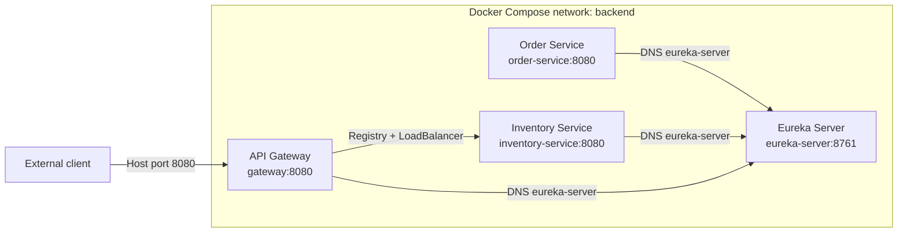

# Hostnames, Internal DNS, and Docker Compose Networking

When running microservices with Docker Compose, each container has its own network namespace and IP address. IP addresses can change when containers are recreated, so application configuration should use a hostname or service name that resolves reliably within the Compose network rather than hardcoding IPs.

Docker Compose provides internal DNS so services on the same network can find each other by service name or network alias. Spring Cloud Service Discovery such as Eureka or Consul is a separate layer: the registry stores the service ID, instance address, and registration status for consumers to look up. Both layers can work together. Docker DNS helps containers connect to the registry and network addresses; the registry helps applications find instances by service ID.

## How Does Docker Compose Create Internal DNS?

When running `docker compose up`, Compose typically creates a default network for the project. Services attached to the same network can resolve each other by service name. For example, service `eureka-server` can be accessed from `order-service` via hostname `eureka-server`.



In this example, `eureka-server`, `inventory-service`, `order-service`, and `gateway` are Compose service names. Internal DNS resolves those names to container addresses on the shared network.

Key characteristics:

- Service names remain stable across container recreations, whereas container IPs can change.
- Internal DNS is only valid for containers attached to the same network or reachable networks.
- A service can be attached to multiple networks and have different aliases on each network.
- You do not need to declare `container_name` just for services to call each other by name.
- Do not hardcode container IPs into `application.yml`, environment variables, or Eureka client config.

## Service Name, Hostname, and Network Alias

In Docker Compose, the service name is the most common and easiest DNS name to manage. For example:

```yaml
services:
  eureka-server:
    image: example/eureka-server:1.0

  order-service:
    image: example/order-service:1.0
```

From the `order-service` container, the hostname `eureka-server` can be resolved if both are on the same network. Compose also allows declaring per-network aliases:

```yaml
services:
  eureka-server:
    image: example/eureka-server:1.0
    networks:
      backend:
        aliases:
          - discovery.internal

  order-service:
    image: example/order-service:1.0
    networks:
      - backend

networks:
  backend:
```

Then `order-service` can connect using `eureka-server` or `discovery.internal`. An alias is only meaningful on the network where it is declared. If multiple containers register the same alias, DNS may return multiple addresses; only use a shared alias when that behavior is intended.

Do not confuse these three concepts:

| Value | Meaning | Example |
|---|---|---|
| Compose service name | Service name used by Compose to create a DNS record | `inventory-service` |
| Container hostname | Hostname inside the container; can be set separately | `inventory-node-a` |
| Network alias | Additional name valid only within one network | `inventory.internal` |

`container_name` names the container at the Docker daemon level, but it limits scaling a service to multiple containers. For applications needing multiple replicas, prefer service names, network aliases, and distinct hostnames/instance IDs instead of fixing a single `container_name`.

## Distinguishing Compose DNS from Spring Cloud Service Discovery

Docker DNS and a registry solve two different questions:

| Mechanism | Looks up by | Data returned | Typical scope |
|---|---|---|---|
| Docker Compose DNS | Service name or network alias | Container IP address on the network | Containers on the same network |
| Eureka / Consul / ZooKeeper | Service ID | Registered instances, hosts, ports, and metadata | Applications configured to connect to the registry |
| Spring Cloud LoadBalancer | Service ID from HTTP URI or API | One instance chosen from the discovery list | Consumer/Gateway with LoadBalancer |

Example of calling directly via Docker DNS:

```text
http://inventory-service:8080/api/items/42
```

Example of calling via Spring Cloud LoadBalancer:

```text
http://inventory-service/api/items/42
```

The second URL only works when the request goes through an HTTP client integrated with `@LoadBalanced` or the corresponding LoadBalancer mechanism. The host `inventory-service` in this case is a service ID looked up via discovery, not a request for Compose DNS to resolve directly.

Compose DNS can be convenient for a small lab or a simple service. However, DNS does not natively provide business metadata, registry health status, zone, version, or Spring Cloud instance selection policies. It also does not replace Eureka/Consul if the application needs those capabilities.

## `localhost` Inside a Container Always Points to That Container

This is the most common configuration mistake when moving an application from running directly on the host to Docker Compose.

- From the host machine, `localhost:8761` may point to the Eureka port published to the host.
- From the `order-service` container, `localhost:8761` points to the `order-service` container itself, not the `eureka-server` container.
- From the `inventory-service` container, `localhost:8080` points to the inventory container itself.

Therefore, Eureka client configuration inside a container must use the Compose service name:

```yaml
eureka:
  client:
    service-url:
      defaultZone: http://eureka-server:8761/eureka/
```

Meanwhile, if you run a Java application directly on the host machine for testing, that application can use `http://localhost:8761/eureka/` when Compose has published port 8761 to the host.

Do not use `localhost` as the instance address registered by Eureka if consumers run in other containers. When a consumer calls that address, it connects to the consumer container itself and typically hits connection refused.

## Port Mapping: Host Port Differs from Container Port

Declare `ports` in `HOST_PORT:CONTAINER_PORT` format to publish container ports to the host machine:

```yaml
services:
  eureka-server:
    image: example/eureka-server:1.0
    ports:
      - "8761:8761"

  inventory-service:
    image: example/inventory-service:1.0
    ports:
      - "18081:8080"
```

From the host machine:

```text
http://localhost:8761
http://localhost:18081
```

From another container on the same Compose network:

```text
http://eureka-server:8761
http://inventory-service:8080
```

The `inventory-service` container still listens on port 8080 inside the network; port 18081 is only the host port mapped to it. Other containers do not call `inventory-service:18081` unless the application actually listens on that port inside the container.

There is no need to publish every service port to the host. Usually only the Gateway or endpoints needed from the development machine are published; the registry and internal services can stay exposed only on the backend network.

`expose` can be used to document ports a service offers to other containers, but it does not create a separate security boundary and does not replace network membership. Containers on the same network can still connect to listening ports even if `expose` is not declared.

## Declaring Separate Networks for Backend and Gateway

The default Compose network is often sufficient for labs. For clearer structure, you can separate external and internal networks:

```yaml
services:
  gateway:
    image: example/gateway:1.0
    ports:
      - "8080:8080"
    networks:
      - edge
      - backend

  eureka-server:
    image: example/eureka-server:1.0
    networks:
      - backend

  inventory-service:
    image: example/inventory-service:1.0
    networks:
      - backend

  order-service:
    image: example/order-service:1.0
    networks:
      - backend

networks:
  edge:
  backend:
```

In this configuration, Gateway joins both `edge` and `backend`; backend services and the registry join only `backend`. External clients access Gateway via host port 8080. Backend services do not need to be published directly to the host.

A container can only resolve service names on networks it belongs to. If `order-service` does not share a network with `eureka-server`, the name `eureka-server` will not resolve from `order-service`, even when the service is running.

You can declare `external: true` so multiple Compose projects share a pre-created network. When doing so, manage the network lifecycle and alias names carefully to avoid collisions across projects.

## Configuring Eureka Server and Clients in Compose

### Eureka Server

For a single-node standalone Eureka Server in a lab, the server configuration can be:

```yaml
server:
  port: 8761

spring:
  application:
    name: eureka-server

eureka:
  client:
    register-with-eureka: false
    fetch-registry: false
```

Eureka Server still serves the registry API on port 8761. The `register-with-eureka` and `fetch-registry` flags disable peer client behavior on the standalone node; they do not disable the HTTP server.

### Eureka Client

Services running in Compose need to use the Eureka service's hostname:

```yaml
spring:
  application:
    name: inventory-service

eureka:
  client:
    service-url:
      defaultZone: http://eureka-server:8761/eureka/
    register-with-eureka: true
    fetch-registry: true
  instance:
    prefer-ip-address: true
```

`prefer-ip-address: true` instructs the Eureka Client to advertise the instance IP instead of its hostname. In Compose, container IPs are usually reachable by containers on the same network. Verify the actual address appearing on the Eureka Dashboard and test connectivity from the Gateway/consumer.

The key point is that the address advertised in `ServiceInstance` must be reachable from consumers. If the registry stores `localhost`, an IP from another network, or a hostname that does not resolve in the consumer's network, lookup may succeed while business calls still fail.

With multiple replicas, each instance needs its own reachable address and a unique instance ID. Do not let all replicas register the same indistinguishable address. When scaling a service, avoid fixed `container_name` and inspect each registration entry in the registry.

### Configuration via Environment Variables

You can pass Spring Boot configuration via environment variables in Compose:

```yaml
services:
  order-service:
    image: example/order-service:1.0
    environment:
      SPRING_APPLICATION_NAME: order-service
      EUREKA_CLIENT_SERVICEURL_DEFAULTZONE: http://eureka-server:8761/eureka/
      EUREKA_INSTANCE_PREFER_IP_ADDRESS: "true"
    networks:
      - backend
```

Environment variable names follow Spring Boot's relaxed binding rules. For map-type properties like `service-url.defaultZone`, verify that the value binds properly using runtime config or startup logs of the version in use. To keep configuration readable and avoid variable naming mistakes, you can mount `application-docker.yml` into the container and activate the `docker` profile.

## Complete Docker Compose Example

The example below illustrates one Eureka Server, two backend services, and one Gateway. Image names are placeholders; replace them with your project's built images.

```yaml
services:
  eureka-server:
    image: example/eureka-server:1.0
    ports:
      - "8761:8761"
    networks:
      - backend
    healthcheck:
      test: ["CMD-SHELL", "curl -fsS http://localhost:8761/actuator/health || exit 1"]
      interval: 10s
      timeout: 3s
      retries: 12
      start_period: 20s

  inventory-service:
    image: example/inventory-service:1.0
    environment:
      SPRING_APPLICATION_NAME: inventory-service
      EUREKA_CLIENT_SERVICEURL_DEFAULTZONE: http://eureka-server:8761/eureka/
      EUREKA_INSTANCE_PREFER_IP_ADDRESS: "true"
    depends_on:
      eureka-server:
        condition: service_healthy
    networks:
      - backend

  order-service:
    image: example/order-service:1.0
    environment:
      SPRING_APPLICATION_NAME: order-service
      EUREKA_CLIENT_SERVICEURL_DEFAULTZONE: http://eureka-server:8761/eureka/
      EUREKA_INSTANCE_PREFER_IP_ADDRESS: "true"
    depends_on:
      eureka-server:
        condition: service_healthy
    networks:
      - backend

  gateway:
    image: example/gateway:1.0
    ports:
      - "8080:8080"
    environment:
      SPRING_APPLICATION_NAME: gateway
      EUREKA_CLIENT_SERVICEURL_DEFAULTZONE: http://eureka-server:8761/eureka/
      EUREKA_INSTANCE_PREFER_IP_ADDRESS: "true"
    depends_on:
      eureka-server:
        condition: service_healthy
    networks:
      - edge
      - backend

networks:
  edge:
  backend:
```

The healthcheck above requires the Eureka image to have the `curl` command and the Actuator health endpoint enabled and accessible. If the image does not have `curl`, install an appropriate check tool or use a corresponding healthcheck available in the image. Do not expose administrative health endpoints publicly just to serve healthchecks.

`depends_on` with `condition: service_healthy` tells Compose to wait for Eureka Server's healthcheck to reach the healthy state before creating dependent services in Compose versions that support this condition. It does not guarantee the registry is fully synchronized or that providers have finished registering. Applications still need retry/backoff when connecting to the registry and must handle an empty instance list during startup.

## Consul and ZooKeeper Also Need Resolvable Hostnames

Compose DNS principles do not depend on a specific registry. If using Consul, clients need to connect to the Consul Agent/server by service name:

```yaml
spring:
  cloud:
    consul:
      host: consul-agent
      port: 8500
      discovery:
        register: true
```

With ZooKeeper:

```yaml
spring:
  cloud:
    zookeeper:
      connect-string: zk-1:2181,zk-2:2181,zk-3:2181
      discovery:
        register: true
```

Hostnames `consul-agent`, `zk-1`, `zk-2`, and `zk-3` must be service names or aliases resolvable from application containers. If the registry runs in a different Compose project, the two projects need to share an external network or have a routable endpoint to each other.

For health checks, the Consul Agent must be able to reach the address and port registered by the service. Do not only check whether the client can reach Consul; also check the path from the agent to the provider's health endpoint.

## Bind Address and Advertised Address Must Match

Spring Boot applications typically listen on all interfaces when `server.address` is not explicitly configured. If you set `server.address: 127.0.0.1`, the application only accepts loopback connections inside the container and other containers cannot reach it over the network.

Inside a container, do not bind a service to loopback if it needs to receive traffic from other containers. You can omit `server.address` to use the appropriate default or set `server.address: 0.0.0.0` when required by application configuration.

Distinguish:

- **Bind address:** the interface the process listens on.
- **Advertised address:** the hostname/IP the registry publishes to consumers.
- **Published host port:** the port on the host machine mapped to the container port.

These three values can differ. For example, the application listens on `0.0.0.0:8080`, Eureka advertises container IP `172.20.0.5:8080`, and the host machine accesses it via `localhost:18081`. Consumers in Compose must use the advertised address they can reach; they do not use host port 18081.

## Docker DNS When Scaling Multiple Replicas

Compose can create multiple containers for the same service using the scale option, for example:

```bash
docker compose up -d --scale inventory-service=3
```

Do not declare a fixed `container_name` for a service that needs to scale. Each replica has its own container and IP. Compose DNS can return multiple addresses for the service name, but DNS round-robin is not equivalent to a registry with per-instance health state and metadata.

When using Eureka/Consul, each replica should register its own instance with a distinct address and instance ID. Gateway uses `lb://inventory-service` so LoadBalancer picks one of the instances returned by the registry. Do not let all replicas advertise `localhost` or an IP unreachable from the Gateway.

If you publish the same fixed host port for all replicas, Compose cannot bind that same host port to multiple containers. Typically only the Gateway is published; backend replicas use internal ports on the network.

## `depends_on` Does Not Replace Retries and Readiness

`depends_on` mainly controls container creation order. Without a health condition, Compose can start client containers right after creating the registry container while the registry application is still booting.

Even with `condition: service_healthy`, the registry may be HTTP-healthy before it is ready to serve every business operation. Providers need connection retries, re-registration after transient failures, and consumers need to handle empty instance lists at startup.

Do not use fixed `sleep` durations as a readiness solution. Healthchecks, retries with backoff, and bounded timeouts help the system adapt better to varying startup times.

## Containers Needing to Access Services Running on the Host Machine

`localhost` inside a container does not point to the host machine. On Docker Desktop, the hostname `host.docker.internal` is commonly provided for containers to call services running on the host:

```text
http://host.docker.internal:9000
```

On Docker Engine for Linux, you may need to declare the host gateway explicitly in Compose:

```yaml
services:
  order-service:
    extra_hosts:
      - "host.docker.internal:host-gateway"
```

Only use this approach when a container genuinely needs to call a process running outside Docker. For services that are also in Compose, prefer service names on a shared network.

## Checking DNS and Connectivity from Inside a Container

When a service cannot connect to the registry or a provider, test from the exact network namespace of the calling container. The commands below require the corresponding tools to be present in the image:

```bash
# View service status
docker compose ps

# View registry logs
docker compose logs eureka-server

# Check internal DNS if the image has getent
docker compose exec order-service getent hosts eureka-server

# Check HTTP endpoint if the image has curl
docker compose exec order-service curl -v http://eureka-server:8761/actuator/health

# List networks created by Compose
docker network ls
```

If a minimal image lacks `getent`, `nslookup`, or `curl`, use a temporary debug container attached to the same network to test. Do not install diagnostic tools into production images just for one-off troubleshooting.

You can inspect network details and container endpoints:

```bash
docker network inspect <project>_backend
docker compose config
```

`docker compose config` helps verify the Compose configuration after merging files and interpolating environment variables. Do not share the output if it contains directly interpolated secrets.

## Common Errors

| Symptom | Possible cause | Resolution |
|---|---|---|
| Container calls `localhost:8761` and gets connection refused | `localhost` points to the client container itself | Use `http://eureka-server:8761/eureka/` |
| Host can call Eureka but container cannot | Only tested host port, container is not on same network, or wrong hostname | Verify network membership and use service name with container port |
| Eureka dashboard shows instance but Gateway cannot call it | Registry advertises `localhost`, wrong-network IP, or wrong port | Check the advertised address from Gateway's perspective |
| DNS does not resolve service name | Containers do not share a network or service name/alias is wrong | Check Compose networks and aliases |
| Internal request uses host port and fails | Confused `HOST_PORT` with `CONTAINER_PORT` | Use service name and container port |
| App binds `127.0.0.1` so other containers cannot reach it | Server listens only on loopback | Bind on the appropriate interface, usually `0.0.0.0` |
| After container recreation, calls still go to old IP | Config hardcodes container IP | Use service DNS or registry-updated instances |
| Scaled service has duplicate or unreachable instances | Fixed `container_name` or non-unique advertised address/instance ID | Remove fixed container_name and inspect each registration |
| Client starts before registry | Relies solely on container creation order | Use healthcheck, depends_on condition, and retry/backoff in the app |

## Deployment Checklist

1. Assign stable Compose service names and use them for internal connections.
2. Ensure containers that need to communicate share at least one network.
3. Use service names/aliases instead of hardcoded container IPs.
4. Do not use `localhost` to call another container.
5. Distinguish host ports from container ports; internal services use container ports.
6. Ensure applications bind on an interface that accepts connections from the network.
7. Verify that addresses advertised by Eureka/Consul are reachable from consumers.
8. With multiple replicas, ensure each instance has an appropriate registration and unique instance ID.
9. Use healthchecks and retry/backoff; do not treat `depends_on` as an absolute readiness guarantee.
10. Publish only required ports to the host and restrict the registry/backend to appropriate networks.

## Conclusion

Docker Compose DNS enables containers on the same network to find each other by service name or network alias, so applications do not depend on mutable container IPs. Spring Cloud Service Discovery adds a registry with service IDs, metadata, and instance state. When combining both layers, use service names like `eureka-server` for clients to connect to the registry, ensure instance addresses advertised by the registry are reachable from consumers, distinguish host ports from container ports, and avoid using `localhost` between containers. Healthchecks, retries, and checking networking from inside containers make deployments more reliable.
