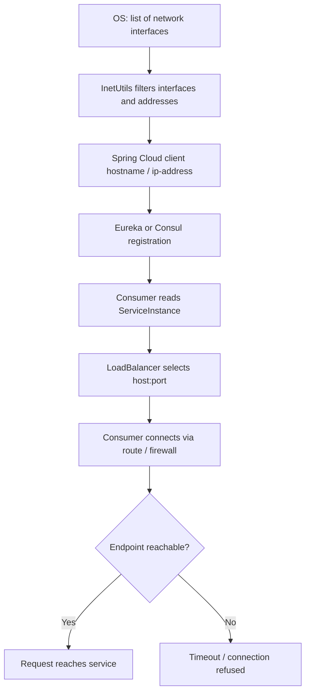

# Multi-Homed Services and InetUtils Selection

A host or container can have multiple network addresses simultaneously: Ethernet cards, Wi-Fi, VPN, Docker bridges, Kubernetes interfaces, management interfaces, and loopback. When a Spring Cloud application auto-detects an address to register in Eureka or Consul, the chosen address may not be the one consumers can reach.

`InetUtils` in Spring Cloud Commons helps find a suitable hostname and IP from the machine's network interfaces. You can filter interfaces by name, prefer address ranges, or restrict to site-local addresses. However, picking the right IP is only part of the problem: the address advertised in the registry must also align with the application port, firewalls, network routes, and the consumer's perspective.

## 1. Why Do Multi-Interface Machines Easily Register the Wrong Address?

Suppose a machine running `inventory-service` has the following interfaces:

| Interface | Example address | Purpose | Reachable by consumers? |
|---|---|---|---|
| `lo` | `127.0.0.1` | Internal loopback | Only processes in the same network namespace |
| `eth0` | `10.42.1.20` | Application network | Yes, from the service subnet |
| `docker0` | `172.17.0.1` | Docker bridge on the host | Usually suitable only for host/containers on the same bridge |
| `tun0` | `10.8.0.12` | Admin VPN | Only nodes with a VPN route |
| `eth1` | `192.168.50.20` | Management or storage network | Not necessarily reachable by consumer services |

If the service registers `172.17.0.1` or `10.8.0.12` while consumers can only route to `10.42.1.20`, the registry may still show the instance as `UP`, but actual requests will time out or hit connection refused.

The address path can be pictured as follows:



## 2. What Does InetUtils Do?

`InetUtils` looks for a suitable non-loopback address and constructs host information containing a hostname and an IP. Spring Cloud Commons uses this as shared host information, which discovery components can use when no separate advertisement configuration is provided.

Selection is governed by filters:

1. The interface must be up and not listed in `ignored-interfaces`.
2. Loopback addresses are not used as ordinary advertised addresses.
3. If `preferred-networks` is configured, the address should match a preferred network pattern.
4. If `use-only-site-local-interfaces` is enabled, only addresses recognized by Java as site-local are eligible.
5. If no suitable host is found or an error occurs, InetUtils can return the configured default hostname/IP.

Do not rely on the interface enumeration order returned by the operating system. Enumeration order can vary across machines, operating systems, containers, and restarts. When multiple NICs exist, declare explicit selection criteria instead of assuming `eth0` is always chosen.

`InetUtils` does not:

- Open ports or bind the web server to an interface.
- Create routes between subnets or configure firewalls.
- Verify whether consumers can connect to the chosen address.
- Override addresses explicitly configured for Eureka/Consul.
- Guarantee the registered address stays valid after network changes.

## 3. Important InetUtils Properties

Current properties in Spring Cloud Commons 5.1.0:

| Property | Default | Effect |
|---|---|---|
| `spring.cloud.inetutils.ignored-interfaces` | Empty list | Java regular expressions used to ignore network interface names |
| `spring.cloud.inetutils.preferred-networks` | Empty list | Java regular expressions used to prefer IP addresses belonging to desired network ranges |
| `spring.cloud.inetutils.use-only-site-local-interfaces` | `false` | Accepts only site-local addresses when enabled |
| `spring.cloud.inetutils.default-hostname` | `localhost` | Fallback hostname when hostname cannot be determined |
| `spring.cloud.inetutils.default-ip-address` | `127.0.0.1` | Fallback IP when no suitable address is found |
| `spring.cloud.inetutils.timeout-seconds` | `1` | Timeout for computing the hostname, in seconds |

A common misconception: `use-only-site-local-interfaces` defaults to `false`. Spring Cloud does not automatically restrict address selection to private ranges just because the application uses service discovery. If the machine has multiple interfaces, configure `preferred-networks` or `ignored-interfaces` according to the actual topology.

`default-ip-address: 127.0.0.1` is a fallback when address detection fails, not a way to force a service to advertise loopback. If a registry receives `127.0.0.1` on a distributed setup, consumers on other machines will connect back to their own loopback.

## 4. Ignoring Interfaces Not Used for Service Discovery

`spring.cloud.inetutils.ignored-interfaces` accepts a list of regular expressions applied to interface names. For example, if Docker bridges, virtual Ethernet, and admin VPNs are not used as service endpoints:

```yaml
spring:
  cloud:
    inetutils:
      ignored-interfaces:
        - docker0
        - veth.*
        - br-.*
        - tun.*
```

Meaning:

- `docker0`: ignores the Docker bridge interface named exactly `docker0`.
- `veth.*`: ignores interfaces whose name starts with `veth`.
- `br-.*`: ignores bridge interfaces whose name starts with `br-`.
- `tun.*`: ignores VPN interfaces like `tun0`, `tun1` if they do not serve service traffic.

These are regexes, not lists of IP addresses. For example, `10.42.*` should not be put in `ignored-interfaces` to filter IPs; use `preferred-networks` for that purpose.

Do not blindly copy the example list into every environment. A `br-*` or `tun*` interface might actually be the valid network path in your infrastructure. Only ignore an interface after identifying its role and routes.

## 5. Preferring Address Ranges with preferred-networks

`spring.cloud.inetutils.preferred-networks` accepts a list of regular expressions matched against IP addresses. When you want a service to advertise an address from the application subnet `10.42.0.0/16`, you can configure:

```yaml
spring:
  cloud:
    inetutils:
      preferred-networks:
        - '^10\.42\..*'
```

The example above prefers addresses starting with `10.42.`. If multiple subnets are valid, list each pattern:

```yaml
spring:
  cloud:
    inetutils:
      preferred-networks:
        - '^10\.42\..*'
        - '^10\\.43\\..*'
```

In YAML, use single-quoted strings to preserve regex backslashes. This pattern is an IPv4 example; for IPv6, write regexes matching how addresses are formatted in your environment and verify the actual result.

`preferred-networks` selects by address, whereas `ignored-interfaces` excludes by interface name. The two properties solve different problems and can be used together: exclude unwanted interfaces first, then restrict to addresses within advertisable network ranges.

Do not write overly broad regexes like `^10\\..*` if the machine has multiple `10/8` networks for different purposes. Choose the specific subnet that consumers have a route to.

## 6. Using Only Site-Local Addresses

You can enable `use-only-site-local-interfaces` to accept only addresses that `InetAddress.isSiteLocalAddress()` identifies as site-local:

```yaml
spring:
  cloud:
    inetutils:
      use-only-site-local-interfaces: true
```

For IPv4, common private ranges are `10.0.0.0/8`, `172.16.0.0/12`, and `192.168.0.0/16`. However, site-local is a concept defined by Java; do not equate it with every organizational private network policy or a single subnet.

Enabling this property does not solve the case where a machine has two NICs both carrying site-local addresses, such as `10.42.1.20` for applications and `192.168.50.20` for management. You still need `preferred-networks` or to ignore the management interface.

## 7. Combined Configuration for Multi-NIC Machines

Suppose consumers only reach the service over subnet `10.42.0.0/16`, while `docker0`, `veth*`, and `tun*` are unused. You can configure:

```yaml
spring:
  cloud:
    inetutils:
      ignored-interfaces:
        - docker0
        - veth.*
        - tun.*
      preferred-networks:
        - '^10\.42\..*'
      use-only-site-local-interfaces: true
      timeout-seconds: 2
```

In this configuration:

- Docker/VPN interfaces are excluded from host detection.
- Only addresses in the `10.42.*` range are preferred as host information.
- The site-local filter adds the requirement that the address be local in scope according to Java.
- The hostname timeout is increased to 2 seconds to suit environments where internal DNS responds slower than default.

`timeout-seconds` affects computing the hostname, not HTTP connection timeouts to services, not Consul/Eureka registration timeouts, and not network routing waits.

If configuration fails to find a suitable address, inspect the regexes and interfaces before changing `default-ip-address`. Turning the fallback into a static IP is no substitute for selecting the right interface.

## 8. InetUtils and Addresses Advertised by Eureka/Consul

InetUtils provides shared host information for Spring Cloud, yet registry integrations can allow setting explicit addresses. When configuring a registry explicitly, verify the final value received by the registry.

### 8.1. Eureka

With Eureka Client, you can choose to register by IP and specify a concrete address:

```yaml
eureka:
  instance:
    prefer-ip-address: true
    ip-address: ${SERVICE_ADVERTISE_IP:10.42.1.20}
```

If you want to advertise a hostname instead of an IP:

```yaml
eureka:
  instance:
    prefer-ip-address: false
    hostname: ${SERVICE_ADVERTISE_HOST:inventory-1.internal}
```

`prefer-ip-address` determines whether Eureka uses the IP instead of the hostname when building the instance's host name. If you want consumers to call a specific IP, set both `prefer-ip-address: true` and `ip-address`; setting `ip-address` alone while still preferring hostname does not guarantee that address becomes the host used for connections. If you want consumers to call DNS, set `hostname` and keep `prefer-ip-address: false`. After registering, inspect the actual host name field returned by Eureka to confirm the value consumers will use.

### 8.2. Consul

Spring Cloud Consul also allows setting the advertised address:

```yaml
spring:
  cloud:
    consul:
      discovery:
        prefer-ip-address: true
        ip-address: ${SERVICE_ADVERTISE_IP:10.42.1.20}
```

Or advertising a hostname:

```yaml
spring:
  cloud:
    consul:
      discovery:
        prefer-ip-address: false
        hostname: ${SERVICE_ADVERTISE_HOST:inventory-1.internal}
```

The Consul agent is what receives registration requests; `ip-address`/`hostname` under discovery is the service endpoint consumers will access. Do not mistake the Consul Agent address for the application's address.

## 9. Advertised Address Differs from Server Bind Address

These are two configurations with different purposes:

| Configuration | Role |
|---|---|
| `server.address` | Interface address to which the embedded web server binds to listen for requests |
| `spring.cloud.inetutils.*` | Rules for Spring Cloud to detect the machine's hostname/IP |
| `eureka.instance.ip-address` / `hostname` | Address Eureka advertises for the instance |
| `spring.cloud.consul.discovery.ip-address` / `hostname` | Address Consul writes into the service registration |

For example, `server.address: 0.0.0.0` allows the web server to listen on all eligible IPv4 interfaces. It does not tell Eureka or Consul which address consumers should call. Conversely, registering `10.42.1.20` does not automatically ensure the application is bound to that interface or that a firewall allows traffic.

For a service to be callable, three things must agree:

1. The application listens on the right port/interface.
2. The registry stores an address to which consumers can route.
3. Firewalls, security groups, container networks, and routes allow consumers to connect.

## 10. Docker, Kubernetes, VPN, and Developer Machines

| Environment | Common issue | How to choose the address |
|---|---|---|
| Developer machine with Wi-Fi + VPN | InetUtils may pick a VPN IP or Wi-Fi not on the consumer's network | Use `preferred-networks` for the required subnet or configure the advertised IP/hostname explicitly |
| Docker host | `docker0`, bridge, or `veth*` may be picked instead of the service interface | Ignore unused bridge interfaces; advertise a DNS/IP address reachable by consumer containers |
| Containers on the same Docker network | Host bridge IP may not route from other containers | Use service/container DNS and container port if topology supports it |
| Kubernetes Pod | Pod has multiple interfaces or sidecar networks; host address differs from pod IP | Decide whether consumers call Pod IP, Kubernetes Service DNS, or headless service; configure registry to match that model |
| Multi-NIC VM | Management/storage interface may be picked | Specify the preferred subnet and verify bidirectional routing |

In Kubernetes, if services are already called via Kubernetes Service DNS, consider using platform-native discovery instead of advertising pod addresses through another registry. If integrating Eureka/Consul, decide whether consumers need Pod IP, service virtual IP, or internal DNS, and configure consistently.

## 11. Checking Addresses Before and After Registration

Before tuning InetUtils, inspect the actual interfaces and addresses on the machine running the service.

Linux:

```bash
ip -br addr
ip route
ip route get 10.42.2.30
```

Windows PowerShell:

```powershell
Get-NetIPConfiguration
Get-NetIPAddress
```

Test from the consumer's own environment (same container/network namespace if applicable):

```bash
nc -vz 10.42.1.20 8081
curl -v http://10.42.1.20:8081/actuator/health
```

Replace the IP and port with the actual endpoint returned by the registry. `nc`/`curl` tests connectivity from the consumer; a successful ping does not prove the application's TCP port is open.

Inside a Spring application, you can log the host information detected by InetUtils:

```java
import org.springframework.boot.ApplicationRunner;
import org.springframework.context.annotation.Bean;
import org.springframework.context.annotation.Configuration;
import org.springframework.cloud.commons.util.InetUtils;

@Configuration
class NetworkDiagnosticsConfiguration {

    @Bean
    ApplicationRunner logDetectedHost(InetUtils inetUtils) {
        return args -> {
            InetUtils.HostInfo host = inetUtils.findFirstNonLoopbackHostInfo();
            System.out.printf(
                    "InetUtils hostname=%s ip=%s%n",
                    host.getHostname(), host.getIpAddress());
        };
    }
}
```

The `InetUtils` bean is available when the corresponding Spring Cloud Commons auto-configuration is loaded. This log shows the host information found by InetUtils; cross-check separately with instance metadata in Eureka/Consul to see whether the integration overrides the address.

Do not expose interface details, internal IPs, or network configs over public endpoints. Diagnostic logs should have restricted access.

## 12. Workflow When the Registry Stores the Wrong IP

1. Fetch the actual `address`/host/port from the Eureka Dashboard, Eureka REST API, or Consul Catalog.
2. Check interfaces and IPs on the exact machine/container running the producer.
3. Log `InetUtils.HostInfo` to see the auto-detected address.
4. Check `ignored-interfaces`, `preferred-networks`, and `use-only-site-local-interfaces` in the effective configuration.
5. Check `eureka.instance.ip-address`, `eureka.instance.hostname`, `prefer-ip-address`, or the corresponding Consul properties.
6. Check `server.address` and `server.port` to confirm the server binds/listens properly.
7. From the consumer's network namespace, test TCP/HTTP to the exact address and port in the registry.
8. If host information is right but the registry is wrong, focus on override properties and profile/environment configuration.
9. If the registry is right but consumers cannot connect, investigate routes, firewalls, security groups, DNS, and port mappings.
10. After fixing, restart or re-register the instance, then confirm the registry has received the new address.

Do not try to fix it by randomly changing `server.port`, `default-ip-address`, or disabling health checks. First determine which layer produced the wrong address.

## 13. Common Errors

| Symptom | Cause | Resolution |
|---|---|---|
| Registry stores IP `127.0.0.1` | InetUtils could not find a suitable address and used fallback | Inspect interface detection logs, DNS, and filter config; do not use loopback for consumers on other machines |
| Registry stores Docker bridge IP | Bridge interface was not ignored or was preferred | Add exact regex to `ignored-interfaces` or restrict `preferred-networks` |
| Registry stores VPN IP | VPN interface was treated as a valid address | Ignore the VPN interface if consumers do not use that route, or explicitly select the application subnet |
| Machine has two private IPs and picks the wrong one | `use-only-site-local-interfaces` only filters site-local, not distinguishing app vs. management subnets | Configure `preferred-networks` for the specific subnet |
| Changed `server.address` yet registry still advertises old IP | Bind address and advertised address are two separate settings | Check InetUtils and Eureka/Consul-specific properties |
| `preferred-networks` does not match | Regex does not match the IP string or escaping is wrong in YAML | Check regex and actual IP value; use single-quoted YAML strings |
| Consumers can reach from host but not from container | Different routes/network namespaces | Test from the consumer's exact container/pod, using appropriate internal DNS/IP and port |
| Registered hostname cannot be resolved | Internal DNS or search domains are inconsistent | Use an FQDN resolvable from consumers or register a routable IP |

## 14. Pre-Deployment Checklist

- [ ] Listed interfaces and IP addresses on the exact host/container running the service.
- [ ] Identified the subnet consumers can actually reach.
- [ ] Configured `ignored-interfaces` for unused interface names.
- [ ] Configured `preferred-networks` if the machine has multiple valid subnets.
- [ ] Understood `use-only-site-local-interfaces` defaults to `false` and enabled it only with reason.
- [ ] Not using `default-ip-address` as a way to force an advertised IP.
- [ ] Distinguished InetUtils addresses from the `server.address` bind address.
- [ ] Checked Eureka- or Consul-specific overrides.
- [ ] Hostname/IP and port in the registry are reachable from consumers.
- [ ] Verified Docker/Kubernetes port mappings, DNS, and routes.
- [ ] Confirmed the new address in the registry after updating configuration.
- [ ] Not exposing logs or endpoints containing internal network details publicly.

## References

- [Spring Cloud Commons 5.1.0 — Ignore Network Interfaces and InetUtils](https://docs.spring.io/spring-cloud-commons/reference/spring-cloud-commons/common-abstractions.html)
- [Spring Cloud Commons 5.1.0 — Configuration Properties](https://docs.spring.io/spring-cloud-commons/reference/configprops.html)
- [Spring Cloud Commons — HostInfoEnvironmentPostProcessor source](https://github.com/spring-cloud/spring-cloud-commons/blob/main/spring-cloud-commons/src/main/java/org/springframework/cloud/client/HostInfoEnvironmentPostProcessor.java)
- [Java InetAddress — isSiteLocalAddress](https://docs.oracle.com/en/java/javase/21/docs/api/java.base/java/net/InetAddress.html#isSiteLocalAddress())
- [Spring Cloud Netflix — Eureka Instance Configuration](https://docs.spring.io/spring-cloud-netflix/reference/spring-cloud-netflix.html)
- [Spring Cloud Consul — Service Discovery Configuration](https://docs.spring.io/spring-cloud-consul/reference/discovery.html)
