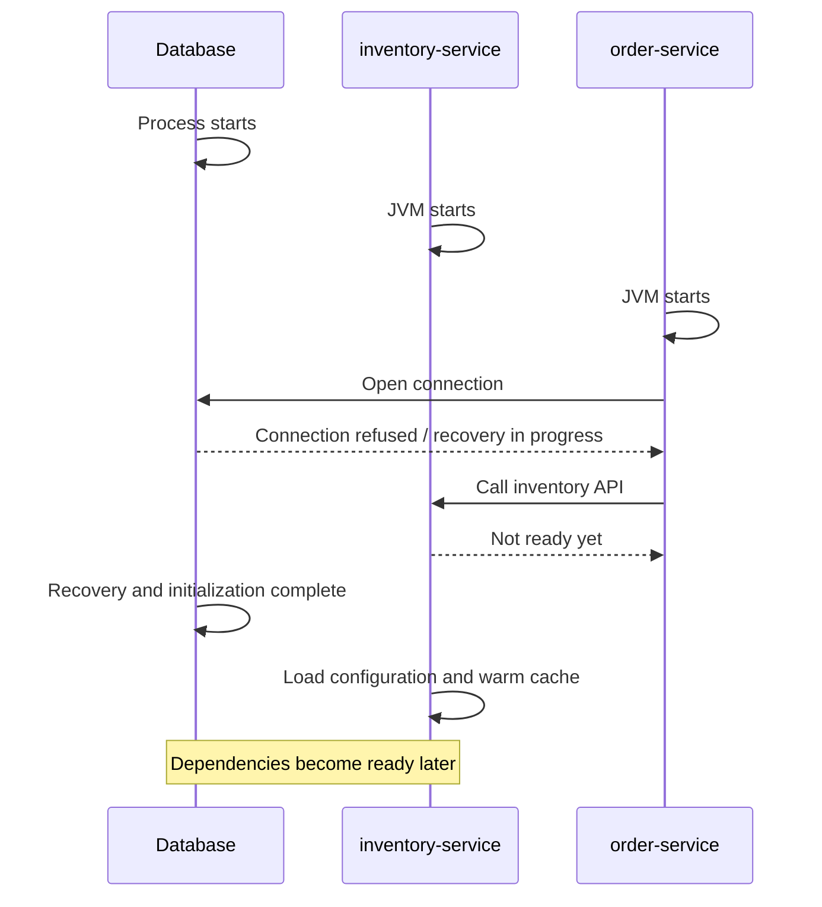
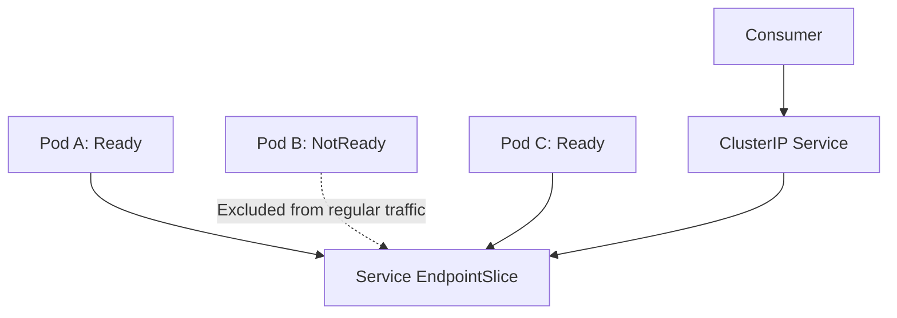
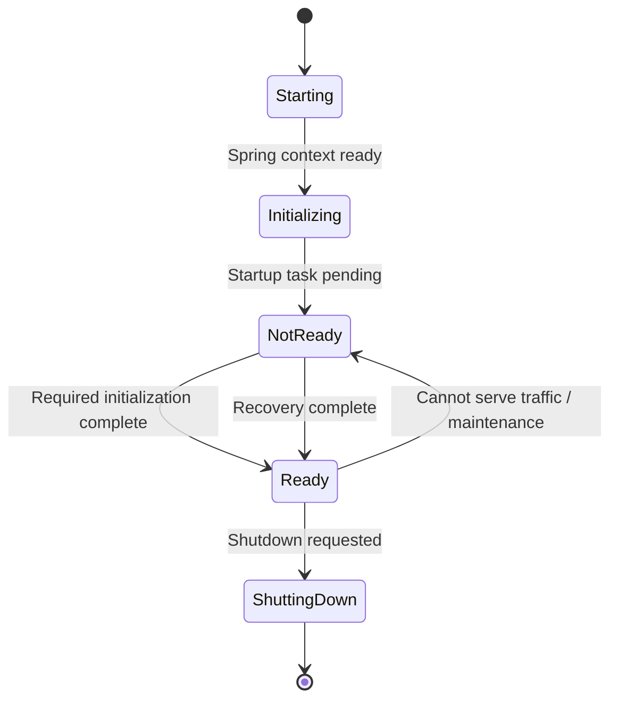

# Readiness-Based Startup Instead of Process Order Alone

In a microservice system, a running process does not mean the service is ready to accept requests. A database may need time to recover, the registry may not have received the registration yet, or the application may still be loading configuration or warming up caches. If processes are only started in order, consumers can still call providers too early and hit connection errors.

Good design must distinguish **started** from **ready**. An orchestrator can start dependencies first, yet the application still has to determine when it can serve traffic. Readiness probes, health checks, retries with backoff, and graceful shutdown help the system coordinate on actual state rather than relying on a fixed delay.

This lesson belongs to the `Network and Deployment` chapter in the `SPRING_CLOUD_SERVICE_DISCOVERY` module. The module helps learners understand finding instances by service name via `DiscoveryClient`, `ServiceRegistry`, Eureka or Consul, registration lifecycle, health checks, load balancing, security, and resolving registry drift. This content focuses on readiness-based startup so services only receive traffic once they can process requests.

## 1. Why Is Startup Order Not Enough?

Suppose `order-service` needs to call `inventory-service` and a database. A startup sequence might play out as follows:

1. The database container is created and the database process starts running.
2. The `inventory-service` container is created and the JVM begins booting.
3. The `order-service` container is created because its dependent containers are already in the running state.
4. `order-service` calls the database or `inventory-service` while dependencies are still recovering or have not opened their listeners.
5. The first requests fail even though all processes exist.

`docker compose up` or a shell script can control process creation order. However, the `running` state only indicates that the container/process is executing; it does not prove the database accepts queries, the HTTP server is serving, or the service has finished registering.



A `sleep 30` does not solve the root cause. A fast machine may only need a few seconds; a database recovering after a crash may need much longer. A fixed delay slows down normal environments while failing to guarantee slow environments are ready.

## 2. Distinguishing Process State, Liveness, and Readiness

Three concepts must be separated:

| State | Question | Appropriate action |
|---|---|---|
| Started | Has the process/container been created and is it running? | Confirm the process exists. |
| Liveness | Is the application still capable of continuing to operate? | If an error is unrecoverable, the orchestrator can restart it. |
| Readiness | Can the instance accept business traffic yet? | If not, temporarily stop sending traffic to the instance while keeping the process running. |

An application can be `started` yet not `ready` during initialization. It can also be `live` yet `not ready` while warming up, under maintenance, or missing an essential dependency. Conversely, a deadlocked process may still have a PID yet no longer be `live`.

Readiness is a traffic-control signal; liveness is a process-recovery signal. Using the exact same check for both without consideration can cause the orchestrator to restart the application simply because an external dependency is having an outage.

## 3. Docker Compose: Waiting for Dependencies to Become Healthy

Docker Compose provides `depends_on` to order startup. The short syntax only expresses that the dependency starts first; Compose does not wait for the underlying application to be ready by default.

To wait for a dependency to pass its health check, use the long syntax with `condition: service_healthy`. For example:

```yaml
services:
  order-service:
    build: ./order-service
    environment:
      SPRING_DATASOURCE_URL: jdbc:postgresql://db:5432/orders
    depends_on:
      db:
        condition: service_healthy
      inventory-service:
        condition: service_healthy

  db:
    image: postgres:16
    environment:
      POSTGRES_DB: orders
      POSTGRES_USER: app
      POSTGRES_PASSWORD: change-me-in-local-dev
    healthcheck:
      test: ["CMD-SHELL", "pg_isready -U $${POSTGRES_USER} -d $${POSTGRES_DB}"]
      interval: 5s
      timeout: 3s
      retries: 12
      start_period: 20s

  inventory-service:
    build: ./inventory-service
    healthcheck:
      test: ["CMD-SHELL", "curl -fsS http://localhost:8080/actuator/health/readiness || exit 1"]
      interval: 5s
      timeout: 3s
      retries: 12
      start_period: 30s
```

In the example:

- `db` is considered healthy only when `pg_isready` confirms PostgreSQL can accept connections.
- `inventory-service` is checked via its readiness endpoint, not just process status.
- Compose waits for `service_healthy` dependencies before creating `order-service`.
- `start_period` gives the dependency startup time before failed checks count toward the health check policy.

The `curl` command requires the `inventory-service` image to have curl installed. If a minimal image lacks that tool, use a suitable health check already available in the image or another check mechanism; do not add packages just for probing if a leaner option exists.

### 3.1. Conditions of depends_on

| Condition | Meaning |
|---|---|
| `service_started` | Dependency has been started; does not wait for health checks. |
| `service_healthy` | Dependency has a health check and has reached the healthy state. |
| `service_completed_successfully` | Dependency finished running and exited successfully, suitable for migrations or one-time initialization jobs. |

Example migration running before the application:

```yaml
services:
  order-service:
    build: ./order-service
    depends_on:
      migrate:
        condition: service_completed_successfully

  migrate:
    image: example/order-migrations:1.0.0
    command: ["./run-migrations"]
```

Only use `service_completed_successfully` for jobs with a finite lifecycle, not for databases or services that must keep running.

### 3.2. Limits of Compose Dependencies

`depends_on: service_healthy` helps orchestrate when Compose starts the project. It does not make dependencies perpetually available throughout the application's lifecycle. If the database is healthy initially yet loses connectivity later, `order-service` still has to handle reconnects, timeouts, and retries itself.

Health checks must also measure actual serving capability. A check testing only a TCP port can pass while a database is still recovering or not yet accepting business queries. Prefer commands that verify the truly required state, such as `pg_isready` for PostgreSQL.

## 4. Kubernetes: readinessProbe Controls Traffic

Kubernetes does not guarantee Deployments start in dependency order. Pods can be created concurrently. Rather than trying to sequence every process, Kubernetes uses probes to determine whether a container has started, is alive, and is ready to receive traffic.

Three probe types have distinct responsibilities:

| Probe | When does it run? | On failure |
|---|---|---|
| `startupProbe` | During startup; runs before liveness/readiness if configured. | Kubelet stops the container after exceeding `failureThreshold`; restarts per restart policy. |
| `livenessProbe` | Periodically after startup probe succeeds, or as configured if no startup probe exists. | Kubelet restarts the container after the allowed consecutive failures. |
| `readinessProbe` | Throughout the container's lifecycle. | The Pod is marked not ready and stops receiving regular traffic via the Service. |

When `startupProbe` is declared, Kubernetes holds off running liveness and readiness probes until the startup probe succeeds. This protects slow-starting applications from being restarted prematurely by a liveness probe.

### 4.1. Deployment Example with All Three Probes

```yaml
apiVersion: apps/v1
kind: Deployment
metadata:
  name: order-service
  namespace: shop
spec:
  replicas: 3
  selector:
    matchLabels:
      app: order-service
  template:
    metadata:
      labels:
        app: order-service
    spec:
      terminationGracePeriodSeconds: 40
      containers:
        - name: app
          image: example/order-service:1.0.0
          ports:
            - name: http
              containerPort: 8080
          startupProbe:
            httpGet:
              path: /actuator/health/liveness
              port: http
            periodSeconds: 10
            timeoutSeconds: 3
            failureThreshold: 30
          livenessProbe:
            httpGet:
              path: /actuator/health/liveness
              port: http
            periodSeconds: 10
            timeoutSeconds: 3
            failureThreshold: 3
          readinessProbe:
            httpGet:
              path: /actuator/health/readiness
              port: http
            periodSeconds: 5
            timeoutSeconds: 2
            failureThreshold: 3
            successThreshold: 1
```

With `periodSeconds: 10` and `failureThreshold: 30`, the startup probe allows a maximum check window of roughly 300 seconds before the container is deemed unable to start (actual time also depends on probe timing and timeouts). Once the startup probe passes, liveness and readiness begin.

The readiness probe keeps running after startup. If the application becomes temporarily unready, the Pod stays running but is removed from endpoints serving regular traffic. When readiness returns to passing, the endpoint can be added back to the Service.

### 4.2. Services Only Send Traffic to Ready Endpoints

Kubernetes updates EndpointSlices based on Pod status and Service selectors. When a readiness probe fails, the Pod's endpoint is no longer eligible for regular traffic from the Service. This is an essential mechanism so a slow-starting or recovering instance does not receive requests too early.



A readiness probe does not start Pods in order. It only controls when a Pod is added to the list of backends eligible to receive traffic.

## 5. Spring Boot Actuator and ApplicationAvailability

Spring Boot provides `ApplicationAvailability` to represent the application's availability state. With Actuator, two important states are exposed via health groups:

- `/actuator/health/liveness`: reflects `LivenessState`.
- `/actuator/health/readiness`: reflects `ReadinessState`.

Spring Boot manages these states automatically along the application lifecycle. During startup, readiness is in the `REFUSING_TRAFFIC` state. After the context is created and startup runners complete, the application transitions to `ACCEPTING_TRAFFIC`. When graceful shutdown begins, readiness transitions back to `REFUSING_TRAFFIC` to stop accepting new requests.

Example configuration:

```yaml
management:
  endpoints:
    web:
      exposure:
        include: health,info
  endpoint:
    health:
      probes:
        enabled: true
```

In Kubernetes, Spring Boot automatically configures liveness/readiness health groups in an appropriate environment. You can explicitly enable `management.endpoint.health.probes.enabled` to make configuration intent clear.

### 5.1. Running Startup Tasks Before the Application Is Ready

If an application needs to load mandatory configuration, validate schemas, or warm up data before accepting requests, it can run synchronous work inside `ApplicationRunner` or `CommandLineRunner`. Spring Boot only publishes `ApplicationReadyEvent` after runners complete, and readiness transitions to `ACCEPTING_TRAFFIC` at that stage.

For example:

```java
import org.springframework.boot.ApplicationArguments;
import org.springframework.boot.ApplicationRunner;
import org.springframework.stereotype.Component;

@Component
public class InitialDataLoader implements ApplicationRunner {

    private final CatalogCache catalogCache;

    public InitialDataLoader(CatalogCache catalogCache) {
        this.catalogCache = catalogCache;
    }

    @Override
    public void run(ApplicationArguments args) {
        catalogCache.loadRequiredData();
    }
}
```

In the example, `loadRequiredData()` finishes before the runner returns. If required data fails to load, the runner can throw an exception to fail startup per application policy; if the error is recoverable, you can keep the process alive while designing appropriate readiness and retry logic.

If you launch an asynchronous task and return immediately, Spring Boot may finish startup before that task completes. In that case, you must explicitly manage readiness state or wait for the mandatory task to finish before the runner exits. Do not assume the framework automatically knows a background future is still running.

### 5.2. Controlling Readiness at Runtime

When the application needs to pause receiving traffic for maintenance or to recover an internal resource, it can publish an `AvailabilityChangeEvent`:

```java
import org.springframework.boot.availability.AvailabilityChangeEvent;
import org.springframework.boot.availability.ReadinessState;
import org.springframework.context.ApplicationEventPublisher;
import org.springframework.stereotype.Component;

@Component
public class TrafficReadiness {

    private final ApplicationEventPublisher events;

    public TrafficReadiness(ApplicationEventPublisher events) {
        this.events = events;
    }

    public void stopReceivingTraffic() {
        AvailabilityChangeEvent.publish(
                events, this, ReadinessState.REFUSING_TRAFFIC);
    }

    public void allowTraffic() {
        AvailabilityChangeEvent.publish(
                events, this, ReadinessState.ACCEPTING_TRAFFIC);
    }
}
```

When `stopReceivingTraffic()` is called, the readiness health group reflects the non-accepting state; Kubernetes updates Pod readiness after the next probe. Only call `allowTraffic()` once the application has recovered and is genuinely ready.

Do not use readiness as an arbitrary toggle to hide errors. There should be clear conditions for state transitions and metrics/logs explaining why an instance is in `REFUSING_TRAFFIC`.

## 6. Liveness Should Not Depend on Every External System

Liveness answers whether the process needs to be restarted to recover. If a database temporarily drops its connection yet the application can reconnect, liveness should not fail solely because the database is down.

If every replica checks the database in its liveness probe, a database outage can trigger all Pods to restart. The newly created Pods then all connect to the database while it is already overloaded, creating a restart loop and worsening the outage.

Readiness can check an essential dependency if the instance cannot serve any meaningful requests while that dependency is down. However, evaluate carefully:

- Is the dependency mandatory for every request?
- Can the application use a cache, queue, fallback, or circuit breaker?
- If a dependency shared by all replicas goes down, does removing all replicas from the Service actually help?
- Is there a risk of readiness flapping causing traffic to repeatedly surge onto remaining instances?

Spring Boot by default does not include external system health checks in the readiness group. This is intentional so applications choose which dependencies truly determine ability to accept traffic. Do not mechanically add every `HealthIndicator` to readiness.

## 7. Readiness, Service Discovery, and Instance Registration

In Kubernetes, readiness is used directly to determine whether a Pod appears in a Service's traffic-serving endpoints. Thus, a Pod can be running and discoverable via certain APIs while still not routed business requests by the Service.

With Eureka or Consul, distinguish registration from health state:

- Registration advertises the instance and its address.
- Health checks or service status indicate whether the instance is eligible for discovery/traffic per integration settings.
- Consumers may maintain their own registry cache, so readiness/health changes do not necessarily take effect instantaneously.

Do not assume every registry's auto-registration automatically waits for Spring Boot readiness. Behavior depends on integration and version. If the registry uses health checks, configure checks that accurately reflect the readiness endpoint. If the integration supports `OUT_OF_SERVICE` or an equivalent status, use the proper lifecycle API to pull the instance out of traffic when needed.

For example, with Consul, an HTTP check can call the readiness endpoint; with Eureka, health check integration can use the application's health status. Verify the published status and how consumers filter instances in your actual configuration.

## 8. Retries, Backoff, and Circuit Breakers When Dependencies Are Not Ready

Readiness prevents accepting traffic too early, yet it does not eliminate network errors or dependency changes after an application is already ready. Consumers still need to handle cases where a service is not ready, the registry has not updated, or a connection was just severed.

Principles:

1. Use bounded connect timeouts and response timeouts.
2. Retry a bounded number of times with exponential backoff.
3. Add jitter so multiple replicas do not retry at the exact same instant.
4. Only retry safe operations or ones with an idempotency key.
5. Use a circuit breaker to stop requests from continuously piling onto a failing dependency.
6. Reconnect connection pools or clients when endpoints recover per library mechanisms.
7. Emit metrics for retries, timeouts, circuit states, and dependency recovery times.

Example bounded Reactor retry:

```java
import java.time.Duration;

import reactor.util.retry.Retry;

public Mono<Product> loadProduct(String id) {
    return catalogClient.getProduct(id)
            .retryWhen(Retry.backoff(3, Duration.ofMillis(200))
                    .maxBackoff(Duration.ofSeconds(2))
                    .jitter(0.5));
}
```

The snippet illustrates retrying up to three times with backoff and jitter. In real applications, filter which error types are retried and ensure operations are safe to retry. Do not blindly retry all 4xx errors or all exceptions.

## 9. Graceful Shutdown and Draining Instances from Traffic

Readiness does not only matter at startup. When deploying a new version or scaling down, an instance must stop accepting new requests before the process terminates.

Spring Boot supports graceful shutdown:

```yaml
server:
  shutdown: graceful

spring:
  lifecycle:
    timeout-per-shutdown-phase: 30s
```

When shutdown begins, Spring Boot transitions readiness to `REFUSING_TRAFFIC`, then allows in-flight requests to complete within the grace period. On Kubernetes, configure `terminationGracePeriodSeconds` long enough to accommodate endpoint removal and in-flight request completion.

For example:

```yaml
spec:
  terminationGracePeriodSeconds: 40
  containers:
    - name: app
      lifecycle:
        preStop:
          exec:
            command: ["sh", "-c", "sleep 5"]
```

`preStop` in the example creates a brief window for endpoint updates to propagate before the container stops; the actual value should be measured and should not replace readiness or graceful shutdown. When a Pod is deleted, EndpointSlice also updates endpoint eligibility; kubelet sends the stop signal after the hook and the application must finish within the grace period.

Do not use long `sleep`s as a readiness mechanism. When traffic draining is needed, use readiness state, an appropriate lifecycle hook, and a graceful shutdown duration sized to actual requests.

## 10. Combined Example: Application Is Ready Only After Database and Cache Initialization

An application may need a database to process all write requests and require a catalog cache before serving. A sound sequence:

1. JVM and Spring context start.
2. Liveness only confirms the application is still alive, independent of the database.
3. `ApplicationRunner` checks database connectivity and loads mandatory cache data.
4. Once initialization completes, Spring Boot transitions readiness to `ACCEPTING_TRAFFIC`.
5. The Kubernetes readiness probe passes and the Pod is added to the Service's EndpointSlice.
6. If the internal cache is lost at runtime and the application cannot serve, it can transition readiness back to `REFUSING_TRAFFIC` while attempting recovery.
7. When recovery completes, readiness returns to `ACCEPTING_TRAFFIC`.



Not every dependency needs to be checked before accepting traffic. If a cache only optimizes performance and can be populated lazily, keeping every replica not-ready during warm-up may be unnecessary.

## 11. Diagnosing Applications That Start Yet Do Not Receive Traffic

| Symptom | Possible cause | What to check |
|---|---|---|
| Container is running but Compose does not start consumer | Dependency has not reached `service_healthy`. | Read health status and healthcheck command output. |
| Pod is Running but `READY 0/1` | Readiness probe failing or startup probe has not passed. | `kubectl describe pod`, events, and probe endpoint logs. |
| Pod keeps restarting at startup | Startup/liveness probe too strict or app genuinely stalled. | Check `failureThreshold`, `periodSeconds`, startup logs, and resource limits. |
| Pod is Ready even though data is not loaded yet | Probe checks only port or endpoint does not reflect readiness. | Use `/actuator/health/readiness` and `ApplicationAvailability` state. |
| All Pods turn NotReady when database goes down | Readiness depends on a shared database. | Evaluate whether the dependency is truly mandatory for every request or has a fallback. |
| Instance appears in Eureka/Consul but requests fail | Registration appeared before health/ready or cache is stale. | Check health check, registry status, and discovery cache. |
| Shutdown drops in-flight requests | Grace period too short or graceful shutdown not enabled. | Check readiness transition, preStop, timeout, and termination grace period. |
| Consumer retries heavily when provider is not ready | Retries lack backoff/jitter or max attempts too high. | Cap retries, add backoff/jitter and a circuit breaker. |

Useful Kubernetes commands:

```bash
kubectl get pods -n shop
kubectl describe pod <pod-name> -n shop
kubectl get endpointslice -n shop \
  -l kubernetes.io/service-name=order-service
kubectl logs <pod-name> -n shop --previous
```

With Docker Compose:

```bash
docker compose ps
docker compose logs db
docker compose logs inventory-service
docker inspect --format '{{json .State.Health}}' <container-name>
```

Check probe and health check status from the exact runtime executing the probe. An endpoint callable from a laptop does not prove kubelet or Docker healthcheck shares the same network path, DNS, port, and credentials.

## 12. Common Misconceptions

**"depends_on means the dependency is ready."** False for `service_started`; only `service_healthy` waits for the dependency's health check in Compose.

**"Kubernetes starts Pods in dependency order."** False. Pods can be created concurrently; readiness controls traffic after containers start.

**"Readiness failure restarts the container."** False. Readiness removes the Pod from Service traffic; liveness or startup probes are what trigger container restarts.

**"Liveness should check the database to be sure the whole system is healthy."** Avoid this. An external dependency failure can cause every replica to restart simultaneously and create cascading failures.

**"Opening the HTTP port is enough to consider the app ready."** Not enough. The listener can open before startup tasks or mandatory data finish loading.

**"Readiness replaces retries."** False. Dependencies can still fail after an app becomes ready; retries and timeouts remain necessary at runtime.

**"Registering in the registry means the instance is ready."** False. Registration and health/readiness are separate signals; integration must be configured so the registry and consumers understand serving state.

## 13. Readiness-Based Startup Design Checklist

| Area | Questions to verify |
|---|---|
| Dependency | Which dependencies are mandatory before the first request? |
| Startup | Are there startup tasks that must finish before accepting traffic? |
| Process | Is process running being confused with service ready? |
| Compose | Does the dependency have an appropriate healthcheck and `service_healthy`? |
| Kubernetes | Are startupProbe, livenessProbe, and readinessProbe properly distinguished? |
| Spring Boot | Does the readiness endpoint accurately reflect `ApplicationAvailability`? |
| External checks | Does readiness check only essential dependencies without unnecessary coupling? |
| Registry | Does Eureka/Consul registration have matching health checks or status integration? |
| Retry | Does the consumer have timeouts, bounded retries, backoff, and jitter? |
| Shutdown | Does readiness switch to refusing traffic before the process stops? |
| Observability | Are there logs/metrics for startup duration, readiness transitions, probe failures, and dependency recovery? |
| Security | Does the health endpoint expose only necessary info and have proper protection? |

## Conclusion

Readiness-based startup helps microservices avoid receiving traffic while dependencies, configuration, or initialization data are incomplete. Docker Compose can wait for dependencies to reach `service_healthy`; Kubernetes uses `startupProbe`, `readinessProbe`, and `livenessProbe` for distinct purposes; Spring Boot provides `ApplicationAvailability` and Actuator health groups to reflect application readiness/liveness.

Readiness decides whether an instance receives traffic, liveness decides when to restart, and startup probes protect long initialization phases. With Eureka or Consul, verify that registration and health status are properly integrated; on every platform, consumers still need timeouts, retries with backoff, circuit breakers, and graceful shutdown. Designing around real state rather than fixed delays makes startup more reliable and reduces cascading errors during deploys or recovery.

## References

- [Spring Boot – Actuator Endpoints and Kubernetes Probes](https://docs.spring.io/spring-boot/reference/actuator/endpoints.html): `ApplicationAvailability`, liveness/readiness health groups, and considerations when checking external dependencies.
- [Kubernetes – Liveness, Readiness and Startup Probes](https://kubernetes.io/docs/concepts/workloads/pods/probes/): behavior and configuration of the three probe types.
- [Docker Compose – Control startup and shutdown order](https://docs.docker.com/compose/how-tos/startup-order/): `depends_on`, `service_healthy`, and healthchecks.
