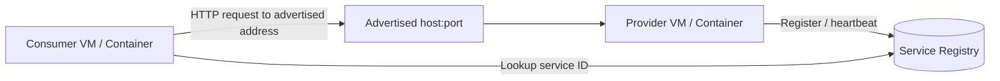
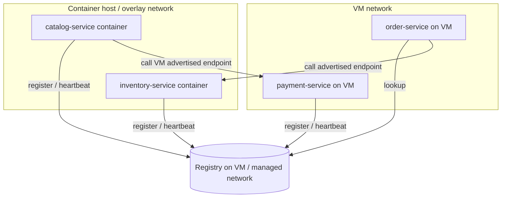

# Deployment on Virtual Machines, Containers, and Hybrid Environments

In a Spring Cloud Service Discovery system, the service registry lets providers advertise instances and consumers find addresses to call. When deploying on virtual machines (VMs), containers, or a mix of both, the critical requirement is that the address a provider registers must be reachable from the consumer's network.

The registry only stores instance information such as service ID, host, port, scheme, and metadata. It does not automatically create routes across NAT, open firewalls, publish container ports, or make a container's private IP reachable from a VM. Therefore, discovery design must go hand in hand with DNS, routing, port mapping, and security design across network zones.

## 1. Distinguishing the Discovery Plane and Service Traffic

There are two separate network flows:

- **Discovery plane:** providers connect to the registry to register/send heartbeats; consumers connect to the registry to look up instances.
- **Service traffic:** after receiving the instance list, consumers connect directly to the advertised host and port (or to an advertised proxy/load balancer).



A configuration can register successfully yet still fail calls. For example, a container registers internal IP `172.20.0.5:8080`; the registry stores this address normally, but a consumer on a VM has no route to the Docker bridge network. The consumer looks it up successfully, LoadBalancer picks the instance, and the connection times out.

Therefore, check three conditions separately:

1. The provider can reach the registry.
2. The consumer can reach the registry.
3. The consumer can reach the instance address returned by the registry.

If the provider uses an active health check (such as a Consul agent calling an HTTP/TCP check), add a fourth condition: the health checker must be able to reach the provider's address and port from the exact network where the checker runs.

## 2. Three Types of Addresses to Distinguish

| Concept | Meaning | Example |
|---|---|---|
| Bind address | Interface address on which the process listens | `0.0.0.0:8080` |
| Advertised address | Host and port advertised by the provider in the registry | `inventory-vm-01.internal:8080` |
| Consumer reachable address | Address to which the consumer can actually route and connect | `10.10.4.21:8080` |

These three values can differ. Applications commonly bind to `0.0.0.0` to accept connections across interfaces, yet should not advertise `0.0.0.0` to consumers. It is a bind address with special meaning, not a routable destination address.

With containers, the application port inside the container may be `8080`, while Docker publishes it to host port `18081`. Consumers outside the Docker network must use the host address and published port, not the container port unless there is a direct route to the container network.

For example:

```text
Application listener:       0.0.0.0:8080
Container address:          172.20.0.5:8080
Docker host published port: docker-node-01.internal:18081
VM consumer can reach:      docker-node-01.internal:18081
```

In this case, the provider needs to advertise `docker-node-01.internal:18081` if VM consumers cannot reach container IPs. If consumers share an overlay network and can reach containers directly, the advertised address can differ. A single registration contains one default endpoint; if multiple consumer groups have different network paths, choose a shared address reachable by all or design separate endpoints/proxies/registry views.

## 3. Deploying on Virtual Machines

In the VM model, each service typically runs as a process or system service on a machine with a relatively stable hostname/IP. A private DNS name or internal IP can be used as the advertised address.

For example:

- Eureka Server: `registry.internal.example:8761`
- Provider: `inventory-vm-01.internal.example:8081`
- Consumer: `order-vm-02.internal.example`

The provider must be able to connect to the registry; the consumer also needs to connect to both the registry and the provider's address.

### Provider Configuration on a VM with Eureka

```yaml
spring:
  application:
    name: inventory-service

server:
  port: 8081

eureka:
  client:
    service-url:
      defaultZone: http://registry.internal.example:8761/eureka/
  instance:
    hostname: inventory-vm-01.internal.example
    prefer-ip-address: false
    instance-id: ${spring.application.name}:${eureka.instance.hostname}:${server.port}
```

In the example:

- `hostname` is the address the provider advertises.
- `prefer-ip-address: false` tells Eureka to use the hostname instead of preferring an IP.
- `instance-id` helps distinguish registrations of individual processes.
- `defaultZone` is the Eureka Server address the client uses.

The hostname must resolve from consumers and point to a reachable address. If internal DNS is inconsistent across subnets, you can use a stable private IP and matching configuration. Do not use a public IP if internal traffic is meant to traverse a private network.

### Verifying on a VM

On the provider, verify the process is listening on the right port:

```bash
ss -lntp
```

From the consumer, check DNS and connectivity:

```bash
getent hosts inventory-vm-01.internal.example
nc -vz inventory-vm-01.internal.example 8081
```

You can also use `curl` against the provider's health endpoint. Testing from the consumer matters more than testing localhost on the provider alone, because firewalls or routing can block traffic between the two machines.

## 4. Deploying in Containers

A container has its own network namespace. The address `127.0.0.1` inside a container points to that container itself; it does not point to the VM host, another registry container, or a peer container.

There are two common connectivity patterns:

- **Same Docker network/overlay:** containers can call each other using DNS names or network aliases.
- **Different networks or consumers on VMs:** requires a published host/port address, routing into the overlay network, or a proxy/load balancer with a routable address.

### Registry Running Outside Containers

Suppose Eureka Server runs on a VM at `registry.internal.example:8761`. The container provider connects to the registry via host DNS/network:

```yaml
spring:
  application:
    name: inventory-service

server:
  port: 8080

eureka:
  client:
    service-url:
      defaultZone: http://registry.internal.example:8761/eureka/
```

Do not set `defaultZone` to `http://localhost:8761/eureka/` unless Eureka Server actually runs in the same network namespace as the provider. Inside a container, localhost is the provider container itself.

### Publishing Ports So VM Consumers Can Call Containers

Suppose the container listens on port `8080` and the Docker host publishes port `18081`:

```yaml
services:
  inventory:
    image: example/inventory:1.0
    ports:
      - "18081:8080"
```

If consumers are outside the Docker network, the advertised endpoint must point to the Docker host's hostname/IP and port `18081`. With Eureka, you can separately configure the advertised hostname and non-secure port:

```yaml
eureka:
  instance:
    hostname: docker-node-01.internal.example
    prefer-ip-address: false
    non-secure-port: 18081
```

The application still listens on port `8080` inside the container; `non-secure-port` in the example is the port consumers access through host mapping. Verify this configuration against your Spring Cloud Netflix version and check the Eureka dashboard/API to confirm the actual registered host/port is right.

If running multiple replicas on the same Docker host, they cannot all advertise the same host/port pair while expecting consumers to select individual containers independently. Choose one of the following approaches:

- Give each container a unique host port and advertise it individually.
- Use an overlay network with distinct endpoint addresses to which all consumers have a route.
- Place a stable load balancer/reverse proxy in front of the container group and register the proxy endpoint as a shared target, if infrastructure-layer load balancing is desired.

Do not use private container bridge addresses if consumers outside the bridge cannot route to them.

## 5. Deploying in Hybrid VM and Container Environments

Hybrid environments typically have a centralized registry with providers and consumers across multiple deployment forms:

- Eureka/Consul/ZooKeeper runs on a VM or dedicated managed platform.
- Some providers run directly on VMs.
- Some providers run in Docker or a container platform.
- Consumers may run on VMs, containers, or both.

Example architecture:



For this model to work, bidirectional network paths are required according to each role:

| Source | Destination | Purpose |
|---|---|---|
| VM provider | Registry | Registration and heartbeat |
| Container provider | Registry | Registration and heartbeat |
| VM consumer | Registry | Instance lookup |
| Container consumer | Registry | Instance lookup |
| VM consumer | Container advertised endpoint | Call container provider |
| Container consumer | VM advertised endpoint | Call VM provider |
| Health checker | Provider endpoint | Active health check if used by provider |

Being able to connect to the registry does not automatically imply being able to connect to providers. When a consumer receives the instance list, every address in that list must have a route from the consumer's network.

### Choosing a Shared Advertised Address

If both VM and container consumers call the same provider, the advertised address must be reachable from both sides. For example, you can use:

- A private DNS name resolving to a host/port routable from both networks.
- An internal load balancer with routes from both VM and container subnets.
- An overlay network connected in a controlled manner to the VM network.
- An API gateway or reverse proxy for services needing a single shared endpoint.

If a single shared endpoint is not feasible, you may need separate service registrations per network zone, separate registry views, or zone-based instance selection policies. Do not expect LoadBalancer to know automatically that an IP reachable only from one subnet is unsuitable for the current consumer without configuring zones/metadata and filtering.

## 6. DNS, Routing, and Firewalls

Service discovery relies on advertised addresses; therefore DNS and networking must be prepared beforehand.

### DNS

- Use stable internal hostnames for VMs.
- Ensure containers can resolve the registry hostname.
- Ensure VMs can resolve the Docker host or load balancer hostname.
- Avoid hostnames that exist only in Docker embedded DNS if consumers are outside the Docker network.
- Watch out for split-horizon DNS: the same name may return different IPs depending on the subnet; this is only suitable if every result leads to a reachable endpoint.

### Routing and Firewalls

Open only the necessary flows:

- Provider to the registry's client/API port.
- Consumer to the registry's client/API port.
- Consumer to the provider's or load balancer's advertised port.
- Health checker to the health endpoint port if active checks are used.
- Internal peer/cluster connections between registry nodes if the registry is clustered.

Do not open entire port ranges just "to make discovery work." Build a table of source, destination, port, protocol, and purpose; allow only the required subnets or workloads. For registries with ACL/TLS, opening network paths does not replace authentication and encryption.

### NAT and Port Mapping

NAT alters the address/port seen by consumers. The registry must store endpoints on the side routable from consumers. Registering a private container address without a route through NAT causes lookup to succeed while requests fail.

If there are multiple consumers across multiple networks, verify connection directions from each network. Outbound NAT often lets a provider initiate connections to the registry without creating an inbound path for consumers to call the provider.

## 7. Health Checks Must Run from the Right Network Location

Health checks can work in different ways:

- Eureka client heartbeat: the provider actively sends heartbeats to Eureka Server; this signals that the client is still in contact with the registry, not by default that the server actively calls an HTTP health endpoint.
- Consul active HTTP/TCP check: the agent executes checks against the configured address. The agent must be able to route to that host/port.
- ZooKeeper discovery: registration can be tied to a session/ephemeral znode; a live session does not prove the HTTP endpoint is healthy.
- Kubernetes readiness: the control plane uses readiness to update endpoint eligibility; this is a Kubernetes platform mechanism.

Distinguish process health, business readiness, and consumer network reachability. A health check passing from inside a container does not prove a VM consumer can reach the advertised endpoint.

For example, a container calling `http://localhost:8080/actuator/health` succeeds, yet a VM consumer cannot route to `172.20.0.5:8080`. The application is healthy internally, yet service calls from the VM fail. Test endpoints from the exact network vantage points of both the checker and the consumer.

## 8. Profile- and Environment-Based Configuration

You can use profiles to separate registry addresses and advertised addresses:

```yaml
# application-vm.yml
server:
  port: 8081

eureka:
  client:
    service-url:
      defaultZone: http://registry.internal.example:8761/eureka/
  instance:
    hostname: inventory-vm-01.internal.example
    prefer-ip-address: false
```

```yaml
# application-container.yml
server:
  port: 8080

eureka:
  client:
    service-url:
      defaultZone: http://registry.internal.example:8761/eureka/
  instance:
    hostname: docker-node-01.internal.example
    prefer-ip-address: false
    non-secure-port: 18081
```

Activate the right profile when running the application. Do not leave a local profile with `localhost` accidentally enabled in container or production environments.

In Consul-based systems, verify address-advertisement properties such as hostname/IP, port, and health-check address according to your Spring Cloud Consul version. With ZooKeeper, check the instance host/port the integration writes into the registration and confirm consumers can route to that address. Property names and override capabilities differ across providers; do not copy Eureka settings to Consul or ZooKeeper.

## 9. Security in Multi-Environment Networks

Hybrid environments typically span multiple subnets, hosts, and operations teams. Security must be applied at both the registry and service endpoints:

- Use TLS for consumer/provider connections to the registry when infrastructure supports it.
- Enable provider-appropriate authentication/ACLs/tokens so only authorized workloads can register or read services.
- Use TLS or service-to-service authentication mechanisms for business traffic.
- Never put secrets, passwords, tokens, or private keys in metadata.
- Restrict firewalls to specific subnets and ports.
- Do not advertise administrative endpoints or debug ports to unnecessary networks.
- Verify the hostname in the TLS certificate matches the hostname advertised by the registry.
- Monitor unusual registrations, duplicate instance IDs, and unapproved address changes.

A valid registration is not proof that a provider is trustworthy. The registry protects metadata and supports discovery; connection authentication and API authorization must still be enforced separately.

## 10. Rollouts and Instance Address Changes

When a VM is replaced, a container is rescheduled, or a host port changes, the advertised address can change. Follow a registry update procedure:

1. Start the new instance with a reachable address.
2. Verify the instance registers with the right service ID, host, and port.
3. Verify from consumer networks that the new endpoint is reachable.
4. Wait for discovery caches and LoadBalancer to pick up the new data.
5. Shift traffic to the new instance per rollout policy.
6. Drain in-flight requests from the old instance.
7. Deregister and stop the old instance.
8. Confirm no consumers are still calling the old address.

Do not remove the old instance the instant the new process starts. Account for heartbeat intervals, cache refresh, health checks, and DNS TTL if the call path uses DNS. With ephemeral containers, avoid registering temporary IPs that consumers cannot route to or leaving stale registrations behind after containers are replaced.

## 11. Troubleshooting Along the Request Path

When a consumer calls a service ID and gets a timeout or no instances, check in order:

1. Can the provider connect to the registry and register successfully?
2. Can the consumer connect to the registry and fetch the instance list?
3. Does the service ID match the name registered by the provider?
4. Which host/port does the registry return?
5. What address does that hostname resolve to from the consumer's network?
6. Do routes and firewalls allow the consumer to reach the endpoint?
7. If the endpoint is a container, are port mappings or overlay routes configured properly?
8. Is the application actually listening on the target port?
9. Where does the health checker run, and does it have a route to the provider?
10. Are caches, heartbeats, sessions, or deregistration keeping stale entries alive?

| Symptom | Possible cause | Resolution |
|---|---|---|
| Provider fails to register | Container/VM cannot reach registry, wrong URL, or ACL | Check DNS, routes, firewalls, TLS, and credentials |
| Consumer finds instance but times out | Advertised host/port is not routable | Test from the consumer to the exact address returned by the registry |
| Registry stores `172.x` container IP | Provider auto-advertises container bridge IP | Advertise host/published port or use an overlay route |
| Container cannot connect to registry via localhost | `localhost` points to current container | Use a reachable registry DNS/IP |
| VM can call provider but container cannot | The two networks have different routes/firewalls | Check subnets, security groups, and advertised address |
| Health check passes but consumer requests fail | Checker and consumer have different network vantage points | Test from consumer network and check port mapping |
| Multiple replicas share the same endpoint | Same host/port registered for multiple containers | Assign distinct ports, distinct overlay IPs, or use a proxy/LB |
| Old instance remains in registry | Deregistration/heartbeat/session has not converged | Inspect provider lifecycle and caches |
| TLS handshake fails after hostname change | Certificate does not match advertised hostname | Issue a certificate with the right SAN and configure trust |

A helpful debugging technique is to pull the exact host/port from the registry and run `nslookup`, `getent hosts`, `nc`, or `curl` from the consumer. Do not test a guessed address that differs from what LoadBalancer actually picks.

## 12. Checklist for VM, Container, and Hybrid Deployments

Before putting a service into operation, confirm:

1. Both providers and consumers can connect to the registry from their networks.
2. Service IDs are consistent across provider, registry, and consumer.
3. Bind address is not confused with advertised address.
4. Advertised host/port is reachable from every consumer network that needs support.
5. Containers do not advertise loopback or unroutable bridge IPs.
6. Port mappings or overlay networks are explicitly configured.
7. DNS resolves consistently and TLS hostnames match.
8. Firewalls allow the exact registry, service traffic, and health check flows.
9. Health checks are verified from the right network location.
10. Instance IDs are unique and registrations are deregistered on shutdown.
11. VM/container profiles are not activated by mistake.
12. Rollouts include verifying new endpoints, waiting for cache convergence, and draining old endpoints.
13. Metadata contains no secrets; registry and service traffic use appropriate authentication/TLS.
14. Registration, heartbeats, health, timeouts, and connection error rates are monitored per network zone.

Deploying service discovery on VMs, containers, or hybrid environments rests on the same principle: providers advertise an address, the registry distributes that information, and consumers must have a network path to the advertised address. By separating the discovery plane from service traffic and verifying advertised addresses from each consumer network, the system can replace instances without forcing applications to depend on ephemeral machine or container IPs.
