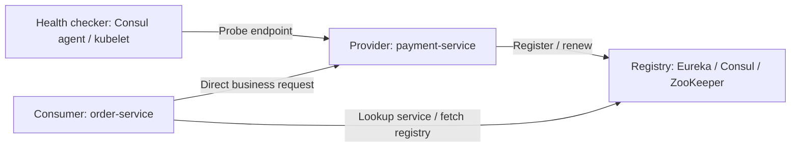

# Checking Separate Network Paths for Registration, Health Checks, and Service Calls

In a microservice system, a service instance can appear healthy in the registry yet actual requests still fail. The root cause often lies not in the discovery algorithm, but in the network paths between components: the provider cannot connect to the registry, the health checker cannot reach the check endpoint, or the consumer cannot call the address the provider advertised.

When operating Spring Cloud Service Discovery, three network flows must be verified separately: **provider → registry** for registration and renewal; **health checker → provider** for health checking when active probes are used; and **consumer → provider** for sending business requests. These three flows have different sources, destinations, ports, and security policies. Opening a single port does not mean all three flows work.

This content belongs to the `SPRING_CLOUD_SERVICE_DISCOVERY` module, focusing on finding instances by service name via `DiscoveryClient`, `ServiceRegistry`, Eureka, Consul, or ZooKeeper. This section guides building a connectivity matrix and checking DNS, routing, firewalls, NetworkPolicy, TLS, and diagnosing from each party's exact network location.

## 1. Distinguishing the Three Network Flows

### 1.1. Provider Registers with the Registry

The provider is the application supplying a service, such as `payment-service`. At startup, the application sends its service name, instance ID, address, port, and metadata to the registry. While running, the provider continues sending heartbeats, renewing leases, or maintaining sessions depending on the technology.

Common flow:

```text
payment-service instance
        |
        | Register / heartbeat / renew / deregister
        v
Eureka Server / Consul Agent or Server / ZooKeeper ensemble
```

This is typically an outbound connection from the provider to the registry. If the provider resides in a private subnet, ensure the registry's DNS resolves and firewalls/security groups allow connections to the exact registry endpoint. With stateful TCP connections, responses normally return over the established connection; you do not need to open a fixed source port from the registry back to the provider just to answer heartbeats.

### 1.2. Health Checker Probes the Provider

Some health check mechanisms actively initiate connections from the checker component to the provider's endpoint. For example, a Consul agent may call a service's HTTP health-check URL. Kubernetes kubelet runs readiness/liveness probes against Pods. In that case, the flow is:

```text
Consul agent / Kubernetes node kubelet / external monitor
        |
        | HTTP / TCP / gRPC health probe
        v
payment-service health endpoint
```

The health checker must be able to reach the address and port configured for the check. If the service allows only the consumer subnet without allowing the Consul agent or node subnet, business requests can succeed while health checks still fail.

Not every registry actively calls the provider's endpoint. With Eureka, the common pattern is the Eureka Client sending heartbeats to the Eureka Server; application health can be integrated via health indicators so the client updates its status. Eureka Server does not by default continuously call every instance's `healthCheckUrl` as an active HTTP probe. Clearly identify the active mechanism before opening firewall rules.

### 1.3. Consumer Calls the Provider

The consumer is the application calling the service, such as `order-service`. The consumer looks up the service name, receives one or more `ServiceInstance`s, then connects to the advertised hostname/IP and port.

```text
order-service consumer
        |
        | HTTP / HTTPS / gRPC request
        v
payment-service advertised host:port
```

This is the business request data plane. The registry only helps the consumer find the address; the registry does not proxy requests through itself. If the provider advertises an internal IP that is unroutable from the consumer, discovery may return a valid instance yet requests still time out.

## 2. Building a Source, Destination, and Port Matrix Before Opening Networks

Do not start by opening the firewall for an entire subnet. Explicitly document which component needs to connect to which component, over which protocol, and for what purpose.

| Flow | Source | Destination | Protocol/port | Purpose |
|---|---|---|---|---|
| Eureka registration/heartbeat | Provider instance | Eureka Server | TCP, typically `8761` with default config | Register, renew, fetch registry, deregister. |
| Eureka peer | Eureka Server node | Eureka Server peer | TCP, usually same Eureka HTTP(S) port, e.g., `8761` | Peer replication and registry exchange. |
| Consul registration via agent | Provider instance | Consul agent/API | TCP, typically `8500` HTTP or `8501` HTTPS | Service registration, catalog/health API, and TTL updates depending on config. |
| Consul agent health check | Consul agent node | Provider health endpoint | TCP, service port, e.g., `8080` or `8443` | Active HTTP/TCP/gRPC checks if configured. |
| ZooKeeper client | Provider/consumer | ZooKeeper client endpoint | TCP, typically `2181` or configured secure client port | Create/read znodes and maintain sessions. |
| DNS | Provider, consumer, health checker | Internal DNS resolver | UDP/TCP `53` | Resolve registry hosts, service hostnames, and endpoints. |
| Kubernetes API discovery | Spring Cloud Kubernetes client | Kubernetes API server | TCP, typically `6443` or cluster-advertised API endpoint | Read Services, Endpoints/EndpointSlices, and related resources. |
| Kubernetes health probe | Node kubelet | Pod IP and probe port | TCP/HTTP/gRPC per probe | Readiness, liveness, and startup probes. |
| Business request | Consumer | Provider instance or Kubernetes Service | TCP, advertised service port | HTTP, HTTPS, gRPC, or application protocol. |

The ports in the table are common defaults or examples, not mandatory rules. Environments may change ports, use TLS, proxies, a service mesh, or load balancers. Pull actual endpoints from configuration and the registry before creating rules.

### 2.1. Distinguishing Client Ports and Internal Cluster Ports

Some platforms have separate internal ports for communication between registry nodes. For instance, ZooKeeper typically uses `2181` for clients, `2888` for peer synchronization, and `3888` for leader election. Regular microservices only need to connect to the client endpoint; do not open quorum ports `2888`/`3888` to every provider and consumer. Similarly, Consul has internal RPC/gossip ports between agents/servers; open them only according to the Consul topology, and do not treat them as business service ports.

## 3. Diagram of Network Paths That Must Work



The diagram highlights two distinct connection types: the consumer calls the registry for lookup, but once an instance is chosen, business requests usually travel directly to the provider. The health checker only initiates a separate connection if the health check model requires it.

## 4. Identifying Registry Address and Service Address

Two addresses are commonly confused:

- **Registry endpoint:** the address providers/consumers use to connect to Eureka, Consul, ZooKeeper, or the Kubernetes API.
- **Advertised service endpoint:** the hostname/IP and port a provider publishes for consumers to call.

For example:

```yaml
spring:
  application:
    name: payment-service
  cloud:
    consul:
      host: consul.internal.example
      port: 8500
      discovery:
        hostname: payment-01.internal.example
        port: 8080
```

`consul.host:port` is the registry endpoint the provider uses to register. `discovery.hostname` and `discovery.port` are the endpoint advertised to consumers. Opening the firewall to Consul does not automatically allow consumers to call `payment-01:8080`; the two paths need separate rules.

With Eureka, `eureka.client.service-url.defaultZone` is the registry endpoint; `eureka.instance.hostname`, `ip-address`, `prefer-ip-address`, and port define the advertised instance details. With ZooKeeper, `spring.cloud.zookeeper.connect-string` is the ensemble endpoint; `instance-host` and `instance-port` are the service address. With Kubernetes, the API server endpoint serves the discovery client, while Service DNS/ClusterIP or Pod IP serves business requests.

Do not advertise `localhost`, `127.0.0.1`, or `0.0.0.0` to consumers on other machines. `0.0.0.0` is a wildcard bind address; loopback points only to the connecting machine or container itself.

## 5. Checking the Provider-to-Registry Flow

When a provider does not appear in the registry, inspect from the exact environment running the provider in the following order.

### 5.1. Check Registry DNS

```bash
getent hosts eureka.internal.example
getent hosts consul.internal.example
```

On Windows you can use:

```powershell
Resolve-DnsName eureka.internal.example
Resolve-DnsName consul.internal.example
```

If DNS fails to resolve, check private DNS zones, search domains, resolvers configured for the VM/container/Pod, and DNS forwarding across VPCs or subnets. Do not replace a hostname with a temporary IP if the architecture relies on DNS failover or hostname-matched TLS certificates.

### 5.2. Check TCP to the Registry

```bash
nc -vz eureka.internal.example 8761
nc -vz consul.internal.example 8500
nc -vz zk-1.internal.example 2181
```

This command only tests whether a TCP connection can be established; it does not confirm APIs, authentication, or application registration succeed. If TCP times out, check routes, firewalls, security groups, NetworkPolicy, NAT, and the destination listener. If connection refused occurs, usually check whether the service is listening on that port, the bind address, and port mappings.

### 5.3. Check Registry HTTP/TLS

With Eureka or the Consul HTTP API, check the health/API endpoint according to environment config:

```bash
curl -v http://eureka.internal.example:8761/eureka/apps
curl -v http://consul.internal.example:8500/v1/status/leader
```

If the registry uses HTTPS:

```bash
curl -v https://consul.internal.example:8501/v1/status/leader
openssl s_client -connect consul.internal.example:8501 \
  -servername consul.internal.example
```

HTTP `401` or `403` indicates a response came back from the server, yet authentication credentials or permissions may be missing. Do not treat every non-`200` HTTP code as a network error. Distinguish TCP errors, TLS handshake errors, authentication, ACLs, and API business errors.

With ZooKeeper, checking TCP to the client port is not enough to confirm sessions/ACLs work. Use Curator/Spring Cloud Zookeeper logs and ZooKeeper administration tools to verify the client connects to the ensemble, authenticates, and has permissions on the root znode.

### 5.4. Check Provider Configuration and Logs

- Cross-check the registry URL, port, scheme, and active profile.
- Check `register-with-eureka`, `spring.cloud.consul.discovery.register`, or corresponding registration settings.
- Check the advertised instance ID, hostname/IP, and port.
- Check ACL tokens, credentials, TLS truststore, and client certificates if applicable.
- Read logs for registration, heartbeats, renewals, session expiration, or `Connection refused`, `UnknownHost`, `Timeout`, `SSLHandshakeException`, `401`, `403` errors.

## 6. Checking the Health-Checker-to-Provider Flow

Health checks must be tested from the exact machine or agent executing the probe. Running `curl` on the provider against `localhost` does not prove the Consul agent or kubelet can reach the endpoint.

### 6.1. Consul Active Health Check

If the Consul service registration declares an HTTP check, the Consul agent makes requests to the configured URL. For example:

```yaml
spring:
  cloud:
    consul:
      discovery:
        health-check-path: /actuator/health
        health-check-interval: 15s
        health-check-timeout: 5s
```

In the agent-based model, the probe source is usually the Consul agent managing the service registration. Firewalls/NetworkPolicies must allow the agent subnet or agent Pod to reach the service port. If health checks run from another Consul agent, verify exactly which agent performs the check and which address is used.

Test from the agent's node/Pod:

```bash
curl -v http://payment-01.internal.example:8080/actuator/health
```

If the check uses HTTPS, verify the CA, hostname verification, and client certificates per configuration. Do not disable TLS verification just to turn a check to passing.

Consul can use HTTP, TCP, gRPC, or TTL checks depending on configuration. With TTL checks, the application/agent updates status on a TTL schedule; Consul does not continuously call an HTTP endpoint on the provider.

### 6.2. Eureka Health Status

With Eureka, the primary default flow is the client sending heartbeats to the server. `eureka.client.healthcheck.enabled` can integrate Spring Boot Actuator health status into the instance status the client advertises. This differs from Eureka Server actively calling the provider's `/actuator/health`.

Therefore, when a Eureka instance is in an unexpected state, check:

- Whether the provider can reach Eureka Server to renew.
- Whether health indicators in the provider accurately reflect application state.
- Whether health check integration configuration is placed correctly for your Spring Cloud Netflix version.
- Whether the instance status is updated by the client and received by the server.

Only open a server → provider flow for health probes if the system has a separate monitor or mechanism that actually calls that endpoint.

### 6.3. Kubernetes Readiness and Liveness Probes

The Kubernetes kubelet on the node runs probes against the container/Pod per Pod configuration. For example:

```yaml
containers:
  - name: payment
    image: example/payment-service:2.8.1
    ports:
      - name: http
        containerPort: 8080
    readinessProbe:
      httpGet:
        path: /actuator/health/readiness
        port: http
      periodSeconds: 10
      timeoutSeconds: 2
    livenessProbe:
      httpGet:
        path: /actuator/health/liveness
        port: http
      periodSeconds: 20
      timeoutSeconds: 2
```

Kubelet must be able to reach the Pod endpoint and declared port. NetworkPolicy behavior for node/host-originated traffic depends on the CNI and Kubernetes platform; do not assume ingress rules using Pod selectors govern kubelet probes identically. When probes time out, check node-to-Pod routes, CNI, host firewalls, and provider network policies.

Readiness decides whether a Pod is added to traffic-serving endpoints; liveness decides when kubelet must restart the container. Do not use liveness to check every remote dependency if doing so can cause cascading restarts. Health endpoints must be fast, stable, and accurately reflect traffic-serving readiness.

## 7. Checking the Consumer-to-Provider Flow

Consumers must be able to connect to the address returned by discovery. Extract `host`, `port`, `secure`, and `uri` from `ServiceInstance` or the registry dashboard, then test from the consumer.

### 7.1. Verify the Advertised Address

Example using `DiscoveryClient`:

```java
for (ServiceInstance instance :
        discoveryClient.getInstances("payment-service")) {
    System.out.printf("id=%s host=%s port=%d secure=%s uri=%s%n",
            instance.getInstanceId(),
            instance.getHost(),
            instance.getPort(),
            instance.isSecure(),
            instance.getUri());
}
```

Compare the output against the provider's bind address, actual port, DNS, and network routes. An `UP` instance does not guarantee the advertised address suits every consumer. If the provider sits in a private subnet, consumers in another subnet/VPC need corresponding routes or peering/VPN.

### 7.2. Check DNS and TCP from the Consumer

```bash
getent hosts payment-01.internal.example
nc -vz payment-01.internal.example 8080
```

On Windows:

```powershell
Resolve-DnsName payment-01.internal.example
Test-NetConnection payment-01.internal.example -Port 8080
```

If DNS returns an old IP or an IP of an unroutable interface, fix the advertised hostname/IP. If TCP times out, check routes, firewalls, and NetworkPolicies on both consumer and provider. If connection refused occurs, check the listener, bind address, port, and process state.

### 7.3. Check HTTP and TLS

```bash
curl -v http://payment-01.internal.example:8080/actuator/health
curl -v https://payment-02.internal.example:8443/actuator/health
```

With HTTPS, inspect the certificate chain and SANs matching the hostname/IP the consumer uses. If requests use a hostname yet the certificate only has an IP SAN, or vice versa, hostname verification can fail even though TCP connects.

Do not use `curl -k` as proof that production TLS is configured properly. That flag skips certificate verification; only use it in isolated testing to separate handshake errors from routing errors, and still verify the trust chain properly afterward.

## 8. Separate Network Paths in Kubernetes

When running on Kubernetes, distinguish traffic to the Kubernetes API, DNS traffic, health probe traffic, and Pod-to-Pod traffic.

| Flow | Source | Destination | Notes |
|---|---|---|---|
| DNS lookup | Pod | CoreDNS or DNS service | UDP/TCP 53; check egress and ingress DNS NetworkPolicies. |
| Discovery API | Consumer Pod | Kubernetes API server | Usually TCP 6443 or cluster endpoint; requires ServiceAccount/RBAC. |
| Service request | Consumer Pod | ClusterIP/Service port or Pod IP | Requires CNI, routes, and NetworkPolicy allowance. |
| Readiness/liveness | Node kubelet | Pod IP/probe port | Depends on node-to-Pod path and CNI behavior. |
| External health check | Load balancer/monitor | Ingress, NodePort, or Pod endpoint | Needs rules from the monitor's actual source subnet. |

### 8.1. Example NetworkPolicy for a Provider

The following example illustrates a policy restricting ingress to `payment-service` solely from the consumer namespace and health checker namespace. Replace namespace labels and ports per your actual cluster:

```yaml
apiVersion: networking.k8s.io/v1
kind: NetworkPolicy
metadata:
  name: payment-allow-consumer-and-health
  namespace: commerce
spec:
  podSelector:
    matchLabels:
      app: payment
  policyTypes:
    - Ingress
  ingress:
    - from:
        - namespaceSelector:
            matchLabels:
              kubernetes.io/metadata.name: orders
      ports:
        - protocol: TCP
          port: 8080
    - from:
        - namespaceSelector:
            matchLabels:
              kubernetes.io/metadata.name: observability
      ports:
        - protocol: TCP
          port: 8080
```

This policy only illustrates traffic from consumer Pods and health checkers running in the `observability` namespace. If the Consul agent runs on a VM outside the cluster, you need CIDR-based rules or a policy mechanism supported by your CNI. If health probes come from kubelet on the node, check how your CNI handles node-originated traffic; do not assume a namespace selector covers that flow.

### 8.2. Example Egress from Provider to Registry and DNS

If a namespace uses default-deny egress, the provider must be allowed to reach DNS and the registry. Example for a registry running in namespace `platform` with Pod label `app: eureka-server`:

```yaml
apiVersion: networking.k8s.io/v1
kind: NetworkPolicy
metadata:
  name: payment-allow-registry-egress
  namespace: commerce
spec:
  podSelector:
    matchLabels:
      app: payment
  policyTypes:
    - Egress
  egress:
    - to:
        - namespaceSelector:
            matchLabels:
              kubernetes.io/metadata.name: platform
          podSelector:
            matchLabels:
              app: eureka-server
      ports:
        - protocol: TCP
          port: 8761
    - to:
        - namespaceSelector:
            matchLabels:
              kubernetes.io/metadata.name: kube-system
          podSelector:
            matchLabels:
              k8s-app: kube-dns
      ports:
        - protocol: UDP
          port: 53
        - protocol: TCP
          port: 53
```

CoreDNS labels, namespaces, ports, and API server endpoint addressing can differ across clusters. If providers/consumers use Spring Cloud Kubernetes DiscoveryClient, also add egress to the Kubernetes API server (usually TCP `6443`, or the cluster-published endpoint). The API server is typically outside the example's Pod selectors, so rules may need an `ipBlock` for the control-plane CIDR or a CNI/platform-specific policy mechanism. NetworkPolicy only takes effect if the deployed CNI supports it. Egress policies must also allow the application's other dependencies such as databases, message brokers, or telemetry endpoints; the example above only illustrates the discovery and DNS flows.

NetworkPolicies are additive: multiple policies can collectively allow traffic. When debugging, inspect all policies applying to the Pod and check CNI behavior, rather than reading only a single YAML file.

## 9. Separate Network Paths Across Subnets or VPCs

In VM or cloud infrastructure, components may span multiple subnets/VPCs. Verify both bidirectional routing and filtering policies at every layer.

- **Route table:** source subnet has a route to the destination subnet via peering, VPN, transit gateway, or appropriate network appliance.
- **Security group:** ingress rules at destination allow required sources; egress rules at source allow destination ports.
- **Network ACL/firewall:** check both outbound and inbound directions. Stateless NACLs require rules for ephemeral return ports per platform design.
- **NAT:** source addresses after NAT may differ from the CIDR permitted by the firewall; health checkers may have their own source IP.
- **Private DNS:** zones are linked or forwarded to the right VPC; records point to reachable addresses.
- **Proxy/service mesh:** sidecars, egress gateways, or proxies can alter source IPs, ports, and TLS termination.

Do not open an entire internal CIDR if you only need to allow a specific group of providers or consumers. Use source CIDRs/subnets, security group references, or platform-appropriate workload identities to scope access.

## 10. TLS, Authentication, and Registry Access Permissions

Successful network connectivity is only the first step. Registries and service endpoints may require TLS, mTLS, ACL tokens, or credentials.

| Component | Controls to verify |
|---|---|
| Provider → Eureka | HTTPS if enabled, truststore/CA, client authentication if used, access permissions on Eureka endpoints. |
| Provider/consumer → Consul | HTTPS, ACL tokens, policies for service registration/catalog/health queries; agent API may differ from server API. |
| Provider/consumer → ZooKeeper | Secure client port, SASL/ACL, permissions on root znode and child nodes. |
| Consumer → provider | HTTPS/mTLS, certificate SANs, authorization, and application port. |
| Kubernetes discovery client → API server | ServiceAccount token, TLS CA, and least-privilege RBAC. |
| Health checker → provider | Credentials/headers/client certificate if the health endpoint is protected; avoid letting probes leak sensitive data. |

Never put tokens or passwords into URLs, logs, registry metadata, or NetworkPolicies. Never resolve certificate errors by disabling TLS verification in production.

## 11. Symptom-Based Diagnostic Table

| Symptom | Flow to check first | Common causes |
|---|---|---|
| Provider does not appear in registry | Provider → registry | Wrong DNS, blocked egress, wrong port, ACL/auth error, registration disabled. |
| Provider appears then vanishes | Provider ↔ registry | Lost heartbeat/session, expired lease, ZooKeeper session timeout, agent not receiving TTL updates. |
| Consul health check turns critical | Health checker → provider | Agent cannot route to health URL, wrong port/path, timeout, or TLS/auth error. |
| Eureka instance `DOWN` despite HTTP endpoint working | Provider → Eureka and health integration | Client-published status is wrong, failing health indicator, or unstable heartbeats. |
| Kubernetes Pod is not Ready | Kubelet → Pod | Wrong probe path/port, app bound to wrong interface, broken node-to-Pod path, or probe timeout. |
| Consumer sees instance but requests time out | Consumer → provider | Advertised IP unroutable, firewall/NetworkPolicy blocking, wrong NAT/route. |
| Consumer gets connection refused | Consumer → provider | Process not listening, wrong port, wrong container port mapping, or endpoint just stopped. |
| DNS works yet service calls fail | Consumer → provider | DNS returns right IP, yet port/firewall/provider endpoint is not working. |
| TCP succeeds yet API returns `401`/`403` | Application/registry auth | Missing token, role, ACL, or authorization policy. |
| TCP succeeds yet TLS handshake fails | TLS between both parties | Untrusted CA, SAN mismatch, protocol/cipher mismatch, or mTLS missing client cert. |

## 12. Systematic Troubleshooting Procedure

When a service discovery flow fails, proceed in order so you do not mistake one flow's failure for another's:

1. **Record endpoints:** collect registry host/port, advertised service host/port, health-check URL, and the probe's source.
2. **Identify the network source:** run diagnostic commands from the corresponding provider, consumer, or health checker; do not use an admin workstation to stand in for every source.
3. **Check DNS:** confirm the hostname resolves to the right IP in the right namespace/VPC/container.
4. **Check routes and TCP:** inspect route tables, security groups, firewalls, NetworkPolicies, NAT, and listeners.
5. **Check TLS:** verify CA, SANs, client certificates, and certificate validity dates.
6. **Check authentication:** inspect Eureka/Consul/ZooKeeper ACLs or Kubernetes RBAC.
7. **Check protocol/application:** call the exact API or health path; distinguish HTTP status codes from network errors.
8. **Cross-check the registry:** confirm the instance ID, host, port, status, and metadata stored in the registry.
9. **Check consumer caches:** determine whether the discovery client and load balancer have picked up the latest data.
10. **Check business requests:** send a request from the real consumer and cross-check provider logs to see whether the request arrives.

A useful isolation technique is comparing the same endpoint from three vantage points: provider calling itself, health checker calling it, and consumer calling it. If the provider can call `localhost` while the health checker cannot call the hostname, the problem may lie in the advertised address or ingress rules. If the health checker succeeds while the consumer fails, inspect the consumer's source subnet/namespace and corresponding policies.

## 13. Firewall and NetworkPolicy Design Principles

- Every rule must have a clear source, destination, protocol, port, and purpose.
- Allow providers to connect only to the required registry endpoint; do not open registry admin ports to every workload.
- Allow health checkers to access only the exact health endpoint and port needed.
- Allow only valid consumers to call the provider's business port.
- Separate ZooKeeper's client port from quorum ports between servers.
- Separate Consul's API/agent ports from internal cluster RPC/gossip ports.
- Allow DNS UDP and TCP 53 to the designated resolver if default policies deny egress.
- Preserve return/ephemeral port paths appropriately for stateful firewalls or stateless NACLs.
- Use TLS/mTLS and ACL/RBAC; firewalls do not replace application-layer authentication.
- Monitor firewall logs, flow logs, CNI policy drops, and connection metrics to pinpoint blocked sources.
- When changing policies, verify registration, health checks, and business requests in turn to confirm each flow.

## 14. Pre-Production Checklist

- Drawn a source/destination diagram for provider → registry, health checker → provider, and consumer → provider.
- Registry endpoint and advertised service endpoint are documented separately without confusion.
- Private DNS zones resolve properly from all required sources.
- Routes, peering/VPN, security groups, firewalls, and NetworkPolicies allow the exact required ports.
- Providers can register/heartbeat/renew and deregister according to the registry mechanism.
- Health checkers can reach the endpoint from the exact node/agent and receive the expected status.
- Consumers can connect to the hostname/IP and port returned by `ServiceInstance`.
- HTTP/HTTPS/gRPC ports match actual listeners and port mappings.
- TLS certificate SANs match advertised addresses; CAs and client certificates are trusted.
- ACL tokens, ZooKeeper ACLs, or Kubernetes RBAC follow least privilege.
- ZooKeeper quorum or Consul gossip/RPC ports are not opened to unnecessary workloads.
- Tested instance shutdowns, temporary registry disconnections, and endpoint address changes.
- Logs/metrics/flow logs exist to track registration failures, health failures, and request connection failures.

## Conclusion

Dedicated network paths for service discovery consist of three independent flows: providers connecting to the registry to register and maintain state; health checkers connecting to providers when active probes are used; and consumers connecting directly to advertised endpoints to send requests. Each flow must be verified from its exact network source with matching DNS, routes, firewalls, ports, TLS, and access permissions.

When an instance appears in the registry yet requests fail, verify the advertised address and the consumer → provider flow. When a provider cannot register, inspect provider → registry. When health turns unhealthy, identify exactly which component runs the probe and test the health checker → provider path. Separating these three flows speeds up fault isolation and produces minimal, manageable network policies in production.
