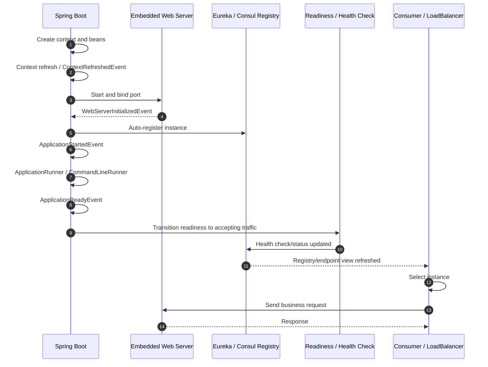

# Application Startup Order, Registration, and Traffic Acceptance

## 1. Why Understanding the Exact Lifecycle Order Matters

A microservice can open its HTTP port before finishing business initialization, be recorded in a registry before consumers see the entry, or appear in the registry before it is eligible to handle requests. Therefore, the following three states are not synonymous:

- **Process running:** the JVM/container has started.
- **Instance registered:** Eureka, Consul, or Kubernetes has information about the instance/endpoint.
- **Instance ready to accept traffic:** the application has completed warm-up, required dependencies are working, and the readiness mechanism allows requests to be routed to the instance.

In Spring Cloud Service Discovery, `DiscoveryClient` helps consumers find instances by service ID; `ServiceRegistry` and auto-registration manage registration; the load balancer selects an instance for a request. To prevent requests from reaching an unready instance, you need to coordinate the Spring Boot lifecycle with health checks/readiness and registry update mechanisms.

## 2. Four Milestones to Distinguish

| Milestone | Meaning | Ready to Accept Traffic? |
|---|---|---|
| Process started | JVM or container is running | Cannot conclude yet |
| Web server initialized | Embedded server has started and has an actual port | The port is bound, but readiness may still be refusing traffic |
| Service registered | The registry has received the instance record | Discoverable by consumers, but not necessarily ready |
| Ready / accepting traffic | Warm-up and readiness checks pass | Can be included in the traffic-receiving endpoint pool |

In particular, binding the server port and the application being ready are two different things. If the port is open while the application is still loading caches, running migrations, or waiting on dependencies, a request arriving too early may fail even though the health endpoint or registry will eventually report a healthy state.

## 3. Startup Sequence in Spring Boot

For a Spring Boot application with a web server, the conceptual sequence typically unfolds as follows:

1. **Create `SpringApplication` and prepare Environment:** read configuration, profiles, environment variables, and initialize the ApplicationContext.
2. **Create beans:** dependency injection, constructors, `@PostConstruct`, and bean initialization steps execute. These steps should focus on local configuration/state.
3. **Context refresh completes:** Spring publishes `ContextRefreshedEvent`; for web applications, the web server is started and its actual port is published during refresh completion.
4. **Publish `WebServerInitializedEvent`:** Spring notifies that the web server is ready and has a port. Spring Cloud Commons auto-registration listens to this event to register the service with the registry. Exact details depend on the starter and implementation.
5. **Publish `ApplicationStartedEvent`:** Spring Boot reports that the context has refreshed; liveness transitions to `CORRECT`, while readiness remains `REFUSING_TRAFFIC` until runners finish.
6. **Run `ApplicationRunner` and `CommandLineRunner`:** the application can perform warm-up, verify configuration, or load required data.
7. **Publish `ApplicationReadyEvent`:** application startup completes; immediately after this event, Spring Boot transitions readiness to `ACCEPTING_TRAFFIC` via the availability mechanism.
8. **Health checks and discovery converge:** Eureka/Consul updates status, or the Kubernetes readiness probe succeeds and the endpoint is added to the ready endpoint set. Consumers refresh their registry/cache and the load balancer can then select the instance.

This is a conceptual order, not a guarantee that every network component completes synchronously at each milestone. Registration, health checks, replication, endpoint controllers, and consumer caches can all run asynchronously.

The key point is that `WebServerInitializedEvent` and service registration can occur before `ApplicationReadyEvent`. While runners are executing, Spring Boot still keeps readiness at `REFUSING_TRAFFIC`; the web server can reject requests according to availability state. With Eureka or Consul, do not assume auto-registration automatically waits for warm-up to finish: you must integrate health status/readiness and ensure consumers only select eligible instances.

### 3.1. Important Events

| Event / Callback | Timing | Recommended Use |
|---|---|---|
| Constructor / `@PostConstruct` | When the current bean is created | Inject dependencies, validate local configuration, initialize simple state |
| `ContextRefreshedEvent` | ApplicationContext has refreshed | Work depending on a constructed context; still account for runners and readiness |
| `WebServerInitializedEvent` | Web server has started and published its actual port | Spring Cloud infrastructure learns the port to auto-register; apps rarely need manual registration |
| `ApplicationStartedEvent` | After context refresh, before runners | Record liveness and begin subsequent startup tasks |
| `ApplicationRunner` / `CommandLineRunner` | After context refresh, before ready event | Warm-up, cache loading, or bounded-timeout dependency checks |
| `ApplicationReadyEvent` | After runners complete | Logic requiring full startup completion; does not guarantee cluster-wide registry convergence |
| `@PreDestroy` / shutdown callback | Context is closing | Stop background tasks, release resources; avoid starting new discovery |

Do not call remote services in a constructor or `@PostConstruct` just to check another service. At that point, the registry may not have finished fetching, the target service may not have registered yet, and an exception can prevent the entire context from starting.

## 4. Application Warm-Up and Readiness

An application may need to complete the following tasks before accepting requests:

- Load data or configuration caches into memory.
- Create connection pools and verify required database connectivity.
- Initialize required consumers, producers, or subscriptions.
- Load models, rules, or large assets.
- Complete migrations or schema checks if required by the deployment process.
- Verify required dependencies according to service policy.

These tasks should be organized in runners or dedicated startup components with clear timeouts and logging. If a required task fails, the application can fail startup or keep readiness in the traffic-refusing state. If a dependency only serves an optional feature, consider letting the application start in degraded mode and returning controlled errors for that feature alone.

Example using `ApplicationRunner` to load a cache before Spring Boot publishes `ApplicationReadyEvent`:

```java
import org.springframework.boot.ApplicationArguments;
import org.springframework.boot.ApplicationRunner;
import org.springframework.stereotype.Component;

@Component
public class StartupWarmup implements ApplicationRunner {

    private final ReferenceDataCache cache;

    public StartupWarmup(ReferenceDataCache cache) {
        this.cache = cache;
    }

    @Override
    public void run(ApplicationArguments args) {
        // Set timeouts for I/O and bound retries if calling external systems.
        cache.loadRequiredData();
    }
}
```

Spring Boot publishes `ApplicationReadyEvent` only after runners finish. If warm-up fails and an exception escapes the runner, startup may fail; choose a fail-fast or degraded-mode policy depending on how mandatory the data is. Avoid waiting indefinitely on another service because services can have circular dependencies and collectively fail to become ready.

### 4.1. Liveness and Readiness Are Different

Spring Boot Actuator supports two health probe groups:

| Probe | Question | On Failure |
|---|---|---|
| Liveness | Is the process alive and able to keep running? | The platform may restart the container/process |
| Readiness | Can the instance accept requests right now? | The platform/registry should stop sending new traffic to the instance |

Do not put every external dependency into liveness. For example, a temporary database disconnect does not necessarily mean the JVM is hung; if liveness depends on the database, many pods may restart simultaneously and worsen the outage. Readiness is more appropriate for reflecting that an instance cannot serve requests due to an unavailable required dependency.

Spring Boot health probes can be enabled:

```yaml
management:
  endpoint:
    health:
      probes:
        enabled: true
  endpoints:
    web:
      exposure:
        include: health,info
```

Commonly used endpoints are `/actuator/health/liveness` and `/actuator/health/readiness`. Ensure the endpoints are exposed, reachable by probes, and appropriately secured. Do not expose all of Actuator to the public network just for health checks.

### 4.2. Reading Availability State in Code

Spring Boot provides `ApplicationAvailability` to inspect readiness/liveness state:

```java
import org.springframework.boot.availability.ApplicationAvailability;
import org.springframework.boot.availability.ReadinessState;
import org.springframework.stereotype.Component;

@Component
public class TrafficReadiness {

    private final ApplicationAvailability availability;

    public TrafficReadiness(ApplicationAvailability availability) {
        this.availability = availability;
    }

    public boolean isReady() {
        return availability.getReadinessState() == ReadinessState.ACCEPTING_TRAFFIC;
    }
}
```

If an application has an additional post-startup warm-up phase, it can publish `ReadinessState.REFUSING_TRAFFIC` while working and transition to `ACCEPTING_TRAFFIC` upon completion using `AvailabilityChangeEvent`. Verify the exact API for your Spring Boot version and ensure the readiness health endpoint reflects that availability state.

## 5. When Is a Service Registered?

### 5.1. Spring Cloud Auto-Registration

When you add a discovery starter and enable auto-registration, Spring Cloud typically manages registration along the lifecycle. For web applications, auto-registration needs the actual server port; therefore, `WebServerInitializedEvent` is a key milestone. Do not also manually call `ServiceRegistry.register()` inside `@PostConstruct` if the starter already auto-registers, as this can create duplicate registrations or incorrect lifecycle behavior.

If the application does not use a web server or uses special ports/endpoints, how the registration address is determined depends on the implementation and configuration. Inspect `ServiceRegistry`, `AutoServiceRegistration`, and the starter's properties rather than assuming all registries register at the same moment.

### 5.2. Eureka

With Eureka Client:

- The application publishes `InstanceInfo` containing app name, instance ID, host/IP, port, status, and metadata.
- Auto-registration sends the instance to Eureka Server once client/lifecycle initialization has sufficient information, typically tied to web server initialization.
- The client sends heartbeats to renew its lease and periodically fetches the registry.
- Consumers may not see the instance immediately due to fetch cache and peer replication delays.
- An `UP` status in the registry does not prove every business API is healthy; integrate an appropriate health indicator or health check handler.

Example Eureka Client integrated health check configuration:

```yaml
eureka:
  client:
    register-with-eureka: true
    fetch-registry: true
    healthcheck:
      enabled: true
```

This health check feature must be configured and tested according to the Spring Cloud Netflix version in use. If application readiness has custom conditions, ensure the health status is mapped accurately to Eureka status; do not assume simply enabling heartbeats checks readiness.

When pulling an instance out of traffic before shutdown, you can transition the Eureka status to `OUT_OF_SERVICE` via the instance management API, wait for the change to propagate to consumers, and then drain requests. When the context closes normally, Eureka Client performs deregistration as part of its lifecycle.

### 5.3. Consul

With Spring Cloud Consul:

- The application registers the service through the Consul Agent according to discovery configuration.
- The registration can include an HTTP, TCP, TTL, or other supported health check.
- The Consul Agent runs the check and updates service status in the catalog/health API.
- Consumers can query passing instances or use the DNS/HTTP API.
- When the application stops normally, the lifecycle can deregister the service; if the process dies or the agent loses contact, TTL/checks and deregistration policies handle the status per configuration.

Conceptual HTTP health check configuration example:

```yaml
spring:
  cloud:
    consul:
      discovery:
        register: true
        health-check-path: /actuator/health/readiness
        health-check-interval: 10s
```

Property names and defaults may vary by release. The endpoint called by the Consul Agent must be reachable from the node/agent, not only from inside the application. If Actuator runs on a separate management port, publish the correct host, port, and scheme.

### 5.4. Kubernetes

Kubernetes follows a different model from Eureka and Consul. The application usually does not write an instance record to a separate registry itself. A Kubernetes Service is a declarative resource; the EndpointSlice controller watches Pod/Service selectors and updates the endpoint list. The Pod's readiness probe determines whether the Pod qualifies as a ready endpoint.

Typical flow:

1. Deployment creates a Pod.
2. The container starts and Spring Boot binds the port.
3. Spring finishes startup and the readiness endpoint reports success.
4. Kubelet executes the readiness probe successfully.
5. The EndpointSlice controller updates the endpoint to ready state.
6. Kubernetes Service routing and/or Spring Cloud Kubernetes `DiscoveryClient` sees the endpoint via its respective mechanism.

Example readiness/liveness probes:

```yaml
spec:
  containers:
    - name: payment-service
      ports:
        - name: http
          containerPort: 8080
      readinessProbe:
        httpGet:
          path: /actuator/health/readiness
          port: http
        periodSeconds: 5
        failureThreshold: 3
      livenessProbe:
        httpGet:
          path: /actuator/health/liveness
          port: http
        periodSeconds: 10
        failureThreshold: 3
```

This is an illustrative configuration; tune `initialDelaySeconds`, `timeoutSeconds`, `periodSeconds`, and failure thresholds based on actual startup time. A failed readiness probe removes the endpoint from the ready set, without restarting the container. A failed liveness probe can cause kubelet to restart the container.

For applications with long startup times, you can add a `startupProbe`. While the startup probe has not yet succeeded, kubelet does not run liveness and readiness probes; this prevents restarting the application just because liveness started checking before startup finished:

```yaml
startupProbe:
  httpGet:
    path: /actuator/health/liveness
    port: http
  periodSeconds: 5
  failureThreshold: 30
```

The values above allow up to roughly 150 seconds before the startup probe fails (excluding other scheduling/timeout factors). Choose thresholds based on actual startup time and keep a separate readiness probe to decide when the Pod accepts traffic.

## 6. From Registration to Consumer Request Delivery

An instance can receive traffic through discovery/load balancing only after several conditions are met:

1. The registry has received the instance record or Kubernetes has created the endpoint.
2. The endpoint has an address, port, and scheme reachable by the consumer.
3. The health/readiness policy marks the instance eligible to receive traffic.
4. The change has propagated to the registry peer/cache or endpoint view used by the consumer.
5. The consumer has refreshed discovery data or the load balancer has fetched the updated instance list.
6. The request is constructed with the correct protocol, port, and path; network policies/firewalls allow the connection.

With client-side discovery, the consumer typically fetches the list of `ServiceInstance` entries via `DiscoveryClient` and Spring Cloud LoadBalancer selects an instance. With Kubernetes Service DNS/VIP, kube-proxy or the corresponding data plane routes to a ready endpoint. Both paths can coexist in a system, so identify which path requests actually take to avoid mistakenly thinking every client sees registry updates immediately.

### 6.1. Convergence Latency

There can be latency between when a service becomes ready and when the first request reaches the instance:

| Component | Source of Latency |
|---|---|
| Eureka | Health status update, heartbeat, server processing, peer replication, and client registry fetch interval |
| Consul | Health check interval, agent/server catalog update, query mode, and consumer cache |
| Kubernetes | Readiness probe interval, kubelet update, EndpointSlice controller, and data plane propagation |
| Consumer | Discovery cache, refresh interval, DNS cache, and load balancer cache |

Do not assume zero propagation time. Measure from application start until the endpoint is visible to consumers, and separately measure endpoint removal time when readiness transitions to false.

## 7. Startup and Traffic-Acceptance Sequence Diagram



The diagram illustrates a common flow for Eureka/Consul-style registries. In Kubernetes, replace the auto-register step with the Service/EndpointSlice controller and readiness probe; the application typically does not register the Pod into a registry itself. Registration, health checks, and refreshes may run concurrently or with lag depending on the implementation.

## 8. Preventing Traffic to Unready Instances

Simply registering a service is not enough to control traffic. You need a readiness gate that the routing mechanism actually enforces:

- With Kubernetes, configure `readinessProbe` pointing to the readiness endpoint and do not use `publishNotReadyAddresses` without a specific reason.
- With Consul, the health check must reflect readiness and consumers must query passing instances when selecting traffic targets.
- With Eureka, health status must be updated properly; consumers/load balancers must exclude `DOWN` or `OUT_OF_SERVICE` instances according to the implementation.
- With custom registries or client caches, define which statuses are permitted to receive traffic and the maximum acceptable staleness.

If a service relies on a long warm-up, keep readiness at `REFUSING_TRAFFIC` until complete. If startup depends on another service, use retries with backoff and timeouts; avoid infinite loops in constructors or runners because they can stall an entire deployment.

## 9. Shutdown and Traffic Draining Order

Safe startup requires a matching shutdown. The goal is to stop accepting new requests, allow in-flight requests to complete within a time limit, and only then close the server and service registration.

A reference sequence:

1. Initiate shutdown or receive a scale-down signal.
2. Transition readiness to `REFUSING_TRAFFIC` or mark the instance `OUT_OF_SERVICE`/critical per the registry.
3. Wait a bounded time for the change to propagate to endpoints/registry and consumers.
4. Drain in-flight requests; stop accepting new requests at the server or proxy layer.
5. Stop schedulers, consumers, and background workers in the appropriate order.
6. Let Spring close the context and let the discovery client deregister/clean up.
7. Exit the process before the termination grace period expires.

Exact details depend on the platform. Kubernetes updates the terminating/ready state of endpoints during Pod deletion; `preStop` hooks and `terminationGracePeriodSeconds` help coordinate, but EndpointSlice and data plane updates are asynchronous. Do not assume every proxy and consumer stops sending requests the instant a Pod receives SIGTERM.

### 9.1. Graceful Shutdown in Spring Boot

You can enable graceful shutdown for the embedded web server:

```yaml
server:
  shutdown: graceful

spring:
  lifecycle:
    timeout-per-shutdown-phase: 20s
```

The duration above is only an example. Set timeouts according to the longest request, drain duration, and Kubernetes `terminationGracePeriodSeconds`. If the platform grace period is shorter than Spring needs, the process may be killed before cleanup completes.

### 9.2. Differences by Registry

| Platform | Removing Instance from Traffic | Cleaning Up Registration |
|---|---|---|
| Eureka | Transition status to `OUT_OF_SERVICE`/`DOWN` and let consumers refresh the registry | Eureka Client deregisters on normal shutdown; on sudden crash, lease/eviction handles it |
| Consul | Health check becomes critical or service deregisters per lifecycle | Client/agent deregisters; if unreachable, checks/TTL and policy handle it |
| Kubernetes | Readiness false or Pod termination makes the endpoint unready for Service routing | EndpointSlice controller updates endpoints; Pod/Service managed by Kubernetes |

With Eureka/Consul, do not rely solely on last-second deregistration because consumers may hold stale caches. Mark the instance as not accepting traffic first, wait for bounded propagation, drain, and then close.

## 10. Illustrative Configuration for a Spring Boot App on Kubernetes

Application with Actuator readiness/liveness:

```yaml
management:
  endpoint:
    health:
      probes:
        enabled: true
  endpoints:
    web:
      exposure:
        include: health,info

server:
  shutdown: graceful

spring:
  lifecycle:
    timeout-per-shutdown-phase: 20s
```

Deployment using probes:

```yaml
apiVersion: apps/v1
kind: Deployment
metadata:
  name: payment-service
spec:
  replicas: 3
  selector:
    matchLabels:
      app: payment-service
  template:
    metadata:
      labels:
        app: payment-service
    spec:
      terminationGracePeriodSeconds: 40
      containers:
        - name: payment-service
          image: example/payment-service:1.0.0
          ports:
            - name: http
              containerPort: 8080
          readinessProbe:
            httpGet:
              path: /actuator/health/readiness
              port: http
            periodSeconds: 5
            timeoutSeconds: 2
            failureThreshold: 2
          livenessProbe:
            httpGet:
              path: /actuator/health/liveness
              port: http
            periodSeconds: 10
            timeoutSeconds: 2
            failureThreshold: 3
```

Service:

```yaml
apiVersion: v1
kind: Service
metadata:
  name: payment-service
spec:
  selector:
    app: payment-service
  ports:
    - name: http
      port: 80
      targetPort: http
```

In this configuration, the Kubernetes Service routes traffic only to Pods with ready endpoints as updated by the control plane. Spring Boot readiness reflects that the application has finished startup; the Kubernetes readiness probe brings that state into routing decisions.

## 11. Common Issues

| Symptom | Possible Cause | Resolution |
|---|---|---|
| Instance appears in registry but requests return 503/500 | Registered before warm-up completed or health status does not reflect readiness | Use a readiness gate and check status/health integration |
| `@PostConstruct` cannot find another service | Registry cache or dependent service is not ready yet | Move logic to a runner/ready phase with timeout and retry |
| Eureka dashboard shows `UP` but database is failing | Heartbeat does not fully represent business health | Integrate Actuator health checks/appropriate custom handler |
| Consul has the service but passing queries return no instance | Health check is not passing or check endpoint is wrong | Inspect agent, check path/port, interval, and readiness endpoint |
| Pod is Running but Service sends no traffic | Readiness probe is failing or EndpointSlice has not updated | Check `/actuator/health/readiness`, probe, and EndpointSlice |
| Consumers still call a recently stopped instance | Stale registry propagation/cache/DNS | Measure refresh interval, use retry/fallback, and graceful drain |
| Shutdown killed before draining finishes | Grace period shorter than cleanup duration | Align Spring timeout, preStop, and termination grace period |
| Startup hangs when a dependency is missing | Runner waits indefinitely or retries unboundedly | Use bounded retries, backoff, and clear fail/degraded decisions |

## 12. How to Test the Lifecycle Sequence

Do not only test that the service appears in a dashboard. Measure startup timing, readiness, and actual traffic:

1. Start the service with healthy dependencies; record timestamps for process start, web server initialized, registration completion, `ApplicationReadyEvent`, and readiness probe passing.
2. Continuously send requests through the real production traffic path (Kubernetes Service, Spring Cloud LoadBalancer, or gateway) during startup; verify no requests reach the instance before readiness.
3. Intentionally slow down warm-up; verify the instance is not selected while readiness refuses traffic.
4. Cause a required dependency to fail after the service is running; verify readiness changes and traffic is drained per policy.
5. Scale down an instance; measure the time from readiness false/`OUT_OF_SERVICE` until consumers stop sending new requests.
6. Send a long-running request during shutdown; verify it is drained or terminated according to the configured timeout.
7. Simulate slow registry/network conditions; verify stale caches, retries, and fallbacks do not create infinite call loops.

Metrics to record include startup duration, time-to-register, time-to-ready, time-to-first-successful-request, endpoint propagation delay, failed requests during rollout, drain duration, and shutdown duration.

## 13. Principles to Remember

- Process running, web server port open, instance registered, and instance ready for traffic are distinct milestones.
- Spring Cloud auto-registration usually starts once the web server has a port; this can happen before `ApplicationReadyEvent`.
- Use runners for warm-up and `ApplicationReadyEvent` for post-startup logic; do not call remote services in constructors or `@PostConstruct`.
- Readiness decides whether to receive traffic; liveness decides whether to restart the process. Do not mix the two goals.
- Eureka/Consul require health status and propagation; Kubernetes uses readiness probes and EndpointSlices to control ready endpoints.
- Discovery caches and load balancers have latency; do not assume registry changes take effect instantaneously on all consumers.
- Shutdown must pull traffic first, drain requests, and then let Spring/registry clean up; set a sufficiently long grace period.

## 14. Conclusion

A service should receive traffic only after Spring Boot finishes required startup, the application reports readiness success, and the routing mechanism sees an eligible endpoint. In Spring Cloud, auto-registration can happen right after the web server binds its port, before `ApplicationReadyEvent` is published. Therefore, successful registration does not mean the application is ready.

Use readiness to control traffic, health checks to update registry status, monitor propagation latency, and implement graceful shutdown with draining. When testing, measure the time from process start to the first successful request and from pulling readiness until new requests stop arriving; these two intervals show whether the discovery lifecycle meets operational requirements.

## References

- [Spring Boot – Application Events and Listeners](https://docs.spring.io/spring-boot/3.5/reference/features/spring-application.html)
- [Spring Boot – Application Availability and Probes](https://docs.spring.io/spring-boot/3.5/reference/actuator/endpoints.html#actuator.endpoints.kubernetes-probes)
- [Spring Cloud Commons – AbstractAutoServiceRegistration](https://github.com/spring-cloud/spring-cloud-commons/blob/main/spring-cloud-commons/src/main/java/org/springframework/cloud/client/serviceregistry/AbstractAutoServiceRegistration.java)
- [Spring Cloud Consul – Service Discovery](https://docs.spring.io/spring-cloud-consul/reference/discovery.html)
- [Kubernetes – Liveness, Readiness and Startup Probes](https://kubernetes.io/docs/concepts/configuration/liveness-readiness-startup-probes/)
