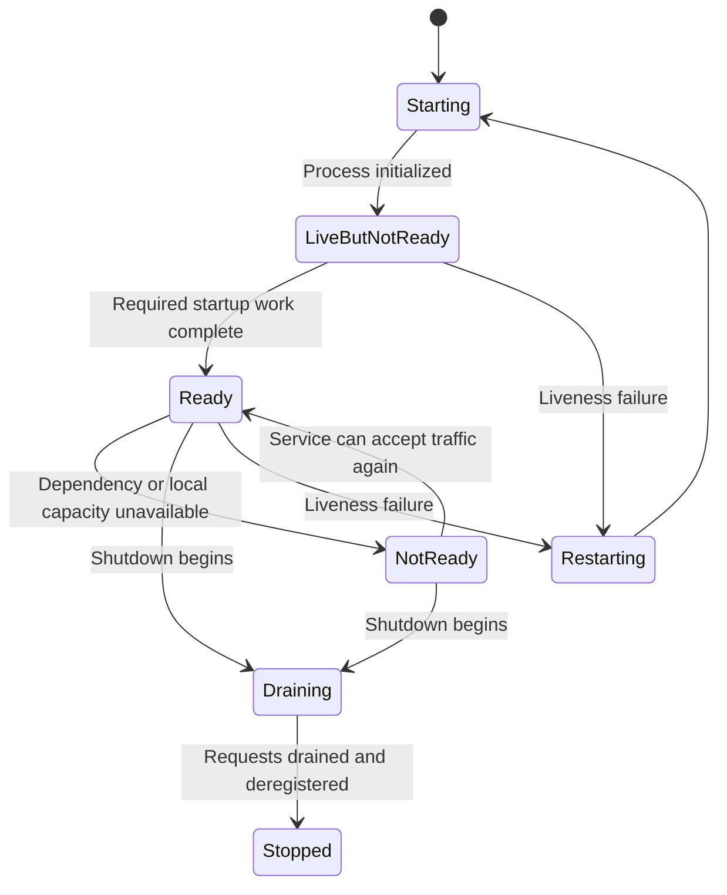
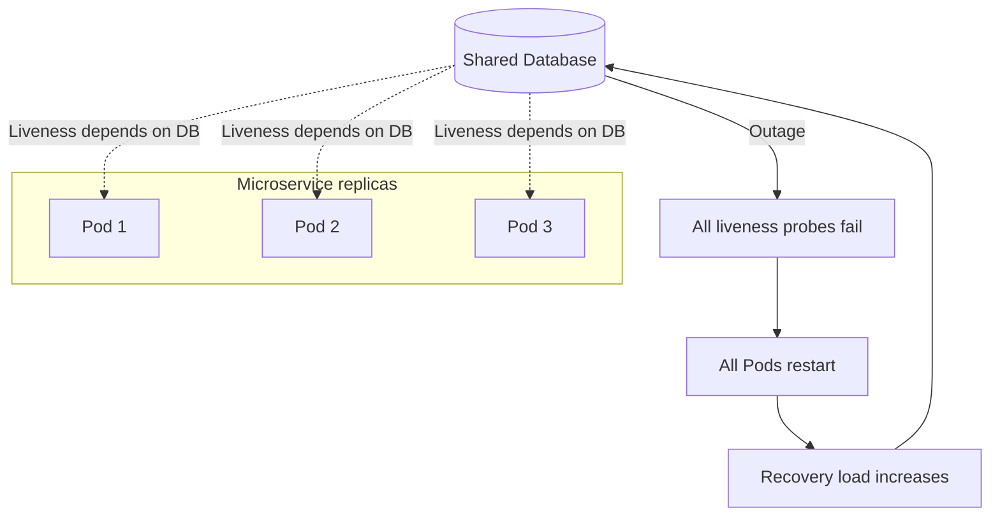

# Relationship Between Liveness, Readiness, and Registry Health Checks

In microservices, an application can be running without being ready to receive requests; it can also still answer a health endpoint while a critical dependency has failed. Therefore, you must distinguish **liveness**, **readiness**, and **service registry health checks**. These three signals are related, yet serve different decisions: Kubernetes decides when to restart or add a Pod to Service endpoints, whereas Eureka/Consul decides which instances are advertised or returned to consumers.

If you share a single `/actuator/health` endpoint for every purpose without understanding semantics, the system can easily fall into cascading restarts during a temporary database outage, route traffic to an uninitialized Pod, or keep a broken instance in the registry. This lesson explains how to design these signals, integrate Spring Boot Actuator with Kubernetes, and synchronize status appropriately with Eureka or Consul.

## 1. Three Concepts to Keep Separate

### Liveness: Is the Process Alive and Able to Keep Running?

Liveness answers the question: is the process in a state where it can continue operating, or has it fallen into a hung/broken state from which it cannot recover on its own?

In Kubernetes, when a liveness probe fails enough consecutive times, kubelet restarts the container. Therefore, liveness should reflect internal process errors such as deadlocks, stuck event loops, or states that cannot recover by continuing to run.

Do not include databases, message brokers, Eureka, or Consul in liveness by default. If a shared dependency temporarily fails, every Pod may fail liveness simultaneously and restart together, increasing load while the system is already degraded.

### Readiness: Can the Instance Accept Traffic Right Now?

Readiness answers the question: has the application initialized sufficiently and can it currently handle business requests?

In Kubernetes, a non-Ready Pod is removed from a Service's normal endpoint list. The container stays running; a readiness failure does not restart the container. When readiness succeeds again, the Pod is restored to endpoints.

Readiness can evaluate initialization status, request-serving ability, connection pools, or dependencies truly required for requests. However, weigh the impact of adding shared dependencies to readiness: if a shared database has an outage, all Pods may be marked NotReady simultaneously, leaving no backends for requests that might still be servable.

### Registry Health Check: Should the Registry Advertise the Instance to Consumers?

A registry health check is the signal that Eureka, Consul, or a discovery implementation uses to evaluate an instance when returning lookup results or updating service status. It can be based on heartbeats/leases, HTTP/TCP checks, or status published by the application.

Registry health is not necessarily synonymous with Kubernetes readiness or liveness. For example:

- Eureka receives heartbeats to renew a lease; instance health status can be updated separately via a health handler.
- A Consul agent can poll an HTTP health endpoint periodically and mark checks `passing`, `warning`, or `critical`.
- Kubernetes manages Service endpoints based on Pod readiness; an application does not need to write an instance registration to a separate registry if it relies solely on Kubernetes Service DNS.

## 2. Comparison Table of Scope and Actions

| Signal | Who Evaluates? | On Failure | Primary Action |
| --- | --- | --- | --- |
| Liveness | Kubelet via liveness probe | Consecutive failure threshold reached | Restart container |
| Readiness | Kubelet via readiness probe | Pod is not Ready | Remove Pod from normal Service endpoints |
| Startup probe | Kubelet during startup | Startup incomplete within configured limit | Keep waiting or restart upon exceeding threshold; liveness/readiness do not run until startup succeeds |
| Eureka heartbeat/lease | Eureka Server and Eureka Client | Lease not renewed within configured period | Instance may expire/be evicted |
| Eureka application health status | HealthCheckHandler and Eureka Client | Health mapped to instance status | Consumers may skip instances not in UP state |
| Consul health check | Consul agent | HTTP/TCP/script check fails | Instance transitions to `warning` or `critical`; `passing=true` queries exclude non-passing instances |
| Kubernetes Service endpoints | Kubernetes control plane | Pod readiness fails | EndpointSlice marks endpoint unready for normal traffic |

The startup probe is a Kubernetes mechanism to protect slow-starting applications. It does not replace liveness/readiness and is not a service registry health check.

## 3. States in a Pod's Lifecycle

An application typically passes through the following stages:

1. The container starts and the JVM launches.
2. The application loads configuration, initializes beans, and opens the server socket.
3. The startup probe confirms the protected startup phase has completed within bounds.
4. Liveness confirms the process is alive; readiness may still not be met.
5. The application completes required steps and transitions readiness to `ACCEPTING_TRAFFIC`.
6. Kubernetes adds the Pod to Service endpoints; any separate registry must also receive the appropriate status.
7. During shutdown, the application transitions readiness to refuse traffic, drains in-flight requests, and deregisters from the registry per lifecycle.



A Pod can be in a Live yet NotReady state during warm-up. This is the intended behavior: the process can keep running to finish initialization without receiving Service traffic yet.

## 4. Spring Boot Actuator Provides Health Groups

Spring Boot Actuator includes health indicators and health groups. When Kubernetes probes support is enabled, the application can expose two separate endpoints:

- `/actuator/health/liveness`
- `/actuator/health/readiness`

In modern Spring Boot, health probe groups may be enabled automatically when running in Kubernetes. When running outside Kubernetes or when you want explicit configuration, enable them via properties:

```yaml
management:
  endpoint:
    health:
      probes:
        enabled: true
  endpoints:
    web:
      exposure:
        include: health,info
```

These groups reflect `LivenessState` and `ReadinessState` managed by Spring Boot. The application can transition readiness state as initialization or shutdown progresses.

Example configuring the readiness group with an additional required health indicator:

```yaml
management:
  endpoint:
    health:
      probes:
        enabled: true
      group:
        readiness:
          include: readinessState,db
```

Add `db` only if the application truly cannot handle any business requests when the database is unavailable. Never add databases or external services to the liveness group. Also avoid blindly putting every health indicator into readiness.

If Actuator runs on a separate management port, ensure probes can reach that port and network policies allow kubelet checks. Some systems configure a dedicated management port, so verify the actual path and port.

## 5. Proactively Transitioning ReadinessState in the Application

Spring Boot provides `ApplicationAvailability` to read state and `AvailabilityChangeEvent` to publish state changes. If initialization is synchronous, it can run inside an `ApplicationRunner` or `CommandLineRunner`; Spring Boot transitions readiness to `ACCEPTING_TRAFFIC` only after runners finish. For asynchronous warm-up or a component that needs to proactively stop receiving traffic at runtime, publish an event:

```java
import org.springframework.boot.availability.AvailabilityChangeEvent;
import org.springframework.boot.availability.ReadinessState;
import org.springframework.context.ApplicationEventPublisher;
import org.springframework.stereotype.Component;

@Component
public class ReadinessController {

    private final ApplicationEventPublisher publisher;

    public ReadinessController(ApplicationEventPublisher publisher) {
        this.publisher = publisher;
    }

    public void markReadyAfterWarmup() {
        AvailabilityChangeEvent.publish(
                publisher,
                this,
                ReadinessState.ACCEPTING_TRAFFIC);
    }

    public void stopAcceptingTraffic() {
        AvailabilityChangeEvent.publish(
                publisher,
                this,
                ReadinessState.REFUSING_TRAFFIC);
    }
}
```

In production code, call `markReadyAfterWarmup()` when warm-up truly finishes and publish `REFUSING_TRAFFIC` via `stopAcceptingTraffic()` at the appropriate lifecycle hook. Do not publish `ACCEPTING_TRAFFIC` right when the socket opens if model loading, cache population, or required connections have not finished.

## 6. Configuring Startup, Liveness, and Readiness Probes on Kubernetes

Example Deployment using three separate probes:

```yaml
apiVersion: apps/v1
kind: Deployment
metadata:
  name: inventory-service
  namespace: commerce
spec:
  replicas: 3
  selector:
    matchLabels:
      app: inventory-service
  template:
    metadata:
      labels:
        app: inventory-service
    spec:
      containers:
        - name: application
          image: example/inventory-service:2.4.1
          ports:
            - name: http
              containerPort: 8080
          startupProbe:
            httpGet:
              path: /actuator/health/liveness
              port: http
            periodSeconds: 10
            timeoutSeconds: 2
            failureThreshold: 30
          livenessProbe:
            httpGet:
              path: /actuator/health/liveness
              port: http
            periodSeconds: 10
            timeoutSeconds: 2
            failureThreshold: 3
          readinessProbe:
            httpGet:
              path: /actuator/health/readiness
              port: http
            periodSeconds: 5
            timeoutSeconds: 2
            failureThreshold: 2
            successThreshold: 1
```

In this example:

- `startupProbe` gives the application an extended startup window. While the startup probe has not succeeded, kubelet does not run liveness and readiness probes.
- `livenessProbe` checks whether the process is alive and responding on the health endpoint. After failing the configured threshold, kubelet restarts the container.
- `readinessProbe` checks whether the application can accept traffic. When it fails, the Pod is removed from normal endpoints while the container keeps running.
- `failureThreshold` and `periodSeconds` determine the waiting window before kubelet takes action; calculate them from real startup duration and fault tolerance requirements.

The example uses the liveness endpoint for the startup probe to verify the JVM and Actuator have started. If the application has a separate bootstrap step lasting after the liveness endpoint already returns UP, create a dedicated startup health group/indicator or use an endpoint that accurately reflects initialization completion. A startup probe should not wait on an external dependency if that could hang indefinitely.

## 7. Do Not Mix External Dependencies into Liveness

A common design mistake is having liveness check the database, Kafka, Redis, Eureka, and every dependent API. When a shared system fails, all instances can restart at once:



The result can be that a recovering database gets slammed with new connections from every restarting Pod. Keep liveness focused on process self-recovery. Use readiness to control traffic if a dependency truly determines serving capability, while considering fallbacks or degraded mode.

Readiness should not be a checklist of every possible dependency. Include only dependencies without which served requests cannot succeed. If only certain endpoints depend on the database, keep the application Ready and return controlled errors for those specific endpoints rather than pulling the whole instance out of traffic.

## 8. Registry Health with Eureka

Eureka has two mechanisms that are often confused:

1. **Heartbeat/lease:** Eureka Client periodically sends renewals so the server knows the instance is maintaining its registration session. If heartbeats fail to arrive within the lease duration, the server can evict the instance.
2. **Application health status:** Eureka Client can publish the application's health status so the server/consumers know whether the instance is `UP`, `DOWN`, or `OUT_OF_SERVICE`.

In Spring Cloud Netflix, you can enable health handler integration with:

```yaml
eureka:
  client:
    healthcheck:
      enabled: true
```

Place this property in the application's `application.yml`. Health check integration enables Eureka Client to use Actuator/Spring health state to update instance status. Verify how your Spring Cloud Netflix version maps statuses.

Key points:

- A successful heartbeat does not mean the application is Ready.
- An instance can still send heartbeats while marked `OUT_OF_SERVICE` or a non-serving status.
- Consumers must filter/select instances with an appropriate status; do not rely solely on an instance still appearing in the registry.
- Without health integration enabled, Eureka may rely primarily on heartbeats/leases and the default instance status.

Do not use a health indicator that depends on the Eureka registry itself to decide the health published to Eureka. That creates a circular dependency: a registry glitch causes the application to mark itself unhealthy and can degrade discovery further.

## 9. Registry Health with Consul

The Consul agent executes the health check declared for a service. Spring Cloud Consul Discovery typically allows configuring an HTTP health check:

```yaml
spring:
  application:
    name: inventory-service
  cloud:
    consul:
      host: ${CONSUL_HOST:localhost}
      port: ${CONSUL_PORT:8500}
      discovery:
        enabled: true
        register: true
        service-name: inventory-service
        health-check-path: /actuator/health/readiness
        health-check-interval: 10s
        prefer-ip-address: true

management:
  endpoint:
    health:
      probes:
        enabled: true
  endpoints:
    web:
      exposure:
        include: health
```

In this example, the Consul agent polls the readiness endpoint periodically. If the endpoint returns an unsuccessful status, Consul marks the check non-passing. Consumers can query service health and filter `passing=true` to receive only instances passing checks.

Use `/actuator/health/readiness` only if the agent can reach the endpoint and the semantics align with traffic routing. If the endpoint binds only to loopback inside the container, an agent on the host or another container cannot reach it. Check the registered hostname/IP and port, network policies, and firewalls.

Consul can keep a service in the catalog while its check is `critical`; whether it is deregistered after some time depends on settings such as critical service timeout and deployment policy. Do not assume a failing check deletes the service immediately.

## 10. Kubernetes Service Endpoints and Spring Cloud Kubernetes

When using a Kubernetes Service as the discovery mechanism, the control plane tracks Pods matched by the Service selector and their readiness state. EndpointSlices reflect the backends; unready Pods are typically excluded from normal Service traffic.

This means:

- Liveness probes control container restarts.
- Readiness probes affect Pod Ready state.
- Kubernetes Service/EndpointSlice reflects backends eligible to receive traffic.
- Spring Cloud Kubernetes `DiscoveryClient` can read Services and Endpoints/EndpointSlices to supply instances to the application.

In this model, the application usually does not register and deregister Service instances itself via a separate registry API. Kubernetes controllers maintain endpoints based on Pods and Services. Enabling `publishNotReadyAddresses` on a Service allows unready endpoints to be published for special purposes; do not enable it indiscriminately for services receiving business traffic.

If consumers call the Service via DNS such as `inventory-service.commerce.svc.cluster.local`, DNS and the data plane handle routing to backends. If using `DiscoveryClient` to fetch individual instances and load balance client-side, the discovery implementation needs appropriate resource read permissions and consumers must handle caching/staleness.

## 11. Which Health Endpoint Should Be Used for the Registry?

There is no single choice for every system. Determine under what scenarios the registry needs to exclude an instance:

| Need | Suggested Endpoint/Signal | Notes |
| --- | --- | --- |
| Process hung, needs restart | Liveness | Check only internal errors recoverable via restart |
| Application not finished initializing | Readiness | Do not accept traffic yet, while the process keeps running |
| Provider cannot serve business requests | Readiness or registry health mapped from readiness | Pick required dependencies and avoid evicting all instances for a non-essential dependency |
| Registry needs to detect dead clients | Eureka lease/heartbeat or Consul agent check | These are registry mechanisms, not replacements for application readiness |
| Pod should not receive Kubernetes Service traffic | Kubernetes readiness probe | EndpointSlice updates according to Pod status |
| Slow startup, avoid premature restarts | Startup probe | Protects startup phase only, does not replace readiness |

With Consul, using the readiness endpoint for the HTTP check generally makes sense if readiness reflects traffic-handling capability. With Eureka, enable the health handler so application status is published. With Kubernetes Services, the readiness probe already directly governs endpoint eligibility.

## 12. Graceful Shutdown and Deregistration

During rolling updates or Pod termination, give the system time to stop accepting new requests and finish in-flight requests:

1. The application transitions readiness to `REFUSING_TRAFFIC`.
2. Kubernetes updates endpoint status to stop sending new traffic to the Pod.
3. Any separate registry receives the non-serving status or deregistration per lifecycle.
4. The application drains in-flight requests.
5. Spring Boot closes the server and resources before `terminationGracePeriodSeconds` expires.

Example Spring Boot configuration:

```yaml
server:
  shutdown: graceful

spring:
  lifecycle:
    timeout-per-shutdown-phase: 20s
```

In the Deployment, `terminationGracePeriodSeconds` must exceed the expected drain time plus cleanup steps. You can use a `preStop` hook if a pause is needed for endpoint propagation to finish, but include that time within the total grace period.

Do not rely solely on deregistration when a process gets `kill -9` or a node loses power. For sudden crashes, the registry needs heartbeats/leases or health checks to detect dead instances.

## 13. Complete Design Example for a Provider

A Spring Boot provider running in Kubernetes and registering with Consul can use the following configuration:

```yaml
spring:
  application:
    name: inventory-service
  cloud:
    consul:
      host: ${CONSUL_HOST:consul-agent}
      port: 8500
      discovery:
        enabled: true
        register: true
        service-name: inventory-service
        health-check-path: /actuator/health/readiness
        health-check-interval: 10s
  lifecycle:
    timeout-per-shutdown-phase: 20s

management:
  endpoint:
    health:
      probes:
        enabled: true
  endpoints:
    web:
      exposure:
        include: health,info

server:
  shutdown: graceful
```

The Deployment declares startup, liveness, and readiness probes pointing to the enabled Actuator endpoints. The Consul agent must be able to reach `/actuator/health/readiness` at the registered instance address. If using Eureka instead of Consul, omit the Consul configuration and enable appropriate Eureka health integration.

In production examples, clearly decide whether readiness includes the database. If the database is needed only for certain endpoints, consider keeping the service Ready and handling errors on database-dependent endpoints rather than evicting the entire instance.

## 14. End-to-End Health Behavior Testing

Do not check only that the endpoint returns `UP`; verify the actions the platform takes:

1. Start a new Pod and verify the startup probe protects the startup phase.
2. Before the application is ready, verify liveness can be UP while readiness has not passed yet.
3. Verify an unready Pod receives no traffic through the Kubernetes Service.
4. When readiness transitions to UP, verify EndpointSlice updates and traffic flows to the Pod.
5. Trigger a controlled liveness failure in a test environment; verify kubelet restarts the container after the configured threshold.
6. If using Consul, make the readiness endpoint fail and confirm the check transitions to `critical`/non-passing.
7. If using Eureka, change health state and confirm instance status is published via the health handler.
8. Restore health and verify the Pod/registry returns to serving state.
9. Terminate the Pod normally and verify readiness drops before shutdown and in-flight requests drain.
10. Simulate an abrupt kill to verify leases/health checks detect the dead instance.

Run these tests against a single replica or in a staging environment. Never intentionally fail liveness across all production replicas to test restart behavior.

## 15. Common Design Mistakes

| Practice | Consequence | Improvement |
| --- | --- | --- |
| Using a shared `/actuator/health` for all probes | Liveness, readiness, and registry share the same semantics despite needing different actions | Use liveness/readiness health groups and explicit registry configuration |
| Putting the database into liveness | Database outage causes cascading Pod restarts | Keep liveness internal; consider the database in readiness |
| Marking Ready as soon as the server socket opens | Traffic arrives before caches/connection pools finish initializing | Transition readiness after required bootstrap steps |
| Treating Eureka heartbeat as business health check | Instance keeps renewing its lease even when unable to serve | Publish health status and use an appropriate consumer filter |
| Treating Consul critical as equivalent to service deletion | The service may still remain in the catalog | Query health with `passing=true` or configure intentional deregistration |
| Using Kubernetes liveness instead of readiness | Temporarily failing Pods get restarted instead of taken out of traffic | Separate the two probes by desired action |
| Registry check cannot reach Actuator | Instance stays critical even when the app is healthy | Check advertised address, bind address, port, and networking |
| Not draining traffic on shutdown | In-flight requests get dropped | Transition readiness, deregister, and enable graceful shutdown |
| Health endpoint depends on the registry checking it | Circular dependency spreads registry glitches into health status | Never include registry self-checks in liveness/readiness published back to the registry |

## 16. Implementation Checklist

- [ ] Liveness reflects only internal errors requiring process restart.
- [ ] Readiness reflects ability to receive business requests.
- [ ] Startup probe protects slow-starting applications.
- [ ] Spring Boot Actuator enables health probe groups and exposes the right endpoints.
- [ ] Kubernetes probes point to the right path, port, and have appropriate thresholds.
- [ ] External dependencies are included in readiness only when strictly mandatory.
- [ ] Eureka heartbeat/lease is distinguished from application health status.
- [ ] Consul agent check can call the health endpoint and consumers filter appropriate status.
- [ ] Kubernetes readiness is used to control Service endpoints.
- [ ] No circular dependency exists between registry health and registry connectivity.
- [ ] Graceful shutdown transitions readiness before stopping and provides drain time.
- [ ] Startup, not-ready, liveness restart, registry check failure, and recovery have been tested.

Liveness decides when to restart the process; readiness decides whether an instance should receive traffic; registry health checks decide how an instance is advertised or selected within a specific discovery mechanism. Good design keeps these three signals distinct, maps them deliberately, and tests the actual behavior of Kubernetes, Eureka, or Consul. That way, the application can survive temporary dependency errors, stop receiving traffic when not ready, and be excluded from discovery when truly unable to serve.
