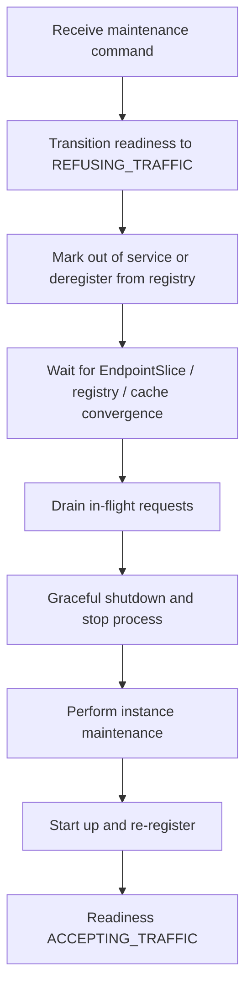

# Transitioning to Refusing Requests Before Maintenance

When a microservice needs an upgrade, configuration change, or maintenance, stopping the process immediately can drop in-flight requests. Consumers may also continue selecting that instance from the Kubernetes Service, Consul, or Eureka for a period of time after shutdown begins.

A safe procedure must first put the instance into a state of **not accepting new requests**, wait for discovery and load balancer data to update, let in-flight requests finish, and only then stop the process. In Spring Cloud, this involves readiness, health checks, `ServiceRegistry`, graceful shutdown, and each registry's convergence time. This lesson explains the execution order and how to coordinate these components when taking an instance into maintenance.

## 1. Why Must You Stop Accepting Traffic Before Stopping?

A service typically has multiple instances serving requests together. Discovery and LoadBalancer select an instance based on the list provided by the registry or platform. When maintaining an instance, there are two groups of requests to handle:

- **New requests:** must be routed to other instances.
- **In-flight requests:** need time to complete before the process or container stops.

If the process is killed immediately, in-flight requests can encounter connection errors, timeouts, or incomplete responses. If you stop the process without updating discovery, consumers may continue picking the old address until health checks, heartbeats, caches, or TTLs detect that the instance is gone.

The draining procedure aims to:

1. Mark the instance as no longer ready to accept new requests.
2. Remove the instance from the endpoint/registry list used by consumers.
3. Wait for those changes to propagate to proxies, discovery clients, and LoadBalancer.
4. Wait for in-flight requests to complete within the allowed time limit.
5. Stop the process gracefully.



Readiness, registry status, and graceful shutdown are distinct mechanisms. Using only one of them is usually not enough to ensure every consumer stops sending requests to the instance.

## 2. Distinguishing Readiness, Liveness, and Registration Status

### 2.1. Readiness Decides Whether to Accept Traffic

Readiness answers the question: is the instance ready to serve new requests? Before maintenance, the application should transition readiness to a traffic-refusing state. In Kubernetes, a failed readiness probe removes the endpoint from being considered ready for normal traffic through the Service.

With Spring Boot Actuator, you can enable health probes:

```yaml
management:
  endpoints:
    web:
      exposure:
        include: health
  endpoint:
    health:
      probes:
        enabled: true
      show-details: never
```

When enabled, the commonly used endpoints are:

```text
/actuator/health/readiness
/actuator/health/liveness
```

Readiness should reflect request-accepting capability. Liveness should reflect whether the process needs to be restarted. During planned maintenance, transition readiness to `REFUSING_TRAFFIC` while keeping liveness healthy; if you fail liveness, Kubernetes may restart the container while you are trying to drain it.

### 2.2. Liveness Is Not a Drain Switch

The liveness probe helps detect hung or unrecoverable processes. It should not be flipped to failing just to take an instance out of traffic. Use readiness to stop accepting requests and let liveness continue monitoring process health.

### 2.3. Registry Status Is a Separate Layer

Application readiness does not automatically update every registry in every configuration:

- Kubernetes Service/EndpointSlice watches Pod readiness and updates endpoints accordingly.
- Consul can use HTTP/TCP/script/TTL checks; when a check is no longer `passing`, consumers querying with `?passing` exclude the instance from results. Registration may still remain in the Catalog.
- Eureka uses heartbeats/leases and instance status. Readiness transitioning to refusing traffic does not automatically guarantee Eureka immediately excludes the instance from all consumers. Use status/deregistration appropriate for your Eureka client/server and verify how consumers filter `OUT_OF_SERVICE`.

Therefore, before maintenance, verify exactly where consumers obtain their instance lists and what condition causes an instance to be excluded from the candidate list.

## 3. Transitioning Readiness State in Spring Boot

Spring Boot provides `AvailabilityChangeEvent` to change the application's readiness state. You can publish `ReadinessState.REFUSING_TRAFFIC` when starting to drain and switch back to `ACCEPTING_TRAFFIC` after the application starts, completes checks, and is ready to accept requests.

Example internal endpoint to initiate draining:

```java
import org.springframework.boot.availability.AvailabilityChangeEvent;
import org.springframework.boot.availability.ReadinessState;
import org.springframework.context.ApplicationContext;
import org.springframework.http.ResponseEntity;
import org.springframework.web.bind.annotation.PostMapping;
import org.springframework.web.bind.annotation.RestController;

@RestController
public class MaintenanceController {

    private final ApplicationContext applicationContext;

    public MaintenanceController(ApplicationContext applicationContext) {
        this.applicationContext = applicationContext;
    }

    @PostMapping("/internal/drain")
    public ResponseEntity<Void> drain() {
        AvailabilityChangeEvent.publish(
                applicationContext,
                ReadinessState.REFUSING_TRAFFIC
        );
        return ResponseEntity.accepted().build();
    }
}
```

The endpoint above only illustrates the readiness operation. In production, protect the endpoint with authentication/authorization, restrict network access, and audit who requested the drain. Do not allow external users to arbitrarily put an instance into maintenance state.

If an application needs to recover after maintenance, it can publish `ReadinessState.ACCEPTING_TRAFFIC` after completing checks and re-registration. Do not switch to accepting just because the process opened its port; verify dependencies, registry status, and the request-serving path.

## 4. Removing an Instance from Discovery

### 4.1. Kubernetes Service

For workloads running in Kubernetes, the readiness probe is the natural mechanism to remove a Pod from ready endpoints. When `/actuator/health/readiness` returns an unready status, kubelet updates the Pod condition; the EndpointSlice controller reflects that change. Service networking then stops selecting the unready endpoint for normal traffic.

Example Deployment configuration:

```yaml
apiVersion: apps/v1
kind: Deployment
metadata:
  name: order-service
  namespace: shop
spec:
  replicas: 3
  selector:
    matchLabels:
      app: order-service
  template:
    metadata:
      labels:
        app: order-service
    spec:
      terminationGracePeriodSeconds: 90
      containers:
        - name: order-service
          image: example/order-service:1.0
          ports:
            - name: http
              containerPort: 8080
          readinessProbe:
            httpGet:
              path: /actuator/health/readiness
              port: http
            periodSeconds: 5
            failureThreshold: 1
          livenessProbe:
            httpGet:
              path: /actuator/health/liveness
              port: http
            periodSeconds: 10
```

Kubernetes updates EndpointSlice only after the Pod status changes and the controller reconciles. Proxies, ingress, client-side discovery, or external caches may need additional time to receive the update. Do not assume a readiness failure stops all requests across the system instantaneously.

### 4.2. Consul

If consumers query the Consul Health API with `?passing` or Spring Cloud Consul enables `query-passing`, the instance will no longer be returned when a related check leaves `passing`.

You can remove the instance from the passing set using one of the approaches designed for the service:

- Have the health endpoint return a non-success HTTP status code when the application enters maintenance.
- Update a TTL check or check status via the Consul Agent/API per configured procedure.
- Deregister the service instance via the Consul client/API when you want to delete the registration.

For example, if the Consul HTTP check calls `/actuator/health/readiness`, switching readiness to refuse traffic causes the next check to fail. Time to exclusion from passing queries depends on health-check interval, timeout, and when consumers re-query.

If immediate removal is needed, use a controlled deregistration operation. Remember that Catalog registration and Health status are two separate pieces of data: a critical check does not necessarily delete the Catalog record.

### 4.3. Eureka

Eureka Client maintains registration via heartbeats. If only readiness fails while Eureka Client keeps sending heartbeats, the instance may continue appearing in the registry.

Before maintenance, you can transition the instance status to `OUT_OF_SERVICE` using the `ServiceRegistry`/Eureka mechanism appropriate for your version, or deregister the registration from Eureka. Then verify:

- Eureka Server has received the new status or deregistration.
- Consumers actually exclude that instance from their candidate list.
- Client-side registry caches and LoadBalancer have updated.

Do not rely on stopping the process for Eureka to detect it instantaneously. When a process disconnects abruptly, the server needs time to detect lease expiration; self-preservation can even delay eviction. `OUT_OF_SERVICE`, cancellation/deregistration, and heartbeats are distinct behaviors, so check the exact code path in your project's Eureka/Spring Cloud version.

### 4.4. Using the ServiceRegistry Abstraction

Spring Cloud Commons defines `ServiceRegistry` to interact with registration, including actions such as register, deregister, read status, and update status. However, registration types and valid status values depend on the implementation.

Conceptual sequence example:

```text
1. Transition readiness to REFUSING_TRAFFIC.
2. Use the registry adapter to set a non-serving status or deregister.
3. Verify the registry no longer returns the instance as a traffic candidate.
4. Wait for caches/discovery clients to update.
5. Drain in-flight requests.
```

Do not pass the same status string to every registry. Eureka has statuses like `OUT_OF_SERVICE`; Consul typically relies on health checks and passing/warning/critical or deregistration. Use the exact API/properties of the active implementation.

## 5. Waiting for Discovery Changes to Propagate

After readiness or the registry updates, consumers may still hold stale lists for a period of time. Layers that can introduce lag include:

- Readiness probe interval and time for kubelet to update the Pod condition.
- Time for the EndpointSlice controller and network proxies to update endpoints.
- Consul health check interval or Eureka registry fetch/heartbeat intervals.
- `DiscoveryClient` and Spring Cloud LoadBalancer caches.
- Client DNS caches or connection pools.
- Ingress, API Gateway, service mesh sidecars, or external load balancers.

The wait duration should be based on configured intervals/cache timeouts and actual measurements. Do not use one fixed number for every environment. During rollouts, monitor Ready endpoint counts, passing/available instances, and real incoming requests to the instance before proceeding to stop.

For a multi-replica service, drain instances one by one in a rolling update or small batches. Retain enough remaining capacity to serve peak load while an instance is under maintenance.

## 6. Draining In-Flight Requests

Removing an instance from discovery only prevents most new requests from reaching it; already-sent requests or keep-alive connections may still exist. The application needs time to finish in-flight requests and stop accepting new ones.

Spring Boot supports graceful shutdown for embedded web servers:

```yaml
server:
  shutdown: graceful

spring:
  lifecycle:
    timeout-per-shutdown-phase: 30s
```

Upon receiving a shutdown signal, the web server stops accepting new connections/requests according to server capabilities and waits for in-flight requests to complete within the timeout. Exact behavior depends on the server (Tomcat, Jetty, Undertow, Reactor Netty) and Spring Boot version.

Points to account for:

- Graceful shutdown timeout must be long enough for the longest allowed request to complete.
- Client and upstream timeouts must be sensible; requests without deadlines can prolong draining.
- Background jobs, message listeners, and scheduled tasks need dedicated pause/stop procedures.
- WebSockets, streaming responses, and long polling may outlive ordinary HTTP requests.
- If the drain timeout expires, there must be clear final termination behavior; you cannot wait forever while the orchestrator is about to kill the container.

Do not confuse `server.shutdown: graceful` with automatic deregistration from Eureka/Consul. Graceful shutdown handles the server currently serving requests; the registry and readiness must be updated beforehand.

## 7. Coordinating with Kubernetes preStop and SIGTERM

When a Pod is deleted or a Deployment rolls out, kubelet runs the `preStop` hook before sending `SIGTERM` to the container. Hook execution time counts toward `terminationGracePeriodSeconds`.

You can use a `preStop` HTTP hook to call the internal drain endpoint:

```yaml
spec:
  terminationGracePeriodSeconds: 90
  containers:
    - name: order-service
      image: example/order-service:1.0
      ports:
        - name: http
          containerPort: 8080
      lifecycle:
        preStop:
          httpGet:
            path: /internal/drain
            port: http
            scheme: HTTP
```

The `/internal/drain` endpoint can transition readiness to `REFUSING_TRAFFIC`, update external registries, and wait for the designed convergence period. After the hook completes, kubelet sends `SIGTERM`; Spring Boot begins graceful shutdown.

`terminationGracePeriodSeconds` must cover `preStop` duration, propagation/drain time, and shutdown time. For example:

```text
terminationGracePeriodSeconds
  >= preStop + propagation/drain + graceful shutdown + safety margin
```

This is a relationship for budgeting time, not a fixed configuration value. If `preStop` waits 20 seconds and graceful shutdown can take 30 seconds, set the termination grace period higher than their sum plus a safety margin.

Kubernetes can send a termination kill signal when the grace period expires. If the application does not stop within the limit, the container may be forcefully killed and remaining requests lost. Test with the longest requests and real propagation times in your system.

## 8. Complete Maintenance Procedure

A controlled procedure can be carried out as follows:

### Before Draining

1. Confirm enough healthy replicas remain to absorb load after pulling one instance.
2. Check current registry status, health checks, LoadBalancer, and error rates.
3. Identify which consumers use Kubernetes Service, Consul, Eureka, or custom caches.
4. Ensure the drain endpoint can only be invoked by operators or the orchestrator.
5. Configure appropriate request timeouts, graceful shutdown, and termination grace period.

### Starting the Drain

1. Send the maintenance command to the target instance.
2. The application transitions readiness to `REFUSING_TRAFFIC`.
3. Update health checks, registry status, or deregistration per implementation.
4. Wait for EndpointSlice/registry/LoadBalancer updates; observe to confirm the instance is no longer selected for new requests.
5. Watch in-flight request count drop to 0 or the defined threshold.

### Stopping and Maintenance

1. Send `SIGTERM` or let the orchestrator proceed with termination after `preStop`.
2. Spring Boot graceful shutdown waits for in-flight requests within the timeout.
3. Stop message listeners, schedulers, and background workers per application policy.
4. Complete maintenance or deploy the new version.

### Bringing the Instance Back

1. Start the process and complete startup.
2. Verify required dependencies and the readiness endpoint.
3. Re-register with the registry if deregistered; ensure no instance ID conflict.
4. Verify health checks/registry status are passing or in the corresponding ready state.
5. Transition readiness to `ACCEPTING_TRAFFIC` when the application is genuinely ready.
6. Monitor error rate, latency, and request distribution after the instance receives traffic.

Do not put an instance back into traffic merely because the container is Running. Running status does not mean Ready or that registration has updated.

## 9. Example Sequence When Using Consul

Assume the Consul check calls `/actuator/health/readiness` and consumers enable `query-passing: true`.

```text
Consumer                 Order instance              Consul
   |                           |                         |
   |                           |<-- POST /internal/drain |
   |                           |                         |
   |                           | Readiness = REFUSING    |
   |                           |                         |
   |                           |<----- HTTP health check -|
   |                           |------ non-2xx ---------->|
   |                           |                         | status critical
   |<------ query passing: instance excluded -----------|
   |                           |                         |
   |---- new request to other instance ----------------->|
   |                           |                         |
   |                           | finish in-flight work   |
   |                           |                         |
   |                           |<-------- SIGTERM --------|
   |                           | graceful shutdown       |
```

In the diagram, the check must run at least once after readiness changes state. If faster removal is needed, proactively update the check/deregister via the Consul API/client instead of waiting for the HTTP check interval. Even then, account for the time consumers take to refresh their instance lists.

## 10. Common Pitfalls

| Symptom | Possible Cause | Resolution |
| --- | --- | --- |
| Pod is draining but new requests still arrive | Readiness has not updated, EndpointSlice/proxy has not converged, or consumers use an external registry | Inspect each discovery layer and update timing. |
| Kubernetes removed Pod, yet Eureka still returns instance | Eureka heartbeats continue and are not automatically tied to Kubernetes readiness | Set Eureka status/deregister separately, then verify consumers. |
| Consul Catalog still has record after check turns critical | Health check changes status without deleting registration | Use `?passing` on consumers or deregister when the workflow requires full removal. |
| In-flight requests dropped during maintenance | Process killed before draining completes or graceful timeout too short | Increase shutdown budget, enforce request deadlines, and test long requests. |
| Pod restarts as soon as draining starts | Liveness probe was also made to fail | Change readiness only; keep liveness reflecting process liveness. |
| Pod killed before graceful shutdown finishes | `terminationGracePeriodSeconds` shorter than total `preStop` plus shutdown | Recalculate the time budget and inspect termination logs. |
| Instance fails to rejoin traffic after maintenance | Readiness still refusing, registry not registered, or health check not passing | Verify startup, registration, and endpoint health before transitioning to accepting. |
| Drain endpoint invoked unintentionally | Endpoint unprotected or publicly exposed | Require operator authorization, restrict network access, and audit calls. |

## 11. Pre-Production Checklist

- Readiness probe accurately measures ability to accept requests; liveness is not used as a drain switch.
- A protected internal endpoint or operation exists to initiate draining.
- All registries and caches used by consumers have been identified.
- Consul check/query-passing or Eureka status/deregistration has been tested against the actual implementation.
- Convergence time from readiness change until new requests stop reaching the instance has been measured.
- Graceful shutdown and request timeouts accommodate in-flight processing time.
- Kubernetes `preStop` and `terminationGracePeriodSeconds` have an appropriate time budget.
- Background jobs, message consumers, schedulers, and streaming connections have separate shutdown plans.
- Sufficient spare capacity exists when draining instances one at a time.
- Instance recovery procedure verifies registration and readiness before accepting traffic.

## 12. Key Takeaways

- Before maintenance, transition readiness to `REFUSING_TRAFFIC` to stop accepting new requests.
- Readiness, registry status/deregistration, and graceful shutdown are separate layers; coordinate them according to the active discovery implementation.
- Kubernetes readiness updates EndpointSlice; Consul can filter with `?passing`; Eureka requires explicit status updates or deregistration to remove an instance before the process stops.
- Wait for discovery clients, proxies, and LoadBalancer to update before terminating the process.
- Use Spring Boot `server.shutdown: graceful` and `spring.lifecycle.timeout-per-shutdown-phase` to wait for in-flight requests.
- Kubernetes `preStop` runs before SIGTERM; hook duration counts within `terminationGracePeriodSeconds`.
- Transition to `ACCEPTING_TRAFFIC` only after startup, health checks, and registration are ready.

A properly ordered draining workflow lets you maintain instances one by one without disrupting the overall service, while reducing failed requests caused by consumers continuing to call a stopping endpoint.

## References

- [Spring Boot: Graceful Shutdown](https://docs.spring.io/spring-boot/reference/web/graceful-shutdown.html)
- [Spring Boot: Application Availability](https://docs.spring.io/spring-boot/reference/features/spring-application.html#features.spring-application.availability)
- [Kubernetes: Pod Lifecycle and Termination](https://kubernetes.io/docs/concepts/workloads/pods/pod-lifecycle/)
- [Spring Cloud Commons: ServiceRegistry](https://docs.spring.io/spring-cloud-commons/reference/spring-cloud-commons/common-abstractions.html)
