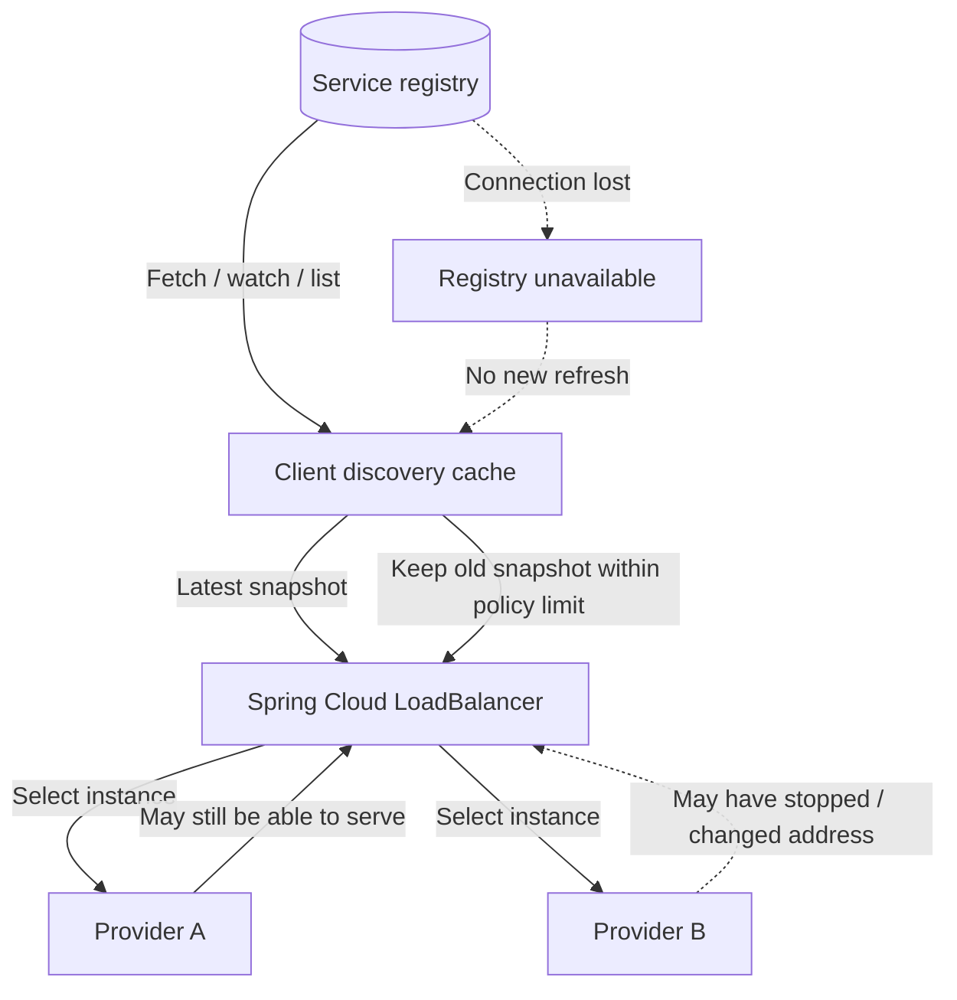
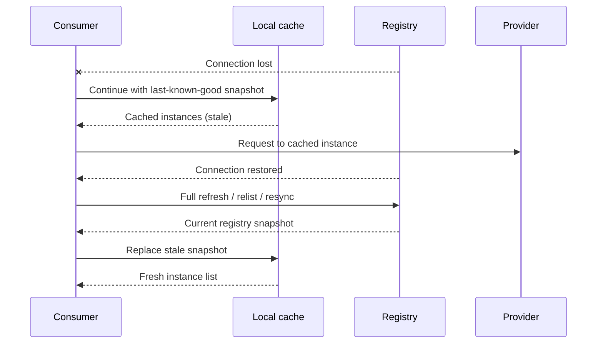

# Registry Disconnected While Client Cache Remains

When Eureka, Consul, ZooKeeper, or the Kubernetes API becomes temporarily unreachable, a consumer application may still retain the previously read list of service instances in memory. This lets some inter-service calls keep working during a registry disruption. However, that list is only the **latest snapshot known to the client**, not proof that the instances are still alive or still permitted to receive traffic.

The problem to solve is balancing availability against data freshness. If you always discard the cache the instant the registry disconnects, a control-plane outage can bring down the data plane even while providers are still running. If you use an old cache indefinitely, consumers may call removed instances, terminated Pods, or changed addresses. Therefore, you need clear policies on stale data, age limits, behavior when starting without a cache, and reconciliation procedures after reconnect.

## 1. What Remains in the Client Cache When the Registry Disconnects?

A service registry stores information about services and instances. Consumers typically do not query the registry for every business request; instead, a discovery client, informer, Curator recipe, or Spring Cloud LoadBalancer may keep data in memory and refresh it periodically or on events.

When the registry connection breaks, a previously populated cache may still contain:

- The service ID and observed instance list.
- Advertised hostnames/IPs and ports.
- Metadata such as zone, version, or environment.
- The most recent health status returned by the provider.
- The timestamp of the last successful refresh, if the application tracks it.

The cache does not automatically know what happened after the last sync. An instance may have shut down, deregistered, moved zones, or been replaced without the consumer receiving the update. Consequently, cached data must be paired with freshness metadata and source connection state.



A registry outage and a provider outage are two different incidents. The registry can be unreachable while providers remain healthy; conversely, the registry may work normally while a specific provider has died. Consumers must handle both situations.

## 2. Distinguishing Cache Layers

In a Spring Cloud application, instance data can pass through multiple layers. Do not lump them all together as "registry cache" because each layer has its own data source and lifecycle.

| Layer | Contents | When the registry disconnects |
| --- | --- | --- |
| Provider registry/server | Service and instance records stored in Eureka/Consul/ZooKeeper/Kubernetes | Cannot accept new registrations, health updates, or queries |
| Discovery client cache | Snapshot held by Eureka client, Curator cache, or informer | May keep serving the last snapshot depending on implementation |
| Spring Cloud LoadBalancer cache | Cached `ServiceInstanceListSupplier` results if caching is configured | May keep returning the cached list until TTL expiry/eviction |
| DNS cache | DNS name resolution results | May keep addresses according to DNS/JVM/resolver TTL |
| HTTP connection pool | TCP/TLS connections to selected instances | May hold idle connections to old addresses |

These layers do not replace one another. Evicting an entry from the LoadBalancer cache does not necessarily clear data in the Eureka client cache; a successful registry refresh does not necessarily close old connections in the HTTP pool right away.

When investigating, determine which layer supplied the instance list for the request and which address the connection targeted. Otherwise, raising TTL or shortening fetch intervals may not affect the layer causing the error.

## 3. Stale Data and Snapshot Age

A snapshot may still be accurate right after the registry disconnects, yet the probability of error grows over time. For instance, a last successful refresh 2 seconds ago may be fresh enough for a system with stable instances; a 20-minute-old snapshot may hold many replaced addresses.

Track at minimum:

- `lastSuccessfulRefreshAt`: timestamp of the most recent successful registry read.
- `cacheAge`: elapsed time from the last successful refresh to now.
- `connectionState`: connection state to the registry, if exposed by the provider.
- `lastRefreshError`: most recent error, normalized and scrubbed of sensitive data.
- `instanceCount`: number of instances in the current snapshot.
- `snapshotVersion` or revision/resource version if supported by the source.

Example application-level snapshot:

```java
import java.time.Instant;
import java.util.List;
import org.springframework.cloud.client.ServiceInstance;

public record DiscoverySnapshot(
        List<ServiceInstance> instances,
        Instant lastSuccessfulRefreshAt,
        boolean registryConnected,
        String revision
) {
    public DiscoverySnapshot {
        instances = List.copyOf(instances);
    }
}
```

`lastSuccessfulRefreshAt` must update only on a successful read. Do not update this timestamp merely on TCP reconnect or when a refresh fails; updating it wrongly causes stale data to be mistaken for fresh data.

Not every provider returns a comparable revision. If no revision exists, use the local refresh timestamp and connection state; do not synthesize a fake revision and treat it as a registry version.

## 4. Choosing a Policy When the Registry Is Unreachable

There are three common approaches. The right policy depends on request criticality and the risk of calling the wrong instance.

| Policy | Behavior | Pros | Risks |
| --- | --- | --- | --- |
| Fail closed | Do not select an instance if sufficiently fresh data cannot be confirmed | Avoids using stale addresses | May halt service calls even when providers are healthy |
| Bounded stale / bounded fail open | Use the latest snapshot within a maximum staleness window | Preserves serving capability during brief control-plane outages | May call an instance that was just removed |
| Degraded mode | Continue partial traffic or allow only safe operations per policy | Controls risk according to business logic | More complex to design and test |

A practical policy is typically bounded stale: use the last-known-good snapshot for a short period, record a degraded state, and then fail closed once the stale budget is exceeded. Do not use a cache indefinitely simply to boost availability.

### Business-Based Policy Examples

- Reading catalogs or rarely changing content can tolerate a short stale snapshot.
- Inventory lookups need a tighter stale age limit because instance data and serving state can shift rapidly.
- Payments, authorization, or financially impactful operations require timeouts, idempotency, and appropriate fail-closed policies; an old cache must never be treated as proof that a provider is still eligible to process them.
- Requests that already have a verified endpoint address inside an ongoing workflow may continue per dedicated policy, while still checking connection errors.

A stale discovery policy only governs whether addresses may be picked from an old snapshot. It does not turn stale responses into up-to-date business data and does not replace database consistency.

## 5. Handling Startup When the Registry Is Down

Distinguish two cases:

1. **Application has synced successfully before:** a last-known-good snapshot exists to consider using within the stale budget.
2. **Application is starting fresh with no snapshot:** there is no reliable data to select an instance.

Do not apply stale-if-error to the second case by fabricating a dummy instance list or falling back to uncontrolled default addresses. The consumer should wait for the registry to become available, stay Not Ready for discovery-dependent flows, or return a clear error when no instance is available.

If the application can serve endpoints that do not depend on discovery, the process can stay up while managing the readiness of discovery-dependent capabilities separately. Restarting the entire process is not necessarily required just because the registry is not ready yet.

## 6. TTL Policies and Stale Budgets

Cache TTL and stale budget are two distinct concepts:

- **Cache TTL** determines when an entry must be refreshed or evicted by the caching mechanism.
- **Stale budget** determines whether the application is still allowed to use an old snapshot when refreshing fails.

Example:

| Parameter | Illustrative value | Meaning |
| --- | ---: | --- |
| Discovery refresh interval | 5 seconds | Interval at which the client tries to fetch fresh data |
| LoadBalancer cache TTL | 10 seconds | Duration the supplier result is kept in cache |
| Maximum stale age | 30 seconds | Beyond this age, do not use the snapshot to pick instances |
| Retry backoff | 1–10 seconds with jitter | Wait duration between retry attempts |

Values are illustrative only. Choose the stale budget based on instance churn rate, lease/health propagation, SLAs, and consumer error handling. If cache TTL is 10 seconds while the underlying provider cache has failed to refresh for 5 minutes, actual stale age is still 5 minutes; do not take an outer-layer TTL as proof that the underlying data is fresh.

Do not set TTL so low that every request hits the registry, nor so high that incidents are masked. Measure cache hit ratio, refresh success/failure rates, and snapshot age before tuning.

## 7. Example: Retaining a Last-Known-Good Snapshot

The following code illustrates an application-layer cache. On a successful refresh, it replaces the snapshot with the new list. On a transient refresh failure, it keeps the old list and timestamp while marking the registry disconnected. When stale age exceeds the limit, it refuses to serve the snapshot.

```java
import java.time.Duration;
import java.time.Instant;
import java.util.List;
import java.util.concurrent.atomic.AtomicReference;
import org.springframework.cloud.client.ServiceInstance;

public class LastKnownGoodDiscoveryCache {

    public record Snapshot(
            List<ServiceInstance> instances,
            Instant lastSuccessfulRefreshAt,
            boolean registryConnected) {

        public Snapshot {
            instances = List.copyOf(instances);
        }
    }

    private final AtomicReference<Snapshot> current = new AtomicReference<>();

    public void refreshSucceeded(List<ServiceInstance> instances) {
        current.set(new Snapshot(instances, Instant.now(), true));
    }

    public void refreshFailed() {
        current.updateAndGet(previous -> {
            if (previous == null) {
                return null;
            }
            return new Snapshot(
                    previous.instances(),
                    previous.lastSuccessfulRefreshAt(),
                    false);
        });
    }

    public List<ServiceInstance> getUsableInstances(Duration maxStaleAge) {
        Snapshot snapshot = current.get();
        if (snapshot == null) {
            throw new IllegalStateException("No discovery snapshot is available");
        }

        Duration age = Duration.between(
                snapshot.lastSuccessfulRefreshAt(), Instant.now());
        if (age.compareTo(maxStaleAge) > 0) {
            throw new IllegalStateException("Discovery snapshot is too stale");
        }

        return snapshot.instances();
    }
}
```

`ServiceInstance` in the example is the Spring Cloud type (`org.springframework.cloud.client.ServiceInstance`). This is an illustrative policy example, not a default replacement for Eureka client, Consul client, Curator cache, or Spring Cloud LoadBalancer.

One crucial detail: if a refresh succeeds and returns an empty list, you must update the cache to the empty list. Do not retain the old list merely because the new list has zero instances. An empty result can be a valid state after all providers have deregistered. Only fall back to last-known-good when the refresh operation actually fails per your defined policy.

In production systems, distinguish transient errors such as timeouts/connection resets from configuration or authorization errors like `401`, `403`, or invalid TLS trust. Do not silently serve a stale snapshot forever when a token has been revoked or the registry configuration is wrong.

## 8. Caching and Spring Cloud LoadBalancer

Spring Cloud LoadBalancer obtains instances via `ServiceInstanceListSupplier`. A supplier can fetch data from `DiscoveryClient`, delegate to another supplier, filter by zone/health, or cache the list.

Points to note:

- If using a caching supplier, that cache can retain the list for its TTL.
- If the discovery provider already maintains a local cache, LoadBalancer caching can add another layer of staleness.
- If a supplier returns an empty list and caches it, newly appearing services might not be seen until the next cache refresh.
- If the supplier does not support stale-if-error, do not assume LoadBalancer automatically preserves last-known-good when the source throws an exception.
- `DiscoveryClient` is a lookup abstraction; its general contract does not mandate that every implementation keep a cache when the registry disconnects.

Therefore, verify the exact discovery implementation and supplier chain in use. Do not add a custom cache simply upon seeing a registry outage; first determine which layer already caches data and how it behaves on refresh errors.

### Avoiding Uncontrolled Layered Caching

For example, the following chain can exist:

```text
Eureka local registry cache
       ↓
DiscoveryClient.getInstances()
       ↓
CachingServiceInstanceListSupplier
       ↓
Consumer request
```

If each layer has its own TTL, actual data age can exceed any single layer's TTL. Measure `lastSuccessfulRefreshAt` at the true data source, not just how long an entry sits in the outermost cache.

## 9. Differences Across Registries

Cache behavior when the registry disconnects depends on the provider. Do not apply a single blanket assumption across all implementations.

| Provider | Where client data is typically held | On disconnect |
| --- | --- | --- |
| Eureka | Eureka client has a local registry cache; LoadBalancer cache may also exist | Client can continue looking up the previously fetched snapshot; freshness depends on the last successful fetch and LoadBalancer caching |
| Consul | Discovery API/client queries and optional LoadBalancer cache | Not all Consul `DiscoveryClient` setups retain last-known-good by default; if a caching supplier exists, behavior depends on that cache and query errors |
| ZooKeeper/Curator | `ServiceCache` or `CuratorCache` holds the znode tree/snapshot | Can retain the snapshot while `SUSPENDED`; after `LOST`, a new session and cache re-initialization/reconciliation are required |
| Kubernetes | Informer/cache or discovery queries depending on Spring Cloud Kubernetes mode | Informer can retain the last state while watch is interrupted; verify cache sync and resource version upon reconnect |
| Kubernetes DNS | DNS resolver cache in JVM/OS/CoreDNS path | Results can persist for the DNS TTL; this is DNS caching, not `DiscoveryClient` caching |

### Eureka

Eureka client typically fetches the registry into a local cache and refreshes periodically. When Eureka Server is temporarily unreachable, the client can keep returning the previously downloaded list to discovery calls. Consumers can thus continue calling running providers even during a control-plane disruption.

However:

- The snapshot lacks changes made since the last successful fetch.
- Recently deregistered instances may still appear in the cache.
- Newly registered instances may not appear yet.
- Spring Cloud LoadBalancer caching can add further update delay.
- When a client starts fresh without a successful fetch yet, no last-known-good snapshot is available.

Monitor fetch success/failure rates and the registry refresh interval. Do not confuse provider heartbeats/leases with consumer registry fetches: a provider might still be renewing successfully against another peer while the consumer fails to fetch the registry from its configured endpoint.

### Consul

Consul provides a service catalog and health API. Spring Cloud Consul Discovery can query a Consul agent/server for instance lists and health; Spring Cloud LoadBalancer can cache the supplier list if configured.

When the Consul API loses connectivity, behavior depends on the layer holding data:

- If using direct queries without an appropriate cache, new queries may fail.
- If a LoadBalancer supplier caches results, the cached list can remain in use until TTL expiry or eviction.
- A local Consul agent may still operate when a backend server has an issue, depending on topology and agent state.

Do not assume Consul `DiscoveryClient` keeps the last snapshot like Eureka does. Inspect the query path, `query-passing`, agent/server endpoints, and supplier chain of your Spring Cloud version.

### ZooKeeper and Curator

Curator `ServiceCache` or `CuratorCache` can hold observed data in memory when the connection state transitions to `SUSPENDED`. Consumers can read that snapshot, but must treat it as stale because watches cannot receive updates.

Upon `RECONNECTED`, the cache recipe must resume watching and reconcile current state. Upon `LOST`, the ZooKeeper session has expired; ephemeral znodes owned by providers under the old session are deleted. Providers must re-register under a new session, and consumers must wait for cache re-initialization/resync before treating the snapshot as fresh.

Do not replay events assuming every watch event during the disconnect was delivered reliably. Re-read current state or rely on a cache recipe that manages synchronization.

### Kubernetes

Spring Cloud Kubernetes can use the Kubernetes API, informers, or other discovery mechanisms depending on configuration and version. With informers, a local cache is updated via list/watch. When the watch is interrupted, the cache may retain the last state without receiving new updates; after reconnecting, ensure the watch is re-established and cache sync/reconciliation completes.

API server errors, RBAC `403`, throttling, and watch expiration are not the same. `403` is not a transient error to retry forever; fix ServiceAccount permissions. An outdated resource version can force the client to relist and resynchronize.

If calling a Kubernetes Service solely via DNS, behavior traverses CoreDNS and DNS caches rather than Spring Cloud `DiscoveryClient`. Determine clearly whether the app uses DNS, the Service/EndpointSlice API, or informer caches.

## 10. What Risks Does Reading a Stale Cache Entail?

When using a stale snapshot, a consumer can encounter several scenarios:

1. **Instance is still alive:** requests continue succeeding even while the registry is unreachable.
2. **Instance has stopped:** requests hit connection refused, reset, or timeout.
3. **Instance was replaced:** the old address no longer routes to the new Pod.
4. **New instances are unknown:** load concentrates on the older instances still in the cache.
5. **Metadata has changed:** the consumer picks the wrong zone/version or misses new capabilities.
6. **All instances were deregistered:** the old cache still has addresses, yet no valid provider remains.

Thus, stale discovery only preserves address lookup temporarily. It does not guarantee request success and does not replace timeouts, circuit breakers, health checks, or conditional retries.

## 11. Selecting Instances While the Snapshot Is Stale

When the cache is marked stale yet remains within the stale budget, LoadBalancer can keep selecting instances per policy. Add these safeguards:

- Do not select instances with invalid host/port or missing required metadata.
- Prefer instances with recent valid health/validation signals if an independent signal source exists.
- Bound retries and retry to another instance only for idempotent requests or requests carrying an idempotency key.
- If an instance repeatedly fails connections, use a circuit breaker or temporary consumer-side exclusion; do not mutate the registry without registration ownership.
- Once the stale budget expires, return a controlled error such as `503 Service Unavailable` instead of selecting old endpoints indefinitely.

Avoid aggressive active health-checking of every instance from every consumer while the registry is down; that can trigger a probe storm. If active probing is needed, use sampling, concurrency limits, and result caching.

## 12. Reconnect and Reconciliation After Registry Recovery

TCP connectivity returning does not mean the cache is synchronized. After reconnecting, perform or await these steps:

1. Confirm the client reconnected to the right registry endpoint/cluster.
2. Execute a full refresh, relist, or watch re-establishment per provider.
3. Read current registry state and replace the old snapshot only after synchronization succeeds.
4. Identify which instances were added, removed, readdressed, or had metadata updated.
5. Re-establish the application's own registration if the old session/lease was lost.
6. Update LoadBalancer caches or signal suppliers to refresh.
7. Mark the cache fresh only after confirmed synchronization evidence.

For event/watch-based providers, treat events as triggers to re-read state if semantics do not guarantee a complete event log. A full snapshot after reconnect prevents missed changes from the disconnected window.



Do not clear the old snapshot before obtaining a valid new one if your policy permits last-known-good. Conversely, if a refresh succeeds and returns an empty list, replace the cache with the empty list; that is a confirmed new state.

## 13. Retries and Backoff When the Registry Is Unavailable

Many replicas retrying the registry on a fixed cadence can cause a thundering herd when the registry recovers. Use exponential backoff with jitter and limit concurrent requests.

Illustrative retry schedule:

| Attempt | Base delay | Delay with jitter (example) |
| ---: | ---: | ---: |
| 1 | 500 ms | 430 ms |
| 2 | 1 second | 1.180 ms |
| 3 | 2 seconds | 1.760 ms |
| 4 | 4 seconds | 3.520 ms |
| 5 | 8 seconds | 7.300 ms |

Delays are illustrative only. Enforce a maximum cap, deadline, and error classification:

- Timeouts, connection resets, server unavailable: usually retryable.
- `401`/`403`: inspect credentials/ACLs; do not retry infinitely.
- Invalid TLS certificate or hostname mismatch: fix trust/certificate configuration.
- Wrong service ID, namespace, or endpoint: configuration error requiring intervention.
- Rate limiting/throttling: honor `Retry-After` or provider policy if present.

Do not retry every business request by querying the registry again while the registry is down. Separate control-plane refresh retries from data-plane HTTP call retries. Both retry loops need independent bounds to prevent load amplification.

## 14. Readiness and Health During a Registry Outage

Do not automatically mark an entire consumer NotReady simply because the registry temporarily disconnected if the consumer still holds a snapshot within the stale budget and can safely serve requests.

A sample policy could be:

| State | Suggested readiness | Downstream calling behavior |
| --- | --- | --- |
| Registry connected, cache fresh | Ready | Select instances normally |
| Registry disconnected, cache still fresh | Ready or degraded per SLA | Use snapshot with warning |
| Registry disconnected, cache stale within budget | Degraded; may stay Ready if business permits | Use stale snapshot, short timeouts, and bounded retries |
| Stale age exceeds budget | NotReady for discovery-dependent capabilities or fail requests cleanly | Do not pick old instances |
| Never obtained a snapshot | NotReady for discovery-dependent capabilities | Wait for registry or return clear error |
| Reconnected, not yet reconciled | Degraded | Keep prior stale policy until full refresh succeeds |

A consumer's readiness does not necessarily mirror its ability to reach every single dependency. If only one business flow relies on service discovery, manage that capability independently rather than cutting off all traffic to the application.

## 15. Observability for Stale Caches

Logs, metrics, and alerts must reveal whether a cache is being served in a stale state.

Recommended metrics:

| Metric | Meaning |
| --- | --- |
| `discovery_refresh_success_total` | Count of successful refreshes |
| `discovery_refresh_failure_total` | Count of failed refreshes by provider/error category |
| `discovery_cache_age_seconds` | Snapshot age since the last successful refresh |
| `discovery_stale_reads_total` | Count of requests using a stale snapshot |
| `discovery_snapshot_instance_count` | Number of instances in the current snapshot |
| `discovery_reconciliation_duration_seconds` | Time spent resynchronizing after reconnect |
| `discovery_reconnect_total` | Count of reconnects |
| `loadbalancer_no_instance_total` | Count of failures to find a suitable instance |
| `discovery_last_success_timestamp_seconds` | Timestamp of the last successful refresh |

State-transition logs should include `service.name`, `service.instance.id`, `discovery.provider`, sanitized `registry.endpoint`, `connection.state`, `cache.age.ms`, `instance.count`, `operation.id`, and `error.type`.

Example stale-cache log:

```json
{
  "event.name": "discovery.cache.stale_in_use",
  "service.name": "checkout-service",
  "discovery.provider": "eureka",
  "cache.age.ms": 8500,
  "cache.max.stale.ms": 30000,
  "instance.count": 4,
  "connection.state": "DISCONNECTED",
  "policy": "BOUNDED_STALE"
}
```

Alerts should trigger on stale age, refresh failure rate, and stale read count, rather than a single registry timeout. Avoid putting instance IDs or dynamic endpoints into high-cardinality metric labels; keep those details in logs.

## 16. Handling the HTTP Connection Pool When Instances Turn Stale

The discovery cache and the HTTP connection pool are two separate layers. When an instance is removed from the registry, the connection pool may still hold idle connections to that address. This does not mean LoadBalancer is still picking the instance; requests might be reusing a previously pooled connection or reading another unrefreshed cache.

Recommendations:

- Bound connection `maxIdleTime` and `maxLifeTime` according to upstream/proxy idle timeouts.
- Close/evict broken connections per HTTP client mechanisms.
- Set connect/response timeouts so requests do not wait indefinitely when an old endpoint stops responding.
- Retry to another instance only when the operation is safe.
- Track connection reset/refused errors alongside instance ID and cache age.

Do not flush the entire connection pool just because the registry disconnected; active connections to healthy providers can still work. Closing pools en masse can trigger a TCP/TLS handshake storm when the system recovers.

## 17. Common Design Mistakes

| Practice | Consequence | Improvement |
| --- | --- | --- |
| Assuming `DiscoveryClient` always keeps a cache on registry errors | Providers have different semantics; may throw exceptions or return empty lists | Inspect the actual implementation and supplier chain |
| Using stale caches indefinitely | Calls removed or readdressed instances | Enforce a maximum stale age and fail closed once exhausted |
| Clearing caches immediately on disconnect | Loses ability to call healthy providers during short outages | Use bounded stale if business rules permit |
| Treating an empty cache result as a refresh error | May retain deregistered instances even though registry validly returned empty | Distinguish empty success from refresh failure |
| Updating `lastSuccess` on socket reconnect | Stale snapshot is mistakenly marked fresh | Update only after a successful full refresh/reconciliation |
| Multi-layer caching with unclear TTLs | Actual stale age exceeds expectations | Measure timestamps from successful source fetches and document every layer's TTL |
| Retrying all registry errors indefinitely | Log storms and load spikes when registry recovers | Classify errors, apply backoff/jitter, caps, and alerts |
| Marking consumers NotReady immediately on registry error | Control-plane outage spills into data plane | Base readiness on stale budget and actual serving ability |
| Retrying all write requests to other instances | Transactions may be executed twice | Use idempotency keys and conditional retries |
| Reporting healthy immediately after reconnect | Caches/watches/registrations may still be unsynchronized | Report recovered only after reconciliation completes |

## 18. Recovery Test Scenarios

Test both cached and uncached cold-start situations:

1. Start the registry and providers; consumer fetches the initial snapshot.
2. Confirm `lastSuccessfulRefreshAt` and instance count are recorded.
3. Cut connectivity from the consumer to the registry while keeping providers running.
4. Send requests within the stale budget; verify the consumer uses the old snapshot and records stale reads.
5. Stop one provider during the registry outage; verify requests to that instance fail with timeouts and retry safely if configured.
6. Let the outage exceed maximum stale age; verify the consumer stops selecting from the stale snapshot.
7. Restore the registry; verify full refresh/relist/watch resync succeeds and replaces the snapshot.
8. Confirm the stopped instance is gone and new instances are added.
9. Test a successful refresh returning an empty list; the cache must become empty.
10. Start a new consumer while the registry is unavailable; verify no fake snapshot exists and readiness/errors reflect the true state.
11. Test `401`/`403` or TLS errors; verify they are not treated as ordinary transient network errors.
12. For ZooKeeper, simulate `SUSPENDED` and `LOST`; for Kubernetes informers, simulate watch reconnect/resource version relist.

Tests should verify HTTP outcomes, cache contents, age metrics, event logs, and exact readiness transition timing. Seeing a client reconnect successfully alone is not enough.

## 19. Runbook When the Registry Disconnects

When an alert reports the registry unavailable, follow these steps:

1. Identify the provider, endpoint/cluster, and blast radius: one consumer, one node, or the whole registry.
2. Check connection state, DNS/TCP/TLS/ACL errors, and the last successful refresh timestamp.
3. Inspect `cache.age`, instance count, and remaining stale budget.
4. Identify whether the consumer uses Eureka local cache, Consul query/cache supplier, Curator cache, Kubernetes informer, or DNS.
5. Verify whether provider endpoints remain reachable from the consumer; do not assume all providers are dead solely from a registry outage.
6. If stale age is within budget, maintain the bounded stale policy and monitor per-instance request errors.
7. If budget is exceeded, transition to defined fail-closed/degraded behavior; do not arbitrarily raise TTLs mid-incident.
8. Restore the registry, verify access permissions, and confirm full reconciliation.
9. Confirm the cache is fresh, instance counts match expectations, and stale endpoints are gone.
10. Post-incident, tune refresh/backoff/TTLs based on observed metrics.

Do not manually edit the registry or wipe caches broadly without confirming data ownership and source of truth. Mistaken registry cleanup can delete valid registrations of active providers.

## 20. Implementation Checklist

- [ ] Know exactly which layers cache the instance list.
- [ ] Track the timestamp of the last successful refresh.
- [ ] Distinguish refresh failures from successful refreshes returning an empty list.
- [ ] Set a maximum stale age aligned with SLAs and instance churn rate.
- [ ] Define separate behaviors for warmed consumers versus cold-starting consumers without a cache.
- [ ] Choose bounded fail-open, fail-closed, or degraded mode per business criticality.
- [ ] Do not assume every `DiscoveryClient` keeps last-known-good on registry failures.
- [ ] Check for layered caching between the provider client and LoadBalancer supplier.
- [ ] Pair reconnect with full refresh/relist/reconciliation before reporting fresh.
- [ ] Handle self-registration/sessions separately if the provider uses leases or ephemeral nodes.
- [ ] Configure retries with error classification, backoff, jitter, caps, and concurrency limits.
- [ ] Protect requests with HTTP timeouts/circuit breakers when cached endpoints turn stale.
- [ ] Monitor cache age, refresh failures, stale reads, and no-instance events.
- [ ] Test short outages, prolonged outages, empty results, reconnects, and consumer cold starts.

When the registry disconnects, a client cache can keep the data plane running briefly, yet the snapshot only reflects the last observed state. Safe design requires knowing where caches live, measuring data age, bounding the stale budget, distinguishing empty results from refresh errors, and resynchronizing full state after reconnect. With a bounded stale policy, consumers preserve serving capability during short control-plane interruptions while halting reliance on old addresses once trust limits expire.
