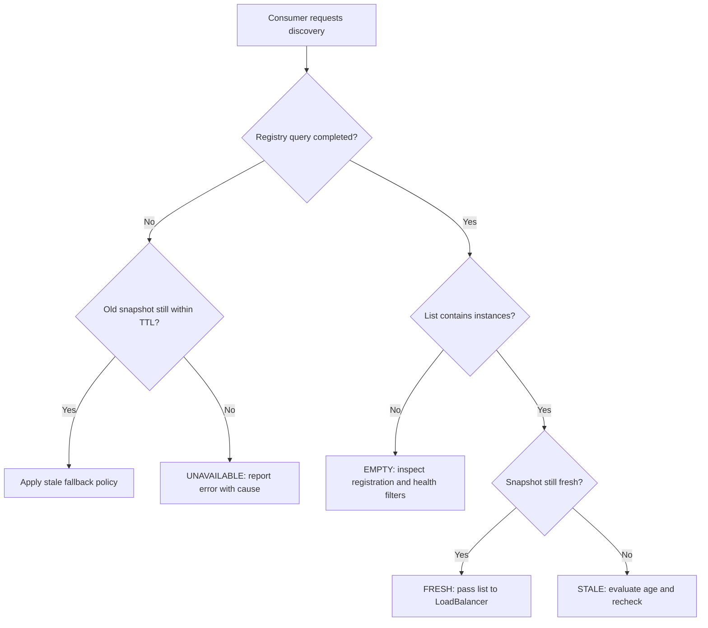

# Distinguishing Empty Lists, Stale Data, and Connection Failures

When a consumer calls `DiscoveryClient.getInstances("order-service")`, the outcome can be an instance list, an empty list, or an exception. These three outcomes do not carry the same meaning. An empty list can be a valid result when no instances are registered or all instances are filtered out by health; stale data may still hold addresses of stopped instances or miss newly added ones; a connection failure means the consumer could not obtain a trustworthy result from the registry.

If an application collapses all three cases into "service not found," it can easily retry improperly, call dead endpoints, or trigger false outage alerts when the registry is only temporarily unreachable. This lesson builds a framework to classify discovery results, detect stale data, diagnose Eureka/Consul/Kubernetes, and design bounded retries/fallbacks for safe recovery.

## 1. Three Discovery Outcomes to Distinguish

### 1.1. Empty list: query succeeded, but no matching instance exists

An empty list (`[]`) means the discovery layer returned a result containing no matching instances. This is not automatically a connection failure. Common causes include:

- The provider has not registered yet or has deregistered.
- Wrong casing, name, or namespace on the service ID.
- All instances are currently Not Ready, `warning`/`critical`, or `OUT_OF_SERVICE`.
- The consumer enabled health filtering such as Consul `?passing`, so instances not meeting the criteria are excluded.
- A Kubernetes Service has no Ready EndpointSlice endpoints due to a mismatched selector/label or unready Pods.
- The application uses `SimpleDiscoveryClient` but the service ID has not been declared under `simple.instances`.
- The consumer just started up and queried before the provider completed registration.

An empty list is a **result**, not proof that the registry is broken. Verify whether the query succeeded, whether the data is fresh, and whether a valid reason explains why no instance was selected.

### 1.2. Stale data: a result exists, but does not reflect current state

Stale data is a registry snapshot or cache older than the system's acceptable limit. It can contain:

- **Stale-positive:** a stopped or deregistered instance still appears in the list.
- **Stale-negative:** a new instance has registered and is healthy, yet the snapshot has not updated so the consumer cannot see it.

Stale-positive entries can route requests to hosts/ports that are no longer alive. Stale-negative entries can reduce capacity or cause queries to return empty lists even when providers are ready.

Staleness commonly originates in registry peers/followers, client-side registry caches, Spring Cloud LoadBalancer caches, DNS caches, proxies, or application-level caches. A query returning a non-empty list does not prove the instances in it are still alive; you must know when the snapshot was last successfully updated and how health checks operate.

### 1.3. Connection failure: unable to obtain a reliable result

A connection failure occurs when the consumer cannot complete the discovery query. For example:

- DNS cannot resolve the registry hostname.
- TCP connection refused, timeout, or blocked by routing/firewalls.
- TLS handshake/certificate error.
- Registry returns `401`/`403` due to missing or invalid credentials/ACLs.
- Registry returns `429`, `5xx`, or closes the connection.
- Eureka/Consul server or Kubernetes API is unavailable.

In this situation, the consumer does not know how many healthy instances the registry currently holds. Never convert a connection error into an empty list, because doing so hides the root cause and can drive wrong application decisions.

## 2. Comparison Table and Initial Handling

| Scenario | Query succeeded? | Returned data | Interpretation | Initial action |
| --- | --- | --- | --- | --- |
| Empty result | Yes | List `[]` | No matching instances in the just-read snapshot | Check service ID, namespace, health filter, registration, and desired replicas. |
| Fresh non-empty | Yes | Fresh instance list | Discovery candidates exist per current snapshot | LoadBalancer picks an instance; requests still need timeouts/health handling. |
| Stale non-empty | Maybe or maybe not on latest refresh | Old snapshot still has instances | Registry/cache has not converged or refreshes are failing | Check snapshot age; only fall back within TTL and policy bounds. |
| Stale empty | Maybe or maybe not on latest refresh | Old snapshot is still empty | Provider may have registered recently while cache has not updated | Refresh in a controlled manner; do not conclude the provider does not exist. |
| Connection failure | No | Exception/error status; no new result | Cannot verify the registry at this moment | Classify error, perform bounded retries, or use old snapshot per policy. |
| Authentication/authorization failure | Request reached endpoint but was rejected | `401`/`403` | Invalid identity/permission configuration | Fix credentials/ACLs; do not keep retrying like a network error. |



The key point is to store the status and timestamp of the most recent successful query. Looking solely at `List<ServiceInstance>` is insufficient to distinguish a fresh empty snapshot, a stale empty snapshot, and a live query failure.

## 3. Classifying Results from DiscoveryClient in Spring Cloud

Basic synchronous API:

```java
List<ServiceInstance> instances = discoveryClient.getInstances("order-service");
```

Typical outcomes are:

- Non-empty list: the discovery implementation provided instances.
- Empty list: no instances were returned for that service ID.
- Runtime exception: the implementation could not complete the operation in its own way; inspect the exception and root cause.

Never write code that turns exceptions into an empty list:

```java
// Avoid: hides connection, TLS, or ACL failures.
try {
    return discoveryClient.getInstances(serviceId);
} catch (RuntimeException ex) {
    log.warn("Discovery failed", ex);
    return List.of();
}
```

Doing so prevents callers from knowing whether the registry actually returned empty or the request failed. Empty-result metrics also inflate erroneously, making availability alerts unreliable.

### 3.1. Returning Results with Status and Observation Timestamp

In the application's adapter layer, you can wrap discovery outcomes into an explicit data type:

```java
import java.time.Instant;
import java.util.List;

import org.springframework.cloud.client.ServiceInstance;

public record DiscoverySnapshot(
        String serviceId,
        List<ServiceInstance> instances,
        Instant observedAt,
        Instant attemptedAt,
        boolean refreshSucceeded,
        String failureReason) {

    public boolean isEmpty() {
        return refreshSucceeded && instances.isEmpty();
    }

    public boolean isUnavailable() {
        return !refreshSucceeded;
    }
}
```

The adapter executes the query and sets `refreshSucceeded=true` only when the operation finishes cleanly:

```java
import java.time.Instant;
import java.util.List;

import org.springframework.cloud.client.ServiceInstance;
import org.springframework.cloud.client.discovery.DiscoveryClient;
import org.springframework.stereotype.Component;

@Component
public class DiscoveryLookup {

    private final DiscoveryClient discoveryClient;

    public DiscoveryLookup(DiscoveryClient discoveryClient) {
        this.discoveryClient = discoveryClient;
    }

    public DiscoverySnapshot lookup(String serviceId) {
        try {
            List<ServiceInstance> instances =
                    List.copyOf(discoveryClient.getInstances(serviceId));

            return new DiscoverySnapshot(
                    serviceId,
                    instances,
                    Instant.now(),
                    Instant.now(),
                    true,
                    null
            );
        } catch (RuntimeException ex) {
            return new DiscoverySnapshot(
                    serviceId,
                    List.of(),
                    null,
                    Instant.now(),
                    false,
                    ex.getClass().getSimpleName()
            );
        }
    }
}
```

This is an application-layer classification example. `observedAt` is the timestamp when a fresh snapshot was read; when the query fails, this field is `null`, while `attemptedAt` records the attempt time. A prior successful snapshot must be stored separately so stale fallback logic can evaluate its age. Depending on the implementation, some clients read from a local cache and do not throw an exception even when the latest background refresh failed. Therefore, `refreshSucceeded` in the adapter only describes the local API call just performed; to know whether registry data is genuinely fresh, monitor the client/observer's refresh state, timestamps, or health separately.

Do not return `failureReason` containing raw URLs with credentials, tokens, headers, or sensitive response bodies. Record normalized error codes and sanitized exception types.

### 3.2. Empty Does Not Equal HTTP 404

Discovery APIs can return an empty list when a service does not exist yet or has no matching instances. A registry HTTP endpoint may represent this with a `200` response carrying an empty array or zero-instance structure, depending on the API. `404` may mean the resource/path/service does not exist per that endpoint's specific contract. Rely on the concrete API contract rather than treating every instance-less response as the same state.

## 4. Detecting Stale Data

### 4.1. Tracking Successful Refresh Timestamps

A snapshot needs at minimum:

- `observedAt`: timestamp of the most recent successful fetch.
- `source`: registry/cluster/namespace that produced the data.
- `age`: elapsed time from `observedAt` to now.
- `refreshStatus`: whether the most recent refresh succeeded or failed.
- `instances`: the list returned by that snapshot.

Example data age policy:

| Snapshot age | State | Suggested action |
| --- | --- | --- |
| Within freshness TTL | Fresh | Use snapshot per health and LoadBalancer policies. |
| Exceeds freshness TTL but within stale TTL | Stale-eligible | May use temporarily if policy permits, while refreshing and emitting stale metrics. |
| Exceeds stale TTL | Expired | Do not use snapshot as proof endpoints are available; return unavailable or apply business-specific fallback. |

Example: a service sets a 15-second freshness TTL and a 60-second stale TTL. An 8-second-old snapshot is considered fresh; a 35-second-old snapshot is used only under the stale fallback policy; a 90-second-old snapshot is expired. These numbers are illustrative only and must be tuned for registry refresh intervals, LoadBalancer caches, health checks, and latency requirements.

### 4.2. Cache Layers That Can Introduce Stale Data

| Layer | Example | Sign |
| --- | --- | --- |
| Registry server/peer | Eureka peer replication, Consul server/follower, or cache | Registry nodes return different instance sets for a period of time. |
| Discovery client | Eureka client registry cache, Consul client/cache | Local calls return an old snapshot even after the server has updated. |
| Spring Cloud LoadBalancer | `ServiceInstanceListSupplier` cache | `DiscoveryClient` updated, yet the LoadBalancer list remains outdated. |
| DNS | Record TTL, local resolver cache | Service name resolves to an old IP after an endpoint change. |
| Application/proxy | Custom cache, connection pool, keep-alive | Requests keep flowing over old connections or snapshots after deregistration. |

Do not sum TTLs mechanically. Cache layers can run concurrently, refresh out of phase, or retain old connections. Measure total elapsed time from registration/health change until consumers stop picking that instance.

### 4.3. Stale-Positive and Stale-Negative

Stale-positive example:

```text
T0: order-a and order-b are healthy
T1: order-b is stopped
T2: registry has marked order-b critical/deregistered
T3: consumer still holds an old cache containing order-b
T4: request is routed to order-b and fails
```

Stale-negative example:

```text
T0: registry does not yet have payment-c
T1: payment-c starts and registers successfully
T2: registry already sees payment-c
T3: consumer still uses an old empty snapshot
T4: lookup keeps returning empty until refresh/cache expires
```

Stale-positive entries cause requests to hit dead instances; stale-negative entries reduce capacity or falsely report service unavailable. Both require monitoring freshness, not just instance counts.

## 5. Identifying Connection Errors and Classifying Retryable Failures

Not every error should be retried. Initial classification:

| Error | Example | Retry? | Handling |
| --- | --- | --- | --- |
| DNS/network transient | Temporary failure, timeout, connection reset | Bounded | Exponential backoff + jitter, check DNS/routing. |
| Registry unavailable | HTTP `502`/`503`/`504`, server restart | Bounded | Retry with deadline; use stale snapshot if policy allows. |
| Rate limit | HTTP `429` | Conditional | Honor `Retry-After`, reduce query rate. |
| Authentication | HTTP `401` | Do not retry continuously | Check token/credentials and rotation. |
| Authorization | HTTP `403` | Do not retry continuously | Fix ACL/RBAC/policies. |
| TLS/certificate | Expired certificate, hostname mismatch, trust failure | Do not retry blindly | Fix certificate, truststore, or hostname. |
| Wrong endpoint/config | HTTP `404`, wrong port/path/region | Do not retry blindly | Verify URL and configuration. |
| Valid empty result | Query succeeded, zero instances | Do not retry continuously | Check registration, health filters, and service ID; may recheck after convergence window. |

Retrying configuration or permission errors usually just generates load and noisy logs. For transient errors, apply max attempts, an overall deadline, increasing backoff, and jitter so many consumers do not storm the registry simultaneously upon recovery.

## 6. Retry Strategy for Discovery

Illustrative retry schedule:

```text
Attempt 1: immediate
Attempt 2: after 200 ms + jitter
Attempt 3: after 500 ms + jitter
Attempt 4: after 1 s + jitter
Stop: when deadline expires or max attempts reached
```

Tune intervals to registry and business request timeouts. Never retry indefinitely inside a request thread. If discovery runs in the background, use a scheduler with backoff and update the snapshot on successful refreshes.

### 6.1. Empty Results Must Not Trigger a Retry Storm

If the registry validly returns empty, an immediate tight retry loop rarely changes the result and can create unnecessary load. Handle by root cause:

- If a provider just started, wait a registration convergence window and query once more.
- If health checks are not passing yet, inspect check states and wait for the next update.
- If the service ID/namespace is wrong, fix configuration instead of retrying.
- If the service intentionally scales to zero, empty may be the expected state requiring no retry.

### 6.2. Retries with Jitter and Deadlines

Pseudocode:

```java
Duration deadline = Duration.ofSeconds(3);
int maxAttempts = 4;

for (int attempt = 1; attempt <= maxAttempts; attempt++) {
    try {
        return queryRegistry(serviceId);
    } catch (TransientRegistryException ex) {
        if (attempt == maxAttempts || deadlineExpired()) {
            throw ex;
        }
        sleep(backoffWithJitter(attempt));
    } catch (AuthenticationException | ConfigurationException ex) {
        throw ex;
    }
}
```

This is pseudocode illustrating policy, not a complete implementation. Ensure total sleep time plus request timeouts stays within the deadline. If using Resilience4j or Spring Retry, configure the retry predicate to retry only transient errors and combine with appropriate circuit breakers/bulkheads.

## 7. Stale Fallback: When Can Old Data Be Used?

When the registry is temporarily unreachable, you may consider continuing to use the most recent snapshot. This helps services preserve partial serving capacity during control-plane incidents, at the risk of choosing a dead instance.

Use stale fallback only if:

- The previous snapshot was fetched successfully and remains within the stale TTL.
- Instances in the snapshot were recently health-checked or request-layer mechanisms exclude failing endpoints.
- Requests enforce short timeouts, bounded retries, and circuit breakers.
- The system tolerates the brief risk of hitting a stale endpoint.
- Metrics and logs clearly indicate requests are using a stale snapshot.

Do not use stale fallback if:

- The snapshot has expired or no successful refresh ever occurred.
- Old endpoints could point to workloads whose permissions were revoked or reassigned to another tenant.
- Address/credential/route changes make old endpoints unsafe.
- Business requirements demand strong consistency or forbid calling the wrong instance.

### 7.1. Fallback Decision Matrix

| New result | Old snapshot | Action |
| --- | --- | --- |
| Fresh non-empty | Any | Use the new list and update the snapshot. |
| Fresh empty | Any | Treat as intentionally empty; do not replace with stale non-empty unless explicitly permitted by policy. |
| Connection failure | Fresh snapshot | Use fresh snapshot if design requires caching; record refresh error. |
| Connection failure | Stale within stale TTL | May use stale snapshot with alerts and health guards. |
| Connection failure | Expired or missing snapshot | Return unavailable; never fabricate instance lists. |
| Auth/config/TLS failure | Any | Report configuration/permission error; do not mask with continuous retries. |

Note carefully: if a fresh query validly returns empty, that evidence is newer than the old snapshot. Do not automatically discard empty to cling to an old list, unless the system has an explicit eventual-consistency policy accepting stale-positive risk.

### 7.2. Do Not Cache Exceptions as Empty

When a refresh fails, keep the old snapshot along with its timestamp and failed refresh state. Do not overwrite the snapshot with `List.of()` simply because the registry call failed. Conversely, when a refresh succeeds and returns empty, update the snapshot to the new empty list; keeping the old list would silently manufacture stale-positives.

## 8. Platform-Specific Diagnostics

### 8.1. Eureka

Eureka Client typically holds the registry in a local cache and fetches updates periodically. Therefore, the application can continue reading lists from cache even when connecting to Eureka Server fails. This reduces per-request dependency, though results can be stale.

When suspecting stale data:

1. Check Eureka Client logs for the latest registry fetch and connection errors.
2. Check `eureka.client.registry-fetch-interval-seconds` in the active configuration.
3. Inspect the Eureka Dashboard/REST API on the server and compare with the list seen by the client.
4. Check peer replication if running multiple Eureka Servers.
5. Check instance status, lease renewals, eviction, and self-preservation.
6. Check Spring Cloud LoadBalancer's cache downstream of Eureka Client's registry cache.

An instance still appearing in the registry is not necessarily healthy. `OUT_OF_SERVICE`, heartbeats/leases, and self-preservation govern whether an instance is kept or picked by consumers. When the server is unreachable, do not treat the local cache as freshly verified data.

### 8.2. Consul

Consul offers a Catalog API and a Health API. The two serve different purposes:

```bash
# View registrations in Catalog
curl -i "http://localhost:8500/v1/catalog/service/order-service"

# View instances along with health checks
curl -i "http://localhost:8500/v1/health/service/order-service"

# Retrieve only entries with all relevant checks passing
curl -i "http://localhost:8500/v1/health/service/order-service?passing"
```

If Catalog has registrations yet the Health API with `?passing` returns empty, all instances may be warning/critical or node/service checks are not passing. This is a health-filtered empty result, not necessarily a connection error.

Consul supports blocking queries via `index`/`wait` parameters so clients wait for changes instead of polling aggressively. Responses include the `X-Consul-Index` header; clients can pass that index on subsequent queries. Consistency modes like `consistent` and `stale` affect which node/leader serves the read and how fresh the data is. Use stale mode only when you understand its consistency trade-offs and do not interpret responses as linearizable latest state.

When diagnosing Consul:

1. Check endpoint, DNS, port, and TLS from the consumer's network.
2. Check ACL tokens; distinguish `403` from an empty response.
3. Compare the Catalog API with the Health API and `?passing` queries.
4. Check node/service checks, TTLs, intervals, deregistration, and the Consul Agent.
5. If using caching or blocking queries, inspect the index, wait duration, and last successful read timestamp.
6. If the Consul cluster has multiple servers, check leader, quorum, and peer/agent status.

### 8.3. Kubernetes

Kubernetes Service discovery relies on Services, DNS, and EndpointSlices. A Service can exist without any Ready endpoints; DNS still resolves the Service name, yet no backend is ready to handle requests.

Check:

```bash
kubectl get service order-service -n shop
kubectl get pods -n shop -l app=order-service
kubectl get endpointslice -n shop \
  -l kubernetes.io/service-name=order-service
kubectl describe service order-service -n shop
```

Classify:

- Service missing or wrong namespace: configuration/name/namespace issue.
- Service exists, EndpointSlice empty: selector mismatch or no Ready Pods.
- EndpointSlice has endpoints yet client still calls old addresses: check DNS caches, proxies, connection pools, or client caches.
- Kubernetes API unreachable: control-plane/network/RBAC error; do not treat as an empty list.

If Spring Cloud Kubernetes `DiscoveryClient` reads the Kubernetes API, check ServiceAccount/RBAC, namespace scope, API watch/list, and client informer/cache state for your version. If the application only calls Service DNS, inspect CoreDNS and resolver caches separately.

## 9. Observing State and Freshness

To distinguish the three outcomes on dashboards, emit dedicated metrics rather than relying solely on a single instance-count gauge.

| Suggested metric | Meaning |
| --- | --- |
| `discovery_lookup_total{service,registry,outcome}` | Lookup counts by outcome: `success_nonempty`, `success_empty`, `error`. |
| `discovery_snapshot_age_seconds{service,registry}` | Age of the most recent successful snapshot. |
| `discovery_refresh_errors_total{service,registry,reason}` | Failed refresh count grouped by normalized cause. |
| `discovery_stale_fallback_total{service,registry}` | Count of lookups served from a stale snapshot. |
| `discovery_instances{service,registry,state}` | Instance count by state such as `registered`, `healthy`, `unhealthy`. |
| `discovery_lookup_duration_seconds{service,registry}` | Duration of lookup/refresh operations. |

These are suggested metric contracts provided by your application or observer, not guaranteed built-in metric names across all Spring Cloud releases. Use bounded-cardinality labels. Never put URLs, churning instance IDs, tokens, or raw exception messages in labels.

PromQL examples:

```promql
# Ratio of successful lookups returning empty over 5 minutes
sum by (service, registry) (
  rate(discovery_lookup_total{outcome="success_empty"}[5m])
)
/
clamp_min(
  sum by (service, registry) (rate(discovery_lookup_total[5m])),
  0.001
)
```

```promql
# Snapshot has exceeded a 60-second freshness TTL
discovery_snapshot_age_seconds > 60
```

```promql
# Stale fallbacks occurring while refreshes fail
increase(discovery_stale_fallback_total[10m]) > 0
and on (service, registry)
increase(discovery_refresh_errors_total[10m]) > 0
```

Configure separate alerts for `success_empty`, refresh errors, and snapshot age. A high empty rate may indicate registration/health problems; high refresh errors suggest connectivity/ACL failures; high snapshot age signals stale data is not refreshing. Never lump all three into one "service not found" alert.

## 10. Consumer-Side Decision Example

A consumer should process results by state, not merely by element count:

```java
DiscoverySnapshot snapshot = discoveryLookup.lookup("order-service");

if (snapshot.isUnavailable()) {
    // Lookup failed: evaluate old snapshot per stale TTL/policy.
    return useStaleSnapshotIfAllowed(snapshot.serviceId());
}

if (snapshot.isEmpty()) {
    // Registry validly returned empty: do not turn into a connection error.
    throw new NoHealthyInstancesException(snapshot.serviceId());
}

return loadBalancerChoose(snapshot.instances());
```

`useStaleSnapshotIfAllowed` must read a prior successful snapshot, check its age, health guards, and service policy. Never pull old lists from an untimestamped cache or one of unknown registry origin.

In many applications, Spring Cloud LoadBalancer and `DiscoveryClient` already manage internal caching/refreshing. Do not layer a third cache following the example above without measuring its benefit and impact. Identify clearly which cache owns the snapshot, who refreshes it, and which TTLs govern it.

## 11. Common Pitfalls and Remedies

| Symptom | Possible diagnosis | Remedy |
| --- | --- | --- |
| `getInstances()` returns `[]` | Not registered, wrong service ID/namespace, health filter excluded all instances | Query registry directly; check service name, health states, and desired replicas. |
| `getInstances()` throws exception | Registry/network/TLS/ACL or implementation failure | Preserve error state, classify exception, and check endpoints/permissions. |
| Client returns stopped instances | Stale-positive snapshot/cache or slow health checks | Check timestamps, cache TTLs, heartbeats/health checks, and connection pools. |
| New provider runs yet consumer sees empty | Stale-negative, registration not converged, or empty cache | Check registration timing, peer sync, and refresh intervals. |
| Consul Catalog has instances yet `?passing` is empty | Warning/critical checks or failing node-level checks | Inspect Health API and individual checks; fix health endpoint/Agent. |
| Eureka Server disconnected yet requests still get instances | Consumer is likely reading local registry cache | Check last successful fetch and cache age; do not treat cache as live proof. |
| Kubernetes Service exists with no backends | Empty EndpointSlice, wrong selector, or unready Pods | Check labels, selectors, readiness, and EndpointSlices. |
| `401`/`403` retried continuously | Authentication/authorization misclassified as transient | Fix tokens/ACLs/RBAC; retry only transient errors. |
| Registry recovered yet consumer still fails | Stale cache, circuit breaker not half-open, or DNS/pool holding old endpoints | Inspect refreshes, TTLs, breaker state, and open new connections cleanly. |

## 12. Recovery Checklist

When abnormal lookups appear, proceed in order:

1. Confirm whether the consumer received `[]`, a stale snapshot, or an exception; record the exact outcome separately.
2. Verify the registry endpoint is reachable from the consumer's exact network.
3. Check auth/TLS/RBAC before retrying.
4. Query the registry directly and distinguish Catalog from Health API/EndpointSlices.
5. Determine the last successful refresh timestamp and cache age at every layer.
6. Compare service ID, namespace, region/zone, metadata, and health filters.
7. Retry only transient errors with deadlines, backoff, and jitter.
8. Use stale fallback only while the snapshot is within TTL and the service accepts the risk.
9. Monitor healthy instance count, lookup errors, empty rate, and stale fallbacks.
10. After recovery, confirm the consumer received a new snapshot and live requests reach healthy instances.

## 13. Key Takeaways

- **An empty list** is a successful lookup with zero matching instances; check service ID, registration, namespace, and health filters.
- **Stale data** is an outdated snapshot; it can be stale-positive (dead instances linger) or stale-negative (new instances are missing).
- **A connection failure** means no new result could be fetched; preserve the error state and never convert it into an empty list.
- `DiscoveryClient` may read from a local cache; a successful local API call does not prove the cache was freshly updated from the registry.
- Retry only transient failures; never infinitely retry empty results, `401`/`403`, TLS errors, or misconfigurations.
- Stale fallback requires TTLs, health guards, timeouts, and dedicated metrics; never serve expired snapshots.
- Track outcomes, snapshot age, refresh errors, and stale fallbacks so operators can pinpoint the exact failure mode.

Properly distinguishing empty results, stale data, and connection failures lets consumers respond appropriately: wait for provider registration, refresh snapshots, apply bounded fallbacks, or surface causal connection errors instead of making flawed discovery decisions.

## References

- [Spring Cloud Commons: DiscoveryClient and ServiceRegistry](https://docs.spring.io/spring-cloud-commons/reference/spring-cloud-commons/common-abstractions.html)
- [Spring Cloud LoadBalancer: Caching and instance suppliers](https://docs.spring.io/spring-cloud-commons/reference/spring-cloud-commons/loadbalancer.html)
- [Consul HTTP API: Health](https://developer.hashicorp.com/consul/api-docs/health)
- [Consul HTTP API: Catalog](https://developer.hashicorp.com/consul/api-docs/catalog)
- [Kubernetes: Service and EndpointSlices](https://kubernetes.io/docs/concepts/services-networking/service/)
