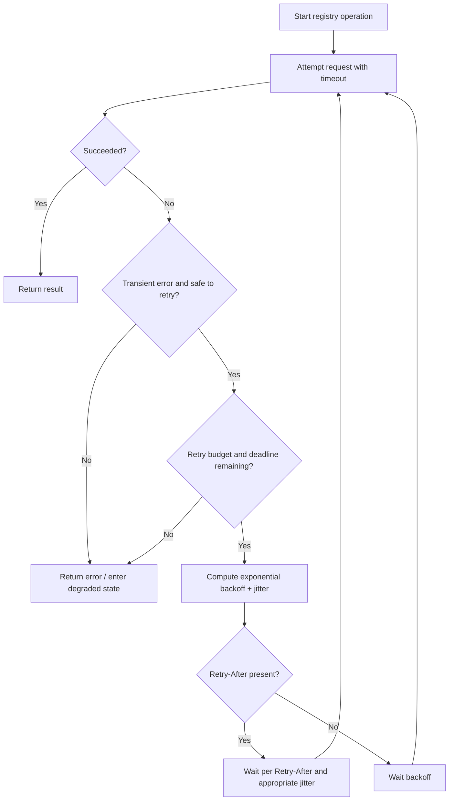

# Timeouts, Retries, and Backoff When Connecting to the Registry

## 1. Why Do Registry Connections Need Controlled Timeouts and Retries?

In Spring Cloud Service Discovery, applications communicate with the registry to register instances, renew leases/heartbeats, fetch service lists, or watch for changes. A registry can become slow due to heavy load, leader loss, network partitions, DNS failures, TLS handshake failures, or post-incident recovery.

If a client waits indefinitely, threads and connections can stay pinned, exhausting pools and stalling business requests. If clients retry too fast or all retry simultaneously, the weakened registry takes extra load and struggles even harder to recover. Therefore, three mechanisms must work together:

- **Timeout:** limits how long an operation is allowed to wait.
- **Retry:** retries transient errors within permitted attempts or total time budgets.
- **Backoff and jitter:** spaces out intervals between attempts and spreads retry timing across clients.

These mechanisms apply to registry connections such as Eureka, Consul, or the Kubernetes API. They also relate to service-to-service requests, though registry timeouts/retries and business request timeouts/retries are two separate policies.

## 2. Distinguishing Timeout Types

No single timeout value fits every operation. Before configuring, clarify what the client is waiting on.

| Timeout type | Meaning | Example failure on expiry |
|---|---|---|
| Connection timeout | Maximum time to open a TCP connection to the registry | Broken DNS/TCP route or server not accepting connections |
| TLS handshake timeout | Time to complete TLS negotiation | Slow certificate validation, proxy, or TLS endpoint response |
| Connection-pool acquire timeout | Time spent waiting to borrow an available connection from the pool | Pool exhausted by hung requests or overly low connection limits |
| Response/read timeout | Maximum time waiting for bytes/response from server after connecting | Registry overloaded, slow processing, or stalled network transfer |
| Request/operation timeout | Total time for a single HTTP or RPC operation | Entire request exceeds budget even though individual phases did not time out |
| Discovery deadline | Total time the application allows to complete a lookup/registration, including retries | Business time budget for waiting on the registry exhausted |
| Blocking-query wait | Duration the server holds a query open waiting for data changes | Consul blocking query or Kubernetes watch ends at its configured limit |

`registry-fetch-interval` is not a response timeout. It is the interval between registry cache fetches. Likewise, the health-check interval is the cadence of checks, not the maximum duration allowed for a single health-check HTTP request.

### 2.1. Setting Timeouts from a Time Budget

A registry connection operation can involve multiple steps: acquiring a connection, DNS/TCP, TLS, sending the request, server processing, receiving the response, and parsing data. Total time must fit inside the deadline:

\[
T_{operation} \leq T_{deadline}
\]

With multiple retries:

\[
T_{total} = \sum_{i=1}^{A} T_{attempt_i} + \sum_{i=1}^{A-1} T_{backoff_i}
\]

Where `A` is the maximum number of attempts. This total duration must be smaller than the calling task's deadline. Never set a 10-second per-attempt timeout with 5 retries inside an operation allowed to wait only 5 seconds.

Illustrative budget for a synchronous registry read:

| Component | Example budget |
|---|---:|
| Acquire connection | 100 ms |
| Connect + TLS | 300 ms |
| Response/read | 700 ms |
| Local parse and processing | 100 ms |
| Single attempt total | Around 1.2 seconds |
| Attempt count | Max 2 |
| Backoff between two attempts | 100–250 ms |
| Overall deadline | Around 2.7 seconds |

This is only an example illustrating budget allocation. Measure real p95/p99 latencies, network characteristics, registry size, and application SLOs before picking numbers. A full registry fetch with a large payload may need a different read timeout than querying a single service ID.

### 2.2. Registry Timeouts Are Not Business Request Timeouts

`DiscoveryClient.getInstances("payment-service")` may read from cache and return quickly, or query the registry depending on implementation. Once an instance is chosen, the HTTP request to `payment-service` has its own connect/read/deadline budgets.

For example:

1. Consumer reads the registry cache in 20 ms.
2. Load balancer picks a `payment-service` instance.
3. Connecting to the instance hangs for 2 seconds.
4. Business request times out after 2 seconds.

Increasing Eureka/Consul timeouts will not solve timeouts on requests to the target service. Conversely, setting registry timeouts too low can cause discovery to fail even while the target service remains healthy.

## 3. Which Operations Are Safe to Retry?

Retries help only when an error is likely transient and the operation can be repeated safely. Do not retry every exception.

### 3.1. Typically Retryable Errors

- Connection reset or connection refused while a server is restarting.
- Temporary DNS resolution failures during endpoint updates.
- Transient timeouts or network glitches.
- HTTP `429 Too Many Requests` when honoring `Retry-After`.
- HTTP `502`, `503`, `504` during proxy/registry failover.
- Kubernetes API Server returning `410 Gone` for an outdated watch resource version: this signals the need to relist and open a new watch, not repeat the exact same watch request forever.
- Ongoing leader election or node failover, if the client library supports reconnects.

### 3.2. Errors That Should Not Be Blindly Retried

| Error | Why continuous retrying is counterproductive |
|---|---|
| HTTP `400` | Malformed request syntax or parameters; retrying cannot fix bad data |
| HTTP `401` | Invalid or expired credentials/token; fix authentication |
| HTTP `403` | Missing RBAC/ACL permissions; retrying only adds load and hides the cause |
| HTTP `404` | Wrong endpoint/path or nonexistent resource; verify semantics per operation |
| TLS certificate/hostname invalid | Configuration or trust error; fast retries will not self-heal |
| Invalid service ID/configuration | Must fix configuration or service name |
| Serialization/schema error | Incompatible payload; retrying the same data usually keeps failing |

Some codes like `404` depend on semantics. For example, querying an unregistered service may be a valid empty-result state, whereas `404` on a wrong registry context path is a configuration error. Classify by API and operation, not by HTTP status code alone.

### 3.3. Registry Reads and Registration Writes Have Different Requirements

Reading an instance list is generally idempotent: repeating the same query creates no new records. Service registration can also be designed to be safely repeatable if the service ID/instance ID stays fixed and the provider's proper registration API is used. However, do not assume every write call is idempotent.

- **Eureka:** registering with the same app/instance ID updates the instance record per Eureka protocol; keep the instance ID stable across retries.
- **Consul:** registering via the Agent API with the same service ID can update an existing service; do not generate a new ID on every retry.
- **Kubernetes:** a `create` operation can return `409 AlreadyExists` when the prior call succeeded and its response was lost. Re-read the object or use `apply`/update with the proper `resourceVersion`; do not loop `create` endlessly.

For operations with side effects, confirm idempotency, identity keys, and post-timeout state before enabling retries.

## 4. Exponential Backoff and Jitter

If all clients retry after the same fixed interval, they can synchronize into lockstep waves of requests. Exponential backoff lengthens the pause after each failure; jitter adds randomness to spread out retry timestamps.

### 4.1. Exponential Backoff

A common formula:

\[
d_k = \min(d_{max}, d_{base} \times m^k)
\]

Where:

- `d_base`: initial delay.
- `m`: growth multiplier, typically greater than 1.
- `k`: number of retries already performed.
- `d_max`: maximum delay cap.

Example with `d_base = 200 ms`, `m = 2`, `d_max = 2 s`:

| Retry attempt | Pre-jitter backoff |
|---:|---:|
| 1 | 200 ms |
| 2 | 400 ms |
| 3 | 800 ms |
| 4 | 1,600 ms |
| 5 | 2,000 ms (capped) |

### 4.2. Full Jitter

Full jitter picks a random value between 0 and the computed backoff:

\[
d_k^{jitter} = U(0, d_k)
\]

This prevents many clients from retrying in lockstep at exactly 200 ms, 400 ms, or 800 ms. Alternatives include equal jitter or decorrelated jitter; pick one strategy and test at realistic client scale.

### 4.3. Honoring `Retry-After`

If the server returns `Retry-After`, the client should wait at least as long as requested before applying appropriate jitter. The value may be expressed in seconds or as an HTTP date depending on protocol. Never ignore the header and retry immediately upon hitting `429`.

### 4.4. Never Retry Forever

Bound retries by both attempt count and overall deadline. For example:

- At most 3–4 attempts for a synchronous lookup.
- Total deadline of 2–3 seconds for a business request needing fast discovery.
- Background registration tasks can use longer retry durations, provided they apply backoff, jitter, and emit clear metrics/logs.

Numbers are illustrative. For background auto-registration, clients may continue reconnecting throughout the process lifecycle; still, every cycle must enforce timeouts, delays, and safeguards against unbounded load.

## 5. Retry Budgets and Avoiding Retry Amplification

A system can have retries at multiple layers:

- HTTP client connecting to the registry retries 3 times.
- Spring Cloud wrapper retries 3 more times.
- Business layer retries 3 more times.

When layers nest, attempts can multiply up to (3 \times 3 \times 3 = 27) for a single initial operation. That is retry amplification.

Principles:

1. Assign one primary layer to own retries for each operation.
2. If a client library already retries internally, do not wrap it with a broad outer retry without computing total attempts.
3. Propagate remaining deadlines downward instead of granting a fresh full timeout at every layer.
4. Enforce a request-ratio or time-based retry budget so retries never consume all capacity.
5. Cap concurrent retrying requests using a bulkhead or semaphore.
6. Log attempt number, elapsed time, exception class, and operation; avoid logging full payloads or secrets.

A retry budget can be expressed as a simple ratio:

\[
RetryBudget = \frac{N_{retry}}{N_{original}}
\]

For instance, cap retries at no more than 10% of original requests over an observation window. This is an illustrative policy; for background registration/heartbeat tasks, define separate budgets per service and registry.

## 6. Circuit Breakers and Bulkheads

### 6.1. Circuit Breaker

When the registry fails persistently, a circuit breaker can temporarily halt calls to the failing endpoint:

- **Closed:** lets requests through and tracks failures.
- **Open:** rejects new requests during a cooldown window, avoiding further registry overload.
- **Half-open:** permits a limited number of probes to check whether the registry has recovered.

A circuit breaker does not replace timeouts. A hung request without a timeout can still tie up resources before the breaker trips. Also avoid sharing one coarse breaker across all registry nodes if the client supports per-endpoint failover; an overly broad breaker could block healthy nodes as well.

### 6.2. Bulkhead

A bulkhead limits concurrent registry operations. For instance, if the registry is slow, at most 20 fetch/registration operations can run concurrently; excess tasks are rejected or placed in a bounded queue rather than exhausting the entire thread pool.

Separate executors and connection pools for registry tasks versus business requests so a retry storm does not starve resources serving live HTTP traffic. For async watches or background refreshes, use bounded queues with an appropriate drop/coalesce policy.

## 7. Configuring Timeouts and Retries Across Spring Cloud Layers

No single Spring Cloud property controls every timeout across Eureka, Consul, and Kubernetes. Configure the exact transport/client used by your starter.

### 7.1. HTTP Client Timeouts

If the application calls registry APIs directly using Spring `RestClient`/`WebClient`, configure connect and response timeouts on the underlying HTTP connector. Example with Reactor Netty:

```java
import java.time.Duration;

import reactor.netty.http.client.HttpClient;
import org.springframework.context.annotation.Bean;
import org.springframework.context.annotation.Configuration;
import org.springframework.http.client.reactive.ReactorClientHttpConnector;
import org.springframework.web.reactive.function.client.WebClient;

@Configuration
public class RegistryHttpConfiguration {

    @Bean
    WebClient registryWebClient() {
        HttpClient httpClient = HttpClient.create()
                .option(io.netty.channel.ChannelOption.CONNECT_TIMEOUT_MILLIS, 500)
                .responseTimeout(Duration.ofSeconds(2));

        return WebClient.builder()
                .clientConnector(new ReactorClientHttpConnector(httpClient))
                .build();
    }
}
```

This example sets a 500 ms connect timeout and a 2-second response timeout. Adjust values to match your network and deadlines. For other HTTP clients, equivalent settings reside on that client's request factory or transport.

This snippet configures only the application-created `WebClient`. It **does not automatically configure** the internal HTTP transport used by Eureka Client, the Consul starter, or the Kubernetes client. To adjust discovery client timeouts, look up the exact starter/client library properties for your project version.

### 7.2. Retries with Spring Retry

Spring Retry can wrap a registry read helper when the operation is safely retryable:

```java
import org.springframework.context.annotation.Configuration;
import org.springframework.retry.annotation.EnableRetry;

@Configuration
@EnableRetry
public class RegistryRetryConfiguration {
}
```

Service executing the lookup:

```java
import org.springframework.retry.annotation.Backoff;
import org.springframework.retry.annotation.Retryable;
import org.springframework.stereotype.Service;
import org.springframework.cloud.client.ServiceInstance;
import org.springframework.cloud.client.discovery.DiscoveryClient;

import java.util.List;

@Service
public class RegistryLookupService {

    private final DiscoveryClient discoveryClient;

    public RegistryLookupService(DiscoveryClient discoveryClient) {
        this.discoveryClient = discoveryClient;
    }

    @Retryable(
            retryFor = {TransientRegistryException.class},
            maxAttempts = 4,
            backoff = @Backoff(
                    delay = 200,
                    maxDelay = 2000,
                    multiplier = 2.0,
                    random = true
            )
    )
    public List<ServiceInstance> findPaymentInstances() {
        return discoveryClient.getInstances("payment-service");
    }
}
```

`TransientRegistryException` here is an application-defined exception produced by an adapter after classifying transient network/timeout errors, for example:

```java
public class TransientRegistryException extends RuntimeException {

    public TransientRegistryException(String message, Throwable cause) {
        super(message, cause);
    }
}
```

Do not catch every `RuntimeException` and retry it. If `getInstances()` returns an empty list, that is a valid query outcome and must not automatically be treated as an exception to retry.

Spring Retry uses AOP proxies; internal calls via `this.findPaymentInstances()` within the same bean bypass the proxy and do not trigger retries. Annotation attribute names can differ across Spring Retry versions; verify against your project dependency. In newer Spring Framework 7 / Spring Boot generations, Spring Retry and resilience mechanisms may offer alternative APIs; avoid mixing APIs across generations.

### 7.3. Resilience4j Configuration Example

If the project uses Resilience4j, you can configure a dedicated retry instance for registry operations:

```yaml
resilience4j:
  retry:
    instances:
      registryLookup:
        maxAttempts: 4
        waitDuration: 200ms
        enableExponentialBackoff: true
        exponentialBackoffMultiplier: 2
        enableRandomizedWait: true
        randomizedWaitFactor: 0.5
```

This example follows the Resilience4j Spring Boot integration; verify exact property names and how exponential/randomized wait combine in your library version. Retry configuration does not take effect unless the method is wrapped with the corresponding annotation or decorator.

Do not enable retries concurrently in Spring Retry, Resilience4j, and the HTTP client for the same operation without accounting for total attempts and total elapsed time.

## 8. Eureka-Specific Considerations

Eureka Client performs several independent network operations:

- Registering the instance at startup.
- Heartbeats/renewals to extend the lease.
- Fetching the registry to update the local cache.
- Canceling/deregistering during graceful shutdown.

### 8.1. Eureka Server Connection Timeouts

The Eureka client library exposes settings for connecting to and reading responses from Eureka Server, such as these common properties:

```yaml
eureka:
  client:
    eureka-server-connect-timeout-seconds: 2
    eureka-server-read-timeout-seconds: 5
```

Exact property names and availability depend on the Spring Cloud Netflix/Eureka client version. Verify configuration metadata for your active release before applying; do not assume these properties exist or share identical defaults in every version.

An overly low connect timeout can trigger false failovers during network jitter; an overly low read timeout can fail full registry fetches on large registries. Overly high timeouts tie up connections and threads when the server is genuinely unreachable.

### 8.2. Fetch Interval Is Not Read Timeout

`eureka.client.registry-fetch-interval-seconds` controls the cadence of registry cache fetches. Lowering the interval helps clients observe changes sooner at the cost of higher server request volume. Read timeout governs how long a single fetch waits for its response. Tune these two properties for their respective goals.

### 8.3. Heartbeats and Self-Preservation

Heartbeat failures can stem from server errors or temporary network issues. Eureka self-preservation can retain instances in the registry when the heartbeat renewal rate drops abnormally. Do not disable this mechanism just to force fast instance eviction during a network partition; instead, check business request timeouts, health statuses, and consumer-side stale instance handling.

## 9. Consul-Specific Considerations

Applications typically register services through a Consul Agent. Clients may call the Agent API or use Spring Cloud Consul to manage registration, health checks, and discovery.

### 9.1. HTTP Timeouts to Agent/Server

Set appropriate connect/read/operation timeouts for the actual HTTP transport used by Spring Cloud Consul. Distinguish the local Agent address from Consul servers: in standard architectures, applications register with the Agent, and the Agent synchronizes the catalog to servers. Checking only server connectivity while ignoring the Agent can miss failures right on the application node.

### 9.2. Blocking Queries and Wait Duration

Consul's HTTP API supports blocking queries via `index` and `wait`. `wait` is how long the server holds the request open waiting for data changes or expiry. The HTTP client's response timeout must exceed `wait` plus a buffer for network and response handling.

Example:

```text
GET /v1/health/service/payment-service?index=1250&wait=2m
```

If the HTTP client sets a 30-second read timeout while `wait=2m`, the client drops the request before Consul has a chance to return normally. Conversely, an overly short `wait` forces the client into rapid back-to-back requests, driving up load. When a blocking query finishes its wait normally, continue using the newly received `X-Consul-Index`; do not treat every `wait` expiry as an error requiring immediate retry.

### 9.3. Health Check Timeouts

Consul health checks have separate intervals and timeouts. The check timeout defines how long a single check waits; the interval defines the cadence between checks. If a readiness endpoint responds slower than the timeout, the service can turn critical even while still serving partial traffic. Base the check timeout on the endpoint's p99 latency and keep the endpoint lightweight—never run heavy business queries on every check.

## 10. Kubernetes API-Specific Considerations

Spring Cloud Kubernetes can access the Kubernetes API directly via Fabric8/Kubernetes Java Client or via DiscoveryServer. Timeouts and retries depend on the HTTP client and informer/watch implementation of that option.

### 10.1. LIST/WATCH and `resourceVersion`

Clients typically obtain a snapshot via LIST and then follow changes via WATCH. A watch can terminate due to `timeoutSeconds`, network glitches, API Server restarts, or an expired resource version.

- When a watch ends normally, reopen the next watch from the last observed resource version.
- When the API returns `410 Gone`, the resource version is too old; perform a fresh LIST for a new snapshot and then open a new watch.
- When the API returns `429 Too Many Requests`, honor `Retry-After` and apply backoff.
- On `401/403`, fix credentials/RBAC; do not retry continuously.
- On transient network errors, reconnect with backoff and jitter, avoiding synchronized cluster-wide relists.

### 10.2. Watch Timeout Is Not an Error

A Kubernetes watch can terminate after its requested duration so the client establishes a fresh watch and keeps the connection healthy. That is normal watch lifecycle behavior, not always an error requiring larger timeouts. Watch `timeoutSeconds`, HTTP read timeout, and total operation deadline are three distinct settings; HTTP read timeout must be long enough not to cut off the watch prematurely.

### 10.3. Respecting API Server Limits

The Kubernetes API Server can return `429` when overloaded or enforcing API Priority and Fairness. Clients should honor `Retry-After`, rely on built-in reconnect/backoff mechanisms in client-go/Fabric8 informers, and avoid writing tight custom LIST polling loops. A single cluster-wide relist can weigh far more heavily than a sustained watch.

## 11. Combining Timeouts, Retries, and Readiness

Timeouts and retries only govern connectivity; they do not determine whether an instance is ready to serve traffic. Combine them with readiness:

1. The application starts up and attempts to register the service.
2. If the registry is temporarily unreachable, the registration client retries in the background with timeouts/backoff.
3. The application finishes warm-up and mandatory dependencies.
4. Readiness transitions to accepting traffic once the application meets all conditions.
5. Consumers pick only healthy/ready instances per registry/load balancer rules.
6. If the registry disconnects, consumers use cached data within policy limits while requests to target services enforce their own timeouts.

Do not hold an application not-ready indefinitely merely because the registry temporarily disconnects if the app can still serve traffic over another routing path and system policy permits it. Conversely, if the registry is strictly required to accept requests, readiness must reflect that dependency. Base the decision on actual traffic architecture.

## 12. Backoff Retry Flowchart



## 13. Example Policies by Operation Type

| Operation | Suggested starting timeout for testing | Retry | Notes |
|---|---:|---|---|
| Read a service from registry cache | Deadline of a few hundred ms to 1–2 s | Usually unnecessary for cache-only reads; short retry if remote call | Returning an empty list is a valid result |
| Full registry fetch | Scaled to registry size, potentially several seconds | Bounded, backoff+jitter | Large payloads and parsing can consume CPU |
| Register instance | Connect/read timeout of a few seconds per network | Background retry with backoff+jitter | Keep instance ID stable and registration idempotent |
| Heartbeat/renewal | Shorter than lease budget yet tolerant of network jitter | Managed by client library; avoid duplicate retry layers | Lost heartbeats can mark the instance unhealthy |
| Consul blocking query | Read timeout greater than `wait` + margin | Open new query upon normal wait expiry | Preserve `X-Consul-Index` |
| Kubernetes watch | HTTP read timeout greater than watch timeout + margin | Reconnect; relist on 410; honor Retry-After on 429 | Avoid tight LIST polling |
| Business request to instance | Aligned with API end-to-end deadline | Retry only if idempotent and deadline remains | Keep separate from registry timeouts |

Durations in this table are starting points for test design, not Spring Cloud defaults. Finalize values after measuring latency, network behavior, registry size, lease/check intervals, and SLOs.

## 14. Metrics and Logs to Monitor

To tell whether retries are aiding recovery or amplifying load, observe:

- `registry_request_duration`: latency by operation (register, heartbeat, fetch, query, watch).
- `registry_request_timeout_total`: timeout count by endpoint/operation.
- `registry_retry_total`: retry count by cause and attempt number.
- `registry_retry_delay`: histogram of actual backoff delays.
- `registry_circuit_breaker_state`: closed/open/half-open state.
- `registry_connection_pool_pending`: requests waiting for a connection.
- `registry_instances_visible`: number of instances visible to consumers.
- `registry_last_success_timestamp`: timestamp of the most recent successful registry operation.
- `discovery_stale_instance_count`: count of instances discovered to be no longer serving.

Logs should include `serviceId`, `instanceId`, `registry`, `operation`, `endpoint`, `attempt`, `elapsedMs`, `timeoutType`, `statusCode`, and `exceptionClass`. Never log credentials, tokens, or full response payloads.

Do not use `instanceId`, URLs with dynamic IDs, or exception messages as metric labels if they create high cardinality. Put granular identifiers in logs/traces and keep metric labels to bounded value sets.

## 15. Common Configuration Mistakes

| Symptom | Cause | Remedy |
|---|---|---|
| Client hangs long when registry disconnects | Missing connect/read/operation timeout | Configure timeouts on the right HTTP transport |
| Registry recovers yet clients keep bursting retries | Fixed backoff or missing jitter | Use exponential backoff + jitter and a retry budget |
| One operation spawns dozens of requests | Nested retries across multiple layers | Designate one primary retry layer and calculate total attempts |
| Service registers duplicates | Instance ID changes on each retry | Keep instance ID stable and registration idempotent |
| Consul blocking queries continually time out client-side | HTTP read timeout shorter than `wait` | Set read timeout larger than wait plus margin |
| Kubernetes API Server repeatedly returns 429 | Client relists/polls too fast or too many watchers | Honor Retry-After, use informers, and apply backoff |
| Kubernetes watch receives 410 then repeats error | Keeps reusing outdated resourceVersion | Re-LIST snapshot and open a new watch |
| Retries exhaust thread pool | No bulkhead or unbounded queue | Isolate pools and cap concurrency |
| Repeated 401/403 errors | Wrong credentials or RBAC | Fix auth/ACLs instead of retrying |
| Discovery returns empty while logs show timeouts | Conflating no-instance results with connection errors | Distinguish empty results from exceptions |

## 16. Implementation Checklist

- [ ] Defined connect, TLS, pool acquire, response/read, and operation deadline timeouts.
- [ ] Set an overall operation deadline accounting for retry/backoff time.
- [ ] Separated registry timeouts from business request timeouts.
- [ ] Retried only transient errors and safely repeatable operations.
- [ ] Applied exponential backoff, jitter, max delay, and a retry budget.
- [ ] Honored `Retry-After` when requested by the server.
- [ ] Prevented uncontrolled nested retries across HTTP clients, Spring wrappers, and business layers.
- [ ] Kept service/instance IDs stable during registration retries.
- [ ] Applied circuit breakers/bulkheads during prolonged registry errors or high concurrency.
- [ ] For Eureka, distinguished connect/read timeouts from registry fetch interval and heartbeats.
- [ ] For Consul, set HTTP read timeout larger than blocking query `wait` plus margin.
- [ ] For Kubernetes, handled 410 via relist, 429 via Retry-After/backoff, and 401/403 by fixing permissions.
- [ ] Monitored timeouts, retries, latency, pool pending counts, stale instances, and last success timestamps.
- [ ] Tested slow registries, network drops, restarts, failovers, and recovery in controlled environments.

## 17. Conclusion

Connecting to a registry requires explicit timeouts, bounded retries, and backoff with jitter. Timeouts protect threads and connections from hanging indefinitely; retries bridge transient failures; backoff and jitter prevent clients from overwhelming the registry in unison. Retries are safe only when operations are repeatable, errors are properly classified, and total attempts fit within deadlines.

Configure the actual transport of each discovery provider, keep registry timeouts independent from business request timeouts, honor `Retry-After`, handle Consul blocking queries and Kubernetes watches deliberately, and track retry budgets and circuit breakers. The goal is not retrying until success at all costs, but recovering predictably without overloading the registry and downstream microservices.

## References

- [Spring Cloud Netflix – Configuration Properties](https://docs.spring.io/spring-cloud-netflix/reference/configprops.html)
- [Netflix Eureka – Client/Server Communication](https://github.com/Netflix/eureka/wiki/Understanding-eureka-client-server-communication)
- [Spring Cloud Consul – Service Discovery](https://docs.spring.io/spring-cloud-consul/reference/discovery.html)
- [Consul – Blocking Queries](https://developer.hashicorp.com/consul/api-docs/features/blocking)
- [Kubernetes – API Concepts, List and Watch](https://kubernetes.io/docs/reference/using-api/api-concepts/)
- [Kubernetes – API Priority and Fairness](https://kubernetes.io/docs/concepts/cluster-administration/flow-control/)
- [Resilience4j – Retry](https://resilience4j.readme.io/docs/retry)
- [Spring Retry – Reference](https://github.com/spring-projects/spring-retry)
