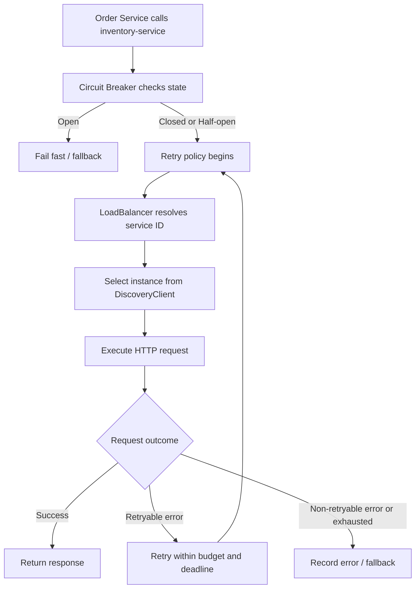
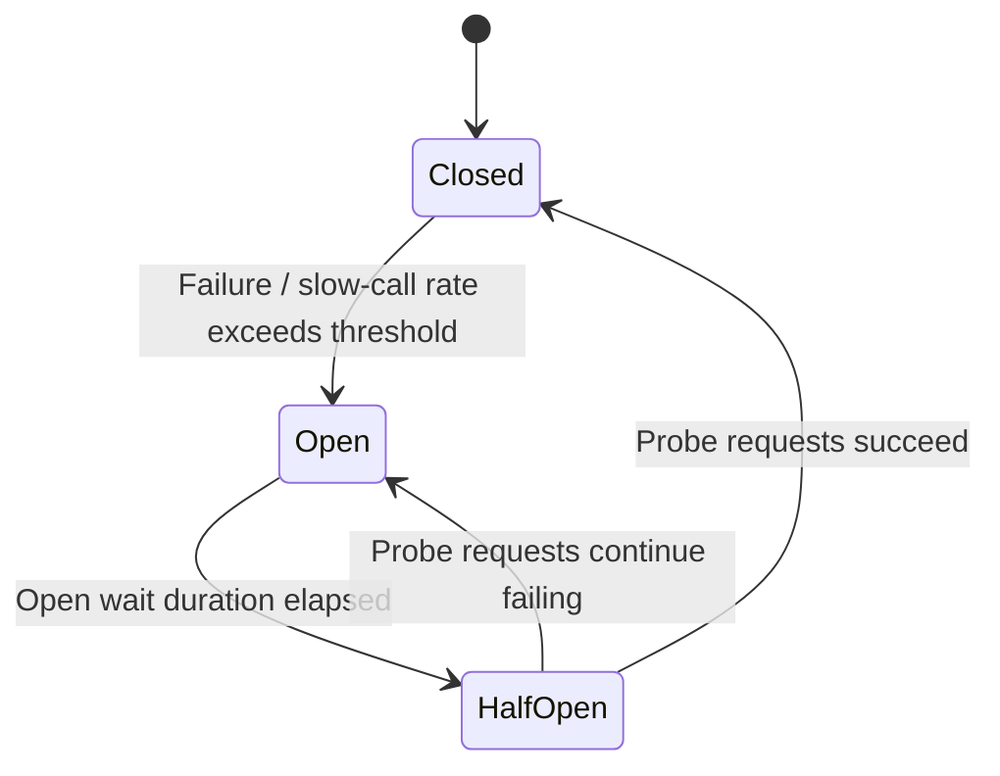

# Coordination Boundaries with Circuit Breakers and Retry Policies

Service discovery, load balancing, retries, and Circuit Breakers all help protect calls between microservices, yet each component solves a distinct problem. Discovery finds registered instances by service ID. LoadBalancer picks an instance for a request. Retry decides whether to resend a request on a transient error. Circuit Breaker stops a consumer from keeping on calling a persistently failing dependency.

Placing these mechanisms at the wrong boundaries can cause a single request to be retried multiple times, piling load onto a degraded service or causing the Circuit Breaker to mismeasure error rates. This lesson focuses on coordinating them around a call to `inventory-service`, choosing a single owner for retries, bounding total elapsed time, and ensuring write operations are not executed twice.

## Division of Responsibilities

| Component | Question it answers | What does it not replace? |
|---|---|---|
| Service Discovery | Which instances currently exist for a service ID? | Does not decide which requests to retry or when to open a Circuit Breaker |
| Spring Cloud LoadBalancer | Which instance will receive this request? | Does not replace timeouts, business retries, or a Circuit Breaker |
| Retry | Should the request be tried again after the error just seen? | Does not guarantee the next attempt will succeed and does not repair the registry |
| Circuit Breaker | Should calls to a failing dependency be paused temporarily? | Does not locate other instances or inspect system-wide health |
| Timeout/deadline | How long will the consumer wait at most? | Does not pick instances or make operations safe to retry |

For example, a consumer calls `http://inventory-service/api/items/42` using an `@LoadBalanced` HTTP client. Discovery supplies the instances, LoadBalancer picks an instance, and then retry and Circuit Breaker policies govern whether the request executes, retries, or fails fast.



The diagram illustrates logical boundaries. Actual execution order depends on where retries sit: retries can live inside LoadBalancer to pick the next instance, or wrap the HTTP call at the application layer.

## How Do Discovery and LoadBalancer Handle Instance Failures?

Suppose the registry returns three instances:

```text
inventory-service
  instance A: 10.0.1.12:8080  (timing out)
  instance B: 10.0.1.13:8080  (healthy)
  instance C: 10.0.1.14:8080  (healthy)
```

LoadBalancer selects an instance using the configured strategy. If instance A just died before the registry removed it, the first attempt may fail. LoadBalancer-layer retry can pick the next instance in the list and try again.

This is per-instance retry: the goal is to work around a faulty endpoint within the same service ID. It suits transient connection errors, connection resets, or certain recoverable server failures. Same-instance retries and next-instance retries must both be explicitly bounded.

Discovery and health checks remain the source of truth for the instance list. Retries do not delete instance A from the registry. Nor does a Circuit Breaker update A's health status automatically. If A fails persistently, investigate health checks, heartbeats, leases, advertised addresses, and registry sync lag.

## Circuit Breakers Protect Dependencies at the Call Level

A Circuit Breaker tracks call outcomes over a statistical window. When the failure rate or slow-call rate exceeds a threshold after a minimum number of calls, the breaker transitions to Open and rejects new calls for a cooldown duration. Afterward, the breaker admits a limited number of probe calls in the Half-open state.



State meanings:

- **Closed:** requests flow to the dependency; the breaker records outcomes.
- **Open:** requests are rejected fast, typically throwing `CallNotPermittedException`; avoids consuming extra connections to a failing service.
- **Half-open:** only a small number of probe requests pass through to assess whether the dependency has recovered.

With service discovery, breakers are typically scoped per logical service ID, such as `inventory`, to track aggregate calls to `inventory-service` across dynamic instances. Creating a separate breaker per IP requires lifecycle cleanup for keys as instances churn. If the goal is isolating a single bad instance, rely on health checks or LoadBalancer policies rather than expecting a service-level breaker to repair the registry.

Circuit Breakers normally maintain local state inside each consumer process. Two replicas of `order-service` can observe different breaker states. Never assume one instance opening its breaker means every consumer across the system opens theirs too.

## Choosing the Retry Boundary: LoadBalancer or Application Layer?

Two common places host retries:

| Location | Decision scope | When appropriate |
|---|---|---|
| Spring Cloud LoadBalancer retry | Retry the same instance or the next instance of the same service ID | Connection errors to one instance, stale endpoints, or single-node transient failures |
| Resilience4j Retry at application layer | Retry the entire dependency call according to business policy | Need backoff, exception classification, attempt limits, and coordination with fallbacks/deadlines |

Avoid letting Gateway, LoadBalancer, HTTP client, and service layer all retry independently without a shared budget. Each layer may look reasonable on its own, yet stacking them multiplies actual request volume.

For example, if Gateway allows 3 attempts, the application allows 2 attempts, and LoadBalancer tries 2 instances, a single incoming request can trigger up to roughly `3 × 2 × 2 = 12` upstream calls when every layer exhausts its retries. That amplifies load precisely while the dependency is degraded.

**Recommendation:** choose one primary retry owner for each call. If the goal is failing over to another instance when one node fails, use LoadBalancer retry and keep business retries minimal. If you need error-classified retries with backoff at the application layer, consider disabling LoadBalancer retry for that call or configuring it to try at most one next instance. Document the choice in configuration and test actual total request counts.

## Configuring Spring Cloud LoadBalancer Retry

Spring Cloud LoadBalancer can retry on the same instance or select the next instance. Illustrative configuration example:

```yaml
spring:
  cloud:
    loadbalancer:
      retry:
        enabled: true
        max-retries-on-same-service-instance: 0
        max-retries-on-next-service-instance: 1
        retryable-status-codes:
          - 503
          - 504
```

What this configuration means:

- Do not retry the initially selected instance.
- Allow at most one retry against the next instance.
- Treat only the listed status codes as retryable.

Exact properties and retry capabilities can vary by Spring Cloud version, HTTP client type, and active integration. Check your release train reference; do not copy settings without verifying client retry support. Also decide which connection errors are retryable and how to avoid re-picking the instance that just failed.

Not every `503` can be fixed by trying another instance. If the entire service has zero healthy instances, retrying only generates futile traffic. For `429 Too Many Requests`, honor `Retry-After` if supported and avoid retrying earlier than quota allows.

## Configuring Resilience4j Retry and Circuit Breaker

To manage retries at the application layer, Resilience4j lets you classify exceptions, set attempt counts, configure wait durations, and define breaker sliding windows. Example configuration for the `inventory` dependency:

With Spring Boot 3, an application can combine the Resilience4j Spring Boot integration with Spring Cloud LoadBalancer. Example Maven dependencies:

```xml
<dependency>
    <groupId>org.springframework.cloud</groupId>
    <artifactId>spring-cloud-starter-loadbalancer</artifactId>
</dependency>
<dependency>
    <groupId>io.github.resilience4j</groupId>
    <artifactId>resilience4j-spring-boot3</artifactId>
</dependency>
```

Manage versions using your project's compatible BOM. If choosing the Spring Cloud CircuitBreaker abstraction instead of the direct Resilience4j API, use the matching Resilience4j starter adapter and `CircuitBreakerFactory` API; do not mix both integration styles unintentionally.

`spring-cloud-starter-loadbalancer` should be managed via the Spring Cloud BOM. For `resilience4j-spring-boot3`, manage Resilience4j versions via Resilience4j's own BOM or project-verified dependency management; do not assume the Spring Cloud BOM manages every Resilience4j artifact.

```yaml
resilience4j:
  retry:
    instances:
      inventory:
        max-attempts: 2
        wait-duration: 200ms
        enable-exponential-backoff: true
        exponential-backoff-multiplier: 2
        retry-exceptions:
          - org.springframework.web.client.ResourceAccessException
          - org.springframework.web.client.HttpServerErrorException
        ignore-exceptions:
          - org.springframework.web.client.HttpClientErrorException
  circuitbreaker:
    instances:
      inventory:
        sliding-window-type: COUNT_BASED
        sliding-window-size: 20
        minimum-number-of-calls: 10
        failure-rate-threshold: 50
        slow-call-duration-threshold: 800ms
        slow-call-rate-threshold: 50
        wait-duration-in-open-state: 10s
        permitted-number-of-calls-in-half-open-state: 3
        ignore-exceptions:
          - org.springframework.web.client.HttpClientErrorException
```

`max-attempts: 2` means at most two total executions, including the initial attempt. This configuration is only an illustrative starting point; attempts, waits, window sizes, and thresholds must reflect target latency, traffic volume, and provider capacity.

Retry only likely transient errors. The example uses `ResourceAccessException` for connection/timeout errors and `HttpServerErrorException` for server error groups; the latter is broader than 503/504 alone. To retry only specific statuses, use a custom predicate checking status codes rather than allowing every HTTP 5xx. `HttpClientErrorException` is ignored in this example; if an API defines a dedicated retry policy for 429, handle `Retry-After` explicitly. Never retry authentication, authorization, validation, missing resource, or non-recoverable business errors by default.

### Decorator Composition Example

When using the Resilience4j API directly, you can fetch retry and breaker instances from the Spring Boot-configured registries. The example below places Retry inside Circuit Breaker so the breaker measures the final outcome of a logical operation:

HTTP client bean annotated with `@LoadBalanced`:

```java
import org.springframework.cloud.client.loadbalancer.LoadBalanced;
import org.springframework.context.annotation.Bean;
import org.springframework.context.annotation.Configuration;
import org.springframework.web.client.RestClient;

@Configuration
class HttpClientConfiguration {
    @Bean
    @LoadBalanced
    RestClient.Builder loadBalancedRestClientBuilder() {
        return RestClient.builder();
    }
}
```

```java
import io.github.resilience4j.circuitbreaker.CallNotPermittedException;
import io.github.resilience4j.circuitbreaker.CircuitBreaker;
import io.github.resilience4j.circuitbreaker.CircuitBreakerRegistry;
import io.github.resilience4j.retry.Retry;
import io.github.resilience4j.retry.RetryRegistry;
import org.springframework.beans.factory.annotation.Qualifier;
import org.springframework.stereotype.Service;
import org.springframework.web.client.RestClient;

import java.util.function.Supplier;

@Service
public class InventoryClient {
    private final RestClient restClient;
    private final CircuitBreaker circuitBreaker;
    private final Retry retry;

    public InventoryClient(
            @Qualifier("loadBalancedRestClientBuilder") RestClient.Builder builder,
            CircuitBreakerRegistry circuitBreakerRegistry,
            RetryRegistry retryRegistry) {
        this.restClient = builder.build();
        this.circuitBreaker = circuitBreakerRegistry.circuitBreaker("inventory");
        this.retry = retryRegistry.retry("inventory");
    }

    public InventoryItem getItem(String sku) {
        Supplier<InventoryItem> remoteCall = () -> restClient.get()
            .uri("http://inventory-service/api/items/{sku}", sku)
            .retrieve()
            .body(InventoryItem.class);

        Supplier<InventoryItem> retryingCall =
            Retry.decorateSupplier(retry, remoteCall);
        Supplier<InventoryItem> protectedCall =
            CircuitBreaker.decorateSupplier(circuitBreaker, retryingCall);

        try {
            return protectedCall.get();
        } catch (CallNotPermittedException ex) {
            throw new InventoryUnavailableException(
                "Inventory circuit is open", ex);
        }
    }
}
```

This snippet assumes the application already configured an `@LoadBalanced` `RestClient.Builder` bean, Resilience4j registries are auto-configured by Spring Boot, and `InventoryItem`/`InventoryUnavailableException` are application types. Declare Resilience4j/Spring Cloud CircuitBreaker dependencies compatible with your Spring Boot version.

Because this example applies Resilience4j Retry at the application layer, disable or constrain LoadBalancer retry for the same call so attempt counts do not multiply unintentionally. Globally, you can set `spring.cloud.loadbalancer.retry.enabled: false`; if other services require LoadBalancer retry, configure per-service/client settings compatible with your release train instead of disabling globally.

In the composition above, Circuit Breaker wraps the entire Retry. One logical request counts as one outcome for the breaker: if a retry succeeds, the breaker records success; if all attempts fail, the breaker records one failure. This keeps the breaker aligned with the final outcome seen by the caller.

### When Should Circuit Breaker Wrap Each Attempt?

You can invert the decorator order:

```java
Supplier<InventoryItem> breakerPerAttempt =
    CircuitBreaker.decorateSupplier(circuitBreaker, remoteCall);
Supplier<InventoryItem> retryingPerAttempt =
    Retry.decorateSupplier(retry, breakerPerAttempt);
```

Here each attempt traverses the breaker and each failure contributes to the failure rate. The breaker can open faster during a burst of errors, though subsequent retries may immediately hit an already-open breaker and be rejected. Configure Retry to ignore `CallNotPermittedException`; otherwise the retry layer will keep retrying calls already blocked by the breaker.

Decorator order changes statistical semantics. Never stack `@Retry` and `@CircuitBreaker` annotations and assume a default ordering without checking aspect precedence for your active version. Use explicit decorators or behavioral tests to verify the boundary.

## Retries Must Respect Idempotency

Retrying a GET request is usually safer than retrying a write operation, yet API side effects still matter. If a POST request reaches the provider and the provider commits the write while the response is lost in transit, the consumer cannot tell whether the operation succeeded. Resending the POST can create duplicate orders or deduct inventory twice.

For write operations:

- Retry only when the API has idempotent semantics or duplicate-processing protection.
- Use a stable idempotency key across every attempt of the same logical operation.
- Have the provider persist outcomes by key and replay the prior result on duplicate requests.
- Never mint a new idempotency key on each retry attempt.
- Without idempotency support, return an error to the caller or rely on an appropriate workflow/compensation mechanism rather than automatically re-sending.

Never retry validation errors, `400`, `401`, `403`, or permanent business errors. For `404`, confirm whether the API can return a transient 404 due to unsynchronized state or whether it is definitive. Never reuse one generic status-code list across all endpoints.

## Timeouts, Deadlines, and Backoff

Retries make sense only while time remains inside the original request deadline. If a caller waits at most two seconds, you cannot configure three attempts each with a two-second timeout plus long backoff and expect to meet the deadline.

The total time budget must cover every attempt duration plus pauses:

\[T_{total} \geq \sum_{i=1}^{n} T_{attempt,i} + \sum_{i=1}^{n-1} T_{backoff,i}\]

For instance, a call with a 1.5-second deadline might allocate 400 ms to the first attempt, 100 ms backoff, and 400 ms to the second attempt, leaving the rest for overhead and response processing. This is only an illustrative allocation; measure real latencies including DNS, connect, TLS, queueing, and serialization.

Exponential backoff with jitter prevents many consumers from retrying simultaneously:

```text
Attempt 1: send immediately
Attempt 2: wait roughly 200 ms + jitter
Attempt 3: wait roughly 400 ms + jitter
```

Cap attempt counts. Never use infinite loops or `Thread.sleep` inside request-handling threads to wait on a dependency. When the deadline is nearly exhausted, stop retrying and return a meaningful error to the caller.

## Fallbacks Must Accurately Represent Degradation

A fallback defines how the application responds when the breaker is open or all attempts fail. Fallbacks must never mask errors with fabricated data:

| Operation type | Potentially suitable fallback | What to avoid |
|---|---|---|
| Reading slowly changing data | Latest cache with clear timestamp/staleness indicator | Returning old data as if freshly read from primary source |
| Reading critical data | Return dependency unavailable error for caller to decide | Returning default values that can drive wrong decisions |
| Writing orders/payments | Return unknown state or error with correlation/idempotency key for reconciliation | Reporting fake success or re-sending write operations blindly |
| Fetching optional data | Omit secondary section and mark response degraded | Hiding degradation so callers misinterpret completeness |

A fallback must not call the same dependency protected by the same breaker, as doing so can trigger loops or keep hammering a failing service. When the breaker is open, you can return `503 Service Unavailable` with `Retry-After` if clients can try again later; include a retry interval only when the system has a sound basis to estimate it.

## Circuit Breakers Do Not Replace Health Checks or Registry Cleanup

Circuit Breakers observe failures from the consumer's perspective. Health checks/heartbeats observe instance status via registry or platform mechanisms. Those two views can diverge:

- Provider health checks still pass while consumers time out due to a network partition.
- The registry still holds an old instance record while consumers fail to connect.
- An instance errors on one request type while serving other requests fine.
- One consumer's breaker opens while another consumer continues calling successfully.

Therefore, never treat breaker state as sole proof that a provider is dead. Correlate breaker metrics, LoadBalancer stats, registry state, health checks, network diagnostics, and provider logs to isolate whether the fault lies in an instance, the whole service, or the network path.

## Observability and Operations

Monitor at least these metrics per service ID and route/caller:

- Successful, failed, and timed-out request counts.
- Attempts per logical request and retry counts for same-instance vs. next-instance.
- Circuit Breaker states: closed, open, half-open, and rejected call counts.
- Response latency p50/p95/p99 before and after retries.
- Instance counts returned by discovery and instances selected by LoadBalancer.
- Fallback rate and degraded response count.
- Errors by category: connection, timeout, 4xx, 5xx, auth, and no-instance.

Propagate correlation IDs or trace IDs to link all attempts of a logical request. Separate application-level logical request metrics from client-level HTTP attempt metrics; looking only at total request counts can hide retry amplification.

Never log tokens, credentials, or sensitive payloads in retry logs. Logs should capture service ID, attempt number, exception/status, wait duration, and trace ID.

## Integration Testing Coordination

Write integration tests with two mock instances of `inventory-service`, one returning transient failures and one succeeding. Verify:

1. Discovery returns both instances accurately and LoadBalancer picks an instance.
2. When the first instance times out, configured retries execute only the expected number of attempts and can fail over to the next instance.
3. When all attempts fail, Circuit Breaker records outcomes accurately per decorator order.
4. While the breaker is Open, subsequent requests fail fast without issuing new HTTP calls.
5. After the cooldown duration, Half-open allows only the configured number of probe requests.
6. Retries do not fire for validation/authentication errors or ignored exceptions.
7. A POST with an idempotency key does not create duplicate records when the first attempt's response is lost.
8. Total HTTP attempts stay within the retry budget across Gateway/client/LoadBalancer layers.
9. Total processing time stays within the configured deadline.
10. Fallbacks return explicit degraded states or clear errors, never fake success.

Do not test only the all-success path. Inject controlled failures such as connection resets, timeouts, 503s, and no-instance states to verify retry, breaker, and fallback policies.

## Common Design Mistakes

| Design | Consequence | Adjustment |
|---|---|---|
| Every layer retries | Request amplification and retry storms | Assign one retry owner; compute aggregate attempt budget |
| Retrying every exception | Repeats unrecoverable 4xx, auth, or validation errors | Allowlist transient errors and ignore permanent failures |
| Retrying POST without idempotency | Creates duplicate data or side effects | Add idempotency keys and provider-side deduplication |
| Circuit Breaker placed inside each HTTP attempt unintentionally | Breaker opens on per-attempt faults even if logical request succeeds; retries hit open breaker | Decide explicitly whether the breaker tracks attempts or logical operations |
| Circuit Breaker keyed by dynamic IP | Spawns unbounded breaker keys as instances churn | Scope service-wide breakers by service ID; isolate bad nodes at health/LB layer |
| Fallback calls the same failing service | Creates call loops and adds load | Serve cache or return degraded errors; avoid the same dependency path |
| No overall timeout | Retries hold requests and threads too long | Enforce end-to-end deadlines and cap attempts/backoff |
| Treating an Open breaker as a dead instance | Confuses local consumer faults with registry state | Cross-check breaker, discovery, health, and network metrics |

## Implementation Checklist

1. Identify the service ID and discovery integration in use.
2. Decide whether retries live in LoadBalancer or the application layer for each call.
3. If multiple retry layers exist, calculate the multiplicative max attempts and enforce a shared budget.
4. Retry only transient errors; ignore validation, authentication, and permanent business failures.
5. Scope Circuit Breakers per logical dependency and clarify whether they measure individual attempts or logical operation results.
6. Configure sliding window, minimum calls, failure threshold, open wait, and half-open probes from real telemetry.
7. Set connect/read timeouts and an overall deadline before enabling retries.
8. Use backoff with jitter and bound attempt counts.
9. Ensure write operations support idempotency or are excluded from automatic retries.
10. Design explicit fallbacks that never loop back to the failing dependency.
11. Monitor breaker state, retry counts, selected instances, latency, and fallbacks.
12. Test no-instance, stale instance, timeouts, 5xx responses, breaker open/half-open transitions, and retry storms.

## Conclusion

Service Discovery supplies the instance list, LoadBalancer picks the target, Retry decides whether to try again, and Circuit Breaker caps ongoing calls to a failing dependency. Place retries at one intentional boundary, bound attempts and deadlines, enforce idempotency for writes, and define clearly whether the Circuit Breaker measures individual HTTP attempts or logical operation outcomes. A Circuit Breaker neither repairs the registry nor replaces health checks; combining consumer, LoadBalancer, and registry metrics is what distinguishes a faulty instance from a degraded service or network.
