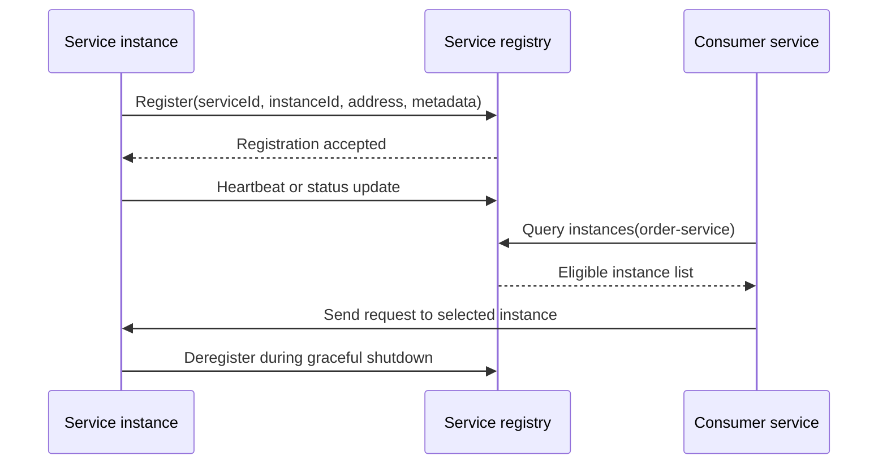
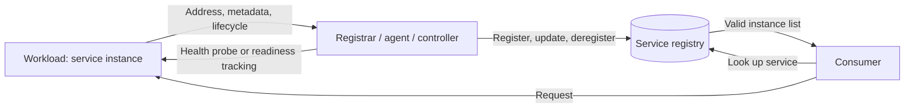

# Self-Registration and Third-Party Registration

In the `SPRING_CLOUD_SERVICE_DISCOVERY` architecture, the registry needs to know where each instance is running, which protocol it can accept requests over, and whether it is still eligible to serve traffic. There are two ways to organize updating this information: either the service registers itself (self-registration), or an external component monitors the service and registers on its behalf (third-party registration). Both produce data that consumers query via `DiscoveryClient`, but they differ in where registration lifecycle ownership resides.

Spring Cloud provides shared abstractions such as `DiscoveryClient`, `ServiceRegistry`, and `Registration`, while integrating self-registration mechanisms for implementations like Eureka and Consul. Understanding both models helps you choose the right place to manage health checks, credentials, deregistration, and instance data when deploying microservices.

## 1. What information does the registry need to store?

A service can run multiple instances. The registry stores information so consumers can find the right instance instead of hardcoding hostnames and ports. An instance record typically contains the following data groups:

| Data | Example | Purpose |
|---|---|---|
| Service ID / service name | `order-service` | Groups instances providing the same service |
| Instance ID | `order-service:pod-a83f` | Distinguishes individual running instances, even when multiple share the same service name |
| Reachable address | `10.20.1.15:8080` or internal hostname | Tells consumers where to send requests |
| Protocol | HTTP or HTTPS | Constructs the proper URI when calling an instance |
| Metadata | zone, version, region, tags | Filters or prioritizes instances based on deployment attributes |
| Health / status | healthy, critical, `UP`, `OUT_OF_SERVICE` | Determines whether an instance is included in the serving list |
| Check configuration | health-check URL, interval, TTL | Enables the registry or agent to check the instance lifecycle |

Not every registry stores all fields under the same names or with the same semantics. `Registration` in Spring Cloud Commons is a marker interface; each provider has its own implementation, such as `EurekaRegistration` or `ConsulRegistration`. Therefore, you should not assume metadata or statuses can be translated verbatim between Eureka, Consul, and other registries.

## 2. Self-registration model

In self-registration, the service process itself knows its address and status, and sends registration details to the registry. With Spring Cloud, when a `DiscoveryClient` implementation such as Eureka or Consul is on the classpath, a Spring Boot application can automatically register its local instance by default. In current Spring Cloud versions, adding `@EnableDiscoveryClient` is no longer required merely to enable this behavior.

General flow:



The process typically consists of the following steps:

1. **Startup and instance identification:** the application determines `spring.application.name`, instance ID, host, port, protocol, and metadata. The instance ID must be unique within the registry's scope.
2. **Registration:** the discovery client sends the record to the registry when the application enters the registration phase of its lifecycle.
3. **Status maintenance:** the instance sends heartbeats or the registry/agent performs health checks. Metadata can be updated when status or address changes.
4. **Taking out of service:** during a graceful shutdown, the instance deregisters or changes status so consumers stop picking it before the process stops.
5. **Cleaning up stale records:** if the process terminates abruptly and cannot deregister, expired heartbeats or failed health checks enable the registry to mark or evict the instance according to the provider's policy.

### How does Spring Cloud support self-registration?

`DiscoveryClient` is primarily intended for querying services and instances. `ServiceRegistry` is the abstraction for registration, deregistration, and certain status operations. These two interfaces serve different purposes:

| Abstraction | Responsibility | Example operations |
|---|---|---|
| `DiscoveryClient` | Look up services and available instances | `getServices()`, `getInstances("order-service")` |
| `ServiceRegistry` | Write or remove registration info for an instance | `register(registration)`, `deregister(registration)` |
| `Registration` | Represents provider registration data | `EurekaRegistration`, `ConsulRegistration` |

Spring Cloud Commons enables auto-registration by default for the corresponding implementation. It can be disabled via configuration:

```yaml
spring:
  cloud:
    service-registry:
      auto-registration:
        enabled: false
```

With Eureka, you can also use `@EnableDiscoveryClient(autoRegister = false)` on an appropriate configuration class. The `@EnableDiscoveryClient` annotation is no longer mandatory in standard configurations of current Spring Cloud releases; the property above is the configuration-based way to control auto-registration.

When you need to control registration timing manually, the application can call `ServiceRegistry` with an appropriate provider-supplied `Registration`. The following example illustrates the idea; how a concrete `Registration` is created depends on Eureka, Consul, or whichever registry is used:

```java
// Pseudocode: Registration is created according to the provider in use.
final class RegistrationLifecycle {
    private final ServiceRegistry registry;
    private final Registration registration;

    void registerWhenReady() {
        registry.register(registration);
    }

    void deregisterBeforeShutdown() {
        registry.deregister(registration);
    }
}
```

Spring Cloud Commons also publishes two events when auto-registration takes place: `InstancePreRegisteredEvent` before registration and `InstanceRegisteredEvent` after registration. Applications can listen for these events to log, add checks, or coordinate with another initialization step. These events are not published when auto-registration is disabled with `spring.cloud.service-registry.auto-registration.enabled=false`.

### Eureka client configuration example

```yaml
spring:
  application:
    name: order-service
  cloud:
    service-registry:
      auto-registration:
        enabled: true

server:
  port: 8080

eureka:
  client:
    serviceUrl:
      defaultZone: http://eureka-server:8761/eureka/
```

With `spring-cloud-starter-netflix-eureka-client` on the classpath, the application acts both as a Eureka client that queries the registry and as a registered instance. The service ID defaults to `spring.application.name`; the port defaults to `server.port`. The `defaultZone` property is a map key and is case-sensitive.

### Heartbeat does not equal application health

The registry needs to know whether an instance is still alive and able to serve requests. These two questions are related, not identical:

- **Heartbeat / lease:** is the process or agent still communicating with the registry?
- **Health / readiness check:** is the instance actually ready to handle the types of requests consumers send?

With Eureka, client heartbeats are used by default to determine whether an instance is still active. According to the Spring Cloud Netflix documentation, Actuator status is not automatically propagated to Eureka in the default configuration; a registered instance may still be advertised as `UP`. If you need to propagate application health status, you can enable `eureka.client.healthcheck.enabled=true` in `application.yml` and verify the behavior for your specific version.

With Spring Cloud Consul, registration creates an HTTP check against `/actuator/health` every 10 seconds by default; if the check fails, the instance is marked `critical`. Consul also supports TTL checks, where the application sends heartbeats to the Consul agent rather than the agent calling into the application. You must properly configure the address, context path, management port, and access permissions for the check endpoint.

## 3. Third-party registration model

In third-party registration, the service is not directly responsible for creating and deleting registry records. Another component tracks the workload lifecycle, collects addresses and statuses, and then registers or deregisters on the service's behalf.

Spring Cloud Commons does not provide a standalone generic controller to automatically register arbitrary workloads outside the application. `ServiceRegistry` is an abstraction on the Spring application side; an out-of-process registrar must use the registry's API/SDK or the deployment platform's API, and manage the mapping between the workload lifecycle and registry records itself.

The intermediary component may be:

- **Registration agent or sidecar:** a process running alongside the service that monitors health and sends registrations to the registry.
- **Node agent:** an agent running on each host that discovers new processes or containers and manages their records.
- **Orchestrator or controller:** a deployment platform that monitors Pods, tasks, or VMs, and updates endpoints when workloads are created, become ready, are replaced, or are deleted.
- **Provisioning system:** a pipeline or control plane that creates workloads while writing instance information to the registry.

General flow:



The intermediary component needs to do three things well: identify workloads accurately, determine precisely when a workload is ready/out of service, and ensure records are updated or removed when a workload disappears. If the registrar cannot observe the application's true state, the registry may contain unready or dead instances.

### Example: workload management platform

Suppose a deployment platform creates three replicas of `inventory-service`. When a new Pod is created, the controller watches the Pod and Service selector, waits for the Pod to become ready, and updates the serving endpoint set. When the Pod is deleted or readiness fails, the controller removes the corresponding endpoint from the published endpoint set.

In Kubernetes, Service and EndpointSlice are maintained by the control plane from Pods and readiness. This is an example of the platform managing endpoints instead of each application writing into a separate Eureka/Consul registry itself. Spring Cloud Kubernetes can use the Kubernetes API as its discovery source; there is no need to assume the application must call `ServiceRegistry` to register itself in this model.

### Distinguishing the Consul Agent from third-party registration

A Spring Cloud Consul client typically sends requests via HTTP API to a Consul agent, usually a local agent on the node. The agent accepts registrations, runs health checks, and coordinates with the Consul cluster. Having an agent in the path does not automatically make the architecture third-party registration: if the Spring Cloud application still initiates the registration record and controls its lifecycle, it remains self-registration from an ownership perspective.

It should only be called third-party registration when an independent component truly owns workload discovery, status determination, and record creation/deletion on behalf of the application. The boundary lies in lifecycle ownership, not simply in whether requests traverse a proxy or agent.

## 4. Comparing the two models

| Criterion | Self-registration | Third-party registration |
|---|---|---|
| Who creates the record? | The service itself or the discovery client inside the service | An agent, sidecar, controller, or deployment platform |
| Who understands internal state? | The application can combine readiness state and business logic | The registrar typically relies on probes, metadata, or signals from the orchestrator |
| Registry integration | Each service needs a client/configuration and registration permissions | The registrar needs registry integration; the service may not need a registry SDK |
| Deployment dependencies | The service must be able to reach the registry or agent | The registrar must be able to reach both the workload and the registry |
| Multi-language support | Each language needs a compatible client or protocol | A single registrar can be shared across multiple runtimes |
| Permissions and security | Registration credentials may reside inside each service | Credentials are centralized in the agent/controller, which must be tightly protected |
| Failure points to manage | Individual clients, configurations, and registration processes | Registrar/agent and the workload observation channel |
| Shutdown handling | Service must deregister; TTL/health checks handle crashes | Registrar must watch termination, disconnects, and remove records |

Neither model automatically guarantees accurate data. Self-registration has the advantage when applications know best when they are ready and can manage their own credentials. Third-party registration is useful when the platform already provides a reliable control plane, needs to support multiple languages, or wants to centralize registry write access.

## 5. Registration lifecycle and error-prone scenarios

Registration does not end with a single API call. The registry must reflect state transitions throughout the instance lifecycle:

| Phase | Action | Risk if handled poorly |
|---|---|---|
| Starting | Generate instance ID and prepare metadata | Duplicate IDs cause one instance to overwrite or accidentally delete another instance's record |
| Ready | Register or add the instance to the serving list | Registering too early causes consumers to call a service whose port is not open or that is not ready |
| Running | Send heartbeats, run health checks, and update metadata | Network hiccups or probing the wrong endpoint cause false healthy or false failure states |
| Draining | Mark as not accepting new requests, wait for in-flight requests to finish | Consumers keep picking the instance while the application is shutting down |
| Stopping | Deregister and stop the process | Removing the record too late causes failed requests; removing it too early can disrupt in-flight requests |
| Crashed | Registry/agent detects heartbeat or health check failure | Stale record persists until TTL expires or the next check runs |

For rolling deployments, the ordering must be right: new instances must only receive traffic once ready; old instances stop receiving new traffic before terminating; drain time must be sufficient for in-flight requests. Heartbeat intervals, health checks, and TTLs should be chosen based on failure detection SLAs, registry load, and tolerance for false positives.

### Common pitfalls

**Registering an unreachable address.** An application might infer its container IP or internal hostname, yet that address may not be reachable by consumers on another network. Identify the address consumers actually use, and verify routing, port mapping, proxies, and TLS before publishing.

**Non-unique instance IDs.** If all replicas share a fixed ID, the registry may update or delete the wrong record. Combine the service ID with pod UID, hostname, process ID, or another unique identifier depending on the platform.

**Confusing readiness and liveness.** Liveness answers whether the process needs to be restarted; readiness answers whether the instance can accept traffic. Registries and load balancers need signals tied to serving capability. An application that is alive yet cannot connect to its database or has not finished loading data may not be ready.

**Unreachable health checks.** The Consul agent may fail to call `/actuator/health` due to management port, context path, firewall, or authentication settings. Test the request from the exact origin where the probe runs, not only from a browser on a developer machine.

**Deregister does not run when a process is killed.** Shutdown hooks only cover graceful stops. For crashes, node loss, or power outages, you need heartbeats/TTL or a controller reconciling actual workloads to clean up records.

**Registry and caches out of sync.** A consumer may still hold a stale instance list after the registry changes. Client-side load balancers should handle connection errors and fetch updated lists according to the provider's refresh mechanism; never assume all consumers see new state immediately.

## 6. Which model fits your system?

Self-registration typically works well when Spring Boot services integrate directly with Eureka or Consul, the workload count is moderate, applications need control over metadata, and credentials can be managed per workload. It is also the straightforward default when learning `ServiceRegistry` and `DiscoveryClient` in Spring Cloud.

Third-party registration typically works well when the organization already has an orchestrator or agent managing workloads, runs multiple languages/runtimes, or wants to centralize registry write permissions in an infrastructure component. With this model, clearly define who is the source of truth for readiness, who handles deregistration, and how the registrar recovers upon restart.

Before deciding, answer these questions:

1. Which component knows for certain when an instance is ready to accept requests?
2. Which component can detect an abrupt instance crash and delete stale records?
3. Is the registered address reachable from all relevant consumers?
4. Which credentials are allowed to create, update, and delete records? Are they scoped by service or namespace?
5. If the registry becomes temporarily unreachable, do services keep running, and who reconciles state when connectivity returns?
6. Does the deployment process ensure new instances receive no traffic before readiness and old instances drain before stopping?

## 7. Security and operations

Service registration is an operation that directly affects traffic routing. An untrusted client or registrar can publish spoofed addresses, false metadata, or delete valid instances. Therefore:

- Authenticate services/registrars with the registry; use TLS when communicating over untrusted networks.
- Grant write permissions per service or namespace, scoping registration and deletion actions to what is strictly required.
- Never put passwords, tokens, private keys, or personal data into metadata/tags exposed in the registry.
- Protect health endpoints; expose them only to agents or probes that need access, and configure the network path properly.
- Log register, update, status change, and deregister events along with service ID, instance ID, timestamp, and reason.
- Monitor instance counts, stale records, critical health checks, heartbeat errors, registration errors, and convergence time after deployments.
- Establish a reconciliation process between the registry and live workloads to detect orphaned records or missing instances.

Do not use the registry as a secret configuration store. Metadata should hold only necessary routing and classification attributes, with validated and controlled data.

## 8. Connecting with DiscoveryClient and load balancing

Regardless of the registration model, consumers typically use `DiscoveryClient` to look up instances by service ID. Then, Spring Cloud LoadBalancer or another routing mechanism picks an eligible instance. The registry answers "which instances are published and valid according to the registry"; the load balancer decides "which instance receives this request".

For example, a consumer calls the logical service name `http://order-service`. The discovery client fetches the instance list for `order-service`; the load balancer selects an instance per the configured strategy and resolves the physical address. Thus, successful registration alone is not enough to guarantee successful requests: networking, TLS, health, timeouts, and retry policies must still be properly configured.

## References

- [Spring Cloud Commons — Common Abstractions: DiscoveryClient, ServiceRegistry, and auto-registration](https://docs.spring.io/spring-cloud-commons/reference/spring-cloud-commons/common-abstractions.html)
- [Spring Cloud Netflix — Eureka Clients, registration, heartbeat, and health check](https://docs.spring.io/spring-cloud-netflix/reference/spring-cloud-netflix.html)
- [Spring Cloud Consul — Service Discovery, registration, HTTP check, and TTL check](https://docs.spring.io/spring-cloud-consul/reference/discovery.html)
- [Kubernetes — Service and EndpointSlice](https://kubernetes.io/docs/concepts/services-networking/service/)
- [Kubernetes — Pod readiness and liveness probes](https://kubernetes.io/docs/concepts/configuration/liveness-readiness-startup-probes/)
