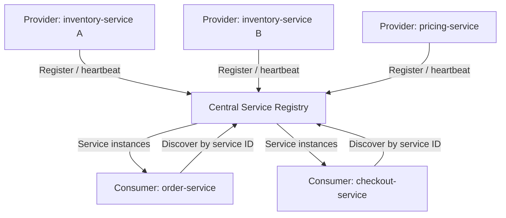
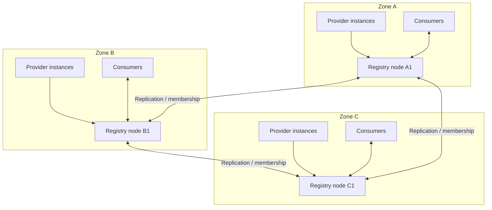
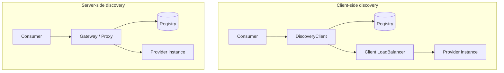

# Centralized Registry and Distributed Registry

In a microservice system, providers need to advertise running instances and consumers need to locate those instances by service name. The Service Registry stores and serves this information. How the registry is organized directly affects availability, lookup latency, data consistency, and operability when a network or node fails.

A registry can be organized under a centralized or distributed model. A centralized model uses a single logical authority to manage service data; a distributed model spreads data and/or processing capacity across multiple nodes, zones, or datacenters. In practice, a logically centralized registry can still run as a multi-node cluster with redundancy. Conversely, a system with multiple servers is not necessarily distributed in the sense that every node participates in maintaining data and serving queries.

This lesson belongs to the `SPRING_CLOUD_SERVICE_DISCOVERY` module, where learners study how Spring Cloud discovers instances via `DiscoveryClient`, `ServiceRegistry`, Eureka or Consul, along with the registration lifecycle, health checks, load balancing, security, and handling registry drift. The focus here is distinguishing between the two registry architectures, understanding how data is shared, and selecting a model suited to your microservice deployment scope.

## 1. What does a Registry do in Service Discovery?

A Service Registry stores records of instances. A record typically includes service ID, instance ID, host, port, protocol, metadata, and provider-specific status or health information.

For example, three instances of `inventory-service` may be advertised as follows:

| Service ID | Instance ID | Address | Metadata |
|---|---|---|---|
| `inventory-service` | `inventory-a1` | `10.10.1.21:8080` | `zone=zone-a` |
| `inventory-service` | `inventory-a2` | `10.10.1.22:8080` | `zone=zone-a` |
| `inventory-service` | `inventory-b1` | `10.10.2.31:8080` | `zone=zone-b` |

A registry supports two groups of operations:

- **Writing and maintaining records:** providers register instances, update status, send heartbeats or undergo health checks according to the registry's mechanism, and deregister upon shutdown.
- **Reading and discovery:** consumers look up by service ID to obtain an instance list, then select an instance or pass the list to a load balancer.

The registry does not process request business logic. Nor does it guarantee that a returned address will still be serving at the exact moment a request arrives. Consumers still need timeouts, connection error handling, and appropriate retry policies.

## 2. Centralized registry

In a centralized model, providers and consumers use a single logical registry focal point. Providers send records to that registry; consumers query the same data source to retrieve instance lists.

The key point is **centralization in terms of management and logical data source**. A registry may be a single process in a development environment, yet production deployments typically require multiple nodes, replicas, or failover mechanisms. A server cluster can still be considered a centralized registry if the overall system provides one shared logical authority and clients access it through an endpoint or a set of endpoints belonging to that same registry.

### 2.1. How it works

A typical flow proceeds as follows:

1. The provider starts up and creates a registration containing service ID, instance address, and metadata.
2. The registry receives and stores the record according to its data model.
3. The provider maintains presence via heartbeats, leases, or health checks if the implementation requires it.
4. The consumer queries the registry by service ID and receives a list of eligible instances per filtering policies.
5. The consumer or LoadBalancer selects an instance to send the request to.
6. When the provider shuts down, it deregisters; if the process terminates abruptly, TTL or health checks can evict the record after a period of time.

### 2.2. Advantages

- **Easy to understand and administer:** there is one logical place to inspect service IDs, instances, statuses, and metadata.
- **Centralized policy management:** registration permissions, naming conventions, metadata, and health rules can be managed consistently.
- **Suitable for single-region systems:** for moderate-scale systems within a single datacenter or network cluster, one logical registry is usually simple enough to deploy.
- **Easy integration:** applications can use Spring Cloud's common abstractions to register and look up services through a specific integration.

### 2.3. Limitations and risks

A centralized registry creates a shared dependency. If the registry goes down, new providers may fail to register and consumers may fail to fetch updated lists. Consumers holding a cache may continue using stale data, though the degree of impact depends on the client and caching policy.

As the number of services and lookup requests grows, the registry can become a hotspot for load or latency. If the registry has only a single node, that node is also a single point of failure. Deploying an HA cluster reduces this risk, yet does not eliminate issues like network outages to the whole cluster, shared misconfigurations, overload, or write unavailability when quorum is lost.

Therefore, "centralized" does not mean "only one machine". You must distinguish logical authority from physical node count.

## 3. Distributed registry

In a distributed model, the registry is deployed across multiple nodes, and data or serving capacity is distributed across nodes, zones, or datacenters. Nodes may replicate state, exchange membership information, serve queries from multiple locations, or coordinate via a quorum mechanism.

The diagram illustrates multiple nodes participating in the architecture. The actual mechanism may be leader/quorum, peer-to-peer replication, gossip, zone-based partitioning, or a combination of several mechanisms. Not every distributed registry lets every node write data independently.

### 3.1. Ways to distribute data

**Leader- or quorum-coordinated replication:** a group of nodes maintains data replicas and coordinates to confirm changes. Some write operations require a leader or quorum. This approach helps nodes agree on state under a deterministic protocol, though when quorum is not met, certain operations may have to be rejected or wait for recovery.

**Peer-to-peer replication with eventual convergence:** nodes exchange changes and gradually converge to the same state. During network partitions or while updates are still propagating, two nodes may return different lists. This model can increase local query or update availability, but consumers must tolerate temporarily stale or inconsistent data.

**Gossip and membership:** nodes exchange information about the existence and status of other nodes periodically or on events. Gossip is typically useful for member discovery and state dissemination. It is not necessarily the storage mechanism for all service records or a consensus protocol for all write operations.

**Partitioning or federation by zone:** each datacenter or zone runs a local registry so providers and consumers can access it nearby. Zones can synchronize, link, or federate necessary information. This reduces local latency and limits blast radius when a zone fails, but requires clear policies on cross-zone lookups and duplicate data handling.

### 3.2. Advantages

- **Better fault tolerance:** a single node failure does not necessarily take down the entire registry, provided topology and quorum are designed properly.
- **Regional scalability:** nodes can be placed close to providers and consumers to lower network latency.
- **Load distribution:** multiple nodes can simultaneously serve queries or maintain data replicas.
- **Fault isolation:** failures in one zone or datacenter can be contained if partitioning and failover architectures are designed correctly.
- **Multi-region system support:** better suited for systems that must operate across multiple datacenters or geographic regions.

### 3.3. Limitations and risks

Distributed architectures are more complex to operate. Teams must understand replication, membership, quorum, partitions, failover, time synchronization, and conflict resolution policies. During network issues, different zones may observe different states.

Adding nodes does not automatically make a system safer. If nodes sit in the same failure domain, share a single switch, single zone, or single faulty configuration, one incident can still wipe out total serving capacity. Replicas must be placed across independent failure domains, and node loss or inter-zone link loss scenarios must be tested.

Additionally, replication and gossip generate extra network traffic. If misconfigured, synchronization traffic can contend for bandwidth with business requests or increase convergence time.

## 4. Comparing the two models

| Criterion | Centralized registry | Distributed registry |
|---|---|---|
| Logical data source | One authority or one shared logical cluster. | Multiple nodes/zones maintaining or serving data per topology. |
| Physical deployment | Can be one node or an HA cluster. | Usually multiple nodes across multiple failure domains. |
| Complexity | Typically lower, easier to observe and administer. | Higher due to replication, membership, quorum, or convergence. |
| Latency | Depends on client location relative to the central registry. | Can be lower when querying local nodes, though cross-zone sync adds lag. |
| Fault tolerance | Depends on HA, replicas, and failover of the central cluster. | Can tolerate node/zone failures better if replicas are distributed properly. |
| Consistency | Can centralize write ordering control; still depends on implementation. | May use quorum or eventual consistency; varies by design. |
| Scalability | Can scale resources and add replicas; central point still needs load management. | Can distribute load and data, at the cost of topology administration. |
| Best suited for | Single cluster or single datacenter, systems needing a simple operational model. | Multiple zones/datacenters requiring fault tolerance and partitioned access. |
| Prominent issues | Shared dependency point, overload, or loss of the logical registry. | Temporary divergence, partitions, quorum, convergence, and operational complexity. |

Neither model is always better. A centralized registry deployed as an HA cluster can meet the requirements of many large systems. A distributed registry may suit a multi-region system while imposing unnecessary operational overhead on a small application.

## 5. Consistency and network partitions

Consistency describes the degree to which nodes see the same registry state and when changes are reflected across replicas. In distributed environments, a network partition can prevent one group of nodes from communicating with the rest.

When a partition occurs, systems typically must weigh continuing to accept operations against ensuring nodes do not present conflicting states. This is part of the CAP trade-off: when a real network partition occurs, a distributed system must choose how to trade off consistency and availability for the affected operations.

Two common directions:

- **Prioritizing consistent confirmation via quorum:** write operations require participation from enough nodes. Without quorum, the system may reject writes to prevent two groups from confirming conflicting changes. In return, part of the system may lose write capability during a partition.
- **Prioritizing continued service with eventual convergence:** nodes or zones can keep serving local data and sync changes once connectivity recovers. In return, consumers may receive stale, incomplete, or differing instance lists across zones for a period of time.

Do not label a registry "strongly consistent" or "eventually consistent" across all operations without checking its documentation. A single product may use different mechanisms for membership, service catalog writes, data reads, and client-side caching.

### 5.1. Why can registry data diverge?

Suppose instance `inventory-a2` has just been stopped in zone A. The provider cannot send a deregistration because the network is severed. A consumer in zone B still holds an old replica and keeps receiving this instance in discovery results. Meanwhile, consumers in zone A may already see the instance removed via local health checks.

This is a temporary divergence between actual state and registry state. Mechanisms such as heartbeats, TTLs, health checks, replication, and cache refreshes help bound the divergence window, though they do not guarantee all consumers update simultaneously.

### 5.2. How applications reduce impact

1. Set appropriate connection and request timeouts; do not treat discovery data as a guarantee that an endpoint is alive.
2. Only retry operations that are safe to retry, bound the retry count, and use backoff to avoid traffic amplification.
3. Use circuit breakers or fault-isolation mechanisms when a dependency is persistently unavailable.
4. Coordinate readiness, graceful shutdown, deregistration, and TTL so instances drain out of traffic at the right moment.
5. Understand caching in the registry client, `DiscoveryClient` adapter, and LoadBalancer; avoid adding unnecessary extra cache layers.
6. Monitor the elapsed time from when an instance changes until consumers observe that change.

## 6. Centralized vs. distributed is one architectural axis; client-side vs. server-side is another

A common misconception is treating a centralized registry as synonymous with client-side discovery, or a distributed registry as synonymous with server-side discovery. These are two independent architectural decisions.

- **Centralized/distributed** describes how the registry is organized, stores data, replicates, and serves queries.
- **Client-side/server-side discovery** describes which component performs the lookup and selects the destination for a request.

In client-side discovery, the consumer calls `DiscoveryClient` to obtain a list of `ServiceInstance` objects; the LoadBalancer picks an instance. The consumer may query a centralized registry or a distributed registry node.

In server-side discovery, the consumer sends requests to a stable proxy, gateway, or load balancer; that intermediary component uses registry data to locate and forward requests to providers. The underlying registry can still be centralized or distributed.

For example, Spring Cloud `DiscoveryClient` combined with Spring Cloud LoadBalancer typically exemplifies the client-side discovery model. Spring Cloud Gateway can use service IDs and discovery integration to route on the gateway side. Both approaches can connect to either a centralized or distributed registry.

## 7. Connections to Spring Cloud, Eureka, and Consul

Spring Cloud Commons defines abstractions so applications do not depend directly on a single registry's proprietary protocol. Key interfaces include:

| Abstraction | Role |
|---|---|
| `ServiceInstance` | Describes a reachable instance, including service ID, host, port, URI, and metadata. |
| `DiscoveryClient` | Looks up the instance list by service ID on the consumer side. |
| `Registration` | Describes an instance used during the registration process on the provider side. |
| `ServiceRegistry` | Provides operations to register, deregister, and manage registration status. |

These abstractions do not enforce a single topology. The registry integration is responsible for connecting to the specific system and translating data into Spring Cloud types.

### 7.1. Eureka

Eureka is commonly deployed as a cluster of Eureka Servers. Peer servers can exchange and replicate registry information; Eureka clients register instances and maintain status via heartbeats. This implementation has its own convergence and caching characteristics, so consumers may temporarily see inconsistent data.

Eureka includes a self-preservation mechanism to limit mass eviction of instances when servers suspect a network issue causing an abnormal drop in heartbeats. This mechanism helps prevent accidental evictions in certain scenarios, yet can also cause records of dead instances to linger longer than expected. Operators need to understand its thresholds, logs, and configuration impact.

### 7.2. Consul

Consul typically runs Consul agents on nodes alongside a cluster of Consul servers maintaining catalog state. The server cluster uses a Raft-based consensus protocol to coordinate certain state transitions; gossip is used for membership and node failure detection in Consul's architecture. These mechanisms serve different roles.

Clients can register services via the agent and query the catalog through the agent or an appropriate API. Health checks can be configured to reflect service health. Reading data with different consistency levels and behavior upon quorum loss must be understood according to the Consul configuration and documentation in use.

### 7.3. Architectural comparison

| Aspect | Eureka | Consul |
|---|---|---|
| Typical components | Eureka client and Eureka Server cluster. | Consul agent on nodes and Consul server cluster. |
| State synchronization | Peer replication, heartbeats, and convergence/caching mechanisms. | Raft for server state requiring consensus; gossip for membership/failure detection. |
| Health | Heartbeats and Eureka status mechanisms. | Health checks configurable per service. |
| During partitions | Delayed or diverging data may appear; self-preservation affects record eviction. | Write capability depends on server quorum; agents and clients may retain local or stale state. |
| Notes | Must monitor replication, renewals, and self-preservation. | Must operate agents/servers, quorum, ACLs, datacenters, and health checks. |

This is an architectural-level description. Specific details vary by version, configuration, topology, and how applications integrate. Do not infer all registry semantics solely from the `DiscoveryClient` or `ServiceRegistry` abstractions.

## 8. Examples of choosing topology by environment

### 8.1. A single application cluster in one datacenter

A group of microservices runs in the same datacenter, with a moderate number of instances and a small operations team. A shared logical registry, deployed as an appropriate HA cluster, can strike a good balance between simplicity and availability.

Key design considerations:

- Multiple registry nodes or replicas across appropriate failure domains.
- Fallback endpoints or cluster endpoint discovery mechanisms for providers and consumers.
- Sensible consumer-side caching to reduce dependence on every single registry query.
- Health checks, heartbeats/TTLs, and deregistration on shutdown.
- Alerts when the registry loses quorum, becomes overloaded, or shows abnormal instance counts.

### 8.2. Multiple zones within one geographic region

A system running across three availability zones can place registry nodes in different zones. Providers and consumers prefer the nearest node or appropriate internal endpoint, while registry state is replicated according to the product's mechanism.

The design must balance local querying against cluster-wide consistency. If each zone only sees local data, you must know when and how instances in other zones are discovered. If all queries go to an endpoint in a remote zone, latency and cross-zone network dependency risks increase.

### 8.3. Multiple datacenters or geographic regions

For multi-region systems, you can use per-datacenter registries combined with federation or selective synchronization mechanisms. Consumers usually prefer instances in the local region to minimize latency and only cross regions for failover or when business policies allow.

Do not assume every service ID must be advertised globally. Some services exist only within one region; others require cross-region discovery. Advertisement scope, access permissions, and fallback rules must be explicitly defined.

## 9. Process for designing a registry topology

You can follow this sequence to select and deploy a model:

1. **Identify failure domains:** do applications run on one node, one zone, multiple zones, or multiple datacenters?
2. **Measure latency requirements:** do consumers look up locally or across regions? How much synchronization lag is acceptable?
3. **Choose data semantics:** which operations require high quorum/consistency, and which tolerate brief staleness?
4. **Select topology:** an HA logical registry, peer cluster, per-region registries, or federation.
5. **Define read and write flows:** where do providers register, which nodes do consumers query, and how is data replicated?
6. **Design health and lifecycle:** how do readiness, heartbeats, TTLs, health checks, and deregistration work together?
7. **Design security:** client authentication, ACLs by service ID, TLS, permission scoping, and metadata protection.
8. **Test failures:** stop a node, lose quorum, split the network, lose a zone, stale data, and registry overload.
9. **Measure recovery capability:** time to detect failed instances, convergence time, and time until consumers receive the correct list.

## 10. Registry security and authorization

The registry holds internal infrastructure data and can influence where requests are sent. An application with arbitrary registration permissions could spoof a service ID or publish malicious addresses. A consumer with overly broad lookup permissions could see information from unrelated regions or services.

Recommended measures:

- Authenticate providers, consumers, and agents when connecting to the registry.
- Enforce permissions for registration, updates, deregistration, and lookups by service ID, namespace, or datacenter.
- Use TLS for connections across untrusted networks.
- Manage tokens and credentials with a secret manager; rotate credentials as needed.
- Never place passwords, tokens, private keys, or sensitive data into metadata.
- Restrict administrative permissions and protect the registry's API/GUI.
- Validate metadata before using it for routing or security policy enforcement.

In distributed topologies, security policies must also remain consistent across nodes, agents, datacenters, and replication mechanisms. A node configured with broader permissions can become a bypass for writing or reading data outside the intended scope.

## 11. Monitoring and troubleshooting

The registry should be monitored as a critical infrastructure dependency. Beyond process liveness, monitor write capability, read capability, synchronization, and data accuracy.

| Metric or signal | Meaning |
|---|---|
| Instance count per service ID | Detects services suddenly losing instances or registering duplicates. |
| Register/deregister success rate | Detects providers failing to publish or cleanly remove records. |
| Heartbeat or health check timeouts | Detects problematic instances or network paths. |
| Discovery query latency | Assesses the registry's impact on consumers. |
| Replication lag or convergence time | Assesses data freshness across nodes if provided by the implementation. |
| Quorum/leader status | Assesses write and coordination health of consensus clusters. |
| Gossip/member status | Detects suspected or unreachable nodes in gossip-based topologies. |
| Empty discovery result rate | Detects wrong service IDs, missing registrations, or wrong query scopes. |

When a consumer receives a dead instance, inspect in order: the address in the record, provider status, health checks/heartbeats, registry node status, replication or caches, and finally LoadBalancer caches. Record timestamps to determine detection and convergence latency.

When the registry loses write capability, do not immediately run ad-hoc scripts to bulk delete or re-register instances. First determine quorum status, leader status, replication health, and the authoritative data source. Manual data edits can worsen record divergence.

## 12. Common misconceptions

**"A centralized registry always has only one server."** False. Centralized can describe a single logical authority served by a multi-node HA cluster.

**"Having multiple servers means the registry is fully distributed."** Insufficient basis. Multiple servers may simply be replicas of a central authority; examine how data is partitioned, replicated, and served.

**"A distributed registry is always more consistent."** False. A distributed topology may prioritize availability and eventual convergence, causing consumers to temporarily see different data.

**"Gossip replaces consensus."** False. Gossip typically propagates membership or status information; consensus resolves agreement across nodes on certain changes. One product can use both for different purposes.

**"Having replicas means data cannot be lost."** False. Replicas can share exposure to misconfigurations, software bugs, accidental deletions, quorum loss, or shared failure domains. Appropriate backups and recovery procedures remain essential.

**"Client-side discovery only works with a centralized registry."** False. Consumers can query a local node within a distributed registry.

**"If the registry returns an instance, the request is guaranteed to succeed."** False. Data may be stale; endpoints, DNS, firewalls, TLS, and the target application can still fail.

## 13. Architecture selection checklist

| Question | Evaluation hint |
|---|---|
| How many zones/datacenters does the system span? | Single-region setups can often start with a shared logical registry; multi-region requires considering locality and federation. |
| What do consumers do if the registry disconnects? | Are there caches, fallback endpoints, fallbacks, or limits on operating with stale data? |
| Do registry writes require quorum? | Identify which operations require consensus confirmation and behavior upon quorum loss. |
| Is delayed data acceptable? | Set bounds on convergence lag and define how consumers handle stale instances. |
| How are dead instances detected? | Heartbeats, TTL, health checks, or a combination. |
| Where do consumers query? | Local node, shared endpoint, or nearest datacenter. |
| How are metadata and permissions managed? | Schema conventions, ACLs, TLS, and secret management. |
| Are partitions and failovers tested? | Simulate node loss, quorum loss, zone loss, and link recovery. |
| Can data freshness be measured? | Track replication lag, cache age, or convergence time. |
| Is operational cost appropriate? | Evaluate on-call staffing, backups, upgrades, and recovery. |

## Conclusion

A centralized registry provides a shared logical authority that is easy to understand and administer; in production, it can still run on a multi-node HA cluster. A distributed registry spreads data or serving capacity across multiple nodes and zones, expanding reach and improving fault tolerance when the topology is properly designed, though it adds complexity in replication, quorum, membership, consistency, and operations.

In Spring Cloud, `DiscoveryClient`, `ServiceInstance`, `Registration`, and `ServiceRegistry` are abstractions that help applications work with registries. Eureka and Consul organize clusters, health checks, and synchronization differently; understand the semantics of the specific implementation rather than assuming abstractions hide every difference. When choosing an architecture, start from failure domains, latency requirements, consistency needs, discovery scope, and operational capacity. Whether the registry is centralized or distributed, consumers must still handle stale data, unavailable endpoints, security, and network errors throughout the microservice lifecycle.
