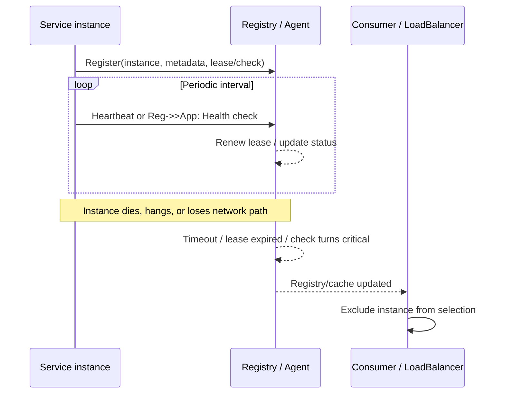

# Failure Detection Mechanisms: Heartbeats, Health Checks, and Sessions

In microservice systems, a registry can only advertise instances it believes are still active. When an instance hangs, loses network connectivity, or can no longer process requests, its registration data can become stale. Heartbeats, health checks, and sessions/leases help detect those conditions, yet each mechanism observes a different aspect and carries latency.

In Spring Cloud, `DiscoveryClient` reads instance lists from the registry and `ServiceRegistry` provides registration/deregistration operations. An instance merely appearing in the list does not prove it is ready to serve. To route traffic safely, you must understand how the registry verifies liveness, how applications report status, and how clients react when data lags.

## 1. Distinguishing heartbeats, health checks, leases, and sessions

| Mechanism | Who sends/checks? | What it proves | What it does not prove |
|---|---|---|---|
| Heartbeat | Application or agent sends periodic signals to registry/agent | The sender could still communicate with the receiver at the time of sending | Does not guarantee business logic, databases, or other dependencies are healthy |
| Active health check | Registry/agent invokes HTTP, TCP, gRPC, or a script against the instance | The instance answered the probe per configured criteria | Does not guarantee every real request succeeds or all dependencies are fine |
| Lease | Registry grants a registration validity period; client must renew before expiration | Permission to appear in the registry remains valid within the renewal window | Not a persistent TCP connection and not a guarantee the instance handles requests well |
| Session | A lifecycle-bound object with an ID; in Consul, sessions can attach to nodes, health checks, TTLs, and distributed locks | The session remains valid under its declared conditions | Not equivalent to an HTTP session, socket, or service registration lease in every registry |
| Liveness | Application reports whether the process is still alive and able to continue running | The process has not entered a state requiring restart | Does not mean the application is ready to accept traffic |
| Readiness | Application reports whether it can accept new requests | The instance currently meets serving conditions per readiness policy | Does not mean the process is dead if readiness fails |

Heartbeats are typically a push mechanism: the instance proactively notifies the registry. Active health checks are a pull mechanism: the registry or agent calls into the instance. A system may use either or combine both.

A lease is how a registry bounds the validity duration of a registration. If no renewal arrives within the allotted period, the registry can mark or evict the instance. A Consul Session is a distinct concept, typically used to bind health checks to distributed locks. Do not lump all of these mechanisms together as "connection sessions".

## 2. Why does failure detection always have latency?

In distributed environments, a registry cannot directly inspect the internal state of a process on another machine. A delayed heartbeat may occur because the process died, yet it can also result from network congestion, garbage collection pauses, CPU saturation, agent restarts, or a busy registry. Therefore, a missing signal is not absolute proof that the process is dead.

Every mechanism needs a timeout window or failure threshold. Setting thresholds too short lets brief network hiccups cause healthy instances to be flagged as failed (false positives). Setting them too long lets dead instances remain in the registry receiving traffic (false negatives from a routing standpoint).

The time from when a failure occurs until clients stop selecting the instance typically consists of several parts:

1. Wait time until the next heartbeat or health check.
2. Probe timeout and the required number of consecutive failures.
3. Lease expiration time or registry status transition time.
4. Registry cache/replication update time and client-side cache refresh time.
5. Time for the load balancer to pick up the updated list and stop choosing that instance.

There is no single universal number across all registries. Measure end-to-end against your exact configuration, because shortening only the heartbeat interval does not automatically speed up caches and state propagation proportionally.



## 3. Eureka: heartbeats renewing leases

With Spring Cloud Netflix Eureka, when a Eureka Client registers, it sends metadata such as application name, host, port, and instance details. The client then periodically sends heartbeats to renew its lease. If the server receives no heartbeat within the lease duration, the instance may be evicted from the registry.

Common default values published by Spring Cloud Netflix:

| Property | Default value | Meaning |
|---|---:|---|
| `eureka.instance.lease-renewal-interval-in-seconds` | `30` seconds | Client heartbeat sending interval |
| `eureka.instance.lease-expiration-duration-in-seconds` | `90` seconds | Time the server waits since the last heartbeat before the lease can expire |

Lease expiration must be greater than the renewal interval. If you change these two values, consider network latency, GC pauses, Eureka Server load, and client-side registry fetch intervals. Lowering the renewal interval too far can overload the registry and violate internal renewal-rate assumptions.

Illustrative configuration in `application.yml`:

```yaml
eureka:
  instance:
    lease-renewal-interval-in-seconds: 30
    lease-expiration-duration-in-seconds: 90
```

These are the defaults written out explicitly so operators can see the active policy. In most deployments, keep the defaults until you have measured and verified a need to change them.

### 3.1. Self-preservation and why the registry may retain stale instances

Eureka has a self-preservation mechanism. When incoming heartbeats drop sharply below the expected threshold, the server can temporarily pause bulk evictions to protect the registry in case a network partition occurs or many clients lose connectivity simultaneously. This prevents accidentally wiping out most of the registry due to a widespread network glitch.

In return, during self-preservation, the registry may continue returning instances that have genuinely stopped. Consumers must tolerate this with sensible connection/response timeouts, bounded retries, and falling back to another instance when appropriate. Retries must avoid creating request storms when the entire cluster is degraded.

Do not disable self-preservation merely to make instances disappear faster. If you consider changing it, evaluate network topology, consumer fault tolerance, renewal thresholds, and how self-preservation state is monitored.

### 3.2. Heartbeats do not equal readiness

Eureka heartbeats primarily confirm the client can still communicate and renew its lease. An instance can keep sending heartbeats while its thread pool is exhausted, queues are full, or business dependencies are unusable. If health status must influence discovery, integrate health/status callbacks via the mechanism Eureka Client supports and verify how that status is published, cached, and consumed.

Never assume that merely adding Spring Boot Actuator makes Eureka automatically exclude every unready instance. Specifically test the status sent to the registry and consumer behavior.

## 4. Consul: active health checks and TTL heartbeats

Spring Cloud Consul registers services with a Consul Agent. Under Spring Cloud Consul's default configuration, the agent creates an HTTP health check calling `/actuator/health` every 10 seconds. If the check fails, the instance is marked `critical`. The path and interval are configurable.

Example HTTP health check configuration:

```yaml
spring:
  cloud:
    consul:
      host: localhost
      port: 8500
      discovery:
        health-check-path: /actuator/health
        health-check-interval: 10s
```

Ensure the actual endpoint matches the application's context path and management port. If Actuator runs on a separate port or under `/admin`, the default URL may be unreachable from the Consul Agent. Health checks must also be secured properly: the agent needs permission to call the endpoint, while the endpoint should not leak sensitive details.

### 4.1. TTL checks: application actively sends heartbeats

Consul supports TTL checks. Instead of the agent calling the application, the application sends heartbeats to the Consul Agent to refresh the TTL status. Spring Cloud Consul can enable this mechanism; according to current property documentation, heartbeat integration is disabled by default and the default TTL is 30 seconds.

Example enabling TTL heartbeats:

```yaml
spring:
  cloud:
    consul:
      discovery:
        heartbeat:
          enabled: true
          ttl: 30s
          use-actuator-health: true
```

When using TTL checks, the application must continue sending heartbeats on time. Without renewal, the check transitions to critical per Consul's TTL rules. `use-actuator-health: true` lets Spring Cloud Consul derive the reported status from Actuator Health when the appropriate endpoint is available.

TTL checks are an alternative to the default HTTP check in discovery configuration; do not assume both mechanisms add up to calculate failure detection time. Verify which check is actually registered in Consul and inspect live status via Consul's UI/API.

Spring Cloud Consul provides `heartbeat.reregister-service-on-failure` to allow attempting service re-registration when heartbeats fail under configured conditions. This feature is disabled by default. Re-registration only restores metadata when the root cause matches; it cannot fix a hung application or a disconnected agent/cluster.

### 4.2. Critical, passing, and deregistration

Consul health check status affects how services are queried. Consumers should query instances in `passing` state when they require only healthy endpoints. A check turning `critical` does not mean the record is immediately deleted from the catalog; the record may remain for visibility and recovery.

Spring Cloud Consul supports `health-check-critical-timeout` to instruct Consul to automatically deregister a service if it remains critical past the timeout, provided the Consul version supports it. This is a cleanup policy for long-dead records, not an initial failure-detection timeout. Consider service self-recovery capabilities and re-registration procedures before configuring it.

## 5. Consul Session: sessions tied to health checks and distributed locks

A Consul Session is an object with an ID, created with a node, a list of health checks, an optional TTL, an invalidation behavior, and a lock delay. Applications commonly combine sessions with Consul KV to build distributed locks or leader election.

A session can be invalidated when its node is deregistered, an associated health check is removed or turns `critical`, the session is destroyed, or its TTL expires if configured. When a session is invalidated, associated locks are handled according to `Behavior`:

- `release`: unlocks the key so another process can acquire it.
- `delete`: deletes the locked key.

`LockDelay` delays lock re-acquisition after a session is invalidated, creating a grace window for the previous owner to realize ownership was lost and stop work. This reduces the chance of two processes acting simultaneously, though it does not replace fencing tokens or target-system ownership checks for workloads requiring strong consistency.

A session's TTL bounds how long the session stays valid without renewal; it is not the TTL of a service registration. A service can register with Consul without using Consul Sessions. Conversely, sessions can be used for distributed locking completely unrelated to how consumers locate service endpoints.

Example creating a session via the Consul HTTP API (illustrative, not Spring Cloud Discovery configuration):

```json
{
  "Name": "inventory-leader-lock",
  "TTL": "30s",
  "LockDelay": "15s",
  "Behavior": "release"
}
```

Consul returns a session ID. The client must renew the session before the TTL expires; otherwise, the session may be invalidated and the lock processed per the chosen behavior. The TTL is only the earliest point at which invalidation can happen; Consul may process it later. Therefore, renew ahead of time and account for network delay, clock skew, and leader failover.

Do not use session TTL as the sole mechanism deciding whether a service receives traffic. Use health checks/registrations for discovery and sessions for locking or related coordination purposes.

## 6. Spring Boot Actuator: separating liveness from readiness

Spring Boot Actuator provides health endpoints and health groups for liveness/readiness in probe-capable environments. These two states answer different questions:

| State | Question | Typical action on failure |
|---|---|---|
| Liveness | Is the process still functioning well enough to stay running? | Platforms like Kubernetes may restart the container |
| Readiness | Can the instance accept new requests right now? | Load balancers/orchestrators stop sending new traffic to the instance |

Do not arbitrarily include external dependencies such as databases, brokers, or registries in liveness probes. If a database briefly loses connectivity, continuously restarting all application instances can worsen the outage. Readiness may consider essential dependencies if the service truly cannot serve traffic when that dependency fails.

Minimal configuration example to enable probe endpoints in `application.yml`:

```yaml
management:
  endpoints:
    web:
      exposure:
        include: health,info
  endpoint:
    health:
      probes:
        enabled: true
```

Spring Boot provides health group endpoints such as `/actuator/health/liveness` and `/actuator/health/readiness`. If the management port is separate from the server port, evaluate whether probes actually test the real serving path. A healthy management server while the traffic-serving server is hung can produce misleading readiness results.

Health endpoints should return only the minimal data needed by probes. Do not expose detailed health indicators, environment, config, or internal connection details to public networks. Apply appropriate authentication/network policies if endpoints are not meant for arbitrary callers.

### 6.1. Readiness at startup and shutdown

At startup, readiness should transition to `ACCEPTING_TRAFFIC` only after mandatory components are ready. During warm-up, migrations, or cache loading, an instance may be alive yet should not receive requests yet.

During a controlled shutdown, the sensible sequence is:

1. Flip readiness to unready so new requests stop arriving.
2. Stop or deregister the instance from the registry/load balancer according to the integration in use.
3. Wait for in-flight requests to finish within the allowed graceful shutdown window.
4. Close resources and terminate the process.

Spring Boot supports graceful shutdown for embedded web servers. You can configure the wait time for in-flight requests:

```yaml
server:
  shutdown: graceful
spring:
  lifecycle:
    timeout-per-shutdown-phase: 30s
```

Web server graceful shutdown alone does not guarantee every registry/cache updates instantaneously. Verify that the registry client deregisters when the context closes, the orchestrator sends the right signal, readiness is lowered before the process terminates, and the platform's termination grace period is long enough.

## 7. Network connections are not health checks

An open TCP connection does not prove a service can still process requests. A connection may stay open while application threads are deadlocked; conversely, a connection may be reset even when the service is healthy and able to accept new connections.

TCP keepalives, HTTP connection pool validation, and client timeouts help detect or bound faulty transport-layer connections. They complement health checks rather than replacing application health checks or registry leases.

Consumers should configure appropriate timeouts separately:

- Connect timeout: bounds the time to establish a connection to an instance.
- Response/read timeout: bounds the time waiting for a response.
- Pool idle/lifetime: avoids holding connections longer than proxy/server timeouts.
- Retries: bound attempt counts, retry only safe or idempotent operations; add backoff and jitter.

Request timeouts must be shorter than the caller's tolerance budget. Retries must not exceed the overall time budget and must not automatically repeat write commands that may already have succeeded on the server.

## 8. Choosing failure detection intervals and thresholds

There is no single heartbeat configuration suited to every system. Start from recovery objectives (RTO), registry load, and false-positive tolerance. Practical principles:

1. Set timeouts above normal latency with safety margin for GC pauses, CPU contention, and networking.
2. Use multiple independent signals when false-positive risk is high, while avoiding heavy health checks that deeply query every dependency at high frequency.
3. Keep lease/heartbeat intervals consistent between clients and the registry; never set expiration shorter than the renewal interval.
4. Synchronize clocks across nodes; for TTLs/sessions, account for clock skew and renew early.
5. Configure consumer timeouts and retry policies so a failing instance does not stall requests excessively.
6. Measure the time from kill/partition until the instance disappears from discovery results, rather than only measuring when a check turns critical.
7. Test graceful shutdowns, process crashes, network partitions, and overload; each scenario can produce different registry states.

## 9. Monitoring and troubleshooting registry drift

When the registry returns an unusable instance, inspect along this chain:

| Observation | Question to answer | Investigation direction |
|---|---|---|
| Heartbeats delayed or missing | Can the client still send heartbeats? | Client logs, connectivity to registry/agent, DNS, firewall, CPU, and GC pauses |
| Health check turns critical | Is the endpoint reachable from the agent itself? | URL/path/port, timeout, TLS, auth headers, management context path, and Actuator logs |
| Eureka still returns stale instance | Did the server enter self-preservation? | Renewal rate, renewal threshold, peer replication, and consumer cache |
| Consul retains long-lived critical record | Is deregister critical timeout configured? | Check status, critical timeout, Consul version, and re-registration policy |
| One consumer still calls an evicted instance | Which cache is the consumer using and when did it refresh? | Registry fetch interval, client-side cache, load balancer cache, and DNS cache |
| Healthy instance gets evicted | Are thresholds/timeouts too sensitive? | Networking, pause times, check timeout, registry load, and renewal interval |

Metrics to monitor include instance count by service and status, received heartbeats/renewals, passing/critical check ratios, time from failure to eviction/deregistration, re-registration counts, failed requests per instance, consumer timeouts/retries, and Eureka's self-preservation state.

For Consul, compare the catalog against health state: an existing record in critical state differs from a deregistered record. For Eureka, inspect both the server-side registry and consumer-side registry cache; they can diverge during replication/fetch windows. Never conclude data is wrong from a single screen or single query.

## 10. Hands-on failure detection verification

With a service registered in Eureka or Consul, run isolated tests in a development environment:

1. Start two instances with the same service name and verify the consumer sees both.
2. Stop one instance via graceful shutdown; observe readiness, deregistration, and time until the instance disappears from discovery.
3. Kill a process abruptly; measure how long heartbeats/leases or health checks take to detect the failure.
4. Temporarily block network traffic from an instance to the registry while keeping its business port running; observe how the registry and consumer react.
5. Make readiness fail while liveness stays healthy; confirm the instance stops receiving new traffic without the process restarting.
6. Restore the network or health endpoint; check whether the instance re-registers and the consumer picks it up again.
7. With Consul Session, create a test lock, stop renewing the session, and verify the lock is released/deleted per the configured behavior after invalidation.

Do not run network partition or process-kill tests in production without an impact-control plan. Record timestamps at each milestone: incident start, check/lease state transition, registry update, and final request reaching the instance.

## 11. Implementation checklist

- [ ] Clearly identified the mechanism in use: Eureka lease, Consul HTTP check, or Consul TTL check.
- [ ] Distinguished liveness from readiness and identified which dependencies affect readiness.
- [ ] Health endpoint has the right path, port, timeout, TLS, and access permissions from the registry/agent.
- [ ] Lease expiration exceeds renewal interval; TTLs are renewed ahead of expiration.
- [ ] Understood Eureka self-preservation behavior and Consul critical/deregister states.
- [ ] Consul Session is used only for locks/coordination needing sessions; behavior, TTL, and lock delay are configured appropriately.
- [ ] Consumers have connect/read timeouts, bounded retries, and the ability to handle stale instances.
- [ ] Graceful shutdown lowers readiness and allows deregistration before the process exits.
- [ ] Metrics/logs exist to measure failure detection time and detect registry/cache drift.
- [ ] Tested crashes, shutdowns, overload, and network partitions in a test environment.

## References

- [Spring Cloud Netflix — Registering with Eureka and heartbeats](https://docs.spring.io/spring-cloud-netflix/reference/spring-cloud-netflix.html)
- [Spring Cloud Netflix — Configuration Properties](https://docs.spring.io/spring-cloud-netflix/reference/configprops.html)
- [Netflix Eureka — Server Self Preservation Mode](https://github.com/Netflix/eureka/wiki/Server-Self-Preservation-Mode)
- [Spring Cloud Consul — Service Discovery and health checks](https://docs.spring.io/spring-cloud-consul/reference/discovery.html)
- [Spring Cloud Consul — Common Application Properties](https://docs.spring.io/spring-cloud-consul/reference/appendix.html)
- [Spring Boot Actuator — Kubernetes Probes](https://docs.spring.io/spring-boot/reference/actuator/endpoints.html)
- [Consul — Sessions and Distributed Locks](https://developer.hashicorp.com/consul/docs/automate/session)
- [Consul — Session HTTP API](https://developer.hashicorp.com/consul/api-docs/session)
