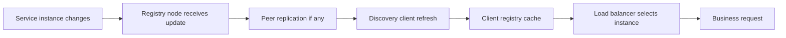
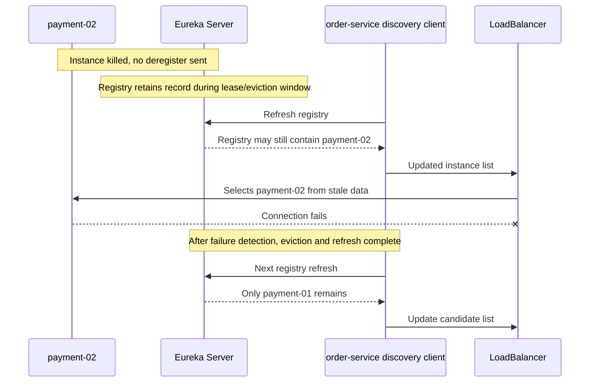

# Change Propagation Latency and Eventual Consistency

In microservice systems, service discovery data changes continuously: new instances register, old instances stop, health statuses change, or a group of services rolls out a new version. Consumers need to know about these changes so they pick valid addresses when sending requests. However, registry updates do not always appear simultaneously across every Eureka Server, Consul agent, discovery client, and load balancer.

The delay between when a change is recorded and when relevant components observe that change is called **propagation latency**. In distributed environments, replicas and caches can temporarily hold different data. Provided the system keeps operating, connectivity recovers, and no new conflicting changes arrive, replicas can gradually converge toward the same state. That is the meaning of **eventual consistency**.

In Spring Cloud, `DiscoveryClient` offers a uniform way to look up instances on the application side, while how the registry updates, replicates data, and refreshes caches depends on implementations such as Eureka or Consul. Consequently, consumers must be designed to tolerate a window of stale data rather than assuming a registry change takes effect instantaneously system-wide.

## 1. Why don't registry changes appear everywhere immediately?

Service discovery typically spans multiple layers. A change must traverse these layers before all consumers can use the updated data:

1. **Service instance:** the application starts, registers, sends heartbeats, changes status, or deregisters.
2. **Registry server/agent:** the component that receives requests, authenticates, and updates registration data.
3. **Other registry nodes:** in multi-node deployments, changes may need to be replicated or synced to peers.
4. **Discovery client:** the client fetches service lists or receives updates from the registry and updates its local cache.
5. **Load balancer or service-calling layer:** the instance-selection component may maintain its own cache or candidate list.

Each layer has its own update interval, queues, timeouts, and error policies. An instance may have registered successfully on one node while a consumer still reads a stale cache. Likewise, an instance may have deregistered in the registry while a consumer still holds its address in memory.

The diagram depicts the conceptual path. Some implementations may merge the agent and registry, use watch/event mechanisms, or cache across multiple layers. Not every system includes every step in this exact order.

## 2. Types of changes and how they propagate

Not all discovery changes have the same convergence time. Distinguish at least four scenarios.

| Change | What happens on provider/registry | What consumers may experience |
|---|---|---|
| New instance registration | Instance sends registration info and registry adds the record. | Consumers do not see the new instance until data replicates and caches refresh. |
| Metadata or status update | Provider publishes updated info or changes status. | Some consumers may continue seeing old status/metadata for a period of time. |
| Graceful deregistration | Instance sends a deregister request or is marked out of service. | Consumers may keep picking the instance from stale cache until the next refresh. |
| Abrupt instance loss | No deregistration can be sent; registry must rely on heartbeats, leases, or health checks to detect it. | Dead addresses may linger longer than in a controlled shutdown. |

New registrations and controlled deregistrations typically begin with an explicit write operation. When an instance dies abruptly, the system needs time to infer that the record is no longer valid. With leases, detection delay relates to heartbeat interval, lease duration, and eviction interval. With health checks, it also depends on check frequency, failure thresholds, and how status propagates to consumers.

## 3. What is eventual consistency?

Eventual consistency is a property of distributed systems: once an update is accepted, if information propagation continues operating and no new conflicting updates occur, replicas will converge to the corresponding state after a period of time.

For example, `payment-service` has two instances, `payment-01` and `payment-02`. When `payment-02` deregisters, registry node A may remove the record first, node B receives the replication later, and consumer C drops the instance from its cache only on its next refresh. During the convergence window, three places may observe three different states. Once replication and refreshes finish, components consistently reflect that `payment-02` is no longer returned by discovery.

Eventual consistency does not mean stale data fixes itself immediately, nor does it guarantee every request succeeds during the convergence window. Nor does it automatically guarantee all readers observe updates in the same order. If the network stays partitioned, nodes cannot sync, or a client stops refreshing, data can continue diverging.

In service discovery, this leads to a practical rule: **the registry supplies candidate lists based on the discovery data the client currently holds; actual reachability must still be verified at the service-call layer.**

## 4. Sources of latency

### 4.1. Heartbeat intervals and lease durations

Heartbeats indicate the client is still communicating with the registry and wants to keep its registration active. If an instance terminates abruptly, the registry receives no deregister command from it. It must detect missing heartbeats or an expired lease before evicting the record per policy.

With Eureka, clients periodically renew their leases. If no heartbeat arrives within the configured duration, the server can mark the registration expired and eviction handles the record. Common defaults may be heartbeats around 30 seconds and leases around 90 seconds, though these are not eviction-time SLAs. Configuration, scheduling timers, system load, networking, and self-preservation all affect when a record actually disappears.

With Consul, agents can register services alongside health checks. Status updates according to check intervals and configured thresholds; service discovery can filter or return services by required health status. Detection time depends on check type and specific configuration.

Heartbeats and health checks also carry different meanings. Heartbeats confirm the client is renewing its registration; health checks evaluate system-defined health conditions. A process still sending heartbeats while a critical dependency has failed may not be reflected accurately unless the application integrates appropriate health status reporting.

### 4.2. Peer replication between registry nodes

When running multiple registry nodes for high availability, changes may need to propagate among nodes. During replication, a consumer reading node A may see a new record while a consumer reading node B does not yet see it.

Eureka supports peer replication across Eureka Servers. Each node maintains a registry and exchanges updates with peers; peer replication lag or connection errors can cause temporary data divergence. If a node becomes isolated, the state it serves can grow stale until connectivity restores and data synchronizes.

Consul uses a server/agent architecture and catalog state synchronization mechanisms. Read behavior and consistency guarantees depend on the query type, queried node, and Consul consistency mode. Do not assume every discovery API across every registry shares the same synchronization contract.

### 4.3. Discovery client cache refreshes

To reduce requests to the registry and avoid hitting the registry on every business request, discovery clients usually retain local data. Clients may fetch the full registry, fetch deltas, or use watches/blocking queries depending on the implementation.

With Eureka clients, the registry cache refreshes on a periodic interval. Consumers may keep using the previously fetched list while the server has already changed. With Consul, applications or integrations can use blocking queries/indexes or watches to wait for changes; that can cut down wasteful polling while still requiring reconnection and cache handling.

### 4.4. Caching at the load-balancing and application layers

Even after `DiscoveryClient` receives a new registry state, the service-calling component may still hold its own instance list or selection state. Spring Cloud LoadBalancer can use caching to reduce repeated lookups. Applications may also store `ServiceInstance`, URLs, or client objects in memory themselves.

If multiple layers cache data simultaneously, total change-visibility latency can exceed the registry client's refresh interval alone. When troubleshooting, inspect every layer that holds instance lists, not just the Eureka or Consul dashboard.

## 5. Estimating convergence time

You can break latency down segment by segment instead of searching for a single system-wide number.

For a newly registered instance, the time until a consumer sees the change can be decomposed conceptually as:

\[
T_{visible} \approx T_{register} + T_{replication} + T_{client-refresh} + T_{lb-cache}
\]

Where:

- `T_register`: time for the registry to receive and apply the registration.
- `T_replication`: time for the change to propagate to the node the consumer uses; 0 or not applicable if there is no replication.
- `T_client_refresh`: time until the discovery client's next refresh or until a watch/query returns.
- `T_lb_cache`: time until the load balancer's cache or instance list reflects the new data.

This is an analytical model, not an exact SLA formula. Steps may run in parallel or overlap; retries, timeouts, and network errors can lengthen total duration.

For an abruptly crashed instance, removal time also typically depends on failure detection time:

\[
T_{remove} \approx T_{failure-detection} + T_{registry-update} + T_{replication} + T_{client-refresh} + T_{lb-cache}
\]

`T_failure-detection` may be the lease expiration wait time, health check failure confirmation time, or another signal. During a graceful shutdown with successful deregistration, the failure-detection component can be replaced by deregister command processing time.

To measure in practice, record timestamps: when the provider starts registering/deregistering, when the registry applies the update, when peers reflect the change, when the discovery client observes the change, and when the first request uses the new list. Measure across multiple deployments and consumers to obtain p50/p95/p99 distributions rather than relying on a single trial.

## 6. Example: consumer calls an instance that just stopped

Suppose `order-service` caches two instances of `payment-service`: `payment-01` and `payment-02`. `payment-02` stops abruptly because its container is killed.

This is an illustrative scenario. Exact ordering and the number of failed requests depend on kill timing, lease intervals, caches, retries, and how the load balancer handles errors. Never assume the consumer will automatically evict an instance right after one failed request unless the application explicitly configures such a mechanism.

## 7. Designing consumers to tolerate stale discovery data

### 7.1. Explicit timeouts

Every request to an instance needs appropriate connect and response timeouts. If an address is stale, timeouts bound how long the consumer waits to connect. Timeouts must align with business SLAs and valid provider processing times.

Do not set timeouts so long that requests stall indefinitely, nor so short that false errors spike under heavy load. Monitor actual latencies and tune per request type.

### 7.2. Bounded retries with backoff

Retries can resend a request to a healthy instance after an initial pick fails. However, retries need attempt limits, backoff, and jitter to prevent many consumers from creating load spikes simultaneously when the registry or a service is degraded.

Retry only requests with safe semantics. For writes or payments, retries can cause duplicate side effects if the provider processed the request yet the response was lost. Use idempotency keys or business-layer deduplication before retrying such operations.

### 7.3. Circuit breakers and bulkheads

Circuit breakers temporarily pause calls to a persistently failing dependency, cutting down futile requests and wait times. Bulkheads isolate resources per dependency so one service's failure does not exhaust all consumer threads or connection pools.

A circuit breaker does not fix the registry. It protects the call flow while discovery and instance state converge; when the dependency recovers, half-open policies and controlled retries allow probing again.

### 7.4. Intentional refresh and caching

Tuning refresh intervals or cache TTLs can shorten change-visibility latency, yet overly frequent refreshes increase registry and network load. Caching too long retains stale instances; caching too briefly increases lookups and sensitivity to registry outages.

Identify clearly where caches live: the registry client, Spring Cloud LoadBalancer, gateway, or custom layers. Base configuration on the exact Spring Cloud version and discovery provider in use, because property names and behaviors vary across versions.

### 7.5. Handling empty instance lists

Consumers must handle empty lists when a service has not registered yet, all instances are marked unhealthy, or caches lack data. Never silently map an empty list to an arbitrary hardcoded address. Depending on business requirements, return a temporary dependency error, use a designed fallback, or enqueue the request.

## 8. Designing providers to shorten dead-instance removal time

### 8.1. Graceful shutdown and deregistration

During a controlled stop, an instance should stop accepting new traffic, complete in-flight requests, and deregister from the registry before the process exits. Exact sequencing depends on the framework and deployment platform, yet the goal is creating a drain window so consumers stop selecting the instance before the address stops serving.

With Eureka, you can use `OUT_OF_SERVICE` status during maintenance/deployment workflows if the system integrates status transitions and leaves time for clients to observe the change. During normal shutdown, the Eureka client can also send a deregister request. With Consul, you can deregister the service or adjust health checks per deployment workflow.

### 8.2. Readiness differs from liveness

Readiness tells whether an instance should receive new requests. Liveness tells whether the process is still running or needs restarting. Using a single health endpoint for both lets a transient dependency glitch trigger repeated restarts or premature evictions.

Design health checks around each signal's role. If a dependency is mandatory to serve requests, readiness may reflect it; if a dependency affects only a secondary feature, avoid letting it evict the entire instance from the registry.

### 8.3. Coordinating with orchestration

In Kubernetes or similar platforms, readiness probes, preStop hooks, and termination grace periods can coordinate with deregistration and draining. When a pod is deleted, allow enough time so the endpoint stops being selected, in-flight requests complete, and the registry updates status.

Never assume a readiness probe automatically updates Eureka or Consul without an integration in place. Verify explicitly which component translates health state into service registration status.

## 9. Differences to note between Eureka and Consul

`DiscoveryClient` lets applications call discovery through a common abstraction, yet does not give all registries identical semantics.

| Aspect | Eureka | Consul |
|---|---|---|
| Registration | Eureka client registers `InstanceInfo` with Eureka Server. | Service registers with Consul agent/catalog per configuration. |
| Status maintenance | Heartbeats renew leases; server applies eviction and self-preservation. | Health checks and participating service/agent status updates determine service health. |
| Multi-node sync | Eureka Servers exchange registry state with peers. | Consul maintains its catalog via server cluster and agents; query consistency depends on read mode. |
| Consumer updates | Eureka client fetches registry and refreshes cache periodically, optionally using deltas. | Can use queries, blocking queries/indexes, or watches depending on API and integration. |
| Operational implications | Pay attention to leases, eviction, self-preservation, and registry caches. | Pay attention to health checks, agent/server health, query consistency, indexes/watches, and client caches. |

This table outlines conceptual differences. Exact configuration and propagation timings depend on library versions, deployment setup, and the APIs used by the Spring Cloud integration. When migrating from Eureka to Consul or vice versa, re-verify timeouts, health behavior, caching, and change observability.

## 10. Observing and testing propagation latency

To confirm the system converges within desired operational bounds, monitor multiple layers instead of checking only instance counts on a dashboard.

Metrics and events to observe:

- Registration, status update, and deregistration timestamps on providers.
- Time the registry accepts updates and peer replication status.
- Time the discovery client receives updated registry data or watch events.
- Cache data age if exposed by the implementation.
- Failed requests due to connection refused, timeouts, or unresolved hosts.
- Retry counts, open circuit breakers, and fallback request rates.
- Counts of `UP`, `OUT_OF_SERVICE`, unhealthy, or lease-expired instances per service.
- Instance count discrepancies across registry nodes and across consumers.

A test you can run in a staging environment:

1. Record the initial instance list for a service.
2. Register a new instance and measure the time until multiple consumers see it.
3. Transition an instance to non-serving status and measure how long consumers take to stop picking it.
4. Abruptly stop an instance in the test environment and measure how long the registry takes to remove the record.
5. Repeat with multiple registry nodes or while a consumer temporarily loses connectivity.
6. Compare p50/p95/p99 latencies, request failure rates, and extra load caused by refreshes/retries.

Tests must use safe probe requests with bounded load. The goal is observing actual behavior of your running configuration, not inferring SLAs solely from documentation defaults.

## 11. Design and operations checklist

- Define the maximum acceptable time for consumers to see new instances and stop selecting departed instances.
- Document heartbeat, lease, health check, registry refresh, and load balancer cache intervals.
- Verify peer replication and convergence after network connectivity between registry nodes recovers.
- Use graceful shutdown, readiness, and draining to minimize requests hitting stopping instances.
- Configure timeouts, bounded retries, backoff, jitter, and circuit breakers suited to business semantics.
- Retry write operations only when idempotency or deduplication safeguards exist.
- Handle empty instance lists and missing metadata explicitly.
- Monitor connection errors toward removed instances and how long caches retain stale records.
- Measure convergence latency across multiple consumers and registry nodes under load, network faults, and rollouts.
- Cross-check documentation for the exact versions of Eureka, Consul, and Spring Cloud before altering refresh or health check parameters.

## Conclusion

Propagation latency occurs because service discovery changes must flow through the registry, replication, discovery clients, caches, and the load-balancing layer. Meanwhile, consumers can temporarily see different versions of the registry. Eventual consistency describes the ability of replicas to converge as the system keeps exchanging data without conflicting updates; it does not guarantee every request succeeds during the convergence window.

A resilient Spring Cloud system combines discovery with health/readiness probes, graceful deregistration, timeouts, safe retries, circuit breakers, and latency observability. Measure the actual convergence time of Eureka or Consul in your deployed topology, then pick refresh intervals and service-calling policies aligned with operational requirements.
