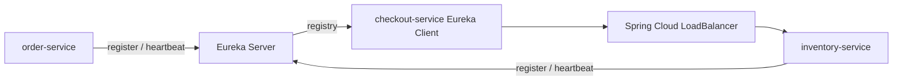
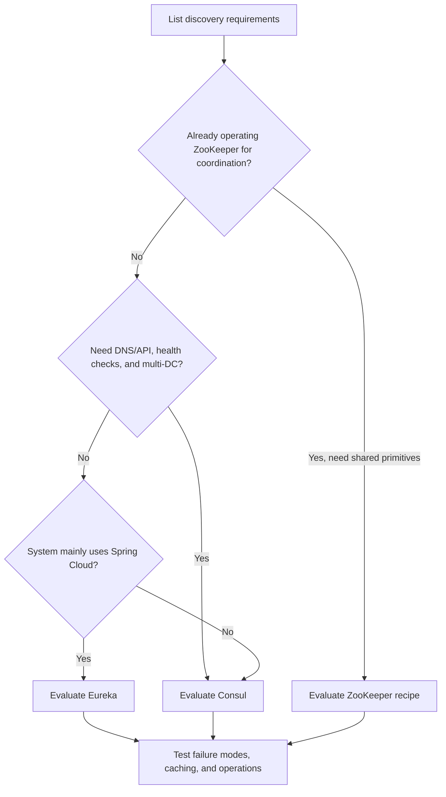

# Comparing Eureka, Consul, and ZooKeeper by System Requirements

## 1. Starting from service discovery requirements

In microservice systems, service discovery helps one service locate instances providing another service without hardcoding IP addresses and ports in source code. When an instance is created, replaced, or stopped, the registry must reflect that change so consumers can pick valid call targets.

Spring Cloud provides abstractions such as `DiscoveryClient` for querying instances and `ServiceRegistry` for registering instances. Eureka, Consul, and ZooKeeper can all help solve this problem, yet they were designed with different goals and operational models. Therefore, choosing among them should not rest solely on popularity or feature count; start from requirements around availability, consistency, health checks, security, multi-region support, and operational capacity.

One distinction must be clear from the start: Eureka and Consul are purpose-built to provide service registries/discovery. ZooKeeper is primarily a distributed coordination service; service discovery is typically built atop its primitives such as ephemeral znodes, sessions, and watches. All three can help locate instances, yet their developer experience and operational cost differ considerably.

## 2. Quick overview

| Criterion | Eureka | Consul | ZooKeeper |
|---|---|---|---|
| Design goal | Service registry and discovery | Service networking, registry, health, and configuration | Distributed coordination, structured metadata, and synchronization |
| Common registration method | Eureka Client registers directly with Eureka Server | Service registers with Consul Agent on the node; agent updates catalog | App or library creates an ephemeral znode following a convention |
| Discovery method | Eureka API and client-side registry cache | HTTP API or DNS interface | Clients read znodes and monitor with watches |
| Health checks | Heartbeat/lease; can integrate health indicators | Built-in HTTP, TCP, gRPC, script, or TTL checks per configuration | Usually inferred from session/ephemeral node or custom-built health checks |
| Data synchronization | Peer replication and client caching; may incur lag | Catalog managed via agents and servers; writes use Raft, reads support consistency modes | Ensemble uses Zab; writes require quorum, sessions and watches provide coordination |
| Load balancing | Typically paired with Spring Cloud LoadBalancer on the client side | DNS, API, or load balancer/proxy integration | No full application load balancing out of the box; consumers pick instances themselves |
| Bundled features | Focused on the registry | ACLs, KV, multi-datacenter, Consul Connect/service mesh | Znodes, watches, locks, leader election, barriers, and coordination recipes |
| Standout fit | Spring applications needing simple discovery | Systems needing health checks, DNS, ACLs, and multi-region connectivity | Systems needing coordination primitives or already running ZooKeeper |

The table above is an architectural orientation, not an absolute ranking. Exact behavior also depends on versions, cluster configuration, client libraries, networking, and how consumers consume discovery data.

## 3. Eureka: a lean choice for service discovery in the Spring ecosystem

### 3.1. How it works

Eureka uses a client/server model. Each service integrates Eureka Client and registers `InstanceInfo` with Eureka Server. Records typically contain application name, instance ID, hostname/IP, port, status, and metadata. Clients send periodic heartbeats to renew their leases; on a normal shutdown, clients can send a deregistration request.

Consumers download the registry from Eureka Server and usually maintain a local cache. When needing to call `inventory-service`, the consumer looks up instances under that application name and uses a client-side selection mechanism. In Spring Cloud, load balancing is typically handled by Spring Cloud LoadBalancer; Eureka provides the instance list rather than executing full business-request load balancing itself.



In multi-server deployments, Eureka peer replication lets nodes exchange registry updates. Data across peers and consumer caches may converge after a delay; never assume all clients observe changes instantaneously.

### 3.2. Health and failure behavior

Heartbeats confirm Eureka Client can still communicate with Eureka Server. They do not prove all business capabilities or service dependencies are healthy. You can integrate Spring Boot Actuator health indicators so instance status better reflects application health.

Lease expiration and eviction remove instances that stop sending heartbeats. However, Eureka includes a self-preservation mechanism: when the server suspects many heartbeats are missing due to a widespread network issue, it can pause eviction to avoid accidentally deleting large numbers of instances. This protects the registry during certain network partitions, yet can also leave dead instances appearing in the registry longer.

If Eureka Server becomes temporarily unreachable, consumers can continue using their previously fetched registry cache. This keeps some requests to known instances working, though new registrations, status changes, and registry updates may lag or fail until connectivity restores. Actual continuity depends on the application's caches, timeouts, and retry policies.

### 3.3. Advantages and limitations

**Advantages**

- Natural integration with Spring Cloud Netflix Eureka Client and Spring discovery APIs.
- Registration, heartbeat, and client caching model is relatively straightforward.
- Fits systems primarily needing instance lookup by service name and client-side load balancing.
- Can continue using cached registry data during certain temporary server disruptions.

**Limitations**

- Focused on the registry; active health checks, DNS service discovery, ACLs, and service mesh are not core built-in features on par with Consul.
- Consistency across peers and caches incurs lag; self-preservation can retain stale instances longer than desired.
- Requires managing Eureka Server, peer replication, networking, and custom security policies.
- Does not replace a load balancer, API gateway, or application observability stack.

**Consider Eureka when:** the team uses Spring Cloud, wants a simple registry, primarily discovers services within one system or deployment domain, and accepts registry caching and convergence latency.

## 4. Consul: service networking with health checks and multiple access paths

### 4.1. How it works

Consul uses an agent/server model. Typically each node runs a Consul Agent. Services can register with the local agent via configuration or HTTP API; the agent forwards updates to Consul servers and the catalog. Consul Servers maintain cluster state using Raft for consensus on writes. Gossip is used for membership and member failure detection across LAN/WAN pools.

Consumers can query the service catalog via HTTP API or DNS interface. This lets applications, scripts, proxies, and diverse platforms consume the same source of truth without requiring a specialized Java client.

### 4.2. Health checks and service mesh

Consul makes health checks a central part of the service catalog. Depending on check type and configuration, Consul can probe HTTP, TCP, or gRPC endpoints, execute scripts, or receive TTL updates pushed by the application. Check results attach to the service/node and can be used to filter for healthy instances when querying.

Consul also offers a KV store and Consul Connect for service-to-service communication in a service mesh model, typically combining sidecar proxies, identities, and mTLS. This is an advantage when system requirements extend beyond locating instance addresses to controlling inter-service connections.

ACLs and TLS support controlling access to agents, APIs, and the cluster. Token policies, certificates, gossip encryption, and authorization still require proper design, rotation, and monitoring.

### 4.3. Consistency and fault tolerance

Consul Servers use Raft consensus for catalog writes and coordination data. This requires the server cluster to maintain quorum to accept writes. Consul supports read modes with differing consistency characteristics; the chosen query mode affects freshness and consistency of read data. Therefore, when the system must guarantee critical decisions rely on the latest state, inspect read modes carefully rather than assuming every DNS/HTTP query offers the same guarantee.

Agents on nodes can continue performing certain local tasks, such as running health checks, when server connectivity is disrupted. However, updating the cluster-wide catalog, performing quorum-dependent operations, or serving the freshest data is constrained by server and network state. Design timeouts, caches, retries, and fallback behavior on consumers.

For multi-datacenter deployments, Consul provides a model connecting datacenters and querying services within appropriate scopes. This helps when systems span multiple sites or deployment regions, yet brings requirements for WAN design, ACLs, replication, and cross-region traffic control.

### 4.4. Advantages and limitations

**Advantages**

- Provides a service catalog paired with rich health checks, filtering out unhealthy instances when queried appropriately.
- Exposes both HTTP API and DNS, making integration straightforward across languages and platforms.
- Includes ACLs, TLS, KV store, multi-datacenter support, and Consul Connect/service mesh.
- Node-agent model supports registering and checking services right where they run.

**Limitations**

- More components and concepts than Eureka; requires operating agents, server quorum, gossip, ACLs, certificates, and health checks.
- When quorum is lost, writes requiring consensus cannot proceed normally.
- Health checks are only useful when properly configured and tied to real readiness criteria; heavy checks or poor thresholds create noise.
- DNS caching and query consistency modes can affect how quickly consumers see changes.

**Consider Consul when:** the system is multi-language or multi-platform, requires integrated health checks, DNS/API discovery, explicit ACLs, multi-datacenter support, or plans to adopt Consul Connect.

## 5. ZooKeeper: a coordination platform where discovery is built from primitives

### 5.1. How it works

ZooKeeper stores data in a hierarchical tree of znodes. Clients can create, read, update, and delete znodes. A znode can be persistent or ephemeral; an ephemeral znode exists only while the client's session remains active and is deleted when the session expires. Sequential znodes can be combined to generate ordered names.

A service discovery recipe might adopt a path convention like:

```text
/services
  /order-service
    /instance-0000000012  -> 10.0.1.12:8081
    /instance-0000000013  -> 10.0.1.13:8081
  /inventory-service
    /instance-0000000007  -> 10.0.2.7:8082
```

When an instance starts, it creates an ephemeral znode holding its address and metadata. Consumers read the child znodes of the target service to retrieve the instance list. When a process disconnects long enough for its session to expire, ZooKeeper deletes the ephemeral znode, thereby signaling the instance is no longer registered.

Clients can set watches to be notified when data or child lists change. Traditional ZooKeeper watches are one-shot: after firing, the client typically must re-read the data and register a new watch. When many clients watch the same parent znode, a change can wake up large numbers of consumers; watches and caches must be designed to avoid thundering-herd spikes.

### 5.2. Coordination and consistency

ZooKeeper uses Zab (ZooKeeper Atomic Broadcast) to preserve update ordering across the ensemble. Write operations require quorum; the system needs enough members to elect/maintain a leader and commit changes. ZooKeeper provides strong coordination guarantees such as ordered updates and atomic operations within its data model.

ZooKeeper is not a full-featured service catalog in the same sense as Consul. It does not natively define service health, DNS discovery, load balancing, or connection policies. Applications or libraries must define znode schemas, session timeouts, instance registration, watch handling, retries, and instance selection.

An ephemeral znode reflects session lifecycle, not comprehensive business health checks. If an application keeps its session alive yet can no longer process requests, the znode may still persist. Deeper health evaluation requires separate health signals or custom probing mechanisms.

### 5.3. Advantages and limitations

**Advantages**

- Provides battle-tested coordination primitives: ephemeral/sequential znodes, watches, locks, leader election, and barriers.
- Session model automatically cleans up registrations when a client disconnects long enough for its session to expire.
- Suitable when the platform already uses ZooKeeper for other coordination tasks and wants to share infrastructure.
- Quorum and Zab provide consensus guarantees for coordination state.

**Limitations**

- Service discovery must be built using recipes or libraries; applications must handle schemas, watches, caches, and sessions.
- Lacks built-in health checks, DNS interface, and service mesh capabilities like Consul.
- Requires careful management of the ensemble, quorum, session timeouts, connection churn, ACLs, and upgrades.
- One-shot watches and large client counts can generate notification storms; avoid letting all consumers react simultaneously without caching or throttling.

**Consider ZooKeeper when:** the system already relies on ZooKeeper for coordination, needs primitives like leader election/locks, or has a proven ZooKeeper-based discovery layer. If the sole goal is brand-new service discovery, factor in the cost of maintaining discovery recipes and operating the ensemble.

## 6. Comparing across architectural requirements

### 6.1. Data freshness and behavior during network loss

| Scenario | Eureka | Consul | ZooKeeper |
|---|---|---|---|
| New instance registers | Server accepts registration; peers and consumer caches may update later | Agent registers service and catalog updates via servers | Client creates znode; consumers re-read or receive watch and refresh cache |
| Instance stops normally | Client sends deregistration | Agent/service deregisters or check status changes | Session closes or ephemeral znode is deleted on session expiration |
| Instance crashes abruptly | Heartbeats stop; lease/eviction handles removal, self-preservation may delay it | Health check or TTL marks unhealthy; catalog/queries reflect updated state | Session expires and ephemeral znode is deleted; timing depends on session timeout and detection |
| Server loses quorum/connectivity | Consumers may use stale cache; registry updates are impacted | Servers cannot accept quorum writes; agents and caches have specific limits | Cannot commit new writes without quorum; clients may lose sessions during prolonged outages |
| Consumer-side data | Registry cache, refreshed periodically | DNS/API queries, caching, and consistency modes | Client caches and watches; must re-read and re-register watches |

You cannot conclude one technology always detects dead instances fastest solely from its product name. Compare heartbeat/lease configurations, health check intervals, TTLs, session timeouts, retries, cache TTLs, network timeouts, and behavior upon quorum loss.

### 6.2. Health checks and instance quality

| Requirement | Eureka | Consul | ZooKeeper |
|---|---|---|---|
| Know client still reaches registry | Heartbeats | Agent/server communication and check status | Session/connection |
| Active HTTP/TCP/gRPC probes | Usually integrated with Actuator or external systems | Built-in checks available | Must be custom-built or paired with external systems |
| Exclude unhealthy instances from queries | Based on instance status and consumer status handling | Can query services filtered by check status | Recipe/consumer defines filtering logic |
| Reflect business dependencies | Must configure appropriate health indicators | Must configure checks reflecting readiness appropriately | Must add separate health signals |

Health checks should reflect ability to accept traffic, not necessarily that every dependency is operational. For instance, a service might keep serving read endpoints when a secondary dependency fails. Distinguish liveness (process alive), readiness (able to accept traffic), and dependency status to avoid evicting instances prematurely or retaining broken instances too long.

### 6.3. Security and access control

| Aspect | Eureka | Consul | ZooKeeper |
|---|---|---|---|
| Authentication/authorization | Typically integrates Spring Security, reverse proxy, or endpoint protection | ACL tokens and policies are core platform features | ACLs on znodes; may use SASL/Kerberos depending on setup |
| Transport encryption | Can configure TLS and protect endpoints | Supports TLS for applicable traffic; gossip encryption configured separately | Can configure TLS and corresponding authentication mechanisms |
| Permission scoping | Must be designed at the application/infrastructure layer protecting Eureka | Can grant permissions per token, service, and resource | Can grant permissions per znode path and operation |
| Operational notes | Protect dashboard/API, credentials, and network | Manage tokens, policies, certificates, gossip keys, and rotation | Manage ACLs, credentials, certificates, and path permissions |

Never leave a registry wide open just because it sits on an internal network. Registries expose system topology, addresses, and metadata; if modified without authorization, attackers could register spoofed instances or hijack service routing.

### 6.4. Operational complexity

| Area | Eureka | Consul | ZooKeeper |
|---|---|---|---|
| Components to operate | Eureka Server and clients | Node agents, Consul Servers, gossip, and Raft | ZooKeeper ensemble and client libraries |
| Things to monitor | Heartbeats, eviction, self-preservation, peer replication, caches | Agent/check status, Raft quorum, gossip, ACLs, DNS/API, WAN federation | Quorum/leader, latency, sessions, watches, connections, disk, and snapshots |
| Custom discovery logic needed | Minimal with Spring Cloud | Minimal for standard registry usage | Higher; depends on recipes and libraries |
| Fit for Spring teams | High | Good via Spring Cloud Consul | Integration exists, yet requires understanding client/recipe internals |

Actual complexity also depends on whether your organization already operates that technology reliably. A team already running Consul smoothly may find Consul easier to operate than a brand-new Eureka cluster; a team with a well-managed ZooKeeper ensemble may leverage it for existing coordination needs.

## 7. Choosing technology by system requirements

### 7.1. Common scenarios

| System requirement | Choice to evaluate first | Reason |
|---|---|---|
| Spring Cloud apps needing registration and lookup by service name | Eureka | Direct integration, simple client-side discovery model |
| Multiple languages needing discovery via DNS and HTTP API | Consul | Offers multiple registry access interfaces |
| Needs HTTP/TCP/gRPC health checks and status-filtered instance lookup | Consul | Health checking is a built-in platform capability |
| Multiple datacenters needing centralized catalog and access policies | Consul | Provides multi-datacenter model and ACLs |
| Needs service-to-service mTLS and proxy mesh | Consul Connect or dedicated mesh solution | Discovery can combine with identity and proxied traffic |
| Already uses ZooKeeper for leader election, locks, and coordination | ZooKeeper may fit | Leverages existing infrastructure and primitives |
| Only needs new service discovery, no coordination needs | Eureka or Consul is usually simpler | Avoids building custom discovery recipes on ZooKeeper |

### 7.2. Reference decision tree



A decision tree only narrows down candidates. Before finalizing, verify consistency requirements, failure detection times, behavior during quorum loss, instance counts, deployment regions, and on-call operational readiness.

## 8. Integration in Spring Cloud

Spring Cloud provides abstractions to decouple applications from any single registry's proprietary API. Common starters include:

```xml
<!-- Eureka -->
<dependency>
    <groupId>org.springframework.cloud</groupId>
    <artifactId>spring-cloud-starter-netflix-eureka-client</artifactId>
</dependency>

<!-- Consul -->
<dependency>
    <groupId>org.springframework.cloud</groupId>
    <artifactId>spring-cloud-starter-consul-discovery</artifactId>
</dependency>

<!-- ZooKeeper -->
<dependency>
    <groupId>org.springframework.cloud</groupId>
    <artifactId>spring-cloud-starter-zookeeper-discovery</artifactId>
</dependency>
```

Add only the starter matching your chosen registry and manage versions through a Spring Cloud release train/BOM compatible with your project's Spring Boot version. Never mix incompatible standalone starter versions.

Consumers can use the `DiscoveryClient` abstraction to list instances:

```java
@Service
public class ServiceLookup {

    private final DiscoveryClient discoveryClient;

    public ServiceLookup(DiscoveryClient discoveryClient) {
        this.discoveryClient = discoveryClient;
    }

    public List<ServiceInstance> findInstances(String serviceId) {
        return discoveryClient.getInstances(serviceId);
    }
}
```

The example above demonstrates looking up instances by service ID. In real HTTP-calling applications, pair with Spring Cloud LoadBalancer or an equivalent mechanism to choose instances and handle timeouts and retries appropriately. Never simply pick the first element of the list and call it complete load balancing.

Connection properties differ per implementation: Eureka uses `eureka.client.service-url.defaultZone`; Consul typically configures the agent's host/port and discovery properties; ZooKeeper typically requires a connection string to the ensemble plus registration/discovery settings. Consult documentation for the exact release train in use, because property names and capabilities can change across versions.

`DiscoveryClient` reduces coupling at the query layer, yet does not give all registries identical semantics. For example, how health updates, consistency, metadata, ACLs, and disconnect handling behave still differ. When switching registries, test operational behavior rather than merely swapping dependencies and URLs.

## 9. Pre-decision checklist

Before selecting Eureka, Consul, or ZooKeeper, the architecture team should answer these questions:

1. **Scale:** how many services, instances, nodes, and datacenters exist? What is the scale-up/down rate?
2. **Freshness:** how long can consumers tolerate a recently dead instance remaining in the registry?
3. **Health:** are simple heartbeats enough, or are HTTP/TCP/gRPC probes, readiness, and dependency checks needed?
4. **Failure modes:** what must keep running when servers, peers, quorum, or the network fail?
5. **Consistency:** which operations require the latest data? Can stale caches be used temporarily?
6. **Traffic:** who selects instances and balances load? Are DNS, proxies, gateways, or a service mesh needed?
7. **Security:** what level of TLS, ACLs/tokens, per-service permissions, or registry audit logging is required?
8. **Topology:** does the system span multiple regions/datacenters or high-latency WAN links?
9. **Operations:** which technology does the team already have experience, monitoring, backups, upgrades, and runbooks for?
10. **Compatibility:** are the starters and registry versions compatible with your current Spring Boot/Spring Cloud versions?

## 10. How to evaluate with hands-on testing

Do not decide solely from synthetic read/write benchmarks. Stand up a small testbed resembling production topology and measure these scenarios:

- Register many instances concurrently and measure how long consumers take to see new instances.
- Perform graceful shutdowns and abrupt process kills; measure how long instances take to vanish from discovery results.
- Disrupt connectivity between clients and the registry, between agents and servers, or between server nodes; observe caching and retries.
- Induce controlled quorum loss in the test environment; verify which operations continue, which are rejected, and how the system recovers.
- Fail a service dependency while keeping the process alive; verify whether health checks remove the instance from traffic as intended.
- Scale up the number of consumers watching changes; measure load generated by polling, DNS queries, or watch notifications.
- Verify ACLs/TLS, credential/certificate rotation, and auditability.

At a minimum, record registration time, unhealthy-instance detection time, registry convergence lag, query error rates, agent/server CPU/memory, network bandwidth, post-partition recovery time, and operational effort. Test results tell you which technology meets your system's SLOs under realistic conditions.

## 11. Selection conclusion

Eureka fits when the focus is straightforward service discovery within the Spring Cloud ecosystem and the team accepts registry caching and convergence latency. Consul fits when discovery is part of broader service networking requiring built-in health checks, DNS/APIs, ACLs, multi-datacenter support, or service mesh. ZooKeeper fits when the system needs coordination primitives or already operates ZooKeeper; using it for greenfield discovery requires careful design of recipes, watches, sessions, and health signals.

There is no single best choice for every system. Base the final decision on SLOs, failure modes, consistency, security, topology, and operational capabilities validated through testing.
