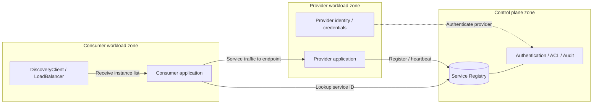

# Registry Threat Model and Trust Boundaries

The service registry is a critical control component in a Spring Cloud Service Discovery system. The registry receives registration information from providers, stores service IDs and instance endpoints, and provides data for consumers to find where to send requests. If the registry or workload identity is compromised, an attacker can divert call destinations, read internal topology, disrupt discovery, or exploit consumers to send requests to unintended endpoints.

The registry must be treated as a separate trust boundary in a microservice architecture. Registry data helps locate addresses, but it does not by itself prove that an instance is valid or that a request is authorized to access business operations. A secure design requires authenticating providers/consumers, authorizing operations, encrypting connections, restricting the network, verifying endpoints, and maintaining resilience when the registry is untrusted or temporarily unavailable.

## 1. Where Does the Registry Sit in the Architecture?

Service discovery has two main flows:

- **Control plane:** providers register/send heartbeats; consumers query the registry; the registry stores and distributes instance information.
- **Data plane:** consumers send HTTP/gRPC requests directly to a selected instance or to an advertised proxy/load balancer.



The registry does not necessarily sit on the path of every business request. A consumer can retrieve instances from a cache and call the provider directly. This has two security consequences:

1. Protecting the registry API alone is not enough; consumer-provider traffic also needs authentication and encryption.
2. When the registry is modified or cached data is poisoned, consumers may continue calling the wrong endpoint even after the registry itself has been restored.

Clearly distinguish the trust boundaries of the registry, each workload, the network, and the service APIs. Do not merge them into a single "internal so trusted" zone.

## 2. Assets to Protect

A threat model begins by identifying assets and the consequences if those assets are disclosed, modified, or made unavailable.

| Asset | Examples | Impact When Compromised |
|---|---|---|
| Workload identity | Service account, client certificate, Consul token | Attacker impersonates a provider or consumer |
| Registration | Service ID, instance ID, host, port, scheme | Requests are routed to a rogue instance or wrong destination |
| Catalog and topology | Service names, namespaces, zones, tags | Internal structure and inter-system relationships are exposed |
| Metadata | Version, zone, capabilities, routing hints | Modified to influence instance selection |
| Registry configuration | ACLs, peers, root paths, health checks | Loss of access control and registry state integrity |
| Secrets and keys | ACL tokens, passwords, TLS private keys | Unauthorized access and connection spoofing |
| Discovery cache | Instance list in client/LoadBalancer | Malicious or stale endpoints continue to be used |
| Audit and events | Who registered, read, or deleted a service | Loss of investigation and attack-detection capability |
| Availability | Registry quorum, API, watch, heartbeat | Microservices cannot find new targets or lose resilience |

Do not protect only passwords. A wrong endpoint registered using valid credentials can still have a major impact if consumers trust it and automatically send requests to that endpoint.

## 3. Actors and Trust Boundaries

Common actors include:

- **Legitimate provider:** an application allowed to register a specific service or group of services.
- **Legitimate consumer:** an application allowed to read required services and call APIs according to policy.
- **Operator:** an administrator managing the registry, ACLs, cluster, and security configuration.
- **Health checker/agent:** a component checking instance status or updating health.
- **CI/CD and secret manager:** systems issuing credentials and deploying configurations and images.
- **Compromised workload:** an application holding valid credentials that has been taken over by an attacker.
- **External attacker:** an adversary trying to access the registry/API or exploit network exposure.
- **Compromised registry:** a server, peer, or datastore whose control has been seized or whose data has been tampered with.

Trust boundaries that must be clearly defined:

| Boundary | Questions to Answer |
|---|---|
| Workload → Registry | Which identity do providers/consumers use to authenticate? |
| Registry → Workload | How does the consumer verify endpoints and server identity? |
| Provider → Consumer | Does the consumer verify the exact service identity or only trust host/port? |
| Registry node → Registry node | Is peer traffic encrypted and authenticated? |
| Workload → Secret manager | Who is issued tokens and with what secret scope? |
| Operator → Control plane | Over which network is administration performed, and what MFA/auditing applies? |
| Cluster/network → Registry | Which ports are exposed and which subnets are allowed access? |

A workload running in the same VPC, subnet, or Kubernetes cluster is still a separate principal. An internal network does not replace authentication and authorization.

## 4. STRIDE Analysis for the Service Registry

STRIDE helps categorize threats by attack behavior:

| Category | Examples in Discovery | Impact |
|---|---|---|
| Spoofing | Registering a fake instance under a valid service ID; spoofing a registry endpoint | Consumer mistakenly calls the attacker |
| Tampering | Modifying host, port, metadata, health state, or ACLs | Routing and permission manipulation |
| Repudiation | No audit trail of who created/deleted a registration | Changes cannot be traced |
| Information disclosure | Reading the entire catalog, hosts, ports, zones, tags | Exposure of topology and attack surface |
| Denial of service | Flooding registrations, lookups, watches, or breaking quorum | Discovery slows down or stops working |
| Elevation of privilege | A catalog-read token can write/delete other services | Workload exceeds granted permissions |

Not all registries have the same features or APIs. STRIDE is a way to list risks; each risk must be mapped to the actual provider, version, and deployment.

## 5. Registration Spoofing or Poisoning

A weakly authenticated provider or one with overly broad catalog write permissions can register a fake instance under another system's service ID. Consumers looking up that service ID will receive an attacker-controlled instance.

Example of poisoned data:

```text
serviceId: payment-service
instanceId: fake-payment-01
host: attacker-controlled.internal
port: 8080
scheme: http
metadata:
  zone: production
```

If the LoadBalancer picks this endpoint, requests can send sensitive data to the attacker or receive fake responses. The risk increases when consumers automatically trust every instance in the registry.

Required controls:

- Authenticate each provider before allowing registration.
- Grant write permissions only for the service IDs or namespaces owned by the workload.
- Use unique instance IDs with naming conventions and auditing.
- Restrict allowed advertised hosts/ports/schemes per environment.
- Do not allow arbitrary metadata to control URLs or HTTP destinations.
- Use TLS/mTLS between consumer and provider; verify identity per service, not merely whether the certificate is valid.
- Monitor new registrations, host/port changes, and anomalous instance appearances.

Consumers should also validate endpoint attributes against system policy. For example, internal services may only be called over HTTPS and on ports in an allowlist. Do not take a scheme, host, or URL from metadata provided by an untrusted source and use it directly.

## 6. Catalog Disclosure and Enumeration

The catalog can reveal service names, hostnames, IPs, ports, zones, versions, and metadata. An attacker who can read the catalog can map the architecture, find administrative services, identify outdated versions, or infer internal network zones.

Reduce risk by:

- Requiring authentication for registry APIs, including read APIs.
- Authorizing consumers to read only the services/namespaces they need.
- Separating catalog-wide operator permissions from runtime permissions.
- Restricting UI endpoints, dashboards, and admin APIs to administrative networks.
- Never storing tokens, passwords, private keys, or sensitive data in metadata.
- Auditing unusual catalog-wide queries and sudden spikes in request volume.
- Using namespaces/root paths/partitions to isolate domains when supported by the provider.

Hiding service names from the UI is not an access control measure. Permissions must be enforced at the registry API or an equivalent protection layer.

## 7. MITM, Registry Spoofing, and Unencrypted Connections

If providers or consumers connect to the registry over unprotected HTTP, an attacker positioned on the network can steal tokens, modify responses, or spoof endpoints. If service traffic also lacks TLS, an attacker can read or alter business data even after discovery completes.

Measures:

- Use TLS for client-registry and peer-registry connections.
- Use mTLS when mutual workload identity verification is required.
- Manage CAs, certificate renewal, truststores, and private keys throughout their lifecycle.
- Verify that the certificate hostname/SAN matches the registry or provider endpoint.
- Do not disable certificate verification in production as a "quick fix" for handshake errors.
- Protect DNS and registry endpoint configurations against unauthorized changes.
- Use TLS for service-to-service traffic; registry TLS does not protect business requests on its own.

During certificate expiration or CA rotation, roll out trust bundles and certificates in a compatible order to avoid disconnecting all clients simultaneously.

## 8. SSRF and Malicious Endpoints from Discovery Data

Consumers may call endpoints supplied by the registry. If an attacker can write registrations or tamper with the catalog, the consumer risks becoming a vehicle for sending requests to unintended internal addresses.

Potential targets include cloud metadata services, admin ports, databases, debug endpoints, or services restricted to internal networks.

This is especially dangerous when an application:

- Accepts a service ID from user input and performs arbitrary lookups.
- Uses a host/URL from metadata to construct an HTTP client.
- Allows registration of any endpoint without checking network zones.
- Allows arbitrary schemes, ports, or hostnames.
- Uses a consumer with broader network access than the services it needs to call.

Controls:

1. Service IDs must be declared dependencies or allowlisted, never taken arbitrarily from user requests.
2. Consumers should only be allowed egress to the subnets/ports of valid services.
3. Validate scheme, hostname, port, and network zone before sending requests if policy requires it.
4. Prevent metadata from becoming a full URL or arbitrary HTTP headers.
5. Use mTLS/service identity to verify the target peer.
6. Block access to link-local, loopback, metadata endpoints, and management networks unless explicitly permitted.
7. Log the service ID and selected endpoint safely for investigation, avoiding logging secrets or sensitive payloads.

Service discovery should not become a general-purpose proxy for arbitrary caller-supplied URLs.

## 9. Compromised Credentials and Excessive Permissions

Provider credentials can be stolen from environment variables, configuration files, logs, images, or CI pipelines. If a token has catalog-wide admin permissions, an attacker can delete services, create rogue instances, or read the topology.

Apply least privilege:

| Principal | Permissions That Should Be Granted | Permissions That Should Not Be Granted by Default |
|---|---|---|
| Provider | Register/update/deregister instances belonging to owned services | Write/delete all services |
| Consumer | Read required services | Register or modify catalog |
| Health checker | Update/query health by design | Registry-wide operator permissions |
| CI/CD | Issue credentials and deploy within pipeline scope | Long-lived full-access runtime tokens |
| Operator | Task-scoped administration with auditing | Sharing admin credentials with applications |

Separate credentials by workload and environment. Use a secret manager or protected secret mount; never commit tokens to source code. When credential exposure is suspected, revoke/rotate them, inspect audit logs, and verify registrations created by those credentials.

## 10. Denial of Service and Registry Availability

The registry can be overloaded by:

- Too many clients polling or fetching the catalog too frequently.
- Registration churn caused by continuously restarting containers.
- Too many open watches/subscriptions or failing to close them according to lifecycle.
- Excessively frequent health checks or unreasonable timeouts.
- Request floods against APIs, UI, or management endpoints.
- Losing quorum or putting pressure on the registry cluster's disk/network.

Measures to reduce load and maintain availability:

- Enforce rate limits, connection limits, and access controls at the network/API gateway or registry where supported.
- Configure timeouts and retries with backoff and jitter; avoid synchronized retry storms.
- Use caching and watches according to provider guidance; do not enumerate the entire catalog on every request.
- Set health check frequency appropriately for failure detection goals.
- Monitor quorum, leader status, disk, memory, request rate, registration churn, and latency.
- Deploy the registry in a supported HA topology; protect peer traffic and backups.
- Design applications with defined behavior when the registry is temporarily unavailable, even while stale cache remains usable.

Adding more registry nodes should not be treated as a sufficient measure on its own. You must verify quorum, failure domains, replication, backup/restore, and upgrade procedures.

## 11. Data Drift, Stale Instances, and Cache Poisoning

An instance may have stopped while still remaining in the cache or registry for a period of time. Conversely, a healthy instance may temporarily disappear due to heartbeat, session, or network partition issues.

Scenarios:

- A consumer holds a cache containing stale endpoints after the provider deregisters.
- An attacker creates a fake instance, and that instance continues to persist in caches.
- A network partition causes the two sides to have different views of health.
- Duplicate instance IDs cause registrations to be overwritten or wrongly cleaned up.
- Clients keep retrying an endpoint that has already been removed from the registry.

Controls:

- Choose lease/heartbeat/session timeouts based on failure detection needs and network profile.
- Understand TTL/refresh/caching at each layer, avoiding multiple uninvalidated caches.
- When an endpoint fails repeatedly, circuit breakers and bounded retries help reduce impact.
- Use graceful deregistration and ordered rollout/drain.
- Periodically reconcile registrations against actual workloads and audit anomalous changes.
- Do not treat registry health as the sole proof of business readiness.
- After restoring the registry, verify caches and registrations before reopening traffic.

Do not delete an entire service registration to handle a single bad instance. Cleanup operations must target the exact service ID and instance ID.

## 12. Registry-Specific Controls

Each provider has its own authentication and authorization model. General principles must be mapped to concrete mechanisms:

| Registry | Mechanisms to Protect | Verification Points |
|---|---|---|
| Eureka | Protect Eureka Server/API, HTTP authentication/authorization, and TLS per deployment | Clients only register permitted services; UI/API are not public; peer/replication traffic is protected |
| Consul | ACL tokens/policies, TLS, gossip encryption, and network segmentation | Provider/consumer/operator tokens separated; only required service/namespace permissions granted; agent/API not overexposed |
| ZooKeeper | Authentication, znode ACLs, TLS, and quorum/peer traffic protection | Correct ACLs on root and child nodes; verify CREATE/READ/WRITE/DELETE permissions; client sessions do not share credentials |
| Kubernetes | RBAC, ServiceAccounts, API server TLS, NetworkPolicy, and admission controls | Only list/watch resources in required namespaces; EndpointSlice/Service cannot be modified by out-of-scope principals |

### Eureka

Eureka Server is typically deployed as a Spring Boot application. Protect registry endpoints with Spring Security or an organization-approved security layer; configure HTTPS/TLS, API authorization, and dashboard access permissions. Do not assume every Eureka deployment has granular per-service-ID ACLs; if per-service provider authorization is needed, design policies at the server/security layer or gateway and test with actual credentials.

### Consul

Consul provides ACL policies/tokens and TLS. Separate tokens by workload, use policies that restrict service registration/read, and protect the HTTP API and gossip/peer traffic according to the cluster architecture. Do not place tokens in tags or metadata. Local agents must also be protected because the agent API may allow node-level operations depending on configuration.

### ZooKeeper

ZooKeeper uses authentication schemes and ACLs attached to znodes. ACLs must be configured for both the root path and child nodes; do not assume parent ACLs are automatically inherited recursively. Protect the client port and quorum/peer communication, enable an appropriate authentication mechanism, and verify actual ACLs using administrative tools. Read permissions for service paths and write permissions for registrations should be separated by role.

### Kubernetes

Kubernetes discovery relies on API resources such as Service, Pod, and EndpointSlice. Use a dedicated ServiceAccount per workload; RBAC should only grant get, list, and watch on the required resources and namespaces. Protect the API server, restrict permissions to modify Service/EndpointSlice, and use NetworkPolicy and admission policies to reduce the risk of unauthorized workloads advertising endpoints.

## 13. The Registry Does Not Replace Service Authorization

The registry answers the question "which instances can be called for a service ID?". It does not answer "is this user or service allowed to perform this business operation?".

For example, a consumer discovers `payment-service` and establishes a successful TLS connection. That does not mean the consumer is permitted to issue refunds or view card details. The provider must still authenticate the caller and check business permissions.

Separate protection layers are needed:

- Service-to-service authentication using mTLS, OAuth2 client credentials, or a workload identity mechanism.
- Authorization by scope, role, audience, or business policy.
- End-user authentication if the request acts on behalf of a user.
- Input validation, rate limiting, and auditing at the target service.
- Do not trust identity headers sent directly by the consumer without a reliable signing/verification mechanism.

The registry is a control plane that assists routing. Authorization must be enforced at the target API/service or a trusted gateway.

## 14. Observability, Auditing, and Anomaly Detection

The following events should be recorded:

- Which principal created, updated, or deleted a service registration.
- Which service ID/instance ID changed host, port, scheme, or metadata.
- Which credentials performed catalog-wide reads or called admin APIs.
- Authentication/authorization errors and 401/403 rates.
- Registration churn, instance flapping, and heartbeat/session expirations.
- Lookup latency, registry API error rates, and cache refresh lag.
- Changes to ACLs, RBAC, TLS certificates, peer membership, or registry config.

Logs should include principal, operation, service ID, instance ID, timestamp, and outcome. Do not log tokens, passwords, private keys, Authorization headers, or payloads containing sensitive data. Protect audit logs from unauthorized modification/deletion and synchronize clocks to correlate events across nodes.

Alerts should focus on meaningful anomalies: an unfamiliar provider registering a critical service, an endpoint changing to an unexpected subnet, an operator token used from a runtime workload, broadened ACLs, catalog read spikes, or registry quorum instability.

## 15. Example Consumer Validation Before Calling an Instance

The code snippet below illustrates an application-layer policy: accepting only HTTPS and ports in an allowlist. This does not replace TLS certificate validation or provider-side authorization; it is an additional check before using an endpoint from discovery.

```java
import java.util.Set;

import org.springframework.cloud.client.ServiceInstance;
import org.springframework.stereotype.Component;

@Component
public class DiscoveredEndpointPolicy {

    private static final Set<Integer> ALLOWED_PORTS = Set.of(8443);

    public void validate(ServiceInstance instance) {
        if (!instance.isSecure()) {
            throw new SecurityException("Only secure instances are allowed");
        }

        if (!ALLOWED_PORTS.contains(instance.getPort())) {
            throw new SecurityException("Discovered port is not allowed");
        }

        String host = instance.getHost();
        if (host == null || host.isBlank()) {
            throw new SecurityException("Discovered host is missing");
        }
    }
}
```

In production, policies should be configured per service ID and network zone rather than using a single shared port allowlist for all services. When using hostnames, verify DNS resolution and network egress; when using mTLS, the certificate identity must be mapped to the expected service.

## 16. Runbook When Registry Compromise Is Suspected

When an unfamiliar instance or abnormal endpoint change is detected:

1. Identify the service ID, instance ID, host, port, metadata, and time of change.
2. Check which principal/credential created or updated the registration via audit logs.
3. Reconcile the endpoint against actual workloads, deployments, and network inventory.
4. Temporarily block the suspicious endpoint at network egress or routing policy if needed to protect consumers.
5. Revoke/rotate compromised credentials; do not merely delete the registration.
6. Remove or quarantine the malicious registration using a precisely scoped operation.
7. Check consumer/LoadBalancer caches and wait for valid data to converge.
8. Verify TLS certificates and service identities of replacement endpoints.
9. Review API access logs, catalog reads, and business requests that may have been redirected.
10. Restore ACL/RBAC and registry configuration from a controlled source.
11. Monitor new registrations, authentication errors, and anomalous traffic after recovery.
12. Record the root cause and update the threat model.

Do not wipe the entire catalog or restart all services simultaneously as a default reaction. Broad actions can increase downtime and destroy investigative evidence.

## 17. Pre-Deployment Threat Model Checklist

1. Assets, actors, trust boundaries, and control/data plane flows are enumerated.
2. Providers and consumers have distinct identities and authenticate when accessing the registry.
3. Register, read, modify, and delete permissions are scoped by service/namespace.
4. Registry APIs, UI, peer traffic, and datastore are protected.
5. TLS/mTLS is used appropriately; certificates are verified and rotation is planned.
6. Consumers do not blindly trust host, port, scheme, or metadata in registrations.
7. Service IDs are controlled dependencies; never taken arbitrarily from user input.
8. Network egress restricts consumers to valid endpoints.
9. Service APIs still enforce authentication and authorization independently of discovery.
10. Secrets are managed outside source code, images, and logs.
11. Auditing is in place for registrations, catalog reads, and policy changes.
12. Appropriate rate limits, timeouts, retry/backoff, and caching are configured.
13. Processes exist to detect stale instances, poisoning, and registration churn.
14. The registry cluster has HA, backup/restore, and quorum/peer protection.
15. A runbook exists for compromised credentials or registry compromise.
16. Scenarios for registration spoofing, unauthorized catalog reads, bad endpoints, and registry unavailability have been tested.

The service registry is a routing control data source with broad impact across the entire microservice system. By clearly defining trust boundaries, authenticating each workload, restricting permissions, encrypting connections, validating endpoints, and protecting service APIs independently, the system reduces the risk of instance spoofing, topology disclosure, SSRF, DoS, and registry tampering. Treat discovery data as routing information that must be verified, not as sole proof of identity or authorization.
