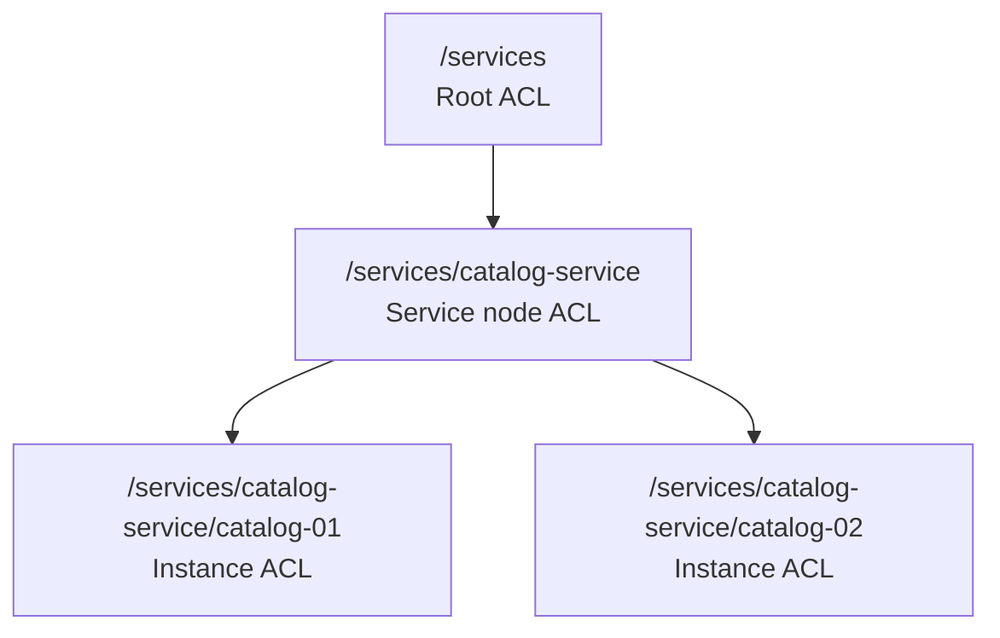

# ZooKeeper ACLs, Authentication, and Protecting Registration Paths

Spring Cloud Zookeeper uses Apache Curator to register and discover services. Instance information is stored as znodes in the ZooKeeper data tree. If every client can read, create, modify, or delete these znodes, an application can spoof services, delete another application's registration, or read internal infrastructure details.

ZooKeeper provides connection authentication and per-znode Access Control Lists (ACLs). Authentication determines the client's identity; ACLs determine which operations that identity is allowed to perform on a specific path. To protect the service registry, you must configure both layers, scope permissions by path, and audit the ACLs of existing znodes.

This lesson belongs to the `Security` chapter in the `SPRING_CLOUD_SERVICE_DISCOVERY` module. The module helps learners understand how to find instances by service name via `DiscoveryClient`, `ServiceRegistry`, Eureka, or Consul, along with registration lifecycles, health checks, load balancing, security, and handling registry inconsistencies. This section focuses on ACLs, authentication schemes, permissions on registration paths, how Spring Cloud Zookeeper integrates Curator, and procedures for verifying access permissions.

## 1. Where Does Service Discovery Data Live in ZooKeeper?

ZooKeeper organizes data in a znode tree. Each znode can hold data and child znodes. Curator Service Discovery stores service instances under a base path, followed by the service name and individual instance IDs.

Spring Cloud Zookeeper provides the `spring.cloud.zookeeper.discovery.root` property to select the service registry root directory. The default value is typically `/services`.

Illustrative tree structure:

```text
/services
  /catalog-service
    /catalog-01       -> instance A payload
    /catalog-02       -> instance B payload
  /order-service
    /order-01         -> instance C payload
```

In this example:

- `/services` is the root of the service registry.
- `/services/catalog-service` is the znode grouping instances of `catalog-service`.
- `/services/catalog-service/catalog-01` stores the data for one instance.
- Consumers read the list of children under the service path and then read each instance's payload.

The exact path depends on `spring.cloud.zookeeper.discovery.root`, the service name, the instance ID, and integration settings. Curator also supports custom base paths or path constructors. Therefore, inspect actual paths in ZooKeeper before designing ACLs; never assume every application uses `/services`.

### 1.1. Configuring Separate Roots per Environment

Registries can be separated per environment via the root path:

```yaml
spring:
  application:
    name: catalog-service
  cloud:
    zookeeper:
      connect-string: zk-1.internal:2181,zk-2.internal:2181,zk-3.internal:2181
      discovery:
        enabled: true
        register: true
        root: /services/production
```

Instances are then stored under `/services/production/catalog-service/...`. Staging environments can use `/services/staging`. The root path helps organize and partition data; on its own, it is not an authentication or authorization mechanism.

If the same ZooKeeper ensemble is used for both service discovery and distributed configuration, keep the roots for those two functions separate. Spring Cloud Zookeeper discovery typically uses `/services`; Zookeeper Config typically uses `/config`. Set distinct ACLs on each data tree so applications only read or write within their authorized area.

## 2. Authentication and ACLs Are Two Distinct Layers

Two security questions must be answered independently:

1. **Authentication:** who is the connecting client? The client proves its identity via digest, SASL/Kerberos, X.509 certificates, or another configured mechanism.
2. **Authorization:** what can that identity do on a znode? ACLs assign `READ`, `WRITE`, `CREATE`, `DELETE`, or `ADMIN` permissions to an identity.

For example, `catalog-service` can authenticate with an account `catalog-writer`. ACLs permit that account to create instances under `/services/catalog-service`, update its instance payloads, and deregister on shutdown. A consumer only gets read permissions on service discovery znodes; it cannot create or delete registrations.

Successful authentication does not grant full permissions on ZooKeeper. Conversely, an ACL referencing an identity the client has not authenticated with will not grant the client access either.

## 3. ACLs Operate Per Individual Znode

ZooKeeper ACLs are attached to a specific znode. The ACL on `/services` does not automatically apply to `/services/catalog-service`, and the ACL on the service node does not automatically apply to instance nodes beneath it.



This means placing a restrictive ACL on the root does not protect child nodes that already exist with permissive ACLs. When creating new znodes, the application or Curator must attach the appropriate ACL to each znode itself. When changing policies, ACLs must be updated on every existing node; you cannot simply change the root ACL and expect children to inherit it.

## 4. Five Fundamental ACL Permissions

ZooKeeper supports five primary permissions:

| Permission | Meaning | Example in Service Registry |
|---|---|---|
| `CREATE` | Create child znodes under the target znode. | Create a service node under `/services` or an instance node under `/services/catalog-service`. |
| `READ` | Read the znode's data and list its child znodes. | Consumers list instances and read payloads. |
| `WRITE` | Modify the data of the znode itself. | Update an instance's payload or metadata. |
| `DELETE` | Delete child znodes of the target znode. | Remove an instance node using `DELETE` permission on the service parent. |
| `ADMIN` | Modify the ACL of the znode. | Administrator updates permissions on root, service, or instance nodes. |

`CREATE` and `DELETE` are separate from `WRITE`. A client may be allowed to add children without being allowed to delete children, or allowed to edit a znode's payload without creating new nodes beneath it.

Important note: `DELETE` permission is checked on the **parent** of the znode being deleted. To delete `/services/catalog-service/catalog-01`, the client needs `DELETE` permission on `/services/catalog-service`. Similarly, to create an instance node under a service node, the client needs `CREATE` permission on the service node.

ZooKeeper has no concept of an owner akin to Unix file ownership. `ADMIN` is a permission to manage ACLs, not a default ownership automatically granted to the creator.

## 5. Common Authentication Schemes

ZooKeeper supports several schemes to associate an identity with a connection:

| Scheme | How Identity Is Represented | Notes |
|---|---|---|
| `world` | Identity `anyone`, representing all clients. | `world:anyone` requires no authentication; use only when data is genuinely public. |
| `auth` | All identities authenticated on the current connection. | Useful to restrict permissions to already-logged-in identities; does not replace enabling authentication on the server. |
| `digest` | Username and password. | Easy to test and integrate, but digest credentials are sent over the network; requires TLS over untrusted networks. |
| `sasl` | Identity authenticated via SASL, typically with Kerberos. | Suited to enterprise environments with Kerberos and principal management. |
| `x509` | X.500 principal from a client certificate. | Can use mutual TLS to authenticate clients by certificate. |
| `ip` | Source IP address or subnet. | An IP-based condition rather than cryptographic authentication; IP addresses can be spoofed on unprotected networks. |

An ACL entry takes the form `scheme:id` paired with a permission set. For example, `digest:catalog-reader:...` is a digest identity stored in an ACL; the digest ID portion must be generated in the format ZooKeeper expects, not a raw password string.

### 5.1. `world:anyone` and OPEN_ACL_UNSAFE

Curator includes `ZooDefs.Ids.OPEN_ACL_UNSAFE`, which grants `world:anyone` all permissions on a znode. The name `UNSAFE` is an explicit warning: never use this ACL for a production service registry.

A node created with an open ACL can be read, modified, given children, or have children deleted by unauthenticated clients. If an instance node payload contains host, port, and metadata, internal information can be exposed; if an attacker has write access, they can publish rogue addresses causing consumers to send requests to the wrong destination.

Always inspect the actual ACLs on nodes created by Curator. Do not infer that configuring digest authentication causes all znodes to automatically receive restrictive ACLs.

### 5.2. The `auth` Scheme

`auth` is a convenience scheme that applies permissions to all identities authenticated on the connection creating the ACL. It is commonly used to create nodes accessible only to authenticated identities.

If the connection has no authenticated identity yet, creating an ACL using `auth` will fail. Additionally, `auth` does not enable or enforce authentication across the ensemble; the server must configure appropriate enforce-auth policies if you want to reject unauthenticated clients at connection time.

### 5.3. Digest Does Not Replace TLS

Digest authentication still transmits username/password material in authentication data according to ZooKeeper's protocol. Therefore, never use digest over an untrusted network without encrypting client-server transport. Digest ACLs are also not a place to store raw passwords.

When protecting identities and credentials over the network, prefer SASL/Kerberos or mutual TLS with X.509 if infrastructure supports it. If digest is still used, combine it with TLS, a secret manager, per-application credentials, and a password rotation policy.

## 6. Designing Permissions for Service Registration Paths

With the `/services/<service-name>/<instance-id>` structure, permissions can be divided across three tiers:

| Path | Registering Provider | Discovering Consumer | Registry Administrator |
|---|---|---|---|
| `/services` | `READ`, `CREATE` to create service nodes when permitted. | `READ` to list services. | Full administrative rights. |
| `/services/catalog-service` | `READ`, `CREATE`, `DELETE` to manage child instances. | `READ` to list instances. | Full administrative rights. |
| `/services/catalog-service/catalog-01` | `READ`, `WRITE` if payload updates are needed. | `READ` to read addresses and metadata. | Full administrative rights. |

This is a reference matrix. If each service has a dedicated writer account, ACLs can restrict `catalog-service`'s writer solely to `/services/catalog-service`; that writer has no permission to create or alter registrations for `order-service`.

### 6.1. Separating Reader, Writer, and Administrator

A common design uses three identity groups:

- **Discovery reader:** has only `READ` on the root, service nodes, and instance nodes within its discovery scope.
- **Service writer:** has `CREATE` on the parent where children must be created, `WRITE` on its own service's instance nodes, and `DELETE` on the service parent to remove instances. Necessary permissions must be scoped by path.
- **Registry administrator:** has `ADMIN` or broader administrative privileges to create namespaces, fix ACLs, and handle incidents. These credentials are never used in everyday application processes.

If all microservices share a single writer account with permissions across all of `/services`, one compromised service can spoof or delete another service's registrations. Separating identities per service or service group limits blast radius.

### 6.2. Partitioning by Environment

Separate roots can be configured:

```yaml
spring:
  cloud:
    zookeeper:
      discovery:
        root: /services/production
```

Staging can use `/services/staging`. Admins pre-create the required roots and set matching ACLs before applications register. Separating paths helps organize data and apply policies; ACLs must still be attached per znode because there is no recursive inheritance.

Another option is a ZooKeeper chroot in the connect string or a Curator namespace. Chroot/namespace restricts how a client views the path tree, but it does not replace ACLs. Clients still need valid identities and proper ACLs inside their namespace region.

## 7. Properly Protecting Parent Paths and Instance Paths

For a provider to create a new instance, permissions must be placed in the exact right locations:

1. Provider needs `CREATE` on `/services` if allowed to create new service nodes.
2. Provider needs `CREATE` on `/services/catalog-service` to create instance nodes.
3. Consumer needs `READ` on `/services` to list services and `READ` on the service node to list instances.
4. Consumer needs `READ` on the instance node to read its payload.
5. Provider needs `WRITE` on the instance node if updating data.
6. Provider needs `DELETE` on the service parent to explicitly deregister an instance node.
7. Admin needs `ADMIN` on each node whose ACL they need to modify.

If you grant `CREATE` on `/services` without granting `CREATE` on `/services/catalog-service`, the provider can create the service node but cannot create instances underneath it. If a consumer has `READ` on an instance without `READ` on the service parent, it can read a known path directly but cannot list child instances.

For ephemeral nodes, ZooKeeper manages lifecycle by session. When a session expires, ephemeral nodes are removed by server mechanics. Nevertheless, explicit application registration and deregistration still need proper permissions; do not rely on session expiry as the sole cleanup mechanism.

## 8. Configuring Authentication in Spring Cloud Zookeeper

Spring Cloud Zookeeper uses Curator underneath. Common discovery dependency:

```xml
<dependency>
    <groupId>org.springframework.cloud</groupId>
    <artifactId>spring-cloud-starter-zookeeper-discovery</artifactId>
</dependency>
```

Declare the ZooKeeper addresses and root path:

```yaml
spring:
  application:
    name: catalog-service
  cloud:
    zookeeper:
      connect-string: zk-1.internal:2181,zk-2.internal:2181,zk-3.internal:2181
      discovery:
        enabled: true
        register: true
        root: /services/production
```

`connect-string` specifies the ensemble; `discovery.root` sets the registration tree. These properties do not configure authentication or ACLs on their own. You must customize the Curator client to send authentication credentials and apply appropriate ACLs when creating znodes.

### 8.1. CuratorFrameworkCustomizer in Modern Spring Cloud Zookeeper

Modern versions of Spring Cloud Zookeeper provide `CuratorFrameworkCustomizer`. Auto-configuration applies customizers to `CuratorFrameworkFactory.Builder` before creating the Curator client. Digest authorization can be added as follows:

```java
import java.nio.charset.StandardCharsets;

import org.springframework.cloud.zookeeper.CuratorFrameworkCustomizer;
import org.springframework.context.annotation.Bean;
import org.springframework.context.annotation.Configuration;

@Configuration
public class ZookeeperAuthenticationConfiguration {

    @Bean
    CuratorFrameworkCustomizer digestAuthentication(
            ZookeeperCredentials credentials) {
        byte[] authData = (credentials.username() + ":" + credentials.password())
                .getBytes(StandardCharsets.UTF_8);

        return builder -> builder.authorization("digest", authData);
    }
}
```

`ZookeeperCredentials` in this example is an application-supplied configuration object; username and password must be retrieved from a secret manager or secret mount, never hardcoded in source code. The Curator builder receives `authorization("digest", ...)` before the client is constructed.

Do not define a replacement `CuratorFramework` bean solely to add credentials if auto-configuration already supplies the client. In modern versions, declaring a `CuratorFrameworkCustomizer` is the proper extension mechanism; replacing the bean can cause `ZookeeperAutoConfiguration` to back off and lose Spring Cloud's default configuration.

### 8.2. Differences Across Versions

Some older Spring Cloud Zookeeper docs describe calling `addAuthInfo` directly on `CuratorFramework` inside `@BootstrapConfiguration`. However, `CuratorFramework` is an interface and has no `addAuthInfo` method. Newer branch documentation has moved to `CuratorFrameworkCustomizer` and `CuratorFrameworkFactory.Builder.authorization(...)`.

If the project uses legacy bootstrap (`spring-cloud-starter-bootstrap` or `spring.cloud.bootstrap.enabled=true`), the customizer must be registered early enough in the bootstrap context according to that release train's guidance. If using Spring Boot Config Data, do not add a bootstrap file merely because an old example says to. Check the documentation for the exact Spring Cloud Zookeeper version in use.

## 9. Configuring an ACLProvider for Curator

Authentication establishes who the client is; `ACLProvider` determines which ACL Curator attaches to znodes when creating them. Curator provides the `ACLProvider` interface with two methods:

- `getDefaultAcl()`: default ACL when no path-specific rule applies.
- `getAclForPath(path)`: ACL applied to the znode at the given path.

Curator's `DefaultACLProvider` typically returns `ZooDefs.Ids.OPEN_ACL_UNSAFE` as the default ACL. Therefore, you must configure a restrictive `ACLProvider` instead of relying on the open default ACL.

The example below illustrates three-tier authorization across root, service node, and instance node. Digest identities are passed to the constructor as ACL IDs generated by the organization's credential provisioning process; never pass raw passwords as ACL IDs.

```java
import java.util.List;

import org.apache.curator.framework.api.ACLProvider;
import org.apache.zookeeper.ZooDefs;
import org.apache.zookeeper.data.ACL;
import org.apache.zookeeper.data.Id;

public final class ServiceRegistryAclProvider implements ACLProvider {

    private final String root;
    private final List<ACL> rootAcl;
    private final List<ACL> serviceAcl;
    private final List<ACL> instanceAcl;

    public ServiceRegistryAclProvider(
            String root,
            String readerDigestId,
            String writerDigestId,
            String adminDigestId) {
        this.root = root;

        Id reader = new Id("digest", readerDigestId);
        Id writer = new Id("digest", writerDigestId);
        Id admin = new Id("digest", adminDigestId);

        this.rootAcl = List.of(
                new ACL(ZooDefs.Perms.READ, reader),
                new ACL(ZooDefs.Perms.READ | ZooDefs.Perms.CREATE, writer),
                new ACL(ZooDefs.Perms.ALL, admin));

        this.serviceAcl = List.of(
                new ACL(ZooDefs.Perms.READ, reader),
                new ACL(ZooDefs.Perms.READ | ZooDefs.Perms.CREATE
                        | ZooDefs.Perms.DELETE, writer),
                new ACL(ZooDefs.Perms.ALL, admin));

        this.instanceAcl = List.of(
                new ACL(ZooDefs.Perms.READ, reader),
                new ACL(ZooDefs.Perms.READ | ZooDefs.Perms.WRITE, writer),
                new ACL(ZooDefs.Perms.ALL, admin));
    }

    @Override
    public List<ACL> getDefaultAcl() {
        return instanceAcl;
    }

    @Override
    public List<ACL> getAclForPath(String path) {
        if (root.equals(path)) {
            return rootAcl;
        }

        String prefix = root + "/";
        if (path != null && path.startsWith(prefix)) {
            String relativePath = path.substring(prefix.length());
            if (!relativePath.isEmpty() && !relativePath.contains("/")) {
                return serviceAcl;
            }
        }

        return instanceAcl;
    }
}
```

This is a pattern to explain the principle. In real applications, you must:

- Normalize `root` and verify the exact paths Curator passes into `getAclForPath`.
- Handle parent paths created automatically, especially when root has multiple levels such as `/services/production`.
- The code sample assumes the root and its ancestors were pre-created by an administrator with appropriate ACLs. If Curator creates `/services` or `/services/production` itself, `ACLProvider` must return distinct ACLs for each ancestor so the client has `CREATE` on the corresponding parent.
- Prevent unfamiliar paths from falling back to an open ACL; `getDefaultAcl()` must be a restrictive ACL.
- Scope writers per service name if each service has its own identity.
- Use ACL IDs formatted correctly for the authentication scheme; a digest ACL ID is not a raw password.
- Test ACLs on root, service parent, and instance nodes using different identities.

### 9.1. Attaching ACLProvider in CuratorFrameworkCustomizer

Authorization and `ACLProvider` can be combined in the same customizer:

```java
import java.nio.charset.StandardCharsets;

import org.apache.curator.framework.api.ACLProvider;
import org.springframework.cloud.zookeeper.CuratorFrameworkCustomizer;
import org.springframework.context.annotation.Bean;
import org.springframework.context.annotation.Configuration;

@Configuration
public class ZookeeperSecurityConfiguration {

    @Bean
    CuratorFrameworkCustomizer registrySecurity(
            ZookeeperCredentials credentials,
            ACLProvider serviceRegistryAclProvider) {
        byte[] authData = (credentials.username() + ":" + credentials.password())
                .getBytes(StandardCharsets.UTF_8);

        return builder -> builder
                .authorization("digest", authData)
                .aclProvider(serviceRegistryAclProvider);
    }
}
```

In this configuration, `authorization` authenticates the Curator client; `aclProvider` determines the ACL attached when creating znodes. The two capabilities are related but do not replace each other.

If the same Curator client is also used for Zookeeper Config or another znode tree, `ACLProvider` must explicitly handle paths for those features. Do not apply an overly narrow ACL across the entire ensemble without checking which paths the application needs to read or write.

## 10. Distinguishing ACLProvider from Modifying Existing Node ACLs

`ACLProvider` is invoked when Curator performs a znode creation operation and needs to determine its ACL. Adding an `ACLProvider` today does not automatically modify the ACLs of nodes created yesterday.

If the registry already contains znodes created with `OPEN_ACL_UNSAFE`, a migration procedure is needed:

1. Use an administrative identity holding `ADMIN` permission on the nodes to update.
2. Enumerate all paths under the registry root.
3. Read the current ACL of each znode.
4. Apply the new ACLs on root, service nodes, and instance nodes according to policy.
5. Re-verify with reader, writer, and admin identities.
6. After confirmation, revoke or rotate old credentials.

Do not fix only the root ACL because ACLs do not inherit. Inspect the entire tree, including existing service nodes and instance nodes.

Calling `setACL` requires `ADMIN` permission on that znode. Keep admin credentials dedicated to migration tasks; do not grant this permission to every service writer.

## 11. Configuring Mandatory Authentication on ZooKeeper Server

Clients sending credentials does not mean the server requires all clients to authenticate. To reject unauthenticated clients, enable an enforce-auth policy on the server.

With ZooKeeper 3.7 or later, you can configure:

```properties
# Java system properties passed to the ZooKeeper server JVM
-Dzookeeper.enforce.auth.enabled=true
-Dzookeeper.enforce.auth.schemes=sasl
```

These are Java system properties passed to the JVM when starting ZooKeeper, not Spring Boot YAML keys. The example above requires clients to authenticate using SASL. If using another scheme, the server configuration must list the corresponding scheme and clients must be configured properly. `zookeeper.enforce.auth.enabled` is available starting in ZooKeeper 3.7; older versions have a separate option `zookeeper.sessionRequireClientSASLAuth` for SASL enforcement.

Before enabling enforce-auth in production, audit every connected client: service discovery, config clients, admin tools, exporters, backups, and operational jobs. Clients lacking valid credentials will fail to establish sessions.

## 12. TLS for Client-Server and Peer Connections

ACLs control permissions at the data layer; TLS protects data in transit. These two layers address different problems.

ZooKeeper can configure TLS for client-server connections and for quorum traffic between servers. Quorum TLS does not automatically enable TLS for client connections; each channel must be configured separately.

Principles:

- Use a secure client port and appropriate keystore/truststore to encrypt application connections to ZooKeeper.
- Consider mutual TLS so the server authenticates clients via X.509 certificates.
- Enable quorum TLS if protecting data between peers in the ensemble is required.
- Enable hostname verification and manage CA/certificate rotation properly.
- Never treat using a TLS port as a substitute for ACLs; connected clients still need znode permissions.
- When using digest authentication, never transmit credentials over plaintext connections.

TLS properties and enabling the secure port depend on the ZooKeeper version and `serverCnxnFactory`. Follow the Admin Guide for your exact server version and inspect startup logs to confirm TLS is actually active.

## 13. Protecting Registration Paths and Namespaces

One registry may host multiple services, environments, and application groups. Design paths so that one application's permissions do not spill over to other services.

Example:

```text
/services
  /production
    /catalog-service
      /catalog-01
      /catalog-02
    /order-service
      /order-01
  /staging
    /catalog-service
      /catalog-stg-01
```

Policies can be partitioned as follows:

- `catalog-writer` only has permissions to create, update, and deregister instances under `/services/production/catalog-service`.
- `order-writer` only has permissions to manage `/services/production/order-service`.
- `production-discovery-reader` has read permissions for production services the consumer is allowed to call.
- `staging-reader` can read only the staging branch.
- `registry-admin` manages ACLs and namespaces.

Do not grant `CREATE` or `DELETE` across all of `/services` to every application when each only needs to register one specific service. Also do not grant `ADMIN` to consumers merely so they can read instance lists.

### 13.1. Chroot and Namespace Do Not Replace ACLs

A ZooKeeper connect string can use a chroot path so a client sees a subtree as its root; Curator also supports namespaces to prefix paths. These mechanisms help isolate logical paths and reduce the risk of applications accidentally accessing another branch.

However, chroot/namespace are neither authentication nor ACLs. Clients still need valid credentials and proper ACLs on the underlying znodes. If multiple applications share a broad-permission identity, chroot cannot replace per-service authorization.

## 14. Verifying ACLs with ZooKeeper CLI

You can use the ZooKeeper CLI to verify paths and ACLs. Example connecting to the ensemble:

```bash
zkCli.sh -server zk-1.internal:2181
```

After authenticating under the configured scheme, inspect the registration tree:

```text
ls /services/production
ls /services/production/catalog-service
get /services/production/catalog-service/catalog-01
getAcl /services/production
getAcl /services/production/catalog-service
getAcl /services/production/catalog-service/catalog-01
```

`getAcl` requires `READ` or `ADMIN` permission on the znode. Without `ADMIN`, digest hashes in ACLs may be masked. Never include real credentials in commands saved in shell history or shared terminal logs.

When testing with individual identities:

| Identity | Expected Test Outcome |
|---|---|
| Reader | Lists services and reads authorized payloads; cannot create, modify, or delete nodes. |
| Service writer | Creates instances under the assigned service path; updates allowed payloads; cannot edit ACLs or register other services. |
| Administrator | Reads and manages ACLs according to operational procedures. |
| Anonymous client | Rejected if the server enforces authentication and no credentials are supplied. |

Test both allowed and denied cases. A test confirming only that a reader can read does not prove the reader cannot write or delete nodes.

## 15. Diagnosing Authentication and ACL Errors

| Symptom | Possible Cause | Where to Check |
|---|---|---|
| Session not created, authentication failed | Wrong credentials, SASL principal mismatch, or server requires another scheme. | Check client auth config, JAAS, certificates, and `enforce.auth.schemes`. |
| `NOAUTH` when creating service node | Identity connected but lacks `CREATE` on parent path. | Check ACL of `/services` or configured root. |
| `NOAUTH` when creating instance | Missing `CREATE` on service parent. | Check ACL of `/services/<service-name>`. |
| Consumer cannot list instances | Missing `READ` on root or service parent. | Check read permissions and actual discovery path. |
| Consumer can list but cannot read payload | Missing `READ` on instance node. | Check ACL on individual instance znodes. |
| Deregistration fails | Missing `DELETE` on parent of instance node. | Check service parent ACL and Curator logs. |
| Payload update fails | Missing `WRITE` on instance node. | Check instance node ACL. |
| `setACL` rejected | Identity lacks `ADMIN` on znode. | Use admin credentials per runbook. |
| Some old instances remain readable | Old nodes have different ACLs than new nodes; ACLs do not inherit. | Traverse the entire subtree and inspect every node's ACL. |
| Connection works but credentials could leak | Digest used over plaintext connection. | Enable TLS or switch to SASL/mTLS. |
| New service created but consumer does not see it | Inconsistent root path, namespace, or READ permissions. | Compare `discovery.root`, actual paths, and ACLs at each tier. |

Never resolve every `NOAUTH` error by granting `ALL` to `world:anyone`. First identify the rejected operation, the znode being checked, and the relevant parent path; then grant the exact minimum permission needed.

## 16. Secure Deployment Procedure

A controlled deployment procedure can follow this sequence:

1. **Finalize namespaces:** choose root paths by environment and service; decide whether to use chroot/Curator namespaces.
2. **Create identities:** issue separate credentials for readers, writers, and administrators; prefer SASL/Kerberos or mTLS if supported by infrastructure.
3. **Enable transport security:** configure TLS for client-server and quorum communication as required.
4. **Enable enforced authentication:** configure the server to require accepted schemes; verify all clients before enforcement.
5. **Create root znodes:** admins create roots and set ACLs for root/service parents according to policy.
6. **Configure Curator:** use `CuratorFrameworkCustomizer` to supply authorization and `ACLProvider` compatible with your release train.
7. **Register service:** run a test provider and verify service paths and instance paths are created with the right ACLs.
8. **Verify consumer:** use the reader identity to read services and instances; confirm writes/deletes fail.
9. **Verify writer:** confirm the writer can only create/update/deregister instances within its assigned service path.
10. **Migrate old nodes:** traverse and fix ACLs on every existing node; do not assume ACLProvider updates old data.
11. **Test session lifecycle:** verify deregistration, session expiration, and re-registration after reconnect.
12. **Monitor:** track auth errors, `NOAUTH`, sessions, ACL migrations, and administrative operations.

## 17. Common Misconceptions

**"Once digest is configured, all znodes are private."** False. Authentication only binds an identity to the connection; each znode's ACL still governs access. Curator's default ACL may be `OPEN_ACL_UNSAFE` unless restricted explicitly.

**"An ACL on `/services` automatically protects all child services."** False. ACLs are non-recursive; separate ACLs must be assigned to service nodes and instance nodes.

**"WRITE permits deleting children."** False. `DELETE` is a separate permission checked on the parent of the node being deleted.

**"Granting CREATE at the root is enough for a provider to register instances."** Insufficient. The provider also needs `CREATE` on the service parent to create instance nodes.

**"CuratorFrameworkCustomizer replaces ACLProvider."** False. The customizer is simply a builder extension point; `authorization` configures authentication, while `aclProvider` determines ACLs when creating znodes.

**"Changing ACLProvider updates old znodes automatically."** False. A migration is required, calling `setACL` with an identity holding `ADMIN` on each node.

**"Chroot or root path is an authorization mechanism."** False. They organize or scope logical paths; ACLs and authentication must still be configured.

**"Exposing the ZooKeeper port on an internal network is safe enough."** False. Appropriate firewalls, authentication, ACLs, and TLS are needed; ZooKeeper should never be exposed directly to the Internet.

## 18. ZooKeeper Registration Path Protection Checklist

| Area | Verification Question |
|---|---|
| Authentication | Does each client have a distinct identity and does the server enforce that scheme? |
| Transport | Do client-server and quorum traffic use TLS as required? |
| ACL defaults | Is `OPEN_ACL_UNSAFE` avoided for registry nodes? |
| Root path | Is `spring.cloud.zookeeper.discovery.root` aligned with the ACL policy? |
| Parent permissions | Does the writer have `CREATE` on parents and `DELETE` on service parents where needed? |
| Instance permissions | Does the reader have `READ`, the writer necessary `WRITE`, and admin `ADMIN`? |
| Non-recursive ACLs | Do root, service, and instance nodes each have their own ACLs? |
| Identity scope | Does each service have a writer identity scoped to the right path? |
| Curator | Are authorization and ACLProvider applied to the actual Curator client Spring Cloud uses? |
| Existing nodes | Have ACLs on older znodes been migrated? |
| Secret handling | Are credentials stored in a secret manager and rotated? |
| Runtime | Have reader/writer/admin and anonymous access been tested for both allow and deny? |
| Operations | Is there a recovery runbook for lost credentials or ACL changes? |

## Conclusion

ZooKeeper protects the service registry through two layers: authentication establishes the client's identity, while ACLs grant permissions on each individual znode. With the common `/services/<service-name>/<instance-id>` registration structure, a provider needs `CREATE` on parents to create nodes, `WRITE` on instances if updating payloads, and `DELETE` on the service parent to remove instances; consumers need `READ` on the root, service nodes, and instance nodes. ACLs do not inherit from parent to child, so each tier of the path must be protected explicitly.

Spring Cloud Zookeeper uses Curator and can customize the Curator client via `CuratorFrameworkCustomizer` in newer versions. Distinguish `authorization` from `ACLProvider`, use least-privilege identities, avoid open ACLs, enable TLS and enforce authentication appropriately, and audit existing nodes. When registration paths are properly protected, applications can discover instances without being granted permission to modify or delete another service's registry entries.

## References

- [Apache ZooKeeper Security](https://zookeeper.apache.org/security/): security model, TLS, authentication, ACLs, and key limitations.
- [ZooKeeper Programmer's Guide – ACL](https://zookeeper.apache.org/doc/current/zookeeperProgrammers.html): `CREATE`, `READ`, `WRITE`, `DELETE`, `ADMIN` permissions, authentication schemes, and non-recursive ACLs.
- [ZooKeeper Administrator's Guide](https://zookeeper.apache.org/doc/current/zookeeperAdmin.html): enforcing authentication, client-server TLS, and quorum TLS.
- [Spring Cloud Zookeeper – Service Discovery](https://docs.spring.io/spring-cloud-zookeeper/reference/discovery.html): Curator integration, registration, and discovery.
- [Spring Cloud Zookeeper – ACL configuration](https://docs.spring.io/spring-cloud-zookeeper/reference/5.1-SNAPSHOT/config.html): `CuratorFrameworkCustomizer` and configuring authorization in newer branches; verify your release train before applying.
- [Apache Curator – Service Discovery](https://curator.apache.org/docs/service-discovery/): base path/service/instance structure and registration/deregistration APIs.
- [Apache Curator – ACLProvider API](https://curator.apache.org/apidocs/org/apache/curator/framework/api/ACLProvider.html): default ACL and per-path ACL.
